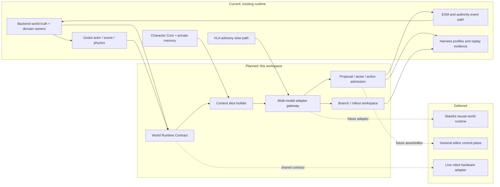
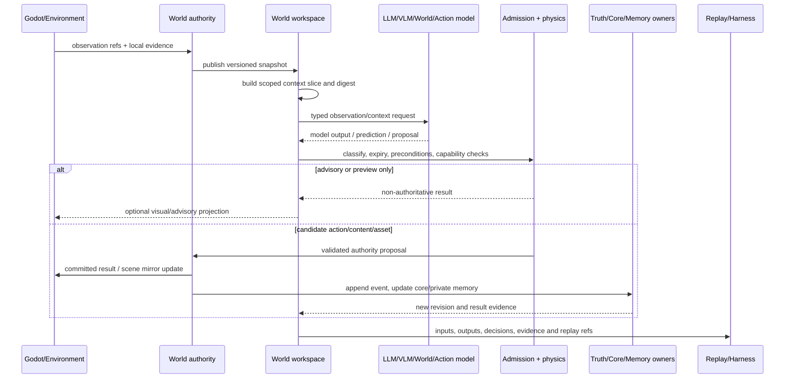
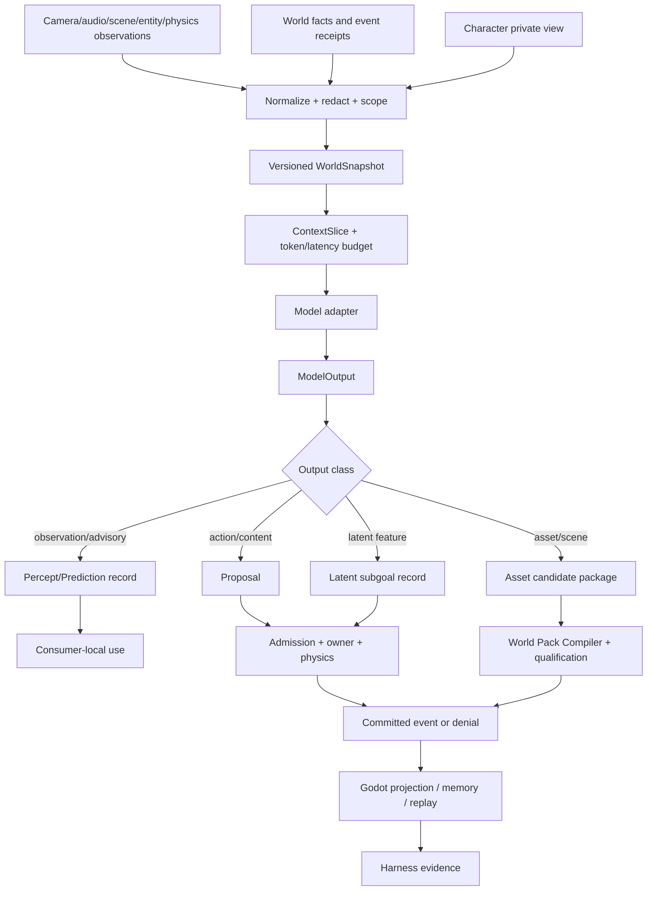

# 多模型世界工作区总规格

状态：`analysis/planned/non-authorizing`

来源：`docs/10月分析/` 角色、世界真相、L1、表现和编辑器设计；`docs/上下文不够用/对话4.md`；`docs/上下文不够用/LAWAM.md`；P7C world-model proposal boundary；现有 `world_runtime`、角色智能体、ESM、Godot 和 Harness 文档。

## 1. 目标与纠偏

目标不是把 Godot 变成模型输出的视频播放器，而是让现有 3D 世界成为多模型共同工作的环境。模型能读取经过授权的状态和观察，能生成预测、计划、内容、动作和资产候选，能在分支世界里预演，能接收真实执行结果；运行时则保持世界真相、角色私有记忆、物理结果、权限和回放的单一 owner。

纠偏如下：

- 视觉世界模型输出的是视觉连续性或观察结果，不天然拥有实体 ID、碰撞、库存、生命状态或历史事实。
- LaWAM 式隐空间模型输出的是与动作相关的未来隐特征/子目标，不是可直接执行的骨骼、刚体或 Godot 节点变换。
- LLM 输出的是解释、目标、计划或 typed decision，不是 authority event。
- 生成 GLB、材质、动画、场景和碰撞只能进入候选资产包，经过编译和准入后才能成为可交互世界。
- 所有模型共享的是 `World Runtime Contract`，不是共享内部代码或共享完整上下文。

## 2. 范围与非目标

### 范围

1. 统一 observation、snapshot、proposal、preview、commit、result、memory 和 replay 合同。
2. 连接 LLM、VLM/VLA、视觉 WAM、LaWAM 类 latent model、world action model 与 Godot/仿真环境。
3. 通过分层时空数据和 context slice 解决模型窗口上限。
4. 让生成内容、资产和场景修改可验证、可撤销、可回放。
5. 为未来机器人 sandbox 保留相同的观察、动作、预演和结果接口。

### 非目标

- 这份规格不授权实现新的数据库、事件总线、时钟、物理引擎或第二套角色记忆库。
- 不承诺视觉模型在任意画面中自动恢复稳定 3D 场景图或 GLB。
- 不把模型训练、checkpoint 选择、模型微调质量当作 runtime contract 已完成。
- 不把自走棋单局回合、羁绊和奖励适配并入开放世界合同。

## 3. 统一分层

```text
事实层：World Truth / domain owner / authority event / replay
连续性层：Character Core / private memory / entity identity / temporal cursor
工作区层：World Runtime Contract / snapshot / observation / context slice
模型层：LLM / VLM-VLA / visual WAM / latent WAM / action model
执行层：proposal admission / physics / action controller / asset compiler
表现层：Godot scene / actor / camera / audio / UI / neural visual projection
证据层：Harness / trace / calibration / replay / drift report
```

## 4. 架构图



## 5. 主流程时序图



## 6. 数据流图



## 7. Owner 边界

| 数据或行为 | Owner | 模型可做 | 模型不可做 |
|---|---|---|---|
| 世界事实、位置、库存、生命状态 | 既有 domain owner / authority | 提供观察或预测 | 直接 append 或覆盖 |
| 角色私有记忆 | Character Core/private memory owner | 提交 memory candidate | 读取未授权私有记忆或直接写入 |
| 当前角色意图 | 角色智能体/Laya/L4 | 在候选集合中选择 typed intent | 直接宣布动作已成功 |
| 近场运动和碰撞 | Godot/physics/actor | 建议目标或动作块 | 直接写 transform/pose/hit |
| 场景与资产 | World Pack Compiler/asset qualification | 生成候选和 metadata | 生成后自动可交互 |
| 表现层补全 | Godot projection 或受控 neural visual zone | 提供 visual frame/overlay proposal | 修改世界真相 |
| 证据与回放 | Harness/replay | 提供 trace metadata | 把证据当成事实 |

## 8. 状态标签

### `[current]`

- `backend/app/world_runtime/vla_provider.py` 的 VLA request/result 和 advisory boundary。
- `vla_slow_path.py`、`vla_cache.py`、`vla_percept_bridge.py` 的慢路径、缓存和参考性回传。
- `l1_perception_frame.py`、`l1_runtime_perception_bridge.py`、`l1_space_model.py` 的感知/空间输入。
- `simulation_clock.py`、`population_driver.py` 的现有时钟和 cadence 边界。
- `model_provider_readiness.py` 与现有 Harness profile 的 readiness/证据分离。
- P7C 的 scope-filtered snapshot、proposal、expiry、calibration、zero-write 设计。

### `[planned]`

- 正式 `World Runtime Contract`、context slice、multi-model gateway 和 rollout contract。
- 统一 proposal admission、asset qualification、entity binding 和 world-pack 版本治理。
- 视觉世界模型和 LaWAM 类模型的受控接入，以及从模型输出到结构化候选的映射。
- 近场 explicit 3D、远场 neural visual、未来 stateful neural zone 的切换协议。

### `[deferred]`

- 视觉世界模型直接生成可恢复的完整 3D world state。
- 具备实体 ID、空间、事件、快照和恢复的神经世界运行时。
- 实时机器人硬件、安全控制器和通用编辑器 control-plane。

### `[forbidden]`

- 任何模型、Godot 或图谱直接成为世界真相 owner。
- 用视频帧、latent vector 或生成 GLB 代替稳定实体、碰撞、事件和回放。
- 模型基于旧 revision 的结果绕过 admission 强行提交。

## 9. 验收目标

1. 同一 `world_revision` 可以重建模型输入、输出分类和最终提交结果。
2. 任何模型输出都可证明是否只停留在 advisory/preview/proposal，或经过了 owner commit。
3. 近场玩家交互不会因为视觉模型延迟而改变物理真相；模型迟到时有明确降级和重规划。
4. 角色看到的内容受 L1/private view 约束，不因工作区而泄露全局状态。
5. 生成资产能追溯到模型、输入快照、资源版本、资格检查和回滚点。
6. 同一合同可以接入 Godot headless、Godot runtime、分支 rollout 和未来机器人仿真环境。
