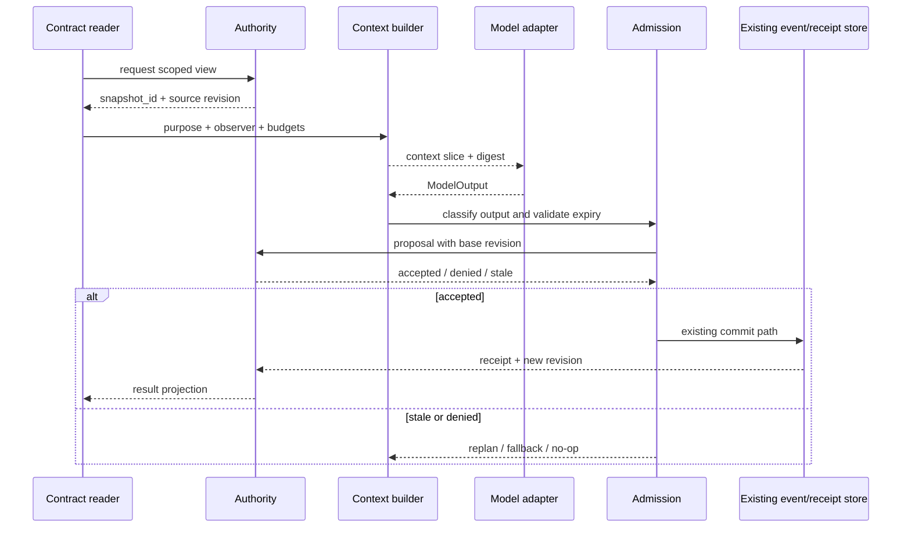
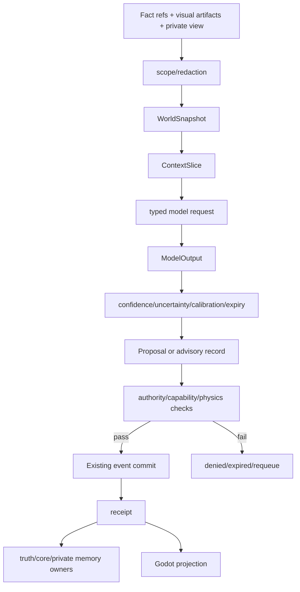

# World Runtime Contract 统一工作区契约

状态：`analysis/planned/non-authorizing`

## 1. 契约目的

`World Runtime Contract`（WRC）是模型与 3D 世界交换数据的共同协议。它解决的是“多个模型如何在同一个有版本的世界里协作”，不是建立一个新的世界数据库。所有消息必须携带来源、版本、权限、时效和可回放引用。

## 2. 核心对象

### 2.1 WorldSnapshot

```text
WorldSnapshot {
  snapshot_id
  world_id
  world_revision
  simulation_tick
  capture_clock { simulation_time, wall_time, physics_tick? }
  region_refs[]
  entity_refs[]
  fact_refs[]
  spatial_index_ref?
  physics_summary?
  presentation_refs[]
  private_view_ref?
  provenance[]
  expiry
}
```

Snapshot 只包含调用方有权读取的 projection。原始私有记忆、密钥、未公开线索和 writer service 不在 snapshot 中。

### 2.2 ObservationFrame

```text
ObservationFrame {
  observation_id
  snapshot_id
  observer_kind       # player / character / siming / model / environment
  observer_ref
  camera_or_sensor_refs[]
  artifact_refs[]     # image/audio/depth/scene capture
  visible_entity_refs[]
  inferred_refs[]
  uncertainty[]
  source_revision
}
```

`visible_entity_refs` 是运行时已知实体的受控目录；模型不能凭空声明目录外实体已经存在。

### 2.3 ContextSlice

```text
ContextSlice {
  slice_id
  snapshot_id
  purpose             # perception / planning / rollout / dialogue / asset_compile
  subject_refs[]
  fact_refs[]
  memory_refs[]
  observation_refs[]
  constraints[]
  token_budget
  latency_budget_ms
  digest
  redaction_policy
}
```

### 2.4 ModelOutput 与 Proposal

```text
ModelOutput {
  output_id
  adapter_id
  model_id
  model_version
  input_slice_id
  output_class       # advisory / prediction / latent_subgoal / action_candidate / content_candidate / asset_candidate
  payload
  confidence?
  uncertainty?
  calibration_ref?
  produced_at
  expires_at
  trace_id
}

Proposal {
  proposal_id
  source_output_id
  base_world_revision
  target_refs[]
  preconditions[]
  expected_effects[]
  capability_requirements[]
  authority_route
  conflict_policy
  rollback_plan
  status              # pending / preview / admitted / committed / denied / expired / revoked
}
```

## 3. 版本和时效

- `world_revision` 是事实提交版本；它只由既有 authority/event spine 推进。
- `snapshot_id` 是某次读取视图，不是新的世界版本。
- `input_digest` 证明模型确实看到哪一份数据。
- 任何 proposal 必须声明 `base_world_revision`；提交时不匹配则拒绝或重建 context slice。
- `expires_at` 防止旧的视觉预测、计划、动作块和资产候选晚到后污染当前世界。
- rollback 只回滚 proposal 或临时 presentation；已提交事实按现有事件/replay 规则纠正，不能物理删除历史。

## 4. 架构图

```mermaid
flowchart LR
  Owner[Existing authority/domain owner] --> Snap[WorldSnapshot]
  Snap --> Slice[ContextSlice builder]
  Slice --> Adapter[Model adapter]
  Adapter --> Output[ModelOutput]
  Output --> Classify[Output classifier]
  Classify --> Proposal[Proposal registry]
  Proposal --> Admission[Precondition/capability/physics admission]
  Admission --> Commit[Existing authority commit]
  Commit --> Receipt[Event receipt + new revision]
  Receipt --> Projection[Godot/character/memory projection]
  Output -. no direct write .-> Commit
```



## 5. 主流程时序图



## 6. 数据流图



## 7. 错误和降级

| 情况 | 处理 |
|---|---|
| 输入 artifact 缺失 | 返回 `blocked_missing_artifacts`，保留当前 runtime，不猜测图像 |
| 模型超时 | 返回 late advisory/timeout，取消本次 effect，不阻塞当前 tick |
| provider 版本不匹配 | 降级到已登记 provider 或确定性 continuity floor |
| proposal 基于旧 revision | 拒绝提交，生成新 snapshot/context slice |
| 目录外 entity ref | 丢弃该 ref，保留其余 advisory 字段并记录冲突 |
| 多模型意见冲突 | 按 owner、权限、物理、时效、校准优先级裁决，不按多数票写事实 |
| world pack 资格失败 | 资产停留在候选包，不能加载为可交互实体 |

## 8. 验收和禁止

- 必须可以从 `trace_id` 找到 input digest、model output、admission decision、receipt 或 denial。
- 必须能证明模型没有 writer dependency、raw private memory access 或直接 event append。
- 不允许以自然语言串联模型作为事实接口；模型之间交换结构化 contract refs。
- 不允许把 `PredictionProposal`、`LatentSubgoal` 或 `VisualFrame` 当成事实结果。

## 9. 状态矩阵

- `[current]`：现有 authority revision、fact projection、capture clock、L1/PQF 和 VLA request/result 可作为合同输入来源。
- `[planned]`：本规格定义的统一 WRC 对象、proposal registry、trace/digest 和 admission facade 尚未形成单一实现。
- `[deferred]`：神经世界运行时自身提供完整 snapshot/restore 和 authority 的情况不在本批实现。
