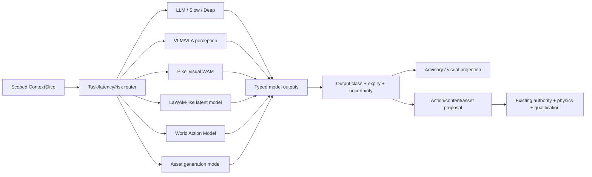
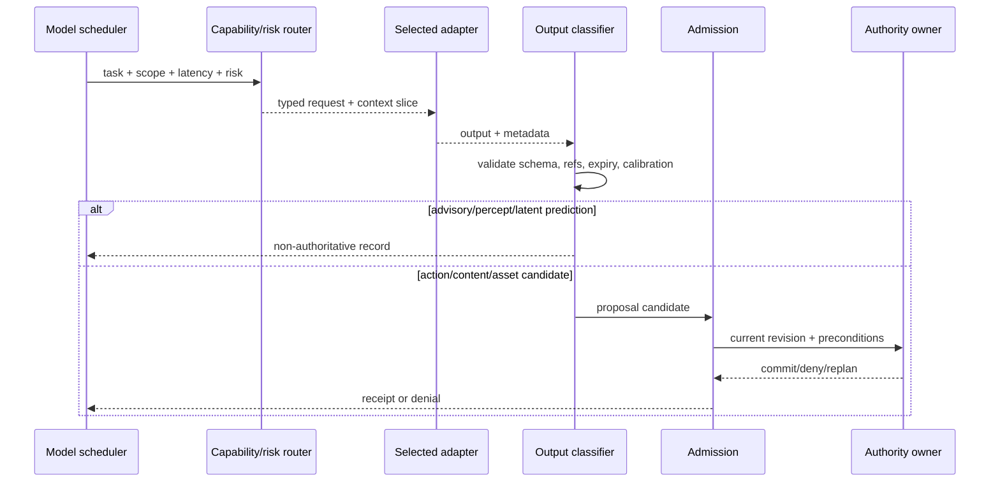
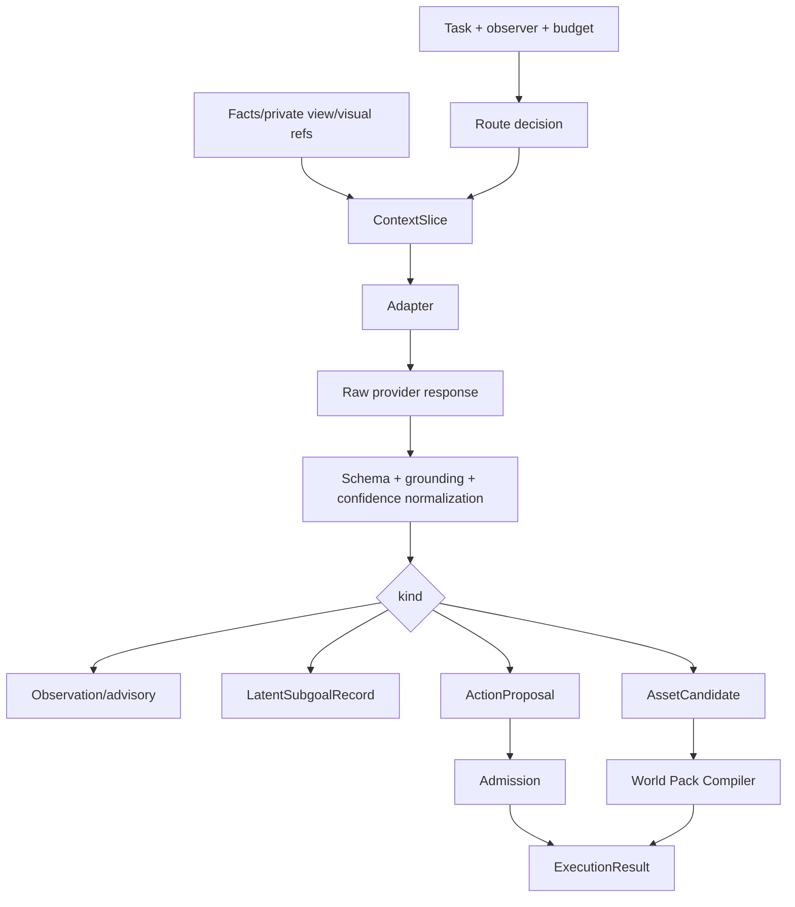

# 模型类别适配与权限路由规格

状态：`analysis/planned/non-authorizing`

## 1. 模型不是同一种能力

工作区同时容纳多类模型，但每类模型看到的数据、输出的对象、允许的延迟和能否进入 proposal route 都不同。路由按“任务目的 + 时效 +风险 + owner”选择，不能因为模型更大就获得更高权限。

| 类别 | 主要输入 | 主要输出 | 适合工作 | 不得直接做 |
|---|---|---|---|---|
| LLM/推理模型 | `ContextSlice`、角色私有视角、目标和规则 | 解释、目标组合、计划、对话候选、typed decision | 角色心智、司命调度、长链因果 | 写世界事实、控制每帧运动 |
| VLM/VLA 感知 | image/audio/depth、grounding catalog、事实 refs | 观察、实体候选、空间关系、冲突和不确定性 | 视觉理解、空间 advisory | 宣布碰撞、位置、库存已改变 |
| 像素视觉世界模型/WAM | 当前视觉历史、语义条件、动作条件 | 视频/帧、视觉未来、表现候选 | 远景补全、视觉连续性、非权威 rollout | 作为可查询 world state 或物理引擎 |
| 隐空间世界模型/LaWAM 类 | 视觉 latent、latent action、任务条件 | latent subgoal、未来 latent、动作相关变化预测 | 低延迟未来预测、候选动作排序 | 直接生成 GLB、transform、真实事件 |
| World Action Model | snapshot、goal、affordance、动作空间、物理摘要 | 动作块、轨迹候选、预期效果 | 分支预演、动作提议、具身计划 | 绕过能力、碰撞和安全校验 |
| 生成资产模型 | 语义描述、参考图、约束和 pack schema | mesh/texture/material/animation/scene candidate | 离线资产生产和候选更新 | 自动发布为生产资产 |

## 2. 路由原则

1. **先选权限，再选模型**：模型不能通过路由升级自己的 authority。
2. **先选时效，再选深度**：物理近场优先确定性执行和低延迟 typed decision；复杂规划可以异步慢路径。
3. **先用结构化状态，再用视觉补全**：已有实体/事实优先于模型猜测；视觉结果只能补充或标记冲突。
4. **预测与提交分离**：任何模型都先输出 `ModelOutput`，需要改变世界时再创建 proposal。
5. **同一输入可多模型竞赛，但只允许一个 owner commit**：多模型结果可以并列评估，不能并行写入。

## 3. LLM 与角色智能体的关系

Laya 仍然是已激活角色智能体的快思考 typed decision 模型；它通过 L1 私有感知、ThoughtMode、能力包络和 L4 执行契约工作。工作区为它提供 `ContextSlice`，但不把世界全量状态直接注入角色。

慢思考/Deep Model 可以重组目标、模式和短计划，完成后返回 Laya 当前决策回路。世界模型预测只作为感知或未来结果候选，不能替代 Laya 的角色心智，也不能直接替代 L4。

## 4. LaWAM 如何接入

依据 `docs/上下文不够用/LAWAM.md`，LaWAM 将：

```text
当前 observation -> 视觉 latent z_t
任务/策略 -> latent action proposal
LaWM -> 未来 latent subgoal z_(t+1)
动作专家/候选器 -> typed action candidate
```

在本项目中，`z_t` 和 `z_(t+1)` 只能作为 `LatentSubgoalRecord` 挂在一次 snapshot/rollout 下。它们不能作为角色记忆、实体位置或事实事件；必须经过 action model/World Action Harness、Godot 物理和 owner admission 才能变成可执行动作。

## 5. 架构图



## 6. 主流程时序图



## 7. 数据流图



## 8. 降级矩阵

| 不可用项 | 角色/游戏降级 | 世界状态处理 |
|---|---|---|
| VLM | 使用已有 structured facts 和 L1 观察 | 不猜测新事实 |
| 视觉 WAM | 使用 Godot explicit scene 或静态远景 | 不影响 truth |
| LaWAM | 使用确定性候选排序或普通 action model | 不影响动作提交 |
| Action Model | 使用注册 action/行为模块/continuity floor | 仍走现有物理和 owner |
| LLM/Deep | 回到 Laya、规则和角色 B0-B3 continuity | 不暂停世界时钟 |
| asset model | 使用已准入 WorldPack | 不加载半成品 |

## 9. 禁止事项

- 不能把“模型能生成视频”写成“模型能生成可交互 3D 世界”。
- 不能把“latent 可预测”写成“latent 可以替代世界事实”。
- 不能把模型的 confidence 当作 authority 权限。
- 不能把模型输出字段未经 schema validation 透传给 Godot transform、physics 或 event store。

## 10. 状态矩阵

- `[current]`：VLA advisory adapter、model registry/readiness、角色 Laya/模型 gateway 和现有 provider boundary 已有不同程度的代码或正式文档。
- `[planned]`：统一多模型路由、latent subgoal adapter、world/action model adapter 和输出分类器需要按 WRC 收口。
- `[deferred]`：任何模型直接成为环境控制器、神经世界 truth owner 或通用资产发布器。
