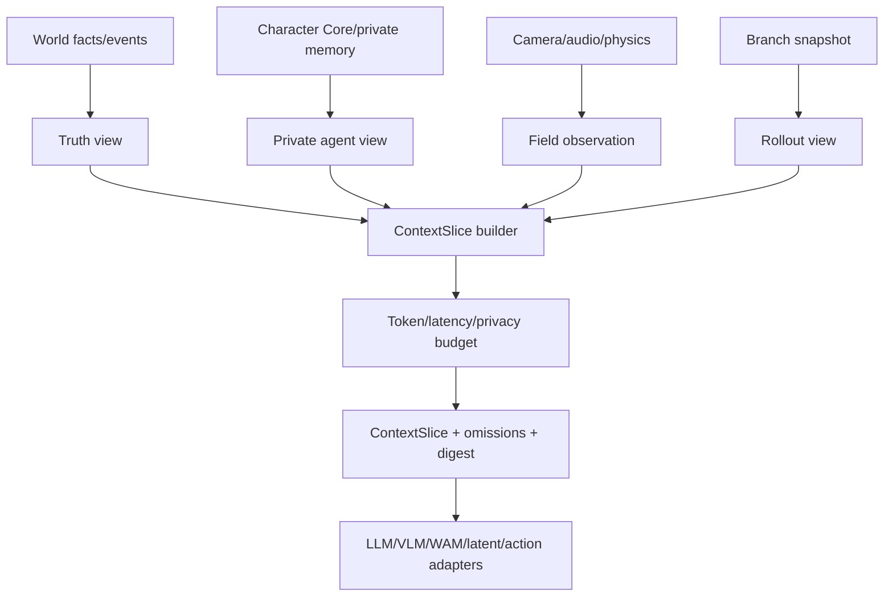
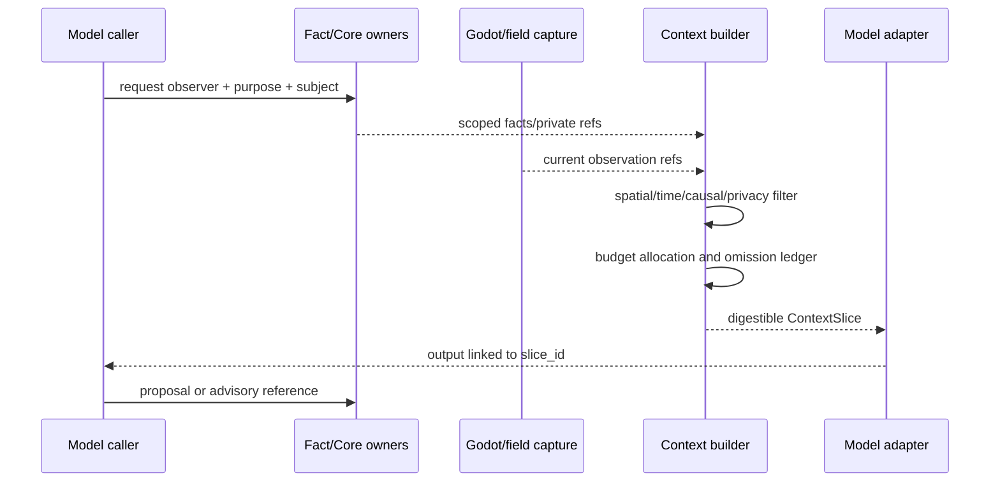
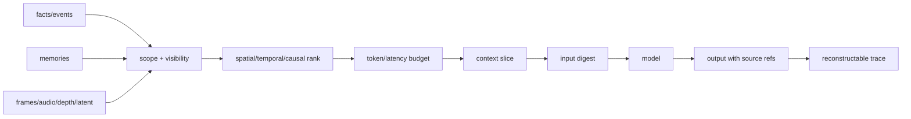

# 上下文窗口与时空数据分层规格

状态：`analysis/planned/non-authorizing`

## 1. 问题

世界模型、VLM、LLM、LaWAM 和动作模型都有输入窗口、显存、延迟或历史长度上限。开放世界不能把整座城市、全部角色人生和所有视觉帧发送给每一次调用。解决方案不是删掉世界，而是让工作区按任务构建可追溯的局部上下文。

## 2. 四种上下文视角

### 2.1 真相视角

给 authority、司命和世界模型使用的事实投影：事件、实体、位置锚点、时间、资源、关系、区域压力、空间索引。它不自动等于角色能知道的内容。

### 2.2 角色私有视角

给角色智能体使用的 L1/L2 输入：角色实际看到、听到、记得、相信和误解的内容，附带来源、freshness、scope 和冲突。它由 Character Core/private memory owner 产生。

### 2.3 现场视角

给 Godot、VLM 和近场动作模型使用的相机/传感器/physics frame：近场显式实体、碰撞、可见性、声音、玩家输入和当前交互窗口。

### 2.4 预演视角

从某个 `world_revision` 分叉的 snapshot 和候选动作结果，用于 rollout、反事实和多方案比较。预演事实不能自动写回主世界。

## 3. 分层数据

```text
L0  identity anchors: entity_id, actor_id, asset_ref, spatial anchor
L1  current state: position, life, inventory, active obligations, visible objects
L2  local history: recent events, actor observations, causal chain
L3  compressed memory: summaries with source refs and expiry
L4  world background: region/organization/economy/graph indexes
L5  optional visual/latent history: embeddings, frames, latent states
```

L0-L2 是高优先级结构化数据；L3-L5 按任务检索。向模型发送 embedding 或 latent 时必须同时提供可回溯的 source refs 和 revision，不能让不可解释向量独占事实。

## 4. ContextSlice 组装规则

1. 先确定 `purpose`：perception、planning、dialogue、rollout、asset_compile 或 presentation。
2. 再确定 `observer`：玩家、角色、司命、世界模型或环境 adapter。
3. 先放硬前置条件和当前状态，再放局部历史，再放摘要和候选参考。
4. 按空间半径、时间窗口、因果相关性、关系邻域和可见性过滤。
5. 超出 token/latency budget 时按优先级裁剪，并留下 `omitted_refs` 和 `context_debt`。
6. 每个外部视觉/latent artifact 都要有 source ref、capture clock、camera/sensor metadata 和 digest。
7. 对角色视角执行 privacy/redaction；不能因模型窗口大而扩大角色权限。

## 5. 时空窗口

| 层 | 典型内容 | 更新节奏 | 适用模型 |
|---|---|---|---|
| 近场 physics window | 角色、交互物、碰撞、声音、玩家输入 | 物理 tick/交互 tick | action model、VLM、Laya |
| 局部 social window | 关系、事件、义务、区域对象 | simulation cadence/事件触发 | LLM、司命、群体模拟 |
| 长时 memory window | 压缩事件、档案、关系变化、世界摘要 | checkpoint/记忆写回 | LLM/Deep/graph retrieval |
| 视觉 history window | 最近帧、关键帧、latent history | provider budget | VLM/WAM/LaWAM |
| rollout window | 分支 snapshot、动作序列、预期效果 | 每次预演 | action/world model |

## 6. 架构图



## 7. 主流程时序图



## 8. 数据流图



## 9. 窗口不足与连续性

- 窗口不足不能改变世界时间；只会减少本次模型可见内容。
- 需要补充信息时，模型发出 `information_request`，由 owner 重新生成允许的 slice。
- `context_debt` 表示被裁掉但尚未请求的上下文，不是隐式全局访问权。
- 角色模型看不到的事实不能因世界模型摘要出现而自动进入角色记忆，必须经过 L1 感知或合法信息事件。
- 视觉历史被压缩为 latent 时，保留关键帧 refs、实体绑定和 revision，防止 latent 漂移后无法解释。

## 10. 验收目标

1. 相同 snapshot、purpose、observer 和 budget 能产生可比的 slice digest。
2. 角色私有 slice 不包含未授权全局事实。
3. 模型能发现缺失信息并通过结构化 request 重新获取，而非猜测。
4. latent/embedding 只作为检索和预测辅助，不能独立提交事实。

## 11. 状态矩阵

- `[current]`：L1/PQF、角色私有视角、capture clock、空间模型和 VLA artifact refs 已提供部分分层输入。
- `[planned]`：目的/观察者驱动的 ContextSlice builder、预算、omission ledger、context debt 和 latent provenance 尚未统一实现。
- `[deferred]`：把整座世界的长期 latent state 作为可恢复唯一 truth，或让模型绕过 privacy 读取全局上下文。
