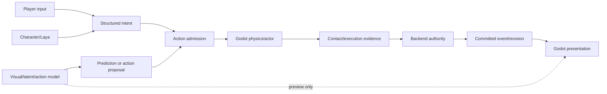
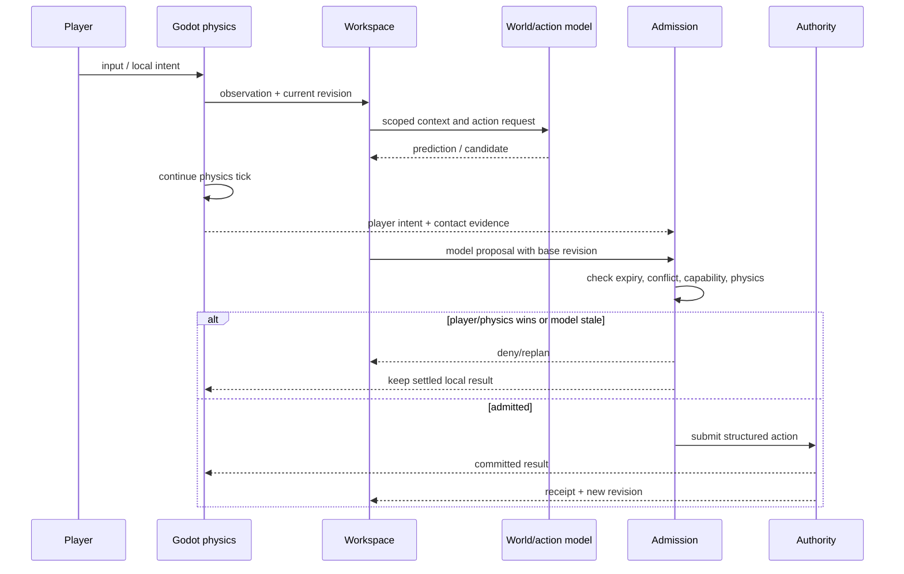
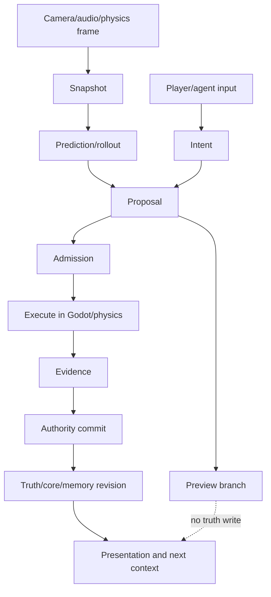

# 实时交互、预测预演与可逆提交规格

状态：`analysis/planned/non-authorizing`

## 1. 目标

让玩家、激活角色、群体模拟和世界模型在同一场景中协作，同时承认模型存在延迟、过期和不确定性。近场发生碰撞、购买、说话、开门等动作时，Godot/物理和 authority 必须继续推进；模型可以提前预测和提出动作，但不能因为推理还没返回就暂停物理，也不能因为视觉生成先返回就把预测当事实。

## 2. 三种运行区域

### Explicit3DZone `[current/planned]`

Godot 显式场景、GLB/mesh、实体 ID、碰撞、导航、actor、物理和 authority 都存在。玩家能交互或有高影响后果的对象必须在该区域结算。

### NeuralVisualZone `[planned/deferred]`

视觉模型提供远景、过渡、非交互背景或观感补全。它可以使用当前显式画面和 semantic condition 生成视觉帧，但必须绑定相机锚点、时间和区域版本；玩家接近前要切回显式区域。

### NeuralStatefulZone `[deferred]`

未来具备 entity ID、空间、事件、快照和恢复能力的神经世界运行时。只有它通过 WRC 并能被 authority 复现后，才可能承担区域级状态推进；当前 HY-World 2.0 的公开输出不足以证明它已经具备该能力。

## 3. 交互状态机

```text
captured -> predicted -> proposed -> previewed -> admitted -> executing -> settled
      \-> stale/denied/failed/replan
```

- `captured`：从当前 snapshot 和现场采集得到输入。
- `predicted`：模型给出未来画面、latent subgoal、动作结果或资产候选。
- `proposed`：结构化 proposal，带 base revision、前置条件和 expiry。
- `previewed`：在分支 world 或本地表现中预览，不写主世界。
- `admitted`：authority/能力/物理/权限通过。
- `executing`：actor/physics/action controller 执行。
- `settled`：owner 写 event/receipt，更新真相、记忆和表现。

## 4. 延迟策略

| 延迟 | 允许行为 | 失败处理 |
|---|---|---|
| 0-1 physics tick | Godot/actor/physics 连续运动和接触 | 物理结果优先 |
| 1-5 interaction ticks | Laya typed decision、动作阶段、现场 VLM advisory | 继续当前承诺或 continuity floor |
| 数百毫秒到数秒 | Action/WAM/LaWAM 预测、候选动作、局部 rollout | stale 则重建 snapshot |
| 秒到分钟 | Slow/Deep、司命重规划、World Pack 编译 | 不阻塞当前世界时钟 |

## 5. 玩家与模型同时修改同一对象

1. 玩家和角色动作都先进入同一个 action/affordance registry。
2. 近场物理接触由 Godot 计算，生成 contact evidence。
3. Backend 根据当前 revision、权限和前置条件决定是否提交。
4. 迟到的模型 proposal 若目标 revision 已变，必须拒绝或重新生成。
5. 视觉模型可以在提交前渲染“可能发生”的表现，但主视图在关键交互处必须回到已提交结果。
6. 如果模型和玩家都提出动作，按 owner 定义的冲突策略处理：物理接触、玩家输入和已提交事实不能被模型覆盖。

## 6. 架构图



## 7. 主流程时序图



## 8. 数据流图



## 9. 可逆性

- preview、visual overlay、latent rollout、候选动作和候选资产可撤销、过期和重新计算。
- 已提交世界事实不可由“撤销按钮”删除；如需修正，生成新的补偿事件并保留原始历史。
- 运行时切换 NeuralVisualZone 到 Explicit3DZone 时，使用最近的显式 snapshot 和 re-anchor；若无法绑定关键实体，回退到显式静态表现，不伪造可交互对象。

## 10. 验收目标

1. 模型超时不会阻塞物理 tick 或主世界时钟。
2. 玩家动作与模型 proposal 的冲突可解释、可回放。
3. stale proposal 不会改变当前 revision。
4. preview/rollout 与 committed event 在数据结构和 Harness 报告中明确分开。

## 11. 状态矩阵

- `[current]`：Godot actor/physics、ESM physical channel、structured intent、authority event 和现有表现投影已经存在窄路径。
- `[planned]`：统一 prediction/proposal/preview/rollout 状态机、玩家与模型冲突策略、zone handoff 和 re-anchor 尚未收口。
- `[deferred]`：由视觉神经模型直接承担近场物理、完整状态推进或无回退的连续 3D 交互。
