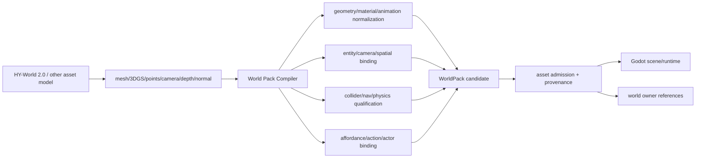
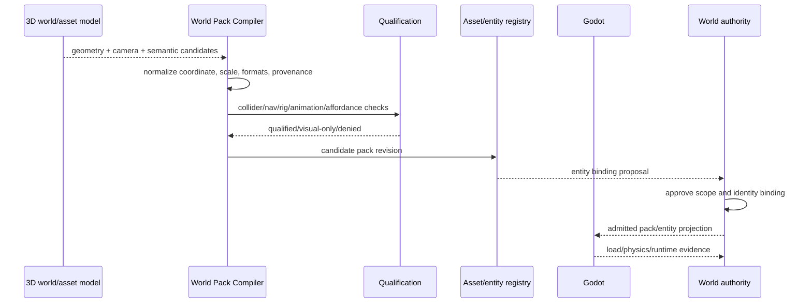
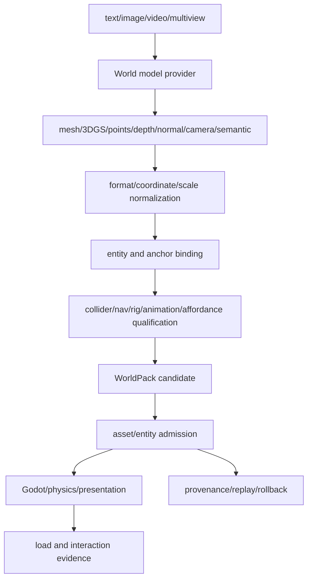

# World Pack 资产、场景与实体绑定规格

状态：`analysis/planned/non-authorizing`

## 1. HY World 2.0 的工程定位

根据 Tencent-Hunyuan 的公开仓库与技术报告，HY-World 2.0 是多模态 3D 世界生成/重建框架：文本、单图、多视图或视频可以进入 World Generation/World Reconstruction，输出 mesh、3D Gaussian Splatting、点云、深度、法线和相机参数。公开 README 明确将其定位为可漫游、可编辑并可导入 Blender/Unity/Unreal/Isaac 的 3D 资产；公开文档中的 WorldMirror 2.0 输出包括 `gaussians.ply`、`points.ply`、camera JSON、depth/normal 等。

这对本项目意味着：HY World 2.0 可以成为 `World Pack Compiler` 的上游资产/场景候选来源，甚至可以提供有价值的导航轨迹、相机和几何先验；但“可漫游、可碰撞、可导入引擎”不自动等于“拥有本项目的 entity ID、事件、角色记忆、权威库存、可回放状态和游戏 affordance”。这些仍由本项目的编译、绑定和 owner 负责。

## 2. WorldPack 结构

```text
WorldPack {
  pack_id
  pack_revision
  source_model { provider, model, version, input_digest }
  scene_manifest
  entities[]
  geometry_assets[]       # mesh / 3DGS / point cloud
  materials[]
  animations[]
  colliders[]
  navigation[]
  affordances[]
  physics_profiles[]
  actor_spawn_points[]
  audio_and_fx[]
  camera_anchors[]
  entity_bindings[]
  provenance[]
  qualification_report
  rollback_ref
}
```

## 3. 生成数据到游戏数据的转换

| 模型输出 | 编译阶段 | 运行时对象 |
|---|---|---|
| mesh/3DGS/point cloud | 几何规范化、坐标和尺度校验、LOD/压缩 | render asset |
| depth/normal/camera | 相机坐标对齐、世界锚定、误差报告 | spatial prior / observation metadata |
| panorama/video | 仅作生成中间物或非交互视觉层 | visual artifact |
| text/image semantic labels | entity candidate + category + confidence | candidate entity catalog |
| inferred trajectory | nav candidate + obstacle report | navigation candidate |
| generated character mesh | skeleton/rig/animation/scale/collision qualification | actor asset candidate |
| generated material/audio | format/licence/provenance/streaming checks | presentation asset |

## 4. Entity binding

每个可交互对象必须有稳定 `entity_id`，并绑定：

- `asset_ref`、`pack_id`、`pack_revision`；
- transform anchor 和坐标系；
- geometry/LOD 与 collider；
- physics profile；
- navigation obstacle/area；
- affordance/action refs；
- ownership、visibility 和 privacy；
- world fact and event refs；
- qualification status 和 rollback ref。

3DGS 适合高保真显示和远景探索，但不能仅凭 splat 点云提供可靠的交互碰撞、可破坏状态、物品库存或角色绑定。需要显式 mesh/proxy collider 或经过验证的几何抽取；失败时该对象只能作为 visual-only entity。

## 5. 角色模型与 GLB 的边界

模型生成的角色模型可以成为 GLB/mesh candidate，但必须单独完成：mesh 拓扑、材质、骨骼、skin、动画、姿态、碰撞、socket、导航 footprint、LOD 和运行时加载验证。资产注册不会自动新增或替换场景 actor；按照仓库 AGENTS 规则，新增角色默认保留独立 actor identity，资产包、骨架 profile、motion library 和 backend identity binding 分开准入。

## 6. 架构图



## 7. 主流程时序图



## 8. 数据流图



## 9. HY World 2.0 当前可采用的路线

### 首先可用

- 离线生成或重建一个区域的 mesh/3DGS/点云。
- 用 WorldMirror 的 camera/depth/normal 作为场景重建先验和 VLA grounding 参考。
- 用 WorldNav/轨迹生成结果辅助导航候选和摄像机路径规划。
- 把输出编译为 visual-only 或 explicit 3D candidate，再由现有 Godot/Backend 验证。

### 尚不能直接假定

- 输出包含本项目所需的 stable entity ID、事件流、snapshot/restore 和多人一致性。
- 3DGS 自动提供可接受的 gameplay collider、破坏状态、库存和物理材质。
- 公开仓库已经提供 Godot 原生 GLB、动画重定向、角色骨架和本项目 affordance registry 绑定。
- 生成世界可以直接成为开放世界运行时的唯一 truth owner。

## 10. 验收目标

1. 任何生成资产都能追溯到模型、输入、pack revision 和资格报告。
2. visual-only、candidate、admitted interactive 三种状态不可混淆。
3. 没有 collider/nav/affordance 的几何不会被角色动作或玩家交互假定为可用。
4. pack 更新不会隐式替换现有 actor identity 或覆盖世界事实。

## 11. 状态矩阵

- `[current]`：仓库已有 GLB/scene/actor 资产资格化、scene knowledge、affordance/action registry 和运行时加载边界，但没有统一 WorldPack。
- `[planned]`：WorldPack manifest、HY World 2.0 输入适配、entity binding、collider/nav/rig/animation qualification 和 pack rollback。
- `[deferred]`：模型生成后自动成为生产交互世界，或自动替换现有 actor/scene identity。
