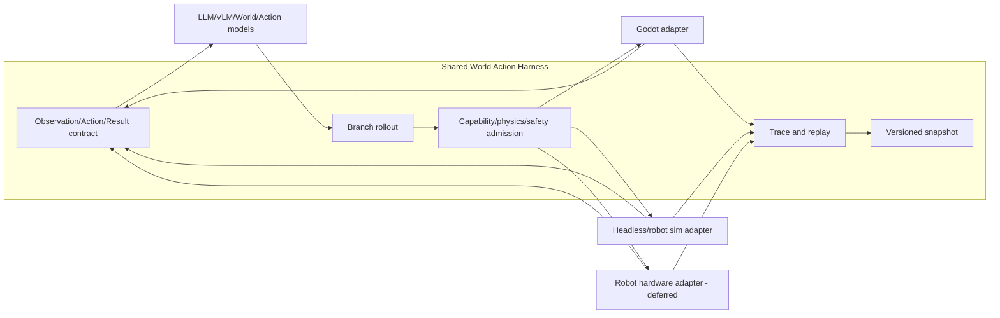
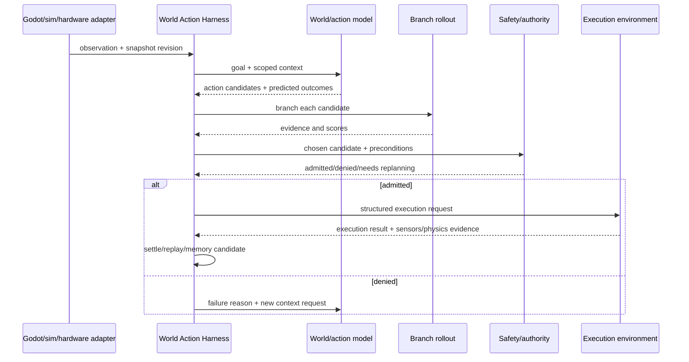
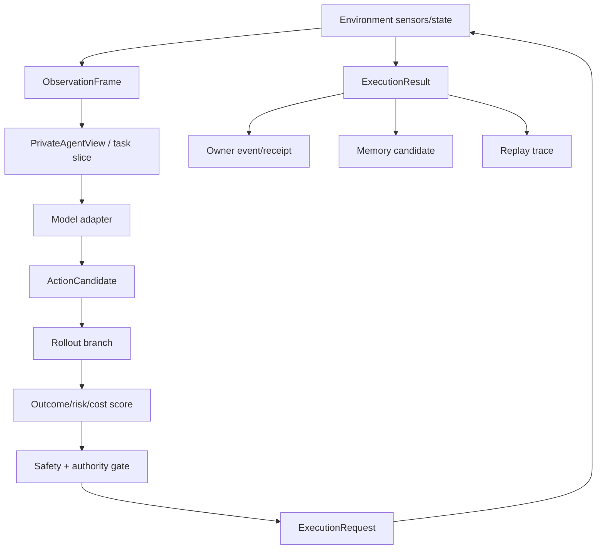

# World Action Harness 与机器人沙盒兼容规格

状态：`analysis/planned/non-authorizing`

## 1. 目标

同一个工作区既服务 AI 游戏角色，也为未来机器人或具身模型提供可预演环境。共用的是观察、目标、动作、权限、物理证据、事件、记忆和回放合同；不共用实时控制频率和安全 owner。

## 2. 两种环境的共同合同

```text
ObservationFrame
WorldSnapshot
PrivateAgentView
Goal / Task
ActionCandidate
PredictedOutcome
ExecutionRequest
ExecutionResult
MemoryWriteCandidate
Trace / Replay
```

### AI 游戏

```text
Godot observation -> character/LLM -> typed intent/action stage
-> action controller -> Godot physics -> Backend event/receipt
```

### 机器人沙盒

```text
camera/depth/tactile/joints -> VLM/world/action model
-> rollout in simulator -> safety controller
-> robot hardware -> sensor feedback -> event/memory
```

机器人沙盒必须增加工作空间限制、速度/力限制、急停、硬件状态、传感器校验和安全控制器；这些不属于游戏 Laya 或 Godot authority。

## 3. 适配器边界

| Adapter | 负责 | 不负责 |
|---|---|---|
| `GodotEnvironmentAdapter` | scene/actor/physics capture，执行注册动作，回传 evidence | 让模型直接写节点或绕过 authority |
| `HeadlessRolloutAdapter` | 从 snapshot 分叉，批量预演和回放 | 把分支结果写主世界 |
| `RobotSimAdapter` | 仿真器实体、关节、接触和传感器映射 | 真实硬件安全 |
| `RobotHardwareAdapter` `[deferred]` | 与硬件控制器交换经安全批准的执行请求 | 接受模型原始动作 |
| `WorldModelAdapter` | 视觉/latent/semantic 预测 | 物理结算和事实写回 |
| `WorldActionAdapter` | 生成动作候选/轨迹/动作块 | 权限、碰撞、安全、最终执行 |

## 4. World Action Harness 生命周期

```text
observe -> formulate goal -> generate candidates -> rollout
-> compare predicted outcomes -> safety/authority admission
-> execute -> measure evidence -> settle -> replay/memory
```

候选可以来自 LLM、World Action Model、LaWAM、规则或角色动作模块。候选比较依据是目标满足度、物理可行性、风险、成本和不确定性，不是模型文本说服力。

## 5. 架构图



## 6. 主流程时序图



## 7. 数据流图



## 8. 和当前项目的关系

### `[current]`

- `EmbodiedActionController`、action/affordance registry、Godot actor ingress、ESM physical channel 和 replay/Observatory 已提供部分执行边界。
- `VLAProviderRequest/Result` 和 percept bridge 已提供视觉 advisory 的受控入口。
- 现有 Harness 已能验证部分 provider、角色执行、Godot mirror 和 authority chain。

### `[planned]`

- 统一 `WorldActionHarness` facade，把现有执行、rollout、world snapshot 和 trace refs 接成 WRC。
- headless 分支预演、候选比较、stale proposal 和 replayable outcome。
- World Action Model/LaWAM adapter 的动作候选映射。

### `[deferred]`

- 实时机器人硬件 adapter、急停和硬件安全控制器。
- 让 HY World 或其他神经世界运行时作为完整环境 owner。

## 9. 验收目标

1. 游戏和机器人两类环境能复用同一结构化 observation/action/result contract。
2. 模型只生成候选，rollout 和 safety/authority 决定能否执行。
3. 真实执行失败会回传证据并产生可追踪的重规划，而不是写入模型自述结果。
4. 分支预演不会污染主世界，硬件路径默认 fail-closed。
