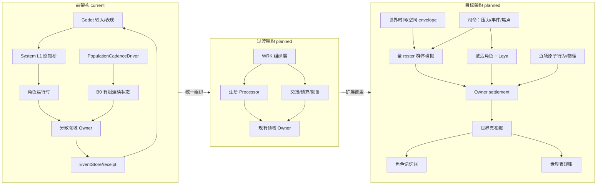
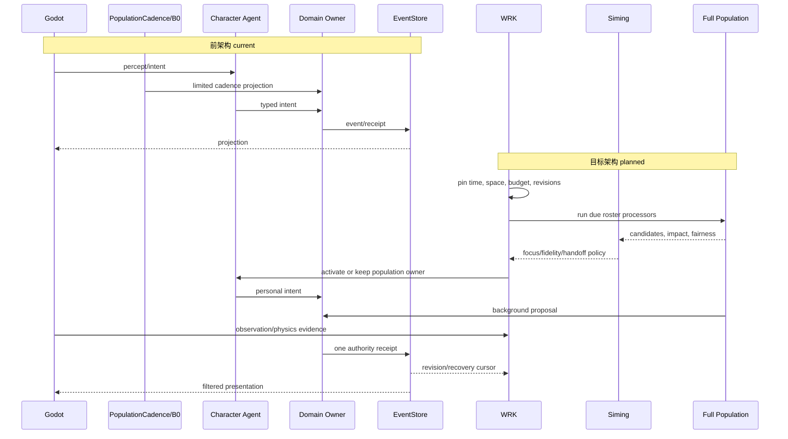
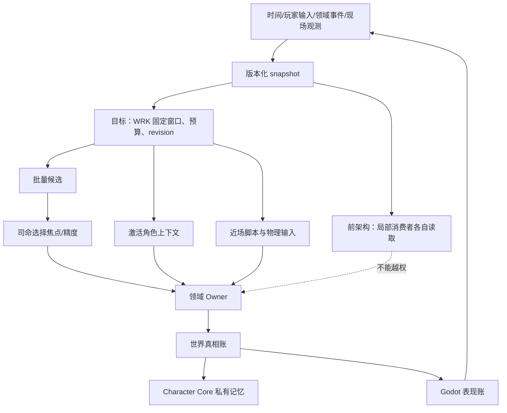

# 前后架构实现差异审查

状态：`analysis/review/non-authorizing`

日期：2026-10-12

本审查把“前架构已经有什么”和“本批目标架构要增加什么”分开。目标图是设计，不是代码完成证明。

## 1. 一句话结论

当前系统是若干条可以独立证明的窄链：人口 cadence/B0、角色心智、司命投影、领域 owner、EventStore、私有记忆和 Godot 镜像分别存在。本批提出的 WRK 是一个组织层，用统一窗口、预算、交接、回执和恢复把这些链串成开放世界社会运行；它不应成为第二个事实数据库或超级 LLM。

## 2. 前、过渡、目标三态

## 3. 差异表

| 责任 | 前架构 `[current]` | 过渡架构 `[planned]` | 目标架构 `[planned]` | 证据或缺口 |
|---|---|---|---|---|
| 时间推进 | `SimulationClock` 是 caller-driven；`PopulationCadenceDriver` 产生人口窗口 | WRK 统一窗口、catch-up、暂停、预算和 revision pin | 世界、物理、认知、表现、操作时钟用显式映射协作 | [`simulation_clock.py`](../../../../backend/app/world_runtime/simulation_clock.py:38)、[`population_driver.py`](../../../../backend/app/world_runtime/population_driver.py:28)；统一映射缺失 |
| 角色覆盖 | roster + 有限 B0/候选 | 每个 actor 都有 continuity cursor 和精度层 | 全体角色持续有生命线，局部提升精度 | [`roster.py`](../../../../backend/app/population_continuity/roster.py:13)；全覆盖 B-01 |
| 司命 | 消费受限投影、obligation、candidate | 统一接收压力、due、影响、预算和公平信号 | 对事件/压力安排角色与精度，不为每人预写故事 | `siming_population_capability.py`；默认 group bridge 仍 stub |
| 图谱 | HeavenlyGraph/authority projection 和私有记忆图分开 | 以 CharacterRecordRef 派生公共社会索引 | 节点覆盖全体角色，边传播社会影响，仍不拥有事实 | graph port/query 已有；全体节点和传播证据缺失 |
| 心智 | 角色 L1-L4 和有限 Laya L3 adapter | 明确 B0/B1 与 B2/B3 handoff | 激活角色 Laya 快循环，Slow/Deep 负责重规划 | [`laya_provider.py`](../../../../backend/app/character_agent/gateway/laya_provider.py:1)；质量门禁 B-04 |
| 事实结算 | 各领域 owner 接收 typed intent/projection | WRK 只路由，统一 receipt/revision/recovery | 所有候选、模型输出、脚本和物理 evidence 经 owner | EventStore/owner tests 存在；WRK 尚未实现 |
| 表现 | cadence receipt 后的固定人口镜像 | freshness、区域和精度 tier | 现场反引后台、原子脚本、物理证据可回放 | [`presentation.py`](../../../../backend/app/population_continuity/presentation.py:1)；空间证据 B-06/B-07 |
| 恢复 | 人口 continuity 有局部 cursor/receipt | 交接、窗口和 owner failure 统一 recovery | 断线、延迟、乱序和近场抢占均可重放 | 人口恢复有证据；跨域近场恢复未证实 |

## 4. 主流程差异时序

## 5. 数据边界差异

## 6. 实现差异审查结论

### 当前可直接采用 `[current]`

- `PopulationCadenceDriver` 已有不可回退 tick、有限 catch-up、暂停、发布和确认游标。
- `SimulationClock` 已有 due/deferred 选择和 caller-driven 语义，不自动写 truth。
- population roster、B0 projection、seed planner、owner receipt 和 Character Core 私有记忆已有局部合同。
- HeavenlyGraph 有 revision、scope、valid/recorded time、privacy 和 query/write port。
- 角色 L1-L4 运行时和 Laya provider 有有限的 typed decision 边界。

### 只能作为过渡设计 `[planned]`

- WRK 的中央协调、Processor 注册、handoff、预算和恢复组织。
- 全 roster 的连续生命 cursor、位置锚点、关系传播和非玩家焦点。
- 统一三本账的同步频率和 `event_time/known_time/presented_time` 字段。
- 近场动物原子动作、静物模型脚本与 physics evidence settlement。

### 明确阻断 `[blocked]`

- B-01 全 roster continuity。
- B-02 公共全体社会图。
- B-03 唯一推进权和交接。
- B-04 Laya 真实 provider 与质量证据。
- B-05 Life/Presence/Soul owner。
- B-06 时空 envelope 和现场回写。
- B-07 动物/静物脚本运行时。

### 本批不做 `[deferred]`

- 自走棋、回合、羁绊、装备、奖励适配。
- 通用 editor control-plane。
- AD/Blender 正式资格化、GLB 复载和动作 admission。
- 世界模型、latent space、World Pack 和 World Action Harness。

## 7. 放行判断

本批可以进入**设计审查和证据建设**，不能直接进入“完整运行时代码实施”。只有当[总实施顺序与门禁计划](../计划/00-群体模拟升级总实施顺序与门禁计划.md)对应 gate 取得 fresh evidence 后，才能把相应 planned 项目转为 implementation-authorized。审查不能把 WRK 图、Laya 输出、图谱快照或 Godot 镜像本身当成 truth commit 证据。
