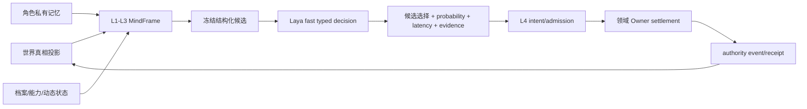
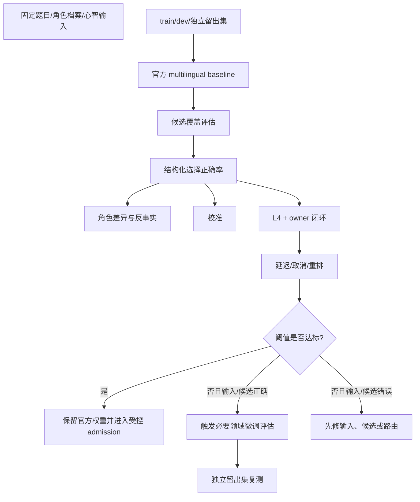
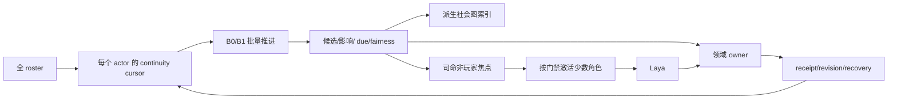

# Laya 与群体模拟质量证据审查

状态：`analysis/review/non-authorizing`

日期：2026-10-12

本文件把 Laya 质量和群体模拟质量分开审查。Laya 的质量不能由慢思考或 Deep Model 的 fallback 代替；群体模拟的连续性也不能由玩家视角中出现了几个 NPC 来代替。

## 1. Laya 的正式定义

Laya 是**已激活角色智能体的通用快思考、低延迟、typed decision 模型**。它在角色当前心智上下文中，从冻结候选中选择可接受动作或表达方向，并返回可审计的选择、概率、延迟和模型证据。它不直接执行动作，不写世界真相，不产生 authority receipt，也不只服务战斗。

## 2. 当前代码能证明什么

| 代码 | 已证明 | 未证明 |
|---|---|---|
| [`laya_provider.py`](../../../../backend/app/character_agent/gateway/laya_provider.py:1) | 有固定 source/checkpoint revision、`/v1/systemone` endpoint、冻结候选校验、只返回选择/延迟/概率证据 | 没有真实本地 `laya-serve` fresh evidence、完整 ThoughtMode 覆盖、稳定性和质量阈值 |
| [`l3_planner.py`](../../../../backend/app/character_agent/planning/l3_planner.py:1) | 在配置 endpoint 时可把角色 profile、记忆、动态状态、能力摘要和候选送到 Laya | 只证明有限 L3 路径；不证明 L1-L4 连续闭环、B3 admission、cancel/expiry/recovery |
| 角色运行时测试 | 有角色 turn、记忆、候选编译、意图和写回的局部测试 | 不证明生产 checkpoint、全体角色、近场竞争或真实世界行动质量 |
| [`seed_planner.py`](../../../../backend/app/population_continuity/seed_planner.py:27) | 对有限 admitted behavior 生成 seed、memory candidate、presentation seed 和 owner 状态 | 不是全 roster 记忆/档案生成器；seed candidate 不是已提交事实 |
| `siming_projection.py` / `siming_runtime.py` | 有 group bridge 接口形状和受限司命输入 | 默认 `StubGroupSimulationBridge` 是 unavailable/shape_only，不是持续群体推演 |

## 3. 质量路线决策

用户已选择“由实测触发”的路线：先固定官方 Laya 基线，只有关键决策在输入和候选都正确时仍不达标，才实施必要领域微调。慢思考和 Deep Model 可以作为后续路由或规划对照，但不能用回退结果宣称 Laya 完成。

### 3.1 A 阶段 baseline `[planned]`

- checkpoint：先固定官方 `multilingual`，面向中文心智上下文；`typed-decisions` 只做隔离对照，不混入生产。
- provider：优先独立 `laya-serve` 本地服务；本地没有可用 LLM 时才使用 API adapter。
- 输入：固定角色档案、动态状态、私有记忆摘要、ThoughtMode、能力包络、世界真相过滤投影和冻结候选。
- 输出：只允许 `candidate_id`、结构化选择证据、概率/置信度、延迟、source/checkpoint revision 和 reject reason。
- 禁止：执行参数、原始 pose、领域事实、库存/资源写入、未经 owner 的 fallback decision。

### 3.2 评估对象必须分层

| 层 | 问题 | 不能用什么替代 |
|---|---|---|
| 输入正确性 | Laya 是否收到正确的心智输入和候选 | 不能用“模型回答通顺”替代 |
| 候选覆盖率 | 正确动作是否在冻结候选集合中 | 不能把缺候选算作模型决策错误 |
| 选择正确率 | 在候选正确时是否选择结构化可接受动作 | 不能用 slow/deep 回退分数代替 |
| 角色差异 | 不同档案、记忆和关系是否产生合理不同选择 | 不能用同一默认角色通过 |
| 校准 | 概率是否与正确率匹配 | 校准不能替代决策正确率 |
| 执行闭环 | typed intent 是否被 L4/owner 正确拒绝、结算、回执 | Godot 动画完成不能代表结算成功 |
| 延迟与取消 | 在预算内响应、超时可取消并 requeue | 不能冻结世界时钟等待模型 |

## 4. 质量评估图

## 5. 质量指标与门禁

数值阈值必须在实施前由评估夹具登记；本文件不凭空指定生产阈值。必须记录以下指标：

| 指标 | 计算对象 | 放行要求 |
|---|---|---|
| `input_fidelity` | 发送给 provider 的 canonical frame 与题目 fixture | 100% 字段 schema/版本/隐私边界通过；不通过先修输入 |
| `candidate_coverage` | 结构化可接受集合中是否包含参考动作 | 低于门限不得归咎于 Laya 选择 |
| `decision_accuracy` | 正确候选选择率，独立留出集 | 达到登记阈值；校准不能替代 |
| `character_differentiation` | 同题不同档案/记忆的选择差异与理由一致性 | 通过预先登记的角色差异案例 |
| `calibration` | 置信度与实际选择正确率 | 作为风险路由输入，不替代准确率 |
| `p95_latency` | provider 响应和 adapter 总延迟 | 不超过操作预算；超时走取消/requeue |
| `owner_accept_rate` | typed intent 经领域 owner 接纳比例 | 低接纳率需要修候选/能力包络，不可静默放宽 owner |
| `replay_determinism` | 固定输入、source/checkpoint、候选和 revision 的回放 | digest 一致或有明确模型随机性记录 |

## 6. `char_d` 的位置

`char_d` 是**评估夹具角色**，用于增加第四种档案/记忆/关系组合，检验角色差异、候选选择和留出集覆盖。它不是生产 roster 来源，不应通过它绕过正式角色登记、Life/Presence/Soul owner、资产绑定或 scene actor admission。没有正式来源时，生产仍保持已登记角色集合。

## 7. 群体模拟质量不能只看 Laya

群体模拟需要另一组证据：

群体模拟的最低证据是：无玩家输入的长窗口中，多个独立角色和区域都有可追溯 due、影响边、owner receipt、记忆候选和可恢复 cursor；焦点不能只围绕玩家生成。默认 group bridge 为 unavailable 时，不能声称这些证据存在。

## 8. 当前阻断

- **B-04 Laya provider/质量门禁**：真实服务、checkpoint、评估题集、独立留出集和微调触发条件尚未固定并取得 fresh evidence。
- **B-02/B-08 群体社会质量**：无全体角色图节点覆盖、长期非玩家焦点和社会因果回放证据。
- **B-03 handoff**：没有完整证明同一 actor 在 B0/B1 与 B2/B3 之间只有一个主动推进 owner。
- **B-06/B-07 现场闭环**：没有证明 Laya typed intent、物理 evidence、脚本模块和 owner receipt 在近场竞争下及时协同。

## 9. 允许的后续顺序

1. 固定输入、候选、题目、官方 multilingual baseline 和 provider contract。
2. 先取得 input/candidate/choice/role-difference 的独立留出集证据。
3. 仅在“输入和候选正确、选择仍不达标”时提交微调方案；微调后仍需独立留出集。
4. 并行建立无玩家群体连续性和非玩家焦点评估，不把 Laya 评测当作群体模拟完成证明。
5. 最后才做近场脚本、物理抢占和 B/C 新场景；不复用 `StreetCombatDemo`。
