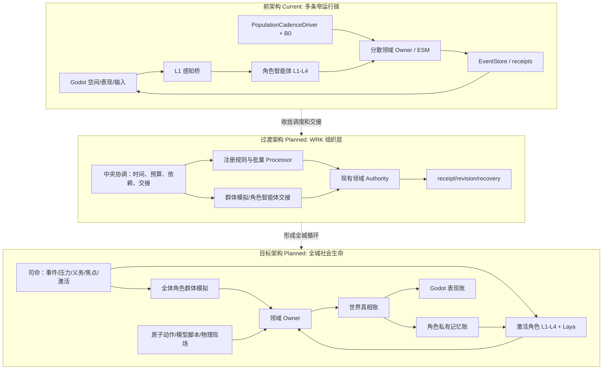
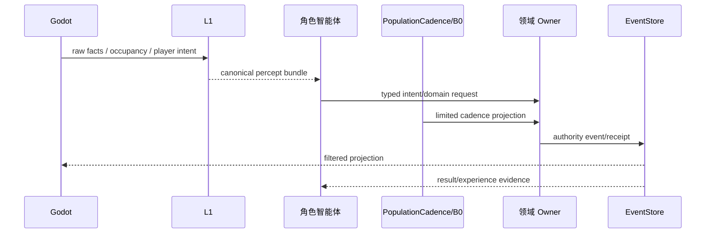
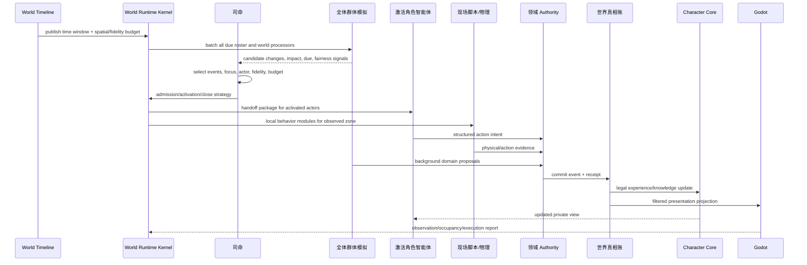
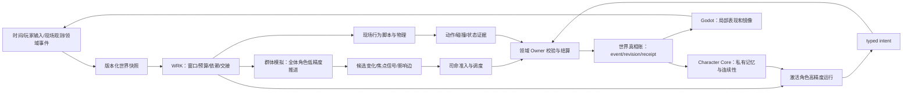

# 群体模拟升级总架构规格

状态：`analysis/planned/non-authorizing`

日期：2026-10-12

来源：

- [线程继承上下文原文](../讨论归档/00-线程继承上下文原文.md)
- [核心原文摘录与注释](../讨论归档/01-核心原文摘录与注释.md)
- 十月分析角色、世界真相、时间、空间、司命和群体模拟设计
- 当前 `world_runtime`、`population_continuity`、角色智能体、ESM、Godot 和 Harness 文档

## 1. 目标

本规格把“一个城市会自己运行，角色有独立人生，玩家可以进入并获得良好体验”变成一套清晰的混合架构：

1. 所有登记角色持续拥有身份、生命状态、位置锚点、关系、义务、行为种子、记忆种子和可恢复游标。
2. 玩家不在场时，群体模拟仍然以低成本推进全体角色和世界领域。
3. 玩家接近或事件重要时，只提高相关区域和角色的模拟精度，不把所有角色都切换成完整智能体。
4. 激活角色智能体使用自己的 L1-L4、记忆、目标和 Laya 快思考回路。
5. 司命负责全局压力、事件、预算、激活和焦点，不替每个人预写完整人生。
6. 世界真相、角色私有记忆和现场表现分别维护，通过 authority receipt 同步。
7. 行为表现由原子动作、原子模型脚本、物理和已确认结果组装，不由自由文本直接驱动。

## 2. 白话定义

可以把整个系统想成一座城市：

- **世界运行内核（WRK）**是城市的交通、日历、调度和办事总中枢。
- **司命**是城市的全局主持者，决定哪些压力值得处理、哪些居民需要认真思考。
- **群体模拟**是城市后台的低成本社会生活计算，让所有居民都有自己的生活线。
- **角色智能体**是某个居民在当前时刻真正思考的心智。
- **世界真相层**是城市正式承认发生过的事情。
- **角色记忆层**是每个居民自己经历、知道、误解和记住的事情。
- **Godot 表现层**是玩家看到和听到的现场。

## 3. 前架构、过渡架构、目标架构

### 3.1 前架构：当前已存在的分散运行链 `[current]`

继承线程原文把当前主链概括为：

```text
Godot 本地空间与表现
        ↓ structured facts / provider refs / player intent
Backend ingress + System L1
        ↓ projected facts / canonical percept bundle
角色智能体与 Siming 消费
        ↓ typed intent / domain request
Gameplay / ESM / 领域 Owner
        ↓ authority event / receipt / projection
Godot 表现与世界镜像
```

人口连续性又有一条独立链：

```text
caller / wall clock
    → PopulationCadenceDriver
    → SimulationClock
    → cadence window
    → WorldContinuityRuntime
    → B0 population projection
    → authority publication
    → receipt / recovery / mirror
```

这说明当前已经有世界事实、L1、角色心智、人口 cadence、领域 owner 和 Godot 投影，但它们还不是覆盖全城所有持续活动的统一内核。

### 3.2 过渡架构：WRK 作为组织层 `[planned]`

不新建第二套 authority，而是在现有 `world_runtime`、`gameplay`、ESM、角色和 Godot 之间增加一层逻辑组织：

```text
世界运行内核 WRK
  = 中央协调
  + 注册规则与批量 Processor
  + 角色驱动交接
  + 领域 Owner 调度入口
  + receipt/revision/recovery 跟踪
```

这一阶段的目标是让现有窄纵切使用同一个时间窗口、读取版本、预算、交接和回执，不把 WRK 变成新的事实写入器。

### 3.3 目标架构：统一开放世界社会运行 `[planned]`

目标结构是：

```text
统一世界时间与空间坐标
        ↓
WRK 中央协调
        ↓
全体角色群体模拟 + 生态/生产/组织 Processor
        ↓ 候选变化
司命准入、焦点选择、精度升级
        ↓
角色智能体 / 现场脚本 / 领域 Owner
        ↓
authority event + receipt + revision
        ↓
世界真相账、角色记忆账、Godot 表现账
```

## 4. 总架构图



## 5. 主流程时序图：前架构与目标架构

### 5.1 前架构 `[current]`



### 5.2 目标架构 `[planned]`



## 6. 数据流图



## 7. 关键关系

| 部分 | 主要作用 | 不拥有 |
|---|---|---|
| WRK | 时间、窗口、预算、任务、交接、回执和恢复组织 | 全部领域事实 |
| 司命 | 全局态势、群体策略、焦点、激活和关闭 | 角色私有记忆、逐帧动作、最终事实 |
| 群体模拟 | 全体角色低成本生命推进和社会影响候选 | 完整角色主观心智、最终结算 |
| 角色智能体 | 某一角色的主观感知、理解、目标和意图 | 世界事实、他人私有记忆 |
| 领域 Owner | 依据规则确认事实并出 receipt | 全局焦点和角色心理 |
| 世界真相账 | 已确认历史和当前状态 | 角色是否知道 |
| Character Core | 角色档案、私有记忆、连续性 | 公共世界事实 |
| Godot | 现场具身、输入、物理和表现 | 权威事实 |

## 8. 不变量与验收

1. 同一角色在群体模拟和角色智能体之间切换时，身份、历史、记忆和资产引用不变。
2. 同一角色同一主动行为在同一时间窗口只能有一个驱动 owner；重复候选必须被合并、拒绝或重排。
3. 世界事实发生时间、角色得知时间和画面显示时间分开记录。
4. 玩家靠近提高现场表现精度，不自动把所有附近角色升级为完整智能体。
5. 所有模型输出、群体候选和脚本意图都必须经过领域 Owner 结算才能成为事实。
6. 关闭角色智能体只降低计算精度，不让居民退出世界。
7. 远处未加载表现可以延迟刷新，但再次进入范围时必须从已确认真相补齐。

## 9. 状态范围

- `[current]`：人口 cadence、有限 B0、角色 L1-L4、部分激活、领域 owner、receipt、Godot 投影和 Harness 窄证据。
- `[planned]`：完整 WRK、全体角色 roster/seed、统一时间空间、局部活化、脚本组合、非玩家焦点和跨链交接。
- `[deferred]`：自走棋单局、编辑器 control-plane、AD/Blender 正式资格链，以及世界模型相关能力。
- `[forbidden]`：第二套 event store/clock/authority；司命、模型、图谱或 Godot 直接写真相。
