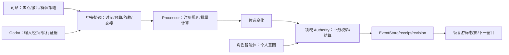
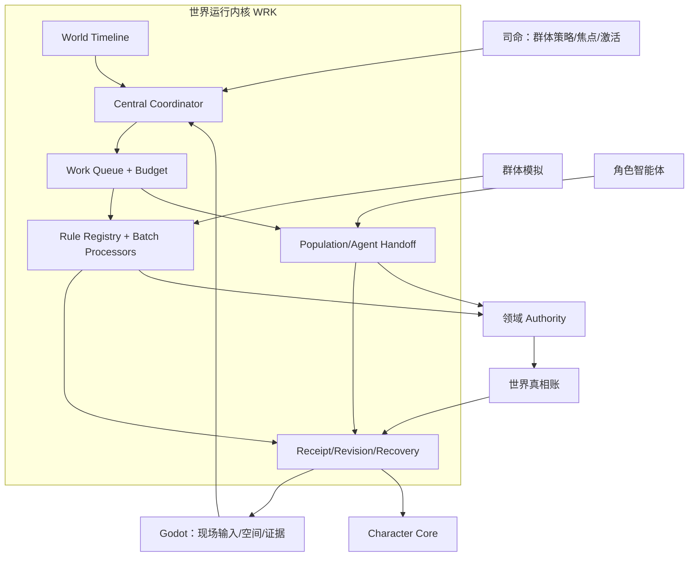
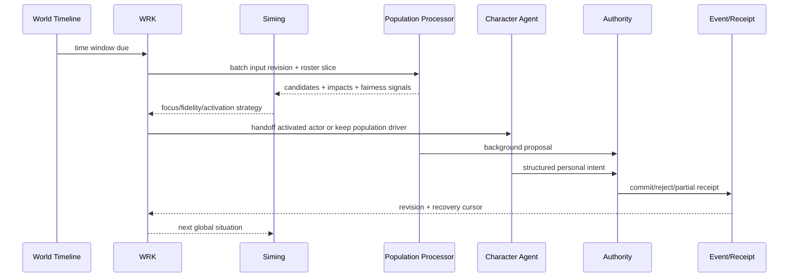

# 前后架构差异与世界运行内核规格

状态：`analysis/planned/non-authorizing`

## 1. 为什么需要 WRK

线程中的核心纠偏是：现在有多条“已经能运行的窄链”，但还没有一个可以组织全城持续生活的共同推进中枢。WRK 不是凭空增加一个万能模块，而是把已有的时间、人口、角色、领域和表现能力按共同合同组织起来。

继承原文的明确命名是：

> 世界运行内核（World Runtime Kernel，WRK）负责组织城市持续运行：时间推进、任务调度、批量模拟、居民在群体模拟与角色智能体之间的驱动交接，以及结算回执跟踪和恢复。

## 2. 前架构：各链能跑，但交接是局部的 `[current]`

### 2.1 当前已经存在的链

```text
Godot → raw_fact_event → L1 projection → character/Siming bundle
character → typed intent → domain owner → event/receipt
PopulationCadenceDriver → SimulationClock → B0 projection → publication
event/receipt → projection → Godot/Character Core
```

### 2.2 当前的结构性限制

- `SimulationClock` 主要服务人口连续性和日窗口，不是所有领域共同使用的完整时间底座。
- B0 只推进有限生命/需求字段，不代表完整社会生活。
- 调度器选择“谁值得计算”，不等于它拥有事实结算权。
- 角色智能体和群体模拟都可能产生同一角色的候选，需要统一交接避免重复。
- 现场位置和表现与后台世界事实之间仍存在局部镜像/刷新边界。
- 现有领域 Owner 不是所有开放世界持续变化的统一接入面。

## 3. 过渡架构：中央协调、Processor、Authority 三部分收拢 `[planned]`



中央协调不取代领域 owner；Processor 只计算候选；Authority 才确认事实。

## 4. 目标架构：一个内核层，内部职责仍分开 `[planned]`

线程中对“混合架构是不是三者在一层”的纠正是：

> 混合后的整体可以放在同一个“世界运行内核”层里，三者成为这一层的内部组成。

因此：

| WRK 内部组成 | 负责什么 |
|---|---|
| 中央协调 | 时间推进、任务预算、依赖、暂停、有限追赶、交接 |
| 数据驱动模拟 | 角色、生态、生产、组织等批量候选计算 |
| 领域结算接入 | 把候选送给正确 Owner，接收 receipt/revision |
| 交接管理 | 群体模拟 ↔ 激活角色智能体，处理锁、在途动作、关闭和回收 |
| 恢复与观测 | cursor、backlog、失败窗口、重试、replay 和指标 |

## 5. 目标架构图



## 6. 主流程时序图



## 7. 前后差异表

| 维度 | 前架构 | 过渡架构 | 目标架构 |
|---|---|---|---|
| 时间 | 人口 cadence 为主 | 统一窗口合同接入更多领域 | 世界时间、物理、认知、结算有映射 |
| 调度 | 各链局部触发 | WRK 统一预算和依赖 | 全城领域工作登记、优先级和公平性 |
| 角色 | B0 和智能体两条链 | 有显式交接包和锁 | 所有角色持续有生命线，精度可切换 |
| 司命 | 群体候选/激活接口 | 事件/压力/焦点集中调度 | 全局社会生命催化，不写事实 |
| 图谱 | 派生索引/局部能力 | 影响传播和非玩家焦点 | 全体社会生命可查询，但不拥有事实 |
| 表现 | 投影和镜像局部接线 | freshness、区域精度和补齐 | 区域分层、脚本、物理和真相一致 |
| 恢复 | 人口和部分领域 recovery | 统一 cursor/receipt/replay | 全城窗口、领域、交接和表现可恢复 |

## 8. 不应做的“伪升级”

- 不能新建一个 WRK event store，把旧 EventStore 变成旁路。
- 不能让中央协调直接改工资、库存、生命、位置、关系或记忆。
- 不能把 Processor 的候选变化直接当作世界事实。
- 不能把“世界运行内核”理解成一个替所有角色思考的超大 LLM。
- 不能用“看到一个 NPC”作为完整智能体激活的隐式条件。

## 9. 验收

1. 一个窗口可以被固定输入、批量计算、领域结算、receipt 和 recovery 完整回放。
2. 群体模拟和角色智能体对同一角色的主动行为不会重复提交。
3. 司命可以改变调度和精度，但不能越过 Authority。
4. WRK 失败时能保留窗口、游标和待处理任务，不丢世界时间。

## 10. 状态边界

- `[current]`：现有人口 cadence、caller-driven clock、领域 owner、EventStore、角色运行时和局部投影。
- `[planned]`：WRK 中央协调、批量 Processor 注册、统一交接、receipt/revision/recovery 组织。
- `[deferred]`：以 WRK 为名新建第二套 event store、clock、scheduler、authority 或私有记忆库；这些方向禁止进入实现。
