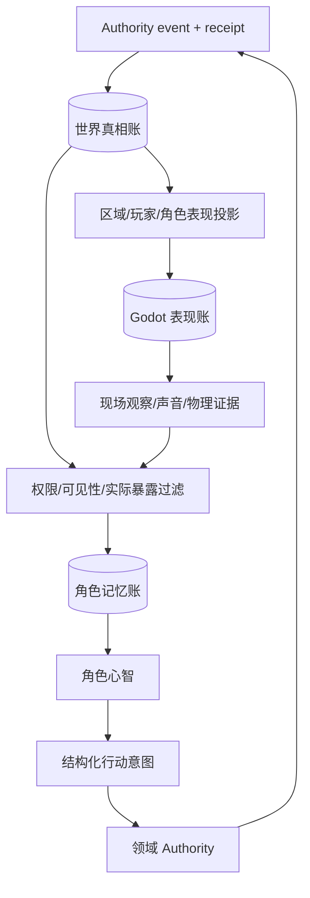
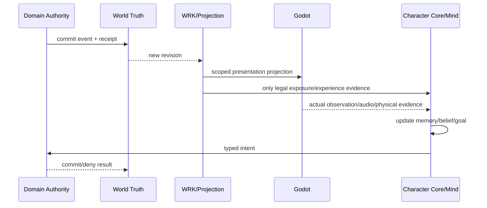
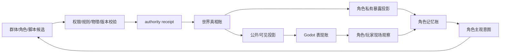

# 三本账与世界真相维护规格

状态：`analysis/planned/non-authorizing`

## 1. 三本账不是三份重复数据库

本规格把线程中反复出现的“世界真相、角色记忆、表现层”固定为三个不同语义的账：

1. **世界真相账**：世界正式承认发生过什么，以及当前可查询状态。
2. **角色记忆账**：某个角色实际经历、知道、相信、误解和记住什么。
3. **世界表现账**：Godot 当前加载、显示、播放和可交互的局部状态。

三者可以引用同一个事件或实体，但不能互相冒充。

## 2. 世界真相账

### 2.1 Owner `[current + planned]`

由现有 Gameplay EventStore、领域 Authority、ESM、WorldContinuity 和各领域 owner 共同承担；未来由 WRK 组织它们的窗口和回执，不建立万能 writer。

### 2.2 允许记录

- 已确认的实体、生命状态、位置/区域锚点、资源、库存、产权、组织、关系和环境状态；
- 物理接触、动作执行、交易、生产、伤势、死亡、出生/生成和消失等已结算事件；
- `world_revision`、事件时间、提交者、来源、scope、幂等键和 receipt；
- 事件何时发生，即使表现和角色知情尚未更新。

### 2.3 不允许记录

- 未经结算的模型猜测、脚本预演或群体平均值；
- 角色“应该知道什么”这种主观状态；
- 仅凭画面刷新判断的物理事实；
- 直接从角色自由文本推断出来但没有合法事件依据的库存/位置/关系。

## 3. 角色记忆账

### 3.1 Owner `[current + planned]`

Character Core/private memory owner。角色档案、生命状态、记忆种子、经验候选和激活连续性都围绕稳定 `character_id` 管理。

### 3.2 记忆类别

```text
observed    角色自己看见/听见/感知
received    合法从别人或系统得知
inferred    角色基于证据作出的判断
believed    当前信念，可能错误
planned     角色打算做什么
experienced 已经有执行证据的经历
forgotten   低优先级或衰减后的记忆索引
```

“我准备买面包”和“我买到了面包”必须是不同记忆类型；后者只能在 authority receipt 后进入 experienced。

### 3.3 记忆写入规则

1. 角色只能接收自己有权限、实际暴露或合法获知的内容。
2. 世界真相变化不自动等于角色记忆变化。
3. 角色记忆可以错误，但错误不反写世界真相。
4. 激活关闭不能删除记忆；关闭期间的经历以可追踪候选/回执方式补入。
5. 记忆写回携带来源事件、发生时间、获知时间、scope、confidence 和 Character Core revision。

## 4. 世界表现账

### 4.1 Owner `[current + planned]`

Godot scene、actor、physics、audio、UI 和局部表现投影。表现账是可重建的 cache/projection，不是事实数据库。

### 4.2 允许延迟

- 玩家未观察区域可以降低刷新频率或暂不加载；
- 静物视觉变化可以在后台事实确认后，在区域重新进入时补齐；
- 非关键角色可以只表现行为种子和具身壳；
- 交互对象一旦进入玩家可感知/可影响范围，必须提升表现和物理精度。

### 4.3 不允许

- 动画播放成功等于动作结算成功；
- Godot 本地临时变化直接成为世界真相；
- 旧表现覆盖新 revision；
- 表现层根据模型猜测修改角色记忆或资源状态。

## 5. 事件、记忆、表现的三种时间

必须分别记录：

```text
event_time      事实在世界中发生的时间
known_time      角色通过观察/传播得知的时间
presented_time  Godot 将结果显示给玩家的时间
```

例如：

1. 早上 08:05，后台结算商店最后一个包子被买走。
2. 玩家 08:30 才走到店前，才看到笼子为空。
3. 角色甲 08:40 听掌柜说起，记忆中才出现“包子售罄”。

这三个时间不一致不代表系统错误；错误是把它们强行合并成一个时间。

## 6. 架构图



## 7. 主流程时序图



## 8. 数据流图



## 9. 验收不变量

1. 任何真相账变化都可找到 authority event 和 receipt。
2. 任何角色记忆都可找到观察、传播或推理依据，并保留主观性质。
3. 任何表现层变化都可以从真相、行为脚本或现场物理重新构建。
4. 角色不知道的世界事实不会凭空出现在其私有记忆。
5. 角色记错不会污染世界真相。
6. 旧表现或旧记忆候选不能覆盖更新的 revision。

## 10. 状态矩阵

- `[current]`：EventStore/receipt、角色私有记忆边界、L1 过滤、Godot projection 已有窄实现。
- `[planned]`：全体角色三本账同步合同、event/known/presented 三时间、局部补齐和统一回放。
- `[deferred]`：自走棋局内账本和世界模型记忆层。
- `[forbidden]`：三本账合并为一份随意可写的 JSON；模型或 Godot 直接写真相。
