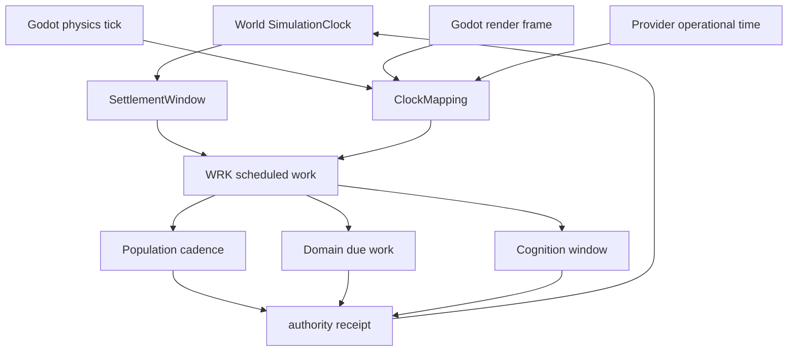
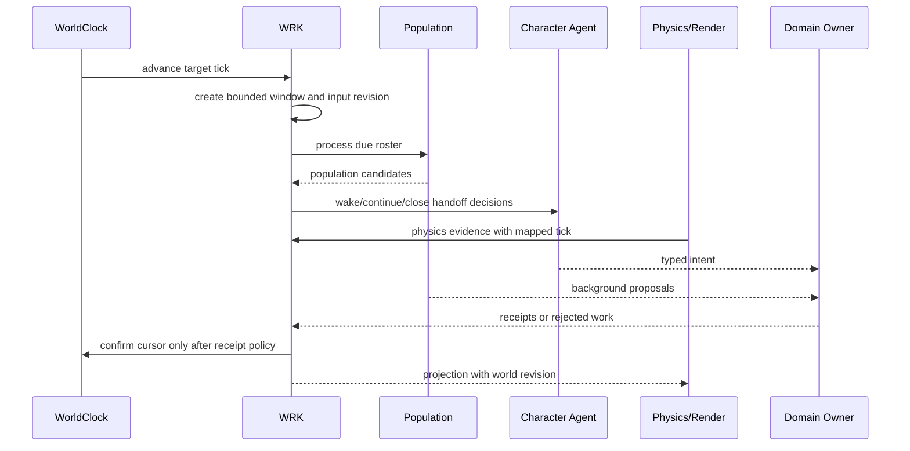
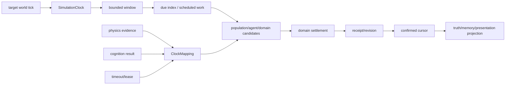

# 开放世界时间模型与多时钟协同规格

状态：`analysis/planned/non-authorizing`

## 1. 设计结论

当前时间模型首先服务开放世界运行时的世界时间、人口 cadence、角色唤醒、到期义务、结算窗口、恢复和回放。未来可以兼容单局运行时，但单局只能作为新的 `session/match timeline profile` 接入；本批不实现自走棋单局。

线程原文的核心表述是：

> 时间模型应成为统一时间基础合同 + 不同运行时 Profile + 明确的作用域与生命周期。

## 2. 前架构 `[current]`

当前同时存在多个时间来源：

```text
world/population tick
producer_ts / wall clock
角色认知时间
Godot physics tick
render frame
provider capture clock
event revision
```

它们各有用途，但映射并不完整。`SimulationClock` 由调用方驱动、只允许单调推进、按整数 tick 处理到期义务、有 catch-up budget，但不自行成为所有领域的世界时钟。

## 3. 目标时间合同 `[planned]`

```text
TemporalProfile
SimulationTimeline
SimulationTime
ClockMapping
ScheduledWork
SettlementWindow
Revision / Receipt / Expiry
```

### 3.1 TemporalProfile

定义运行时如何解释时间：

- `world_open`：持续开放世界、异步窗口、长期角色连续性；
- `session_match`：未来单局作用域、阶段和 teardown；
- `pause_planning`：暂停世界或局部行动，等待选择；
- `benchmark`：加速或固定步长测试。

### 3.2 SimulationTimeline

```text
timeline_id
scope_id                  # world / region / character / session
profile_id
current_tick
confirmed_tick
pending_windows[]
pause_state
catch_up_budget
```

### 3.3 ClockMapping

把不同时间映射到世界时间：

```text
world_tick ↔ physics_tick
world_tick ↔ render_frame
world_tick ↔ cognition_turn
world_tick ↔ provider_capture
world_tick ↔ wall_clock
```

客户端时间、模型耗时和 API timeout 不能直接改变 authority settlement。

## 4. 多时钟职责

| 时钟 | 谁推进 | 用途 | 不能决定 |
|---|---|---|---|
| World clock | WRK/SimulationClock | 城市和人口连续时间 | 客户端本地事实 |
| Physics clock | Godot | 碰撞、刚体、身体运动 | 领域交易/库存事实 |
| Render clock | Godot | 画面刷新 | 世界是否经过一天 |
| Cognition clock | 角色运行时 | Laya/Slow/Deep 决策窗口 | 角色动作已成功 |
| Operational clock | provider/scheduler | timeout、租约、队列 | 世界暂停 |
| Settlement window | domain owner | 批次和结算边界 | 角色主观记忆 |

## 5. 架构图



## 6. 主流程时序图



## 7. 数据流图



## 8. 窗口和失败规则

- 一个窗口的输入 revision 固定；窗口内不重复读取未经确认的新事实。
- 失败窗口保留为 rejected/deferred/backlog，不能静默跳过。
- catch-up 受预算限制，不能因为服务器暂停后一次性调用所有角色完整心智。
- 模型超时只影响本次认知任务；世界时钟继续推进，角色回到 continuity floor。
- 物理事件可以先到达，但必须映射到合法 world tick 和 settlement window。
- 只有达到 receipt policy 的窗口才能推进 confirmed cursor。

## 9. 单局兼容边界 `[deferred]`

未来 `session_match` 可以复用时间坐标、deadline、replay、receipt 和 revision，但必须拥有自己的：

- `session_id` 和 roster；
- start/phase/end/reset 生命周期；
- 局内状态隔离；
- 结果向 world scope 转移的明确 owner 合同。

自走棋的 round、装备、羁绊和奖励不属于时间模型。

## 10. 验收

1. render 掉帧不会让世界少过时间。
2. Laya/Deep 延迟不会拖慢世界时钟。
3. 同一 window 的输入、候选、receipt、cursor 和 replay 可重建。
4. 失败、暂停、恢复和有限追赶不会重复结算。

状态：`[current]` SimulationClock/PopulationCadenceDriver；`[planned]` 统一 Timeline/Mapping/Window 合同；`[deferred]` session profile。
