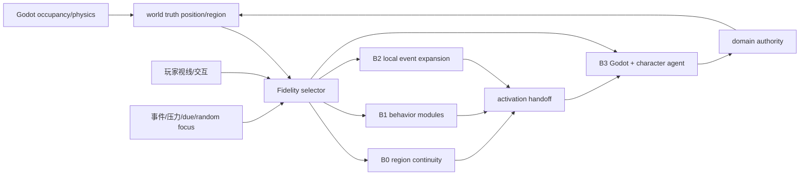
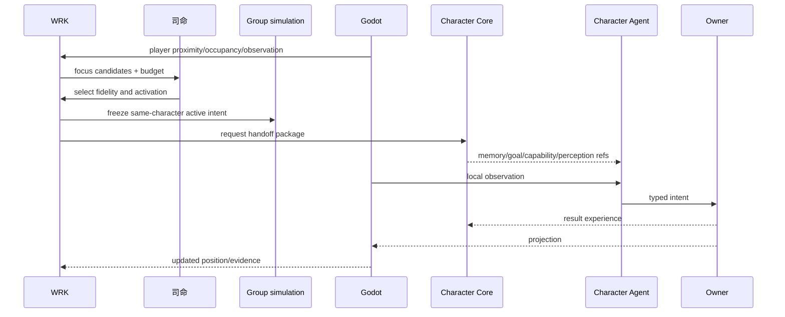
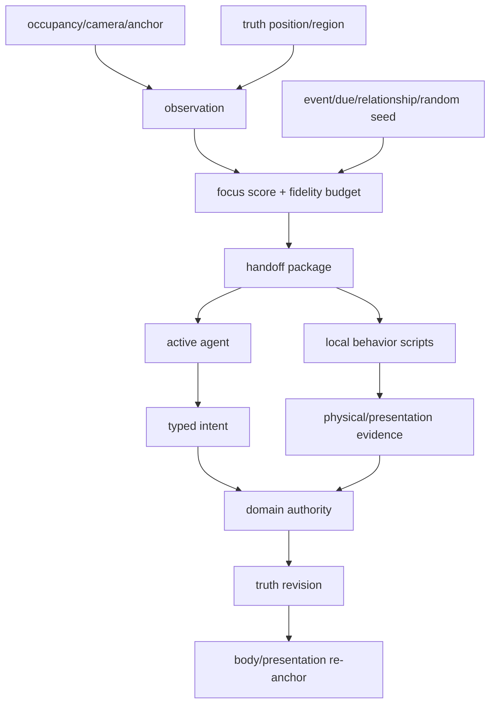

# 空间同步、位置锚点与局部活化规格

状态：`analysis/planned/non-authorizing`

## 1. 设计结论

空间和位置同步与时间同步同等重要。玩家能不能看到、角色能不能感知、Godot 是否加载、后台是否推进、角色是否激活，不能用一个“距离”字段解决，必须拆成：

```text
truth_position      世界真相中的位置/区域
body_position       Godot/物理中的身体位置
perception_position 角色/玩家实际获得的空间观察
presentation_position 表现层当前显示位置
```

## 2. 区域精度层

### B0 远处连续性 `[current + planned]`

只维护区域锚点、生活阶段、到期时间、关系/影响摘要和必要的状态变化，不加载完整身体和物理。

### B1 局部规则行为 `[planned]`

运行可组合行为模块，例如去工作、休息、购买、跟随、等待和转移区域，产生候选路径和影响信号。

### B2 事件局部展开 `[planned]`

加载局部地点、相关实体、资源、关系和可交互对象，准备转交现场或角色智能体。

### B3 现场/完整角色 `[current + planned]`

Godot 具身、物理、L1 感知、Laya、L4 执行契约和领域结算参与。

## 3. 激活条件

角色激活不只由玩家距离决定，候选来自：

- 玩家交互和可见焦点；
- 高影响世界事件；
- 角色 due、义务、连续失败和记忆冲突；
- 关系传播和组织压力；
- 区域资源变化；
- 司命随机社会焦点种子；
- 其他已激活角色对该角色的合法影响。

玩家靠近一个有自我意志的角色时，可先进入“可切换准备态”，但预算不足时仍可使用 B1/B2 行为模块，不能把所有可见角色同时升级为 B3。

## 4. 激活交接包

```text
ActivationHandoff {
  character_id
  character_core_revision
  world_revision
  world_tick
  truth_position
  body_spawn/anchor
  active_background_commitments[]
  pending_population_actions[]
  private_memory_refs[]
  current_goal_portfolio
  capability_envelope
  perception_scope
  ownership_lock
  expiry
}
```

交接前必须：

1. 停止该角色相同主动行为的群体候选提交；
2. 保留外部世界和其他居民继续推进；
3. 对在途动作决定完成、取消、转交或重新排队；
4. 对齐当前世界 revision、位置锚点和记忆 revision；
5. 交接失败时回到 B1/B2，不丢角色历史。

## 5. 架构图



## 6. 主流程时序图



## 7. 数据流图



## 8. 现场反向引导后台

现场可以反向提高后台局部精度，但不能成为真相 owner：

1. 玩家进入区域时，Godot 提交 occupancy、可见实体和交互意图。
2. WRK 给区域增加 B2/B3 预算和更短的同步窗口。
3. 群体模拟暂停该区域相同事件的低精度候选，避免重复。
4. 现场物理和角色智能体产生证据和意图。
5. authority 结算后，后台更新真实 revision；不是现场直接覆盖后台。

## 9. 状态

- `[current]`：Godot occupancy/空间采样、L1 world anchor、局部 actor/presentation 和部分角色激活。
- `[planned]`：统一 truth/body/perception/presentation 四位置、区域 fidelity budget、handoff lock、re-anchor 和玩家触发的后台局部升级。
- `[deferred]`：所有可见角色常驻 B3；无边界的大范围实时物理。
