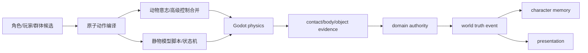
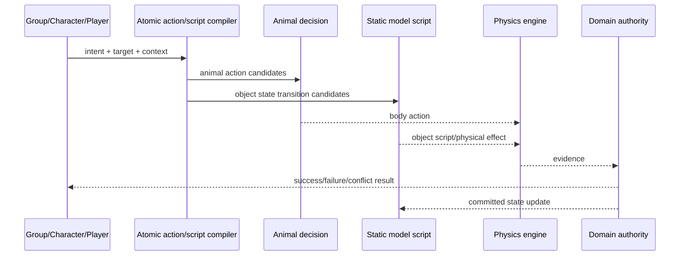
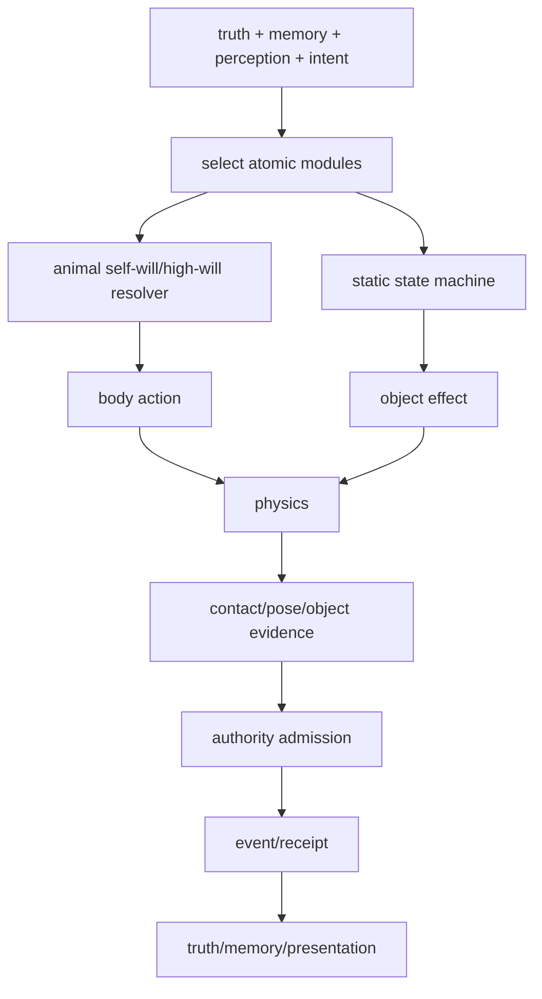

# 动物原子动作与静物模型脚本规格

状态：`analysis/planned/non-authorizing`

## 1. 两类表现对象

线程中已经明确需要分为两类：

### 动物/有机行动体

具备身体、感知、运动和可能的自我意志。动物还要区分：

- 有自我意志，自己选择行动；
- 无复杂自我意志，只执行行为模块；
- 有自我意志但受高级意志控制，例如马受骑乘者牵引；
- 高级意志失效后恢复自身反应。

### 静物/环境对象

没有主观心智，通过模型脚本、状态机、规则和物理变化表现：包子笼、门、灯、摊位、库存容器、天气装置、机器和可破坏对象。

## 2. 原子动作合同

```text
AtomicAction {
  action_id
  actor_ref
  target_refs[]
  preconditions[]
  capability_requirements[]
  control_mode          # self_willed / directed / forced / scripted
  commitment_window
  interrupt_policy
  physics_expectations[]
  evidence_requirements[]
  on_success/on_failure
}
```

原子动作示例：

```text
look_at
turn_head
step
walk_to_anchor
slow_down
stop
brace
avoid
reorient
open
close
consume
remove_item
spill
tip_over
recover_balance
signal_distress
seek_help
```

原子动作不是最终世界事实；它是执行合同和物理行为的最小组成单位。

## 3. 动物意志控制

```text
AnimalDecision
  = own_will candidate
  + higher_intent constraint
  + body/physics constraint
  + fear/pain/need state
```

控制优先级不是简单覆盖，而是根据控制模式明确：

1. 物理不可行和身体极限优先拒绝。
2. 直接高级控制可以限制候选动作范围。
3. 动物自我意志在允许范围内选择反应。
4. 疼痛、恐惧、失衡等身体反馈可以中断高级动作。
5. 领域/authority 最终确认伤害、移动、物品变化和关系结果。

## 4. 静物模型脚本

```text
ModelScript {
  script_id
  object_ref
  state_schema
  transitions[]
  triggers[]
  atomic_effects[]
  visual/audio_bindings[]
  physical_bindings[]
  authority_events[]
  interrupt/recovery_policy
}
```

例如包子笼：

```text
stocked → being_sold → stock_decreased → empty
       ↘ knocked      → tilted         → broken/recovered
```

“包子数量减少”先由交易/库存 owner 确认；“笼子倾斜、包子散落”由物理和静物脚本生成证据；“玩家看到空笼子”由表现投影呈现。

## 5. 架构图



## 6. 主流程时序图



## 7. 数据流图



## 8. 组合和中断规则

- 一个复杂行为由多个原子动作串联，不允许脚本直接写任意 transform 或资源。
- 玩家输入、物理碰撞、疼痛和高优先级世界事件可以中断低优先级动作。
- 中断结果要保存已完成的原子动作、未完成动作和重新排队原因。
- 同一对象的脚本状态只能有一个 authority revision；迟到脚本结果不能回滚新状态。
- 失败动作也会形成合法经历或观察，例如“马受惊”“包子笼倾倒但未破裂”。

## 9. 状态

- `[current]`：Godot physics/actor、部分 action/affordance 和 ESM 执行边界。
- `[planned]`：统一 AtomicAction、ModelScript、意志控制、脚本组合、中断、回放和 authority admission。
- `[deferred]`：任意对象都拥有复杂自主智能；脚本绕过领域结算。
