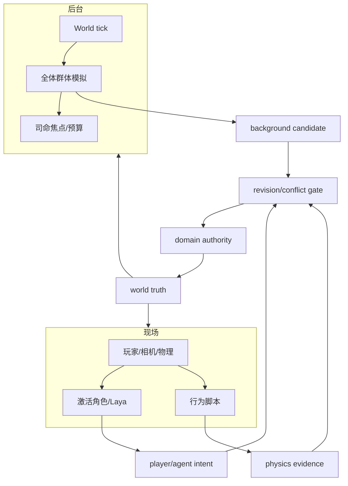
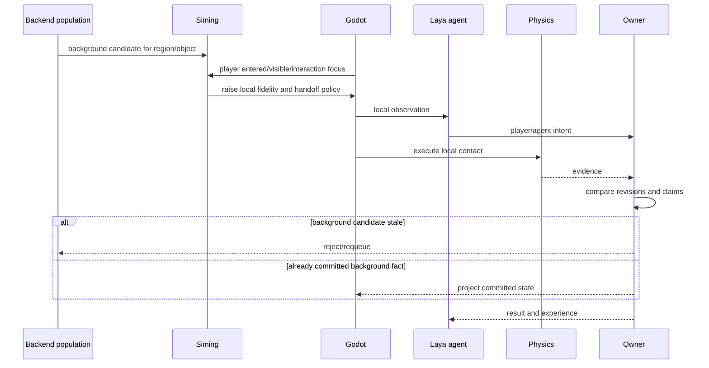
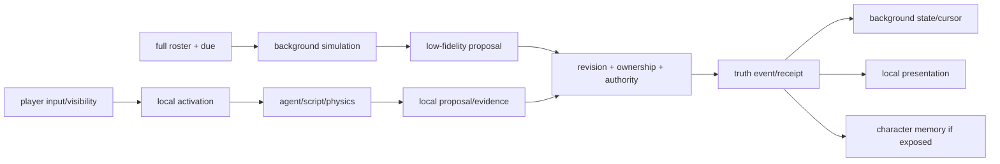

# 后台群体模拟、现场表现与玩家抢占规格

状态：`analysis/planned/non-authorizing`

## 1. 核心问题

后台群体模拟持续推进全体社会生活，但玩家附近不能只是静态贴图；现场需要角色言行、动物反应、静物库存和物理结果。反过来，玩家输入可能在后台下一次 cadence 前改变局面，因此必须定义谁主导、如何抢占和怎样回补。

## 2. 三种驱动层

### 后台社会驱动 `[current + planned]`

推进全体角色、关系、义务、区域压力、库存/生产等已登记领域，频率较低，输出候选和影响信号。

### 现场行为驱动 `[planned]`

当区域进入感知范围，使用具身壳、原子动作、模型脚本、Laya 或确定性行为模块生成连续表现和物理交互。

### 玩家直接驱动 `[current + planned]`

玩家输入和物理接触优先进入 action/affordance/ESM，不能被后台预测覆盖。

## 3. 主导规则

“谁主导”不是一个全局答案，而是按数据类型分层：

| 事项 | 主导者 |
|---|---|
| 世界时间 | WRK/SimulationClock |
| 角色完整心智选择 | 激活角色智能体/Laya |
| 普通居民低精度生活 | 群体模拟/司命准入 |
| 玩家输入 | 玩家 action intent + Godot 物理 |
| 碰撞和身体结果 | Godot physics evidence |
| 库存、交易、生命、关系事实 | 领域 Authority |
| 表现刷新频率 | WRK/Godot presentation policy |
| 角色是否知道 | L1 + Character Core |

## 4. 玩家接近区域的升级流程

1. Godot 报告玩家位置、视线、可见对象、占用区域和交互意图。
2. WRK 计算区域 fidelity budget，司命选择需要激活或保持 B1/B2 的角色。
3. 后台暂停同一角色、同一主动行为的候选提交，但继续推进外部世界和其他居民。
4. 现场加载具身壳、脚本状态和必要的角色心智。
5. 现场产生原子动作、Laya intent 和 physics evidence。
6. Authority 以当前 revision 结算，后台和表现从 receipt 更新。
7. 玩家离开后，关闭角色智能体，保留记忆，未完成行为转交群体路径。

## 5. 玩家抢占后台预测

当玩家动作发生在后台候选提交之前：

- 现场玩家/物理证据进入当前窗口；
- 后台候选基于旧输入 revision 被标记 stale；
- 司命或 WRK 重新生成局部候选。

当后台事实已经提交之后：

- 玩家面对的是新事实；
- 表现可以延迟补齐，但不能回到旧库存/旧位置；
- 角色是否知道该事实取决于合法感知，不自动全员同步。

## 6. 架构图

## 7. 主流程时序图

## 8. 数据流图

## 9. 典型资源冲突

商店只剩一个包子时：

1. 群体模拟、激活角色和玩家都可以提出购买意图。
2. Authority 以当前库存 revision 和合法请求顺序结算。
3. 成功者得到库存减少和购买 receipt。
4. 失败者得到缺货/冲突结果，不能继续相信原候选成功。
5. 表现层根据库存新状态刷新；角色记忆只更新各自实际获得的结果。

## 10. 验收

1. 玩家接近不会强制所有角色调用 LLM。
2. 现场物理不会被旧后台预测覆盖。
3. 后台提交事实后，现场能够从 revision 补齐。
4. 同一对象的后台和现场竞争可回放。
5. 角色不因世界事实提交而无条件获得全局知识。

## 11. 状态边界

- `[current]`：人口 cadence、有限 B0、角色/玩家 typed intent、部分 physics evidence 和领域 receipt 各自已有局部证据。
- `[planned]`：后台与现场的统一 revision、局部 fidelity、抢占、回补、脚本组合和跨账本回放。
- `[deferred]`：全城所有对象常驻高精度现场、通用编辑器 control-plane、自走棋单局表现。
