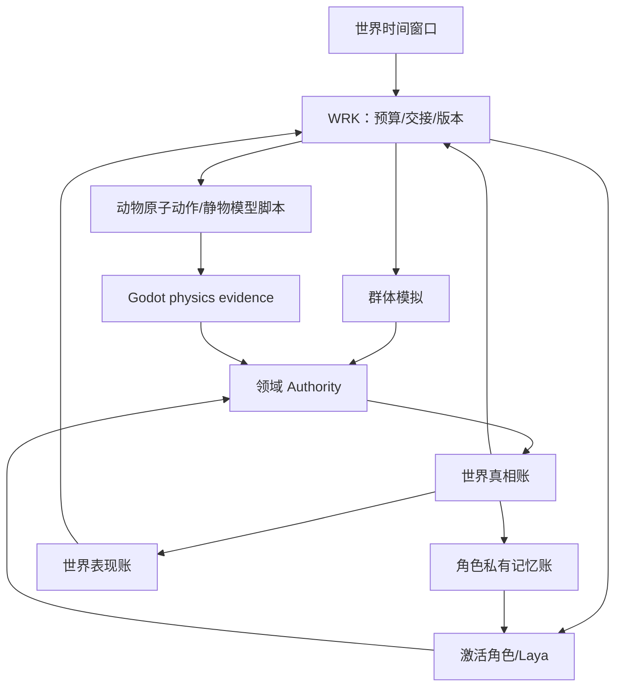
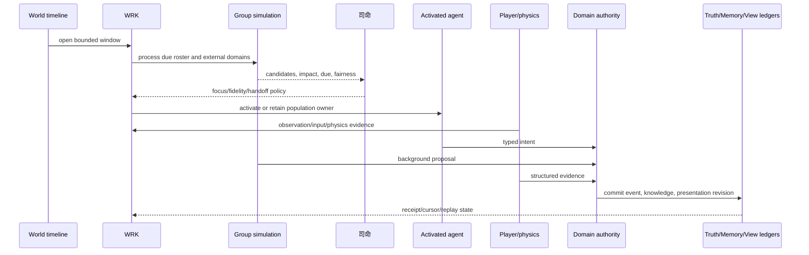
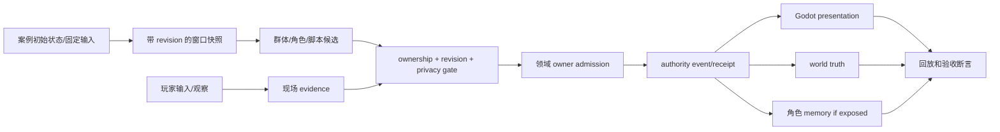

# 典型场景推演与验收案例规格

状态：`analysis/planned/non-authorizing`

本文件把案例写成可回放的设计夹具，不把叙述步骤当作已经完成的运行时证据。

## 0. 案例通用架构图

## 0.1 通用主流程时序图

## 0.2 通用数据流图

## 1. 案例 A：玩家离开三天后返回

### 后台真相视角

1. WRK 推进三个世界时间窗口。
2. 全体角色 B0/B1 更新疲劳、需求、活动阶段、义务和区域锚点。
3. 已登记的生产、库存、天气、组织和关系任务分别提出候选，由领域 Owner 结算。
4. 有影响的事件进入司命焦点队列，可能激活非玩家角色。
5. 世界真相账记录 event_time 和 revision；不因玩家缺席而暂停。

### 玩家视角

1. 玩家进入小镇区域。
2. Godot 加载当前区域状态，而不是重播三天所有画面。
3. 包子笼、道路、居民位置和天气从已确认状态补齐。
4. 玩家只看到自己可感知的表现；角色记忆不会因玩家回来而全部公开。

### 验收点

- 时间没有重复或跳过窗口；
- 远处表现可延迟，但进入区域后状态正确；
- 角色记忆只保留实际经历/合法传播；
- 玩家看到的是确认后的世界。

## 2. 案例 B：玩家看见街上骑马者躲避孩子

### 初始状态

- 司命群体模拟已安排骑马者经过早餐店附近；
- 马是有身体反应和有限自我意志的动物；
- 骑马者是可激活角色或现场行为模块；
- 包子笼是静物模型脚本，库存由领域 owner 管理；
- 玩家进入区域，Godot 开启近场物理。

### 运行过程

1. 孩子进入马的可感知范围，产生现场 observation。
2. 骑马者的角色心智/Laya 或行为模块选择 `slow_down/avoid/stop`。
3. 马在高级意志约束下仍根据恐惧、疼痛、平衡和碰撞空间产生 `brace/reorient/shake_head`。
4. 物理引擎计算马、骑马者、孩子和包子笼的接触。
5. 静物脚本从 `stocked/standing` 转为 `tilted/spilled` 候选；库存减少只有在合法购买或损失规则结算后才确认。
6. Authority 提交碰撞、物品损失、伤害、关系或目击事件。
7. 玩家看到物理结果；骑马者和孩子根据各自感知更新记忆；远处角色不自动知道。

## 3. 案例 C：玩家此时也纵马撞上去

### 后台是否来得及

不以“群体模拟赶不赶得上”作为唯一判断，而按时序处理：

1. 后台候选带有旧 world revision。
2. 玩家接近时，现场成为高精度区域，后台同一对象的低精度主动候选冻结或降级。
3. 玩家输入立即进入 Godot physics；玩家碰撞证据先产生。
4. 后台候选若尚未提交，因 revision/ownership gate 被拒绝或重排。
5. 后台事实若已经提交，则玩家面对新事实，现场不能回滚旧状态。
6. 两次碰撞按 physics evidence 和 authority 规则形成一个或多个有序事件。
7. 迟到的 Laya/司命结果只更新认知、目标和后续行为，不追改已经发生的碰撞。

## 4. 案例 D：激活角色和普通居民争抢最后一个包子

### 真相视角

- 两个请求都引用库存 revision `r`；
- Authority 只接受一个成功扣减；
- 另一个请求得到 conflict/out-of-stock receipt；
- 世界真相只记录实际成功的一次交易。

### 角色视角

- 激活角色接收结构化失败反馈，Laya 选择等待、询问或寻找替代品；
- 普通居民只保存群体模拟的失败/成功经历种子；
- 不允许双方都记成“买到了”。

### 表现视角

- 包子数量只按确认结果减少；
- 玩家看到的笼子状态可以在同一物理/表现窗口刷新；
- 没有玩家观察时，后台只更新库存真相，不必每帧播放售卖动画。

## 5. 案例 E：非玩家社会焦点

1. 司命从区域压力、关系传播、due 或随机种子选出非玩家焦点。
2. 群体模拟为相关角色生成候选和影响边。
3. 重要冲突升级到 B2/B3，激活角色智能体或现场脚本。
4. 事件通过世界真相和合法记忆传播改变其他角色。
5. 玩家可能稍后才遇到结果；玩家不是事件产生的必要条件。

## 6. 案例 F：玩家离开后关闭角色智能体

1. WRK 固定当前 action/goal/memory revision。
2. 完成或取消在途动作，保存已提交结果和未完成任务。
3. Character Core 保存记忆、目标和新的连续性游标。
4. 角色回到 B1/B0，继续受群体模拟推进。
5. 再次激活时用 handoff package 恢复，而不是创建新角色。

## 7. 统一验收表

| 检查 | 必须证明 |
|---|---|
| 事实顺序 | event_time、known_time、presented_time 可区分 |
| 角色连续性 | 激活/关闭不改变 character_id、历史和记忆 owner |
| 竞争结算 | 同一资源不会双扣、双记忆、双表现 |
| 空间一致 | 现场位置、真相位置和投影位置有锚点/版本 |
| 物理一致 | 碰撞结果来自 physics evidence，不来自文本预测 |
| 焦点公平 | 非玩家焦点可在玩家不在时产生并推进 |
| 恢复 | 失败窗口、在途动作、记忆和表现可回放/恢复 |

## 8. 状态

- `[current]`：部分事件、角色、人口和 Godot 证据链可单独证明。
- `[planned]`：以上案例作为跨域 WRK 集成验收夹具。
- `[blocked]`：完整结果取决于统一时间、空间、脚本和领域接入。
- `[deferred]`：自走棋单局、通用编辑器控制面、AD/Blender 正式动作资格化和世界模型工作区案例。
