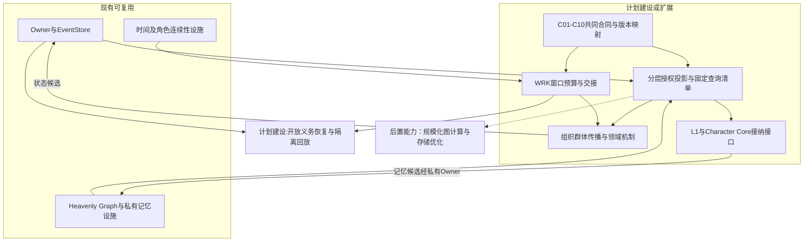
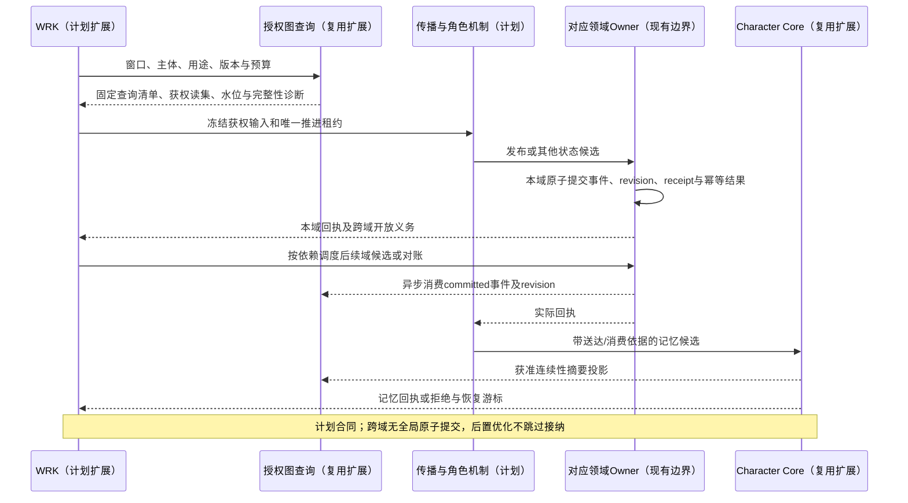
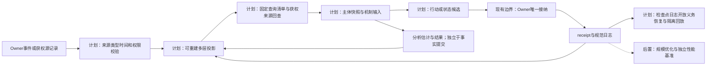

# 13 主项目通用图谱与模拟合同附加设计修正规格（规格06附加）

日期：2026-10-16。状态：`analysis/planned/non-authorizing`。

修订日期：2026-10-16｜合同版本：未发布草案｜建设状态：计划建设 / planned｜验证证据：本轮仅做文档静态核对；运行、迁移、性能及预测未验证。

本文是[06-前后架构差异与世界运行内核规格](06-前后架构差异与世界运行内核规格.md)的独立附加修正，面向主项目未来架构。配对文档为[21-模拟fork通用图谱与主项目合同对齐附加设计修正](../../../fork项目/模拟预测底座/完整版/21-模拟fork通用图谱与主项目合同对齐附加设计修正.md)。WOG 与群体模拟的运行协同另见[规格14](14-世界运行图谱与群体模拟协同规格.md)。保留既有规格原文；本文只收敛通用设计，不授权代码实施。

## 1. 目标、适用顺序与范围

主项目吸收模拟 fork 中适用于游戏、工业、商业等领域的抽象，双方共同维护接口语义。目标是让相同实体、关系、证据、时间和推进合同可承载不同领域机制，避免 fork 复制一套逐渐分歧的基础设施。

根架构的 Owner、私有认知和事实提交边界始终优先。未来按本文设计时，下表明确列出的修正项使用本文及配对文档的共同合同；未涉及部分继续遵循既有规格。本文不更改现有 wire、存储、运行中分支或已验收事实；正式实现前仍须完成对应规格/计划和迁移验收。

主项目无需预置各行业的全部类型与机制。通用合同允许受治理的类型注册；新类型不会自动获得执行能力、事实源资格或 Owner 写权限。金融交易所规则、账户交易、证券数据分类等继续由 fork 专业包定义。

本次同步吸收fork [26 §14](../../../fork项目/模拟预测底座/完整版/26-世界运行图谱与统一运行合同.md#14-设计成熟度评估记录2026-10-16)已确认的R01–R10通用边界。主项目使用现有authority值对象与wire，fork的Record、载荷、Proposal/OwnerReceipt和投影分别按职责主合同定义；本篇只规定语义与适配要求，不新建通用信封或自动改写现有schema。金融夹具、市场规则及性能目标仍在fork，本篇和规格14不复制其数值承诺。

## 2. 设计修正登记

| 编号 | 原设计位置 | 附加修正 | 兼容边界 |
|---|---|---|---|
| M01 | 规格06 §4、§7：WRK组织运行 | 明确图谱治理、查询与领域机制的接口；WRK组织时间/预算/交接，图索引辅助选取读集 | 继续复用现有 clock、scheduler、EventStore 和 Owner |
| M02 | 既有规格02 §3–4：社会节点和二元边 | 增加注册属性、多方 Arrangement、关系引用和多层投影合同 | 保留已有节点/边接口；多方结构可由实体加角色边实现 |
| M03 | 既有规格02 §4：status | 将记录用途、认识态度、生成方式、生命周期、Proposal流程和Owner回执决策分开 | 不给规范信封/读视图增加admission；旧status经显式版本映射读取 |
| M04 | 既有规格02 §5–8：传播和L1 | 将传播路径查询与发布/送达/曝光/消费机制分开 | 邻接只给候选受影响者，不能证明对方已知 |
| M05 | 规格08：时间；既有规格03：精度交接 | 继承六个时间对象；把组织展开、群体聚合、具身精度与B0–B3分离 | 单推进权作用于明确行为维度与时间窗，兼容既有角色锁 |
| M06 | 规格00、06：组织Processor与全体角色 | 明确Organization、DynamicCohort与角色的不同语义和可组合机制 | 不把群体当共同账户，不把组织状态Owner当组织决策者 |
| M07 | 既有规格02、04：图谱查询和假设 | 增加模型端口、依赖和作用路径引用，保留来源回查 | 图路径不证明因果效应；模型输出不直接升级为硬事实 |

本文是这些修正的设计登记；没有新增实现证据。十月分析、既有规格02/03/04及后续实施计划的相应条目在实施批次中需引用本登记，避免消费者继续采用冲突定义。

## 3. 双方共同合同目录

以下C01–C10是配对文档共用的设计合同编号，本节负责通用语义，配对文档负责fork字段映射。表中类型名均为设计示意，正式实现优先映射现有值对象与注册设施。

| ID | 合同 | 必须保留的语义 | 主项目消费者 |
|---|---|---|---|
| C01 | IdentityAndType | 稳定身份、版本化类型、来源别名、匹配证据/置信与可撤回映射 | roster、组织、社会图 |
| C02 | RelationAndArrangement | 规范记录承载关系载荷，多方安排与角色化关系；读投影无独立事实权 | 社会关系、合同、组织职责 |
| C03 | EvidenceAndAssertion | 来源/命题/认识主体、用途/生成/生命周期，候选流程与回执决策分离 | 图谱、私有认知、检索 |
| C04 | TemporalAndAvailability | 六个时间对象、双时间、主体可得时间、序号及观测时钟映射 | WRK、传播、角色唤醒 |
| C05 | ScopeAndPermission | 来源权利、分用途许可、字段可见性、撤权、留存删除、派生限制与授权依据 | L1、司命、图查询、接入和存储 |
| C06 | StructureAndProgression | 组织/群体分离、B0–B3、聚合误差、唯一推进权和交接 | Population、Character Core |
| C07 | MechanismAndPorts | 触发/读写集/时间依赖、Owner绑定、本域原子及跨域协调/失败语义 | Processor、边更新、领域适配 |
| C08 | ProjectionAndQuery | 分层载荷、固定查询清单、规范版本及投影pins、有界遍历/完整性与授权诊断 | 司命、群体选择器、L1、WRK |
| C09 | BranchAndReplay | 分支/输入版本固定、receipt、检查点/日志/开放义务、恢复及两类回放 | WRK、诊断、预测分支 |
| C10 | ContractCompatibility | 能力/版本/迁移、消费者pins、旧轨迹与纵切证据、显式降级及分轴状态 | 包接入与上游同步 |

## 4. 图谱、属性与关系机制

### 4.1 可关联身份与隔离图层

实体身份在各投影之间可解析，资源只在原Owner处保存规范状态。能力图、角色私有记忆图、社会生命图与Heavenly Graph继续保持各自存储/访问/写回边界。统一查询面组合获权摘要或引用；可关联身份不代表允许跨私有图发现、枚举或遍历。

图层、子图和折叠视图属于组织与查询结构。组织折叠后，岗位、账户与义务仍指向原规范身份；不会产生第二份资源。大型时序、文本、矩阵、几何和物理载荷放在相应数据存储，图中保留不可变引用、版本与依赖。

目录、原始载荷、规范事件/状态与派生索引分别保存职责。高频流保留成员级时间、序号、权限和定位，不要求每个样本建图；Owner提交不等待投影刷新。只有查询副本可丢弃重建，唯一原始载荷不能当缓存删除。引用不可变不等于内容永久留存，删除后按§5报告回放缺失。

### 4.2 C02关系最小合同（设计示意）

```text
RelationDefinition = {type_ref, endpoint_roles, property_schema_ref,
  lifecycle_policy_ref, permitted_tag_refs, mechanism_binding_refs,
  admitted_owner_contract_ref}
规范关系：既有领域规范记录承载关系载荷，引用所属Owner与具体revision
fork映射：Record(payload = RelationInstance)
读取投影：WorldRecordView / RelationProjection，仅引用获权的规范版本
派生元数据：source_revision_vector、projection_version、projection_cursor
```

以上是组合示意，不定义第二套Record、RelationInstance或RelationProjection。fork正式字段分别以[03](../../../fork项目/模拟预测底座/完整版/03-类型化数据与统一记录合同.md)、[04](../../../fork项目/模拟预测底座/完整版/04-实体关系图谱与动态边.md)和[26](../../../fork项目/模拟预测底座/完整版/26-世界运行图谱与统一运行合同.md)为准；主项目旧projection_revision等字段通过版本适配，不自动改wire。规范revision、Proposal.base_revision、回执实际提交引用，以及投影版本/游标分别解释。投影可展现源字段的获权副本，但无独立事实版本、admission或接纳权。

二元关系保留原有端点查询；多方关系用Arrangement实体与角色化边表达，不要求更换图数据库。替代原生超边的实现必须保留安排身份、参与者角色、整体有效期和成员修订边界，不能只留下彼此无关的二元边。

属性有类型、量纲、范围、空值语义和测量定义。信任、接触频率、传播延迟、义务金额、供给容量分别定义，不压成万能weight。标签和元标签引用已有语义注册、生命周期、可见性与效果绑定治理，不直接写资源或创建Owner。

关系更新链固定为：源事件/到期工作 → 获权输入快照 → 注册机制计算候选 → 对应Owner校验 → receipt → 新关系投影。图索引只更新派生数据；关系的规范状态由其领域Owner维护。计算衰减也消费统一时间，不创建独立关系时钟。

### 4.3 C03独立语义轴

| 轴 | 示例 | 约束 |
|---|---|---|
| 记录用途（语义轴） | observation、assumption、estimate、candidate、fact、result | fork仍用Record.epistemic_status六值；record_kind仅为未发布迁移名称，不自动改字段 |
| 认识态度 | observes、believes、hopes、intends、经规则证明的knows | 绑定holder、命题/分支/版本与证据；各算子独立 |
| 生成方式 | source、projection、inference、correction、retraction | 由对应载荷/来源表达，保留转换、机制版本和血缘 |
| 生命周期 | active、superseded、revoked、expired | 依对象合同表达；不自动授权删除或无限保留内容 |
| Proposal流程 | 提交、等待、终止等本操作状态 | 候选不构成事实；未获接纳不能宣称效果已完成 |
| Owner处理证明 | 回执decision及接受效果/提交版本引用 | 由OwnerReceipt或现有OwnerCommitReceipt适配表达；不新增Record/WorldRecordView.admission |

这些是需要分开的语义，不要求全部成为信封字段。Proposal和回执是流程对象，事实由Owner提交的规范记录承载。fork回执字段以[05](../../../fork项目/模拟预测底座/完整版/05-世界真相证据模型与修订回放.md)为准；主项目OwnerCommitReceipt按操作/接受效果/实际提交引用显式映射，pending、deferred、partial不能互当成功。原status结合来源、Owner、用途映射；不能判断时返回legacy/unknown诊断，不向fork冻结六值枚举塞入新值或将未知内容当硬事实。

“收到一条传闻”可以是已接纳的采集事实，传闻内容仍可能是假；“角色相信传闻”可以是私有状态事实，不能证明传闻内容成立。图谱修订、关系变更、撤权和来源纠正触发依赖缓存/快照失效，不静默改写已封存决策输入。

## 5. 时间、时空口径与权限

C04以[十月规格09的六个通用时间对象](../../../10月分析/规格/09-通用时间权限投影与领域服务接入规格.md)为基础，并与[规格08](08-开放世界时间模型与多时钟协同规格.md)配合。事件时间、有效时间、系统记录时间、发布、主体可得、消费和表现时间分别解释；有权限不意味着已经接收、阅读或相信。

虚拟世界时间不强行赋予UTC日期。真实源时间经ClockMapping进入目标timeline，保留原时钟、精度、序号、映射版本和误差。operational timeout与模拟内行动延迟分别处理；未知映射不以裸tick或墙钟猜测比较。

空间支持几何、拓扑、区域和适用域引用；测量定义保存单位、分母、聚合窗口和适用范围。字段可不适用，但须声明理由；新增领域只装配需要的合同，不能因通用化强制所有记录带几何坐标。

C05分开表达世界制度权力、组织委托、系统访问、领域提交权和实际知情。组织关系边只引用授权依据，权限判定仍由现有准入设施及获准适配器执行。查询前与展开/提交时校验；撤权使旧frame、缓存和在途候选失效。研究视角不可反向成为角色感知。

来源权利、训练/派生/分享/导出/跨境、地域、敏感级别、留存/删除分别登记；read不推出其他用途，未知授权阻断相应使用。派生结果、摘要和模型特征继承来源限制，匿名化或聚合不自动公开。身份匹配保留证据、置信及可撤回关系，不凭名称合并，也不推测匿名受益人。

撤权、许可到期、内容删除及依法保留分开处理；各Owner执行本域删除，协调器追踪载荷/索引/缓存/派生物传播，不建立万能删除Owner。最小审计仍受访问控制，不可变引用不承诺永久内容。备份恢复先重施限制，缺失输入明确限制回放；删训练源不等于消除模型影响，模型撤回/重训另评。已成立的履约义务按既有系统权限处理，撤权不抹去既成事实。

## 6. 组织、群体、精度与认知

### 6.1 两种一等结构

Organization保存制度身份、岗位、任职、委托、审批/否决、共同资源引用和义务。组织可以拥有多个岗位智能体，但组织Owner仍只负责领域状态提交。

DynamicCohort是某目的/窗口/维度下的成员投影，保存成员或粒子权重、联合分布、网络摘要、聚合误差和拆合条件。群体允许分歧、从众、逆反与分裂；仅对特定行为和时段相近的片段批量计算。分析群体可重叠，执行必须按唯一主体归属分配，不能复制资产或动作。

### 6.2 B0–B3统一定义

| 层 | 双方统一含义 |
|---|---|
| B0 | 已准入连续性状态的低成本推进；不凭总体平均值制造个人重大事实 |
| B1 | 注册轻量心智/行为模块产生候选与升级信号 |
| B2 | 局部事件级角色模拟，意图受明确范围限制 |
| B3 | 完整角色智能体harness，按L1–L4和Laya/Slow/Deep路由运行 |

主体种类、群体聚合程度、组织内部展开、具身精度与B层分别配置。一个组织可包含多个不同B层角色；关闭表现不自动降级心智，打开画布也不自动激活B3。

最小唯一推进锁继续复用既有actor/window合同。未来如允许不同独立行为维度并发，必须先声明写集、冲突政策和子租约；不能以“维度不同”绕过现有锁。群体与角色交接冻结游标、扣除统计贡献、传递获权记忆引用和未完成义务，Owner receipt驱动恢复。

### 6.3 传播与高阶认知

传播机制产生发布、送达、曝光、消费证据，Character Core按合同接纳私有记忆。图谱只能发现可能路径，不能让两跳邻居自动获得消息。

结构化命题采用受限AST及版本化命题引用，支持知道、相信、希望、意图等算子；每层绑定主体、时间、证据与访问限制，限制深度、循环、缓存和预算。当前有限高阶记忆闭环不能据此被描述为完整递归认知实现。

observes、believes、hopes、intends分别接纳；knows须实际取得并理解、具备可追溯证据并通过注册版本知识证明规则。无法核实的开放现实内容保持belief/假设；支持与反对证据可并存，争议、修订或撤回由私有心智Owner追加revision。有限推理不默认自省、公示即共同知识或缺证即不知。

群体情绪、动机、传播倾向等潜变量登记观测/代理/假设、主体/时间、覆盖/滞后/误差、先验、识别范围和用途。竞争模型、区间或联合分布通过敏感性、消融、时间留出验证；个体证据不足退到群体或情景。“方向稳健、动机不可识别”是允许的结果，最佳拟合不构成真实个体画像。

## 7. WRK、图谱与机制的组合边界

WRK继续承担时间窗、预算、依赖、唯一推进权、结算编排和恢复。图谱提供获权、可追溯且有界的读集候选；领域Processor、角色和传播机制负责计算；对应Owner负责状态接纳。

C07声明模型/机制的输入输出、read-set、proposed-write-set、时间域、延迟、Owner、失败和回放能力。模型估计可保存为分析结果；若要修改角色信念、资源或其他规范状态，须进入相应Owner链。反馈依赖声明阶段或滞后，禁止自产预测被再次当独立证据。

C08按主体/用途、世界/分支、cutoff、选择策略、依赖要求及预算固定读集，返回不可变查询清单或现有等价对象。清单保留RecordRef/规范版本、事件游标、固定载荷切片、投影版本/消费水位、转换与测量版本、权限依据、freshness、截断和缺失诊断；fork字段归[26 §6.5](../../../fork项目/模拟预测底座/完整版/26-世界运行图谱与统一运行合同.md#65-跨存储查询合同wog-r04)的QueryManifest，不在本篇重定义。

dependency_complete缺少必需依赖不能返回完整快照，available_with_gaps显式带缺口；均不承诺跨Owner全局原子快照。图中未找到不等于源Owner中不存在，投影失效可依获准策略回查源；重建不触发业务效果。旧graph revision只指派生版本，不等同业务revision。

因果分别标记记录依赖、机制假设、模型干预与现实识别，不是置信度晋升阶梯。声明须包含干预/对照、结果窗、模型、混杂/识别假设、适用范围及不确定性；图路径、相关性或模型内干预不直接证明现实因果效应。

### 7.1 Owner提交与跨域协同

每种规范状态只绑定一个直接Owner。本域原子提交适用的规范revision、事件、资源预留、开放义务、回执及幂等结果，拒绝不制造效果；允许部分接纳须按本操作合同界定原子效果集合。跨Owner按预留→确认/消耗→释放或追加补偿协同，不采用覆盖外部系统的全局事务。Proposal、预留、外部命令/执行、账户或资源效果、交收与补偿分别使用作用域幂等键。

WRK/协调器只安排依赖、重试、超时与对账；预留资源事实属于资源Owner，不由协调器伪造。一个Owner失败不撤销另一域已提交事实；保留未完成义务，恢复后继续，补偿追加不删历史。外部回报接入成功不等于业务Owner接纳；未知外部结果先查询/对账，不能盲目重发动作。

### 7.2 背压、恢复与回放能力

先限制新任务/查询，再降低展示与允许合并的派生计算；已确认输入和规范事实不静默丢弃。封闭模拟可减速，实时滞后须标lag、阻断陈旧动作，必要时暂停。固定硬件/版本/载荷/拓扑后分别测接收、本域提交、跨域完成与投影滞后；fork的金融/工业规模和时延目标不是主项目SLO。

恢复固定checkpoint+log+open obligations及幂等结果。审计回放读取已记录输出解释来源与提交；执行回放在隔离存储重跑固定输入/顺序/逻辑时钟/规则并比较业务结果，不向真实外部重复执行。外部引擎或LLM无确定性保证时声明能力限制，不能把新调用当精确审计。删除/缺失载荷、版本不支持或输入不全时明确无法完整回放。

## 8. 架构图



## 9. 主流程时序图



## 10. 数据流图



## 11. 当前实现映射、实施边界与验收

| 现有设施/设计来源 | 本文复用位置 | 尚需设计与验收 |
|---|---|---|
| `backend/app/models/siming_heavenly_graph.py`、`heavenly_graph_queries.py`、`authority_graph_projector.py` | scope、双时间、来源、查询与投影基础 | 注册扩展、多方关系视图、查询覆盖、水位与缺口合同 |
| Character Core、`graph_memory_store.py` | 私有记忆、连续性与回执边界 | 消费证据接纳、结构化高阶命题映射 |
| `world_runtime`时间、调度与有限结算/回放设施 | 六对象、窗口、receipt和恢复 | WRK消费者统一pins、组织群体和传播机制接入 |
| [既有规格02](既有中旬规格/02-全体角色社会生命图谱与记忆边界规格.md)、[既有规格03](既有中旬规格/03-群体模拟B0-B1与角色智能体B2-B3交接规格.md)、[既有规格04](既有中旬规格/04-司命调度自主焦点与世界因果规格.md) | 图分层、精度语义和司命权限 | 按M01–M07引用增量规格，不能仅凭引用视为实现 |

表中无完整相对路径的文件名仅作模块定位，实际代码位于`backend/app/`相应服务或角色目录；不把模块存在等同所有目标消费者已接入。

验收要求：

1. 同一通用合同分别表达“城镇命令与组织响应”和另一行业场景，无需为业务名称修改内核分支；新事实族仍走正式admission。
2. 动态关系变更可从源事件重建；撤权后缓存、旧frame和跨私有图遍历不能泄露。
3. 多方安排能恢复参与角色及整体修订；跨层实体不重复资源。
4. 未曝光角色不因图路径自动知道消息；其他取得路径须独立举证，消费/理解后按规则接纳记忆或知识。
5. 群体拆合与B层交接保持身份、统计贡献、义务与推进权，重试不重复世界动作。
6. 图查询截断、索引滞后、源记录缺失与确实无关系有不同诊断；Owner提交重校验来源与revision。
7. 新旧schema映射、旧checkpoint+tail和分支pins可复核；不兼容时拒绝或显式降级。
8. 本域提交中断无半套效果；跨域单侧失败、重复消息与未知外部结果可对账恢复，不重复动作或删除既成事实。
9. 严格/带缺口读取、投影丢失、必需载荷缺失各有结果；查询与回放不得冒充完整，投影重建不写业务事实。
10. 在途撤权、派生限制、删除传播、备份恢复均不再次泄漏；用户操作权限与既存义务系统履约权限分开。
11. 争议知识由版本化规则及支持/反对证据检验；潜变量和因果声明标识可识别范围，不以最佳拟合或模型干预冒充现实真相。

### 11.1 同步范围、迁移与纵切证据

R01/R02/R04/R05/R07/R09通用约束分别进入C02/C03、C07/C09、C08、C03/C07、C01/C05/C09和模型消费者；R08只共享测量/背压/恢复方法。R06的Nasdaq子集、ABIDES候选及许可/协议核验继续在fork17，不进入主项目必选依赖。完整逐项映射见[配对21 §11.1](../../../fork项目/模拟预测底座/完整版/21-模拟fork通用图谱与主项目合同对齐附加设计修正.md#111-r01r10同步登记)。

R03的TEST-X合成夹具和五个业务Owner实例归[26 §14.14](../../../fork项目/模拟预测底座/完整版/26-世界运行图谱与统一运行合同.md#1414-wog-r03-已确认决议合成双边交易最小纵切)。主项目以自身场景另验相同通用不变量，规格14的集市案例只是设计示意；fork运行通过也不代替主项目消费者兼容通过。当前R03为设计已确认、实现及运行验收待完成，本次同步同样没有新增运行证据。

每次迁移登记源/目标合同、旧字段及枚举、适配/拒绝条件、消费者pins、权限影响、回滚点、旧轨迹及新场景证据；不能仅凭类型同名转换、自动改record_kind或引入信封admission。修订日期、合同版本、建设状态和验证证据分轴维护。静态校验只能检查显式结构与链接，不证明自然语言全一致、图实际渲染或运行通过。

`[current]`仅指现有领域图谱、权限、时间和回执设施，不在本次重验其运行状态。`[planned]`为本文所有新增共同合同及消费者适配。`[deferred]`为测量后再选的大规模增量计算、分布式存储和通用平台API。`[forbidden]`包括第二事实写入器、未经治理的类型生效、私有图合并、图路径直接证明因果和图谱分支合并自动提交世界状态。

后续先完成合同与消费者差异审查，再按[既有图谱实施计划](../计划/既有中旬计划/02-派生社会图谱与因果传播实施计划.md)及[集成计划](../计划/05-群体模拟升级集成实施计划.md)编制对应增量任务。当前Laya切片不以全套通用化完成为前提；新能力仅在实际消费者需要时进入实现。
