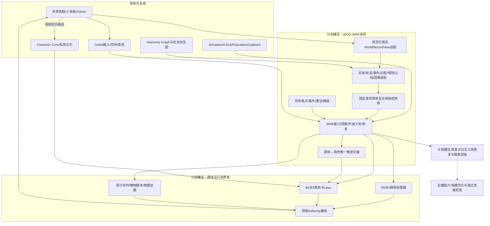
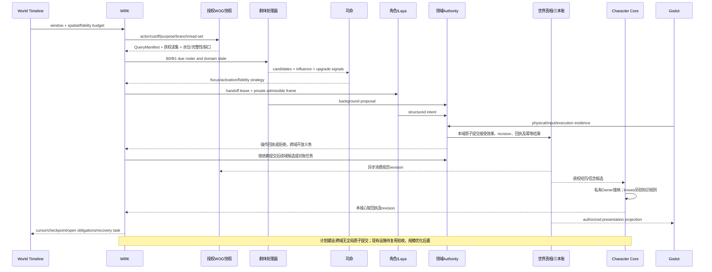
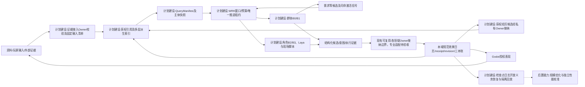

# 世界运行图谱与群体模拟协同规格

状态：`analysis/planned/non-authorizing`

日期：2026-10-16

修订日期：2026-10-16｜合同版本：未发布草案｜建设状态：计划建设 / planned｜验证证据：本轮仅做文档静态核对；运行、迁移、性能及预测未验证。

本文是主项目群体模拟升级的新增配套规格。它把模拟 fork 的“多层时空可演化世界运行图谱”（WOG）适配到主项目的 World Runtime Kernel（WRK）、组织、动态群体、角色智能体、司命、Character Core 和 Godot 表现边界中。本文不改写[06-前后架构差异与世界运行内核规格](06-前后架构差异与世界运行内核规格.md)、[07-三本账与世界真相维护规格](07-三本账与世界真相维护规格.md)或既有 00–13 规格；它是新增的接口收敛文件。

本文只吸收通用运行合同，不把金融市场规则、账户、订单和产业链类型带入主项目。金融专业类型仍留在 fork，通过 WOG 的类型注册、领域机制和 Owner 适配边界接入。

本轮按[规格13](13-主项目通用图谱与模拟合同附加设计修正规格.md)与[fork21](../../../fork项目/模拟预测底座/完整版/21-模拟fork通用图谱与主项目合同对齐附加设计修正.md)同步R01–R10的通用设计裁决。本文负责WOG/WRK消费者组合，不另造字段主合同；主项目现有wire须经显式适配，设计同步不等于schema迁移、消费者实现或运行验收完成。

## 1. 目标与原则

### 1.1 目标

主项目需要的不是一张静态社会关系图，而是一个能支持以下闭环的运行投影：

```text
世界真相/事件/状态
  → 授权图谱读集
  → WRK 窗口与预算
  → 群体批量推进或角色激活
  → 候选变化/意图
  → 领域 Authority 结算
  → receipt/revision
  → 新图谱投影、私有记忆和现场表现
```

### 1.2 设计裁决

1. WOG 是派生图谱和运行读集，不是第二世界真相库。
2. 各图层通过具体规范记录引用及血缘关联同一来源事实，不复制事实库；不同Owner、不同对象有各自revision，不共享一个全局版本。投影版本、来源向量和消费游标独立。
3. WRK 负责时间、预算、依赖、唯一推进权、交接和恢复；图谱不替代 WRK。
4. 群体模拟和角色智能体只产生候选/意图；领域 Authority 产生规范事实和 receipt。
5. 公共 WOG 与角色私有记忆严格分开。路径可达、群体同属和玩家可见都不等于角色知道。
6. 玩家接近、事件重要或司命激活只改变计算精度和观察范围，不改变角色身份连续性。

## 2. WOG 在主项目中的定义

> WOG 是从世界事实、状态、事件、关系、规则和主体认知记录生成的、带时间/空间/权限/来源上下文的可重建运行图谱。它为 WRK、司命、群体模拟和角色智能体提供有界读集与影响路径；它不能直接写生命、关系、位置、资源、记忆或现场结果。

主项目沿用以下图层作为**同一记录集合的投影**：

| 图层 | 主项目作用 | 事实来源 |
|---|---|---|
| Schema/Type | 注册角色、组织、群体、事件、过程、规则和关系类型 | Semantic/Type Registry |
| Entity | 角色、组织、岗位、地点、设备、道具和领域对象的身份 | Identity/roster/领域 Owner |
| State | 生命、位置锚点、义务、资源、关系状态和连续性游标 | 对应领域 Owner |
| Event | 移动、交互、冲突、生产、对话、玩家输入和环境变化 | EventStore/领域 Owner |
| Process | 组织审批、传播、行为脚本、物理执行、群体交接 | 注册 Processor/领域服务 |
| Rule | 世界制度、能力限制、空间规则、权限和领域约束 | Rule Registry/Owner |
| Epistemic | 角色实际收到、记住、相信、希望和误解的命题 | Character Core/private memory owner |
| Causal | 已声明的机制依赖和候选影响路径 | Processor/分析结果，不自动等于因果事实 |
| Projection | 某主体、地点、玩家、司命或调试工具可见的授权视图 | Projection/Permission service |

这些图层不是九个运行时，不允许因为某层有节点就绕过另一层的 Owner 或权限。

## 3. 主项目数据合同

### 3.1 规范记录、流程对象与读取投影

WOG引用主项目已有世界真相、三本账、时间和权限对象；C02/C03/C08语义按规格13适配。fork的唯一字段定义仍在[03-记录](../../../fork项目/模拟预测底座/完整版/03-类型化数据与统一记录合同.md)、[04-关系载荷](../../../fork项目/模拟预测底座/完整版/04-实体关系图谱与动态边.md)、[05-候选与回执](../../../fork项目/模拟预测底座/完整版/05-世界真相证据模型与修订回放.md)和[26-读取投影及查询](../../../fork项目/模拟预测底座/完整版/26-世界运行图谱与统一运行合同.md)。本篇移除旧WorldRecord字段表，以下仅作组合映射，不新增schema。

| 对象 | 本消费者的解释 | 版本与权限边界 |
|---|---|---|
| 规范记录（fork Record） | 唯一事实信封，承载实体/状态/事件/关系等载荷 | 通用身份、时间、来源、权限、认识状态和revision归源记录 |
| RelationInstance | 关系专属载荷，连接参与者、角色及Arrangement | 不自带第二套通用字段或独立事实revision |
| Proposal | 对相应Owner提交的候选流程对象 | base_revision及输入快照用于校验，不代表事实已生效 |
| OwnerReceipt / 主项目OwnerCommitReceipt适配 | 本操作的处理证明，引用实际接受效果及提交版本 | pending、deferred、partial按操作解释，不自动等同成功 |
| WorldRecordView / 旧称WorldRecord | 获权读取包装，可从规范记录重建 | 没有独立事实身份/版本或admission，不接受业务Owner直接写入 |
| RelationProjection | 可查询的关系读模型 | source_revision_vector、projection_version、projection_cursor仅属投影 |

fork的Record.epistemic_status保留observation、assumption、estimate、candidate、fact、result六值；主项目枚举按来源与操作显式映射，不能仅按名称改字段。record_kind是未发布迁移名称，不自动替换现有字段。接纳由流程回执证明，不新增规范记录或WorldRecordView的admission轴。

规范revision、Proposal.base_revision和回执实际提交引用分别解释；旧graph/projection revision须适配为派生版本，不混同业务revision。`available_at`、`consumed_at`和表现时间继续分开。角色未收到或未理解消息，不能因公共图谱或Godot画面已显示就获得知识。

### 3.2 单一概念节点

一个节点只能表达一个语义对象或概念。以下写法禁止：

```text
“村民、商人、守卫、组织关系、记忆和位置” 作为一个节点
```

应拆为：

```text
村民角色、商人角色、守卫角色、组织、任职关系、记忆记录、位置状态
```

并列对象的共同类别使用 `type_ref` 或 `layer` 表示，不把类别名拼进实体标签来代替类型系统。

### 3.3 动态关系与多方安排

关系组合按以下职责读取，字段定义继续由源合同负责：

```text
规范信封 → 世界/分支、时间、来源/血缘、权限、规范revision及接纳依据
关系载荷 → 关系类型、参与者及角色、安排/状态引用和注册属性
关系投影 → 获权端点/属性、源版本向量、投影版本及消费游标
```

家庭、商队、组织会议、任务委托、冲突事件和玩家队伍等多方结构使用 `Arrangement`/过程实体，保留整体身份和参与者角色；不能拆成若干无整体修订的二元边。

### 3.4 分层载荷与固定查询清单

大型原文、数值流、矩阵和几何载荷经不可变引用及固定切片读取，保留成员级时间、序号、权限和定位；图谱选择稳定对象、安排、关系及必要摘要。Owner提交不等待投影刷新，原始唯一载荷不能当可丢弃索引。

Snapshot Service按主体、用途、世界/分支、cutoff、选择策略、依赖要求和预算固定读集，返回QueryManifest或现有等价对象。清单保留规范RecordRef/版本、事件游标、载荷切片、投影pins、转换/测量版本、权限依据、水位、完整性和缺口；fork具体字段以[26 §6.5](../../../fork项目/模拟预测底座/完整版/26-世界运行图谱与统一运行合同.md#65-跨存储查询合同wog-r04)为准。

dependency_complete缺必需依赖不能返回完整快照；available_with_gaps明确披露缺口。二者都不承诺跨Owner全局原子快照。图中未找到、权限过滤、投影滞后、源缺失分别诊断；获权回查或重建投影不创造新事实。

## 4. WOG 与 WRK 的职责分工

| 组件 | 负责 | 不负责 |
|---|---|---|
| WOG/Graph Projection | 身份、关系、状态摘要、事件引用、影响路径和授权读集 | 直接提交世界事实 |
| Snapshot Service | 按主体、时间、空间、权限和版本生成固定读集 | 给主体补入未来信息 |
| WRK | 时钟、窗口、预算、依赖、唯一推进权、任务交接、恢复 | 替代领域 Owner |
| Population Processor | B0/B1 批量候选、分布、影响边和升级信号 | 个人私有记忆和最终事实 |
| Character Agent/Laya | B2/B3 感知、理解、目标和结构化意图 | 修改世界真相 |
| Siming | 全局压力、事件、焦点、激活、精度和预算 | 预写角色人生或越过 Owner |
| Character Core | 私有记忆、角色连续性、认知接纳 | 公共图谱真相 |
| Domain Authority | 规则校验、事实接纳、receipt、revision | 全局激活策略 |
| Godot | 输入、空间、物理表现和执行证据 | 世界权威状态 |

### 4.1 本域提交、跨Owner义务与恢复

每类规范状态只有一个直接Owner。Owner本域原子提交适用的规范revision、事件、资源预留、开放义务、回执与幂等结果；不能只发成功回执而没有持久效果。跨Owner采用预留→确认/消耗→释放或追加补偿，按Proposal、预留、命令/执行、业务效果及补偿各自作用域去重。

WRK协调依赖、超时、重试和对账，不代写资源或伪造预留凭证，不承诺全局同时完成。单侧提交后其他域失败，保留已成立事实与开放义务；未知外部结果先查询/对账，再决定是否重发。补偿追加事件，不删除历史或重新执行已提交动作。

恢复读取checkpoint+log+open obligations及幂等结果。先限制新任务/查询，再降低展示及允许合并的派生计算，不静默丢弃已确认输入或规范事实；实时lag须阻断陈旧动作，封闭仿真可减速。性能按主项目固定负载独立测量，不继承fork金融/工业指标。

### 4.2 来源用途与留存删除

来源权利、训练/派生/分享/导出/跨境、地域、敏感级别和留存/删除分别登记，read不推出其他用途，未知授权阻断。派生摘要、特征和群体统计继承来源限制，匿名化或聚合不自动公开。身份匹配保存证据、置信和可撤回映射，不凭名称合并。

撤权、到期、删除与依法保留分别处理；各Owner执行本域删除，协调器跟踪载荷/索引/缓存/派生物传播结果。不可变引用不等于永久保存内容，最小审计也受控；备份恢复先重施限制，回放明确缺失。删训练源不等于消除模型影响，模型撤回或重训另评。新动作和读取复核当前权限，已成立义务按系统履约权限续办，不因用户撤权抹去事实。

## 5. 组织、动态群体和角色的图谱交织

### 5.1 组织

组织节点保存制度身份、岗位、任职、委托、共享资源和程序。组织内部关系示例：

```text
Organization#O1
  ├── contains_unit → Council#U1
  ├── appointed_as → GuardRole#R1
  ├── authorizes → PatrolProcess#P1
  └── owns_obligation → Duty#D1
```

组织拥有程序和权限，但不自动成为每个成员的单一心智。岗位可以绑定角色智能体，组织流程可以产出集体候选，最终仍由相应 Authority 结算。

### 5.2 动态群体

动态群体是按目的和时间窗形成的行为/信息/空间投影，不是组织的低精度替代：

```text
DynamicCohort#C1
  ├── window = [t0,t1]
  ├── criterion = 同一街区 + 相似恐慌行为
  ├── members_or_particles = [ActorRef/weight]
  ├── disagreement_distribution = ...
  ├── influence_summary = ...
  └── split_merge_conditions = ...
```

群体可以重叠、分裂、合并和暂时消失。群体节点不能拥有成员的资产、记忆或行动结果；主动行为提交必须落到唯一角色/组织身份。

### 5.3 B0–B3 与图谱读集

| 精度 | WOG 读集 | 输出 |
|---|---|---|
| B0 | 连续性状态、空间锚点、义务摘要、环境压力 | 低成本状态候选/升级信号 |
| B1 | 注册行为模块、局部关系和可见事件摘要 | 轻量行为候选、影响边、升级理由 |
| B2 | 角色事件窗口、局部过程、授权认知输入 | 事件级结构化意图 |
| B3 | 角色私有记忆、Laya、关系和当前现场完整读集 | 完整角色意图，经 Owner 结算 |

从 B0/B1 升级到 B2/B3 必须冻结游标、传递已获权记忆引用、扣除群体统计贡献并取得唯一推进租约；降级也必须保存未完成义务和恢复点。

## 6. 主体认知与信息传播

传播链要把“图上相连”和“主体已知”分开：

```text
事件/文档发布
  → 渠道分发
  → 主体可得（available_at）
  → 主体消费或忽略
  → Character Core 接纳记忆/信念候选
  → Laya/行为模块读取
  → 行动候选
```

支持受限命题：

```text
ActorA received(EventE)
ActorA believes(EventE)
ActorA hopes(ActorB does_not_know(EventE))
ActorC suspects(ActorA knows(EventE))
```

每个命题绑定主体、时间、证据和访问范围，递归深度和循环有预算。WOG 只能提供获权来源和传播路径；不能由邻接路径直接生成私有记忆。

命题还须固定对象、分支和版本。observes、believes、hopes、intends独立；knows必须实际取得并理解、具有可追溯证据且通过注册版本知识证明规则。不能核实的开放现实命题保留belief/假设，支持与反对证据并存；争议、修订和撤回由私有心智Owner追加revision。公共发布不自动形成共同知识，有界推理不默认自省，未记录也不能证明主体不知。

因果区分记录依赖、机制假设、模型干预和现实识别；因果声明记录干预/对照、结果窗、模型、混杂/识别假设、适用范围及不确定性。图路径、相关性和模型内干预不自动证明现实因果。群体情绪/动机等潜变量保留观测/代理/假设、误差/覆盖/滞后、先验及识别范围，通过竞争模型、敏感性、消融和时间留出检验；个体证据不足退回群体/情景，允许方向稳健但动机不可识别。

## 7. 运行流程

```text
1. World Timeline 发布窗口和空间/精度预算
2. WRK 请求 actor-aware WOG snapshot
3. WOG 返回固定QueryManifest/等价清单、获权读集、水位与完整性/缺口
4. Population Processor 推进到期群体，生成候选和升级信号
5. 司命选择事件、焦点、角色、精度和预算
6. WRK 发放交接租约；群体与角色不得重复推进
7. 激活角色/Laya、行为脚本或物理现场产生候选
8. 各领域Authority校验并本域原子提交效果/日志/回执/幂等结果；跨域依赖留下开放义务
9. WOG 异步消费规范revision；Character Core经私有Owner接纳经历/信念，知识另验规则
10. Godot 读取授权表现投影，回传观测/执行证据
11. WRK 保存cursor、检查点、未完成义务及下一窗口任务；未知结果先对账
```

## 8. 具体案例：城市集市的谣言与供应中断

### 8.1 初始状态

```text
商会O1：拥有粮仓和采购流程
供应商S1：向市场供货
街区群体C1：按街区和消费行为聚合，恐慌/动机仅为待识别潜变量
角色A：商会采购员，B2
角色B：摊主，B1
角色C：居民，B0
司命：观察到库存压力和谣言传播
```

### 8.2 事件与图层变化

```text
Event E1：运输队延迟
Rule R1：库存低于阈值时必须启动替代采购
Estimate S1：固定库存及需求口径下，覆盖天数估计10天 → 6天；不直接改库存数量
Process P1：采购员询价 → 商会审批 → 替代采购
Epistemic K1：角色A收到带来源运输报告，理解和知识规则另验；角色B仅消费传闻；夹具未向角色C送达
Causal C1：延迟 → 涨价预期 → 囤购 → 库存压力加速（机制假设，非已识别现实因果）
Projection V1：玩家只看到公开摊位价格；司命可见候选影响边；商会可见采购合同
```

### 8.3 推进和交接

```text
B0 居民群体：按注册模型计算需求候选，保留误差与竞争解释
B1 摊主：根据本地价格和传闻调整补货候选
B2 采购员：读取获权报告和商会程序，调用 Laya 形成询价意图
司命：把采购员从 B2 保持激活，要求商会审批过程展开
合同Owner：接纳采购安排和开放义务，不代写库存或资金
资源Owner：各自预留并确认库存/资金效果，本域提交各自回执和revision
WRK：协调依赖、重试和对账，未完成时保留义务，不宣称全局完成
WOG：异步消费已接纳库存/合同/传播及获权心智记录，更新派生投影
Godot：只表现玩家当前区域的可见价格、队列和角色行为
```

### 8.4 交织关系

```text
E1 运输延迟
 ├─ State：库存状态变化候选
 ├─ Rule：触发最低库存规则
 ├─ Process：启动替代采购过程
 ├─ Epistemic：分时送达/消费，信念和知识按各自规则接纳
 ├─ Causal：囤购和价格的机制假设，待干预/识别检验
 ├─ Organization：触发商会审批岗位
 ├─ DynamicCohort：改变居民行为分布
 └─ Projection：按玩家/角色/司命权限显示不同内容
```

这些变化按因果来源与规范引用关联；合同、资源、传播和私有认知分别由相应Owner产生本域回执与revision，不是一个跨域回执或全局版本。开放义务连接各域进度，图谱只组合获权投影。该案例为合成设计示意，不是主项目纵切已运行证据。

## 9. 架构图



## 10. 主交互时序图



## 11. 数据流图



## 12. 现有、计划、后置和禁止事项

| 状态 | 主项目含义 |
|---|---|
| `[current]` | 现有世界真相/Owner、EventStore、角色连续性、部分图谱查询、人口 cadence、局部表现与 Harness 证据；不声明完整 WOG 已实现 |
| `[planned]` | WOG 记录/投影合同、主体快照、WRK 读集接入、组织/群体/角色交接、认知/因果接口和多层回放 |
| `[deferred]` | 大规模增量图计算、分布式图存储、跨世界联合训练、完整城市级因果校准 |
| `[forbidden]` | 第二事实库、图谱直接写真相、群体拥有共同资产、邻接等于知道、展示等于激活、司命越过 Authority |

本文不授权修改 wire、存储、事件源、Owner 或角色私有记忆实现；任何实现必须先建立迁移、权限、交接、回放和失败恢复证据。

## 13. 验收不变量

1. WOG 任一投影可追溯到世界账中的 record/revision/receipt。
2. 同一角色同一时间窗的主动行为只有一个推进 owner；群体和角色切换不重复提交。
3. 角色、组织、动态群体和岗位账户不因图谱折叠而重复身份或资源。
4. 未获得消息的角色不会因公共图谱路径自动拥有该消息；消费后才可提交私有记忆候选。
5. 组织流程、群体候选、角色意图和物理证据都经过相应 Authority 接纳。
6. B0–B3 交接保留游标、义务、记忆引用、统计贡献和恢复点。
7. 索引滞后、权限过滤、源缺失和确实无关系可区分诊断。
8. 固定branch、manifest、规则/模型、输入及载荷版本、事件顺序和seed，在声明能力范围内重放WOG快照和窗口；缺失或不支持须报告，不能只凭seed宣称精确回放。
9. 司命只改变调度、激活、预算和精度，不直接改变世界事实或私有记忆。
10. 玩家表现层不能反向成为世界真相的唯一来源；执行证据仍须进入 Owner。
11. 本域原子提交与跨域单侧失败分别验收，重复消息不重复资源效果；补偿不删事实，开放义务可恢复。
12. 来源用途/在途撤权/删除传播/备份恢复不泄漏，载荷缺失不编造回放；派生统计不自动公开。
13. 知识规则、支持反对证据和私有心智修订可查；因果/潜变量不越过识别范围。

### 13.1 最小纵切及证据边界

fork [26 §14.14](../../../fork项目/模拟预测底座/完整版/26-世界运行图谱与统一运行合同.md#1414-wog-r03-已确认决议合成双边交易最小纵切)定义TEST-X双边交易纵切，当前为设计已确认、实现与运行验收待完成。主项目复用通用验收方法，以自己的输入、Owner绑定和消费者另留证据；§8不因描述完整而算运行通过，也不要求主项目部署金融Owner或ABIDES。

通用证据清单包括固定输入/规则/权限/代码版本、原始事件与回执、幂等结果、资源/开放义务快照、查询清单、水位/缺口、失败注入位置、恢复日志、回放比较及原始证据摘要。审计回放解释既有提交，执行回放在隔离存储重跑确定性能力范围内的固定输入，不重复向外部执行；外部/LLM路径可用记录输出重放并声明限制。缺输入、跳过必需案例或不支持版本均不能标完整通过。

修订日期、合同版本、建设状态及验证证据分别维护；本次文档同步不提升消费者运行成熟度。迁移的源/目标版本、旧枚举、适配/拒绝条件、消费者pins、权限影响和回滚点按规格13 §11.1登记。

## 14. 实施衔接

本规格后续应由以下既有计划承接：

- [既有图谱实施计划](../计划/既有中旬计划/02-派生社会图谱与因果传播实施计划.md)：优先实现多层投影、关系语义、来源向量和因果候选边。
- [群体模拟升级集成实施计划](../计划/05-群体模拟升级集成实施计划.md)：加入 WRK 读集、B0–B3 交接和 Owner receipt。
- [规格13主项目通用图谱与模拟合同附加修正规格](13-主项目通用图谱与模拟合同附加设计修正规格.md)：共同合同 C01–C10 和 fork 对齐边界。

实施顺序必须先完成合同差异审查和最小回放，再扩大群体规模或提高角色精度。当前 Laya 切片不依赖 WOG 全部能力完成；WOG 消费者按实际需要逐步接入。
