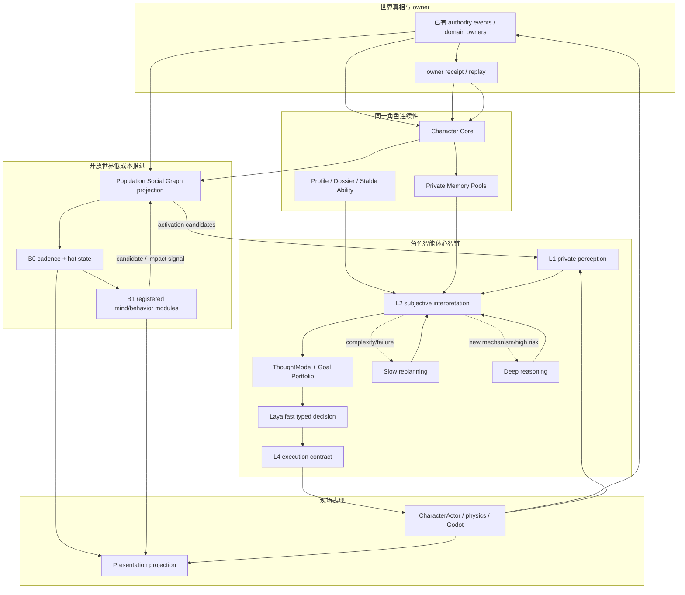
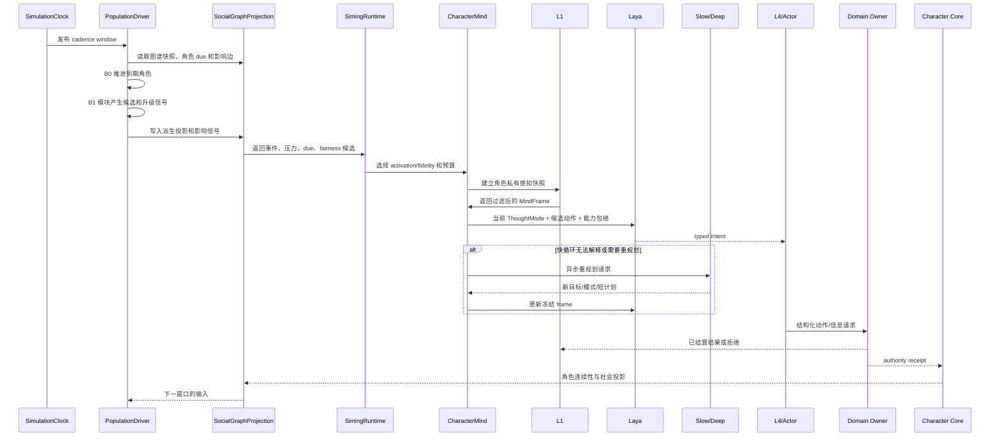

# 全体角色社会生命与混合心智总规格

状态：`analysis/planned/non-authorizing`

日期：2026-10-12

## 1. 目标

本规格把“每个角色都像独立智能体”拆成可以在有限算力下实现的四个承诺：

1. 每个登记角色都持续存在，有身份、生命状态、位置锚点、关系、承诺、行为模块和可恢复游标。
2. 玩家不在场时，角色仍由低成本 B0/B1 推进，生活会产生对其他角色和世界的影响。
3. 角色进入智能体运行时后，使用既有 L1-L4 心智链；Laya 是当前动作的快思考 typed decision 回路，慢思考和 Deep Model 负责重规划和复杂推理。
4. 世界事实、角色连续性、私有记忆、派生社会图谱和表现层分开，由现有 owner 和回执链结算。

本规格不承诺全体角色常驻 LLM，不把司命变成每个人的编剧，也不把图谱变成第二个世界真相库。

## 2. 来源与现有实现映射

| 来源/代码 | 本规格复用 | 当前限制 |
|---|---|---|
| 十月角色 01、02、05、08、09、10、11、13、15 | L1-L4、Laya 快循环、ThoughtMode、主动感知、能力包络、表达和 owner 边界 | 多项仍为 planned/non-authorizing |
| `backend/app/world_runtime/population_driver.py` | 世界 cadence 和窗口推进 | 只证明人口窗口驱动，不证明社会生活完整模拟 |
| `backend/app/population_continuity/continuous.py` | B0 确定性时间、疲劳、需求、到期推进 | 字段有限，不能代表完整角色心智 |
| `backend/app/services/siming_population_capability.py` | read-set、候选、seed、owner receipt、continuity receipt | 当前存在固定 cohort/有界能力路径 |
| `backend/app/character_agent/models/simulation_seed.py` | 状态增量、模块增量、记忆候选、activation hint | 不等于完整全体角色档案系统 |
| `backend/app/character_agent/storage/graph_memory_store.py` | 私有记忆图和时间/权限边界 | 是角色私有记忆存储，不是公共社会图 |
| `siming_heavenly_graph` / SGC-2 | authority projection 派生图、双时间、隐私、回放 | 不允许图谱写生产事实 |
| SGC-3 | fidelity 状态机、activation lock、交接和 requeue | 依赖 cadence source 与 owner consumer |

## 3. 核心模型

### 3.1 两个正交维度

```text
连续性/模拟精度维度：B0 -> B1 -> B2 -> B3
心智模型路由维度：Laya fast <-> Slow replanning <-> Deep reasoning
```

含义：

- B0：批量推进基础生命和客观连续性，不调用模型。
- B1：运行版本化的简易心智/行为模块，产生差异化候选，不等于完整角色智能体。
- B2：局部事件级展开，读取有限空间、关系、资源和规则上下文。
- B3：完整角色智能体 harness，运行 L1-L4；已激活时由 Laya 负责快循环。
- Laya：B3 中的常规当前决策模型，不能被限制为战斗模型或异常模型。
- Slow：对模式、目标和战术进行异步重组。
- Deep：新机制、高风险冲突、连续失败和长链因果。

### 3.2 四类状态

```text
World Truth        领域 owner 已结算事件和投影
Character Core     角色身份、连续性、模块状态和私有记忆准入
Social Graph       从已确认来源派生的社会生命索引
Presentation       Godot/Actor 的局部动作、声音、镜头和临时表现
```

任何模型输出、群体候选、图谱推断和 Godot 预测在结算前都是 proposal 或 projection。

## 4. 总架构图



## 5. 主流程时序图



## 6. 数据流图

```mermaid
flowchart LR
    E[authority event / owner receipt] --> W[World Truth projection]
    W --> C[Character Core continuity]
    W --> G[Social Graph derived projection]
    C --> G
    G --> B0[B0 state advance]
    B0 --> B1[B1 module proposals]
    B1 --> F[impact/fairness/due signals]
    F --> S[Siming selection and budget]
    S --> PF[Participation/Fidelity frame]
    PF --> L1[L1 private filter]
    L1 --> MF[MindFrame + ThoughtModeFrame]
    MF --> CE[CapabilityEnvelope + CognitionPolicy]
    CE --> LY[Laya typed choice]
    MF --> SL[Slow/Deep replan]
    SL --> MF
    LY --> AD[admission / gate / L4]
    AD --> I[ActionIntent / information request]
    I --> O[owner validation and settlement]
    O --> R[receipt / event]
    R --> W
    B0 --> PV[rebuildable presentation seed]
    B1 --> PV
    AD --> PV
    PV --> Godot[Godot presentation]
```



## 7. 司命、图谱和角色的分工

### 7.1 司命

司命处理事情、压力、义务、预算和候选，之后选择人和精度。它可以生成故事义务、激活提示、传播假设和重排请求，但不能直接写世界事实、角色私有记忆或逐帧动作。

### 7.2 社会图谱

图谱记录所有登记角色以及公开、获权的关系、事件、地点、组织、承诺和影响边。它用于发现局部因果、组装候选和支持非玩家焦点；它不能成为事实 owner。

### 7.3 角色智能体

角色智能体只接收 L1 过滤后的角色视角。Laya 做当前动作选择；Slow/Deep 修改目标和短计划；L4 把意图转成执行契约；Owner 决定结果。

## 8. 当前、计划、延期与禁止

### `[current]`

- 世界 cadence、SimulationClock、PopulationCadenceDriver。
- B0 对有限 hot fields 的确定性推进。
- Siming population read-set、候选、seed、owner receipt 和 Character Continuity receipt。
- Character Profile/Dossier、L1-L4 入口、记忆池和私有记忆图边界。
- HeavenlyGraph 的 authority-derived、双时间、scope/privacy 和回放边界。
- Laya 官方服务的仓库外探针证据；不等于 backend adapter/admission/质量闭环已完成。

### `[planned]`

- 全体 roster 的稳定社会生命节点和投影。
- 可组合 B0/B1 角色生活模块。
- 图谱影响传播、due/fairness 自主焦点和图谱局部查询。
- B0/B1 到 B2/B3 的统一交接包。
- B3 角色智能体内 Laya fast、Slow/Deep upgrade、ThoughtMode 组合和 L1 information request。
- 现场局部活化、原子动作/模型脚本与后端持久结果同步。

### `[deferred]`

- 文明级全量社会复杂度和无界因果传播。
- 图谱数据库替换现有 HeavenlyGraph 或新建第二个群体 runtime。
- 自走棋单局回合、羁绊、棋盘和奖励适配。
- 通用编辑器控制面、AD/Blender 正式动作资格化工作流。
- 完整 Life/Presence/Soul owner 未准入时的生产性灵魂规则。

### `[forbidden]`

- 模型、图谱、Godot 或 Siming 直接写世界真相。
- 角色智能体绕过 L1 读取全局数据库。
- 群体平均值直接写个人死亡、伤害、位置、关系或私有记忆。
- B3/Laya 与 B0 并行推进同一角色。
- 为了规模复制第二套时钟、event store、authority 或角色心智链。

## 9. 统一验收条件

1. 每个登记角色都有稳定节点、身份引用、生命状态摘要、位置锚点和 simulation cursor。
2. 未激活角色的 B0/B1 推进可回放，并会产出可解释的候选和影响信号。
3. B0/B1/B2/B3 切换不改变 actor identity、Character Core revision 和历史。
4. 已激活角色的 Laya 运行经过 L1、ThoughtMode、CapabilityEnvelope、L4 和 Owner；Laya 不是脚本替代。
5. Slow/Deep 完成后回到 Laya 当前决策回路，不直接取代 L4 或 Owner。
6. 图谱只消费已确认来源和受控投影，不产生生产事件。
7. 角色私有记忆需要暴露依据、scope、revision 和 Character Core 准入。
8. 玩家未出现时，due、事件传播和 fairness 队列仍可激活非玩家焦点。
9. Godot 现场状态只展示已确认结果或可重建预测，预测不会成为持久事实。
10. 数量增长时，主要成本按 B0/B1 批处理增长，Laya 调用只随 activated actors 和决策窗口增长。

## 10. 后续规格与计划

- 具体 Laya 边界见 [01](01-Laya心智快循环与群体模拟协同规格.md)。
- 具体图谱和记忆边界见 [02](02-全体角色社会生命图谱与记忆边界规格.md)。
- 具体 B0-B3 交接见 [03](03-群体模拟B0-B1与角色智能体B2-B3交接规格.md)。
- 具体司命和自主焦点见 [04](04-司命调度自主焦点与世界因果规格.md)。
- 具体时间、空间和现场表现见 [05](05-时间空间表现层与局部活化规格.md)。
- 实施顺序见 [计划/00](../../计划/既有中旬计划/00-总实施顺序与门禁计划.md)。
