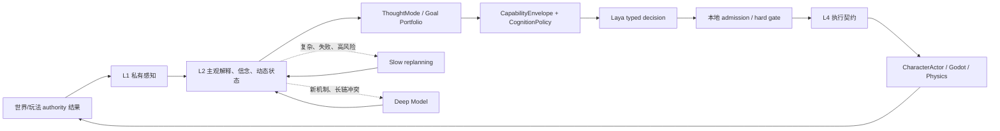
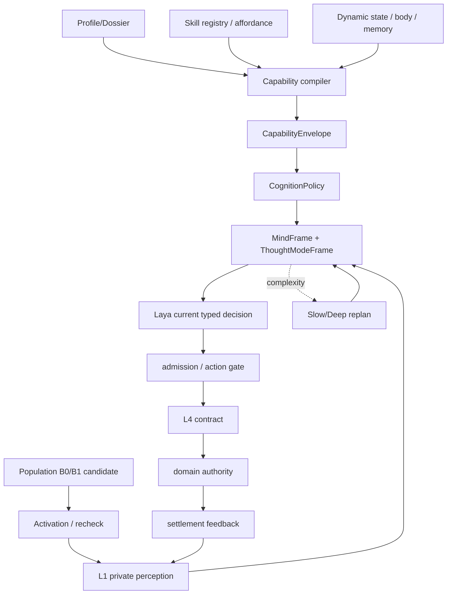
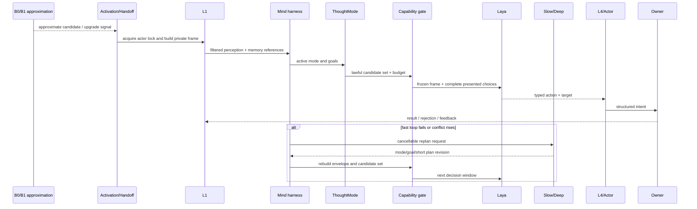
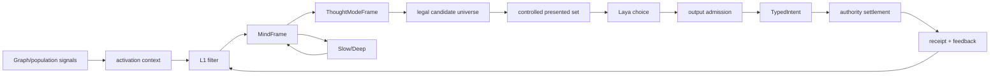

# Laya 心智快循环与群体模拟协同规格

状态：`analysis/planned/non-authorizing`

来源：十月分析角色 01、02、05、08、09、10、11、13；`docs/10月分析/规格/03-角色心智帧、感知边界与ThoughtMode规格.md`；`docs/10月分析/规格/05-角色能力图谱、认知包络与动态算力规格.md`。

## 1. 目的与纠偏

Laya 是**角色智能体运行时中的快思考、低延迟、typed decision 模型**。它在角色已经进入智能体运行时后，连续处理当前动作、语音选择、取消和短期协同。它不是只服务战斗的模型，不是只给重要角色调用的模型，也不是慢思考或 Deep Model 的替代品。

```text
B0/B1/B2/B3       角色连续性/模拟精度
Laya/Slow/Deep     心智模型路由
```

二者正交：一个 B3 角色通常运行 Laya，但 B3 不等于 Laya；B0/B1 可以使用确定性行为模块产生近似候选，但不能把候选冒充为 Laya 已经完成的主观选择。

## 2. Laya 所在的 L1-L4 链



L1 是外部信息唯一入口；L2 解释角色看见的内容；L3/ThoughtMode 管理目标和模式；Laya 选择当前 typed intent；L4 管理动作承诺、取消、超时和执行反馈；Owner 结算事实。

## 3. ThoughtMode 适配

同一心智模型通过模式输入输出适配不同开放世界行为：

```text
战斗：dodge / attack / protect_ally / retreat
经济：inspect_price / negotiate / buy / sell / wait
社交：answer / ask / disclose / avoid / seek_help
探索：move / inspect / remember / probe / follow
调查：observe / compare / ask / preserve_evidence
生存：secure_shelter / conserve / eat / rest / flee
```

每个 ThoughtMode 只声明：

```text
mode_id
activation_conditions
input_projection
question_schema
output_intent_types
priority_bias
resource_horizon
information_needs
exit_conditions
```

多个模式可同时激活，但最终当前 intent 仍由 Laya 在同一个冻结候选集合中选择。未胜出的目标保留为 `background_goal`，不被静默删除。

## 4. Laya 当前决策合同

首版 Laya 输入必须是冻结的结构化心智帧，而不是全局数据库或自由文本世界描述：

```text
MindFrame
ThoughtModeFrame
CapabilityEnvelope
CognitionPolicy
CurrentActionCandidates
SelfStateProjection
L1 evidence + freshness/conflict/revision
```

输出为一次完整“动作 + 目标”选择：

```text
TypedDecision {
  decision_id
  action_id
  target_refs
  mode_id
  priority
  commitment_duration
  stop_conditions
  failure_fallback
  information_request?
  confidence
  context_version
  capability_revision
  policy_revision
}
```

`action_id`、目标、affordance、能力、动作承诺和执行合同必须来自现有注册表和准入边界。模型不能生成未注册动作，也不能把 choice 当成 owner receipt。

## 5. 快循环

```text
observe
→ update L1/L2 short state
→ select active ThoughtMode
→ compile lawful candidates
→ Laya select one complete action + target
→ L4 create/execute commitment
→ Actor/Physics produce evidence
→ Owner settle semantic result
→ feedback to L1
→ repeat until goal/episode/expiry ends
```

快循环不要求每个 render frame 调用模型。连续位移、动画、命中盒和身体表现由 Actor、Motor 和物理运行时承接；Laya 在决策窗口调用。

## 6. Slow/Deep 升级与回落

升级条件：

- 快循环连续失败或重复同一错误；
- 新阶段、新机制或未解释反馈；
- 目标组合冲突；
- 证据不足且信息获取成本值得承担；
- 多个 ThoughtMode 的长期目标冲突；
- 高风险、跨领域和长因果链。

Slow/Deep 只返回新的心智材料：

```text
updated_goal_portfolio
mode_recomposition
short_plan
information_need
uncertainty_update
```

完成后仍返回 Laya，重新选择当前 typed intent。升级结果必须可取消、带 revision/expiry，迟到结果不能生成新效应。模型不可用时回到 continuity floor：观察、保持距离、自保、撤退、求助、沉默或 requeue。

## 7. 能力包络和动态算力

Laya 的候选和预算受以下对象共同限制：

```text
CognitiveCapabilityProfile
StableAbilitySnapshot
CurrentAffordance
DynamicState
CurrentEvent
Authority / Permission
```

硬限制不可被高预算突破：

```text
max_context_items
max_active_hypotheses
max_reasoning_hops
max_candidate_intents
max_concurrent_goals
planning_horizon
confidence_ceiling_without_evidence
allowed_domains
allowed_action_families
```

实际 provider effort 为 `clamp(requested_effort, minimum_effort, character.maximum_effort)`。高风险可抬高最低预算，但不能提升 authored capability ceiling。

## 8. 群体模拟如何消费 Laya 相关合同

B0/B1 不调用 Laya，但应复用：

- 同一 `action_id`/`target_ref` 注册表；
- 同一 ThoughtMode 语义分类；
- 同一 affordance 和权限读取；
- 同一动作承诺/Owner 接入边界；
- 同一 failure/requeue 结果分类。

B0/B1 输出必须标记来源：

```text
source = population_module
decision_fidelity = approximation
requires_agent_recheck = true/false
```

角色激活后，Laya 必须重新读取角色实际 L1 私有感知和能力包络。不能把群体近似候选直接当成角色主观决定。

## 9. 架构图



## 10. 主流程时序图



## 11. 数据流图



## 12. 当前、计划、延期和禁止

### `[current]`

- L1 私有感知、L2/L3/L4 入口和 CharacterActor/Owner 边界。
- 角色 profile、skill/ability、affordance 和部分 MindFrame 输入。
- Laya 官方 `laya-multilingual` 服务的仓库外健康和真实请求探针。
- 角色 cognition stage、gateway/admission 和 continuation 的部分基础。

### `[planned]`

- 专用 Laya adapter、`/v1/systemone` 候选映射、持久 admission 和取消/迟到/恢复闭环。
- 完整 candidate compiler、CapabilityEnvelope、CognitionPolicy、GateResult。
- 跨 ThoughtMode 的统一候选、信息需求和 Laya decision window。
- B0/B1 近似候选与激活后 Laya recheck 的来源标记。

### `[deferred]`

- 多场景大规模战术优化。
- 逐帧模型生成原始动画、骨骼、音高或 Motor 控制。
- 让模型直接读取隐藏 Boss 状态、全局数据库或其他角色私有记忆。

### `[forbidden]`

- 用慢思考结果冒充 Laya 原始选择质量。
- 用 Laya choice 直接当世界事实或 Owner receipt。
- 用本地规则悄悄替代 L2/L3 的主观模型选择。

## 13. 验收

1. 已激活角色能在没有 Slow/Deep 的情况下完成多次常规 Laya decision window。
2. Laya 输入只有 L1 过滤后的角色视角和冻结候选。
3. ThoughtMode 可切换战斗、经济、社交、探索等模式而不创建多个角色大脑。
4. 失败升级到 Slow/Deep 后，结果能取消、过期和回到 Laya。
5. B0/B1 近似候选和 Laya choice 有不同来源标记，不能互相冒充。
6. 选择质量、模型延迟、Owner 执行失败和 Godot 表现失败分开统计。
7. 角色能力上限、候选覆盖和动态算力有 revision/digest，可回放。
8. 质量评估使用十月设计的基础选择质量轨和角色表现轨，不能用慢回退替代 Laya 达标。

## 14. 关联实施计划

见 [计划/03-群体模拟与Laya心智运行时协同实施计划](../../计划/既有中旬计划/03-群体模拟与Laya心智运行时协同实施计划.md)。
