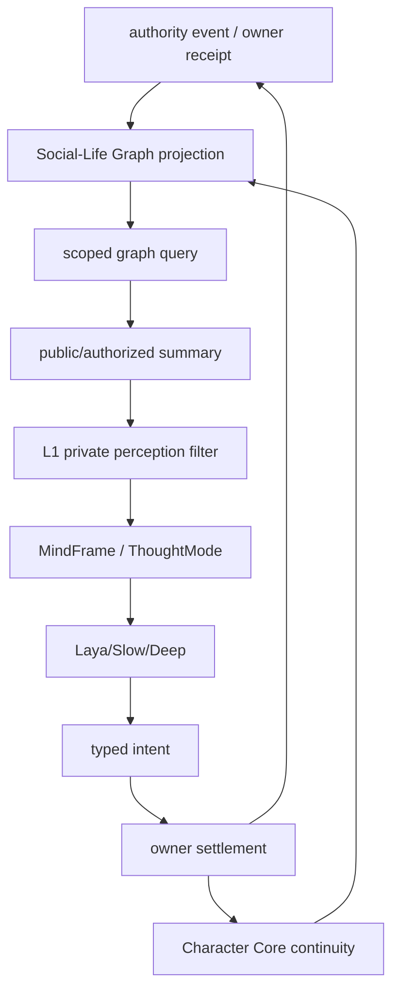
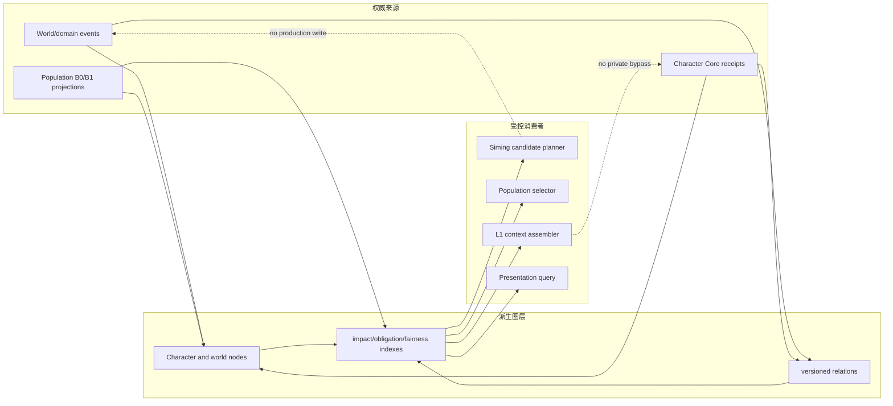
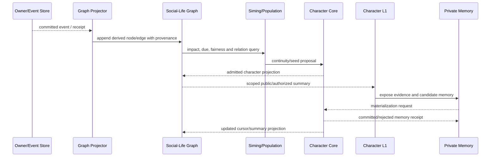
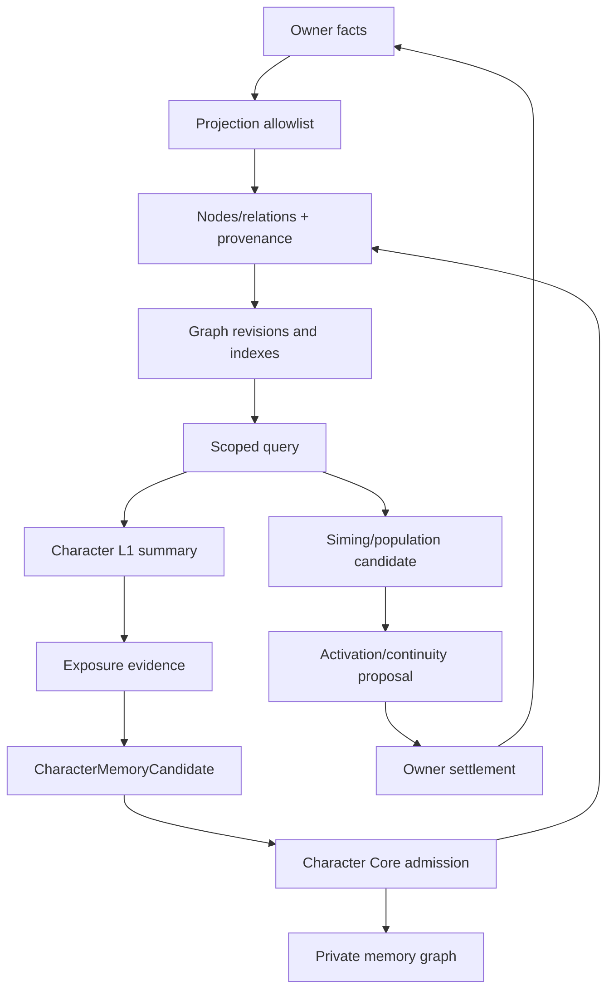

# 全体角色社会生命图谱与记忆边界规格

状态：`analysis/planned/non-authorizing`

来源：MiroFish 式图谱目标；十月角色 09、10、13、15；`2026-08-22-character-simulation-memory-seed-continuity-design.md`；SGC-2 Derived Cognitive Graph Contract；现有 HeavenlyGraph、authority projector 和 `graph_memory_store.py`。

## 1. 目标

本规格采用“每个角色都是图谱节点”的设计方向，但将其落实为**全体角色社会生命的派生投影**：

- 每个登记角色在进入人口 roster 时拥有稳定节点；
- 角色、家庭、组织、地点、事件、资源和义务通过有来源的关系边连接；
- 图谱支持影响传播、焦点发现、上下文组装和公平性调度；
- 图谱不能取代世界真相 owner、Character Core 或角色私有记忆。

## 2. 图谱分层

能力图、角色私有记忆图、社会关系图和 HeavenlyGraph 不合并。

```text
Ability Graph       角色学会什么、能执行什么
Private Memory Graph 角色知道什么、记住什么、相信什么
Social-Life Graph   谁与谁相连、谁受什么影响、哪些事件在传播
HeavenlyGraph       已确认来源的受控派生图和司命可见摘要
```

它们只共享治理值对象：

```text
GraphEvidenceRef
SourceLineage
PrivacyScope
AuthorityScope
LifecycleState
ConflictRef
ExplanationPayload
```

## 3. 节点模型

### 3.1 角色节点

```text
CharacterNode {
  actor_ref
  profile_ref / profile_revision
  life_state_summary
  location_anchor_ref
  region_ref
  activity_phase
  need_pressure_summary
  household_refs
  organization_refs
  public_relationship_refs
  pending_obligation_refs
  behavior_module_refs
  simulation_tick_cursor
  memory_cursor_ref
  fidelity_state
  next_due_tick
  fairness_credit
  impact_score
  source_revision_vector
  graph_revision
}
```

节点只存摘要、引用和调度字段，不复制 Character Core 的完整 profile、私有记忆或领域库存。

### 3.2 非角色节点

```text
Household
Organization
Location
ResourcePool
AuthorityEvent
Constraint
Obligation
Contract
PresentationObject
```

节点类型必须注册，不能由模型临时创造任意类型。

## 4. 边模型

```text
household_member_of
employed_by
member_of
located_at
knows
trusts
owes
promised_to
participated_in
affected_by
responsible_for
blocked_by
depends_on
```

每条边都至少携带：

```text
relation_id
source_node_id
target_node_id
relation_type
source_event_refs
owner_ref
derivation_kind
visibility_scope
valid_from / valid_to
recorded_at
revision
supersedes_revision
status
```

`status`：`confirmed`、`derived`、`candidate`、`hypothesis`、`revoked`。只有已确认来源或用途允许的 derived edge 才能作为硬约束参与模拟。

## 5. 图谱更新来源和频率

### 5.1 事件驱动

立即投影：

- 角色生命状态、死亡、复活或 tombstone；
- 家庭、组织、工作和正式关系变化；
- 合同、交易、资源保管和承诺结果；
- 重大公共事件和正式 owner receipt；
- 角色已确认参与或感知的事件。

### 5.2 cadence 批量

人口窗口投影：

- 活动阶段、需求和疲劳摘要；
- 区域和位置锚点；
- 日程和下一次 due；
- B0/B1 候选、影响信号和 fairness credit；
- fidelity/activation 状态。

### 5.3 现场局部

高频精确坐标、姿态、碰撞、镜头和临时动画保留在 Godot/Actor/物理层。只有产生持久 owner 结果时才回写图谱。

## 6. 图谱查询用途

图谱可以回答：

```text
哪些角色直接受这件事影响？
哪些关系邻居可能被传播？
哪个组织或地点是共同约束？
哪些角色长期没有获得高精度处理？
哪些候选需要 B2/B3 或 Laya activation？
哪些公开事实可以组装成当前角色的 L1 输入？
```

图谱不能回答并写成事实：

```text
角色一定知道什么；
角色内心真正想什么；
尚未结算的交易是否成功；
未经暴露的私人记忆；
模型猜测的隐藏关系；
Godot 临时动作是否造成持久后果。
```

## 7. 记忆边界

必须区分：

```text
世界发生了什么
角色是否暴露
角色是否知道
角色是否记住
角色如何解释
```

群体模拟的输出最多生成 `CharacterMemoryCandidate`，不能直接写五池记忆。候选必须携带：

```text
actor_ref
source_event_refs
event_valid_at / event_recorded_at
knowledge_available_at
exposure_basis
visibility_scope
privacy_disposition
materialization_policy
source_revision_vector
```

只有 Character Core 验证来源、权限、时间、去重和暴露依据后，才可物化到角色私有记忆。

## 8. 图谱和角色 L1 的关系



图谱不会直接进入 Laya 的全局上下文。Laya 只读取角色有权感知的局部投影。

## 9. 架构图



## 10. 主流程时序图



## 11. 数据流图



## 12. 当前、计划、延期和禁止

### `[current]`

- HeavenlyGraph 的节点、关系、双时间、scope/privacy、source lineage 和 correction 机制。
- `graph_memory_store.py` 的角色私有记忆池和私有图存储。
- authority graph projector 的部分领域事件派生。
- Population roster、projection、seed 和 Character Core receipt 的基础。

### `[planned]`

- 全体登记角色的 social-life node admission。
- 角色生命摘要、关系、地点、事件和义务的统一 projection allowlist。
- 影响传播索引、区域 shard、due/fairness 查询和局部子图交集包。
- social graph 与 L1 的隐私/新鲜度/用途绑定。
- 角色 exposure evidence 到 private memory candidate 的完整闭环。

### `[deferred]`

- 全社会无界图推演、文明级全量边传播和任意动态图数据库。
- 图谱自动生成未经 owner 确认的新关系或生产事实。

### `[forbidden]`

- 图谱写库存、账户、位置、生命、关系或生产事件。
- 图谱全文保存所有角色私有记忆。
- 用图谱缺失或推断替代 L1 的角色感知。

## 13. 验收

1. 每个已登记角色有稳定节点，且重复投影幂等。
2. 角色节点能从 checkpoint + tail 重建，节点和边带来源与 revision。
3. 公共图和私有记忆图在存储、scope、查询和写回上隔离。
4. 图谱查询能返回事件直接受影响者、关系邻域、地点和组织约束。
5. candidate/hypothesis/derived 不会被当作 confirmed fact。
6. 群体事件不自动给全体角色写入私人记忆。
7. Laya 只能读取经过 L1 过滤的局部图谱摘要。
8. 图谱只产生 proposal、projection、activation hint 或 retrieval context，不产生 production append。
9. 图谱修订、撤销、隐私收紧和来源补偿能使缓存失效并可重建。

## 14. 关联实施计划

见 [计划/02-派生社会图谱与因果传播实施计划](../../计划/既有中旬计划/02-派生社会图谱与因果传播实施计划.md)。
