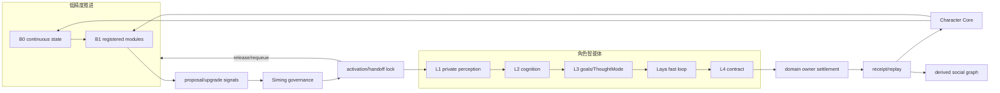
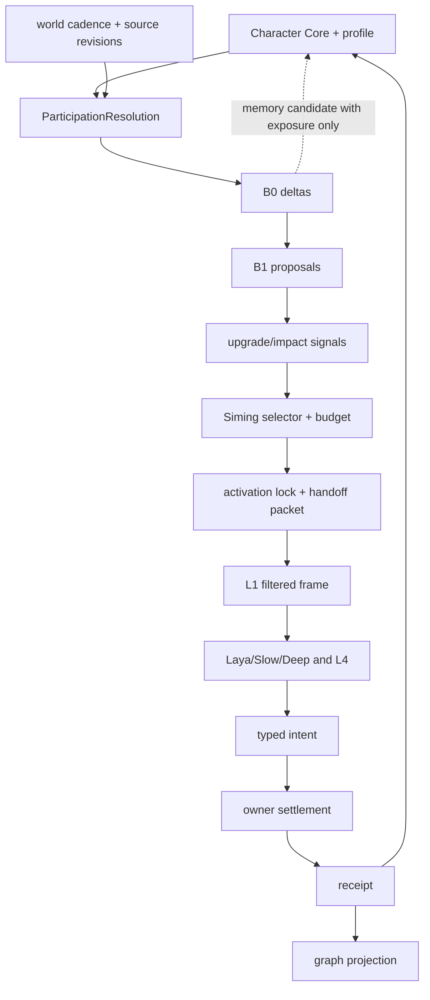

# 群体模拟 B0-B1 与角色智能体 B2-B3 交接规格

状态：`analysis/planned/non-authorizing`

来源：2026-09-16 角色与群体模拟增量设计；2026-09-18 角色、群体与社会因果运行时整合规格；SGC-3；角色 01、05、08、10、11、13；现有 population continuity、activation 和 Character Core。

## 1. 目标

定义相同角色从低成本群体推进到个体角色智能体，再回到低成本推进时的连续性边界。B0/B1/B2/B3 是精度和执行者状态，不是角色类型，也不代表 Laya/Slow/Deep 模型等级。

## 2. 精度层合同

| 层 | 计算方式 | 可产生 | 不得直接产生 |
|---|---|---|---|
| B0 | 确定性连续状态推进 | 热状态 delta、due、基础 exposure/impact 信号 | 个人重大事实、私人记忆、领域交易结果 |
| B1 | 注册的轻量心智/行为模块 | 结构化行动候选、升级信号、presentation seed | 未注册意图、事实提交、模型主观选择声明 |
| B2 | 局部事件级角色模拟 | 有限范围的关系/空间/资源行动 intent | 跨范围全局事实和未授权个人信息 |
| B3 | 完整角色智能体 harness，L1-L4 | Laya typed decision、Slow/Deep replan、意图/信息需求 | authority commit、绕过 L1 的全知输入 |

B3 的 Laya 快循环职责见规格 [01](01-Laya心智快循环与群体模拟协同规格.md)。

## 3. ParticipationResolution

同一份版本化参与解析由人口推进者、司命和角色智能体消费：

```text
actor_ref
world_ref
profile_revision
world_mode_ref/revision
cadence_source_ref/revision
fidelity_ceiling
allowed_modules
protected_fields
privacy_scope
active_commitments
activation_lock_ref
decision_reason_refs
source_revision_vector
policy_revision
```

原型默认、个体覆盖、情境预设、承诺和锁共同决定结果。个体覆盖默认收紧保护；放宽需要明确授权和迁移版本。没有合法精度时 defer/requeue，不得静默忽略硬限制。

## 4. 唯一推进权与交接

同一 actor 在一个时间窗口只能有一个推进者。复用现有 activation/handoff lock、cadence、Character Core revision 和 Owner receipt；不新增并行 NPC runtime。

```mermaid
sequenceDiagram
    participant Clock as World cadence
    participant B0 as B0/B1 population
    participant Graph as Social graph projection
    participant Sim as Siming selector
    participant Lock as Activation authority
    participant Agent as Character agent L1-L4
    participant Owner as Domain owner
    participant Core as Character Core
    Clock->>B0: authorized window
    B0->>B0: advance actor to confirmed cursor
    B0->>Graph: candidate/impact/fidelity signals
    Graph->>Sim: scoped due and impact set
    Sim->>Lock: request actor handoff
    Lock-->>Sim: lock acquired or requeue
    Sim->>Agent: pinned handoff packet
    Agent->>Agent: L1 frame; Laya decision windows
    Agent->>Owner: structured intent
    Owner-->>Core: committed receipt or failure
    Core-->>Graph: accepted continuity projection
    Agent->>Lock: release after receipt/recovery
    Lock-->>B0: resume after latest accepted cursor
```

交接包至少携带：

```text
actor_ref / profile_ref
confirmed_from_tick / target_tick
character_revision
source_revision_vector
location_anchor and scope
public/authorized context refs
module state refs
pending obligation refs
memory scope grant (not memory dump)
activation lock ref
fidelity and policy revision
idempotency key
```

## 5. 记忆和连续性

- B0/B1 可更新 Character Core 已准入的公开或角色连续性状态字段。
- B0/B1 不可把群体平均值写入个人，也不可把公共事件自动写入私人记忆。
- 有 exposure basis 时，模块可生成 `CharacterMemoryCandidate`，由 Character Core 检查和物化。
- B2/B3 使用同一角色 identity、profile、记忆池和 simulation cursor。
- Owner effect 已提交但 Character Core 暂未接纳时，保留 receipt 并走恢复路径；不能重复执行世界操作。
- 退出高精度时保留已确认结果、未决意图、承诺和失败原因。

## 6. 交接失败

```text
active lock conflict       -> requeue; no owner/core write
stale graph/source revision -> rebuild frame; old proposal invalid
budget exhausted           -> retain due/fairness; defer
Laya unavailable           -> continuity floor or explicit requeue
owner rejected             -> preserve rejected receipt; no false success
core rejected after owner  -> receipt-driven continuity recovery
```

不得以旧 frame、旧候选或重新读取当前 head 后复用旧 proposal。

## 7. 架构图



## 8. 数据流图



## 9. 当前、计划、延期与禁止

### `[current]`

- `advance_b0_row()` 对有限字段进行确定性推进。
- Population cadence driver、read set、capability planner、seed planner 和 continuity port。
- Activation lock、pending/release、角色 continuity receipt。
- SGC-3 proposed fidelity lifecycle 和 bounded cohort 证据。

### `[planned]`

- 通用 ParticipationResolution 和可配置 B0/B1/B2/B3 policy。
- 全 roster due、fairness、交接和恢复。
- 一致的交接 packet、旧执行者 fencing、checkpoint/tail replay。
- B1 模块化简易心智、B2 局部事件级模拟和 B3 L1-L4/Laya。

### `[deferred]`

- 无界群体行为、文明级全因果模拟和大规模并行个体 LLM。
- 没有来源设计依据的自动人格成长或大规模社会学习。

### `[forbidden]`

- B0/B1 和 B2/B3 并行推进同一角色。
- 群体模拟报告直接覆盖角色身份、记忆、生命或领域事实。
- 激活仅因角色重要性永久占用 Laya/模型资源。

## 10. 验收

1. 同一 actor 在任一窗口至多一个推进锁。
2. B0/B1 到 B3 前先固化最后确认游标；冲突时 zero-write/requeue。
3. B0/B1 的未注册字段和无 exposure 的记忆候选 fail-closed。
4. B0/B1 与 Laya 输出带不同 decision source/fidelity。
5. 激活后 Laya 看到角色自己的 L1，不直接接受群体推演为其信念。
6. 角色激活期间，后台 due 到期可排队，但不得双写或越过确认游标。
7. owner receipt、Character Core receipt 和图谱 projection 可分别审计、恢复和回放。
8. 回到低精度后仍保留身份、承诺、接受状态和 memory cursor。

## 11. 关联计划

见 [计划/01](../../计划/既有中旬计划/01-角色社会生命底座实施计划.md) 和 [计划/03](../../计划/既有中旬计划/03-群体模拟与Laya心智运行时协同实施计划.md)。
