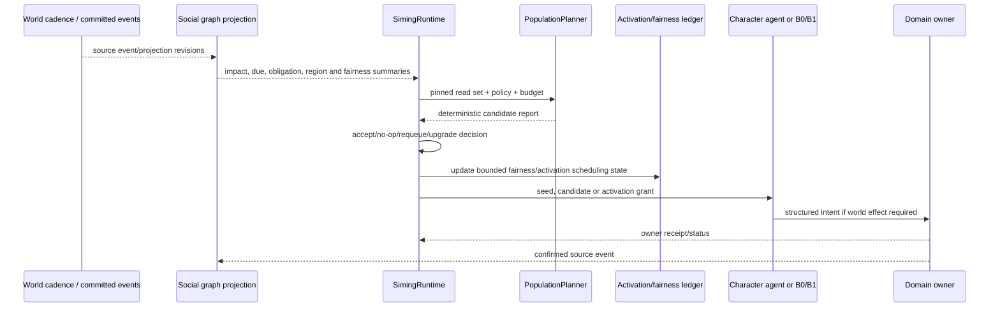
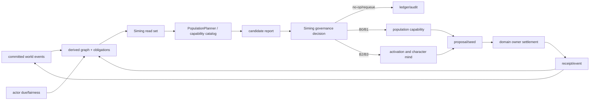
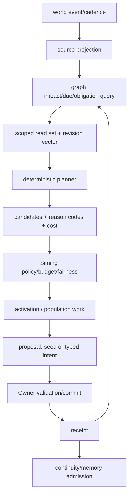

# 司命调度、自主焦点与世界因果规格

状态：`analysis/planned/non-authorizing`

来源：`2026-08-29-siming-led-population-simulation-design.md`、`2026-09-01-siming-generalized-population-decision-surface-design.md`、Heavenly Graph SGC-1/2/3、十月角色 01/05/08/10/13。

## 1. 核心定位

司命治理“事情和资源”，然后为需要处理的事情选择合适参与者、精度和预算。其不是逐个角色的人生编剧，也不拥有世界真相。

司命职责：

- 观察已提交事实、世界 cadence、领域压力、待决义务和角色/群体回执；
- 选择处理范围、selector、policy、budget 和 execution capability；
- 选择候选角色、组织、地点和精度升级；
- 检查人口 planner 报告，决定接受、no-op、requeue、延期或升级；
- 将批准的工作形成 continuity seed/activation hint/owner-bound proposal；
- 接收 owner receipt 和 Character Core receipt，推进后续治理。

## 2. 候选焦点来源

任何候选焦点必须可追溯到以下一种或多种来源：

```text
world_event          已提交事件造成的影响
actor_due            角色生活状态/承诺到期
relationship_spread  已确认关系上的有限传播
region_pressure      区域事件、环境或供给压力
organization_duty    组织/家庭义务和工作窗口
player_interaction   玩家交互与空间近场
fairness_seed        长期未被处理角色的公平焦点
narrative_obligation 已登记故事节点或待揭示义务
```

公平焦点是探索和覆盖机制，不是凭空制造冲突的剧情骰子。它从合法 roster、due/fairness credit 和受限随机 seed 中选择，不得跳过权限、事实、隐私和预算门槛。

## 3. 对事选人规则

对每个事件/压力，司命从图谱和获权投影中查找候选参与者。候选评分由版本化策略计算，不由 LLM 自由发明：

```text
eligible(actor, matter) =
  scope_match
  AND role/relationship relevance
  AND location/access compatibility
  AND capability/authority compatibility
  AND privacy/admission allowed
  AND no conflicting active lock
```

策略可使用优先级和公平补偿，但评分不是世界事实，也不能直接变成角色决定。

## 4. 叙事义务和社会生活

Story blueprint、runtime story node、narrative obligation 和 attractor 是世界级因果结构：

```text
confirmed fact / constraint
→ unresolved obligation
→ eligible actor/location/organization candidates
→ Siming scheduling
→ role or owner proposal
→ authority settlement
→ closure/continuation receipt
```

它们不会自动构成每个角色的个人故事线。角色日常生活由 B0/B1 和角色自己的已确认承诺持续推进；叙事义务只是影响优先级和局部调度。

## 5. 司命和图谱边界

图谱输入只包括获权、带 provenance 的来源投影。司命通过 scope/revision 读取事件、关系邻域、角色状态摘要和 obligation，不读取他人私有记忆全文。图谱候选和 propagation hypothesis 不能成为 Owner 输入，除非重新查询来源 Owner 并取得兼容版本证据。

## 6. 调度流程



## 7. 架构图



## 8. 数据流图



## 9. 当前、计划、延期和禁止

### `[current]`

- `SimingRuntime.tick()` 有 population cadence 专用入口。
- `PopulationCapabilityCatalog` 和 `PopulationDecisionPlanner` 支持有限授权决策面。
- 叙事核心、story graph、obligation runtime、activation hints 和 guardrails 已有组件。
- `StubGroupSimulationBridge` 仍为 unavailable/shape_only/read_only，不能宣称完整社会推演。

### `[planned]`

- roster due、影响传播、区域压力、关系邻域和 fairness 统一进入 Siming read set。
- 非玩家自主焦点队列及明确的 coverage/starvation 指标。
- 司命对事选人的可解释候选排序和有限生命周期。
- narrative obligation 与独立角色生活之间的统一调度关系。

### `[deferred]`

- 全局自由叙事代理、无限故事分支和文明级全局优化。
- 没有原文授权的全角色即时认知模拟。

### `[forbidden]`

- Siming 直接创作并提交角色人生结果。
- Siming 直接成为角色私有记忆 store 或世界 truth owner。
- 通过公平 seed 为了剧情冲突而任意改写角色行为。

## 10. 验收

1. 每个候选都有事件、due、关系、区域、义务、玩家或公平来源之一。
2. planner 输入有 pinned revision、scope、policy、selector 和 budget。
3. 同一 read set、seed 和 policy 重放产生稳定候选排序。
4. 预算耗尽时保留 due/fairness 账，不静默丢失角色。
5. 叙事义务可调度角色，但不能覆盖角色实际能力、记忆和选择。
6. 图谱 hypothesis 必须回查 Owner 才能成为硬约束。
7. no-op、requeue、upgrade、owner commit 和 continuity commit 分开审计。
8. 玩家长期不出现时仍能证明非玩家焦点和区域事件推进。

## 11. 关联计划

见 [计划/02](../../计划/既有中旬计划/02-派生社会图谱与因果传播实施计划.md) 和 [计划/03](../../计划/既有中旬计划/03-群体模拟与Laya心智运行时协同实施计划.md)。
