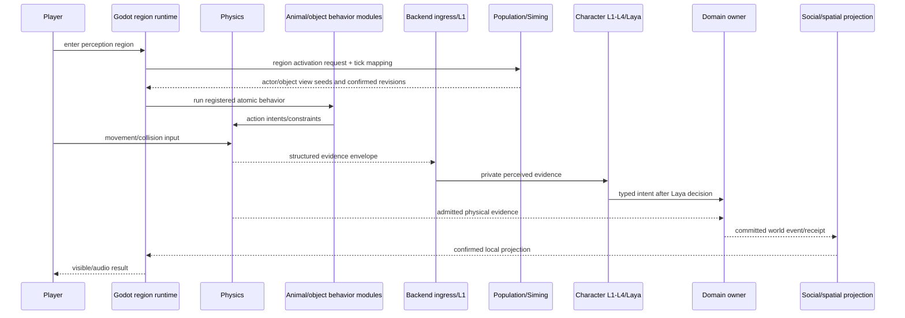
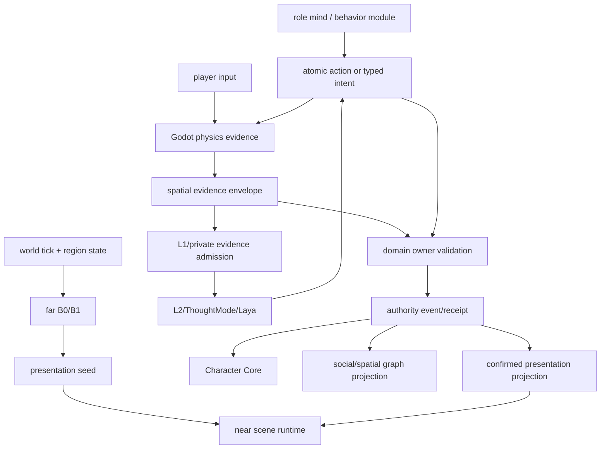

# 时间、空间、表现层与局部活化规格

状态：`analysis/planned/non-authorizing`

来源：十月角色 06、08、09、10、11、16；现有 SimulationClock、PopulationCadenceDriver、Godot/CharacterActor、L1、physics/authority 边界；用户关于区域局部活化、动物/静物脚本与现场回引后台的设计讨论。

## 1. 目标

让世界时间和空间位置都参与群体模拟；只有玩家能感知到的局部区域才需要完整视听表现。远处仍持续推进世界事实和角色连续性；近场由引擎物理、原子动作和角色智能体共同完成高精度现场响应。

本规格不建立第二时钟，也不承诺当前已有本规格的现场反向引导链。

## 2. 时间和空间表示

后端/图谱可维护：

```text
world_tick / cadence cursor
region_ref / location_anchor_ref
route_ref / building_ref
presence status
coarse activity phase
event valid time / recorded time
```

Godot/Actor/物理运行时维护：

```text
高频 transform、速度、接触、碰撞、动画 phase、声音和镜头
```

物理证据若要改变持久世界事实，必须通过现有结构化 intent/evidence/authority 结算，不可由 Godot 本地表现直接宣布结果。

## 3. 区域活化

区域分为：

```text
far: cadence + B0/B1 + graph projection; 无连续角色视听实例要求
warm: 即将进入玩家感知; 预生成 presentation seed 和局部脚本状态
near: 玩家正在感知; Actor/physics 执行原子行为和交互
engaged: 直接交互/复杂因果; 获取 actor lock，启用 B3/L1-L4/Laya
```

状态是表现/推进策略，不是角色身份或权限。重要角色默认有更高的可达性/priority，不表示永久激活。

## 4. 现场回引后台

近场物理和角色 Laya 是高频输入源。合法反馈流程：

```text
Godot/Physics observation
→ structured evidence envelope (actor, object, spatial frame, world tick mapping, revision)
→ backend ingress/L1 and evidence admission
→ role mind and/or domain owner interpretation
→ typed intent or owner operation
→ committed receipt
→ updated population/social projections
→ Godot visible confirmation
```

场景可以允许现场对后台的优先权仅限于**本地物理连续性和可见证据采样**。对世界真相、角色长期连续性和社会图谱的持久改变仍要由后端 owner/Character Core 接纳。冲突时使用 authority revision 和 handoff lock；不能让现场位置和后台位置同时成为 owner。

## 5. 动物和静物

### 动物

动物行为由可组合行为脚本与原子动作执行。需要声明：

```text
agency_kind: self_directed | directed | mixed
controlling_intent_ref?
allowed_action_families
override_policy
interruptibility
perception_scope
```

混合意志动物（如受骑手控制的马）允许较高级控制意图在当前行为窗口压过自我意志；被覆盖的反应可表现为迟疑、挣扎或生理反应，但具体动作必须由注册规则和物理支持，不能由模型直接改位置或姿态。

### 静物

静物由原子模型脚本驱动，使用有限状态机和自动行为：

```text
stocked -> partially_depleted -> empty -> replenishing
intact -> displaced -> damaged -> repaired
closed -> opened -> occupied -> vacated
```

例：包子笼可以依据已结算售卖/购买结果减少库存；近场展示可平滑减少可见模型数量。仅观察物体不能让持久库存减少。

### 物理支持

引擎负责连续模拟、碰撞和接触证据；行为脚本选择原子动作；领域 Owner 负责可持久结果；Character Core 负责角色连续性和记忆准入。

## 6. 玩家进入与碰撞示例

以骑手勒马、马甩头碰倒包子笼为例：

1. 远场 B0/B1 推进天气、路线、营业和区域状态，不常驻 Laya。
2. 区域进入 warm 时，准备骑手、马、孩子、包子笼和店铺的表现/行为候选。
3. 进入 near 后，骑手、孩子、马和静物脚本在 Godot 物理下运行；骑手控制意图与马的自我防御反应依 `mixed` policy 协调。
4. 碰撞只形成 physics evidence；如果需要改变笼子/包子/马的持久状态，由对应 owner 校验并提交结果。
5. 马、骑手或孩子因复杂互动/玩家接触升级到 engaged，获取唯一 actor lock，必要时运行完整角色 L1-L4/Laya。
6. backend 将确认结果同步回区域投影；只有玩家可见的结果在现场呈现。

如果玩家同时撞上来，物理引擎按同一现场窗口提供排序/碰撞证据；后端不得假定群体模拟能在一个物理帧内完成。当前现场行为先运行，持久结果以 owner settlement 后回投；需明确的采样窗口和 event ordering 合同仍是 planned blocker。

## 7. 更新频率

| 层 | 驱动 | 更新对象 |
|---|---|---|
| world cadence | SimulationClock/PopulationCadenceDriver | B0、角色 due、区域压力和低频图谱投影 |
| B1 | 模块 due/事件 | 简易行为候选、日程和需求转换 |
| B2 | 局部事件窗口 | 空间、关系和互动候选 |
| B3/Laya | 已激活角色决策窗口 | 当前 typed intent；不是每 render frame |
| Godot physics/render | 引擎帧 | 连续物理、碰撞、动画和音画 |
| graph projection | authority event + cadence | 粗粒度节点/关系/事件/游标 |

真实 world tick 到物理窗口映射必须使用 pinned `ClockMapping`/evidence revision；在合同未实现前不能声称后台与现场可精确同步。

## 8. 架构图

```mermaid
flowchart LR
    Clock[existing SimulationClock] --> Cadence[Population cadence]
    Cadence --> Far[B0/B1 far simulation]
    Far --> Graph[coarse social/spatial projection]
    Graph --> Warm[warm region preparation]
    Warm --> Near[near actor/script/physics]
    Near --> Evidence[structured spatial/physics evidence]
    Evidence --> Ingress[L1/backend evidence admission]
    Ingress --> Mind[engaged CharacterMind + Laya]
    Near --> Intent[typed local action intent]
    Mind --> Intent
    Intent --> Owner[domain owner settlement]
    Owner --> Receipt[confirmed result/receipt]
    Receipt --> Graph
    Receipt --> Godot[visible confirmation]
    Near -.local predicted animation only.-> Godot
```



## 9. 主流程时序图



## 10. 数据流图



## 11. 当前、计划、延期和禁止

### `[current]`

- Godot/CharacterActor 本地 embodiment、player input、visible/audio presentation 边界。
- World runtime cadence 和 SimulationClock。
- L1 感知与部分 physics/ESM/authority 入口。
- 当前没有已证实的通用 ClockMapping 或 scene-to-backend high-frequency feedback contract。

### `[planned]`

- region far/warm/near/engaged admission 和可见对象集合。
- 动物/静物注册行为脚本、原子动作、状态机和 physics evidence 协议。
- 物理窗口与 world tick 的映射、排序、迟到与冲突恢复。
- 现场反馈经 L1/Owner/Character Core 后回投群体图谱和表现层。

### `[deferred]`

- 全城所有角色持续高频 3D 物理运行。
- 任意场景的精确回滚/确定性物理 replay。
- 当前没有来源设计依据的通用动画生成器或自动脚本生成器。

### `[forbidden]`

- Godot 表现层直接写入世界真相或角色私有记忆。
- Siming 直接下发原始 pose、骨骼、Motor 或逐帧控制。
- 只因玩家靠近就向 Laya 暴露该角色全部私人记忆。
- 静物的纯视觉购买动画直接扣除持久库存。

## 12. 验收

1. 远场角色和静物可按 cadence 更新且不创建 scene actor。
2. 玩家进入区域时只激活获准范围对象，能根据 actor lock 区分近场脚本与 B3 角色。
3. 混合意志动物的控制意图、反应和打断可解释且可回放。
4. 物理碰撞和角色选择分别记录 evidence 与 intent；只有 Owner receipt 产生持久真相。
5. 购买确认后库存和表现层都减少；未结算请求不能显示为确认售出。
6. 现场物理变化能通过显式 ClockMapping/版本证据映射到后端窗口。
7. 后台窗口落后或高延迟时不双重推进角色；现场可暂时连续表现，后台按 receipt/requeue 收敛。
8. 世界真相、角色位置摘要、私有记忆、精确变换和表现层各自有独立 owner 与 revision。

## 13. 关联计划

见 [计划/04-时间空间表现与局部活化实施计划](../../计划/既有中旬计划/04-时间空间表现与局部活化实施计划.md)。
