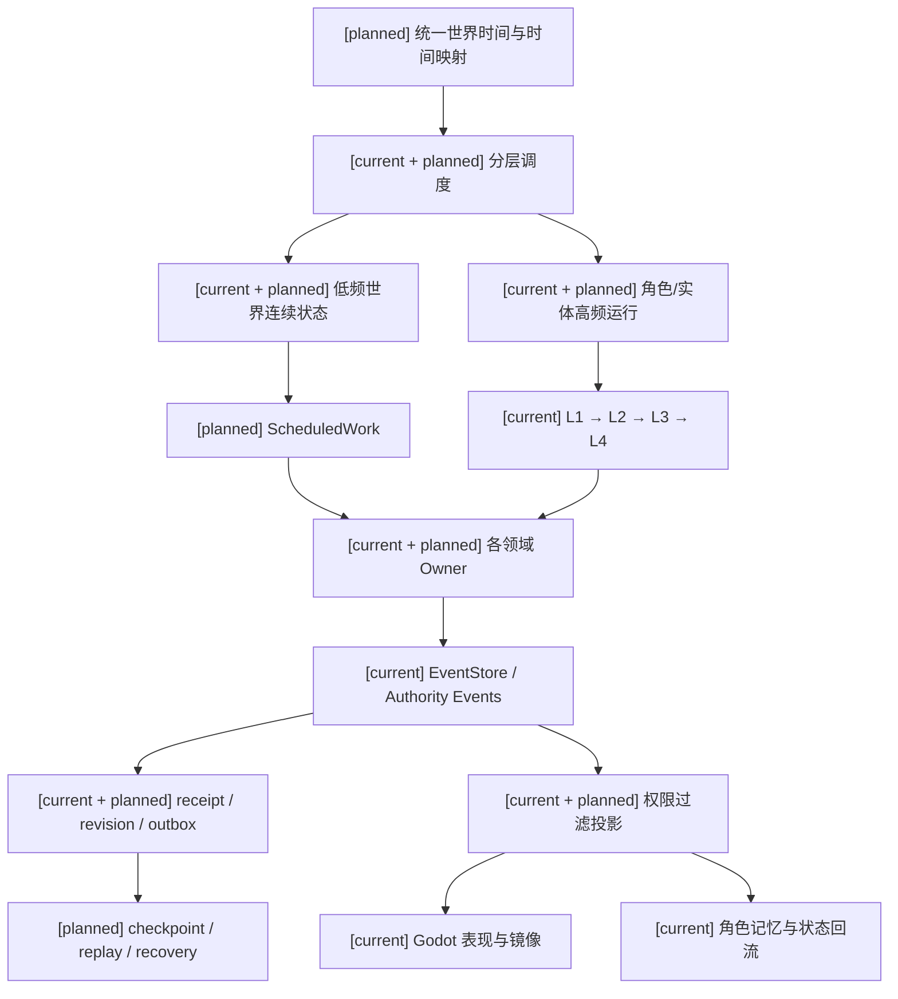
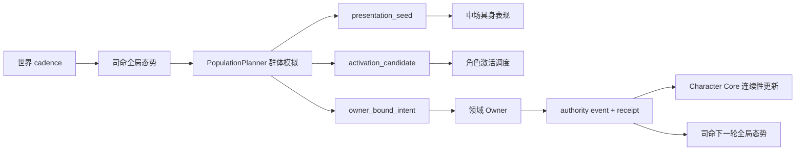
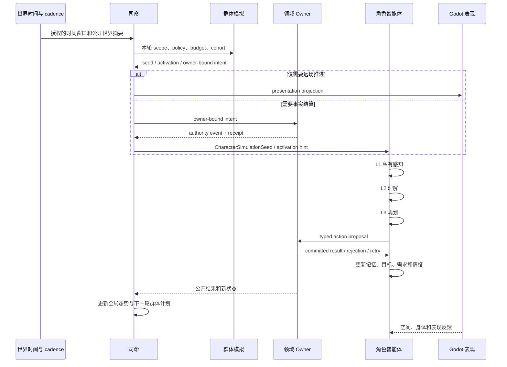
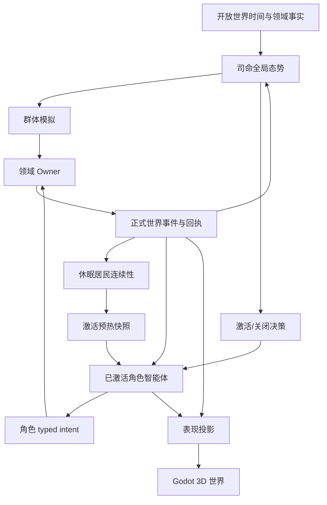
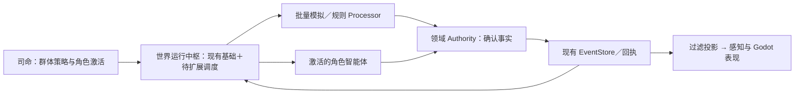
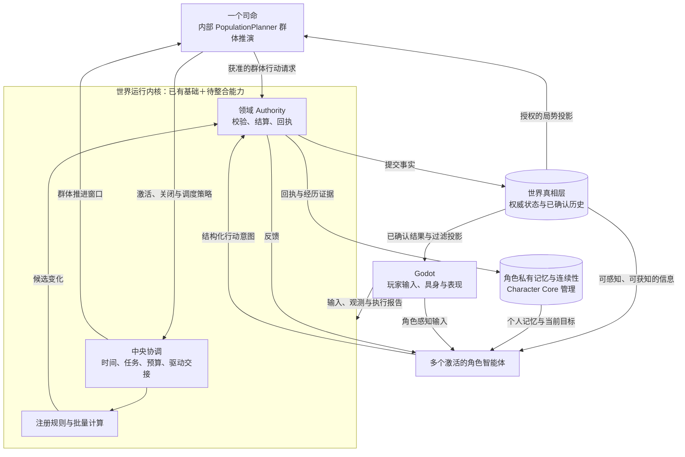

#我认为我们项目做的是开放世界运行时，单局运行时还没覆盖，你觉得呢？是不是最近做的时间模型的设计可以兼容两者？

我同意你的判断：当前项目的目标是**开放世界运行时**，自走棋这类单局运行时尚未覆盖，因此自走棋应继续保持 `[deferred]`，不作为当前角色、通用领域或开放世界玩法包的阻断项。

最近的时间模型设计原则上可以兼容两者，但前提是把它定义成**通用时间基础设施 + 运行时配置**：

| 层次 | 开放世界 | 单局运行时 |
|---|---|---|
| 时间基础 | 持续世界时间、异步事件窗口、长期连续性 | 对局时间、回合、阶段、倒计时 |
| 生命周期 | 长期存在、持久化、恢复 | 开局、进行、结束、重置 |
| 状态边界 | 世界事实持续积累 | 状态限定在 session/match scope |
| 回放方式 | 事件历史、checkpoint、恢复 | round/phase 快照、分支重放 |
| 角色决策 | 持续感知、背景认知、行动承诺 | 阶段触发、回合决策、局内预算 |

应共享的部分包括：

- 时间坐标和时间来源；
- `TemporalProfile` 一类的精度、取整、迟到、有效区间规则；
- action window、deadline、batch settlement、receipt、revision；
- 取消、过期、恢复和 replay；
- 单一时间 authority，不能为不同玩法再造第二套 clock/scheduler。

需要补明确的边界：

1. **运行时范围**：区分 `world`、`session/match` 等 scope。
2. **状态持久性**：单局结束不能自动写入开放世界事实。
3. **生命周期**：单局必须有 admission、start、phase transition、teardown/reset。
4. **参与者边界**：单局 roster、棋盘、奖励等只能在 session scope 内成立。
5. **跨边界提交**：单局结果若要影响世界，必须经过明确的 owner-bound transfer，而不是时间模型自动合并。

所以结论是：**时间模型可以作为两种运行时的共同底座，但不能因此声称单局运行时已经实现。** 当前应先把开放世界 profile 做实；未来单局运行时只需新增 session-specific profile 和 owner，不应改写角色回合、资源、权限和通用时间合同。

#时间模型设计当前是用来服务于什么的?

当前时间模型设计首先服务于**开放世界运行时的共享时间基础设施**，不是自走棋或其他单局系统。

它当前要统一这些开放世界行为：

- 世界时间、物理/Gameplay step 和调度窗口；
- 角色唤醒、背景认知和行动承诺的截止时间；
- 动作窗口、状态/资源效果到期；
- 延迟、暂停、catch-up、取消、恢复和回放；
- 领域 authority 的结算窗口与 receipt；
- 编辑器配置的时间 profile、映射和版本治理。

现有代码中，主要对应：

- `simulation_clock.py`：世界 tick 和单调推进；
- `population_driver.py`：按窗口推进人口运行时；
- `scheduling.py`：选择哪些角色计算，不负责推进世界时钟；
- `action_window_runtime.py`：动作窗口与期限；
- 状态生命周期、事件 revision 和恢复逻辑。

设计文档中的 `TemporalProfile`、`SimulationTimeline`、`SimulationTime`、`ClockMapping`、`ScheduledWork`、`SettlementWindow` 是计划中的统一合同，目前还不是完整实现。原设计明确以开放世界、实时连续模拟和现有世界调度为第一接入对象；单局运行时只是未来可以使用另一套 profile 的可能消费者。

因此准确表述是：

> **当前时间模型服务于开放世界运行时的世界时间、调度和结算边界；架构上预留兼容单局运行时，但单局 profile、回合/阶段 owner 和 session 生命周期尚未实现。**

另外，模型推理耗时、API timeout 和租约属于 operational clock，不能自动拖慢开放世界时间。依据见 [通用玩法时序模型与编辑器设计](/D:/Users/User/Documents/paralls-phase-0-demo/docs/10月分析/角色/16-通用玩法时序模型与编辑器设计.md) 和 [通用时间权限投影与领域服务接入规格](/D:/Users/User/Documents/paralls-phase-0-demo/docs/10月分析/规格/09-通用时间权限投影与领域服务接入规格.md)。

#那时间模型可以升级成让开放世界运行时兼容单局运行时？

可以，而且这是合理的升级方向。时间模型应成为：

> **统一时间基础合同 + 不同运行时 Profile + 明确的作用域与生命周期。**

当前设计已经覆盖两类基本时间形态：

- 实时连续：适合开放世界；
- 阶段/行动队列/离散 step：适合未来的单局运行时。

但单局运行时不能只是给开放世界时间模型增加 `round` 字段，还需要补齐以下边界：

| 层 | 开放世界 | 单局运行时 |
|---|---|---|
| 时间作用域 | world 持续时间 | session/match 局内时间 |
| 生命周期 | 持久运行、暂停、恢复、checkpoint | start、phase、end、reset |
| 状态持久性 | 世界状态长期保留 | 局内状态默认随局结束隔离 |
| 调度方式 | 连续 step、异步工作窗口 | 回合、阶段、行动队列 |
| 回放 | 世界事件历史与恢复 | 局内快照、阶段重放 |
| 结果出口 | 直接进入世界 owner | 先进入 session owner，再按规则转移到世界 |

建议升级成四层：

1. **共同时间合同**  
   继续复用 `SimulationTime`、`ClockMapping`、`ScheduledWork`、`SettlementWindow`、精度、取整、迟到、取消、恢复和回放规则。

2. **Runtime Profile**  
   配置实时开放世界、阶段式单局、暂停规划等推进方式。Profile 只决定时间如何推进，不定义装备、羁绊、奖励或战斗规则。

3. **Scope 与生命周期**  
   明确 `world`、`session/match`、`phase` 等作用域。单局结束时，局内状态不能自动写入开放世界；跨边界转移必须经过明确的 owner 合同。

4. **领域 Adapter**  
   开放世界接人口、天气、生产、角色心智等 owner；未来单局接 board、roster、phase、offer、reward 等 owner。时间模型只提供时间坐标和结算窗口，不接管这些事实。

所以结论是：

- **架构上可以兼容两者；**
- **当前实现仍主要服务开放世界；**
- **单局兼容需要新增 session profile、生命周期和隔离/转移合同；**
- **不需要重写角色回合、资源或通用 authority 合同；**
- **自走棋仍可保持 deferred，直到单局运行时本身立项。**

最稳妥的实施顺序是先把开放世界时间合同做实，再用一个不带自走棋规则的通用 `session` 试验 profile 验证兼容性。

#分析现在的开放世界运行时的架构!

# 当前结论

项目现在的开放世界运行时不是一个单一模拟循环，而是由几条职责分明的运行链组成：

```text
Godot 本地空间与表现
        ↓ structured facts / provider refs / player intent
Backend ingress + System L1
        ↓ projected facts / canonical percept bundle
角色智能体与 Siming 消费
        ↓ typed intent / domain request
Gameplay / ESM / 领域 Owner
        ↓ authority event / receipt / projection
Godot 表现与世界镜像
```

其中，开放世界的持续推进主要由另一条人口连续性链驱动：

```text
caller / wall clock
    → PopulationCadenceDriver
    → SimulationClock
    → cadence window
    → WorldContinuityRuntime
    → B0 population projection
    → authority publication
    → receipt / recovery / mirror
```

## 1. Godot 层：空间与表现，不拥有世界真相

Godot 当前负责：

- scene、room、zone；
- actor 和 object 的位置；
- occupancy、可达性、碰撞和环境采样；
- 玩家输入；
- 动画、音频和可见表现；
- 输出 `raw_fact_event`、provider refs 和结构化输入。

Godot 的 physics/render 时间是本地引擎时间，不是后端统一世界时钟。Godot 的动画完成也不代表领域动作已经结算成功。

整体边界见：

- [整体架构.md](/D:/Users/User/Documents/paralls-phase-0-demo/docs/架构/整体架构.md:33)
- [整体架构.md](/D:/Users/User/Documents/paralls-phase-0-demo/docs/架构/整体架构.md:93)

## 2. System L1：把空间事实整理成角色可消费输入

后端收到 `raw_fact_event` 后，大致经过：

```text
RawFactEvent
  → L1 world fact foundation
  → occupancy / fact projection
  → PerceptionQueryFrame
  → CanonicalPerceptBundle
  → character / Siming consumer
```

`L1RuntimePerceptionBridge` 会根据事实建立：

- `clock_domain`
- `monotonic_tick`
- `source_frame_index`
- `wall_clock_ts`
- `capture_id`
- `world_anchor_id`
- 结构化 fact refs
- 角色私有感知 bundle
- Siming 全局感知 bundle

它负责输入对齐和权限过滤，不负责角色认知，也不负责世界结算。

实现位置：

- [l1_runtime_perception_bridge.py](/D:/Users/User/Documents/paralls-phase-0-demo/backend/app/world_runtime/l1_runtime_perception_bridge.py:70)
- [main.py](/D:/Users/User/Documents/paralls-phase-0-demo/backend/app/main.py:4254)

## 3. 开放世界连续运行：PopulationCadenceDriver

当前开放世界时间推进的实际入口是 `PopulationCadenceDriver`。

### SimulationClock

`SimulationClock` 的特点：

- 调用方驱动；
- 只允许单调推进；
- 按整数 tick 计算到期义务；
- 有 catch-up budget；
- 不自行启动后台循环；
- 不直接写世界事实。

见：

- [simulation_clock.py](/D:/Users/User/Documents/paralls-phase-0-demo/backend/app/world_runtime/simulation_clock.py:8)
- [simulation_clock.py](/D:/Users/User/Documents/paralls-phase-0-demo/backend/app/world_runtime/simulation_clock.py:38)

当前人口时钟配置是：

| Profile | 当前语义 |
|---|---|
| `production` | 以秒为单位，窗口为 `86400` tick |
| `benchmark_1x` | 窗口为 `1` tick |
| `benchmark_10x` | 窗口为 `1` tick，速度加速 |

这说明当前时钟主要服务于人口连续性和日窗口，不是一个已经覆盖所有玩法的通用 Gameplay 时间系统。

### PopulationCadenceDriver

`PopulationCadenceDriver` 负责：

- 把目标 tick 切成连续窗口；
- 处理暂停；
- 限制 catch-up；
- 逐窗口调用 `WorldContinuityRuntime.build_population_cadence`;
- 发布 cadence；
- 只有发布成功后才推进确认游标；
- 失败窗口保留为 rejected/deferred。

见：

- [population_driver.py](/D:/Users/User/Documents/paralls-phase-0-demo/backend/app/world_runtime/population_driver.py:28)
- [population_driver.py](/D:/Users/User/Documents/paralls-phase-0-demo/backend/app/world_runtime/population_driver.py:60)

它可以被应用生命周期启动为异步任务，但它本身仍然不是世界事实 Owner。

## 4. WorldContinuityRuntime：开放世界人口连续性的核心

`WorldContinuityRuntime` 维护：

- 人口热状态；
- due index；
- cadence cache；
- projection cache；
- confirmed receipt；
- recovery state；
- population cursor；
- digest 和 revision 上下文。

它的关键原则是：

```text
先读取已确认状态
    → 纯计算 B0 投影
    → 发布给 authority
    → authority 成功后安装确认结果
```

`build_population_projections` 本身是只读预览，不推进游标，也不提交外部事实。

见：

- [world.py](/D:/Users/User/Documents/paralls-phase-0-demo/backend/app/population_continuity/world.py:42)
- [world.py](/D:/Users/User/Documents/paralls-phase-0-demo/backend/app/population_continuity/world.py:285)

B0 计算目前包含：

- fatigue；
- need pressure；
- starvation credit；
- activity phase；
- next due tick。

这些状态按照真实秒数和日周期推进，但当前仍是人口连续性专用逻辑，并不是完整角色生命、物理、动作和 Gameplay 的统一模拟。

见：

- [continuous.py](/D:/Users/User/Documents/paralls-phase-0-demo/backend/app/population_continuity/continuous.py:53)

## 5. Publication 与 Gameplay Authority

人口 cadence 发布后，进入现有 Gameplay Foundation：

```text
PopulationCadenceInput
  → RuntimeCadencePublisher
  → GameplayEventStore / AuthorityEventBus
  → outbox
  → domain owner adapter
  → receipt
  → mirror / projection
```

`RuntimeCadencePublisher` 的职责包括：

- 从已确认人口窗口构造领域窗口；
- 生成 organization due 等领域请求；
- 读取 owner 结果；
- 验证 receipt；
- 通过 outbox 投递；
- 在 authority 确认后刷新镜像。

见：

- [runtime_publication.py](/D:/Users/User/Documents/paralls-phase-0-demo/backend/app/population_continuity/runtime_publication.py:33)
- [runtime_publication.py](/D:/Users/User/Documents/paralls-phase-0-demo/backend/app/population_continuity/runtime_publication.py:72)

真正的事实提交仍由 Gameplay/领域 Owner 完成。`WorldContinuityRuntime` 和 `PopulationCadenceDriver` 不能代替 Economy、Inventory、Organization 或其他领域成为事实 Owner。

`GameplayEventStore` 提供：

- event append；
- stream revision；
- idempotency；
- exact duplicate replay；
- changed duplicate rejection；
- outbox；
- projection checkpoint；
- replay 基础。

见：

- [event_store.py](/D:/Users/User/Documents/paralls-phase-0-demo/backend/app/gameplay/event_store.py:124)
- [event_store.py](/D:/Users/User/Documents/paralls-phase-0-demo/backend/app/gameplay/event_store.py:152)

## 6. 调度器：选择谁被唤醒，不推进时间

`backend/app/world_runtime/scheduling.py` 负责：

- 按 continuity priority；
- wake-up request；
- salience；
- 最近活动时间；
- 人口规模降级阈值；
- wake budget；

选择本轮需要被计算的角色。

它明确不负责：

- 推进世界时间；
- 创建事实；
- 提交资源或状态；
- 运行后台世界循环；
- 代替 domain authority。

见：

- [scheduling.py](/D:/Users/User/Documents/paralls-phase-0-demo/backend/app/world_runtime/scheduling.py:31)
- [scheduling.py](/D:/Users/User/Documents/paralls-phase-0-demo/backend/app/world_runtime/scheduling.py:62)

## 7. 角色智能体：开放世界中的认知消费者

角色智能体当前是另一条独立但可连接的运行链：

```text
CharacterPerceivedEvent
SelfBodyPerceivedEvent
Siming output
settlement result
        ↓
CharacterAgentRuntime
        ↓
L1 private perception
memory / session timeline
        ↓
L2 interpretation
        ↓
L3 intent planning
        ↓
L4 execution staging
        ↓
CharacterExecutionContract
        ↓
ESM / Gameplay / domain authority
```

`CharacterAgentRuntime` 内部包含：

- L1 感知；
- L2 解释；
- L3 意图规划；
- L4 执行适配；
- 角色档案；
- memory stores；
- goal state；
- need/affect；
- supervision；
- background cognition；
- skill service；
- continuity state；
- character turn coordinator。

见：

- [runtime_loop.py](/D:/Users/User/Documents/paralls-phase-0-demo/backend/app/character_agent/runtime/runtime_loop.py:134)
- [runtime_loop.py](/D:/Users/User/Documents/paralls-phase-0-demo/backend/app/character_agent/runtime/runtime_loop.py:187)

### 角色回合不是世界时间推进

`CharacterTurnCoordinator` 记录的是角色私有认知回合：

```text
context
  → interpretation
  → goal
  → intent
  → execution
  → awaiting settlement
```

它通过 actor-private session stream 追加事件，使用 turn id、stage ref、idempotency key 和 revision 进行重放保护。

见：

- [character_turn_coordinator.py](/D:/Users/User/Documents/paralls-phase-0-demo/backend/app/character_agent/services/character_turn_coordinator.py:13)
- [character_turn_coordinator.py](/D:/Users/User/Documents/paralls-phase-0-demo/backend/app/character_agent/services/character_turn_coordinator.py:67)

角色模型只能产生：

- interpretation；
- intent；
- typed execution proposal；
- character-facing suggestion。

模型输出、Laya 输出和 Godot 表现都不能直接写世界真相。

## 8. 当前运行时的两条主调度链

当前最容易误解的地方是：系统存在两种不同的“运行”。

### 世界连续性链

```text
PopulationCadenceDriver
  → SimulationClock
  → cadence window
  → B0 population projection
  → authority publication
```

这是开放世界后台连续运行的核心。

### 角色认知链

```text
fact / body / Siming event
  → CharacterAgentRuntime
  → L1/L2/L3/L4
  → typed intent
  → owner settlement
```

这是事件触发和角色唤醒驱动的认知链。

二者通过以下边界连接：

- L1 perception bridge；
- authority events；
- population scheduling；
- character continuity；
- owner receipts；
- projection/mirror。

它们目前不是同一个 `SimulationTimeline`。

## 9. 当前时间模型实际服务什么

当前已经存在的时间能力主要服务：

1. 开放世界人口连续推进；
2. cadence window；
3. 人口 due work；
4. 角色感知和认知调度间隔；
5. 动作窗口、状态过期和部分到期义务；
6. authority revision 和 receipt 边界；
7. recovery cursor；
8. event replay 和 projection consistency；
9. wall clock pause/catch-up 行为。

但以下能力仍是规划状态：

- `TemporalProfile`
- `SimulationTimeline`
- `SimulationTime`
- `ClockMapping`
- `ScheduledWork`
- `SettlementWindow`
- 统一 profile 编辑器；
- 跨引擎/网络/角色唤醒的正式时间映射；
- 通用 rollback。

因此，不能说项目已经实现“统一时间模型”。

设计文档也明确记录了这一点：

- [16-通用玩法时序模型与编辑器设计.md](/D:/Users/User/Documents/paralls-phase-0-demo/docs/10月分析/角色/16-通用玩法时序模型与编辑器设计.md:224)
- [09-通用时间权限投影与领域服务接入规格.md](/D:/Users/User/Documents/paralls-phase-0-demo/docs/10月分析/规格/09-通用时间权限投影与领域服务接入规格.md:19)

## 10. 当前架构的主要缺口

### 缺口一：没有统一跨领域时间坐标

当前同时存在：

- population tick；
- `producer_ts`；
- character cognition cadence；
- Godot physics tick；
- render frame；
- wall clock；
- provider capture clock；
- event stream revision。

这些字段各自有用，但还没有完整的、可验证的跨域 mapping。

特别是：

- `producer_ts` 不能自动等同于 simulation time；
- render frame 不能推进世界；
- 客户端时间戳不能决定 authority settlement；
- “角色三回合”不能直接解释成“三秒”。

### 缺口二：开放世界连续性还不是完整世界模拟 authority

当前已实现的是人口状态和 cadence publication 闭环，尚未完整覆盖：

- LifeState；
- EntityPresence；
- spawn/despawn；
- full ecology simulation；
- complete threat/relationship authority；
- full embodied world state；
- all domain scheduled work。

### 缺口三：角色连续性和世界连续性仍然是两条运行线

当前连接点已经存在，但没有统一的：

```text
world timeline
  ↔ character wake timeline
  ↔ provider capture timeline
  ↔ engine physics timeline
```

正式合同。

### 缺口四：尚未有单局运行时合同

当前没有完整的：

- session/match runtime；
- match start/phase/end；
- 局内状态隔离；
- turn/initiative owner；
- match reset；
- match result transfer；
- session replay contract。

所以当前项目确实主要是开放世界运行时。

## 11. 是否可以升级为同时兼容开放世界和单局运行时

可以，但应升级为：

```text
共同时间合同
    + runtime profile
    + timeline scope
    + lifecycle policy
    + domain adapters
```

而不是把当前人口时钟直接改造成“回合时钟”。

建议的共同底座是：

```text
TemporalProfile
SimulationTimeline
SimulationTime
ClockMapping
ScheduledWork
SettlementWindow
```

### 开放世界 Profile

```text
scope: world
lifecycle: persistent
timeline: continuous
advancement: cadence / wall-clock driven
state: long-lived
recovery: checkpoint + receipt recovery
cognition: background and event-triggered
```

### 单局 Profile

```text
scope: session / match
lifecycle: start → phase → end → reset
timeline: bounded
advancement: turn / phase / step driven
state: session isolated
recovery: match replay or bounded rollback
cognition: turn-triggered or phase-triggered
result: explicit transfer to persistent world
```

共同底座可以复用：

- 时间单位和精度；
- revision；
- clock mapping；
- scheduled work；
- settlement window；
- deterministic ordering；
- replay pins；
- adapter capability；
- authority receipt；
- projection filtering。

但两种运行时必须保留不同的生命周期和状态边界。

## 最终判断

当前架构可以准确描述为：

> 一个以 Gameplay EventStore 为权威账本、以 PopulationCadenceDriver 和 WorldContinuityRuntime 支撑开放世界人口连续性、以 L1 感知桥连接角色智能体与 Siming、以领域 Owner 完成事实结算、以 Godot 负责本地空间和表现的后端权威运行时。

时间模型当前首先服务于：

> 开放世界人口连续运行、到期义务、角色唤醒、结算窗口、恢复和回放。

它未来可以成为开放世界与单局运行时的共同底座，但单局运行时应该作为新的 `session/match timeline profile` 接入，而不是改变当前开放世界人口时间语义。当前没有修改文件，也没有把尚未实现的统一时间合同或单局能力描述成已完成。

#详述缺口二，并且用白话比喻解释现状和未来

**缺口二的准确含义**

“开放世界连续性还不是完整世界模拟 authority”，不是说项目没有开放世界功能，也不是说没有领域事实。更准确地说：**已经有一条能持续推进人口状态的运行链，也有一些具体领域自己的事实 Owner，但还没有一套能把世界中所有重要的持续变化统一纳入时间推进、调度、结算、恢复的完整运行机制。**

这里的 authority 指能确认“世界事实已经发生”的负责人。比如，角色状态投影算出一个候选变化，不等于变化已经成为事实；需要对应领域 Owner 校验并提交，产生事件或回执。

**现在实际运行到什么程度**

以人口连续性为例，当前流程是：

```text
PopulationCadenceDriver 推进一个时间窗口
    → WorldContinuityRuntime 读取人口热状态
    → advance_b0_row 计算有限的 B0 状态变化
    → 发布窗口
    → 对应 Owner 提交已准入的领域事实
    → 记录确认回执，供恢复和投影使用
```

B0 目前计算的内容有限，主要包括疲劳、需求压力、饥饿积累、活动阶段和下次到期时间。它是持续人口运行的一块基础，不是对每个角色进行完整生活模拟。比如，算出角色到了工作阶段，并不意味着角色已经实际走到工作地点、完成了一项工作或产生了工资；那些事情需要各自的动作和领域事实链支持。

代码上可以看 [continuous.py](D:/Users/User/Documents/paralls-phase-0-demo/backend/app/population_continuity/continuous.py:53) 和 [world.py](D:/Users/User/Documents/paralls-phase-0-demo/backend/app/population_continuity/world.py:285)。窗口由 [population_driver.py](D:/Users/User/Documents/paralls-phase-0-demo/backend/app/world_runtime/population_driver.py:60) 推进；它处理暂停、有限追赶和发布失败，但不会自行变成所有领域的事实 Owner。

同时，玩家交互和部分领域活动已经有自己的处理链。例如，具体请求可以经过 ESM 或 Gameplay 领域 Owner 完成结算。人口 cadence 也能为**已准入的特定领域**提供到期请求。关键限制是：这些是按具体领域接入的能力，尚未形成覆盖世界所有持续活动的通用机制。调度到某件工作，只表示“这项工作该被处理了”，不代表它已经结算成功。

所以要区分两件事：

- **具体领域已经有一些 Owner 和事件结算能力。**
- **这些能力尚未全部接入同一套开放世界时间、工作调度、确认与恢复合同。**

当前没有完整接入的范围包括完整的生命状态和出生/消失生命周期、全面环境或生态连续演化、实体在世界中的完整准入与清理，以及各种时间性领域工作的统一调度。这里的意思是它们尚未作为完整能力接进这条开放世界连续运行主链，并非仓库里绝对找不到任何相关的局部实现。

**用白话比喻**

把现在的开放世界想成一座已经有人生活、也有若干部门办事的城市。

- `PopulationCadenceDriver` 像城市的日历，按时间通知“新的一天到了”。
- B0 人口推进像一张简化的居民日常表：更新一些疲劳、需求和活动阶段。
- 领域 Owner 像不同部门的办事窗口。工资归经济部门确认，库存归库存部门确认，状态归对应状态管理者确认。
- 回执像办事凭证：有凭证才知道某项事实确实办成了。

现在这座城市能翻日历，更新一部分居民状态，也有一些部门可以按各自规则处理到期事项。**但它还没有一张覆盖全城、能可靠说明每栋建筑、每个居民、环境和领域工作何时变化、由谁处理、处理成功没有的统一运行表。**所以不能把现在说成“整个世界都在被完整模拟”。

未来也不应该变成一个“市长程序”替所有部门改账。更合适的方向是先有共同的世界时间与窗口合同，再让不同领域通过明确的适配器登记自己能处理什么、需要哪些输入、失败时怎样恢复。调度系统可以发出工作请求；实际事实仍由对应 Owner 确认并出具回执。

设计文档把 `TemporalProfile`、`SimulationTimeline`、`ClockMapping`、`ScheduledWork` 和 `SettlementWindow` 等列为 **planned 合同**，也明确说明统一时间模型尚未实现。可见 [16-通用玩法时序模型与编辑器设计.md](D:/Users/User/Documents/paralls-phase-0-demo/docs/10月分析/角色/16-通用玩法时序模型与编辑器设计.md:224) 和 [规格09](D:/Users/User/Documents/paralls-phase-0-demo/docs/10月分析/规格/09-通用时间权限投影与领域服务接入规格.md:19)。

**一句话概括：现在有城市日历、居民简化连续状态，以及若干能独立办事的部门；未来要补的是让各部门按同一套时间和回执规则协作，而不是由一个新模块冒充全城事实的总负责人。**

#想要做开放世界运行时，还需要实现什么，理想状态是什么样的？白话解释。

# 先说结论

理想的开放世界运行时，不是让所有角色每一帧都思考，也不是做一个“大脑模块”替所有系统改数据。

它更像一座**会自己运行的城市**：

- 玩家离开后，城市仍然有时间、计划和变化；
- 居民有自己的身体、记忆、目标和关系；
- 工资、库存、天气、伤势、建筑、社交各由不同部门负责；
- 每件事情都必须由对应部门确认后才算真的发生；
- 服务器重启后，城市能从记录中恢复；
- 玩家回来时，看到的是已经发生过的世界，而不是重新编造的一段剧情。

当前项目已经有这座城市的**日历、部分居民状态、部分办事部门、角色心智和事件账本**。还缺的是把它们接成一套完整、可恢复、可扩展的城市运行系统。

---

# 一、当前已经具备什么

## 1. 有世界日历

现在已经有：

```text
PopulationCadenceDriver
  → SimulationClock
  → population cadence window
```

它可以推进人口时间窗口，处理暂停、有限追赶和失败窗口。

但它主要服务于：

- 人口连续性；
- 日窗口；
- 到期义务；
- 部分后台角色工作。

它还不是所有领域共同使用的完整时间底座。

## 2. 有一部分居民连续状态

B0 人口推进已经可以计算：

- 疲劳；
- 需求压力；
- 饥饿积累；
- 活动阶段；
- 下次到期时间。

这像城市里有一张简化居民表：

> “这个人现在大概在休息、工作还是休闲，疲劳到了什么程度，什么时候该触发下一项工作。”

但它还没有自动证明：

- 角色真的走到了某个地方；
- 角色真的完成了工作；
- 角色真的获得了工资；
- 角色和别人发生了完整互动；
- 环境因此发生了后续变化。

这些仍然要进入具体领域的 Owner 结算。

## 3. 有世界事实账本

`GameplayEventStore` 已经提供：

- 事件追加；
- stream revision；
- 幂等键；
- 重复请求处理；
- outbox；
- projection checkpoint；
- replay 基础。

它像城市的正式档案室：

> 申请不等于办成，只有登记入档并有回执，才算事实成立。

## 4. 有角色心智运行时

角色已经有：

```text
感知
  → 私有世界快照
  → 记忆和时间线
  → L2 理解
  → L3 规划
  → L4 执行合同
  → 领域结算
```

角色智能体可以连续记住事情，也能在后台被唤醒。它不是简单的“收到事件后生成一句话”。

## 5. 有基础调度

调度器已经可以根据：

- 连续性优先级；
- wake-up 请求；
- salience；
- 最近活动时间；
- 人口规模；

决定本轮先处理哪些角色。

这相当于城市调度中心已经会决定：

> 哪些居民现在值得叫醒，哪些居民可以晚一点处理。

---

# 二、还需要实现什么

## 1. 统一的世界时间合同

这是最基础的缺口。

现在同时存在：

- population tick；
- `producer_ts`；
- 角色认知时间；
- Godot physics tick；
- render frame；
- wall clock；
- provider capture clock；
- event revision。

它们都有用途，但还没有统一的映射关系。

未来需要正式实现：

```text
TemporalProfile
SimulationTimeline
SimulationTime
ClockMapping
ScheduledWork
SettlementWindow
```

白话来说，就是要明确：

- 这个世界现在几点；
- 这个角色看到的事情属于哪个世界时间；
- 物理帧如何映射到世界时间；
- 哪些工作到期了；
- 哪些结果属于同一个结算窗口；
- 哪些变化已经确认，哪些只是预测。

必须保证：

- render 掉帧不会让世界少过一天；
- 客户端时间不能直接决定权威结算；
- 角色模型思考慢不会拖慢世界；
- 不同领域不能各自偷偷拥有一套互相冲突的时钟。

这部分应当升级现有 `SimulationClock`，而不是另起第二个时钟系统。

## 2. 完整的实体生命周期

开放世界不能只知道“角色有一行状态”。

还需要明确管理：

- 角色出生或创建；
- 角色进入世界；
- 角色离开世界；
- 暂时休眠；
- 失联；
- 受伤；
- 昏迷；
- 死亡；
- 复苏；
- 永久销毁；
- 召唤物和新实体；
- 资源、装备、记忆和身份是否随之保留。

现在生命状态、实体 presence、spawn/despawn 等还没有全部作为完整 Owner 接入开放世界主链。

白话说：

> 现在系统知道“这个居民有疲劳值”，但还没有完整解决“这个居民是否真的存在、在哪里、是否还能行动、离开后怎么恢复、回来后是不是同一个人”。

## 3. 持续领域要接入同一套时间和回执

理想状态下，以下领域都应该能够被世界时间唤醒：

- 人口；
- 生态和天气；
- 经济与工资；
- 生产和组织；
- 库存和物品；
- 社交和关系；
- 生命、伤势和恢复；
- 角色认知；
- 环境资源；
- 任务和长期义务。

但每个领域仍然保留自己的事实 Owner。

正确方式是：

```text
世界时间到期
  → 发出领域工作请求
  → 领域 Owner 校验
  → Owner 提交事实
  → 返回 receipt
  → 世界安装确认结果
```

错误方式是：

```text
世界运行时直接修改工资、库存、关系、生命和装备
```

开放世界需要的是一个统一调度面，而不是一个新的“万能世界写入器”。

## 4. 分层模拟和细节等级

开放世界规模一大，就不能让每个角色永远运行完整心智。

理想状态应该分层：

### 远处居民

只运行低成本连续状态：

- 时间；
- 位置区域；
- 工作阶段；
- 需求压力；
- 简化关系变化；
- 到期工作。

### 玩家附近居民

增加：

- 感知；
- 记忆召回；
- 目标；
- 关系判断；
- 角色唤醒；
- 更细的身体和空间约束。

### 正在交互的角色

运行完整路径：

```text
L1 → L2 → L3 → L4 → authority settlement → feedback
```

这就像城市管理：

> 远郊只需要知道“工厂今天开没开”；  
> 玩家走进工厂后，才需要知道每个工人在哪里、看到了什么、对谁说了什么。

当前已有 B0 和角色调度基础，但还需要把**距离、显著性、连续性、玩家关注、交互状态、能力和预算**统一接入分层策略。

## 5. 角色行为要闭环回世界

角色不能只会“想”和“提议”。

完整闭环应该是：

```text
角色感知世界
  → 形成意图
  → 提交 typed action proposal
  → 对应领域 Owner 重验
  → 事实提交
  → 角色收到结果
  → 记忆、目标、情绪和关系更新
```

例如角色想去工作：

1. 角色决定去工作；
2. 系统检查它是否知道工作地点；
3. 空间层检查是否能到达；
4. 组织/工作领域确认工作是否有效；
5. 经济领域确认工资或义务；
6. 角色收到“成功、失败或部分完成”；
7. 角色更新记忆和目标。

现在角色 L1-L4 已经比较完整，但世界侧还需要把更多实际动作接入真实 Owner，并保证执行结果回流角色，而不是停在模型输出层。

## 6. 真正可靠的持久化和恢复

理想状态下：

```text
服务器停止
  → 保存一致检查点
  → 保存未完成工作和回执
  → 服务器重启
  → 从 checkpoint + replay tail 恢复
  → 不重复发工资、不重复扣物品、不丢角色记忆
```

当前已经有：

- 人口 recovery state；
- receipt；
- digest；
- projection cache；
- replay 基础。

但仍需补齐：

- 跨进程恢复；
- 所有领域的统一 checkpoint；
- 未完成批次恢复；
- owner 部分成功后的后续计划；
- 领域能力缺失时的明确降级；
- 失败窗口和 backlog 的长期处理。

目前文档中的人口运行证据仍明确标记了部分 `backend-only` 和 `godot_unverified` 状态，不能把静态代码或单进程测试当成完整开放世界恢复证明。

## 7. 规模和性能门禁

开放世界的难点不是“一个角色能不能运行”，而是：

- 100 个角色是否能持续运行；
- 1000 个角色是否会积压；
- 多局或多世界是否互相拖慢；
- 模型调用慢时是否会阻塞世界；
- 磁盘写入变慢时是否会造成 cadence backlog；
- 内存是否随时间无限增长。

当前已有性能和容量测试，但历史记录显示部分长测出现过：

- 多窗口 lag；
- backlog；
- 多局共享写入等待；
- Godot 未验证。

因此还需要正式确定：

- 每类角色的预算；
- 每个世界的最大 backlog；
- 最大允许延迟；
- 角色唤醒公平性；
- provider 超时策略；
- 存储写入隔离；
- 降级模式；
- 失联角色的处理策略。

“系统没崩”不等于“开放世界运行可靠”。

## 8. 可观察性和运营控制

理想运行时必须能回答：

- 世界现在推进到哪个时间；
- 哪些窗口已经确认；
- 哪些窗口延迟；
- 哪些角色被降级；
- 哪些领域 Owner 失败；
- 哪些事件等待回执；
- 哪些角色记忆没有恢复；
- 哪些投影已经过期；
- 哪些 Godot 表现只是旧画面。

需要有：

- world timeline dashboard；
- cadence backlog；
- actor wake queue；
- domain receipt status；
- recovery cursor；
- model/provider latency；
- projection freshness；
- degraded-mode reason；
- replay/checkpoint diagnostics。

否则出了问题只能看到“角色不动了”，不知道究竟是时间没推进、模型超时、Owner 冲突、事件没投递，还是 Godot 没刷新。

## 9. Godot 真实运行验证

后端证明不等于玩家真的看到了正确结果。

理想状态需要验证：

```text
后端 authority event
  → filtered projection
  → Godot message
  → actor/local presentation
  → 可观察场景结果
```

需要实际证明：

- 角色确实移动到正确位置；
- 角色确实播放了对应表现；
- 失败结算不会伪装成成功动作；
- 世界重启后 Godot 能重新拉到正确状态；
- 过期投影不会覆盖新状态；
- provider 只提供采样，不越权修改世界。

当前这部分仍有 `godot_unverified` 的限制。

---

# 三、理想状态的完整结构



这个结构的核心是：

> 时间统一，模拟分层，事实分域，结算有回执，失败可恢复，表现只是投影。

---

# 四、用一个完整例子说明

假设玩家离开小镇三天后回来。

## 现在的基础能力

系统可以知道：

- 世界时间推进了几个窗口；
- 居民疲劳和需求发生了变化；
- 某些人口工作已到期；
- 某些已准入领域收到了 cadence；
- 角色能被唤醒；
- 事件和回执可以进入账本。

## 理想状态下还应发生

1. 世界时间推进三天；
2. 居民低频状态连续更新；
3. 天气和生态按自己的规则更新；
4. 组织确认哪些人完成了工作；
5. 经济确认工资或债务变化；
6. 物品和库存确认生产结果；
7. 角色根据显著事件被唤醒；
8. 角色记忆中只出现它真正能感知到的事情；
9. 发生冲突的领域分别恢复；
10. 服务器重启后仍能恢复到一致结果；
11. 玩家回来时，Godot 看到的是确认后的世界镜像。

这不是每个 NPC 三天里都模拟了 259200 秒，而是：

> 远处使用低成本连续计算；  
> 重要事件进入领域结算；  
> 玩家真正关注的角色再提升模拟精度。

---

# 五、最合理的实现顺序

## 第一阶段：先把开放世界主干做可靠

优先实现：

1. 统一时间合同的最小版本；
2. 现有 `SimulationClock` 的显式 profile 和 mapping；
3. cadence、cursor、backlog、receipt；
4. population B0 的稳定恢复；
5. EventStore 与 outbox 的可靠闭环；
6. 100/1000 人规模和延迟门禁。

这一阶段目标是：

> 世界能稳定地持续运行、暂停、恢复，不丢窗口、不重复结算。

## 第二阶段：接入完整世界对象生命周期

补齐：

- LifeState；
- EntityPresence；
- spawn/despawn；
- 角色和实体身份连续性；
- 伤势和恢复；
- 召唤物和临时实体；
- 退出世界和重新进入世界。

目标是：

> 世界不只会更新几张状态表，还知道“谁存在、谁离开、谁还能行动”。

## 第三阶段：扩展持续领域

按 Owner 逐个接入：

- 生态；
- 经济；
- 生产；
- 库存；
- 社交；
- 生命；
- 组织；
- 长期任务。

每个领域都必须有：

- 输入合同；
- 时间窗口；
- 权限；
- Owner；
- 事件；
- receipt；
- replay；
- recovery。

## 第四阶段：强化角色与世界闭环

让角色的：

```text
感知
→ 心智
→ 意图
→ 执行
→ 领域事实
→ 反馈
→ 记忆更新
```

在开放世界中稳定运行。

## 第五阶段：完善作者和运营控制面

最后再补：

- 时间 profile 编辑；
- 世界规则编辑；
- 预览；
- replay comparison；
- 版本发布；
- activation boundary；
- backlog 和健康度监控；
- 降级与恢复操作。

---

# 最后用一句白话总结

**现在的项目像一座已经有城市日历、居民状态表、几个办事部门和居民心理系统的小镇。**

**理想的开放世界运行时，是这座小镇能在玩家离开后继续生活；每种变化都有自己的负责人；重要事情有正式凭证；出故障可以从档案恢复；人多时不会让所有人同时耗尽算力；玩家回来时看到的是连续、可信、可解释的世界。**


#我们现在有角色智能体（角色认知链 ）和司命智能体（主导群体模拟），他们应该怎么和这个会自己运行的城市合作；换句话说，角色智能体怎么直接附身城市中的居民，司命智能体怎么作为城市的天道，去控制一切并且使用群体模拟控制并推进城市运行。

可以把三者定义成：

| 系统 | 城市比喻 | 运行职责 |
|---|---|---|
| 角色智能体 | 居民的心智和主观体验 | 感知、记忆、理解、规划、提出个人行动 |
| 司命智能体 | 城市的天道和统筹中枢 | 观察全局、推进群体模拟、分配计算预算、制造高层催化 |
| 领域 Owner | 城市各个办事部门 | 最终确认工资、库存、伤势、关系、生产等事实 |
| Godot | 城市的可见街道和身体 | 空间、物理、动画、声音和表现 |

核心原则是：

> 司命决定城市“往哪里发展、哪些地方值得计算、哪些候选值得送去结算”；角色决定居民“怎么看、想什么、想做什么”；领域 Owner 决定“这件事到底有没有发生”。

---

# 一、角色智能体如何“附身”居民

角色智能体不能只是一个模型进程。它必须绑定到一个长期存在的居民身份。

## 一个居民应该有五层

```text
CharacterRecord
├── 身份与长期档案
├── 世界实体与位置
├── 身体和运行状态
├── 记忆、目标、关系
└── 当前激活状态
```

### 1. 身份层

包括：

- `character_ref`
- authored profile
- 人格和价值倾向；
- 能力和限制；
- 身份历史；
- 长期连续性版本。

这相当于居民的身份证。角色智能体无论远离玩家、进入休眠还是重新激活，都必须还是同一个居民。

### 2. 世界实体层

包括：

- 当前是否存在；
- 当前世界、区域、地点；
- 是否有可见身体；
- 是否在工作、休息、旅行或受伤；
- 当前使用的 actor/scene/presentation binding。

这相当于居民的身体和住址。

角色身份绑定、场景 Actor、骨架和动作资源应该分开管理。换一个模型或动作资源，不应自动换掉居民身份。

### 3. 心智运行态

包括：

- 需求压力；
- 情绪和张力；
- 当前目标；
- unresolved tension；
- 当前控制模式；
- 当前行为连续性。

这些属于角色智能体自己的运行状态，但它们不能直接改写城市事实。

### 4. 角色私有记忆

包括：

- 事件记忆；
- 观察记忆；
- 知识记忆；
- 社交记忆；
- 高阶记忆；
- 角色自己的误解和不确定判断。

城市拥有公共事实，角色拥有自己的经历和理解。两者不能混成一份全局记忆。

### 5. 激活状态

居民不需要一直运行完整 LLM。

同一个居民可以处于三种运行档位：

```text
远场居民
  → 中场具身壳
  → 近场完整角色智能体
```

这三种状态仍然绑定同一个 `character_ref`。

## 三档居民模型

### 远场居民

城市只维护：

- 活动阶段；
- 需求变化；
- 工作计划；
- 区域位置；
- 简化关系；
- 到期工作；
- 需要升级的原因。

这里不运行完整角色心智。

### 中场具身壳

当玩家接近，居民开始准备：

- 当前任务；
- 可见行为；
- 位置和身体；
- 最近公共事件；
- 角色的连续性摘要。

它可以先让居民“像是在生活”，但不会凭空创建一套新的记忆或账户。

### 近场完整智能体

当居民真正进入交互范围后：

```text
公共世界投影
  → 角色私有 L1 感知
  → 记忆召回
  → L2 理解
  → L3 规划
  → L4 执行合同
  → 领域 Owner 结算
  → 结果回到角色记忆和目标
```

这就是角色智能体真正“附身”居民的时刻。

它不是重新生成一个 NPC，而是把同一个远场居民恢复成完整的主观连续体。

相关设计见：

- [角色分级连续性设计](D:/Users/User/Documents/paralls-phase-0-demo/docs/8月分析/司命与群体世界补充设计/03-群体模拟与角色分级连续性.md)
- [角色智能体模块](D:/Users/User/Documents/paralls-phase-0-demo/docs/架构/运行时/模块/角色智能体.md)

---

# 二、角色智能体附身后的实际流程

以居民“阿明今天去面包店工作”为例。

```text
1. 远场群体模拟判断阿明今天有工作安排
2. 司命生成 owner-bound intent
3. 组织/生产领域 Owner 确认工作事实
4. 产生 authority event 和 receipt
5. Character Core 收到结构化 continuity seed
6. 玩家接近阿明
7. 阿明激活完整 CharacterAgentRuntime
8. L1 只提供阿明能看到、听到和感知到的内容
9. L2/L3 形成阿明自己的理解和下一步意图
10. L4 发出 typed action proposal
11. 对应领域再次校验并结算
12. 结果回写阿明的记忆、目标和状态
```

这里有两个重要区别：

- 群体模拟可以提前决定“阿明今天大概率要工作”；
- 角色智能体负责决定“阿明怎么看待这份工作、遇到人时怎么反应、是否临时改变计划”。

这样既有城市级连续性，也有居民级主观性。

---

# 三、司命如何成为“城市天道”

司命的“控制一切”应该理解为控制城市的：

1. **时间节律**
2. **群体计算**
3. **注意力分配**
4. **高层催化**
5. **能力和预算**
6. **公平性与降级策略**
7. **哪些居民需要从远场升级到近场**

司命通过这些机制影响整个城市，而不是亲自替每个部门改账。

## 司命的输入

司命可以读取：

- 公开 Authority Events；
- 世界时间窗口；
- 区域和组织投影；
- 公开环境事实；
- 人口和群体状态摘要；
- 公共经济、生产、库存和社会信号；
- 角色公开可见的状态；
- fairness snapshot；
- 已授权的 provider 和感知 bundle。

司命不应读取居民的：

- 私有五池记忆；
- 隐藏知识；
- 未授权关系；
- 私人感知缓存；
- 私人推理过程。

这保证了“天道观察全城”，但不会直接偷窥居民脑内内容。

## 司命的核心能力

### 1. 全局态势理解

司命维护：

```text
城市现在发生了什么
哪些区域正在积压
哪些群体需要调整
哪些趋势会影响公平和稳定
哪些事件值得提升模拟精度
```

这部分由 `SimingGlobalSituationLayer` 承担。

### 2. 群体模拟

司命内部的 `PopulationPlanner` 运行批量计算：

- cohort 选择；
- 日程和工作；
- 资源压力；
- 区域传播；
- 组织行为；
- 角色激活候选；
- presentation seed；
- owner-bound intent。

群体模拟使用冻结的 cadence、read-set、scope、policy、ruleset 和 budget，不自己发明城市时间。

### 3. 预算和注意力分配

司命决定：

- 本轮处理哪些区域；
- 哪些居民进入 cohort；
- 哪些角色需要升级；
- 哪些角色暂时只保留低频状态；
- 哪些事件值得触发完整角色智能体；
- 模型预算用在普通工作、社会冲突还是重大事件上。

这就是天道对城市的“注意力控制”。

### 4. 高层催化

司命可以产生：

- 某个区域的压力变化；
- 某个组织的公共任务；
- 某个事件的 salience 提升；
- 某个居民的唤醒建议；
- 某个环境事件的注意力；
- 角色应该重新观察某个目标的提示。

这些是高层催化输入，交给角色智能体自己理解。

### 5. 统一观察和纠偏

司命还要观察：

- 某个群体是否长期没有推进；
- 某类居民是否过度被忽略；
- 某个领域是否积压；
- 某个 Owner 是否反复拒绝；
- 某个区域是否出现异常状态；
- 计算预算是否需要降级。

它可以调整下一轮的 cohort、优先级和预算。

---

# 四、群体模拟如何真正控制城市运行

群体模拟的输出必须分成三类：

```text
presentation_seed
activation_candidate
owner_bound_intent
```

## 1. presentation_seed

用于表现：

> “这个居民大概正在修屋顶。”

它可以驱动中场行为种子、场景提示或可重建的表现。

它本身不会改变工资、库存、关系或世界事实。

## 2. activation_candidate

用于调度：

> “这个居民马上会被玩家看到，应该提前激活。”

它只改变角色智能体的优先级和唤醒顺序。

## 3. owner_bound_intent

用于推进事实：

> “请组织领域确认这名居民是否真的完成了这项工作。”

它必须绑定到一个已注册的领域能力和 Owner。Owner 确认后才生成正式事件和 receipt。

完整链路是：



当前仓库的设计已经明确了这个方向：

> 司命统辖策略、准入和提交；PopulationPlanner 负责批量计算和候选生成；领域 Owner 负责世界事实；Character Core 负责角色连续性。

见：

- [群体模拟与角色分级连续性设计](D:/Users/User/Documents/paralls-phase-0-demo/docs/8月分析/司命与群体世界补充设计/03-群体模拟与角色分级连续性.md)
- [时间、空间与推进内核](D:/Users/User/Documents/paralls-phase-0-demo/docs/8月分析/司命与群体世界补充设计/08-时间空间与推进内核.md)
- [SimingRuntime](D:/Users/User/Documents/paralls-phase-0-demo/backend/app/services/siming_runtime.py:162)

---

# 五、司命、角色和城市的完整协作时序



---

# 六、它们之间最重要的权限边界

| 事情 | 司命 | 角色智能体 | 领域 Owner |
|---|---|---|---|
| 选择本轮模拟哪些群体 | 负责 | 提供个人优先级信号 | 提供可用投影 |
| 选择哪些角色升级 | 负责 | 接受或延迟激活 | 提供能力和状态 |
| 生成居民的主观记忆 | 不负责 | 负责 | 提供公开事实 |
| 生成角色的个人意图 | 提供催化 | 负责 | 校验能力和权限 |
| 修改工资 | 提出批量意图 | 可提出申请 | Economy Owner |
| 修改库存 | 提出批量意图 | 可提出申请 | Inventory Owner |
| 修改生命状态 | 提出高层候选 | 可提出自我保护意图 | Life/Status Owner |
| 修改关系事实 | 提出公共社会信号 | 形成个人理解 | Social Owner |
| 直接控制 Godot pose | 不负责 | 输出语义执行合同 | 只返回结算结果 |
| 推进世界时间 | 消费授权窗口、参与调度 | 消费角色时间 | 遵守时间合同 |
| 回写角色连续性 | 提供 seed/catalyst | 负责记忆和心智更新 | 返回事实证据 |

---

# 七、当前仓库距离这个理想状态还有多远

当前已经有一条受限的纵向样板：

```text
世界 cadence
  → SimingRuntime
  → PopulationPlanner
  → 特定 Owner
  → receipt
  → Character Core
```

当前已接入或验证的是有限范围，例如：

- Production/Organization；
- Inventory output custody；
- public Social population signal；
- 一条 bakery seed vertical；
- 三档角色连续性模型的受限实现。

仍然需要扩展：

- 完整人口；
- 生命和实体生命周期；
- 生态和天气；
- 经济、生产和组织；
- 社会关系；
- 多区域和多组织传播；
- 更完整的角色激活和退出；
- 跨进程恢复；
- 大规模性能门禁；
- Godot 真实场景验证。

因此，当前的 Siming 已经可以作为**群体模拟的统筹入口**，但还没有完成“管理整座城市所有因果”的终局能力。

---

# 最合理的落地顺序

## 第一步：先固定居民身份连续性

先保证：

```text
远场居民
  → 中场具身壳
  → 近场完整角色
```

始终使用同一个 `CharacterRecord`，不会产生影子居民、重复记忆或重复账户。

## 第二步：完成一条完整纵切

继续使用已有的 `schedule_gated_supply` 类似纵切，证明：

```text
司命群体模拟
  → owner-bound intent
  → domain receipt
  → Character Core seed
  → 玩家靠近后激活完整角色
  → 角色行动再回到 Owner
```

## 第三步：扩展城市部门

按领域逐个接入，不一次性做一个万能 authority：

- 生产；
- 经济；
- 库存；
- 社交；
- 生命；
- 生态；
- 环境资源。

## 第四步：完善司命的群体控制面

补齐：

- cohort 选择；
- 区域预算；
- 优先级；
- fairness；
- 降级；
- 激活；
- backlog；
- 全局趋势；
- 事件传播。

## 第五步：补恢复和规模证明

最后必须证明：

- 城市能持续运行；
- 角色不会重复结算；
- owner 失败可恢复；
- 服务器重启后可继续；
- 居民数量增加不会让城市停摆；
- 玩家回来能看到与后台事实一致的结果。

**白话总结：角色智能体是居民的“灵魂”，司命是城市的“天道”，领域 Owner 是各个真正办事的部门。司命通过时间、群体模拟、预算、催化和激活来统筹城市；角色通过自己的感知、记忆和心智生活在城市里；任何真正改变城市的事情，都要经过对应部门确认并留下回执。**

#
#一个项目里会存在多个角色智能体和一个司命，司命决定激活或关闭角色智能体。实际上对于玩家的体验来说，就是一个3d开放世界，背后是会自己运行的城市（开放世界运行时）在运转，与玩家互动的角色和重要角色会被司命激活角色智能体，角色智能体可关闭，但角色记忆永存，角色在没有角色智能体驱动的时候就和其他开放世界角色一样受到司命群体模拟的驱动（主要是世界真相和记忆上的变化，玩家或活着的角色智能体没注意到的情况下，这些变化就不会在表现层及时更新，而是定期更新。），群体模拟是一直推进的，期间处于激活状态的角色智能体也会随着世界真相和记忆的变化，在这个城市里活着。


对，这就是应确立的开放世界运行时模型：

> **城市一直运行，司命一直统筹，角色智能体按需出现；角色智能体可以关闭，但居民不会消失。**

## 一、三者关系

```text
一个项目
├── 一个司命智能体
├── 一个持续运行的开放世界
├── 很多 CharacterRecord 居民
└── 许多可按需激活/关闭的角色智能体实例
```

关键是：

```text
居民是否活着 ≠ 角色智能体是否运行
```

角色智能体是居民的“当前心智计算进程”，不是居民本身。

居民的身份、身体、历史、记忆、关系和世界状态都属于持久的 `CharacterRecord`。角色智能体只是暂时接管这个居民的高精度认知和行为决策。

## 二、城市中每个居民的四层状态

### 1. 世界事实

由城市和领域 Owner 维护：

- 位置；
- 生命状态；
- 工作；
- 物品；
- 经济；
- 关系事实；
- 环境影响；
- 已提交事件。

这些事实不依赖角色智能体是否开启。

### 2. 居民连续性和记忆

由 Character Core 和持久化存储维护：

- 事件记忆；
- 观察记忆；
- 知识记忆；
- 社交记忆；
- 高阶记忆；
- 当前目标；
- 未解决张力；
- 情绪和需求历史。

角色智能体关闭后，这些仍然存在。

但要区分：

> 司命和群体模拟可以生成“这个居民可能经历了什么”的候选，不能直接伪造居民的私有记忆。  
> 正式世界事件经过授权后，才由角色连续性链物化为该居民可拥有的记忆或状态变化。

### 3. 角色智能体运行态

只在被激活时运行：

```text
L1 感知
→ L2 理解
→ L3 规划
→ L4 执行
→ 领域结算
→ 记忆和目标更新
```

它使用同一个居民的 `CharacterRecord`，不会创建第二个 NPC。

### 4. 表现层状态

Godot 不必实时显示城市全部变化。

可以按照：

- 玩家距离；
- 角色重要性；
- 当前可见性；
- 事件显著性；
- 投影新鲜度；

决定什么时候刷新。

所以远处居民的事实和记忆可以已经变化，但玩家暂时看不到具体表现。玩家靠近时，系统再用最新确认状态重新生成表现。

## 三、群体模拟一直推进

在世界处于 `running` 状态时，司命统筹的群体模拟持续推进：

```text
世界时间窗口
  → 司命读取公开世界投影
  → PopulationPlanner 批量计算
  → 生成群体结果
  → 领域 Owner 结算真实变化
  → 结果写入事件账本
  → 更新居民连续性和待激活数据
```

群体模拟不等于每个居民每秒都运行完整 LLM。

远处居民可能只更新：

- 活动阶段；
- 工作安排；
- 需求压力；
- 区域位置；
- 简化关系；
- 待处理事件；
- 是否需要激活。

这就是城市在后台“自己生活”。

## 四、司命负责激活和关闭角色智能体

司命根据全局态势决定：

- 哪些居民需要激活；
- 哪些居民继续保持低成本运行；
- 哪些居民需要提前预热；
- 哪些居民可以关闭；
- 哪些事件必须提升到完整角色智能体；
- 哪些角色因为玩家接近而获得高优先级。

典型激活原因：

- 玩家接近；
- 玩家正在与该角色交互；
- 角色是当前剧情或社会事件的关键人物；
- 该角色收到重大事件；
- 角色有未解决冲突；
- 角色所在区域发生高显著变化；
- 其他角色需要和它进行高质量互动。

但司命的“控制一切”应理解为：

> 控制时间、预算、优先级、群体模拟和激活策略。

它不应直接改写工资、库存、伤势或私有记忆。真实事实仍由对应领域 Owner 提交。

## 五、角色智能体的生命周期

建议把角色智能体生命周期定义成：

```text
dormant
  → warming
  → active
  → draining
  → dormant
```

### dormant：休眠

居民仍然存在：

- 群体模拟继续推进；
- 世界事实继续变化；
- 记忆仍然持久保存；
- 待处理事件和连续性变化被记录；
- 不运行完整 L1-L4 心智链。

### warming：预热

司命决定激活后：

1. 读取最新世界 revision；
2. 读取居民连续性快照；
3. 读取待处理事件；
4. 合并授权的记忆候选；
5. 建立角色私有感知窗口；
6. 获取 activation lock。

这一步不能直接把旧缓存当成当前世界。

### active：运行

角色智能体开始处理：

```text
世界事件
→ 角色私有感知
→ 心智理解
→ 行为规划
→ typed intent
→ Owner 结算
→ 结果回写
```

它不需要每一帧思考，而是按事件、唤醒计划、交互和目标变化运行。

### draining：关闭

关闭不是删除居民，也不是丢弃记忆：

1. 停止接收新的普通认知任务；
2. 完成或挂起当前 turn；
3. 保存最新 memory、goal、dynamic state 和 revision；
4. 保存未完成 intent 和 recovery cursor；
5. 释放 activation lock；
6. 回到群体模拟驱动。

如果角色正在进行不可中断的正式结算，不能粗暴关闭；应该等待回执或进入可恢复状态。

## 六、完整协作流



这里最重要的是：**激活前后使用的是同一个居民身份和同一条事实历史。**

## 七、一个具体例子

玩家离开小镇三天。

### 玩家不在场时

- 城市时间继续推进；
- 阿明的疲劳和需求变化；
- 群体模拟安排阿明工作；
- 组织 Owner 确认工作事实；
- 经济 Owner 记录工资；
- 阿明的连续性链记录“发生过工作事件”；
- 但阿明没有运行完整角色智能体；
- Godot 也不必实时播放阿明的全部动作。

### 玩家回来并接近阿明

司命发现：

```text
玩家接近 + 阿明是重要交互对象
```

于是：

1. 激活阿明的角色智能体；
2. 读取阿明最新世界状态；
3. 读取三天内已授权的连续性变化；
4. 建立阿明自己的私有记忆视图；
5. 阿明根据自己的性格、记忆和当前情绪理解玩家；
6. L3 规划回应；
7. L4 输出表达和行动合同；
8. 需要改变世界的事情交给领域 Owner；
9. 结果回写阿明记忆；
10. Godot 显示当前可见表现。

阿明不是“刚刚生成的 NPC”，而是一个已经在城市里生活了三天、现在被重新接通心智的居民。

## 八、与当前实现的对应关系

当前已经有这些基础：

- `PopulationCadenceDriver` 和人口连续推进；
- `SimingRuntime`；
- `PopulationPlanner`；
- 角色 L1-L4；
- `CharacterGraphContinuityStore`；
- actor-private session/memory store；
- activation policy 和 activation handle；
- owner receipt、event store、replay 基础；
- 受限的远场、中场、近场角色连续性纵切。

还没有完整实现的关键部分是：

- 一个项目级司命作为正式激活总调度者；
- 角色智能体进程与 `CharacterRecord` 的严格租约绑定；
- 关闭时的 drain、checkpoint 和恢复合同；
- 休眠期间世界事件到角色记忆候选的完整物化流程；
- 同一居民从群体模拟无缝切换到完整智能体；
- 表现层按关注度延迟刷新；
- 多角色同时激活时的预算、公平和优先级；
- 跨进程重启后的角色激活恢复。

## 最准确的定义

最终运行时应当是：

> **群体模拟负责让城市持续生活，司命负责决定城市把计算和注意力给谁，角色智能体负责让被激活的居民拥有连续的主观心智，领域 Owner 负责确认世界事实，Godot 负责把当前可见结果表现出来。**

因此，角色智能体关闭时，居民仍然活在城市里；再次激活时，接回的是同一个居民、同一段记忆和同一条世界历史。


#我记得这些"仍然需要扩展：
- 完整人口；
- 生命和实体生命周期；
- 生态和天气；
- 经济、生产和组织；
- 社会关系；
- 多区域和多组织传播；
- 更完整的角色激活和退出；
- 跨进程恢复；
- 大规模性能门禁；
- Godot 真实场景验证。"
- 都或多或少有窄实现？到底缺啥，八月分析里我推进了好多，我以为很多都实现了，比如生态。

你记得是对的。上一条把“尚未完整覆盖”说成“还需要实现”，容易让人误解为八月成果不存在。你列出的这些能力大多已经有窄实现、Owner、事件、回放和 Harness 证据。Annotation 1

真正的区别是：

> **已有窄纵切 ≠ 已经成为整个开放世界的通用、持续、自动运行能力。**

八月状态登记采用四种状态：

- `current-verified`：有限范围已有代码和可复现证据；
- `current-partial`：基础和窄切存在，但完整领域未完成；
- `planned/blocked`：还缺 Owner、合同或实现；
- `integration gap`：模块存在，但尚未接入完整开放世界主循环或最终证据。

## 逐项核对

| 能力 | 已经有的东西 | 真正缺的东西 | 准确状态 |
|---|---|---|---|
| 完整人口 | 人口 cadence、B0 连续状态、roster、due work、恢复；司命三角色纵切；Production、Inventory、public Social 等有限适配 | 通用人口真相 Owner、家庭/组织日程、出生死亡、迁移、完整人口社会关系、文明和多区域长期运行 | `current-partial`，有 `bounded verified` 纵切 |
| 生命与实体生命周期 | Survival 的 cold/dehydrated/fatigued 等状态、状态到期、死亡确认意图、角色激活连续性、部分实体/设施生命周期 | 通用 `LifeState`、`EntityPresence`、spawn/despawn、身份连续、死亡/复苏/清理与人口 cadence 的完整接入 | `current-partial` |
| 生态与天气 | 区域、环境、资源、作物、灾害记录；seasonal process；drought；frost；weather-front 的单步、路径、有限 fanout/wave；frost/seasonal 到 Construction 等窄边 | 自动长期天气循环、完整资源/作物/群落生命周期、多灾害通用传播、所有跨域消费者接入、开放世界自动生态调度 | **`current-verified` 的受限 Ecology Platform + 更广能力 planned** |
| 经济、生产、组织 | fixed quote、account、debt、contract、tax、dynamic quote/clearing/credit；面包店、工资、经营窗口、生产输出、组织和政府多条窄边 | 完整城市经济连续运行、通用生产链、自由市场、通用支付/转账/补偿、组织全生命周期、跨区域经济传播 | `current-partial` |
| 社会关系 | actor-private SocialFactAuthority、握手共享经历、public social population signal、部分社会隐私和回放 | 通用关系图真相、出席/聚会、社会传播、群体关系演化、关系对人口和组织的完整反馈 | `current-partial` |
| 多区域、多组织传播 | Ecology 的相邻区域、显式路径、有限 fanout 和 wave；多组织商业生态窄切 | 自动多区域持续传播、通用图遍历、跨域 fanout、人口/社会/经济/生态统一传播 | `current-partial` |
| 角色激活与退出 | `activation lock`、pending/requeue、dormant/prewarm/active、同一 `CharacterRecord` 三档连续性；三角色司命纵切 | 生产版 `CharacterSimulationSeed`、完整 memory materialization、四游标、关闭 drain、跨领域激活恢复、司命长期激活调度 | `current-partial`，已有很重要的 bounded slice |
| 跨进程恢复 | SQLite/EventStore、spawn 进程边界、checkpoint/replay、角色 session/current 恢复、数据导向恢复 | 整个开放世界在进程重启后同时恢复 cadence、Owner 在途任务、角色激活、记忆种子、投影和未完成结算的一致证明 | 基础存在，完整主链仍未闭合 |
| 大规模性能 | 100/1000/10000 节点数据导向测试；人口正确性、长时采集和容量诊断；多种延迟、内存和恢复工具 | 固定版本下满足正式 lag/backlog/RSS/真实 provider 门槛；共享写入峰值归因和修复；最终容量结论 | 基础和诊断存在，正式容量门禁未完全通过 |
| Godot 真实场景 | Phase 0、部分 Gameplay mirror、P1D 等有限 Godot 证据 | 开放世界人口 100/1000 人真实场景、LOD、断线重绑、恢复、帧预算和同版外机证据 | 后端不少已验证，开放世界最终 Godot 仍 `godot_unverified` |

## 生态为什么容易被误判

生态是最典型的例子。

现在不是“没有生态”，而是已经有一个能工作的有限生态平台：

```text
EcologyAuthority
  → 区域/环境/资源/作物/灾害事实
  → seasonal / drought / frost / weather-front
  → Ecology event
  → scoped projection / replay
```

例如已经验证过：

- 单区域季节推进；
- 干旱过程；
- 霜冻影响作物；
- weather front 传播到相邻区域；
- 固定路径和有限 fanout；
- 霜冻或季节过程影响 Construction；
- revision、privacy、idempotency、receipt、replay。

所以，生态不是应该重新做一遍。真正缺的是：

```text
caller-driven ecology command
        ↓
接入开放世界授权 cadence
        ↓
长期自动运行
        ↓
跨区域持续演化
        ↓
按已注册合同影响生产、身体、经济、人口和社会
```

当前文档明确说，现有生态过程仍是 caller-driven，不是后台 scheduler，也不是完整多区域生态传播。[生态环境与灾害系统](D:/Users/User/Documents/paralls-phase-0-demo/docs/8月分析/世界基础设施增量指导/18-生态环境与灾害系统.md:11)

## 八月推进实际完成了什么

八月已经完成了大量“地基和样板”：

```text
领域 Owner
  → typed command
  → owner fragment
  → append_batch
  → receipt
  → outbox
  → scoped projection
  → full/checkpoint-tail replay
```

这说明很多领域已经具备可信的局部事实结算能力。

但开放世界终局还需要把这些窄边放进统一城市循环：

```text
世界时间 cadence
  → 司命选择 cohort / budget
  → PopulationPlanner 计算
  → 已注册 owner-bound intent
  → 领域 Owner 结算
  → receipt
  → Character Core 连续性更新
  → 角色激活或继续休眠
  → Godot 按关注度刷新
```

目前已证明这条链在有限 bakery/三角色/少数 Owner 上成立。八月文档也明确写着，这不代表完整人口、社会、经济、文明或多区域模拟已经完成。[群体模拟与角色分级连续性](D:/Users/User/Documents/paralls-phase-0-demo/docs/8月分析/司命与群体世界补充设计/03-群体模拟与角色分级连续性.md:60)

## 所以现在最缺的不是“重新开发所有系统”

真正的缺口集中在四类：

### 1. 从窄 Owner 行扩展到开放世界覆盖

不是创建通用万能 Writer，而是继续逐行补：

- source；
- target owner；
- event family；
- scope；
- revision；
- privacy；
- receipt；
- replay；
- failure/recovery。

### 2. 把已有领域接入持续 cadence

很多生态、生产、组织能力现在是显式 caller-driven。需要让开放世界 cadence 按授权合同调用它们，而不是每个领域自行维护后台循环。

### 3. 把角色连续性桥补完整

司命已经能生成群体候选和 activation candidate，但还需要完成：

- `CharacterSimulationSeed` 生产合同；
- state cursor；
- memory cursor；
- candidate cursor；
- materialization cursor；
- 角色关闭时的 drain；
- 再激活时的 merge/requeue；
- 记忆候选不能越过 Character Core 直接写入。

当前角色记忆种子文档仍明确列出这些缺口。[角色模拟记忆种子与连续性设计](D:/Users/User/Documents/paralls-phase-0-demo/docs/8月分析/司命与群体世界补充设计/12-角色模拟记忆种子与连续性设计.md:898)

### 4. 把“有代码”变成“开放世界已证明”

还要补最终证明：

- 长时运行；
- 多角色和多区域；
- backlog 不无限增长；
- 进程重启；
- Owner 部分失败；
- 角色激活/关闭；
- Godot 真实场景；
- 同版本 replay 和恢复。

## 最准确的总结

当前项目不是：

> “生态、经济、社会、角色激活都没做。”

也不是：

> “开放世界已经完整完成。”

更准确的是：

> **八月已经建成了多个有真实 Owner、事件、回放和权限边界的领域窄纵切；现在的主要工作，是把这些窄纵切接入司命统筹的持续开放世界循环，并逐步扩大覆盖范围，同时补齐角色连续性、跨进程恢复、容量和 Godot 真实运行证据。**

因此，下一步重点不是重复开发生态基础，而是：

```text
已有领域能力
  → 统一 cadence 接入
  → 司命群体调度
  → owner-bound settlement
  → Character Core 连续性
  → 激活/关闭交接
  → 长时与真实场景验证
```

这也是为什么八月状态页把生态标为 `已实现限定域`，把群体模拟标为 `已实现限定切片`，而不是简单标成“未实现”。详见[八月分析实现收口与证据映射](D:/Users/User/Documents/paralls-phase-0-demo/docs/8月分析/12-实现收口与证据映射.md:83)。

#我们的这些部门（领域）分的算合理吗？

总体判断：**方向合理，但当前“部门表”混合了三种不同东西：事实领域、平台基础设施、智能体/表现层。**如果直接按现在的表实现，容易出现多个部门都想写同一件事，或者把调度器误做成万能总管。

## 一、现在分得合理的部分

这些确实适合作为独立事实领域：

- 生态与环境
- 生命、生存与身体状态
- 组织、工作与生产
- 经济与账本
- 库存与物品持有
- 产权与合同
- 政府与政策
- 社会关系与通信
- 任务、调查与剧情目标
- 未来的冲突/战斗领域

它们的共同特征是：

```text
有自己的事实
有自己的 stream
有自己的 revision
有自己的 Owner
有自己的事件和回执
```

例如生态应该负责区域、天气、资源、作物、灾害；霜冻影响生产时，生态只提交来源证据，生产 Owner 再决定生产结果。这一点现在的生态设计是合理的。[生态环境与灾害系统](D:/Users/User/Documents/paralls-phase-0-demo/docs/8月分析/世界基础设施增量指导/18-生态环境与灾害系统.md:5)

库存、装备、产权也不应完全合并：

- Inventory 负责“东西在哪里、数量多少、谁持有”；
- Equipment 负责“装在哪个槽位、是否启用”；
- Ownership 负责“法律上归谁”。

它们可以共享代码，但事实责任应保持可区分。

## 二、当前最需要调整的地方

### 1. 不要把基础设施当成“部门”

以下不是城市部门，而是城市公共基础设施：

- `GameplayEventStore`
- System L6
- `world_runtime`
- 时间与调度
- L1 感知桥
- replay/checkpoint
- Godot mirror

它们像城市的：

- 档案馆；
- 道路和通信网；
- 时钟；
- 调度中心；
- 公共广播；
- 监控和投影系统。

它们可以服务所有部门，但不应该拥有工资、库存、关系、天气等具体事实。

当前责任矩阵把 `Settlement/Scheduler Authority` 放在一个逻辑 Owner 行里，这个命名需要谨慎：调度器负责“该处理什么”，领域 Owner 负责“是否真的发生”。不能让调度器变成总事实写入者。[系统边界与责任矩阵](D:/Users/User/Documents/paralls-phase-0-demo/docs/8月分析/全域架构/00-系统边界与责任矩阵.md:38)

### 2. “社会与制度玩法”太宽，应该拆开

现在把：

```text
Economy / Organization / Governance / Polity
```

放在同一行，作为分析导航可以，但作为运行时部门不够清楚。

建议拆成：

- Economy/Ledger：账户、债务、付款、价格和结算；
- Organization/Work：组织、岗位、工作窗口、生产和设施运营；
- Government/Policy：许可、监管、税收、公共义务；
- Ownership/Contract：产权、地契、合同和权利；
- Polity/Civilization：长期制度、政治、军事、文明能力，后置实现。

原因是它们的事实生命周期和失败处理不同。工资不是政府事实，许可证不是组织事实，生产设施也不应由经济账本直接拥有。

### 3. “Perception/Social Authority”混了两个层面

感知和社会事实不能放进同一个 Owner：

- 感知是“角色看到了什么、听到了什么”；
- 社会是“关系、通信、承诺、公开事件是否成立”。

一个居民可能看到某人很生气，但这不等于 Social Authority 已经写入“双方关系恶化”。

建议拆为：

- Perception/L1 Projection：输入过滤和角色私有视图，不拥有世界真相；
- Social/Communication Authority：关系、消息、披露、社会事实；
- Character Core：角色对这些事实的主观记忆和理解。

### 4. World Record Authority 不应变成万能世界 Owner

实体档案、因果档案、存在状态和领域事实最好分层：

- Entity/Identity：这个东西是谁；
- Presence/Lifecycle：它是否存在、出生、进入、离开、死亡、销毁；
- Causal Projection：从已提交事件生成查询视图；
- 具体领域：天气、工资、库存、关系等实际事实。

否则一个“World Record Authority”会逐渐吞掉所有领域。

## 三、建议的目标部门结构

```text
一、公共基础设施，不拥有具体世界事实
   - Temporal/Cadence Coordination
   - Event Store / Replay / Outbox
   - L1 Perception Projection
   - System L6 Event Bus
   - Projection / Mirror

二、城市事实部门，拥有自己的 canonical facts
   - Entity Identity & Presence
   - Ecology & Environment
   - Life / Body / Survival
   - Organization / Work / Production
   - Inventory / Custody
   - Economy / Ledger / Commerce
   - Ownership / Property / Contract
   - Government / Policy / Regulation
   - Social / Communication / Relations
   - Quest / Investigation / Story
   - Conflict / Combat（后续）

三、智能和统筹层
   - 一个 Siming：全局观察、群体模拟、预算、激活、催化
   - 多个 Character Core：居民私有心智、记忆、目标和意图

四、外部适配和表现
   - Godot
   - VLA/provider
   - UI、音频、调试和分析
```

## 四、司命和角色智能体放在哪里

司命不是普通部门，更像城市的“天道/总调度中枢”：

```text
司命读取公开投影
  → 决定时间预算、cohort、激活和催化
  → 生成 owner-bound intent
  → 由具体事实部门提交事件
```

司命不能直接写：

- 工资；
- 库存；
- 关系；
- 生命；
- 角色私有记忆。

角色智能体也不是事实部门。它是居民的主观心智：

```text
Character Core
  → 感知和记忆
  → 理解和规划
  → typed intent
  → 领域 Owner 结算
  → 结果回到角色记忆
```

所以城市的权力关系应该是：

```text
司命：决定谁被计算、何时激活、哪些候选值得推进
领域 Owner：决定事实是否成立
角色智能体：决定居民如何理解和提出行动
EventStore：记录已经成立的事实
Godot：表现当前可见结果
```

## 五、最终判断

**部门划分的基本方向是对的，不需要推倒重来。**需要做的是：

1. 把基础设施从“事实部门”中分离；
2. 把 Economy、Organization、Government、Ownership、Polity 拆清；
3. 把 Perception 和 Social 分开；
4. 把 Entity/Presence/Projection 与具体领域事实分开；
5. 明确 Siming 和 Character Core 是智能层，不是世界事实 Owner。

最重要的判断标准不是“模块名称是否好看”，而是：

> 一件事实只能有一个最终 Owner；其他系统只能读取投影、生成候选或提交请求。
>
> 

#你说为什么我们要做这些onwer来维护世界真相呢？有没有更好的方式

有更简洁的方式。**Owner 是一种划分责任的方法；真正必须保留的是“谁有权确认这个变化，以及确认时检查哪些规则”。**它不意味着每个领域都要建一个独立服务，更不意味着每个部门再配一个智能体。

我上一条把“城市部门”比喻得太具体了，容易让架构显得比实际需要的更繁琐。

### 为什么需要确认世界真相

这里的“世界真相”，白话就是：**游戏正式承认发生过的事情**。

例如阿明想买一个面包：

```text
阿明想买 → 提交购买请求 → 检查钱和库存 → 正式完成购买
```

“阿明想买”属于角色意图；“钱已扣、面包归阿明”才是世界事实。

如果司命、角色模型和 Godot 都能直接修改这些数据，就可能出现：

- 角色拿到了面包，钱没有扣；
- 两个人买走了同一个面包；
- 模型根据旧库存做决定，实际库存已经变了；
- 请求超时重试，扣了两次钱。

所以需要一个可靠的确认环节。**Owner 就是当前架构给这个环节起的名字。**

它的价值也不只是防错：角色可以判断错、失败、撒谎，但正式世界状态仍然有明确依据。

### 可以有哪些做法

| 做法 | 白话理解 | 适用性 |
|---|---|---|
| 一个中央世界引擎 | 所有请求交给一个总办事窗口，由它检查规则并改状态 | 小规模、规则比较统一时很简单；规模增大后容易越来越庞杂 |
| 按领域拆 Authority | 经济检查钱，库存检查物品，生态检查环境 | 责任清晰、容易分别验证；拆得过细会增加协调成本 |
| 数据驱动的规则/ECS | 实体保存组件，由注册系统按规则处理变化 | 适合大量规则化模拟；复杂交易、权限和跨域一致性仍需要明确提交边界 |
| 混合方式 | 共享时间、命令、存储和提交机制，领域保留关键业务校验 | **更适合你们已有的实现** |

这些方式都需要解决“候选变化如何成为正式状态”。区别在于把这项责任集中到哪里、怎样组织规则。

**事件账本、ECS、标签系统都不能单独替代确认环节。**它们分别解决历史记录、状态组织和语义表达，不会自动判断某次工资、购买或伤害是否合法。

### 对你们更合适的方向

我建议继续使用已有底座，同时减少重复实现：

```text
司命群体候选 / 角色行动 / 玩家请求
                  ↓
     统一风格的结构化请求合同
                  ↓
     已准入的领域校验与规则计算
                  ↓
       现有 EventStore 提交
                  ↓
       结果、记忆回流、表现投影
```

这是一种组织方向，不是新增一个可以任意改世界的通用接口。

你们已经有共同的 [EventStore](D:/Users/User/Documents/paralls-phase-0-demo/backend/app/gameplay/event_store.py:124) 和提交路径。因此可以：

- 共享版本检查、幂等、回执、存储和回放机制；
- 用注册的数据定义和规则表达相似行为；
- 只在业务约束确实不同的地方保留独立 Authority；
- 让多个领域留在同一个后端进程，按需要使用已有原子批次合同。

**Owner 应按“必须一起保证正确的事情”划分。**不用每个字段、标签、动作或窄纵切都创建一个新 Owner。例如十种天气过程可以由同一个 Ecology Authority 处理，而不必成立十个部门。

### 对司命和角色，最重要的还有“谁正在决策”

Owner 只能解决结算责任，不能单独解决重复驱动。

假设司命安排阿明工作，阿明的角色智能体也正在安排工作：两份请求各自合法，仍然可能重复做同一件事。

因此还需要明确交接：

| 状态 | 谁决定居民的个人行动 | 谁继续推进外部世界 |
|---|---|---|
| 角色智能体关闭 | 司命群体模拟 | 城市各领域持续运行 |
| 角色智能体激活 | 角色自己的心智链 | 城市各领域持续运行 |
| 激活或关闭交接中 | 按明确边界接管，并保存在途工作 | 城市继续运行，相关工作按合同等待或恢复 |

激活期间，群体模拟仍然推进天气、供给、他人的行为和其他外部条件；这些变化继续影响阿明。对阿明已经接管的个人行动，需要避免再发一份重复计划。

### 白话总结

把世界想成一场大型桌游：**司命负责主持和调度，角色负责做选择，规则负责判定选择能否成立，账本记录结果。**

你们可以把“判定规则”组织得更集中、更数据化，减少部门数量和重复代码。最终需要保留的是：**居民可以自由做决定，世界变化必须有统一、可信的确认过程。**

#

#数据驱动的规则/ECS 这个好像UE的mass ai，如果采用混合方式，我们应该怎么改，哪些领域owner留下？ 中央世界引擎要做吗？

**我建议采用混合方式：保留领域事实的责任边界，把批量模拟、调度和通用提交能力集中起来。中央世界引擎可以做，但应从现有 `world_runtime` 逐步完善。**

这是基于当前代码的架构建议，尚未执行改动。

### 1. 和 UE Mass 的相似点

你的联想是对的。MassEntity／MassAI 这类方案的核心思路是：居民保留身份，把经常计算的数据组织成组件，由 Processor 批量处理；按需要给少量居民提供更精细的行为和表现。

但 **ECS 解决“怎样高效计算”，Owner 解决“谁有权确认结果、结果是否合法”**。两者可以同时存在。

你们已经有这方面的基础：[PopulationHotState](/D:/Users/User/Documents/paralls-phase-0-demo/backend/app/population_continuity/hot_state.py:44) 保存居民热字段，[B0 积分器](/D:/Users/User/Documents/paralls-phase-0-demo/backend/app/population_continuity/continuous.py:53) 批量推进疲劳、需求压力等模拟值。这些值不自动等同于身体、库存或私有记忆的权威事实。

### 2. 哪些 Owner 应留下

**保留下面这些逻辑责任；它们可以在同一进程运行，也可以共用计算器和提交工具。** 表中的分组不是要求立即合并现有类。

| 责任边界 | 应保留的原因 | 适合共享或批量化的部分 |
|---|---|---|
| 角色 Core | 私有记忆、信念、目标和心智连续性有独立的隐私与接纳规则 | 输入整理、召回、激活准备 |
| 对象／具身交互，现有 ESM 与相关 Authority | 确认交互、接触、占用和对象变化 | 空间查询、候选接触、表现投影 |
| 生态 | 确认环境、资源、作物、生物与灾害事实 | 区域演进、传播计算、到期查询 |
| 身体／资源／生存／状态 | 保证消耗、伤害、恢复、状态生命周期正确 | 周期计算、属性派生 |
| Inventory／Equipment | 保证保管、容器、数量、装备关系正确 | 批量查询、容量计算 |
| Ownership／LandRight | 财产归属和土地权利不能由物品所在位置代替 | 权利查询、资格判断 |
| 经济、债务、契约 | 转账、债务和履约需要各自的合法性检查 | 价格、到期、支付候选计算 |
| 建造／生产 | 生产输入、设施生命周期与产出需要完整结算 | 进度计算、配方求值 |
| Organization／Government／Social | 组织承诺、政策权限、公开社会事实各有约束 | 联合读取、群体预测、批量候选 |

生态已经有 [EcologyPlatformAuthority](/D:/Users/User/Documents/paralls-phase-0-demo/backend/app/gameplay/ecology_platform_runtime.py:281)。[组织／政府／社会平台](/D:/Users/User/Documents/paralls-phase-0-demo/backend/app/gameplay/organization_government_social_platform_runtime.py:1) 也明确采用共享投影和合同、保留原有三个 Authority 的方式。这就是已有的混合架构基础。

**通常不需要新增独立 Owner 的东西**：每条玩法规则、每个作物种类、每个标签、每个模拟 Processor、LOD 和统计指标。它们应归入现有领域，或者作为基础设施。

### 3. 中央世界引擎要承担什么

**要有一个共同推进世界的运行中枢。** 我建议它承担：

- 时间推进、到期任务、暂停与有限追赶。
- 各领域计算任务的登记、依赖顺序和预算。
- 居民行动驱动的交接：群体模拟或角色智能体。
- 固定本次计算的输入版本，接收结果并交给对应 Authority。
- 跟踪回执、失败重试、确认游标和恢复。
- 根据关注范围安排表现刷新。

已有 [PopulationCadenceDriver](/D:/Users/User/Documents/paralls-phase-0-demo/backend/app/world_runtime/population_driver.py:28) 是推进基础；[RuntimeExecution](/D:/Users/User/Documents/paralls-phase-0-demo/backend/app/services/runtime_execution.py:81) 提供有界执行队列。后者的执行线程 `owner` 与领域事实 Owner 是两个概念。

建议的关系如下，**新增的全域调度能力仍是待设计部分**：



白话说：**中央引擎是城市的运行调度中心；Processor 是计算人员；Owner 是对结果负责的业务部门；司命决定推进策略和哪些居民需要精细思考。**

### 4. 我们应该怎样改

1. **先明确居民行动的交接。** 复用已有激活锁、pending 和回执机制，核对群体候选与角色动作如何避免重复提交；处理关闭时尚未完成的动作。角色激活期间，生态、身体变化和其他居民仍继续运行。
2. **把各领域的周期计算逐步接入共同推进机制。** 每个任务声明读取范围、版本、时间区间、依赖和结果类型。例如生产读取已确认的生态影响，再提交生产结算。
3. **将计算规则逐步数据化。** 从现有 Patch／Rule IR 和注册合同扩展：内容提供参数与规则，Processor 计算候选，领域 Authority 校验并结算。跨域操作继续使用已有授权片段与原子提交路径。
4. **完善事实到表现的增量投影。** 未被关注的地方降低表现刷新频率；重新进入关注范围时补齐当前状态。角色记忆按实际经历和合法暴露证据补齐。
5. **最后按实测优化数据布局。** 当前热表仍是 `list[dict]`，可以以后升级 SoA／原生 kernel。历史测量中纯积分约占总耗时 4.87%，不能据此认定换成 ECS 就能解决整体性能问题。

**优先改的是共同推进、行动交接与跨域接线。保留已经实现的领域能力，再把重复的计算和基础设施收拢起来，最符合你们现在的开放世界目标。**


#给这一层一个明确命名.

这一层命名为 **世界运行内核（World Runtime Kernel，WRK）**。

它负责组织城市持续运行：时间推进、任务调度、批量模拟、居民在群体模拟与角色智能体之间的驱动交接，以及结算回执跟踪和恢复。

三者的职责可以固定为：

- **司命**：决定推进策略、干预方向和角色激活。
- **世界运行内核**：安排计算与执行，让世界持续推进。
- **领域 Authority**：依据各自规则确认世界事实。

代码归属沿用现有 [world_runtime](/D:/Users/User/Documents/paralls-phase-0-demo/backend/app/world_runtime)，逐步整合已有能力。数据驱动规则和 ECS 式批量处理是内核组织使用的计算方式。

#你说的混合架构不是这三者都在一层么?

**对，混合后的整体可以放在同一个“世界运行内核”层里，三者成为这一层的内部组成。** 我上一条只把调度部分叫作内核，范围说窄了。Annotation 1

不过，你引用的三项原本是三种架构方案。混合以后，各自承担的职责需要重新确定：

| 世界运行内核的内部组成 | 职责 |
|---|---|
| **中央协调部分** | 推进时间、安排任务与预算、协调依赖、处理居民驱动交接 |
| **数据驱动模拟部分** | 用注册规则和 ECS 式 Processor 批量计算居民、生态、生产等变化 |
| **领域 Authority 部分** | 检查业务规则，确认事实，通过共享提交机制记录结果 |

内部的工作顺序就是：

**中央协调安排计算 → Processor 产生候选变化 → 对应 Authority 校验结算 → 已提交结果回流。**

因此，命名明确为：**世界运行内核（World Runtime Kernel）＝中央协调＋数据驱动模拟＋领域结算。**

司命和角色智能体向这一层提出策略或行动意图，Godot 消费结果并表现。同一层内仍保留明确的事实责任边界；现有 `world_runtime` 和 `gameplay` 可以共同构成它，无须先搬进同一个目录。

#明确这个架构和司命(群体模拟),角色智能体以及世界真相层之间的关系和数据流转,白话告诉我世界运行起来按我说的各种情况,各自有什么用.

**按你描述的目标：一个项目有一个司命，城市持续运行，居民长期存在；司命按需启用多个角色智能体，让重要居民获得更精细的思考能力。世界运行内核负责把这些计算、行动和结算组织起来。**

下面说明这个目标架构如何工作。已有实现提供了其中不少基础；完整覆盖所有城市活动仍需要逐项接入。

先把五个部分的用途说清楚：

| 部分 | 白话比喻 | 负责什么 |
|---|---|---|
| **司命，包含群体模拟** | 城市的天道与人群推演者 | 观察整体局势，模拟普通居民活动，选择干预和需要激活的角色 |
| **角色智能体** | 某个居民正在思考的心智 | 根据自己的感知、记忆、性格和目标，决定个人行动 |
| **世界运行内核** | 城市持续运转的机器 | 推进时间、安排计算、处理驱动交接，由内部领域 Authority 校验结算 |
| **世界真相层** | 城市实际发生过的事及当前状态 | 保存已确认的库存、产权、环境、生产等事实，提供受权限约束的查询 |
| **Godot 表现层** | 玩家看见和听见的城市 | 实现身体动作、输入、空间采样、声音与画面，消费权威结果 |

**角色记忆还有自己的持久连续性数据，由 Character Core 管理。** 世界真相记录“商店缺货了”；角色记忆记录“我今天去商店，发现没货”。两者的内容、形成时间和读取权限不同。

整体关系可以这样看。图中的“世界运行内核”是我们刚才确定的逻辑组织方式，尚未代表所有模块已经整合完成：



这里有一个容易重复建设的地方：**PopulationPlanner 继续属于司命。** 内核提供时间、计算基础和结算入口；司命内部 Planner 使用这些能力做人群推演。内核里的生态、生产等规则计算，则可以按照已登记任务自动运行。它们无需每个周期都等待司命大模型重新决定。

**城市运行时有两条行动链，汇入同一套世界结算。**

普通居民的链路：

> 内核给出推进窗口 → 司命读取授权局势 → 群体模拟产生候选 → 司命准入 → 领域 Authority 结算 → 世界真相更新 → Character Core 接纳有证据的经历 → 下一轮继续模拟。

激活角色的链路：

> 居民感知到变化 → 读取自己的记忆 → 心智理解并选择行动 → 提交结构化意图 → 领域 Authority 结算 → 世界真相更新 → 行动结果回到心智和记忆。

角色的内心推理、误解和计划可以先发生；涉及外部结果的经历，需要依据真实结算结果保存。例如“我准备买面包”和“我已经买到面包”是两种记录。

按你说的各种情况，具体会这样运行：

1. **玩家不在，居民也没有激活智能体。**

   司命群体模拟以较低成本安排居民的工作、休息和已支持的社会活动；内核同时推进生态、生产等注册任务。实际改变库存、账户、身体或组织状态的结果，由对应领域结算。

   居民的身份和记忆继续存在。有意义的经历通过 Character Core 保存为连续性增量，之后激活时可以接上。普通居民不用一直调用完整心智模型，也能参与城市变化。

2. **玩家走近，看见居民，但暂时没有互动。**

   Godot 可以给这个居民加载具身壳，依据当前任务和行为种子表现走路、工作或休息。司命根据重要性和预算判断是否需要激活。

   **“出现在画面里”和“启用完整角色心智”是独立的决定。** 玩家可以看见很多居民，其中只有少数正在运行精细心智。

3. **玩家与居民互动，司命激活它。**

   内核组织交接：核对当前状态、已发生经历、在途行动和激活权限，再让角色智能体接管相应的个人行动决策。

   角色智能体使用同一个居民身份、身体、财产和记忆。白话说，就是这个人开始认真思考、理解玩家并作出自己的回应；原来的人生继续往前走。

4. **角色已激活，城市仍在变化。**

   司命继续模拟其他居民；天气、生产、供给和组织变化也继续推进。激活角色受到这些变化影响，并在自己获得相关信息时作出反应。

   例如粮食短缺已经影响他的购买机会；如果他还没听到消息、也没去商店，就不应凭空知道短缺原因。**客观影响可以先发生，角色知情可以后发生。**

   群体模拟也可以计算其他人对他的影响。对于同一居民、同一时段的同一主动行为，需要明确由谁驱动，避免群体模拟和角色智能体各替他买一次东西。

5. **玩家离开，司命关闭这个角色智能体。**

   内核处理未完成行动，确认已提交结果，保存心智连续性，并把适合继续的任务交回群体路径。

   关闭之后，这个居民仍在城市里生活，原有记忆保留。以后再次激活，他会接上自己的历史以及关闭期间合法保存的经历。

   **关闭智能体相当于降低思考的计算成本，居民本身没有退出世界。**

6. **远处发生变化，玩家和激活角色都没注意到。**

   世界事实按仿真节奏推进，远处画面可以周期刷新或暂时不加载。例如某店库存已被合法消耗，玩家尚未看到店铺，店里的动画就无需持续播放。

   当玩家接近时，表现层补齐当前可见状态；当角色真正观察、听闻或亲历相关事情时，才更新其认知。

   因此需要分别记录：**事情何时发生、角色何时知道、画面何时显示。** 不能用“画面还没刷新”来判断事情尚未发生。

7. **多个激活角色、普通居民和玩家同时影响一个对象。**

   他们都提交意图，领域 Authority 根据当前状态、版本、权限和资源决定哪些结果成立。

   比如商店只有最后一个面包：角色智能体想买，群体模拟中的居民也想买。结算成功的一方获得结果，另一方收到缺货或冲突反馈，再重新选择行动。角色记忆据此记录成功或失败，画面也依据结果更新。

**所以，“谁在驱动居民”“居民能知道什么”“居民是否需要实时显示”，应当分别管理。** 一个远处的重要角色可以持续运行心智；一个眼前的普通居民可以只运行轻量行为；任何居民的客观状态，都继续受城市规则影响。

现有依据包括[群体模拟与角色分级连续性设计](/D:/Users/User/Documents/paralls-phase-0-demo/docs/8月分析/司命与群体世界补充设计/03-群体模拟与角色分级连续性.md)、[司命群体能力接口](/D:/Users/User/Documents/paralls-phase-0-demo/backend/app/services/siming_population_capability.py:138)和[角色连续性协议](/D:/Users/User/Documents/paralls-phase-0-demo/backend/app/character_agent/models/simulation_seed.py)。当前已存在群体候选、领域回执、连续性接纳和激活接口；这次是静态核对，上述全城协作方式是对这些基础的目标组织，不能视为所有场景已经完成验证。


