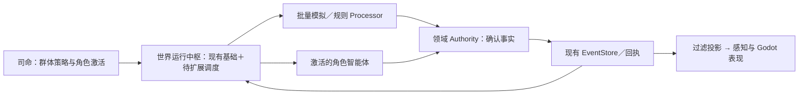
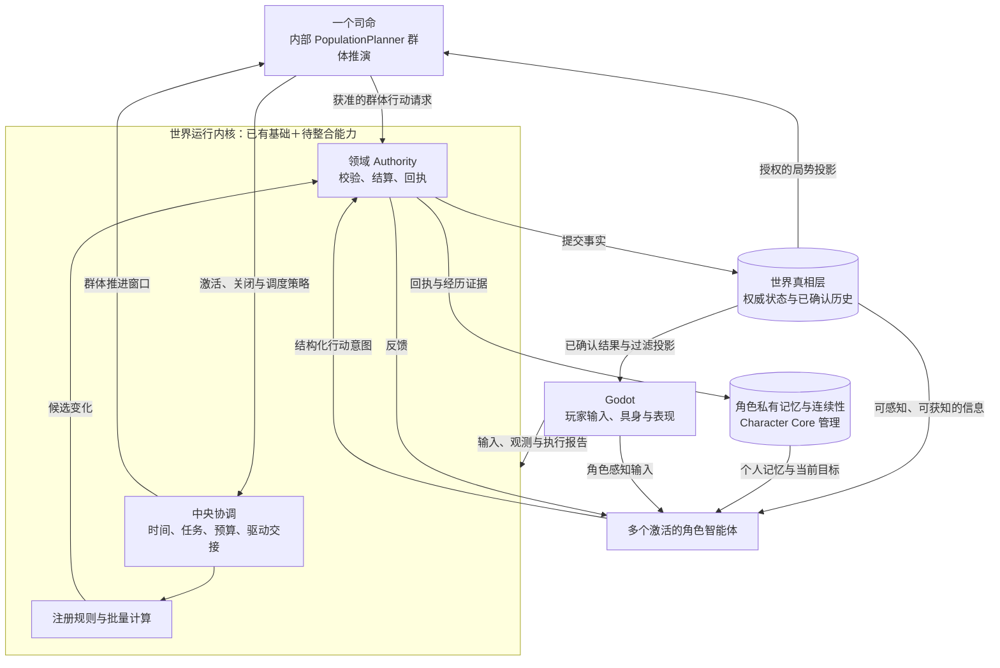

# 核心原文摘录与注释

状态：`analysis/source-archive/non-authorizing`

完整继承上下文见：[00-线程继承上下文原文](00-线程继承上下文原文.md)；本线程问答见：[05-本线程问答原文（排除世界模型）](05-本线程问答原文（排除世界模型）.md)。以下摘录保留原讨论中的关键表述和图表，用于说明本批规格从哪里来；摘录不是当前实现证明。

## 1. 原文对当前开放世界运行时的判断

来源：`讨论.md`，约第 108-187 行。

> 当前项目的目标是开放世界运行时，单局运行时尚未覆盖。

```text
Godot 本地空间与表现
        ↓ structured facts / provider refs / player intent
Backend ingress + System L1
        ↓ projected facts / canonical percept bundle
角色智能体与 Siming 消费
        ↓ typed intent / domain request
Gameplay / ESM / 领域 Owner
        ↓ authority event / receipt / projection
Godot 表现与世界镜像
```

注释：这定义了“表现、感知、心智、结算、投影”的旧主干。本批新增 WRK，不替换这些 owner，而是把时间、调度、批量模拟、交接和回执组织起来。

## 2. 原文对当前连续性链的判断

来源：`讨论.md`，约第 189-280 行。

```text
caller / wall clock
    → PopulationCadenceDriver
    → SimulationClock
    → cadence window
    → WorldContinuityRuntime
    → B0 population projection
    → authority publication
    → receipt / recovery / mirror
```

原文明确指出：B0 目前主要计算疲劳、需求压力、饥饿积累、活动阶段和下次到期时间；它不是完整角色生活，也不自动证明角色真的到达地点、完成工作、获得工资或完成互动。

注释：这直接成为本批“全体角色档案/记忆种子”和“B0-B3 交接”规格的边界，不能把 B0 写成完整智能体。

## 3. 原文对理想开放世界的比喻

来源：`讨论.md`，约第 298-420 行。

> 理想的开放世界运行时，不是让所有角色每一帧都思考，也不是做一个“大脑模块”替所有系统改数据。它更像一座会自己运行的城市。

原文进一步要求：有世界日历、居民连续状态、世界事实账本、角色心智运行时、基础调度、实体生命周期、领域时间和回执、分层模拟、持久化恢复、规模门禁、可观察性和 Godot 真实运行验证。

注释：这些要求被拆为本批 07、08、09、11、12 规格和 05 计划。

## 4. 原文确定的世界运行内核图

来源：`讨论.md`，约第 2620-2695 行。



原文随后将这一层命名为 **世界运行内核（World Runtime Kernel，WRK）**，并明确：WRK = 中央协调 + 数据驱动模拟 + 领域结算；司命和角色智能体向它提出策略/行动意图，Godot 消费结果并表现。

注释：这张图是目标架构的来源。它不表示现有 `world_runtime` 和 `gameplay` 已经完全合并。

## 5. 原文确定的五部分关系图

来源：`讨论.md`，约第 2694-2757 行。



注释：本图把“司命不是事实部门”“Character Core 不是公共图谱”“Godot 不拥有世界真相”写成了结构关系。

## 6. 原文对七种运行情况的规定

来源：`讨论.md`，约第 2753-2815 行。

```text
普通居民：内核给出推进窗口 → 司命读取授权局势 → 群体模拟产生候选 → 司命准入 → 领域 Authority 结算 → 世界真相更新 → Character Core 接纳有证据的经历。

激活角色：居民感知变化 → 读取自己的记忆 → 心智理解并选择行动 → 提交结构化意图 → 领域 Authority 结算 → 世界真相更新 → 行动结果回到心智和记忆。
```

原文强调：

- 看见角色不等于启用完整角色智能体；
- 角色关闭后仍然活在城市中，记忆保留；
- 客观影响可以先发生，角色知情可以后发生；
- 事情发生时间、角色知道时间、画面显示时间必须分别记录；
- 多个角色和玩家争夺同一资源时，由 authority 按版本、权限和资源结算；
- 不能让群体模拟和角色智能体替同一个居民重复提交同一主动行为。

## 7. 本批设计的使用方式

| 原文材料 | 新规格落点 |
|---|---|
| WRK 混合架构图 | 00、06 |
| 世界真相/角色记忆/Godot 关系 | 07 |
| SimulationClock/PopulationCadenceDriver | 08 |
| 看见角色与激活分离 | 09、11 |
| 动物/静物/行为脚本讨论 | 10、12 |
| 玩家抢占和冲突 | 11、12 |
| Laya、慢思考和 Deep | 02、04 |
| 全体角色图谱和记忆种子 | 01、03 |

所有原文的完整内容保存在同目录 `00-线程继承上下文原文.md`，本文件只做可导航摘录和注释。
