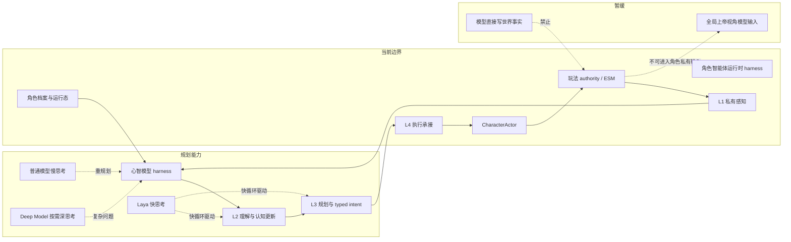
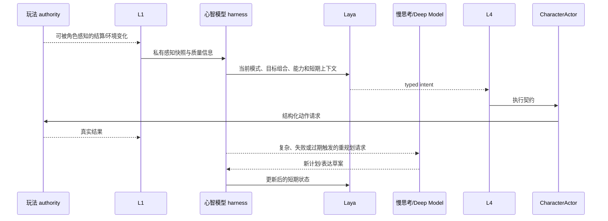
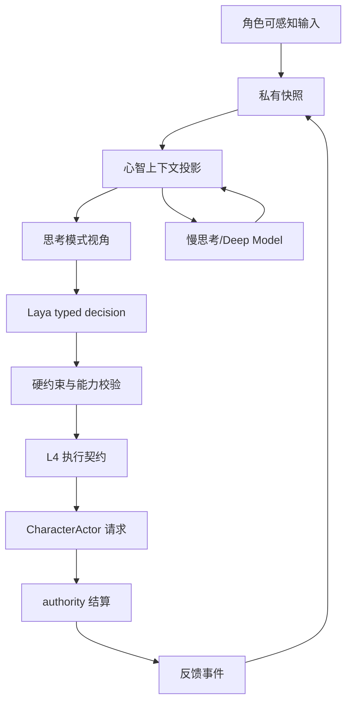

# 01 角色心智模型与模型驱动运行时设计

状态：`planned architecture; non-authorizing`

## 1. 目的

定义角色智能体、心智模型、模型、L1-L4 和玩法 authority 的关系，解决“谁是大脑、谁提供智能、谁拥有事实、谁执行动作”的边界问题。

## 2. 核心关系

角色智能体是完整运行 harness，负责调度、状态持久化、模型调用、执行承接和观测。心智模型是角色智能体的大脑 harness，负责把档案、记忆、动态状态和 L1 私有感知组织成模型可用的思考上下文。模型是智能来源，负责主观解释、目标权衡和意图选择；模型不是世界 authority，也不是执行器。



## 3. L1-L4 职责

| 层 | 责任 | 禁止越界 |
|---|---|---|
| L1 | 获取和维护角色私有感知、身体状态、听觉通信、主动感知结果 | 不把隐藏 authority 事实直接交给模型 |
| L2 | 解释感知、更新信念/记忆/动态状态、整理当前问题 | 不用本地规则静默替代模型认知 |
| L3 | 管理目标组合、候选意图和当前 typed intent | 不绕过模型替模型决定主观策略；本地只做能力/权限/硬约束校验 |
| L4 | 将 intent 转成执行契约并承接取消、超时、连续动作 | 不结算世界事实 |
| CharacterActor | 身体、动画、声音和可见表现 | 不成为世界真相 authority |
| 玩法 authority | 结算命中、伤害、掉落、资源和世界状态 | 不把完整事实广播给角色 |

## 4. 模型路由

- `Laya`：短上下文、低延迟、typed decision；负责当前动作、语音选择、取消和短期协同。
- 普通模型：慢思考；负责战术重构、目标重组、复杂解释和动态表达草案。
- `Deep Model`：按需调用；负责新机制、高风险冲突、连续失败和长链推断。
- 规则与本地代码：只负责 schema、权限、能力、可执行性、时限和 authority 边界。

Laya 的确切 `choice / score / noul` 语义必须以实际 checkpoint 验证为准；本设计只冻结“typed decision 快循环”这一接口方向。

## 5. 关键数据对象

```text
PrivatePerceptionSnapshot
MindFrame
ThoughtModeFrame
GoalPortfolio
TypedIntent
ExecutionContract
SettlementFeedback
```

每个对象都需要携带 `source`、`confidence`、`context_version` 或 `revision`，使模型输出能够被回放和过期检查。

## 6. 主时序



## 7. 数据流转



## 8. 当前、计划与暂缓

- `[current]`：仓库已有 L1 私有快照、主动感知、L2/L3 入口、L4 执行承接、认知 job/continuation 和心智状态对象。
- `[planned]`：把 Laya 接入快循环；将 L3 的语义最终选择收回模型；引入统一 typed intent、模式帧、上下文版本和异步升级。
- `[deferred]`：让模型直接读取全局世界状态、让模型直接写 authority、用另一个本地“脑”替代心智模型。

