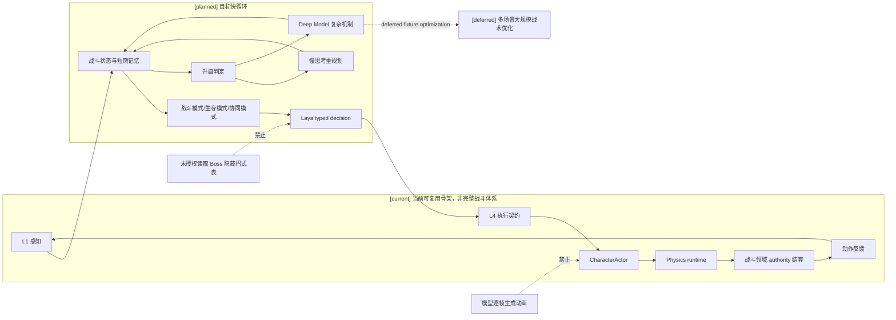
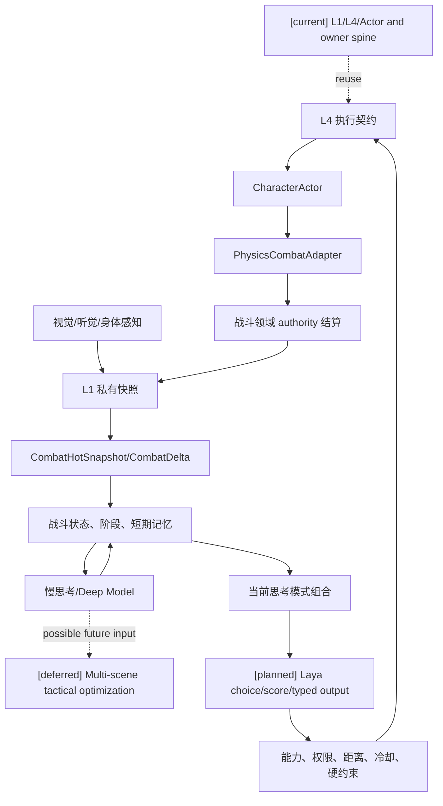

# 02 Laya 快循环与快慢思考战斗设计

状态：`planned architecture; non-authorizing`

## 1. 设计目标

让 Laya 能够在不等待慢思考的情况下，连续完成一段常规战斗，包含观察、试探、闪避、攻击、资源管理、失败修正、阶段切换和撤退；慢思考和 Deep Model 只在快循环无法解释或需要重规划时介入。

## 2. 战斗循环



## 3. 快循环应承担的能力

```text
observe / probe
approach / reposition
dodge / block
attack / punish
heal / disengage
hold_position / retreat
protect_ally / focus_target
abort_maneuver
```

每个 intent 至少包含目标、承诺时长、停止条件、失败回退、上下文版本和优先级；跨玩法动作契约的字段和生命周期由 [11-跨玩法动作承诺协议设计](11-跨玩法动作承诺协议设计.md) 统一定义。连续位移、动画、命中盒和身体表现由执行层承接，不要求每帧调用 Laya。

快循环的输入不是模型自行推算的战斗文本，而是 `CombatHotSnapshot`、`CombatDelta` 和物理/具身证据的权限过滤投影。Laya 可以读取当前可用资源、冷却、状态、装备可用性、环境暴露、动作阶段和空间摘要；它不能把物理接触直接当成伤害，也不能自己结算蓝耗、命中、控制或环境场效果。

战斗内容包通过 Gameplay Foundation 的物理证据适配合同与物理引擎协作：物理引擎提供碰撞、轨迹、接触、遮挡和冲量证据，战斗所属领域 authority 按已注册规则解释证据并提交命中、闪避、格挡、伤害、控制和资源/状态变化，再把结构化结果回投给 L1/Laya。物理引擎负责连续运动和表现；Gameplay Foundation 提供跨玩法动作、证据、时序和提交边界；战斗内容包定义战斗语义。

上述完整合作合同为 `[planned]`；`[current]` 仅复用已有执行入口、局部证据/窗口与 owner 提交主干，不表示通用物理证据适配和跨通道战斗结算已经完成。

战斗循环消费 [16-通用玩法时序模型与编辑器设计](16-通用玩法时序模型与编辑器设计.md) 提供的时间线、step/frame 映射和结算窗口。当前 3D 物理时间与世界 tick 之间尚无统一的可编辑 profile 合同；接入后应由明确的 `ClockMapping` 和证据 revision 确定采样证据属于哪个结算窗口。

## 4. 魂游 Boss 推演

1. Boss 抬刀：L1 提供前摇，Laya 选择保持距离或试探。
2. 重击落空：L1 反馈恢复窗口，Laya 选择一到两次惩罚攻击并准备脱离。
3. 三连斩首次命中：战斗短期记忆记录失败，Laya 调整为延迟闪避。
4. 二阶段特效出现：L1 观察到姿态、音效和范围变化，模式切换到生存优先；慢思考可后台重排短期计划。
5. 连续几次无法解释新招：触发 Deep Model；快循环仍保持防御、距离和撤退。
6. Boss 倒地：Laya 选择是否补刀，不能因长期目标而盲目贪刀。

## 5. 升级与降级

升级触发：连续失败、上下文冲突、新阶段、目标组合冲突、信息不足、快循环重复同一失败动作。

降级顺序：动态语音/复杂表达取消；慢思考回落到 Laya；模型不可用时进入 continuity floor，只允许观察、保持距离、自保、撤退、沉默等连续性动作。

## 6. 时序图

```mermaid
sequenceDiagram
  participant P as Boss/玩法 authority
  participant L1 as 角色 L1
  participant B as 战斗短期状态
  participant F as Laya
  participant X as L4/Actor
  participant G as Physics runtime
  participant C as Combat domain authority
  participant S as 慢思考或 Deep Model
  Note over P,S: [current] L1/L4/Actor and owner spine; [planned] full fast loop and mapped windows; [deferred] large-scale multi-scene tactics
  P-->>L1: 可感知前摇/命中/阶段变化
  L1->>B: 更新敌情、体力、失败记录
  B->>F: 当前战术上下文
  F->>X: 闪避/攻击/保持/撤退 intent
  X->>G: typed action/field intent
  G-->>C: collision/contact/trajectory evidence
  C-->>L1: semantic result and CombatDelta
  alt 快循环失效
    B->>S: 异步重规划请求
    S-->>B: 新短期计划
  end
```

## 7. 数据流图



## 8. 状态标记

- `[current]`：L1、L4、Actor ingress、authority 结算和部分 L2/L3 入口。
- `[planned]`：Laya 连续快循环、战斗短期记忆、失败修正、阶段升级和可取消重规划。
- `[deferred]`：跨场景的大规模战术优化、模型驱动精细动作生成研究。
- 始终禁止：模型未授权读取 Boss 隐藏状态、绕过执行契约和 authority；逐 render frame 调用模型不作为本设计的执行路径。
