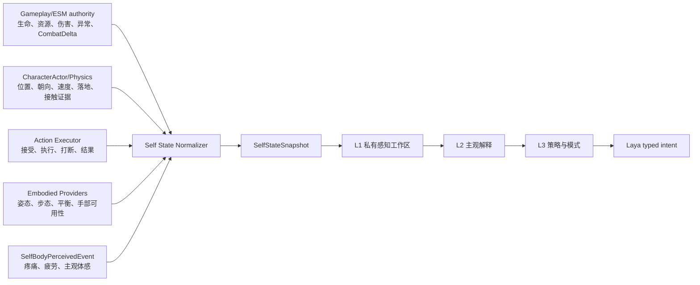
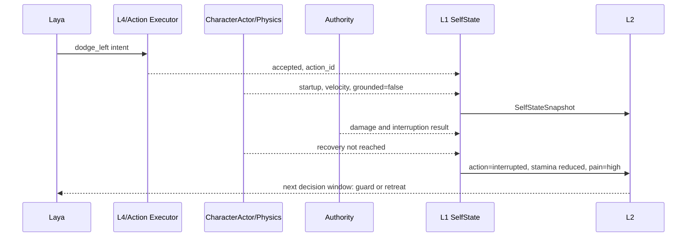
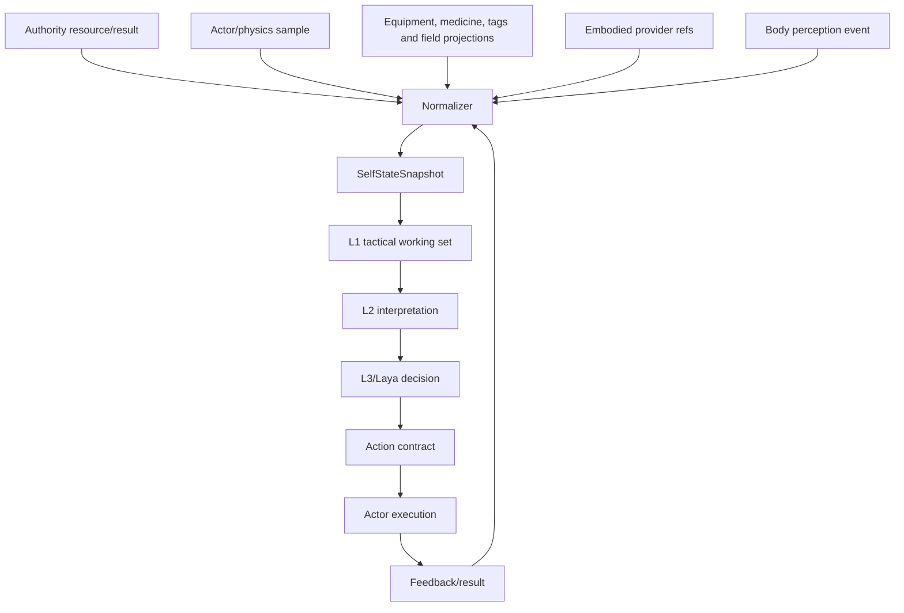

# 06 自身状态感知与具身反馈设计

状态：`planned architecture; non-authorizing`

## 1. 目标与边界

角色不能只感知外界，也必须持续知道自己的身体处于什么状态、正在做什么、动作做到哪一步，以及这些信息有多新、多可靠。

本文定义自身状态在 L1 中的统一投影，不把 Godot 变成角色认知宿主，也不允许角色智能体直接修改 authority 状态。

- `[current]`：`SelfBodyPerceivedEvent`、`EmbodiedStateProvider`、`EmbodiedSkeletalStateProvider`、`CharacterActor` 运行态和 L1 provider refs 已存在。
- `[planned]`：统一 `SelfStateSnapshot`、动作生命周期、动作反馈、authority revision 和 freshness。
- `[deferred]`：把完整骨骼快照持续送入模型上下文、让模型逐帧生成身体姿态。

## 2. 当前实现判断

当前自身感知由几条路径组成：

```text
authority/body result -> SelfBodyPerceivedEvent/CombatHotSnapshot -> L1 body_state_hints
CharacterActor/physics -> PhysicsCombatAdapter evidence + EmbodiedStateProvider -> provider refs
skeletal provider -> high/mid-level embodied refs
action ingress/result -> CharacterRuntimeState / feedback projection
```

`SelfBodyPerceivedEvent` 目前主要包含 `body_state_class` 和 `perceived_summary`，因此更接近身体提示，而不是完整的自身状态读模型。当前 L1 bundle 的 `embodied_state` 也主要保存 provider 引用。

## 3. 目标架构



`Self State Normalizer` 是输入归一化功能，不是新的认知层。它保留来源、时间、revision 和置信度，输出角色可用的自身状态投影。

## 4. `SelfStateSnapshot` 建议字段

```text
SelfStateSnapshot
├── identity
│   ├── actor_id
│   ├── capture_id
│   ├── producer_ts
│   ├── source_revision
│   └── freshness
├── resources
│   ├── health
│   ├── stamina
│   ├── namespaced resource entries
│   └── carried_load
├── combat_influences
│   ├── active profession/identity/capability effect bindings
│   ├── equipped item availability and condition
│   ├── active medicine effects
│   └── field exposure and formation membership
├── physiology
│   ├── pain
│   ├── fatigue
│   ├── injury
│   └── abnormal_effects
├── spatial
│   ├── position
│   ├── facing
│   ├── velocity
│   ├── angular_velocity
│   ├── grounded
│   └── support_surface
├── pose
│   ├── posture
│   ├── stance
│   ├── gait
│   ├── balance
│   └── hand_readiness
├── action_execution
│   ├── intent
│   ├── action_id
│   ├── actual_action
│   ├── phase
│   ├── progress
│   ├── interruptible
│   └── result
├── affordances
│   ├── can_move
│   ├── can_attack
│   ├── can_block
│   ├── can_speak
│   └── can_interact
└── quality
    ├── confidence
    ├── stale_fields
    ├── conflicting_sources
    └── unknown_fields
```

未知值必须明确表示为 `unknown`，不能静默复用旧值。旧值仍可进入记忆，但必须带有时间和 freshness。

## 5. 自身状态中的动作反馈

`SelfStateSnapshot.action_execution` 只记录身体实际状态，动作契约、取消条件和 authority 结果协议由 [11-跨玩法动作承诺协议设计](11-跨玩法动作承诺协议设计.md) 负责。自身感知必须区分四件事：

```text
intent：我想闪避
request：闪避请求已提交
execution：身体正在向左翻滚
result：翻滚被命中并中断
```

Laya 的意图只有在 L4/Actor 报告执行阶段、authority 返回结果后，才成为自身感知中的实际反馈。

## 6. 权威状态与主观体感

同一个身体状态要保留两种视角：

```text
SelfBodyTruthProjection
  hp=62, stamina=18, grounded=false, action_phase=startup

SelfBodyPerception
  “腿下没有支撑”
  “右肩发麻”
  “我好像闪得慢了一点”
```

前者来自运行时和 authority 投影，后者来自角色可感知的身体结果。二者可以不一致，偏差应影响 L2 的风险解释，而不是被系统自动抹平。

## 7. 时序图



## 8. 数据流图



## 9. 直接收益

1. Laya 不会因为发出了 `dodge` 就误以为已经闪避成功。
2. 角色可以根据体力、硬直、支撑和动作阶段连续修正。
3. 旧状态不会伪装成当前事实。
4. 身体真实状态和主观体感可以产生合理的犹豫、误判和求助。
5. L2/L3 能够读取可行动的身体约束，而不是一串孤立提示词。
