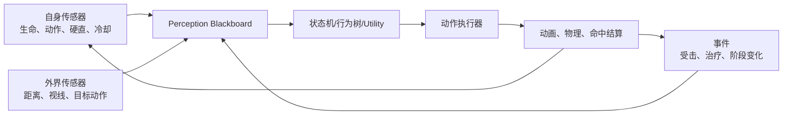
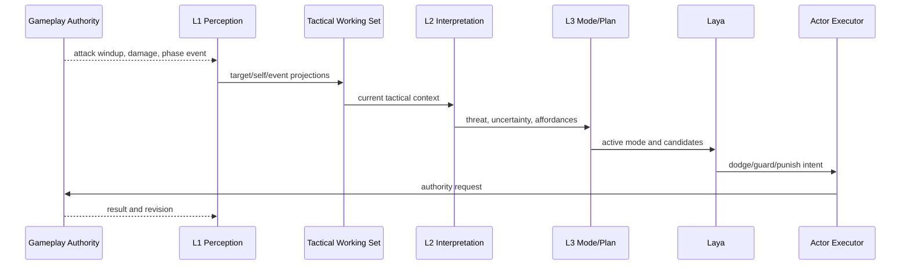
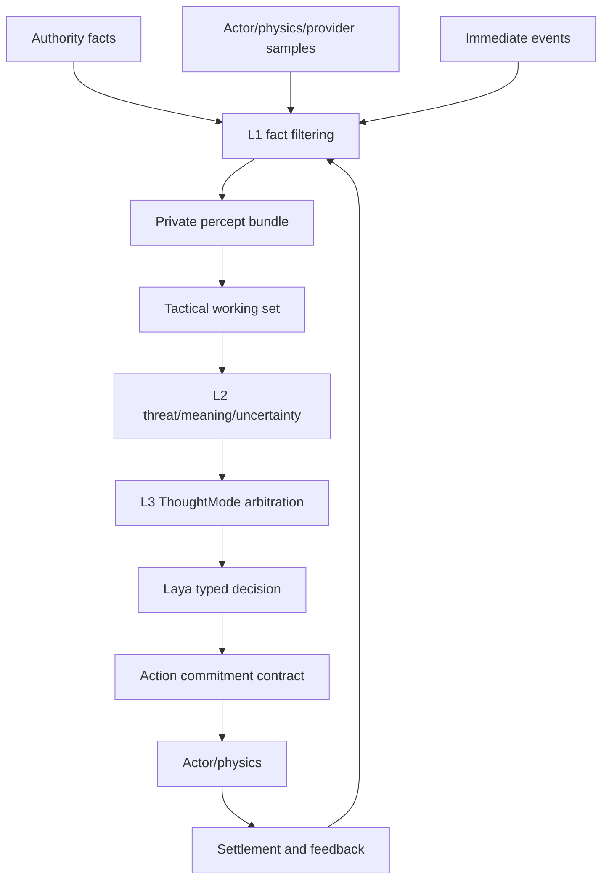

# 07 传统游戏 AI 感知机制参考设计

状态：`architecture analysis; proposed and non-authorizing`

范围标记：

- `[current]`：现有 L1 事实/provider 链、CharacterAgent L1-L4 骨架和 authority 边界。
- `[planned]`：L1 tactical working set 的传感器输入和事件/采样融合。
- `[deferred]`：直接读取玩家隐藏状态、用行为树替换统一心智模型、模型逐帧控制动作。

## 1. 参考对象的共同结构

传统 Boss AI 通常不是一个模型观看画面，而是若干传感器把结果写入 Blackboard 或 working memory，再由状态机、行为树或 Utility AI 选择行为。



我们应借鉴它的运行机制，但不能照搬其全知读取方式。角色仍只能获得经过 L1 过滤的私有投影。

## 2. Boss 的自身感知

Boss 通常持续读取：

```text
生命、体力、阶段、硬直、当前动作
起手/有效帧/收招、动作是否可取消
目标锁定、技能冷却、是否着地
是否能转身、移动、攻击、格挡
```

这说明自身感知必须高频、结构化、比外界感知更可靠。对应到角色系统，就是 `SelfStateSnapshot` 和动作生命周期，而不是简单的 `body_state_hints`。

## 3. Boss 的外界感知

典型外界传感器包括：

```text
距离和角度：决定近战、追击、远程技能
视线和遮挡：决定是否锁定、是否发射
区域触发：决定是否激活战斗
目标动作：喝药、攻击后摇、倒地、无敌
伤害事件：决定转向、反击和仇恨
导航查询：决定追击、绕路和撤退
群体信息：决定召唤、集火和保护
```

这些结果应转换成行动相关的投影，例如：

```text
目标在左前方 4 米
目标正在恢复，短时间不能再次攻击
右侧路线可达，左侧被墙阻挡
目标刚开始治疗，惩罚窗口有效性为高
```

## 4. 参考启发的边界

本文只负责记录传统游戏 AI 的感知机制及其可借鉴的事实。Blackboard 到 L1 工作区的映射、Boss 阶段到 ThoughtMode 的适配由 [12-传统游戏 AI 与 ThoughtMode 设计](12-传统游戏AI与ThoughtMode设计.md) 负责；动作承诺协议由 [11-跨玩法动作承诺协议设计](11-跨玩法动作承诺协议设计.md) 负责。这样参考分析和产品架构不会重复定义同一契约。

## 5. 架构时序图



## 6. 数据流图



## 7. 与传统 Boss AI 的关键差异

传统 Boss 可能直接读取玩家真实位置、真实动作和隐藏招式表。我们的角色必须经过 L1 私有过滤：

```text
authority：知道完整世界事实
L1：只给角色能获得的投影
L2：解释投影意味着什么
L3：管理目标与模式
Laya：选择眼前动作
Actor：执行身体动作
authority：确认最终结果
```

因此我们借鉴的是传感器、工作记忆、阶段、承诺和反馈闭环，不借鉴全知视角。
