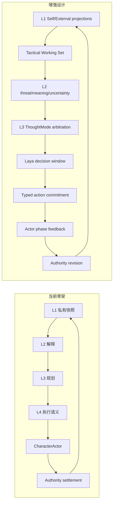
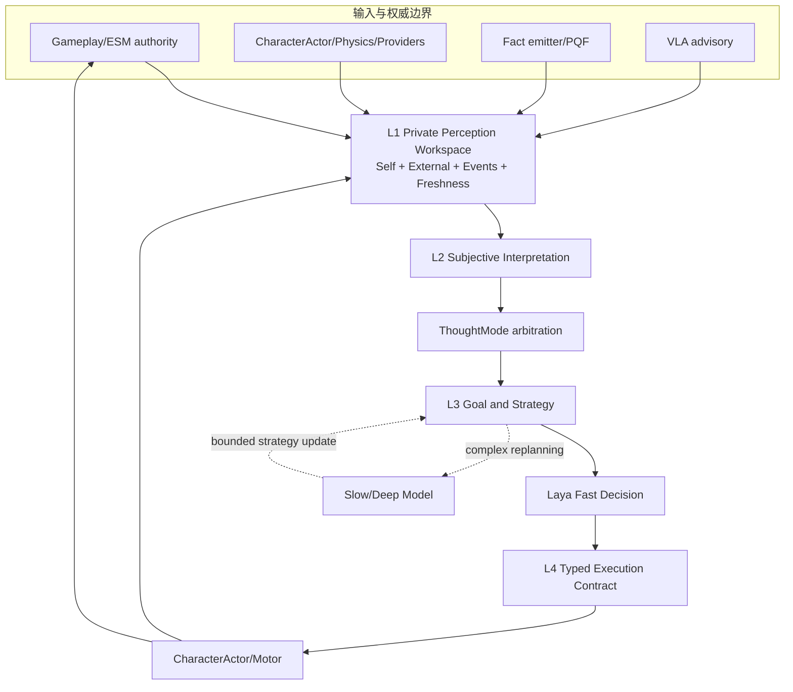
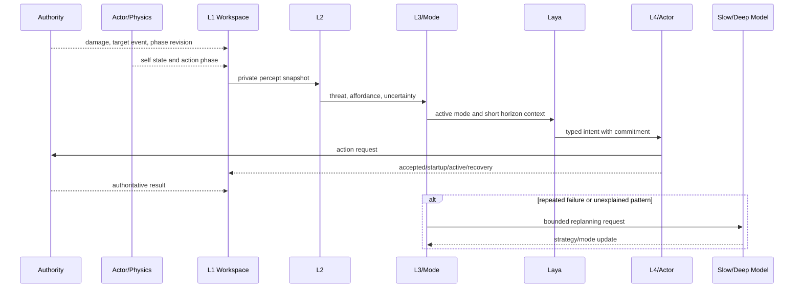
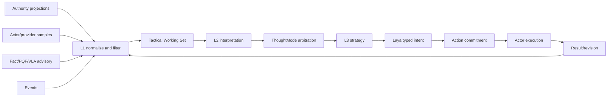

# 08 游戏 AI 启发下 L1-L4 架构增强设计

状态：`planned architecture; non-authorizing`

范围标记：

- `[current]`：事实抛出器主链、provider/PQF 链、VLA advisory 协议、L1-L4 角色运行时骨架和 authority settlement。
- `[planned]`：统一自身/外界状态、战术工作区、ThoughtMode 仲裁、Laya 决策窗口和动作承诺反馈。
- `[deferred]`：完整 world truth 直读、VLA 直接控身、逐帧模型动作生成、每种玩法复制独立角色大脑。

## 1. 结论

参考传统 Boss AI 后，现有架构不需要改成行为树系统，也不需要添加一个独立的 Boss AI 大脑。需要把传统游戏 AI 的可靠运行机制嵌入现有 L1-L4：

```text
L1 结构化私有感知与战术工作区
L2 主观解释、威胁和不确定性
L3 ThoughtMode、目标和策略仲裁
Laya 决策窗口内的快动作选择
L4 动作契约与执行语义
CharacterActor 连续具身
Authority 最终结算和反馈
```

## 2. 现有设计与目标设计



当前骨架仍然有效，增强设计是在其内部补齐状态对象和反馈协议，而不是替换层级。

## 3. 主要改动

本文件只维护跨层差距、依赖关系和落地顺序；具体协议由主题 owner 维护：L1 见 [09](09-L1多源感知与信息入口设计.md)，主动感知见 [10](10-主动感知与记忆边界设计.md)，自身状态见 [06](06-自身状态感知与具身反馈设计.md)，动作承诺见 [11](11-跨玩法动作承诺协议设计.md)，ThoughtMode 适配见 [12](12-传统游戏AI与ThoughtMode设计.md)。

### 3.1 跨层差距矩阵

| 层/能力 | 需要补齐的差距 | 唯一 owner |
|---|---|---|
| L1 | 多源输入收敛、自身/外界投影、事件和 freshness | [09](09-L1多源感知与信息入口设计.md) |
| 主动感知 | 信息需求、记忆过期、冲突和调查策略 | [10](10-主动感知与记忆边界设计.md) |
| 自身状态 | 数值、位置、姿态、动作实际阶段和身体体感 | [06](06-自身状态感知与具身反馈设计.md) |
| L2/L3 | 可行动解释、目标排序、ThoughtMode 和阶段仲裁 | [05](05-玩法思考模式适配与L1信息获取设计.md)、[12](12-传统游戏AI与ThoughtMode设计.md) |
| Laya/L4 | 决策窗口、typed intent、承诺、取消、回退和结果 | [02](02-Laya快循环与快慢思考战斗设计.md)、[11](11-跨玩法动作承诺协议设计.md) |

本文件不再复制这些主题的字段、状态机或时序，只说明它们如何组成一次跨层增强。

## 4. 目标架构图



## 5. 时序图



## 6. 数据流图



## 7. 变更后的职责表

| 部件 | 保留职责 | 增强职责 | 禁止越界 |
|---|---|---|---|
| L1 | 角色私有信息入口 | 自身/外界统一投影、工作记忆、freshness | 认知决策、修改世界真相 |
| L2 | 主观解释 | 威胁、窗口、可行动性、不确定性 | 直接提交动作 |
| L3 | 目标和规划 | ThoughtMode、阶段、失败升级、慢思考入口 | 读取隐藏 authority |
| Laya | 快循环动作选择 | 决策窗口、动作承诺契约 | 逐帧生成动画、跳过 L4 |
| L4 | 执行语义 staging | 生命周期、取消、回退、执行反馈 | 结算伤害和资源 |
| CharacterActor | 本地具身和表现 | 位置、姿态、动作阶段反馈 | 成为世界真相 owner |
| Authority | 领域结算 | revision、结果和资源投影 | 代替角色认知 |
| VLA | 视觉/空间 advisory | 不完整信息的补充解释 | 覆盖事实、直接控动作 |

## 8. 推荐落地顺序

1. 先定义 `SelfStateSnapshot`、`ExternalPerceptSnapshot`、`ActionExecutionState` 和统一 revision。
2. 把现有 `SelfBodyPerceivedEvent`、Embodied providers、CharacterActor 运行态接入这些投影。
3. 建立 L1 tactical working set，明确短期状态与长期记忆的边界。
4. 为 Laya 增加决策窗口和 typed action commitment。
5. 将战斗、协同、经济等玩法适配成 ThoughtMode，而不是复制角色智能体。
6. 最后再接入阶段升级、主动信息获取和 VLA advisory 的复杂策略。

## 9. 暂缓事项

```text
让模型读取完整 world truth
让 VLA 直接驱动 CharacterActor
用每种玩法独立的一套 Boss AI 替代统一心智模型
让 Laya 每帧改写动作
把战术 Blackboard 永久写入人格和长期记忆
```
