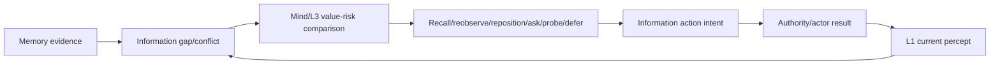
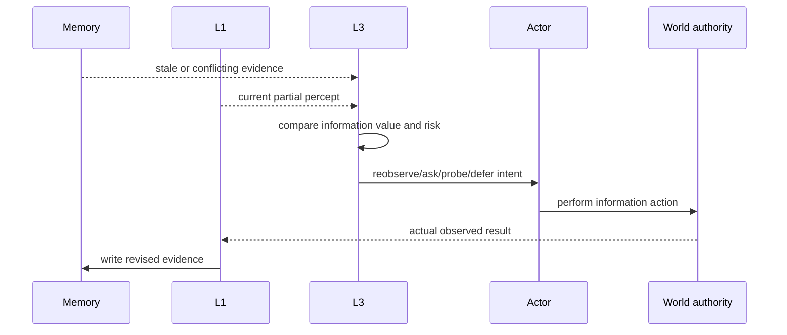
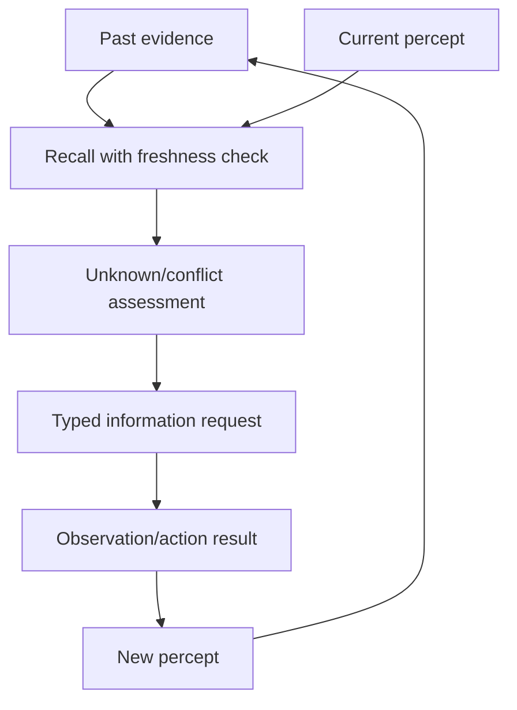

# 10 主动感知与记忆边界设计

状态：`planned architecture; non-authorizing`

## 1. 主题结论

记忆只能说明角色过去知道什么，不能保证世界现在仍然如此。信息缺失、过期或冲突时，角色不必自动走回原地，可以比较观察收益、时间、风险和资源后选择信息获取策略。

- `[current]`：L1 私有感知、主动感知触发和记忆写回边界已有运行时基础。
- `[planned]`：typed information request、信息新鲜度、冲突处理和主动感知策略选择。
- `[deferred]`：自动回到原地点重新观察；把长期记忆当作全知世界模型。

## 2. 策略类型

```text
RecallStrategy              先检查记忆和当前上下文
LocalReobserveStrategy      原地重新观察
RepositionAndObserve       移动到更好位置再观察
AskOtherActor               询问队友或 NPC
ProbeAction                 用低风险行动试探
DeferStrategy               暂缓获取，先保持安全
AbandonStrategy             信息价值低于成本时放弃
```

## 3. 架构图



## 4. 时序图



## 5. 数据流图与记忆字段



每条记忆至少带有：

```text
source
captured_at
freshness
confidence
attention
conflict
revision
```

记忆是证据，不是当前世界真相；重新感知结果必须重新经过 L1。

