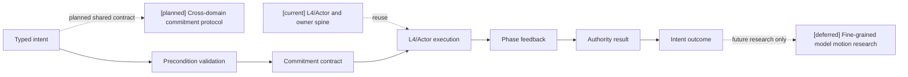
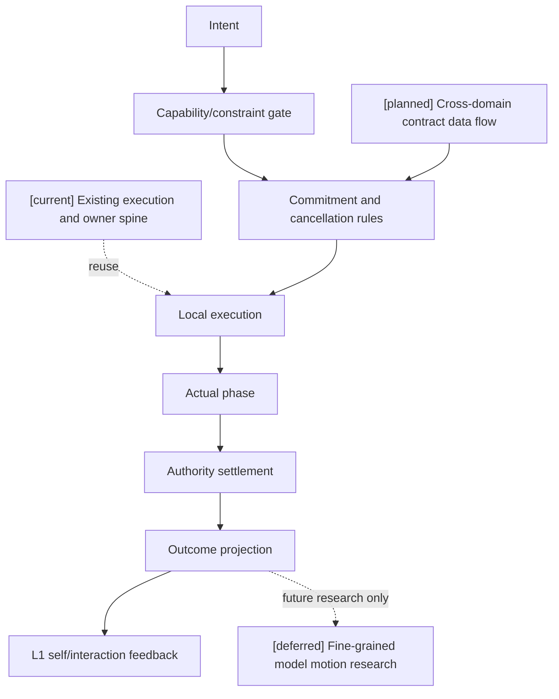

# 11 跨玩法动作承诺协议设计

状态：`planned architecture; non-authorizing`

## 1. 主题边界

本文只定义 Laya/模型输出如何被 L4、CharacterActor 和 authority 接受、执行、取消和反馈。战斗快循环与慢思考策略由 [02-Laya 快循环与快慢思考战斗设计](02-Laya快循环与快慢思考战斗设计.md) 负责；传统 Boss 的动作启发由 [07-传统游戏 AI 感知与 Boss 战思考模式设计](07-传统游戏AI感知与Boss战思考模式设计.md) 负责。

- `[current]`：L4、Actor ingress、authority settlement 和动作结果投影的运行时骨架。
- `[planned]`：跨玩法统一的 typed action commitment、阶段、取消条件和失败回退。
- `[deferred]`：模型驱动精细动作生成研究。
- 始终禁止：模型绕过 L4 和 authority 直接写身体或世界真值。

## 2. 协议结构



## 3. 动作契约

```json
{
  "intent": "dodge_left",
  "target": "boss_01",
  "commitment_ms": 420,
  "preconditions": ["stamina >= 12", "left_route == reachable"],
  "abort_conditions": ["ground_lost", "incoming_area_attack"],
  "fallback": "guard",
  "context_revision": "self-1842"
}
```

协议同时适用于战斗、经济、社交和调查动作，例如 `buy`、`ask`、`inspect`、`dodge`，区别由 ThoughtMode 注册 intent 类型和约束。

对于战斗动作，协议不把物理引擎当作 authority，也不跳过物理证据：`L4/Actor` 将 typed action commitment 交给对应执行器，Gameplay Foundation 的 physics evidence adapter 返回碰撞、接触、轨迹、遮挡或冲量证据，战斗内容包所属 authority 再将证据解释为命中、闪避、控制、资源和状态结果。经济、社交和调查动作可以使用各自的 domain adapter，但最终遵守同一套承诺、执行和 authority result 生命周期；时间戳通过 [16-通用玩法时序模型与编辑器设计](16-通用玩法时序模型与编辑器设计.md) 定义的 mapping 关联到领域结算窗口。

## 4. 动作生命周期

```text
queued -> accepted -> startup -> active -> recovery -> completed
                         \-> interrupted / failed / blocked
```

必须区分：

```text
intent：我想做什么
request：请求是否被执行层接受
execution：身体或交互通道实际做到哪一步
result：authority 最终确认的结果
```

## 5. 时序图

```mermaid
sequenceDiagram
  participant Y as Laya/Model
  participant V as L4 validator
  participant X as Actor/Executor
  participant A as Authority
  participant L1 as L1 feedback
  Note over Y,L1: [current] L4/Actor and authority spine; [planned] shared commitments and time mapping; [deferred] fine-grained model motion
  Y->>V: typed intent + context revision
  V->>X: accepted commitment
  X-->>L1: startup/active/recovery
  X->>A: authority request
  A-->>L1: completed/interrupted/failed result
  L1-->>Y: outcome at next decision window
```

## 6. 数据流图



## 7. 契约所有权

| 部件 | 负责 | 不负责 |
|---|---|---|
| Laya/模型 | 选择 intent、目标和短时承诺 | 直接控制姿态、宣称动作成功 |
| L4 | 校验能力、约束、取消和回退 | 结算伤害、资源、产权 |
| CharacterActor | 本地连续执行、动作阶段和表现 | 成为 world truth owner |
| Authority | 最终结算、revision 和结果 | 代替模型选择主观目标 |
| L1 | 接收实际状态和结果并形成私有反馈 | 把意图当成事实 |
