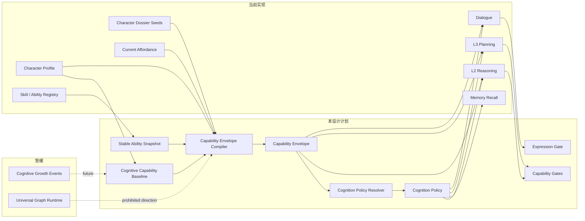
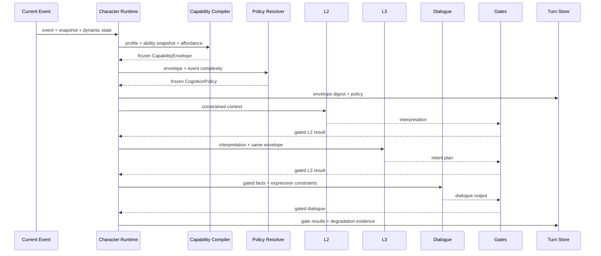
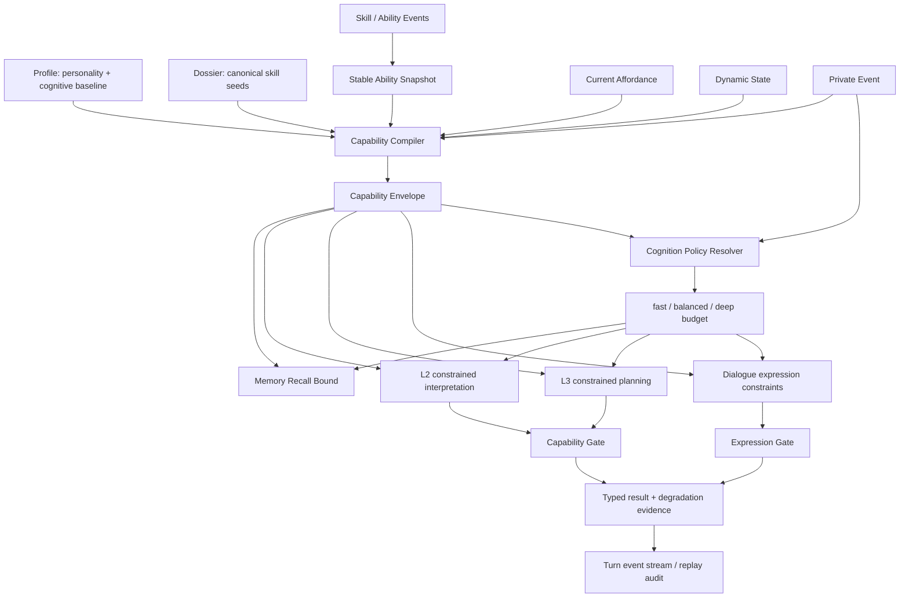

# 13 角色能力图谱、认知包络与动态算力设计

状态：`architecture analysis; proposed and non-authorizing`

整理日期：2026-10-06

## 1. 结论摘要

角色智能体使用相同基础模型时，不能把人物差异只交给 prompt。系统需要把以下概念分开：

```text
人格：角色倾向怎样处理
一般认知能力：角色最多能处理到什么程度
领域技能：角色在哪些事情上受过训练
当前发挥：角色本回合能稳定发挥多少
认知策略：本回合允许消耗多少资源
表达约束：角色最后能怎样说出来
```

本设计采用：

```text
硬能力上限 + 受控概率性失误 + 动态认知预算
```

能力图谱复用现有 Skill / Ability Graph 的领域能力，不并入 Heavenly Graph、关系图或 Siming Knowledge Graph。三类图只共享证据、来源、权限、生命周期、冲突和解释等治理值对象。

本设计不授权代码实现，是后续正式 spec、implementation plan 和 Harness 验收的输入。

## 2. 目标与非目标

### 2.1 目标

1. 角色不能全能，所有角色都有可审计的认知和领域边界。
2. 大五人格、认知能力、领域技能和动态状态在运行时职责清楚。
3. 能力差异映射到 L2 理解、L3 规划、行动选择、对话表达和记忆写回。
4. 低能力角色默认消耗更少上下文、记忆、候选、推理深度和 provider 预算。
5. 高预算不能突破角色能力上限，低预算也不修改角色长期能力。
6. 同一事件下不同角色的差异可以重放、比较和验收。
7. 未知技能引用不能被静默忽略，运行时采用 fail-closed。

### 2.2 非目标

- 不创建新的通用图数据库。
- 不把能力图、关系图和 Heavenly Graph 合并。
- 不让模型直接写入长期能力、技能事实或世界 authority。
- 不让一次成功行动自动提升一般认知能力。
- 第一版不实现一般认知能力的事件驱动成长。
- 不要求低能力角色公开说出明显错误的世界事实。

## 3. 当前实现审计

### 3.1 `[current]` 已有能力基础

- `CharacterProfile` 有技能、知识领域、身体/心理/社会约束和 `memory_retention`。
- 大五人格及 facets 已进入 profile schema。
- `PersonalityProjectionResolver` 可投影社交、分析、程序纪律和压力脆弱等倾向。
- `CapabilitySeedProfile` 有技能种子、熟练度、信心、支持行动族、前置条件和阻断条件。
- `SkillDefinition`、`ActionDefinition`、`SkillActionBinding`、`CharacterSkillState` 和 affordance 服务已经存在。
- L2、L3、对话和 Mind Frame 已有 profile、技能或 affordance 的输入位置。
- 记忆召回已有 pool limit 和 token budget；`memory_retention: strong` 可扩大召回范围。
- `CharacterTurnContext`、阶段事件和 revision/digest 机制可承载回合冻结与重放证据。

### 3.2 `[current]` 关键缺口

当前还没有统一的：

- 一般认知能力维度，如工作记忆、证据辨识、因果推理和元认知。
- 最大假设数、最大推理跳数、最大规划跨度等硬上限。
- profile/dossier/技能事件到当前回合能力包络的编译器。
- 低能力角色的动态认知预算和 provider thinking effort 映射。
- L2/L3/对话输出的统一能力门禁。
- 失误、裁剪、置信度封顶和回退的回放记录。

当前任务级 `max_tokens` 只能限制输出长度，不能等同于思考强度。provider 的 DeepSeek 路径目前显式关闭 thinking，因此动态 thinking effort 仍属于 `[planned]`。

## 4. 架构边界



### 4.1 图谱边界

能力图、关系图和 Heavenly Graph 保留独立节点、边、查询和存储。只共享：

```text
GraphEvidenceRef
SourceLineage
PrivacyScope
AuthorityScope
LifecycleState
ConflictRef
ExplanationPayload
```

能力图不使用 Heavenly Graph 的世界事实语义表达“角色擅长安全评估”，也不能把能力记录作为角色观察到的事实进入 memory recall。

### 4.2 能力三层

```text
一般认知基线
  角色长期固定的认知上限

稳定领域能力
  复用 Skill / Ability Graph，可由学习、训练、授予和限制事件改变

当前回合能力包络
  将认知基线、稳定能力、当前 affordance、动态状态和事件编译成冻结限制
```

## 5. 数据对象

### 5.1 CognitiveCapabilityProfile `[planned]`

来源是 profile YAML，第一版一般认知能力固定：

```yaml
cognitive_capability_layer:
  general_facets:
    working_memory: 0.74
    evidence_discrimination: 0.86
    causal_reasoning: 0.67
    abstraction: 0.55
    social_inference: 0.82
    spatial_reasoning: 0.36
    numerical_reasoning: 0.42
    metacognition: 0.79
  hard_limits:
    max_context_items: 8
    max_active_hypotheses: 3
    max_reasoning_hops: 2
    max_candidate_intents: 3
    max_concurrent_goals: 2
    planning_horizon: short
    confidence_ceiling_without_evidence: 0.68
  expression_constraints:
    vocabulary_band: plain
    explanation_depth: concrete
    uncertainty_style: qualified
  compute_defaults:
    preferred_effort: balanced
    maximum_effort: deep
    memory_recall_limit: 8
    l2_max_tokens: 550
    l3_max_tokens: 900
    dialogue_max_tokens: 160
```

`general_facets` 不是总智力分数。高开放性不等于高因果推理，高尽责性也不等于高抽象能力。

### 5.2 StableAbilitySnapshot `[planned; reuses current skill graph]`

这是现有技能/能力事件投影的编译结果：

```yaml
stable_ability_snapshot:
  actor_id: char_b
  capability_revision: capability:char_b:17
  registry_revision: skills:v3
  skills:
    - skill_id: skill:threat_assessment
      source: authored
      rank: trained
      proficiency: 0.68
      confidence: 0.72
      domains: [security_protocol, threat_assessment]
  allowed_action_families: [safety_assessment, access_control]
  blocked_action_families: [complex_motive_analysis]
  source_refs: [profile:char_b:v1, dossier:char_b:v1, skill_registry:skills:v3]
```

稳定技能成长继续复用现有事件语义：

```text
SkillLearned
SkillRankPromoted
AbilityGrantActivated
AbilityGrantRevoked
AbilityRestrictionApplied
```

领域技能成长不自动修改 `working_memory`、`causal_reasoning`、`abstraction` 或 `metacognition`。

### 5.2.1 能力快照与战斗影响源的边界

`StableAbilitySnapshot` 只拥有角色学会、理解和稳定执行的技能/技法能力投影。它不拥有职业/身份标签的效果绑定，也不拥有装备、药品、阵法或环境场的实例状态。战斗运行时通过 [战斗影响源、标签与跨维度效果设计](战斗系统与角色技能，状态和资源/07-战斗影响源、标签与跨维度效果设计.md) 和 [外物、装备、药品与使用限制定义](战斗系统与角色技能，状态和资源/06-外物、装备、药品与使用限制定义.md) 读取这些来源，再将当前可感知、可用的摘要合并到 `CombatStablePrefill` 或 `CombatHotSnapshot`。

```text
StableAbilitySnapshot
  = learned skill/technique mastery and affordance

CombatInfluenceSource projection
  = effectful tags + equipped/consumable/field sources

CombatHotSnapshot
  = current resources, states, cooldowns, spatial evidence and usable influence results
```

技能掌握不能凭空获得装备、药品库存、身份权限或阵法控制权；外物和标签的效果也不能反向修改一般认知能力上限。

### 5.3 canonical `skill_id` 规则 `[planned]`

运行时技能必须使用 canonical `skill_id`。作者档案允许 alias，但加载或编译时必须解析：

```yaml
skill_resolution:
  source_value: threat assessment
  canonical_skill_id: skill:threat_assessment
  resolution_mode: alias
  registry_revision: skills:v3
```

未知技能处理：

```text
authoring mode  → 允许保存，产生 unresolved_skill_reference 诊断
runtime mode    → 不能物化，profile activation fail-closed
```

不能静默忽略未知技能，也不能让未知技能生成 affordance。

### 5.4 CapabilityEnvelope `[planned]`

这是 L2、L3、对话和预算共同消费的单回合冻结对象：

```yaml
capability_envelope:
  actor_id: char_b
  turn_id: turn:char_b:204
  capability_revision: capability:char_b:17
  envelope_revision: envelope:char_b:204
  cognitive_limits:
    max_context_items: 6
    max_active_hypotheses: 2
    max_reasoning_hops: 1
    max_candidate_intents: 3
    max_concurrent_goals: 2
    planning_horizon: immediate
    confidence_ceiling_without_evidence: 0.55
  active_domains:
    security_protocol:
      effective_proficiency: 0.81
      confidence: 0.76
  allowed_action_families: [safety_assessment, access_control]
  blocked_action_families: [complex_motive_analysis]
  degradation_reasons: [ambiguity_pressure]
  source_refs: [capability:char_b:17, affordance:char_b:204, dynamic_state:char_b:204]
```

### 5.5 CognitionPolicy `[planned]`

它决定本回合投入多少资源，不改变长期能力：

```yaml
cognition_policy:
  policy_id: cognition-policy:char_b:204
  actor_id: char_b
  turn_id: turn:char_b:204
  tier: balanced
  provider_thinking_effort: medium
  memory:
    recall_limit: 6
    token_budget: 900
  reasoning:
    l2_max_tokens: 500
    l3_max_tokens: 700
    max_active_hypotheses: 2
    max_reasoning_hops: 1
  dialogue:
    max_tokens: 140
    explanation_depth: concrete
  reasons: [event_risk:high, domain_match:high, social_ambiguity:medium]
  source_refs: [envelope:char_b:204]
```

### 5.6 GateResult `[planned]`

```yaml
gate_result:
  gate_id: gate:l2:char_b:204
  actor_id: char_b
  turn_id: turn:char_b:204
  stage: l2
  status: accepted_with_degradation
  checks:
    evidence_scope: passed
    hypothesis_limit: passed
    reasoning_depth: degraded
    confidence_ceiling: repaired
    domain_boundary: passed
  capped_fields:
    - field: confidence
      original: 0.78
      final: 0.55
  pruned_items: []
  reasons: [confidence_exceeded_without_evidence]
  source_refs: [envelope:char_b:204, l2-output:char_b:204]
```

允许状态：

```text
accepted
accepted_with_degradation
repaired
rejected_fallback
```

## 6. 能力包络编译

### 6.1 输入与计算

```text
CapabilityEnvelope =
  CognitiveCapabilityProfile
  + StableAbilitySnapshot
  + CurrentAffordance
  + DynamicState
  + CurrentEvent
  + Authority / Permission
```

领域匹配采用受限倍率：

```text
direct_match       = 1.00
adjacent_domain    = 0.75
weak_transfer      = 0.45
unknown_domain     = 0.20
```

有效能力不能超过档案上限：

```text
effective_capability = min(
  authored_ceiling,
  authored_ceiling × domain_match × dynamic_state_modifier × memory_modifier
)
```

动态状态可以分别影响工作记忆、证据辨识、因果推理和社会推理，不能只使用一个全局压力系数。

### 6.2 硬限制

以下字段是绝对上限：

```text
max_context_items
max_active_hypotheses
max_reasoning_hops
max_candidate_intents
max_concurrent_goals
planning_horizon
confidence_ceiling_without_evidence
allowed_domains
allowed_action_families
authority_permissions
```

高算力不能突破这些上限。

## 7. 动态认知策略

事件复杂度由以下因素组成：

```text
0.20 × ambiguity
0.20 × risk
0.15 × goal_conflict
0.15 × actor_count
0.15 × domain_crossing
0.15 × causal_distance
```

| tier | 适用场景 | 典型预算 | provider effort |
|---|---|---|---|
| `fast` | 低风险、熟悉流程、单目标 | recall 4、少候选、短 L2/L3 | low |
| `balanced` | 中等歧义、单领域冲突 | recall 6-8、有限多假设 | medium |
| `deep` | 高风险、多目标、跨领域因果 | recall 10-12、更长规划 | high |

角色配置同时声明：

```text
preferred_effort
maximum_effort
```

实际策略为：

```text
actual_effort = clamp(requested_effort, minimum_effort, character.maximum_effort)
```

高风险事件可以抬高低能力角色的最低预算，但不能抬高能力上限。阿博可以从 `fast` 提升到 `balanced`，仍只能保留一个假设和一跳推理。

## 8. 确定性概率性失误

第一版只实现：

```text
working_memory_omission
evidence_confusion
confidence_overreach
```

失误应改变内部保留证据、候选排序、行动选择或表达置信度，不强制角色公开说出错误世界事实。

回放种子：

```text
error_seed = sha256(
  scenario_seed + turn_id + actor_id
  + capability_revision + policy_revision
)
```

相同输入、能力版本和策略版本必须产生相同失误抽样结果。事实越界必须拒绝；行动选择不佳、解释不完整和证据遗漏可以保留。

## 9. 门禁与记忆写回

### L2

- 限制输入上下文和知识领域。
- 限制假设数、推理跳数和无证据置信度。
- 检查结论是否引用角色可见证据。
- 把情绪判断和事实判断分开。

### L3

- 裁剪超过 `allowed_action_families` 的候选。
- 检查技能、权限、身体和当前 affordance。
- 限制规划跨度、并发目标和候选数量。
- 没有合法候选时回退到 `observe`、`ask_probe`、`defer` 或 `self_protect`。

### 对话与记忆

事实必须有可见证据；推断必须使用限定表达；表达深度、词汇、句长和不确定性样式受 envelope 控制。内部猜测不能写成事实记忆：

```yaml
state: suspected
confidence: 0.38
source_refs: [observation:lock_tampered]
```

如果推断超出能力，则只写入可观察事实。

## 10. 回合冻结与审计



长期能力和回合能力分开保存：

```text
长期可重建：CognitiveCapabilityProfile、StableAbilitySnapshot
回合需冻结：CapabilityEnvelope、CognitionPolicy、GateResult
不保存：未受控的模型隐藏推理链
```

回合审计至少记录：

```text
capability_revision
envelope_revision
cognition_policy_id
capability_digest
policy_digest
pruned_items / omitted_refs
confidence caps
fallback action
gate reasons
provider usage metadata
```

## 11. 数据流



## 12. 典型角色验收基线

| 角色 | 认知与领域定位 | 人格映射 | 同一门锁事件的首选路径 | 默认预算 |
|---|---|---|---|---|
| 林月 | 证据辨识、工作记忆和社会推理较强；档案流程、礼仪、调解 | 高尽责、高宜人、低外向 | 查记录、保留责任假设、延迟归责 | balanced，复杂冲突可 deep |
| 乔任 | 空间和安全流程强；社会动机分析弱 | 高尽责、低开放、低宜人、较高神经质 | 封锁、隔离、确认授权 | balanced，高风险可 deep |
| 沈墨 | 社会推理和抽象联想强；正式证据链弱 | 高开放、高外向、中高宜人、较低尽责 | 识别关系压力、调解和询问 | fast/balanced |
| 阿博 | 工作记忆、因果推理和元认知较低；固定流程可靠 | 低开放、高尽责、低外向 | 执行清单、停用入口、通知主管 | fast，最高 balanced |

固定事件“档案室门锁被动过；乔任要求封锁；沈墨紧张；无人知道是谁动的”应满足：

```text
林月：查记录、保留责任假设、延迟归责
乔任：封锁、隔离、确认权限，不解释复杂动机
沈墨：识别关系压力、调解和询问，不把情绪当事实
阿博：执行清单、停用入口、通知主管，不展开复杂推理
```

所有角色都不得获得档案外知识。

## 13. 验收矩阵

| 验收 | 必须证明 |
|---|---|
| canonical skill | alias 能解析；未知技能 authoring 有诊断；runtime 不物化 |
| fixed cognition | 技能成长不改变一般认知能力 |
| envelope freeze | L2/L3/对话使用同一 envelope digest |
| hard limits | 假设、推理跳数、候选和置信度不能越界 |
| domain boundary | 领域不匹配会裁剪路径，不自动迁移能力 |
| dynamic degradation | 压力/疲劳只降低当前发挥，不改变 authored ceiling |
| deterministic error | 相同 seed、revision 和输入可重放 |
| factual safety | 不可见事实不能进入对话或事实记忆 |
| action diversity | 同一事件下四个角色产生符合档案的不同路径 |
| cost differentiation | 低能力角色默认使用更少 recall/context/token/effort |
| risk floor | 高风险可以提高最低预算，但不能突破能力上限 |
| provider budget | provider 请求携带实际 tier 和 thinking effort |
| audit | gate、裁剪、降级、预算和 source refs 可回放 |

## 14. 实施分层

### `[planned]` 第一阶段：模型和编译基础

- 扩展 profile 的认知能力层和预算字段。
- canonical skill alias 解析和未知技能诊断。
- 编译 `StableAbilitySnapshot` 和 `CapabilityEnvelope`。
- 将 envelope digest 接入回合上下文或首个认知阶段。

### `[planned]` 第二阶段：消费和门禁

- 记忆召回消费 envelope/policy。
- L2/L3 使用统一能力限制。
- 对话表达门禁和事实/推断分类。
- 记录 gate result 和降级原因。

### `[planned]` 第三阶段：provider 和成本证据

- `fast/balanced/deep` 映射到 provider 请求。
- 按 provider 支持情况传递 thinking effort。
- 记录预算请求、实际 usage 和回退原因。
- 完成同事件多角色对照验收。

### `[deferred]`

- 一般认知能力事件驱动成长。
- 跨角色能力传播。
- 通用能力图平台或新的图数据库。
- 通过模型输出自动创建技能或认知能力。

## 15. 与既有设计的关系

- 复用现有 Skill / Ability Graph / Affordance 设计，不建立第二套同名技能运行时。
- 遵守 Character Gameplay Foundation 对能力图、关系图和 Siming/Knowledge Graph 的隔离约束。
- 复用 `CharacterMindFrame` 的 enduring truth、affordance 和 cognition process 分层。
- 复用 `CharacterTurnContext` 的 revision、stage、idempotency 和 replay 机制。
- 复用既有 L1 私有感知、L2/L3/L4 和 authority 边界；模型仍不是世界事实 authority。

## 16. 已收敛决策

1. 采用“硬上限 + 受控概率性失误”。
2. 一般认知能力固定，领域技能可成长。
3. canonical `skill_id` 是运行时唯一技能标识。
4. 未知技能运行时 fail-closed。
5. 低能力角色默认低算力；高风险可提高最低预算，但不能提高能力上限。
6. 失误主要影响内部认知和行动选择，不强制公开错误事实。
7. 能力图复用现有技能图基础，不复用 Heavenly Graph 的领域节点、边、查询或存储。

进入正式实现前，还需要把本设计转换为正式 spec，确定具体 Pydantic 合同、事件 owner、provider 支持矩阵和 Harness profile 名称。

## 17. 需求追踪与实现判定

下表把线程中的核心要求映射到设计对象、运行时 owner 和可验证证据。当前文档只能作为分析输入；“正式 spec”列出的合同冻结后，才具备实现授权所需的精度。

| 原始要求 | 设计对象 | 运行时 owner | 必须有的验收证据 |
|---|---|---|---|
| 角色不能全能 | `CognitiveCapabilityProfile`、`StableAbilitySnapshot`、`CapabilityEnvelope` | profile compiler / capability gate | 未声明领域和超出硬上限的路径被拒绝或回退 |
| 同一基础模型仍有智力差距 | `general_facets` 与 `hard_limits` | envelope compiler | 同事件角色的假设数、推理跳数、证据保留和结论置信度不同 |
| 差异映射到言行 | `PersonalityProjection` + `expression_constraints` | L3 choice / dialogue gate | 同一事实下行动优先级、句式、不确定性表达不同 |
| 低能力低算力 | `CognitionPolicy` | policy resolver / recall / provider adapter | recall 数、输入 token、候选数、输出 token、调用次数和 effort 可比较 |
| Big Five 继续生效 | personality projection | behavior policy | 人格只改变偏好、风险承受、社交与表达，不越过认知上限 |
| 技能可成长但一般智力不漂移 | `StableAbilitySnapshot` 与 skill events | skill service / event owner | 技能事件前后一般认知字段 digest 不变 |
| 能力图复用现有实现 | canonical `skill_id`、affordance、skill event | Skill / Ability Graph | alias 可解析，未知技能 authoring 有诊断，runtime fail-closed |
| 可重放和可审计 | revisions、digests、`GateResult` | turn store | 相同输入、版本和 seed 产生相同 envelope、policy 和失误结果 |

## 18. 合同、来源和优先级

正式 spec 必须冻结以下对象，而不是继续依赖任意字典：

```text
CognitiveCapabilityProfile   profile YAML -> CharacterProfile 校验
StableAbilitySnapshot        skill registry + dossier seeds + skill events
CapabilityEnvelope           当前事件、affordance、dynamic state 的冻结结果
CognitionPolicy              envelope + event complexity 的冻结预算
GateResult                   各阶段输出的裁剪、修复、拒绝和回退证据
ProviderUsage                requested/actual effort、输入输出 token、调用次数、支持状态
```

来源优先级必须固定为：

```text
authority / active restriction
  > current dynamic state
  > ability event projection
  > dossier capability seed
  > profile authored default
  > tier default
```

同一字段不能由多个 owner 写入。profile 负责作者声明，dossier 负责候选种子和来源，Skill Service 负责技能投影，Capability Compiler 负责回合冻结，Policy Resolver 负责预算，Gate 只负责验证和修复输出。模型输出不能反向修改这些对象。

`capability_constraint_layer.skills` 当前是字符串列表，`CapabilitySeedProfile.skill_seeds` 已是带 proficiency/confidence 的结构；正式实现应统一编译为 canonical `skill_id` 的 `StableAbilitySnapshot`，禁止 runtime 继续把所有 profile skill 默认成 `0.5/0.5`。这是当前实现达到目标前必须修复的集成缺口。

## 19. 阶段门禁的确定性规则

| 阶段 | 可修复 | 必须拒绝或回退 |
|---|---|---|
| Recall | 超过 `max_context_items` 时按证据优先级裁剪；低置信卡片降级为 suspected | 越过 privacy/authority scope、注入不可见事实 |
| L2 | 假设、推理跳数、置信度超限时裁剪并生成 `accepted_with_degradation` | 引用角色不可见事实；输出无法映射到证据 |
| L3 | 删除越界 action family、并发目标和规划步骤 | 无合法候选时只能 `observe`/`ask_probe`/`defer`/`self_protect`；不得执行越权行动 |
| Dialogue | 把无证据断言改为限定表达；按词汇、解释深度和句长重写 | 仍包含不可见事实、权限承诺或世界真值写入 |
| Memory writeback | 将未经证实推断写为 `suspected` 或只写可观察事实 | 把模型猜测写成 confirmed/enduring truth |

每次修复都必须保留 `original_digest`、`final_digest`、`capped_fields`、`pruned_items` 和 `reasons`。不能用静默截断代替门禁结果。

## 20. 人格到言行的映射边界

人格不是“智力分数”，而是对已允许候选的排序和表达方式施加偏置：

```text
高尽责 + 高审慎       -> 先查证据、列步骤、延迟承诺
高宜人 + 高共情       -> 先稳定关系、缓和措辞、询问他人状态
高外向 + 高主动       -> 更快发起询问、公开提出方案、承担社交成本
高开放 + 高歧义容忍   -> 保留更多解释路径、接受探索性问题
高神经质/高焦虑       -> 提高风险权重、偏向自保和确认，不自动变得更聪明
低元认知              -> 即使人格自信，也必须受 confidence ceiling 和证据门禁限制
```

因此同一事件中，两个角色可能拥有相同的事实和相同的能力上限，却因人格选择不同动作；能力上限不同则决定他们最多能保留多少假设、走几步因果链、承担多长计划。正式验收必须分别断言这两类差异，避免把“说话风格”误当成“智力差异”。

## 21. 可观测成本与 provider 规则

“低能力低算力”不能只看 `max_tokens`。每回合至少记录：

```text
recall_card_count / recall_input_tokens
l2_input_tokens / l2_output_tokens / l2_calls
l3_input_tokens / l3_output_tokens / l3_calls
dialogue_input_tokens / dialogue_output_tokens / dialogue_calls
requested_tier / requested_thinking_effort / actual_thinking_effort
provider_support_status / fallback_reason
```

`max_tokens` 是输出上限，不是思考强度。provider 不支持 thinking effort 时必须记录 `unsupported` 或 `disabled`，不能伪装成已执行的 low/medium/high。验收采用同一事件、同一 provider、同一温度和相同输入的中位数比较：低成本角色的 recall/context、候选数和总输出预算不得高于高能力角色，除非事件风险规则明确抬高最低预算；抬高预算也不能突破 envelope 硬上限。

## 22. 固定夹具与角色预期

正式 Harness 应固定事件、可见证据、动态状态、provider 和随机种子，至少比较林月、乔任、沈墨、阿博四个 profile。除最终文本外，还要断言结构化结果：

```text
林月：保留责任假设，先查记录；表达带证据和延迟归责。
乔任：先封锁和确认授权；不生成复杂动机解释。
沈墨：优先识别关系压力并询问；不把紧张直接写成事实。
阿博：执行固定清单并通知主管；一跳推理、少候选、fast 默认预算。
```

固定夹具必须检查四个角色的 `envelope_digest` 在各自回合内贯穿 L2/L3/dialogue，`GateResult` 没有越界通过，且成本字段可解释角色差异。只有这组证据通过，才能声称“能力差异已映射到言行并同时降低低能力算力成本”。

## 23. 当前结论与下一道闸门

本文件已经足以完整表达线程中的目标、设计原则、角色推演和主要实现缺口；它还不是可直接编码的正式 spec。进入实现前必须把第 17--22 节转换为正式 spec，至少冻结：

1. Pydantic/YAML 字段、默认值、范围和 owner。
2. profile、dossier、registry、skill event 的冲突与合并规则。
3. L2/L3/dialogue/memory 的 gate 输入输出类型和错误码。
4. provider 支持矩阵、预算测量口径和 Harness fixture 断言。

完成这四项并由用户评审通过后，才能编写 implementation plan；在此之前不应修改运行时代码。
