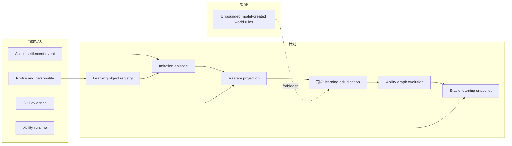
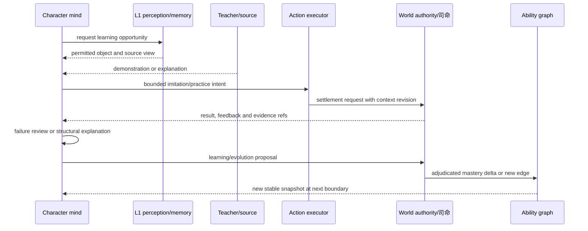
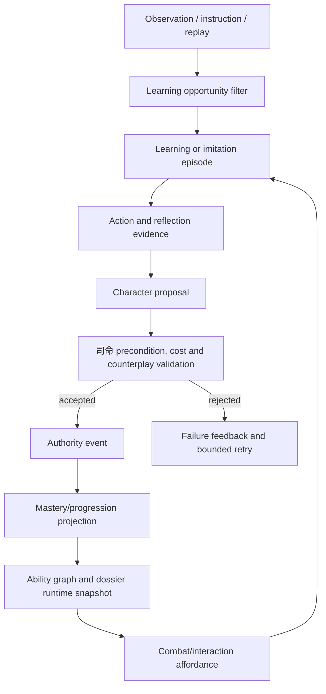

# 14 角色学习系统、模仿与技能进化设计计划

状态：`architecture analysis; planned and non-authorizing`

整理日期：2026-10-06

## 1. 结论摘要

角色的学习不是一次模型回答，也不是给技能加一个经验值。它是由观察、模仿、指导、练习、实战、失败复盘、研究、师承和跨技能迁移组成的可审计过程。学习对象既包括知识和概念，也包括动作、策略、技法、功法/心法结构以及构筑方法。

模仿是一等学习方式，同时可以成为角色自己的可成长能力。角色可以提出“想学什么、如何尝试、怎样组合”的意图，但不能直接把成功写入世界真值；司命或对应 authority 负责验证前置、结算结果、生成证据并决定是否形成技能节点、变式或进化边。

学习系统需要同时表达三种差异：

```text
人格决定角色愿意学什么、怎样学和如何回应反馈
一般认知能力决定角色能否理解复杂结构、保持步骤并迁移
领域技能与动作掌握决定角色当前能否稳定做出来
```

## 2. 目标与非目标

### 2.1 目标

1. 把学习对象、学习机会、学习过程、学习证据和学习结果分开建模。
2. 支持观察、模仿、指导、练习、实战、复盘、研究、师承和迁移等学习方式。
3. 支持动作学习；动作的时序、空间、节奏、力量、取消和压力稳定性都能留下证据。
4. 区分技能升级与技能进化：升级提高熟练和稳定性，进化改变结构、分支或可用边。
5. 让大五人格、一般认知能力、当前状态和角色资源实际影响学习路线与表现。
6. 让司命裁定世界规则、资源成本、风险、克制和新节点生成，模型只提出受限意图。
7. 让每次学习结果可重放、可解释，并能进入能力图谱和角色 dossier 的版本化快照。

### 2.2 非目标

- 本文不授权实现完整学习引擎，也不替代正式 spec 或 implementation plan。
- 不把“看过一次”直接等同于学会；不允许一次模型输出越过 authority 形成长期能力。
- 不把所有学习压成通用经验值，不在本轮定义世界观的全部功法细节。
- 不把学习过程中的模型 token 预算当成能力本身；预算只能限制当前尝试。

## 3. 现有实现与差距

### 3.1 `[current]` 可以复用

- `backend/app/character_agent/skills/learning.py` 已有 `SkillCandidateStore` 和 `SkillPromotionGate`，可作为候选与晋升门禁的起点。
- `backend/app/character_agent/skills/evidence.py` 能从 action settlement 生成技能证据。
- `backend/app/gameplay/ability_runtime.py` 已有稳定技能状态、技能等级、路径定义和 affordance。
- `backend/app/gameplay/action_graph_content.py`、`action_window_runtime.py` 已有动作节点、时长窗口、取消目标、条件引用、空间快照和距离带。
- 角色 profile 已有技能、知识领域、身体/心理/社会约束、大五人格和记忆保留设置。
- authority event、revision、digest 和回放机制可承载学习证据的重放来源。

### 3.2 `[planned]` 缺口

- `LearningEpisode`、`ImitationEpisode`、学习对象版本和学习机会的统一合同。
- 多维掌握状态，而不是单一经验值。
- 动作准确度、压力稳定性、迁移能力、个人化程度和失败复盘证据。
- 人格/认知能力到学习难度、步骤上限、反馈策略和资源消耗的编译规则。
- 学习证据到技能升级、分支、突变、融合和进化边的司命裁定流程。
- 学习慢循环与战斗高频循环之间的快照和权限边界。

### 3.3 `[deferred]`

- 让模型自由发明未注册的世界规则。
- 以端到端模型 loss 直接改写角色长期能力。
- 首期实现通用神经网络训练或跨世界自动迁移；迁移先采用可解释的能力图边和证据门槛。

## 4. 学习对象分类

| 对象 | 例子 | 最低证据 | 结果形态 |
|---|---|---|---|
| 知识 | 药材属性、门派历史 | 来源、理解问答、冲突处理 | 可引用知识节点 |
| 概念 | 距离、杠杆、元素相克 | 能用自己的话解释并在新情境识别 | 概念掌握边 |
| 动作 | 步法、格挡、施法手势 | 时序、空间、节奏和压力下重复 | `ActionPattern` 熟练度 |
| 策略 | 拉开距离、诱导反击 | 在约束变化下选择并复盘 | 策略节点/条件边 |
| 技法 | 剑招、治疗术、控制术 | 结构化执行和结果结算 | `Technique` 状态 |
| 功法/心法 | 呼吸循环、内力运转 | 前置、资源循环、风险和长期稳定 | `Method`/`InnerMethod` |
| 构筑方法 | 连击、克制、减蓝增伤增范围 | 组合意图、资源支付和司命裁定 | 变式或进化边 |

学习对象必须有稳定 `object_id`、版本、来源、前置、难度、允许的证据类型和世界规则引用。来源可以是观察者、老师、书卷、战斗回放、环境实验或自身失败记录。

## 5. 学习过程与模仿模型

### 5.1 学习阶段

```text
available -> noticed -> observed -> imitated -> structured
          -> practiced -> operational -> stable -> integrated
          -> personalized -> complete -> evolved
```

阶段不是线性强制流程：角色可以停留、退化或在迁移时重新进入 `practiced`。`complete` 表示已满足对象定义的完整掌握门槛，不表示可以突破角色能力上限；`evolved` 只能由司命依据进化规则产生。

### 5.2 `ImitationEpisode` 一等建模

```json
{
  "episode_id": "imitate-actor-07-018",
  "learner_id": "actor-07",
  "object_id": "sword.step.cut.v2",
  "source_id": "teacher-03",
  "mode": "observed_replay",
  "context_revision": "world-812",
  "attempt": {
    "phase": "imitated",
    "step_retention": 0.68,
    "timing_error_ms": 91,
    "spatial_error_m": 0.42,
    "force_error": 0.27,
    "resource_error": 0.18
  },
  "pressure": {"level": 0.4, "interruptions": 1},
  "feedback": ["late_recovery", "correct_target_line"],
  "evidence_refs": ["event-9912"],
  "authority_status": "accepted"
}
```

模仿 episode 至少记录：观察到的源、可见上下文、模仿模式、动作误差、资源误差、压力和中断、反馈、是否被 authority 接受以及后续复盘引用。模仿不是复制数值；它要区分“外形相似”“结构理解”“可在新条件下复现”。

### 5.3 学习方式

| 方式 | 主要输入 | 受人格影响 | 典型瓶颈 |
|---|---|---|---|
| 观察 | 示范、回放、结果 | 开放性、谨慎度 | 只记表象，漏掉因果 |
| 模仿 | 动作轨迹、节奏、姿态 | 模仿倾向、羞耻/风险反应 | 步骤保持、动作精度 |
| 指导 | 教师解释、纠错 | 宜人性、信任、权威接受 | 错误概念或依赖教师 |
| 练习 | 低风险重复 | 尽责性、耐心 | 单一环境过拟合 |
| 实战 | 真实压力和代价 | 神经质、勇敢、冲动 | 压力下失稳 |
| 复盘 | 结果、失败、对手反馈 | 反思、开放性 | 防御性归因 |
| 研究 | 资料、实验、对照 | 开放性、分析倾向 | 成本和时间 |
| 师承 | 长期关系、门派规则 | 宜人性、忠诚、权威观 | 路线锁定 |
| 迁移 | 相邻技能和概念 | 开放性、一般认知 | 结构类比错误 |

## 6. 掌握状态与学习难度

### 6.1 多维掌握状态

```text
familiarity              熟悉度：见过并能辨认
conceptual_understanding  概念理解：能解释原理和边界
procedural_fluency       程序熟练：能按步骤执行
motor_precision           动作精度：时序、空间、力量和姿态
pressure_stability       压力稳定：受伤、干扰、资源不足时仍可用
transfer_capacity        迁移能力：换目标、地形或组合后能调整
insight                   洞察：能找到隐藏约束和因果
personalization           个人化：形成符合自身资源和人格的变式
```

每个维度都有 `value`、`confidence`、`evidence_refs`、`last_validated_at` 和 `decay_policy`。技能等级是这些维度的投影，不反向覆盖原始证据。

### 6.2 难度分解

学习难度不能只有一个等级，至少拆成：

```text
complexity       步骤数、分支数、抽象层数
novelty          与已知技能的距离
precision        时序、空间、力量和资源精度
pressure         受击、时间、风险、社会压力
resource_load    资源量、循环和转换难度
world_binding    对世界规则、媒介或血脉的依赖
transfer_gap     从已知对象迁移的结构差异
```

角色的认知包络决定可尝试的复杂度、最大同时保持步骤、最大规划跨度和最大假设数；技能与身体状态决定能否实际执行。降低模型算力只能减少当前尝试深度，不能伪造掌握。

## 7. 人格、认知能力与学习路线

### 7.1 大五人格映射

| 维度 | 学习偏好 | 行为映射 |
|---|---|---|
| 开放性 | 研究、跨域迁移、变式和创造 | 更愿意试验未验证组合，表达更多假设 |
| 尽责性 | 分步练习、记录、复盘、稳定化 | 少跳步，按计划重复，失败后更可能修正 |
| 外向性 | 示范、师承、协同练习、即时反馈 | 更主动请求指导和展示，社交成本较低 |
| 宜人性 | 合作学习、模仿老师、共享技巧 | 更重视关系与他人安全，可能牺牲个人最优 |
| 神经质 | 风险规避、短练习、熟悉路线 | 压力下更易回退，反馈触发防御或焦虑 |

人格是倾向和成本修正，不是硬能力。相同能力图和相同认知包络下，不同人格应当选择不同学习对象、学习方式、风险上限和表达方式。

### 7.2 一般认知能力映射

建议的认知维度：工作记忆、证据辨识、因果推理、抽象能力、规划跨度、元认知和不确定性校准。它们编译为学习约束：

```text
工作记忆 -> 可同时保持的步骤与条件数
因果推理 -> 能否理解资源支付和效果之间的关系
抽象能力 -> 能否从动作迁移到策略、从技法迁移到功法
元认知   -> 能否识别“会做但不理解”或“理解但做不稳”
校准能力 -> 置信度是否随失败和新证据正确下降
```

## 8. 升级、分支、突变、融合与进化

### 8.1 区分结果

- **升级**：同一技能节点的熟练度、精度、稳定性或资源效率提高，结构不变。
- **分支**：从共享核心分出不同用途、距离、元素、节奏或风险路线。
- **突变**：在高不确定或异常条件下产生结构变化，必须经过司命风险和世界规则校验。
- **融合**：两个或多个对象共享概念、动作或资源循环，形成有来源边的新对象。
- **进化**：技能节点、变式和世界规则边发生受控重构，可能改变前置、克制、资源和动作图。

### 8.2 司命裁定输入

角色只能提交 `LearningOutcomeProposal` 或 `TechniqueEvolutionProposal`，包含目标、证据、组合意图、预期收益、可接受代价和失败回退。司命返回：

```text
accepted_evidence
mastery_delta
new_or_updated_node
new_edges
resource_cost_or_refund
risk_and_counterplay
world_rule_refs
rejection_reason
authority_event_id
```

“减蓝增伤增范围”属于技法构筑意图：资源支付可以换取效果强度、范围、距离或持续时间的放大，但司命必须同时裁定冷却、打断暴露、反噬、过热、因果债或其他后续代价。模型不能直接宣称新技能已经存在。

## 9. 与能力图谱和角色档案的关系

能力图谱保存技能/技法节点、前置、证据、掌握阶段、分支和进化边；知识图谱保存概念、来源和语义关系。两者共享 `source_ref`、`evidence_ref`、权限、版本和冲突治理值对象，不合并成一个全能图。

角色 dossier 保存 authored baseline；学习事件形成 runtime progression；司命 authority event 才能把 progression 投影为可重放的能力快照。每个回合使用冻结的 `StableAbilitySnapshot`，避免模型在同一回合中观察到自己尚未结算的能力变化。

技能学习和战斗影响源必须分开：学习/模仿可以改变技能掌握、技法变式和动作稳定性，但不能凭空生成职业/身份标签、装备、药品库存、阵法组件或外物效果。战斗当前可用效果由 `StableAbilitySnapshot` 与 `CombatInfluenceSource` 投影共同决定；后者还需要读取装备耐久/次数、药品持续状态、标签 effect binding、环境场和当前资源。相关定义由 [战斗影响源、标签与跨维度效果设计](战斗系统与角色技能，状态和资源/07-战斗影响源、标签与跨维度效果设计.md) 与 [外物、装备、药品与使用限制定义](战斗系统与角色技能，状态和资源/06-外物、装备、药品与使用限制定义.md) 负责。

## 10. 学习慢循环与战斗快循环



学习和创新是低频循环；战斗中的动作选择、资源读取和效果结算是高频循环。高频循环只读当前快照，不等待模型重新学习；战斗结果和失败证据在边界处进入学习队列。

## 11. 主交互时序



## 12. 数据流与权限边界



输入、转化和输出的权限必须明确：观察和提案可由角色产生；资源、效果、能力节点、克制关系、外物状态和长期状态只能由 authority 写入。模型输出不能直接添加标签、装备效果、药品库存或阵法权限。

## 13. 典型角色差异样例

| 角色 | 人格/认知基线 | 学习路线 | 可观察言行 |
|---|---|---|---|
| 纪律剑士 | 高尽责、低开放、工作记忆中高 | 模仿→分解→重复→稳定升级 | 少猜测，强调步骤和时机，失败后修正同一环节 |
| 好奇术士 | 高开放、中尽责、抽象和迁移高 | 研究→跨域融合→风险受控的变式 | 会提出假设和组合，但会标注未验证代价 |
| 紧张医者 | 高宜人、高神经质、精度高、压力稳定低 | 指导→低风险练习→协作实战 | 优先保人和资源安全，受压时回退熟悉治疗序列 |
| 直觉猎手 | 高外向、中开放、程序纪律中低 | 观察→快速模仿→实战反馈 | 学得快但步骤保持弱，倾向用位置和节奏弥补理论不足 |

这些不是固定 prompt 标签；它们应由 profile、人格 projection、能力包络、当前资源和学习证据共同编译，最终体现在候选选择、行动承诺、复盘内容和表达置信度中。

## 14. 后续正式化与验收入口

建议按以下顺序拆正式 spec，不在分析文档中提前授权实现：

1. 学习对象、episode、证据和 authority event 合同。
2. 多维掌握状态与技能/技法/功法能力图映射。
3. 人格与认知能力到学习难度、成本和输出门禁的 resolver。
4. 动作学习、模仿 episode 和压力复现的 gameplay vertical slice。
5. 司命裁定升级、分支、突变、融合和进化的规则包。
6. 学习快照、战斗高频读取和回放验收。

验收至少应证明：同一示范下不同角色产生不同学习路线；模仿 episode 可重放；低能力角色不能以高 token 预算越过结构上限；失败能形成可解释复盘；新技法只有在司命 authority event 后才可被 affordance 读取。
