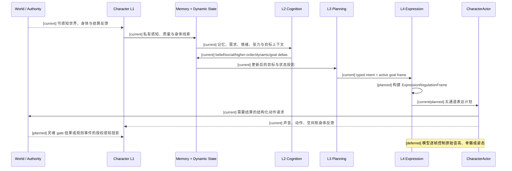
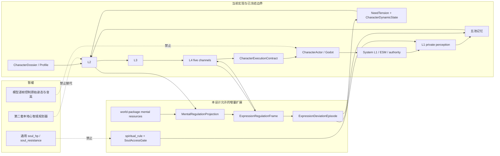

# 角色设定、言行表达、理智调节与灵魂规则边界设计

状态：`architecture analysis; proposed and non-authorizing`

日期：`2026-10-07`

正式 spec 源文档：[角色设定、言行表达、理智调节与灵魂规则边界设计](../superpowers/specs/2026-10-07-character-expression-regulation-and-soul-boundary-design.md)。本文件是十月分析目录中的同步版本，供相关议题索引和后续实施计划引用。

## 1. 目的

本文整理角色长期设定、短期心智状态、言语表达、身体动作、情绪失控、理智调节、精神资源和灵魂规则之间的关系。

本文是现有角色心智主线的增量设计，不建立第二套角色大脑、第二套动作系统或第二套世界 authority。它扩展已有的：

- `CharacterDossier / CharacterProfile`；
- `L1 -> L2 -> L3 -> L4` 角色心智链；
- 五池记忆；
- `NeedTensionState` 与 `CharacterDynamicState`；
- `CharacterExecutionContract`；
- `CharacterActor` 与 Godot 本地表现；
- 世界包注册的生命/精神资源；
- `spiritual_rule` 与 `SoulAccessGate` 规划边界。

本文不把瞬时情绪写回 authored profile truth，不把模型变成 world-truth authority，也不把灵魂变成默认数值资源。

## 2. 已冻结的架构不变量

### 2.1 角色表达的主链

```text
CharacterDossier / CharacterProfile
        ↓
L1 角色私有感知
        ↓
五池记忆 + NeedTensionState + CharacterDynamicState
        ↓
L2 主观理解与认知更新
        ↓
L3 目标、候选意图与选择
        ↓
L4 表达和执行协调
        ↓
CharacterExecutionContract
        ↓
CharacterActor / Godot 本地表现
        ↓
新的感知与 authority 反馈
```

角色的言和行必须沿这条链产生。L4 可以把一个意图拆成多个表现通道，但不能替代 L2/L3 决定角色真正想做什么。

### 2.2 权威边界

| 领域 | owner | 本设计中的职责 |
|---|---|---|
| 长期设定 | `CharacterDossier / CharacterProfile` | 身份、价值、人格、谈吐和具身基线 |
| 主观解释 | L2 与角色模型 | 事件对角色意味着什么，产生何种信念、社会和动态更新 |
| 意图选择 | L3 与角色模型 | 目标组合、表达目的、动作意图和优先级 |
| 表达协调 | L4 | 把已选意图转成 speech、face、body、social-spatial、physiology 计划 |
| 世界事实 | System L1 / ESM / 领域 authority | 结算动作、资源、状态、空间和灵魂规则事件 |
| 身体和声音表现 | `CharacterActor` / Godot | 本地动画、声音、姿态、呼吸、空间传播和可见反馈 |
| 灵魂规则 | `spiritual_rule` owner 与 `SoulAccessGate` | 受 gate 限制的身份、真名、誓约、附身、诅咒等规则事实 |

模型、L2、L3、L4 和 Siming 都不能直接写入世界真相或灵魂事实。Siming 只能提供高层催化和压力，不能下发原始姿态、逐帧音高或灵魂写入。

## 3. 设定、状态和表达

### 3.1 长期设定提供基线

长期档案提供“角色平时如何表达”的稳定偏置：

```text
identity
origin
values
personality_projection
temperament_response_layer
conversation_personality
style_expression_bias
voice_baseline
capability_constraints
embodiment_baseline
```

这些字段可以描述：

- 常用词汇、句式、正式程度和直接程度；
- 默认音高中心、音域、共鸣、语速、响度、停顿和咬字；
- 默认站姿、重心、步幅、转身、手势、视线和社交距离；
- 哪些情绪通常被隐藏；
- 哪些通道最容易出现情绪泄漏；
- 角色的动作、表达和社交能力限制。

长期基线不会直接决定本轮台词或动作。它必须与当前私有感知、记忆、需求、情绪、张力、目标、社会情境和身体状态一起进入 L2/L3/L4。

### 3.2 运行态继续使用现有分层

短期和中期变化继续存放在已有运行态：

```text
L1 private perception
Event / Observation / Knowledge / Social / Higher-Order Memory
NeedTensionState
CharacterDynamicState.affect_state
CharacterDynamicState.tension_state
CharacterDynamicState.motivation_stack
body-state hints
registered mental resources
active goals
control mode
```

这保证长期人格、短期情绪、记忆证据、玩法状态和身体状态不会互相覆盖。

## 4. `MentalRegulationProjection`

现有仓库没有通用的 `rationality` 字段。新增的建议对象是一个派生的、只读的表达和决策输入投影：

```text
MentalRegulationProjection {
  clarity
  attention_stability
  inhibitory_control
  goal_continuity
  masking_load
  regulation_pressure
  rationality_band
  source_revisions
}
```

它不是新的心智中枢，也不是独立 authority。它由已有状态和已注册资源的权限过滤投影构成：

```text
感知质量
+ 情绪、需求与张力
+ 目标冲突
+ 身体负担
+ 已注册精神资源
+ 社会情境
+ 过去失控后的残留压力
        ↓
MentalRegulationProjection
```

`rationality_band` 是用于表达、调试和策略约束的区间投影：

```text
stable
strained
edge
temporary_loss
continuity_risk
```

理智投影可以：

- 缩小复杂目标和多步计划的稳定范围；
- 提高冲动、冻结、撤退或求助候选的权重；
- 减弱语言、视线、动作和呼吸的抑制；
- 提高短暂表达失控的触发概率；
- 促成修复、解释、回避、重新控制或重新确认目标。

理智投影不能直接造成伤害、扣血、攻击、资源变化或灵魂变化。含有世界后果的意图仍然必须经过正常的 L4、CharacterActor 和 authority 链。

## 5. 精神资源与理智

精神力在现有设计中属于世界包可以选择启用的认知资源或状态投影，例如：

```text
mental:focus
mental:concentration
mental:sanity
```

它们沿已有资源合同拥有 `current`、`capacity`、`reserved`、`locked`、`available`、恢复条件和 `revision`。没有注册精神资源的世界不会生成隐形精神条。

生命与精神的关系仍由世界包显式选择：

```text
vitality_model = fused
vitality_model = coupled
vitality_model = independent
```

例如 `mental_damage -> focus_loss`、`focus_zero -> collapse` 或 `health_low -> mental_vulnerability_up` 只能由世界规则注册。角色模型不能根据自然语言自动推导资源转换。

精神资源不足通常通过现有动态状态和表达投影表现为：

- 注意力容易被打断；
- 工作记忆和目标连续性下降；
- 语句停顿增多；
- 动作和反应延迟；
- 情绪抑制变弱；
- 对复杂计划的承诺变短。

精神力不是灵魂，也不代表人格或身份已经改变。

## 6. 灵魂的现有边界

### 6.1 灵魂不是默认数值资源

当前主线将灵魂保留为 `spiritual_rule` 规则层：

```text
灵魂没有通用 soul_hp
灵魂没有通用 soul_resistance
灵魂不是默认资源
```

计划中的灵魂事实包括：

```text
soul_anchor
identity
true_name
oath
possession_state
reincarnation_link
curse_binding
rule_authority
```

这些事实表达身份、真名、誓约、附身、诅咒、转生联系和规则权威，不等同于 `soul_integrity` 数值。

### 6.2 `SoulAccessGate`

灵魂效果必须先经过计划中的 gate：

```text
soul_effect_allowed =
  life_or_mind_vulnerability_satisfies_rule
  AND spiritual_link_valid
  AND attacker_authority_sufficient
  AND no_higher_rule_blocks
```

未通过 gate 时，灵魂模块不得写入灵魂规则事实。通过 gate 后，规则包才可以允许 `possess`、`bind`、`banish`、`sever`、`curse`、`seal`、`block_reincarnation` 或 `alter_identity` 等具体规则结果。

### 6.3 灵魂规则进入角色心智

灵魂规则事件不能直接写成：

```text
rationality = 0.2
emotion = anger
play_animation = possessed
```

它必须经由已有感知和认知链：

```text
灵魂规则事件
  ↓
L1 可感知的异常、身体线索或精神线索
  ↓
L2 主观解释、信念、社会意义和动态更新
  ↓
L3 防御、求助、逃离、修复或继续行动的目标与意图
  ↓
L4 言语、姿态、动作、空间和生理表现
```

角色可见的灵魂信息必须经过私有投影。Combat hot snapshot 只可以暴露角色有权知道的 gate 结果和原因摘要，不能泄露不可见的规则事实。

## 7. 表达调节与五个 L4 通道

建议由 L4 创建只读的：

```text
ExpressionRegulationFrame {
  intent
  social_context
  rationality_band
  affect_pressure
  masking_pressure
  regulation_load
  channel_control
  leakage_channels
  recovery_state
  body_constraints
  mental_resource_summary
  soul_rule_summary
  source_revisions
}
```

它只负责将已经选择的意图转译成表达控制，不负责重新选择角色意图。

五个通道分别对应已有 L4 设计：

1. `Speech Channel`：语义表达、台词请求、交付计划；
2. `Face Channel`：面部、眼神和微表情计划；
3. `Body Channel`：姿态、头颈、手势、重心、步态和动作强调；
4. `Social-Spatial Channel`：接近、退开、保持距离、跟随、断联和私密圈尝试；
5. `Physiology Channel`：呼吸、颤抖、疲劳、保护性动作和非自主微动作。

每个通道可以有独立的控制程度：

```text
speech_content_control
prosody_control
gaze_control
gesture_control
locomotion_control
breath_control
```

这允许言行不完全同步，例如语言仍然克制但音高不稳，身体已经后退但嘴上仍说“我不害怕”，或者台词恢复后呼吸和视线仍未恢复。

## 8. 言语设计

现有的 `speech_channel`、`dialogue_act`、`utterance_request` 和 `speech_state` 继续作为接入点。表达计划可以分成语义和声音两部分。

### 8.1 语义层

```text
SpeechSemanticPlan {
  dialogue_act
  content
  target
  disclosure_level
  register
  directness
  truthfulness_policy
  urgency
}
```

### 8.2 声音实现层

```text
SpeechRealizationPlan {
  voice_id
  pitch_center
  pitch_range
  pitch_contour
  intonation
  loudness
  speech_rate
  pause_map
  breathiness
  roughness
  articulation
  disfluency
  laugh_cry_sigh
  accent_or_register
}
```

长期档案提供声线和谈吐基线；当前情绪、关系、目标、紧迫度、理智区间和通道泄漏产生本轮调制。模型可以生成受控文本和表达草案，但不能越过 Laya/L3 的意义选择、权限和时效约束。

语音继续使用既有三条路径：

- 预设语音快路径；
- 角色化迟疑、口癖和填充音频路径；
- 受控动态文本与流式 TTS 路径。

CharacterActor 负责本地播放和空间传播，接收者是否听见仍由接收角色的 L1 决定。

## 9. 动作设计

动作沿已有 `Body Channel` 和 `Social-Spatial Channel` 生成语义动作，再由动作资产和角色具身配置实现。

```text
MovementRealizationPlan {
  posture
  center_of_gravity
  torso_lean
  stride_length
  cadence
  turn_speed
  gesture_amplitude
  gaze_behavior
  hesitation
  weight_shift
  contact_distance
  interruption_behavior
}
```

动作风格由下列信息共同决定：

- `embodiment_profile`；
- `style_expression_bias`；
- 身体状态和动作能力；
- 当前情绪、张力和理智区间；
- 当前目标和社会关系；
- 已资格化动作资产的 realization 能力。

同一语义动作可以有不同实现：谨慎接近会有更短步幅和更高犹豫；威慑接近会有更强重心前移和更小社交距离；恐惧接近可能出现靠近与后撤交替。

动作资产只负责表现实现，不能写入世界事实或替角色决定目标。含有移动、交互、攻击或抓取后果的动作仍然必须经过现有动作和 authority 合同。

## 10. 短暂表达失控

短暂失控是表达调节层产生的、有来源、有持续时间、有恢复过程的运行时事件：

```text
ExpressionDeviationEpisode {
  episode_id
  trigger_refs
  affected_channels
  onset
  peak
  duration
  visibility
  control_loss_kind
  recovery_strategy
  aftermath_tags
  source_revisions
}
```

可能的通道包括：

```text
speech_content
prosody
face
body
social_spatial
physiology
```

角色档案可以声明通道泄漏倾向，例如：

```text
pitch_first
speech_content_first
gesture_first
gaze_first
freeze_first
physiology_first
```

失控由当前事件、主观评价、情绪/需求/张力、精神资源、身体负担、社会约束和调节能力共同触发。它不是随机动画，也不是永久人格切换。

可见表现包括：

- 音高突然抬高或音域收窄；
- 语速突然改变；
- 句子中断、重复或改口；
- 说出原本要隐藏的信息；
- 手势突然扩大或动作做到一半冻结；
- 视线短暂逃离；
- 身体先后退或靠近，语言随后补充解释；
- 呼吸、哭腔、笑声或颤抖泄漏。

失控若包含世界相关动作，仍必须经由正常动作请求和 authority 结算。失控结束后，事件可以触发羞耻、戒备、关系修复、回避公开场合、求助或重新建立控制的目标与记忆，但不能直接改写 authored profile truth。

进入和恢复使用不同的条件，避免在阈值附近每帧抖动：

```text
进入 temporary_loss：调节压力超过进入条件
退出 temporary_loss：理智、注意力或环境稳定性达到恢复条件
```

## 11. 时序图



## 12. 数据流图

```mermaid
flowchart TD
  P[CharacterDossier / Profile<br/>[current]] --> B[长期表达基线<br/>[current]]
  I[L1 私有感知<br/>[current]] --> C[L2 主观评价<br/>[current]]
  M[五池记忆<br/>[current]] --> C
  D[Need / Affect / Tension / Motivation<br/>[current]] --> C
  R[已注册精神资源<br/>[current/planned]] --> E[MentalRegulationProjection<br/>[planned]]
  S[spiritual_rule facts + gate result<br/>[planned]] --> C
  C --> G[L3 goals + typed intent<br/>[current]]
  G --> E
  B --> E
  E --> X[ExpressionRegulationFrame<br/>[planned]]
  X --> T[Speech semantic + realization<br/>[current/planned]]
  X --> F[Face plan<br/>[current/planned]]
  X --> Y[Body plan<br/>[current/planned]]
  X --> Z[Social-spatial plan<br/>[current/planned]]
  X --> Q[Physiology plan<br/>[current/planned]]
  T --> A[CharacterActor / Godot<br/>[current]]
  F --> A
  Y --> A
  Z --> A
  Q --> A
  A --> O[Perception / authority feedback<br/>[current]]
  O --> I
  H[自由灵魂数值条、逐帧模型控制<br/>[deferred]] -.禁止接入.-> A
```

## 13. 架构图



## 14. 事件、回放与隐私

新增的表达调节信息必须携带已有的回合和版本元数据：

```text
turn_id
context_revision
causation_id
correlation_id
idempotency_key
profile_revision
dynamic_state_revision
goal_revision
body_revision
mental_resource_revision
soul_rule_revision
```

建议记录：

- `ExpressionRegulationFrame` 的来源摘要；
- 失控 episode 的触发证据和受影响通道；
- speech/body/face/social-spatial/physiology 计划；
- Actor 接收、取消、过期和恢复结果；
- authority 动作请求和结算结果；
- 失控之后产生的记忆、动态状态和目标更新。

文本、声音和灵魂规则信息继续遵循角色隐私投影。不可见的秘密、不可知的 soul gate 原因和其他角色私有状态不能通过表达缓存、TTS 上下文或 Actor 调试字段泄露给不具备权限的观察者。

## 15. 当前、计划与暂缓

### `[current]`

- `CharacterDossier / CharacterProfile` 和长期表达基线方向；
- `temperament_response_layer`、`style_expression_bias`、voice baseline 和 speech style；
- L1-L4 角色心智链；
- 五池记忆、`NeedTensionState`、`CharacterDynamicState`；
- `CharacterExecutionContract`；
- L4 的 speech、face、body、social-spatial、physiology 五通道契约；
- CharacterActor、Godot 本地声音和动作表现边界；
- 世界包可注册的生命/精神资源合同；
- `spiritual_rule`、灵魂事实和 `SoulAccessGate` 的规划边界。

### `[planned]`

- `MentalRegulationProjection` 和 `rationality_band`；
- 通道控制能力和泄漏通道投影；
- `ExpressionRegulationFrame`；
- `SpeechRealizationPlan` 和 `MovementRealizationPlan` 的统一接点；
- `ExpressionDeviationEpisode` 的事件、回放和恢复语义；
- 失控后的记忆、动态状态、关系和目标写回；
- 灵魂规则结果经 L1 私有投影进入 L2 的完整接线；
- Combat hot snapshot 对精神资源和 soul gate 的权限过滤摘要。

### `[deferred]`

- 通用 `soul_hp`、`soul_resistance` 或其他默认灵魂条；
- 模型直接写入灵魂事实、精神资源、身体状态或世界事实；
- 模型逐帧控制音高曲线、骨骼、Motor 或原始姿态；
- 用本地规则脑替代 model-led L2/L3；
- 通过一次失控永久改写 authored profile truth；
- 完整 FACS/SACS/Binder/Mixer 和最终资产表现系统；
- 无限扩展的世界规则编辑器和跨世界灵魂平衡系统。

## 16. 验收标准

这份设计进入实施计划前，至少需要满足以下结构性验收条件：

1. 角色表达仍然经过 `CharacterDossier -> L1 -> L2 -> L3 -> L4`，没有平行心智链。
2. 理智是从已有动态状态、身体/精神资源和情境推导的表达投影，不是新的世界 truth owner。
3. 世界包可以显式选择是否启用精神资源，以及生命/精神的 fused、coupled 或 independent 关系。
4. 没有启用精神资源的世界不会生成隐形精神条。
5. 灵魂继续使用 `spiritual_rule` 事实和 `SoulAccessGate`，没有通用 soul 数值条。
6. L4 能够分别表达 speech、prosody、face、body、social-spatial 和 physiology 的控制与泄漏。
7. 同一意图可以根据设定、情绪、理智和身体状态生成不同声音和动作实现。
8. 短暂失控有触发证据、受影响通道、持续时间、恢复策略和后果记录。
9. 失控不能绕过现有动作 authority，也不能直接写入长期档案。
10. 表达计划、失控 episode、权威结果和记忆/动态状态写回能够通过 turn/revision 元数据关联并回放。
11. 角色只能读取经过权限过滤的灵魂 gate 结果、精神资源和其他角色信息。
12. 现有 Phase 0、Character Agent、Actor 和 authority 验证链不被架构设计破坏。

## 17. 现有设计依据

- [角色心智核心完成状态](../character/character-mind-core-status.md)
- [角色档案与状态核心架构](../8月分析/02-角色档案与状态核心架构.md)
- [角色语音与多模态表达设计](04-角色语音与多模态表达设计.md)
- [角色战斗资源与资源转换计划](战斗系统与角色技能，状态和资源/02-角色战斗资源与资源转换计划.md)
- [效果通道、环境场与生命精神灵魂规则设计](战斗系统与角色技能，状态和资源/05-效果通道、环境场与生命精神灵魂规则设计.md)
- [战斗状态、CombatPrefill 与高频读取计划](战斗系统与角色技能，状态和资源/04-战斗状态、CombatPrefill与高频读取计划.md)
- [完整角色心智核心设计](../superpowers/specs/2026-06-29-complete-character-mind-core-design.md)
