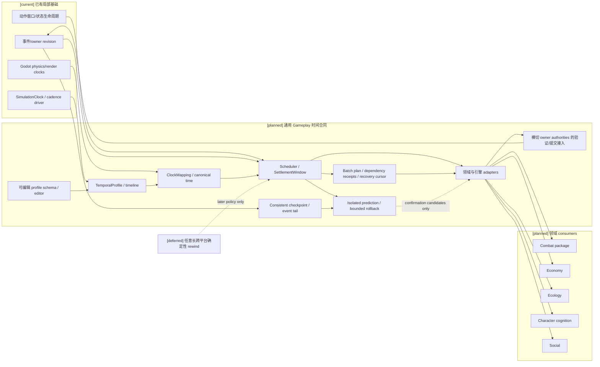
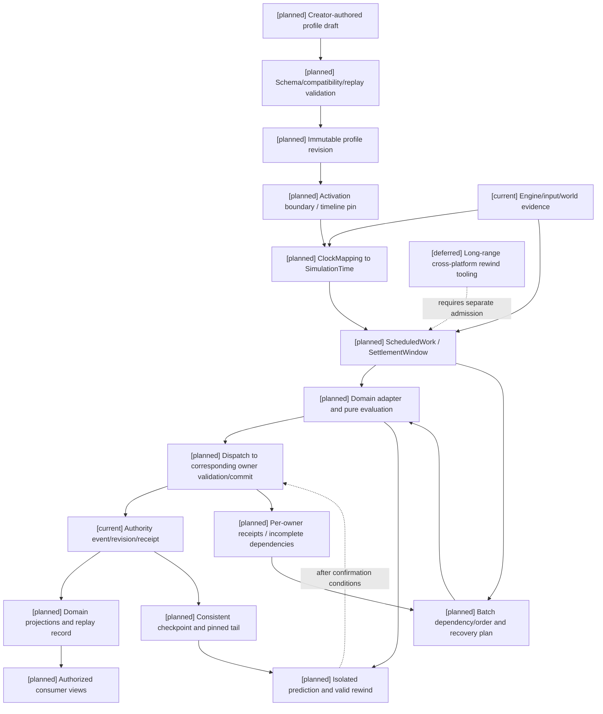

# 16 通用玩法时序模型与编辑器设计

状态：`architecture analysis; planned and non-authorizing`

本文件提出跨玩法共享的时序模型，供战斗、经济、生态、社交、角色心智、物理接入和其它 Gameplay domains 使用。时间配置不属于 Combat。共同概念使用 `TemporalProfile`、`SimulationTimeline`、`SimulationTime`、`ClockMapping`、`ScheduledWork` 和 `SettlementWindow`，不以 `Runtime` 命名。目标是在现有 Gameplay Foundation、世界调度、事件 revision、动作窗口和状态生命周期上增量升级；不把 Street Combat 验证 slice 当作架构模板。

本文件唯一负责时间语义、profile 字段及时间专项校验；草稿/权限/发布/激活的通用编辑器治理复用 [编辑器与能力权限治理](编辑器与能力权限治理/00-README.md)，不复制第二套控制面。动作承诺生命周期仍由 [11-跨玩法动作承诺协议设计](11-跨玩法动作承诺协议设计.md) 负责。

时间 profile 在编辑器目录中的跨领域接入、权限/标签/能力/owner 同步和验收矩阵见 [04-十月分析领域接入与编辑器同步矩阵](编辑器与能力权限治理/04-十月分析领域接入与编辑器同步矩阵.md)。本文件仍是 `TemporalProfile`、`SimulationTimeline`、`ClockMapping`、`SettlementWindow` 和时间专项校验的唯一 owner。

## 1. 设计决策

时间是 Gameplay Foundation 的通用基础合同。各领域声明如何消费时间、何时调度和怎样结算；领域 owner 仍拥有各自事实和规则。

```text
Gameplay Foundation
  shared time coordinates / scheduling / settlement windows / replay pins
  generic action, resource, state, effect and authority contracts

Gameplay domain package
  domain definitions / policies / owner contracts / projections

Engine adapters
  physics / input / presentation / network evidence and time mappings
```

本模型不把“实时、回合、帧级”做成互斥的单一枚举。它们是不同配置轴，可以组合：

| 轴 | 可选语义示例 |
|---|---|
| 时间推进 `advancement_policy` | continuous、phase_based、event_driven |
| 解析量化 `resolution_quantum` | fixed_step、integer_frame、action_quantized |
| 调度 `scheduling_policy` | realtime_input、turn_order、initiative_queue、scheduled_event |
| 结算 `settlement_policy` | immediate_owner_action、window_batch、phase_batch |
| 暂停/缩放 `time_control_policy` | pause_scope、time_scale、slow_motion、catch_up |
| 确定性 `determinism_policy` | best_effort、replay_deterministic、rollback_deterministic |
| 回滚 `rewind_policy` | disabled、unconfirmed_window、checkpoint_branch |

例如 3D 实时动作可采用 continuous + fixed_step + realtime_input + window_batch；回合游戏可采用 phase_based + action_quantized + turn_order，并在回合内给弹体、持续效果分配离散 step；格斗游戏可采用 continuous + integer_frame + realtime_input + window_batch（每帧一个窗口）+ rollback_deterministic。

## 2. 共同时间合同

### 2.1 `TemporalProfile` `[planned]`

```text
TemporalProfile {
  profile_id / revision / content_package_ref
  advancement_policy / resolution_quantum / scheduling_policy
  settlement_policy / time_control_policy
  determinism_policy / rewind_policy
  canonical_unit_ref / step_duration{unit_ref, numerator, denominator}
  supported_clock_mappings / rounding_policy
  activation_boundary / compatibility_constraints
}
```

字段使用有理数或固定精度表达，禁止用平台相关浮点累计决定权威结算。profile 不承载角色当前时间或状态；它描述本时间线的规则。

### 2.2 `SimulationTimeline` 与 `SimulationTime` `[planned]`

```text
SimulationTimeline {
  timeline_id / parent_timeline_id?
  world_scope_ref / advancement_owner_ref
  profile_ref / profile_revision
  epoch_ref / current_step / current_phase
  authoritative_revision / status
}

SimulationTime {
  timeline_id / step_index / substep_index
  phase_index? / canonical_time_value
}
```

同一时间线只有一个权威推进点。现实时间、Godot physics step、render frame、网络时间和角色心智唤醒不是平级的权威时钟；它们通过带版本、比例、偏移和取整策略的 `ClockMapping` 映射到时间线。渲染掉帧不能改变已结算世界时间；暂停可按 scope 冻结世界时间，但不必冻结 UI 或外部观测。

```text
ClockMapping {
  mapping_id / revision / source_clock_ref / source_unit_ref
  target_timeline_ref / target_profile_revision
  source_origin / target_origin / ratio{numerator, denominator}
  rounding_policy / valid_source_interval / max_lateness
  evidence_source_policy_ref
}
```

映射声明物理 step、输入采样和世界时间的对应关系，不把客户端时间戳当成权威时间。证据必须同时带 source clock、采样时间、接收时间和来源 revision；过期、重复或跨 timeline 输入按已注册策略拒绝或排到后续窗口。跨时间线交互必须显式映射，不能比较两个 timeline 的裸 step 数字。

### 2.3 `ScheduledWork` 与 `SettlementWindow` `[planned]`

```text
ScheduledWork {
  work_ref / domain_ref / due_time / trigger_ref
  ordering_key / expected_revision_vector / owner_contract_ref
}

SettlementWindow {
  window_ref / timeline_id / from_time / to_time
  participant_scope / phase_ref
  input_cutoff / late_input_policy_ref / confirmation_boundary
  frozen_read_set / evidence_refs / ordering_policy_ref
  expected_authority_revisions / settlement_idempotency_key
}
```

调度基础负责确定工作何时可运行、窗口如何分组和输入如何排序，不负责解释伤害、工资、天气或社交后果。通用 batch facility 可以承载一批候选，但原子性仅在已经准入的 owner/event vector 范围内成立；跨 owner 的一系列提交不得伪装成一个全局事务。

沿现有调用方驱动时钟与应用生命周期接入：先确定每条时间线的现有推进 owner，再给它增加 profile/映射合同，不新增并行时钟、第二事件存储或独立后台循环。到期任务只生成 owner-bound 工作请求；调度成功不等于领域结算成功。预算不足的 catch-up 保留 deferred 游标，不能静默丢掉状态 tick 或把未提交窗口标成完成。

### 2.4 跨领域批次编排合同 `[planned]`

`SettlementWindow` 固定时间与读取边界；`BatchSettlementPlan` 固定本窗口参与者、提案和依赖。共同合同在本节唯一维护，战斗 09 只定义它的领域实例。工资/库存交付、生态恢复、范围治疗都能复用该合同，不能因战斗名称另造事实提交中心。

```text
BatchSettlementPlan {
  batch_ref / timeline_ref / window_ref / plan_revision / input_digest
  frozen_read_set_ref / evidence_refs / definition_and_rule_pins
  participant_owner_contracts / proposal_refs / dependency_edges
  ordering_policy_ref / consistency_scope / idempotency_keys
  failure_policy_ref / confirmation_boundary / recovery_cursor
}
OwnerCommitReceipt {
  batch_ref / plan_revision / owner_ref / operation_ref / input_digest
  accepted_event_refs / rejected_proposal_refs / conflict_refs
  owner_revision_before / owner_revision_after
  status: committed | rejected | partial | deferred
}
```

`partial` 仅用于 owner 合同明确允许分项成功的操作；要求原子的 owner 事件向量只有 committed 或零写入失败。统一编排不是全局事务。owner 间共享 event store 也不自动意味着有跨 owner 原子保证。

| 编排阶段 | 允许行为与失败结果 |
|---|---|
| collected/evaluated | 收集输入、冻结 read-set、纯求值；无事实写入 |
| validated | 每个 owner 校验自己的范围；校验不是锁或最终提交保证 |
| committing | 按依赖边和稳定顺序提交，保存每份 receipt；失败不能抹掉已有事件 |
| pending_recovery | 结果或 receipt 不完整；保留游标，查询原 operation 后决定重试 |
| completed | 所有必要操作及补偿已闭合；保留每项结果，不把失败说成成功 |

默认依赖图有向无环；循环支付/转换必须拆成有界阶段或进入已有明确原子 owner 合同。运行时数据冲突在 owner 内检查 expected revision；依赖前序提交时，后序提案还需引用其实际 receipt 和 revision，而非全程套用初始 revision。

超时不能判定提交失败：先按 `owner_ref + operation_ref` 查询原 receipt；exact duplicate 返回原结果，changed duplicate 拒绝。已经部分提交后，不能修改同一幂等键的计划再发。需重算时产生 successor plan，引用原 batch 及已提交事件，避免再次付费或再次造成伤害。

资源预留/释放仍是 Resource owner 的正式操作。跨 owner 完整性可选择：已有获准原子合同；预留后有界提交并重试；或显式补偿事件。没有可接受失败语义的配置不得激活。对不可补偿伤害，优先保持已提交伤害并恢复后续生命周期/状态操作，不凭空撤回伤害；可容忍分项失败的效果则明确返回 partial。

投影可发布真实已提交变化并标注 batch completeness，不能隐藏生命变化等到整个批次闭合，也不能把不完整结果标成整体成功。必要依赖未完成时，相关目标/生命资格保持诊断中的受限策略，不能靠过期读视图继续行动。窗口确认游标等待必要提交或已准入终止政策完成；仅预算耗尽不能推进确认。

## 3. 三种常见配置与适用范围

| 配置组合 | 适用内容 | 建议时序行为 |
|---|---|---|
| 实时连续输入 + 固定 step | 3D 动作、FPS、ARPG、开放世界、实时模拟 | 引擎独立推进渲染/物理；领域在固定 step 或 settlement window 消费证据 |
| 阶段/行动队列 + 离散 step | 战棋、JRPG、卡牌、暂停规划 | 以 phase/action 调度；世界时长效果和弹体可继续推进子 step |
| 整数帧 + 窗口结算 | 格斗、弹反、节奏战斗、精确取消 | 前摇、active、硬直、无敌和输入宽限都按整数 frame 定义 |

3D 不是自动等于逐 render frame 结算。常见配置可以是 render 60+ FPS、physics 60 Hz、world/Gameplay step 30 或 60 Hz；具体组合由编辑器 profile 与引擎能力验证确定。动作可以选择毫秒换算到 step，或对关键窗口采用整数帧量化。

实时、回合与帧可组合，但内容必须声明转换与舍入。例如回合内 `duration=3 turns` 与环境 tick `every 2 simulation steps` 是不同计时定义，不能都存作无单位的 `duration=3`。

回合不必等于固定秒数：某阶段若没有注册 turn-to-time 映射，禁止把“三回合”转换成“三秒”或跨时间线截止时间。initiative、速度、行动点如何产生行动队列属于领域规则；通用调度只按已验证的队列和排序键执行。同一窗口内“同时命中”可使用 frozen read-set 求候选结果，再由所属 owner 的批次政策提交；不能因线程先后改变死亡、反击或治疗结果。

共享实例：剑招前摇、药效每秒回蓝、烘焙工序完成、债务到期和天气阶段转换都可引用 `SimulationTime`/`ScheduledWork`。各自的效果、账户和工序语义仍归原 owner，不进入时间模型的通用字段。

## 4. 编辑器合同 `[planned]`

编辑器可以创建/复制 profile、调整 schema 允许的配置、配置 package/world/game-mode 的继承与 override、预览转换与批量顺序，并发布不可变 revision。编辑器不允许写当前 timeline 真值或提交领域事件。

推荐配置继承：

```text
World Temporal Profile (default)
  -> Game Mode Profile (optional bounded override)
    -> Scenario/Encounter Profile (optional admitted override)
      -> Action timing definition (unit-bound values, never global clock rules)
```

窄层 override 只能覆盖其 schema 声明的字段；不可静默改变 timeline 的 canonical unit、确定性等级或 rollback 保证。活动时间线只在明确 activation boundary 切换 profile；已运行/可回放的窗口固定原 profile revision。

默认迁移政策 `[planned]`：在途动作保留原 profile/window pins；状态、冷却和计划任务按声明的剩余世界时长或剩余回合转换，不直接复制旧裸 tick；历史 receipt 和回放保持旧 revision。转换不能精确表达时使用声明的舍入策略并记录诊断；没有迁移合同则拒绝切换。周期任务跨边界的触发键必须去重，避免补发或漏发同一次回蓝/伤害/工资事件。

编辑器草稿字段摘录（发布还须补齐上文的 revision、来源、映射与激活政策引用，并通过完整 schema 校验）：

```json
{
  "profile_id": "world.action_realtime.v1",
  "advancement_policy": "continuous",
  "resolution_quantum": "fixed_step",
  "scheduling_policy": "realtime_input",
  "settlement_policy": "window_batch",
  "canonical_unit_ref": "simulation_step",
  "step_duration": {"unit_ref": "second", "numerator": 1, "denominator": 60},
  "time_control_policy": {"pause_scope": "world_and_gameplay", "scale": "1/1"},
  "determinism_policy": "replay_deterministic",
  "rewind_policy": "disabled"
}
```

### 4.1 校验与发布

发布前验证：

1. 必填字段、枚举、单位维度、范围、分子分母合法性和整数帧约束。
2. 引擎/adapter 是否支持请求的 step、frame、time scale 和 pause scope。
3. profile 继承无环；override 不修改未授权字段；action/state/effect 的时间引用能解析。
4. 启用 rollback 时必须具备对应 determinism、输入记录、状态快照和未确认窗口策略；不满足则拒绝，而不是降级成虚假的确定性承诺。
5. 相同 fixture、profile revision、输入和 evidence 重放时，领域结果及排序相同；比较结果包含单位、舍入和事件序号。
6. 时间线切换有 activation boundary、旧 revision 保留策略以及 in-flight action 的处理规则。

编辑器提供 draft -> static validation -> preview -> replay comparison -> publish revision -> activation boundary。预览不改世界；失败报告说明冲突字段、不可支持的适配器能力和重放差异。

### 4.2 活动 timeline 与权威

内容作者编辑未来 revision。活动时间线通过控制面批准的新版本切换，不由模型或普通世界内角色更改时钟配置。活动中的角色、技能和领域只能提交各自授权动作；时间推进服务只发出 step/window 事实，参与的对应 owner authorities 仍校验及提交各自领域变化。

若执行暂停、减速、回合推进或 timeline 分支，必须带授权主体、适用 scope、起止时间和 profile/timeline revision。Rollback 重算只覆盖 profile 明确允许的未确认范围；已经被对应 owner authority 提交并对外观察的事实，必须经正式补偿/分支规则处理，不能静默撤销。

### 4.3 时间效果与配置编辑的区别

世界内“加速”“时停”“局部时间领域”可以是已注册技能或环境效果：角色提出 intent，所属 authority 验证 scope、代价、抵抗和持续时间，再产生受限时间控制结果。它们不授予角色编辑 `TemporalProfile` 或全局时钟的权限。局部时间缩放只影响声明的 action/status/motion consumers；网络超时、UI 和安全租约仍按各自 operational clock 计时。后台模型用时不会自动拖慢世界；逾期决策按窗口策略处理。

## 5. 与现有 Gameplay Foundation 的增量关系

### `[current]` 可复用基础

- [SimulationClock](../../backend/app/world_runtime/simulation_clock.py)：调用方驱动的整数 tick、单调推进、到期义务排序和 catch-up budget；本身不启动后台循环，也不写世界事实。`population_clock_profile` 已有 production/benchmark 的单位、窗口和速度配置，但不是创作者可编辑的通用 profile。
- [PopulationCadenceDriver](../../backend/app/world_runtime/population_driver.py)：复用该时钟、按窗口推进，处理暂停、补推进上限、发布失败和确认游标。升级应保留现有应用生命周期及 owner publication 路径。
- [Scheduling](../../backend/app/world_runtime/scheduling.py)：按预算、连续性优先级和 salience 选择角色；它选择计算工作，不负责物理 step 或世界时钟推进。
- [Action graph](../../backend/app/gameplay/action_graph_content.py) 与 [Action window](../../backend/app/gameplay/action_window_runtime.py)：已注册动作图及冻结空间 revision 的只读窗口准入；现有窗口要求 `window_end_tick - window_start_tick == 1`，不等于可配置 1/60 秒帧或通用时间线。
- [Status lifecycle](../../backend/app/gameplay/status_tags.py)、[Semantic effects](../../backend/app/gameplay/semantic_effects.py)：已有状态 apply/remove/expire 生命周期，semantic effects 可计划 `expires_at_tick`/到期义务；尚未统一 profile 驱动的自动 tick。
- [Resource body](../../backend/app/gameplay/resource_body_runtime.py)：资源预留、消耗和释放；现有资源边界不是通用时钟。
- event store、owner append、revision、receipt 和 replay；这些仍是领域事实提交和重放的主干。
- Godot physics/render 时间与本地表现；它们是外部适配输入，不是跨领域 Gameplay 时间 owner。

### `[planned]` 缺失的共享合同

- 时间线、规范时间坐标、profile revision 和 clock mapping。
- profile 驱动的 step/phase/scheduled work 调度。
- 跨领域 settlement window、稳定排序与有限的批次原子性声明。
- 引擎/网络/角色唤醒到世界时间的适配与 freshness 规则。
- 通用编辑器 profile schema、验证、预览、发布和 activation boundary。
- 按确定性等级准入的 replay/rewind 能力。

不能声称现有代码已经实现统一时间模型、跨领域时钟、回合/帧 profile 编辑器或通用 rollback。现有模块使用的 tick/frame/time 字段是局部合同；迁移时通过显式 adapter 对齐，不用字段重命名假装架构已完成。

升级顺序是 `现有 SimulationClock/driver -> 规范时间映射 -> 现有 action/status consumers -> 编辑器 profile -> 批次与回放 -> 可选有限 rollback`。已有 tick 单位和日窗口先以 legacy profile 显式保留，旧事件不可按新频率重新解释；不必为每种玩法复制新的时间系统。

## 6. 领域适配规则

| 消费领域 | 读取通用时序能力 | 保留的领域 owner |
|---|---|---|
| Combat | action time、impact evidence、batch window、cooldown/status progression | 技能资格、命中/伤害/治疗/控制、仇恨、死亡与战斗结果 |
| Economy / Inventory | cadence、deadline、period window | Economy 保留账户、义务、工资和交易事实；Inventory 保留库存/持有事实 |
| Ecology | simulation step、scheduled transitions、time scale | 天气、生态状态、环境资源与恢复 |
| Character cognition | wake schedule、event-trigger、deadline | 感知、记忆、目标、人格投影和模型预算 |
| Social/communication | delivery time、latency、expiry、phase | 关系事实、消息可见性、同意与社会事件 |
| Physics/presentation | mapping to physics step/render frame | 引擎运动、碰撞、动画/音频和本地表现 |

Combat 的物理协作是 Gameplay Foundation 通用证据适配能力的一个 consumer。物理引擎产生空间和接触证据；战斗包/所属 authority 解释证据并提交领域事实。时间 profile 决定证据归属哪个 step/window，不接管物理模拟。

## 7. 确定性、日志与回滚

确定性有等级，不应对所有世界和物理引擎承诺 bitwise deterministic：

```text
best_effort
  有序事件与可诊断记录，不保证跨平台数值完全相同

replay_deterministic
  同一平台/规则版本/输入/证据可以重建相同 owner 事件和领域结果

rollback_deterministic
  在已声明窗口内，输入、状态和所有参与领域可重算，结果按固定顺序提交
```

日志记录 profile/timeline revision、simulation time、输入/evidence pins、窗口 read-set、owner receipt 和结果 digest。日志本身不是第二事实 owner。

若物理引擎不能跨平台确定性重放，可记录权威 PhysicsEvidence 作为重放输入；不能让 replay 再次猜测碰撞结果。Rollback 要求同一回滚窗口所有参与领域的状态可快照/重算。确认前使用隔离的预测状态与候选结果，不向现有正式 append spine 写入可撤回事件；确认时才由领域 owner 提交。确认后不可静默倒写，也不能把现有已提交事件重新标为暂定。

### 7.1 数值、随机流与重放输入 `[planned]`

`TemporalProfile.determinism_policy` 引用版本化的求值配置：数值精度、溢出、负数、取整、集合排序、随机算法及证据接纳政策。各资源/effect 仍声明自己的单位、上限和计算规则，时间模型不统一所有伤害公式。随机上下文至少包含 `timeline + window + operation_ref + effect_ref + target_ref + draw_index`，并固定算法/seed policy revision；禁止读取墙上时间或依赖共享 RNG 的调用顺序。保密的 seed 不进角色快照。

同一输入/规则/证据应重建同一结果 digest；增加无关目标或并行工作不能改变既有目标的随机抽样。预算截断按稳定顺序继续，下一轮保留抽样键。暴击、命中、掉落和突变概率属于各领域政策，不由提高模型预算改写。

记录证据的重放只能保证领域结果可重建，不能证明物理引擎也可重新模拟。证据丢失、版本缺失、digest 不符时返回明确的 `unreplayable`/`divergent`，不降级猜测碰撞或重新调用模型补历史。模型学习/创新输出若曾获准，重放读已接纳提案和 owner 事件，不重新生成一次不同提案。

### 7.2 有限 rollback 与确认前预测 `[planned]`

```text
PredictionWindow {
  timeline_ref / prediction_branch_ref / base_confirmed_revision_vector
  first_step / last_step / input_cutoff / profile_and_rule_pins
  participant_refs / snapshot_refs / input_refs / evidence_refs
  random_context_ref / speculative_digest / confirmation_policy_ref
}
```

启用 rollback 必须声明 horizon、快照周期、可恢复消费者、最大重算量与无法恢复的外部副作用。快照涵盖：资源与预测预留、动作阶段/冷却、状态实例/到期任务、投射物/生成实体、目标/威胁、局部时间控制、随机上下文及参与者 revision；正式账户和事件存储不被预测副本覆盖。

1. 从最新一致的确认检查点建立隔离预测分支；所有候选只有 provisional 标记，无正式 authority receipt。
2. 输入序号去重、排序；迟到输入只可更正 horizon 内且未确认的窗口。无法恢复物理时，只能在证据固定且与更正输入兼容的范围重算领域结果；输入改变轨迹需要可恢复物理或新受信证据，否则拒绝更正/请求同步。
3. 恢复最早受影响快照，固定版本和随机键按顺序重算；更新 prediction revision。旧预测 delta 不能冒充 committed delta。
4. 达到确认条件后把终版候选交给对应 owner 校验提交。若实际 revision 冲突，重新对齐真实 owner 状态并重算；confirmation 条件满足不免除 owner 校验。
5. 只有正式 receipt 后发布 confirmed 结果。跨 owner 部分提交进入 2.4 的恢复路径，不把已提交前半段重新放回预测分支。

UI 可按策略插值/纠正预测动画、位置和生命显示，必须保留 provisional 区别；不可逆物品消费、学习授予、外部通知等等待正式事件。预测空间证据必须注明分支，禁止混入无分支的正式证据缓存。回滚不重新呼叫角色模型以改变历史决定；超出窗口的迟到输入按规则拒绝、排入后续或同步，不能静默重写已确认世界。

### 7.3 编辑器预览与故障案例 `[planned]`

编辑器可以编辑单位/精度、排序政策引用、随机政策引用、batch 依赖与失败政策、snapshot interval、rollback horizon、确认条件和预算上限；owner 路由只能从已注册合同中选取。预览至少展示同窗攻击/治疗、迟到输入、丢 receipt、owner 部分提交、预测纠正和预算截断。换版本不得改旧窗口 pins；缺少可恢复参与者时禁止发布 rollback profile。

| 设计验收案例 | 必须得到的结果 |
|---|---|
| 同输入重算、打乱网络/线程顺序 | 稳定顺序、随机抽样和 owner 结果 digest 一致 |
| 超时发生在 owner 已提交之后 | 查询原 receipt 后闭合，不重复消耗或追加 |
| 第二 owner 冲突 | 保留第一 owner 事件，依声明重试/补偿，不宣称整体零写入 |
| 迟到输入改变投射物轨迹 | 无可恢复物理/新证据则拒绝更正；不得复用不相容的旧碰撞 |
| 预测实体被撤销 | 回收预测分支对象；正式实体/库存不受改写 |
| 确认游标前预算耗尽 | 保留 recovery cursor，不能省略 tick 或推进确认 |

### 7.4 通用检查点、consistent cut 与回放尾部 `[planned]`

检查点不是某个领域的完整快照，而是一个时间线在指定 `SimulationTime` 的一致切面：所有纳入范围的 owner、adapter 和 projection 都必须声明同一或可证明先后关系的 revision。公共合同如下：

```text
ReplayCheckpoint {
  checkpoint_ref / timeline_ref / checkpoint_time / profile_revision
  included_scope / owner_revision_vector / adapter_revision_vector
  state_snapshot_refs / scheduled_work_cursor_refs
  open_window_refs / evidence_refs / random_context_refs
  serialization_revision / digest / status: consistent | incomplete
}

ReplayTail {
  checkpoint_ref / from_revision_vector / to_revision_vector
  event_refs / receipt_refs / dependency_edges
  definition_and_rule_pins / evidence_refs / result_digest
  visibility_policy_revision / status: verified | incomplete | divergent
}
```

一致切面的建立顺序为：冻结时间窗口和输入 cutoff -> 记录各 owner 的 revision/receipt 游标 -> 固定未完成 batch、到期任务和预测分支边界 -> 读取状态快照 -> 计算 digest。任一 owner 在切面建立期间继续提交时，必须被纳入新的 cut 或使本次检查点标记 `incomplete`；不能把不同时间读取的最新值拼成假快照。

检查点范围至少覆盖声明参与者的资源预留、动作阶段/冷却、状态实例、投射物/生成实体 presence、目标/威胁关系、局部时间效果、定时任务和随机上下文。未参与领域可用 opaque reference 表示，但其 owner revision 和重建能力必须记录。跨 owner 的事实仍按各自 receipt 恢复；检查点不把多 owner 合成新事实 owner。

回放从 `ReplayCheckpoint` 读取，再按稳定的 event/operation sequence 应用 `ReplayTail`。重复 tail 通过 operation/ref 幂等；缺段、版本不支持、依赖 receipt 不完整或 digest 不同则停止为 `incomplete`/`divergent`，不得跳过事件继续生成可信结论。旧历史按自己的 profile/rule/definition pins 解码；没有兼容 decoder 就只保留不可重建诊断。

检查点、事件尾部和投影有不同权限：authority audit 可读取完整 pins；creator preview 只读授权内容；角色回放只读 L1 过滤后的 projection。过滤回放能证明可见片段顺序，不能冒充全量世界确定性。检查点压缩、保留和清理属于存储政策，但清理前必须有可审计的 successor checkpoint 或明确失去重建能力。

### 7.5 跨 adapter 能力准入 `[planned]`

每个 engine/network/physics adapter 发布能力描述：支持的时钟映射、证据类型、快照范围、确定性等级、最大迟到、可否重演、实体身份绑定和 rollback horizon。`TemporalProfile` 激活前对所有参与 adapter 做兼容交集计算；缺能力时拒绝、降级到显式的 `best_effort` 或改用固定证据回放，不能保留 `rollback_deterministic` 名称而静默降低保证。

能力描述包含版本与失效策略。运行中能力丢失时停止受影响窗口的确认，记录 adapter fault，并根据内容政策继续非权威表现、等待恢复或提交可审计的补偿；不能把最后一个有效画面或模型判断当作新物理证据。引擎局部重启后的恢复必须带新 adapter revision 和时间映射，旧证据不能跨能力边界无条件续用。

## 8. 状态标记与后续拆分

- `[current]`：已有局部 action window、状态生命周期/到期计划、资源/事件 revision、世界调度/连续性和引擎时钟；并无统一跨领域时序合同。
- `[planned]`：`TemporalProfile`、`SimulationTimeline`、`SimulationTime`、`ClockMapping`、`ScheduledWork`、`SettlementWindow`、编辑器治理、领域 adapters 和按等级确定性/回放。
- `[deferred]`：跨平台 bitwise deterministic physics、任意长时间 rewind 和跨 timeline 自由融合。
- 始终禁止：模型直接修改权威时间、profile、已提交时间线或领域真值，以及无约束脚本绕过既有 owner；这些不是 deferred 能力。

推荐后续设计文档顺序：先盘点并对齐现有时间单位/时钟来源；再定义规范时间坐标与 mapping；然后接入一个现有世界调度和一个 action/status consumer；接着交付 profile editor、继承/validation/preview；最后再增加 batch replay 与有限 rollback profile。每一步都应配套静态验收矩阵和必要的运行验收门禁；本文件只提出设计，不授权 spec、plan 或实现。

## 9. 架构图



## 10. 主流程时序图

```mermaid
sequenceDiagram
  participant CE as Creator editor
  participant REG as Content registry
  participant ADV as Timeline advancement
  participant SCH as Scheduler/window coordinator
  participant AD as Domain adapter
  participant OW as Corresponding domain owner(s)
  participant PR as Authorized projections
  participant PRED as Isolated prediction branch
  Note over CE,PR: [current] local clocks, action/status and owner event spine; [planned] common time contract/editor/adapters; [deferred] unbounded cross-platform rewind
  CE->>REG: draft profile revision
  REG->>REG: validate schema, mappings, engine support and replay fixture
  REG-->>CE: preview diagnostics; no world writes
  CE->>REG: publish immutable revision
  REG->>ADV: activate at declared boundary
  ADV->>SCH: advance SimulationTime / emit due work
  SCH->>AD: frozen window, evidence and pinned read-set
  opt admitted rollback profile
    AD->>PRED: fixed state/input/evidence/rule pins
    PRED->>PRED: recompute unconfirmed range on valid late input
    PRED-->>AD: final candidates after confirmation conditions
    Note over AD,PRED: No formal world writes or authority receipt in prediction branch
  end
  AD->>OW: dispatch owner-bound proposals by fact type
  OW->>OW: validate only owned facts and expected revisions
  OW->>OW: commit admitted owner event vector or reject with zero writes
  OW-->>PR: receipts and revisions
  alt incomplete owner receipts
    PR-->>SCH: committed revisions plus pending batch dependencies
    SCH->>OW: query original operation receipt / bounded recovery
    OW-->>PR: existing result or new admitted recovery events
  else required operations closed
    SCH->>SCH: advance confirmation cursor
  end
  PR-->>AD: refreshed authorized projection
  Note over ADV,OW: [planned] rollback can recompute only unconfirmed windows under an admitted profile
```

## 11. 数据流图



## 12. 验收标准

1. Combat、Economy、Ecology、Character、Social 和 Physics adapters 共用时间坐标/映射合同，但各自保留领域 owner。
2. realtime、turn、frame 可通过正交配置组合；单位和转换有类型、版本和舍入规则。
3. render frame 变化不改变规范时间线的历史结算；暂停/减速 scope 可预测、可重放。
4. 创作者能在编辑器编辑、校验、预览和发布 profile；非法单位、无支持 adapter、坏继承、越权 override 和不兼容 rollback 被拒绝。
5. profile revision 在 activation boundary 生效；在途动作、持续状态、计划任务和旧回放有显式迁移政策。
6. settlement window 固定 read-set、evidence、顺序和 revision；跨 owner 原子性不超出获准 event vector。
7. replay pins 足以重现 profile、输入/物理 evidence 和 owner 结果；日志不成为第二事实来源。
8. rollback 只在 profile 声明的确定性和未确认范围内工作；已确认 authority events 不被静默撤回。
9. 现有 action window、状态、资源和世界调度可经 adapter 渐进接入，不需要假设 Street Combat 是通用参考实现。
10. 已有日窗口与资源/状态 tick 经 legacy profile 保持原语义；频率切换不得重复或遗漏周期事件，失败窗口不推进确认游标。
11. 世界内局部时间效果只影响准入 consumers；不会延长网络超时、安全租约或模型预算，不会授予角色 profile 编辑权限。
