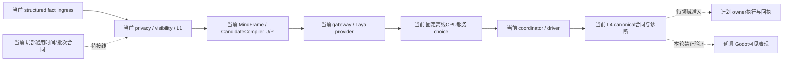
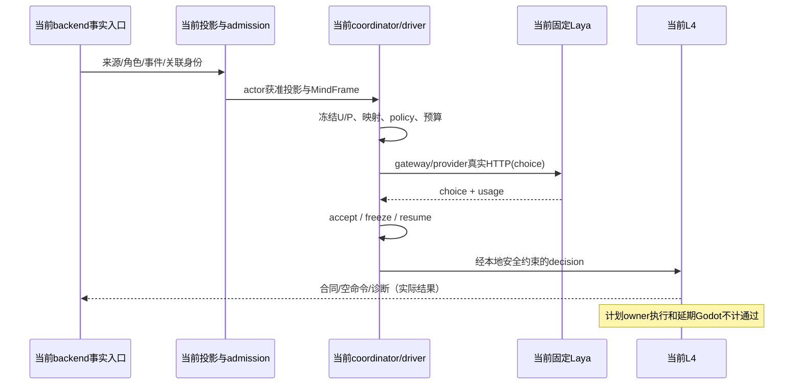
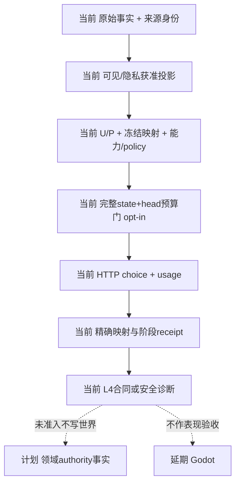

# 2026-10-15 backend choice、角色基础与阶段三局部实施

本轮顺序为真实 backend choice → 计划02/03角色基础 → 规格09–12／计划04通用领域接入。阶段三不指计划03，也不指A/B/C。用户本轮明确禁止Godot验证及其他Laya输出类型；历史证据、失败和用户修改保留。

## 分项状态

| 项目 | 本轮状态 | 验收边界 |
|---|---|---|
| Laya choice输出合同 | 实际固定服务返回choice，精确映射获准 | 不验证score/noul；不要求解释、执行参数、世界事实或授权 |
| backend真实回合 | 网络事实入口、投影、admission、MindFrame、U/P、gateway、实际HTTP、阶段续行及L4有证据 | L2为显式local stub；不是完整真实慢模型认知或领域动作成功 |
| 角色基础 | 新增调节投影、五通道表达/观察episode、协同信号/短契约、SpeechLease | 逐任务实现和局部阻断见计划02/03最新证据表 |
| 阶段三Task1–2 | 已开始实施、局部合同通过 | 生产时间consumer迁移、完整快照/预测和更多owner未完成；见同目录阶段三报告 |
| 模型质量 | 未验收 | Policy A仍为autonomous 0/8、explicit diagnostic 0/6、role-sensitive 1/8 |
| Godot／领域最终执行 | 未验证／未验收 | 不以backend或单测替代；Harness all历史未通过保持 |

## 实际backend链路与证据

仓库外证据：`D:/Users/User/Documents/paralls-evidence/october-backend-choice-20261015/`。`attempt4/trace.jsonl`为完整观察记录，`backend-choice-summary.json`关联trace行、冻结请求、U/P、映射、预算、usage、choice、L4和阶段receipt；`provider-identity.txt`记录源码/权重/tokenizer身份，`run_backend_choice.py`为本轮自有观察helper。helper启动真实component_app与RuntimeExecution owner，以本地授权凭据经真实`/ws`发送`raw_fact_event`，包装观察原方法并调用原实现，没有直接HTTP评估绕过backend。

输入使用既有char_a/b/c、room_demo/scene_demo/zone_focus与env_lamp。来源为`backend.structured_fact_probe`，带角色、可见性、producer_ts、causation/correlation及外部request身份；经过事实解析与privacy/visibility投影。原始事实schema没有独立request_id字段，外部request由helper保留；投影使用自己的visual_fact/session关联身份，不能声称原request字符串贯穿未变。trace同时保留实际job/turn ID、source lineage、获准快照和冻结digest。

固定服务使用官方Hub ID `convaiinnovations/laya-multilingual`与离线缓存；source `68804629e8ccd9d616d48a40e87de9fabbeae069`，checkpoint `1720e3e3357cfe1e281542e223f8273b0890ca34`，multilingual/CPU。health的实际checkpoint device为CPU、fallback count为0。权重SHA256为`9d628fd971b700382ac6f65920a86f149777b2e748e0c955fb3b19695aa8f204`，tokenizer SHA256为`609d8f4c067cd3950f88594c5a802616cea245823836ef5848ee4fc40aab5b6f`。

backend进程显式设置`CHARACTER_LAYA_ENDPOINT=http://127.0.0.1:18765/v1/systemone`、`CHARACTER_LAYA_INPUT_MAX_LEN=8192`及固定tokenizer路径/hash。本轮修复Laya路由被普通reasoning endpoint覆盖的问题，并在L3冻结前将显式预算设置写入请求。普通运行时预算门仍是opt-in：未设置该环境变量时不检查，不能从calibration配置推定已开。没有修改用户常驻配置。

attempt4六次成功HTTP的总输入token依次为2000、1953、2014、1946、2011、1932；state分别1898、1851、1912、1844、1909、1830，head均101，max8192/head256。实际usage逐次与预算total一致，全部state_tokens_dropped=0、truncated=false、truncated_questions=[]。耗时依次2199.246、1995.161、1933.230、1805.904、1980.517、1903.433ms；所选均为冻结候选`self_protect`。这不是答对计数，也没有formal quality pins批准的宣称。

| 接纳层次 | 现场结果 |
|---|---|
| 模型输出 | choice属于冻结映射，provider/gateway完成；能力包络与cognition policy实际进入请求，空domain/无owner不凭模型新增授权 |
| L3续行 | 实际`accept_l3 result_ready → freeze_l3 commit_started → resume_l3 stage_ready`，并进入`freeze_execution/resume_execution` |
| 首回合L4 | 现有`cognition_unavailable`安全路径将self_protect降为physiology_hint；产生表达/control及canonical execution合同。semantic_action仍保留来源映射；不将此称为self_protect执行成功 |
| 第二不同事件 | light_level_drop产生不同turn/request并真实调用服务，冲突后重试，最终completed但L4命令列表为空；证明新回合，不证明第二次领域执行 |
| owner提交 | 记录的是角色阶段receipt及L4输出；无领域owner_route，不存在本轮模型choice产生的领域执行成功证据。历史/启动期其他settlement不可挪作本轮choice回执 |

取消用原runtime cancel路径，在实际Laya进入后取消pending turn；真实服务仍返回，后续commit为`zero_write / unknown_or_invalid_job`。只证明准入被拒绝，不声称停止服务端计算；独立Siming child不因此自动取消。provider不可用用该helper进程的未监听endpoint触发两次真实`URLError`；既有continuity fallback可能继续输出，不能记为provider成功。原负例consumer与driver沿用，没有第二套验证底座。

真实trace取得时尚未加入本轮最后的表达frame接线；后者以随后focused/完整回归为证，不冒充同一次现场链路。

## 本轮代码责任与局部前置

角色基础落在现有MindFrame、L1、dialogue continuation和L4 canonical合同；没有新认知owner。MentalRegulationProjection只读且actor-private，缺注册policy保持unknown；ExpressionRegulationFrame保留冻结intent/目标，五通道独立，观察episode不修改profile。SpeechLease收紧已有deadline并检查排队、chunk、TTS后及commit；协同信号沿原RawFact→CandidatePercept→recipient filter→L1，main consumer缺可信clock/revision时拒绝。

阶段三继续使用现有Gameplay event store/replay、System L1/L6、clock与scheduler；Task1是显式时间合同与映射API，尚未生产consumer迁移。Task2已接实际Organization/Economy owner方法与幂等receipt查询，adapter能力失效阻止confirmation；event-spine checkpoint/tail只覆盖已有事件投影，不能称全世界快照或隔离预测。详见[阶段三Task1–2回写](stage3-task1-task2-20261015.md)。

计划02 Task6新增8例实际消费者纵向回归：现有char_a/b/c经过L2 local gateway、L3 envelope/policy/冻结候选与L4合同；四学习路线经过现有gate/extractor/candidate/settlement，缺owner时profile/stable snapshot不变。char_d缺正式profile且隔离fixture禁止runtime admission，保持拒绝。尚缺作者化认知字段、高低能力差异、L2消费本轮L3包络、自动学习策略/对象注册和实际owner结算；不虚构角色或owner补齐。

计划03自动episode需要注册阈值/policy，协同main consumer需要可信当前时间/context_revision/participant_state；预录preset/catchphrase目录、三路径dispatch、真流式TTS与played/heard证据尚缺。精神资源capacity/locked映射和soul结果需要实际领域owner/API，等待对应计划04准入，不反向阻断时间/批次工作。外部语音依赖没有自动安装。

本轮独立审查发现并修复L4生命周期漏洞：同idempotency key的变更合同曾可绕过初次冻结身份，影响feedback/cancel/expire。现在每次变更前核对冻结digest，提前过期也固定身份，终态不被后续取消/过期改写。6例先失败后通过；独立复审再次运行6例通过，无该修复范围内遗留发现。此处是角色合同修复，不冒充领域执行验收。

## 三图：当前、计划与延期边界

## 验证与保留

最终focused、完整pytest、backend Harness及diff检查结果见下。收集期间曾从错误cwd运行一次、并在新增模块尚未落盘时两次触发collection error，保留外部原日志，不将其记为最终通过或产品修复。仅选择不启动Godot的backend profile；不运行Harness all，不覆盖历史未通过。

本轮自有backend已clean shutdown；provider/helper回收与临时运行库清理在证据导出后单独登记。用户既有进程、缓存、serve.log/serve.pid及历史.harness数据不清理。

### 最终收尾证据与局部失败

- focused集成回归89 passed；角色最终8文件71 passed；阶段三13文件102 passed；生命周期独立复审6 passed。这些集合有重叠，不相加作唯一测试数。
- 最终`backend-contract` Harness exit 0，`overall_backend_contract_passed=True`，`harness_cleanup=passed`。仓库外导出为`harness-backend-contract-stable/`及同名log；该profile不启动Godot，不能替代Harness all。
- 完整pytest出现历史评估fixture source pins失配：原角色13按本轮要求回写后，准备器报`source_changed`并拒绝继续。已逐项核对两套fixture登记的source pins，只有角色13失配，明细在`source-pin-mismatches.json`。`source-pin-failure-diagnosis.log`定向复现16 failed、1 passed；development runner/preparation均在来源检查处阻断，source-freeze断言不再成立。封存hash、threshold、label及历史评分保持原样，不通过刷新pins让测试变绿；后续需单独审查变更后来源，再决定新评估版本。本项只阻断依赖旧封存的评估准备，不阻断通用后端合同。
- 本轮owned provider PID304的Uvicorn shutdown完成；backend/helper clean shutdown。四个本轮`owned-state`目录在导出后已删除。`cleanup.json`记录精确清理及保留边界；不能从端口连接超时单独宣称端口关闭。
- `.harness` git status为空；目录实际核对保留既有历史verification产物，本轮Harness临时run已清理，未清除用户历史文件。

完整命令从仓库根执行`python -m pytest -v`，exit 1：**8010 passed、17 failed、2 skipped、109 warnings，1427.95秒**，原始日志`pytest-full-stable.log`。其中16项是上文来源冻结失配；另1项`test_visual_fact_event_model_dump_returns_canonical_nested_shape`发现新增可选协同字段输出None改变旧形状。本轮修复RawFact serializer只省略缺失signal，并使VisualFact兼容映射保留实际signal；新增两例JSON/字典往返先RED再GREEN。修复后事实路由、协同、L1投影、candidate/filter/frame六文件**72 passed、8 warnings**，证据`fact-signal-compatibility-repaired.log`。该修复发生在完整套件之后，未再运行约24分钟全套，不将完整套件改写为通过；其余16项来源冻结失败仍开放。中间一次不存在测试文件和一次serializer类型导入错误已在上述最终回归纠正，原日志保留。

修复后再次运行backend-contract Harness，exit 0且cleanup passed，导出`harness-backend-contract-repaired/`；最终`git diff --check` exit 0（仅既有换行提示），`.harness`无git变更。本轮没有执行Godot或Harness all。真实choice现场trace早于最终事实序列化兼容修复，后者由这72项回归单独证明。

主要修改范围：现有`gateway/model_provider.py`与`planning/l3_planner.py`的Laya endpoint/显式预算；角色MindFrame/L1/L4与dialogue continuation；新增调节、表达、协同、lease模型；`models/raw_fact.py`/`visual_fact.py`的兼容序列化；现有world clock/scheduler加时间合同、owner batch/recovery、event cut/tail与adapter admission模块及对应测试。既有dirty changes不归为本轮新增；原设计、对应规格/计划、审查登记与本批报告已回写。

下一项可执行工作为计划04 Task1现有population driver生产时间pins/持久化接入，随后按该consumer实际snapshot需求推进Task2。协同consumer需独立补可信clock/revision/participant_state；完整预测仍缺owner/physics/work等snapshot API，只阻断对应预测consumer。

## RW-41 Task3 资源前置解阻续记（2026-10-16）

状态 `documentation-only / B design complete / C deferred / implementation admission = 0`。本次逐项区分旧合同 A、可依原文设计的 B 和缺来源/具名责任的 C，完成[Task3 七项矩阵与解除条件](stage3-task3-20261016.md#8-task3-资源切片-abc-准入矩阵2026-10-16rw-41)、[规格10 正式接口设计](../规格/10-通用资源状态效果影响源与装备领域规格.md#rw-41-task3-资源前置接口设计仅文档)及计划04同步；架构/时序/数据流共同使用[Task3 §8.4 三图](stage3-task3-20261016.md#84-rw-41-共同伴随三图)。没有新增资源实现、schema、caller、默认字段/权限/target 或基础设施。

C1–C8：容量来源/政策、锁定、债务、恢复源账与时间准入、持久 pause/drain 责任、目标映射/codec、资源 privacy/revocation、真实非战斗 caller/owner route，全部正式 deferred。A 的旧 decoder/receipt/Durable 历史证据不扩为目标资源通过；B 只形成条件接口设计。下一项最小工作为用户选定已有非战斗入口与真实资源/容量内容的来源决策记录，不默认构造 caller。

阶段三仍未完成：Task1/2 保留局部边界，Task2 T07/prediction/完整 snapshot 未完成且本轮不启动；Task3 缺口未获得运行时证据；facility repair 沿用 RW-40 四项 C/deferred，不重复审查；Task4 其他动作、Task5/6 不启动。Laya 仅 choice 输出类型。只执行文档链接、图表、空白/diff、`.harness` 清单检查；未运行 pytest/Harness/Godot 或任何运行时验收，未运行 calibration/final/holdout/训练/微调。历史证据、source pins、threshold、label、archive、cleanup incomplete 与 HTTP503 独立审查 incomplete 不变。
