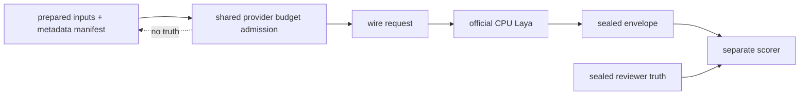
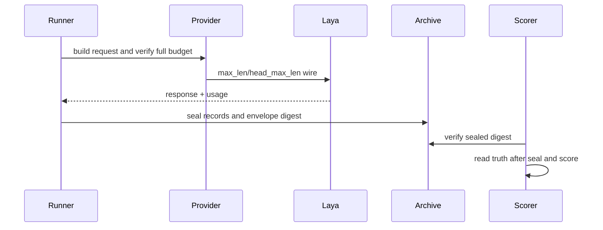
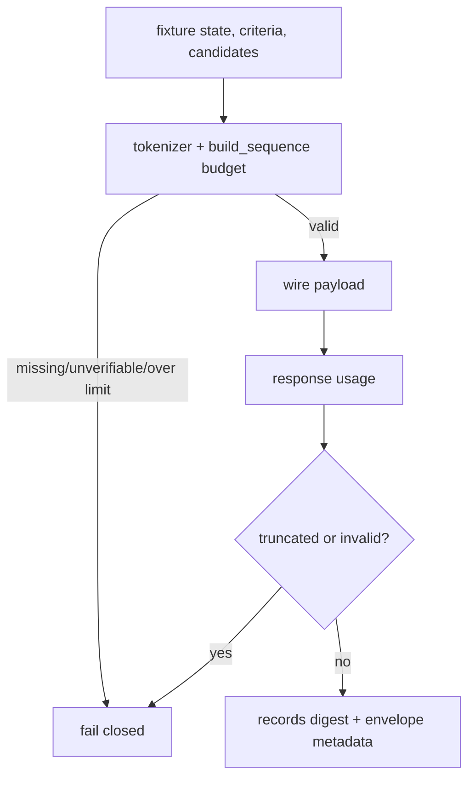

# RW-32：A-Cognition calibration 输入与隔离修复（2026-10-14）

状态：`工程修复通过；修复后诊断已封存22/22；独立truth批准缺失，正式评分保持阻断；Policy A 未判定`。

本批固定 source/checkpoint/artifact、multilingual、CPU、原 fixture/state/U/P/candidate order、22 条正式分母和阈值 digest `sha256:a4bb6f41bc165ed1a645550ee54a7e1830ff5f5dbd8843bb73ecfbf6b6517ba1`。共享 `LayaSystemOneProvider` 现在在 transport 前用固定 tokenizer 验证完整 head + state + closing SEP，冻结 `max_len=2091`、`head_max_len=256`，超过支持范围、预算缺失或不可验证均 fail-closed。准备包 v3 的 24 条输入无截断，最大完整需求 2081。

运行器 `scripts/verification/run_calibration_diagnostic.py` 只读取 prepared inputs 与 metadata-only transport manifest，不读取 truth、acceptable set 或 rationale；它保存实际 request/response body、usage、digest、budget 映射，并在首个异常或截断停止。封存 envelope 使用 `calibration_run_envelope.v1`，保留历史 records-array digest，同时加入 provider/tokenizer/device、请求前后状态和运行状态元数据。`score_calibration_diagnostic.py` 仅在 envelope digest 验证后读取旧 truth，按 frozen invalid handling 排除 truncated/invalid，正式分母仍为 8/6/8，最低有效样本不足则阻断；旧评分原件未覆盖。

本轮同轮重跑使用 Hub repo ID 的官方离线缓存 CPU provider，固定 revision `1720e3e3357cfe1e281542e223f8273b0890ca34`，合成预检通过；22/22 正式题已封存，最大完整需求 2081，全部 `truncated=false` 且 `state_tokens_dropped=0`。原失败运行保留未覆盖；8765/PID 59520 wslrelay 保留未动。该结果属于已暴露 calibration 的修复后诊断重跑，不是 blind、final 或 holdout；final/holdout 未读取。v3 truth approval 尚未由未参与修复且未接触结果的独立审查者重新确认，因此 scorer 不得生成质量结论，Policy A 保持未判定。A-Embodied、Godot、B/C、玩法包、编辑器、自走棋及 AD/Blender 继续关闭。

封存合同补充：旧 `records` 数组 canonical digest 算法未变；新 envelope 要求输入、provider、tokenizer、device、预算参数、前后 health/preflight attestation 和 execution identity，并以显式排除 `envelope_digest` 的版本化 digest 封存。修复后的 runner read log 记录按序读取的 inputs/metadata-only manifest 路径，truth/labels 保持未读；旧 v2 archive/read-log 原件不回写。

证据根：`D:/Users/User/Documents/paralls-evidence/october-calibration-repair-20261014/`。

最终验证：focused `10 passed`；`character-policy-calibration` Harness passed/cleanup passed；完整 `python -m pytest -v` 为 `7947 passed, 2 skipped`、exit 0；`git diff --check` exit 0。`harness --profile all` 已真实执行但 exit 1，前序 docs/boundaries/drift/backend-contract/godot-project 通过，cleanup passed；这不是 all 通过，也不能由前序 profile 替代。独立 gate 对当前 v3 truth 批准给出 FAIL/HOLD；正式 scorer 未运行，微调触发条件不可评价。

## 同轮后续：预算复核、独立批准与封存诊断

先前 `2081` 是共享 provider 将 instruction 与选项拼成一段文本后的估算，原预检和封存 usage `2091` 均保留。固定官方 `build_head` 实际将 `choice question: ` 加 instruction 独立编码，逐 option 编码并插入 CLS/SEP/MASK；`build_sequence` 再接 state 与末尾 SEP。逐题重新计数有 17 条比旧估算多 10 token、5 条多 9 token；22/22 与封存 `usage.input_tokens` 一致，最大 2091，head 最大 195。两条 shared_reminder 正好贴住 `max_len=2091`，无输入截断。新计数仅是仓库外派生审计，旧 manifest 的 2081 与原 archive 不追溯改写。共享 provider 在 caller 显式给 `max_len` 或 `input_budget_required=true` 时启用预算门；普通运行时未设置两者时没有此保护，不能称全量运行时已受保护。

独立 reviewer `/root/truth_reviewer_retry` 未参与修复、未接触模型结果；读取日志只含旧/新净化来源、准备输入、旧批准/truth、冻结 threshold、固定 tokenizer 与官方源码。其新签署绑定实际输入 digest、22 个 request/candidate mapping digest、来源与 truth digest、ID/轨道/固定 8/6/8 分母及 threshold digest。逐题语义未变；transport 增加 `2091/256` 并经独立逐项编码复核。旧批准的字节范围不能自动延续，新签署仅批准已暴露 calibration 的诊断输入适用性，不批准模型性能、runtime authority 或 final/holdout。Lead 已核对读取范围及逐题计数，没有代签或更改 acceptable sets。

评分器先验证 records/envelope、逐题 request/response digest 与候选映射，再核验独立批准和 truth/source/threshold 版本绑定；缺失、拒绝或不匹配时不产生 Policy A 质量结论。对原 `diagnostic-run-v2/run-envelope.json` 的派生评分为 autonomous `0/8`（有效 8）、explicit diagnostic `0/6`（有效 6）、role-sensitive `1/8`（有效 8），三轨分别未达 `6/5/6`，Policy A 诊断未通过。逐题结果在仓库外 `diagnostic-score-approved-v3.json`，无效项按冻结规则不计命中与有效样本，正式分母不变。正确输入和独立 truth 门已满足讨论微调的部分前提；仍须按逐题来源、候选语义、评分映射与模型选择证据分析，不把全部 mismatch 自动归为模型能力问题，不训练。

逐题证据显示 22 条有效样本中模型选择 `C3` 18 次，获准可接受标签为 `C2` 14 题、`C1` 8 题；唯一命中为 shared_reminder participant_03。优先核查候选位置、描述呈现与模型选择偏向，并保留来源/映射/阈值不变；该模式本身不能单独证明训练是正确修复。

本次评分是已暴露 calibration 的修复后诊断，不是 blind/final/holdout 验收。v2 原 envelope 没有可绑定的 execution identity/read log；现有新 runner 合同不能追溯成为旧运行原证据。原 archive 字节未变，派生批准与评分在仓库外。final/holdout、训练、A-Embodied、Godot、B/C 及其他关闭范围继续关闭。

原 v2 `run-envelope.json` 本轮只读文件 SHA-256 为 `9da73a0207bfdd3b9e73bfa9ba55a82c41eca1f25cb454d7851886b9d5807e58`；独立批准文件 SHA-256 为 `ebcece4e051f7dae031b0e8a8c2bbb05fd7ec13724bf0d05ed37d3f1d2ea9757`。两者身份不同于 envelope 内部 canonical digest，不能互换。

Harness all 的上一轮原始逐步报告未保留，故不能从旧 `exit 1` 单独断定原故障。此次最终工作树重新执行并导出报告：docs、boundaries、drift、backend-contract、godot-project 均通过；第六步 `character-agent-execution` 在执行前被环境门阻断，`attempt=0`、`failure_kind=environment`，具体消息为 `Godot executable not found. Set GODOT_EXE or pass --godot-exe.`；整体 exit 1、cleanup passed。后续步骤因首个阻断未执行，不称全部检查通过。未为求全绿变更profile范围或放宽检查；当前阻断不能证明前次失败必是同一原因。最终导出报告在仓库外 `harness-all-final/harness-run-report.json`。

最终验证：预算/准入 focused 15 passed；旧四角色准备与评估合同加本轮 focused 共 39 passed。完整 `python -m pytest -v` 在最终代码上为 `7952 passed, 2 skipped`、exit 0。第一次全量运行的 16 个失败均从旧四角色活动源码 pin 的 provider SHA 不匹配开始；仅将两份 policy、lock-event manifest 和静态审计常量中的活动 pin 更新为当前 `laya_provider.py` SHA `34e11611c20f4794d16044ca7ec9ae9e5b5f950338e876c2dd126be33897bde7`，历史 pin 记录未改。`character-policy-calibration` Harness passed/cleanup passed；all 的环境阻断如上。上述测试不代表 Godot/runtime 集成验收。
