> 当前整体目标已按用户 2026-10-20 授权扩展为阶段一至三；统一状态与执行依赖见[统一验收矩阵](october-stages-1-3-acceptance-20261020.md)。本文件保留阶段三事实与历史证据，不再单独代表整个 Goal 的范围。

## 2026-10-20 Admin production ASGI and execution-time admission correction（stage3 incomplete）

上一轮管理员证据仅覆盖 `component_app`。本轮真实 `main.app` + spawn-child 回归依次复现配置列表无法序列化、parent 路由 404、提前导入 child 后 verifier 沿用空配置，以及 queued credential 过期后仍提交。现由既有 trusted bootstrap 显式传递隐藏的凭据列表，child 应用设置后重建 verifier；parent 只转发登记路由并保留实际 peer/HTTP scheme，child 在 owner 执行前以当前操作时间重新认证且要求身份不变。

独立审查发现配置校验错误会暴露 secret，不能只依赖 repr/exclude。环境加载与嵌套 bootstrap 的缺身份/短 secret 四项 fresh-process 回归先 RED；凭据及外层 Settings 隐藏错误输入后凭据测试 15 passed。最终定向验收证据导出至 `D:/Users/User/Documents/paralls-evidence/stage3-admin-reviewed-20261020-01/`；该目录仅以真实报告结果为准，不外推全领域或真实 TLS 部署验收。

| 需求与来源 | 当前实现 | 验收证据与限制 |
|---|---|---|
| 部署配置→身份来源 | `WORLD_ADMIN_CREDENTIALS_JSON`→严格设置→verifier | fresh-process 配置加载测试；测试账号不代表已部署生产身份 |
| 真实 backend 入口 | `main.app` parent→既有 IPC→spawn child→RuntimeExecution→原 cadence owner | loopback/HTTPS scope 成功、远端 HTTP 即使伪造 `X-Forwarded-Proto` 也拒绝；不证明实际 TLS 握手 |
| 执行时权限 | 入队前认证，执行前对当前 verifier/time/identity 重验 | 真实队列阻塞后过期、账号关闭或身份替换三项先 RED，修复后零写 403 |
| receipt 与恢复 | 同一 Durable owner stream；新 child 重开原路径 | exact retry 返回原 event IDs；child 正常退出且 execution credit 归零 |
| Inventory 消费 | 同一 cadence revocation stream 的既有 Inventory admission | 应用 admission 前后变化与既有 Inventory 实际结算零写回归；不扩大为其他 consumer 已验收 |

设计中的架构、时序、数据流三图已更新为实际 parent/child 边界，见 [管理员撤权设计](../../superpowers/specs/2026-10-20-world-admin-cadence-revocation-design.md)。生产部署凭据、其他 consumer、通用资源/设施 grant issuer 与全 owner global cut 仍待验收。阶段三继续 incomplete，下一执行范围按用户 2026-10-20 的新授权扩展为十月主线阶段一至三，Godot 集中放在后端收口后。

## 2026-10-20 Ten-domain shared Durable cut（stage3 incomplete）

Task6 原八领域共同 cut 现加入同一应用 Durable store 的 Social fact 与 Social delivery：公开 Population Social owner 事实先提交，既有 Social delivery owner 以该持久事实直接记录投递；cut 后提交 expiry，同时保留资源、库存、装备、Economy random/temporal、Ecology temporal、Presence 与 LifeState 的原 tail。关闭重开相同 Durable 路径后整体 full/checkpoint+tail 相等，十个具名 participant 的现有投影摘要逐项篡改并重算外层 hash 均拒绝且 store 零写。`test_economy_random_replay_participant.py` **19 passed**；最终 Harness 证据导出到 `D:/Users/User/Documents/paralls-evidence/stage3-ten-domain-cut-20261020-01/{task6,admitted,docs}/`。投递为 owner-direct 技术组合，不是 Government 生产需求来源；世界管理员 issuer、其他已准入 owner 的统一 cut 与权限/迁移/隐私 parity 仍未验收，阶段三保持 incomplete。

## 2026-10-20 Social fact event provenance in replay（stage3 incomplete）

`social@1` 的捕获与历史校验原先只按四个事件类型选择，错误 stream、可见性、schema、未知版本、owner 事务或持久事件差异可进入 manifest。真实 Social owner 的 relationship 事实提交后，八类损坏输入先全部 RED；现在两条路径共用严格只读事件选择，逐项核对 Social owner 事务、持久事件、schema、stream、payload 形状和可见性。聚焦 Social/replay 集合 **51 passed**；Task6 allowlist 已加入 Social owner 回归并单列 provenance。最终 profile 报告导出到 `D:/Users/User/Documents/paralls-evidence/stage3-social-fact-provenance-20261020-01/{task6-final,admitted-final,docs-final}/`。此修正只强化 bounded 回放，不证明所有 Social 家族、正式外部 issuer 或全 owner global cut；阶段三仍 incomplete。

## 2026-10-20 Social delivery event provenance in replay（stage3 incomplete）

审计发现 `social_delivery@1` 原先只按事件类型与 recipient payload 组装投影，读结果中的错误 stream、可见性、schema、owner 事务或持久事件差异均可能进入 manifest。六类真实 owner 写入后的损坏输入先 RED；现构造与历史校验共用严格只读事件选择，命名空间未知类型也 fail closed，并对原 owner 事务和持久事件逐一核验。Social/replay 五文件 focused **98 passed**。Task6 原 allowlist 未包含这组 Social owner 负例，现已加入并在矩阵中单列 provenance；当前代码切片的预检 Task6 **313 passed**、admitted matrix **391 passed / 42 participant**，均 cleanup passed。冻结源码后的最终报告导出到 `D:/Users/User/Documents/paralls-evidence/stage3-social-delivery-provenance-20261020-01/{task6-frozen,admitted-frozen,docs-frozen}/`。这只强化已准入 owner 的 bounded replay，不制造 Government 多 recipient 生产需求或全 owner global cut；阶段三仍 incomplete。

## 2026-10-20 Social delivery multi-recipient bounded replay（stage3 incomplete）

`social_delivery@1` 现从已提交 Government notice receiver 和 Social delivery owner 事件构造排序后的多 recipient scope，分别调用原 `view_for` 并核验各投影、完整事件引用和总摘要；旧单 recipient/unbound checkpoint 仍可读。应用回归在同一 Durable store 中验证单 recipient cut 接第二 recipient tail，以及 unbound cut 后连续两条投递；关闭重开后 full/checkpoint+tail 一致，逐 recipient 子投影各只含自己的事件。更改 recipient 列表、子投影、事件引用或总摘要并重算外层 tail hash 均零写拒绝。五文件 focused **92 passed**；fresh `infra-task6-fault-matrix` run=`f280ece7fd4b417db19d0f362fc3b5f5` **288 passed**，`infra-admitted-participant-matrix` run=`61878dc2d09a432b9ea6395098bb4a0b` **391 passed**、42 个具名 participant，`docs` run=`f02d92920fd44043bfd7075ac7fda578` passed，均 `overall_harness_passed=true`、`cleanup_status=passed`；证据根为 `D:/Users/User/Documents/paralls-evidence/stage3-social-multi-cut-20261020-01/`。第二 recipient 由测试调用既有 Social owner，未证明正式 Government 多 recipient 生产需求；42 个具名准入测试也不构成同一原子 cut。Task6 全 owner global cut、权限/迁移/隐私 parity 和阶段三总门禁仍 incomplete。

## 2026-10-19 First Social fact after an empty replay cut（stage3 incomplete）

真实 Population Social owner 在空 checkpoint 后首写，原 replay 因新增 `social` participant 报 `replay_participant_scope_conflict`。新 capture 对应用已固定的 `character:siming` 读取 scope 保存空 Social 投影；同一 Durable 路径关闭重开后，首写 tail 的 full/checkpoint+tail 一致且零写。历史无 Social 事实的缺席 manifest 保持可读；边界已有事实却缺 participant 时拒绝。Social delivery 现复用 Government notice→Contract/acquisition 的真实 receiver 绑定，在 notice 已存在但未投递时保存具名空投影；notice 与首次投递都在 cut 后时，checkpoint 只保存无 recipient/无数据的 unbound decoder，tail 由真实 owner 事实进入具名 scope。两种顺序均在同一 Durable 路径关闭重开后通过 full/checkpoint+tail 与 store 零写；已有投递事实时 unbound 明确拒绝。五文件 focused **90 passed**；最终 fresh `infra-task6-fault-matrix` run=`b3596ea5286c4ff3b3334208ab25e44a` **286 passed**、`docs` run=`6e0a869452ca4cb2888209dca427842a` passed，均 `overall_harness_passed=true`、`cleanup_status=passed`；证据根为 `D:/Users/User/Documents/paralls-evidence/stage3-first-social-delivery-cut-20261020-01/`。多 recipient 共同 cut、正式 issuer 与全 owner global cut 仍未验收，阶段三保持 incomplete。

## 2026-10-19 First Economy temporal, Ecology temporal and Economy random facts after a cut（stage3 incomplete）

真实 owner 的三条应用路径在空 checkpoint 后首写，原 replay 均因 participant 集合变化报 `replay_participant_scope_conflict`。新 capture 固定空 `economy_temporal@1`、`ecology_temporal@1`、`economy_random@1`；同一 Durable 路径关闭重开后，三个首写 tail 均通过 full/checkpoint+tail 对照且 store 零写。旧无事件且缺 participant 的 manifest 仍可读；空随机上下文保持 `not_applicable`，首个私有随机结果后为 `bounded_owner_result`、`t07=not_verified`，manifest 不含 seed。四文件 focused **57 passed**；fresh `infra-task6-fault-matrix` run=`2b2edd3475b54534b201879fff71803e` **283 passed**，`docs` run=`d7c49217bdbd402c9ba542e2d3d6ed18` passed，均 `overall_harness_passed=true`、`cleanup_status=passed`，证据在 `D:/Users/User/Documents/paralls-evidence/stage3-first-economy-ecology-random-cut-20261019-01/`。正式 T07 producer、world-admin issuer、全 owner global cut 与阶段三总门禁仍 incomplete。

## 2026-10-19 First Inventory and Equipment facts after a cut（stage3 incomplete）

审计原有“首次 Equipment participant 或 Inventory actor 出现后必须重新 capture”的测试合同，发现它使已准入 owner 的真实首写无法从先前 cut 恢复。新 capture 固定空 `inventory_domain@1`、`equipment@1`，既有 Inventory/Equipment owner 提交首写后由原 projector 对新 actor 从 tail 原事实重建，已有 actor 继续非空 checkpoint 接续；两个应用测试均在同一 Durable 路径关闭重开后验证 full/checkpoint+tail 与 store 零写。历史缺 participant 的无事件 checkpoint 不自动增加参与者，测试自有 sword definition 重新登记不代表生产定义发布。七文件 focused **93 passed**；fresh `infra-task6-fault-matrix` run=`5e2d8cbb64264fa989183191416f5098` **279 passed**，`docs` run=`ba13adbef87644d1b3e8b93f0c887b78` passed，均 `overall_harness_passed=true`、`cleanup_status=passed`。仓库外证据：`D:/Users/User/Documents/paralls-evidence/stage3-first-inventory-equipment-cut-20261019-01/`。正式 Equipment 生产需求、world-admin issuer、所有 owner global cut 和阶段三总门禁仍 incomplete。

## 2026-10-19 First activation across an empty replay cut（stage3 incomplete）

回放审计发现新角色首次 activation 同时新增 Resource、Presence、LifeState；旧 capture 只在有事件时列出这些 participant，导致空 checkpoint 后的真实 handoff tail 在 Durable 重开时因集合变化拒绝。现新 capture 固定三项空状态，Resource 新 actor 从 tail 原事实重建，Presence/LifeState 从空状态续接；`test_world_replay_checkpoint_application.py` 用真实 application handoff、同一 Durable 路径关闭重开验证首次物化/spawn/alive 的 full/checkpoint+tail，旧 Inventory 无 Presence authority 的空状态验证保持可读。六文件 focused **73 passed**；fresh `infra-task6-fault-matrix` run=`583df2ab4fc640f883e696296117bfae` **279 passed**，`infra-admitted-participant-matrix` run=`f64e56466f984beaa571ec82f7771ebe` **391 passed**、列出 **42** 个具名 participant，`docs` run=`5b75d3c8dedd44b588704e7b1eb11298` passed；三者 `overall_harness_passed=true`、`cleanup_status=passed`。仓库外证据：`D:/Users/User/Documents/paralls-evidence/stage3-first-activation-empty-cut-20261019-01/`。测试 grant 仍为 fixture，不代表正式 issuer；旧无参与者 capture 不自动准入新增领域，Task6 全 owner global cut 保持 incomplete。

## 2026-10-19 Task6 LifeState bounded participant and eight-domain cut（stage3 incomplete）

`life_state@1` 现对已提交 LifeState 事实形成只读 bounded participant：保存 actor state/incarnation/revisions 与完整事件身份/摘要，验证 LifeState、activation、Presence、case-death confirmation 及 terminal fact 的 owner 来源和状态转移；旧 schema 1 unknown→dead 可读。八领域共同 cut 在非空 alive checkpoint 后通过真实 `CaseDeathLifeStateCaller` 写入 dead tail，同时 Presence 显式 despawn；同一 Durable 关闭重开后 full/checkpoint+tail 对照，八个 participant 的 view digest 篡改逐一零写拒绝。缺 terminal、伪造 confirmation owner、伪造 activation/Presence owner 均经回归拒绝且 store 零写。七文件 focused **79 passed**；最终 fresh `infra-task6-fault-matrix` run=`50cd2f97f99a4af68d4dbf0f5fb1a168` **278 passed**，`docs` run=`c20c9b3b4ccb47b1a4e3787f9d8eb7ba` passed，均 `overall_harness_passed=true`、`cleanup_status=passed`。仓库外证据：`D:/Users/User/Documents/paralls-evidence/stage3-shared-eight-domain-cut-20261019-02/`；较早同目录 `-01` 的 green profile 已被后续源码改动取代，不作为最终证据。测试 grant 与 terminal source 仍为 fixture，不是正式外部 issuer 或生产 combat producer；Task5 完整生命周期和 Task6 全 owner global cut 仍 incomplete。

## 2026-10-19 Economy random private scoped replay（stage3 incomplete）

Task6 七领域同界增量：前述六领域 cut 现在加入真实 `ProfileActivationAuthority`→`PopulationActivationPresenceService.commit_and_spawn()`→Presence/LifeState owner 事件，tail 由 `PopulationPresenceAuthority.despawn()` 显式离场；同一 Durable 关闭重开后，Presence 旧 incarnation 不再 present，整体 full/checkpoint+tail 相等，七个 participant 的 view digest 篡改逐一零写拒绝。测试中的 activation grant 为 fixture，仅证明 owner/admission 及同界 replay 技术路径，不能冒充正式外部 issuer 或完整 Task5 生命周期。focused 四文件 **38 passed**；fresh `infra-task6-fault-matrix` run=`a1ec9edb7fa2492bb8b553905d2e3354` **274 passed**，`infra-admitted-participant-matrix` run=`60cd0ca2afb84dcaade374552c692e8c` **391 passed**、矩阵列出 **42** 个具名 participant；两者 `overall_harness_passed=true`、`cleanup_status=passed`。`docs` run=`b2caa3a3c7da40eb98160571efd70650` passed、cleanup passed。证据在仓库外 `D:/Users/User/Documents/paralls-evidence/stage3-shared-seven-domain-cut-20261019-01/`。准入矩阵分别覆盖具名路径，不构成 42 个 participant 的原子共同 cut；阶段三仍 incomplete。

Task6 同界测试现扩至六领域：在原 Resource/Inventory/Equipment/Economy random cut 上，加入真实 Economy scheduled-transfer 与 Ecology drought obligation；Population cadence 在 cut 后调用现有 consumer，两个领域均产生 committed terminal 结果。关闭重开后 full/checkpoint+tail 整体对照，六个 participant 各自的 view digest 篡改均拒绝且零写。旧 Economy temporal 离线测试原未传 reopened Inventory authority，已按当前 participant 合同补齐测试装配；五文件 focused **69 passed**。fresh `infra-task6-fault-matrix` run=`8378b4431e0d4bbe852441259b2706a2` **274 passed**，`infra-task6-economy-ecology-joint` run=`8e8dbd3435ba43b392ed91767c40ed74` passed，均 `overall_harness_passed=true`、`cleanup_status=passed`；证据在仓库外 `D:/Users/User/Documents/paralls-evidence/stage3-shared-six-domain-cut-20261019-01/`。joint profile 本身只覆盖 temporal 两域，六领域组合测试位于 Task6 allowlist。这仍是具名六领域的同界证据，不是所有已准入 owner 的 global cut。

Task6 同界增量：同一应用 Durable checkpoint 同时含非空 Resource reservation、Inventory custody、Equipment activation 和 Economy private random result；tail 提交 Resource consume、Equipment unequip、第二次 random result，关闭重开后整体 full/checkpoint+tail digest 一致。对四个 participant 分别篡改 view digest 并重算外层 tail digest，均拒绝且共享 store 零写。fresh `infra-task6-fault-matrix` run=`56def5f05e124e90b8796ab710aaface` **274 passed**，`overall_harness_passed=true`、`cleanup_status=passed`；证据在仓库外 `D:/Users/User/Documents/paralls-evidence/stage3-shared-four-domain-cut-20261019-01/task6/`。这是四领域与既有 Population/settlement 基础的共同 cut，仍不是所有已准入 owner 的 global cut；Equipment 测试物品定义在重开后由夹具显式登记，不证明生产历史 item definition 发布来源。

本轮审计在前一切片发现两条漏验路径：未知 `gameplay.economy.random_` 类型可被 participant 筛选器忽略；已有随机结果的 checkpoint 仍写 `random_context.status=not_applicable`。三项 RED 后，participant 先扫描命名空间并仅准入两类精确事件，未知类型/版本 fail closed；manifest 按 bounded result 或 anchor pending 表达实际状态，同时保留 `t07=not_verified`。focused replay **39 passed**；fresh `infra-task6-fault-matrix` run=`2c90f1a4bc124b9db0d3be822d7ffd4a` **273 passed**，`overall_harness_passed=true`、`cleanup_status=passed`，证据在仓库外 `D:/Users/User/Documents/paralls-evidence/stage3-economy-random-replay-scope-20261019-01/task6/`。

Task6 在既有 shared Durable cut 中新增 `economy_random@1`：从真实 Economy owner 的 authority-only anchor/result 事件调用 `EconomyProjector` 重建，核验原事务与持久化事件，manifest 只保存事件身份、operation 结果摘要和 aggregate digest，不复制 seed、候选项或结果 payload。anchor 与 result 之间的合法 cut 可读；缺 participant/version、事件身份或投影摘要损坏均拒绝。应用入口测试使用真实 owner 两次提交、checkpoint→tail、关闭重开和零写对照，未把 fixture 的 lottery demand 当作生产 producer。

random/replay focused **49 passed**；fresh `infra-task6-fault-matrix` run=`dba50d1351984109a8d9d5e942267ad3` **271 passed**，`infra-economy-random-owner` run=`ded1042e8c1e4c5493b744f8e2ff34ee` **61 passed**，均 `overall_harness_passed=true`、`cleanup_status=passed`。证据在仓库外 `D:/Users/User/Documents/paralls-evidence/stage3-economy-random-replay-20261019-01/`。T07 authenticated lottery/loot/event-choice 生产需求、公开结果投递、全 Economy owner cut 和 Task6 global atomic cut 仍未验收；阶段三 **incomplete**，Goal active。未运行全量 pytest/all、Godot、provider/model evaluation、calibration/final/holdout 或训练。

## 2026-10-19 D06 historical definition pins for scoped replay（stage3 incomplete）

补充回归：真实 owner 连续提交 v1→v2→v3 后，Resource scoped full 与早期非空 checkpoint+tail 一致；另两个真实 actor owner 事务对同一 resource/version 固定不同 v2 definition，目标 cut 明确 `resource_migration_definition_conflict`，早期 cut 可读、store 零写。Resource focused **59 passed**；fresh `infra-task6-fault-matrix` run=`eb9f9519124b49dc85cac2eb2c6807b9` **259 passed**，`infra-resource-world-time-recovery` run=`cc95bac455d34addbfc4e5b154707d0e` **168 passed**，`docs` run=`2c3f55fbd40f4be7ae9681a954382618` passed，均 `overall_harness_passed=true`、`cleanup_status=passed`。证据在仓库外 `D:/Users/User/Documents/paralls-evidence/stage3-d06-definition-conflict-20261019-01/`。此项关闭前一记录中的“同版本冲突缺独立回归”，不改变全 owner cut 和阶段三 incomplete 状态。

新 `ResourceMigrationOwner` 迁移事件保存 exact source/target `ResourceDefinition` 快照与 canonical digest；既有 projector 对照注入定义。Task6 Resource participant 仅在同一 bounded cut 内核验 `resource_migration_owner` 原事务、resource 事件与 control completed 的持久化身份及内容后建立历史 registry，供 full 与非空 checkpoint+tail 重建。旧事件缺快照仍明确拒绝，不从 bounds 猜定义。缺失持久化事件、completed 内容变化等 provenance 错误 fail closed、零写。

Resource migration/replay focused **56 passed**；新增 completed 篡改回归单测通过。fresh `infra-resource-world-time-recovery` run=`72f4a90fdd23428797486608c820d0c7` **168 passed**，最终 `infra-task6-fault-matrix` run=`f704dcb9dc224908acb0838120c24441` **257 passed**，`docs` run=`1cee99311f9d4b898bb0aad16ad76f68` passed；均 `overall_harness_passed=true`、`cleanup_status=passed`。证据在仓库外 `D:/Users/User/Documents/paralls-evidence/stage3-d06-definition-pins-20261019-01/`。同 resource/version 冲突仍缺独立多迁移回归；全 owner cut、正式权限 issuer 和其余 Task1–Task5 门禁未因此关闭。未运行全量 pytest/all、Godot、provider/model evaluation、calibration/final/holdout 或训练。Goal 保持 active，阶段三保持 **incomplete**。

## 2026-10-19 Economy random projection fail-closed correction（stage3 incomplete）

本轮审计发现 `EconomyProjector.rebuild()` 对 `random_result_committed@1` 的两个校验分支之外还有静默落账路径：`anchor_ref` 与 `candidate_policy` 同时缺失时仍写入 `random_results`；随机 anchor/result 位于错误 stream 或使用未知 schema 时也被接受。五项真实已提交事件的损坏变体先 RED，现均由领域 projector 拒绝；anchored 与既有 legacy policy 校验路径保持兼容。修复只涉及 `backend/app/gameplay/economy_runtime.py` 与 `backend/tests/test_economy_random_owner.py`，不改变 owner 写入、随机政策、seed 或历史事件。

Economy owner/command focused **21 passed**；fresh `infra-economy-random-owner` run=`35a70e7dc28b480aa5e05fe82c213a36` **61 passed**，`infra-task6-fault-matrix` run=`08549744ce634ef78c3980f010a9c15a` **250 passed**，两者 `overall_harness_passed=true`、`cleanup_status=passed`。证据导出到 `D:/Users/User/Documents/paralls-evidence/stage3-economy-random-projection-20261019-01/`。此修复强化 Economy 领域投影；原 scoped event replay 使用独立通用 decoder，随机结果尚无独立 Economy participant，不能借本证据声称全 owner cut 已验证。

生产入口审计：`main.py` 已接 `economy_random_command`、`equipment_command` 与 `equipment_prediction` typed WebSocket handler，random command 有受 controller binding 约束的显式 self-draw trigger/owner 结果，并有测试中的 loopback WebSocket 往返。但当前非测试客户端/游戏工作流没有发送这些 message type 的代码；trusted-local controller credential 也不是 world-admin issuer。故 T07 的 bounded self-draw 服务端入口与 T09 的 bounded 装备入口不能外推到真实 lottery/loot 交付、产品装备操作或正式外部管理员签发；阶段三仍 incomplete。

## 2026-10-19 Task6 Inventory domain participant 增量（stage3 incomplete）

本轮在原 scoped replay cut 中增加独立 `inventory_domain@1`，与既有 production-output custody 专项 participant 并存。完整保存现有 `InventoryProjection` 的 items、containers、locations、reservations、capacity reservations、source revisions 和 projection revision，并绑定全部 Inventory owner 事件身份及摘要。错误 stream/actor/schema/type、缺 participant/version、状态或事件摘要篡改均拒绝。跨流 harvest/certification 引用由同一 bounded store 提供；保存状态经历史 full 重建校验后解码为 typed checkpoint，再接 tail 与目标 full projection 对照，回放零写。原 `InventoryProjector` 的 production-output provenance digest 少计 `source_certification_provenance`，已与 owner 写入和 custody view 合同对齐。

RED 为完整 participant/version 缺失；GREEN 使用真实 Inventory owner 写入非空物品、数量预留和容量预留，consume 后同一 Durable 路径关闭/重开并恢复非空 checkpoint；另用原 Production certification→Inventory custody 应用测试核验真实跨流来源。actor 新增要求重新 capture，非法事件范围及 state/ref/digest/version/participant 损坏拒绝。Inventory/Equipment/Resource/replay 聚焦回归 **89 passed**；Task6 frozen-source profile run=`90478230e4a1437a9c2666f980b90a6c` **245 passed**、`overall_harness_passed=true`、`cleanup_status=passed`。docs run=`510f8cb2e5d44d0d9243f2d93331dba6`、`overall_docs_passed=true`、`cleanup_status=passed`。证据：`D:/Users/User/Documents/paralls-evidence/stage3-inventory-replay-20261019-01/`。docs 通过后仅补录此证据索引。

该 participant 覆盖现有 InventoryProjector 字段；已知 commerce custody/delivery 事件的独立领域效果不在该 projector 内，不得据此称 Commerce owner 完整恢复。历史 item definition 缺失会明确拒绝，Equipment 测试夹具为其自有 `item:sword` 显式登记确切定义；生产历史定义来源仍待全域设计。正式管理员 issuer、T07/T09 生产需求来源、全 owner atomic cut 及其余 Task1–Task5 门禁仍未关闭。未运行全量 pytest/all、Godot、provider/model evaluation、calibration/final/holdout 或训练；阶段三保持 **incomplete**，Goal active。

## 2026-10-19 Task6 Equipment domain participant 增量（stage3 incomplete）

本轮继续既有目标，`equipment_runtime.py` 的 EquipmentProjector 增加 keyword-only typed checkpoint；`replay_participants.py` 与 `replay_checkpoint.py` 增加可选 equipment@1 participant/version。保存完整 activations（包括 ability/modifier/container-access 引用）、active slots、ended IDs、来源 revisions 和 projection revision，以及完整事件 digest；严格 actor/stream/schema/type，缺 participant/version 拒绝。恢复先验证历史 bounded 状态，再将保存的非空领域状态解码接 tail，与目标 bounded full rebuild 对照，回放不重提装备命令、不改写事实。设计与架构/时序/数据流三图、实施责任见规格10与计划04同名增量。

RED 已观察到旧 capture 缺 equipment/version。真实 Equipment owner 与 Resource materialization/reservation owner 在同一应用 Durable store 形成混合 cut；capture 后 unequip，再关闭重开，确认真实 Equipment checkpoint 参数包含激活和 slots，full/cut-tail parity 且零写。定向 replay/Equipment/Resource suite 74 passed，随后 Equipment participant 13 passed（含新增参与者必须重新 capture、多槽/ended history、checkpoint actor/digest 损坏、state/ref/digest/decoder/participant/version 与事件范围损坏拒绝；4 项既有 FastAPI deprecation warnings）。Task6 verifier allowlist 纳入新测试及 Equipment runtime regression。fresh Harness 在下文补录。

此增量只重建 Equipment 自身领域状态；保留引用不等于已重建 Ability、Modifier、Container access 或完整 Inventory owner。Resource migration 历史定义来源、全已准入 owner atomic cut、恢复/迁移/隐私 parity、正式外部 issuer 与真实业务需求 producer 仍未闭合；阶段三继续 incomplete，Goal active。前一 Resource 切片 docs run=`fe9a73eb94064be3abdd24a6b95f60c9` passed/cleanup passed，仓库外证据 `D:/Users/User/Documents/paralls-evidence/stage3-resource-replay-20261019-03/docs/`。

本次冻结源码的 `infra-task6-fault-matrix` run=`588b7c1630ef4d7ab167c6935fd0215d`：234 passed，`overall_harness_passed=true`、`cleanup_status=passed`，运行临时目录已移除。仓库外证据 `D:/Users/User/Documents/paralls-evidence/stage3-equipment-replay-20261019-01/task6/`。本切片没有执行全量 pytest/all、Godot、provider/model evaluation、calibration/final/holdout 或训练；不新增跨表现层运行时集成声明。

对应 docs profile run=`5ccea8a4c92c4b8599cceda0afad9997`，`overall_docs_passed=true`、`cleanup_status=passed`；证据 `D:/Users/User/Documents/paralls-evidence/stage3-equipment-replay-20261019-01/docs/`。docs 运行完成后仅补录本证据索引，未以自引用改动替代代码验证。

## 2026-10-19 Task6 Resource domain participant 增量（stage3 incomplete）

本次继续既有目标授权，补齐 Task6 原 cut 只有 Resource 原始事件、没有领域状态对照的缺口。实现文件为 `backend/app/world_runtime/replay_participants.py`、`replay_checkpoint.py`；新增 `backend/tests/test_resource_replay_participant.py`，并扩展 `scripts/verification/verify_task6_fault_matrix.py` 的明确 allowlist。设计、三图和验收边界见规格10末节，步骤/责任见计划04末节。

已从 RED（Resource manifest/version 缺失）到 GREEN：真实角色模板 materialization owner、reservation owner、Population recovery callback 使用同一 Durable store；cut 保存非空 reservation/lock，再 consume/recovery，关闭重开后从保存领域状态恢复 checkpoint 接 tail，并与 full rebuild 对照。校验完整 entries、reservation、lock、revision、projection digest 与完整事件摘要；缺 participant/version、篡改 state/ref/digest/decoder、错误 stream/actor/schema 及缺迁移定义均 fail closed、零写。限定 replay application/cut/participants 49 passed（4 项既有 FastAPI on_event deprecation warnings）。另发现既有 Population presence admission 的 LifeState v2 已登记却被 replay 白名单拒绝；已补入精确类型/版本，保留未知版本拒绝，相关 Durable 应用回归通过。

本切片不代表完整 Task6：应用尚无统一历史 ResourceDefinitionRegistry，含 bounds migration 的 Resource reconstruction 明确 `resource_definition_registry_required`；Equipment domain projection、全部已准入 owner 的全域 atomic cut、恢复/迁移/隐私 parity 仍未闭合。正式外部身份/grant/revoke issuer、真实 authenticated 业务 producer 和其余 Task3–5 门禁沿用本台账，阶段三继续 incomplete。

Task6 frozen-source fresh Harness run=`75d96cf08b9847408f010962f43fb76e`，`infra-task6-fault-matrix` passed（208 passed），`overall_harness_passed=true`、`cleanup_status=passed`；证据导出到仓库外 `D:/Users/User/Documents/paralls-evidence/stage3-resource-replay-20261019-03/task6/`。先前因源码版本变化失败的运行未作为证据使用。

# 阶段三总收口审查（2026-10-16）

## 2026-10-19 inherited continuation: D06 pause receipt integrity

本轮继续 Task3/Task6，保留既有工作树。D06/modifier 来源复核确认：`ResourceModifierBridgeOwner` 从持久化 Equipment activation/deactivation transaction 校验来源，写入既有 Resource modifier ledger；`test_d06_equipment_recovery_modifier_survives_durable_migration_and_recovery` 已覆盖非空 recovery modifier ledger 的迁移、Durable 重开、duplicate、后续恢复及 full/checkpoint+tail 一致。因此早期“仅空 ledger”的描述是历史快照；当前仍不能扩大为所有 modifier 类型及全资源 D06 已验收。

发现并修复 `ResourceMigrationControlAuthority.pause()` 的丢响应重试缺口：旧实现只比较 payload request digest，会接受 command、stream revision、global sequence 或事件可见性损坏的 receipt。新增回归先观察四项 RED，再补缺失事件的 RED；现在回读 Durable transaction、receipt 与持久事件，校验 principal/key、command、control stream/event type、actor/migration、authority-only、event refs、revision 与 sequence；缺事件统一返回 `resource_migration_receipt_incomplete`。五类故障均零写拒绝，既有正常/changed duplicate 和重开测试保留。

| 验收关联 | 来源→实现 | 本轮证据 | 门禁 |
|---|---|---|---|
| Task3 D06 / Task6 lost-response recovery | 原暂停 owner→共享 Durable receipt/transaction/event 查询；无新 issuer/store/clock | `test_pause_replay_rejects_damaged_durable_receipt_without_write` 五类 RED→GREEN；资源 Harness **168 passed** | 仅暂停 receipt 完整性通过；正式管理员 identity/grant/revoke issuer、完整 D06 和 global participant cut 仍未通过 |
| Task3 modifier→D06→world-time recovery | 已注册 focus charm→Equipment owner→Resource bridge→migration/recovery owner | 同一资源 Harness 中的实际 Equipment source 测试、Durable reopen 和 full/checkpoint+tail | 非空 recovery ledger bounded 已验证；不证明生产 Equipment demand、全部 modifier 类型或跨 owner conversion |

Fresh `infra-resource-world-time-recovery` run=`371a7c61ccd64e56b5f4501093c16232`，`overall_harness_passed=true`、`cleanup_status=passed`；仓库外证据 `D:/Users/User/Documents/paralls-evidence/stage3-d06-pause-20261019-01/`。未运行全量 pytest/all、Godot、模型评估、calibration/final/holdout 或训练。阶段三保持 **`stage3 incomplete`**，Goal 保持 active；下一项仍须接通可核验的管理员身份签发/撤权来源，不能将已有 controller/session binding 当作资源权限。

## 2026-10-19 inherited continuation: resource conversion application revalidation

继承会话 `01a15396-8e0d-7fc0-9b16-a0c20cbdf55d` 的 Task1–Task6 目标与验证限制。本轮保留已有工作树，在原会话尚未验证的 `resource_conversion` typed handler 上完成失败回归与修复：应用层先前将 world/timeline 快照闭包交给 owner，准入后切换 timeline 仍会提交。`main._handle_envelope()` 现在通过 resolver 每次读取当前 Population driver 的 world/timeline，提交前切换时返回 `resource_conversion_scope_conflict`，事件数不变。该变更复用既有 owner、store 和时钟，不改变权限来源。

`backend/tests/test_resource_conversion_application.py` 验证上述 race、默认 capability 缺失零写拒绝、显式测试授权后的真实 handler→owner→Durable 提交，以及关闭/重开相同 Durable 路径后的丢响应重试：返回原 event refs 和 duplicate receipt，资源投影一致且无新增事件。测试中的 capability callable 只用于边界注入，不是正式签发服务或生产来源。应用与 service focused suite 为 **12 passed**。

资源 profile allowlist 纳入这两个 conversion 测试文件；fresh `infra-resource-world-time-recovery` run=`961bd139676f431b906db6b52a772621`，**163 passed**、`overall_harness_passed=true`、`cleanup_status=passed`。仓库外证据：`D:/Users/User/Documents/paralls-evidence/stage3-resource-conversion-20261019-01/`。该 profile 不运行 Godot、模型评估、calibration/final/holdout、训练或全量 pytest/all。

这仅将 conversion 从 owner-only 更正为“typed application ingress + live scope revalidation + Durable retry 已验证”的 bounded slice；正式 Resource capability issuer、生产需求来源、全资源 D06、跨 owner conversion 和 Task6 全参与者 cut 均未由本证据证明。阶段三保持 **`stage3 incomplete`**，Goal 保持 active。下一步先核验现有权限 owner 是否能提供可追溯签发/撤销来源，再推进依赖此来源的生产 caller，不把 session/controller binding 当作资源写权限。

## 2026-10-19 当前接线勘误（本轮）

以下内容覆盖本文件较早的“无入口”快照；历史记录保留不改写。

| 范围 | 当前实现与来源 | 新鲜证据 | 门禁结论 |
|---|---|---|---|
| Economy 随机 | `backend/app/services/economy_random_command_service.py` 与 `main._handle_envelope(economy_random_command)` 接入共享 Population caller、Economy owner 和 Durable store；`assets/gameplay/economy_random/bakery_lottery_v2.yaml` 是本阶段设计并实现的 bakery scope 来源，保存 seed/result/receipt 但响应不泄露 seed。 | `test_economy_random_command_application.py` 与 owner allowlist 覆盖 typed handler、真实认证 binding、source freeze、关闭重开、exact/changed duplicate、未绑定零写。 | T07 仍 incomplete：尚无可核验 authenticated lottery/loot/event-choice 业务 producer；不会由 cadence 自动造需求。 |
| Equipment | `main._assemble_equipment_runtime()` 注册 `mana-focus-charm.v1.yaml` 到既有 Inventory/Equipment/Modifier/Resource mapping registry，`equipment_command` typed handler 调用 `EquipmentCommandService`；读取 Population Presence/LifeState、实际 Inventory custody 和同一 Durable store。 | `test_equipment_command_application.py`、`test_equipment_command_service.py` 及 modifier bridge focused suite；覆盖 scope/incarnation、binding 撤权、receipt、Durable reopen。 | 关闭 T09 的 owner/admission bounded slice；Prediction production ingress、全规格10迁移与管理员 issuer仍未完成。 |
| Street combat transport | pose/attempt 在写入前复用现有 controller binding、actor subject、connection epoch 与撤权状态。 | `test_street_combat_transport.py` + authority：20 passed。 | 仅 controller transport admission；Godot caller、canonical combat producer/faction/Threat/Target 仍未验证。 |

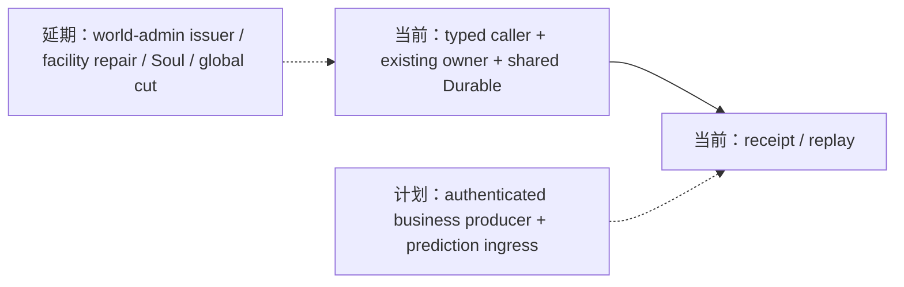

```mermaid
sequenceDiagram
  participant C as typed caller
  participant A as controller/auth and Population source
  participant O as domain owner
  participant S as shared Durable store
  C->>A: resolve actor, scope, temporal pins
  A-->>C: frozen binding/source
  C->>O: submit command
  O->>S: pre-commit revalidate and atomic append
  S-->>C: receipt; retry queries same transaction
```

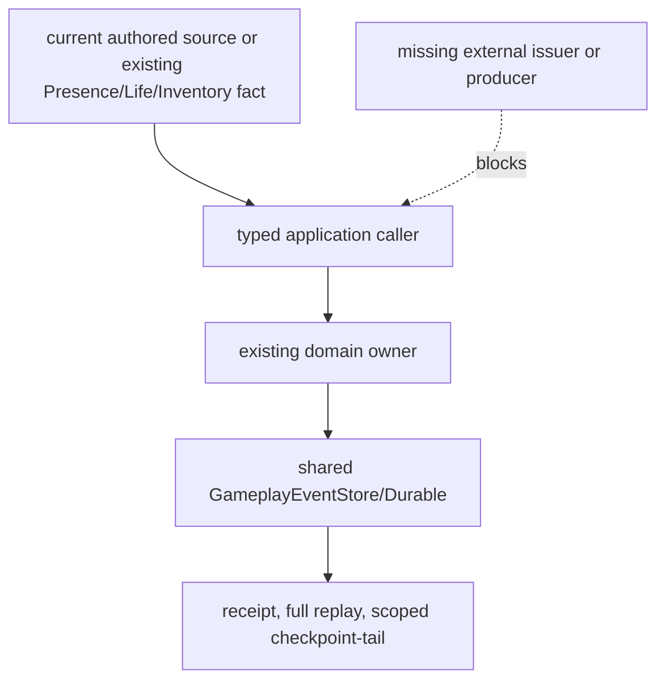

## 2026-10-19 latest bounded verification correction

本轮在资源 lane 停止编辑后重新执行了允许的 Harness profiles：

| Profile | Fresh result | Evidence |
|---|---|---|
| `infra-resource-world-time-recovery` | passed; cleanup passed; run `220035c85a6d4b14bff79572f4bf9baa` | `D:/Users/User/Documents/paralls-evidence/stage3-resource-recovery-20261019-02/` |
| `infra-task6-fault-matrix` | passed; cleanup passed; run `de7a62ee10504d54afffad54cbef49ff` | `D:/Users/User/Documents/paralls-evidence/stage3-task6-fault-20261019-01/` |

资源模板数值已按用户授权固定为本次设计并实现的 authored policy：`char_a` 为 stamina 100/100、每 10 tick 恢复 5；mana 80/80、每 10 tick 恢复 4；action-points 6/6、每 tick 恢复 1；三者均禁止欠值，技能预留使用独立 lock lifecycle。`char_b`/`char_c` 也具有显式模板值，不再使用默认容量或从 Inventory 推导。资源证据仍只证明角色模板→materialization→Population confirmed boundary→ResourceBody recovery→Durable replay 的 bounded slice，不把 authored issuer 冒充外部历史来源。

本轮资源 profile 覆盖关闭后重开 Durable store、恢复 receipt 重放、modifier attach/detach 时间边界、容量与锁/迁移约束及 full/checkpoint+tail parity。Task6 profile 覆盖 bounded caller→owner→shared-store 故障矩阵，包括 exact/changed duplicate、丢响应、部分成功、撤权/过期、版本冲突、迁移失败、Durable 新实例和同一 cut replay；报告明确限制为 bounded slices，不是全域 atomic cut。

阶段三总状态仍为 **`stage3 incomplete`**。未闭合门禁包括 authenticated world-admin identity/grant/revoke issuer、T07 生产随机需求 producer、T09 Equipment production ingress、完整规格10 modifier/debt/conversion/D06 生命周期、facility repair 执行（既有 deferred）、canonical combat/LifeState/Soul/faction/Threat/Target production ingress，以及 Task6 global cross-domain cut。不得用本轮 bounded 证据扩大为 Task1–Task6 全部通过。

## 2026-10-19 current-tree consolidation

本次用户已授权代理自行确定缺失数值和产品政策。核心资源 authored template 数值与恢复政策、Threat 语义均已按本次设计并实现标记；它们不冒充历史外部来源。最新可复核证据索引如下：

| 范围 | 最新证据 | 当前结论 |
|---|---|---|
| RW-50 Inventory | `infra-rw50-inventory-replay` run `c5c96dabe2814d5f9b099f9a44532c9c`，本轮导出 `D:/Users/User/Documents/paralls-evidence/stage3-current-20261019-11/rw50/` | 关闭后重新打开同一 Durable store，创建新 Inventory authority；同一参与范围验证 rows、event refs、boundary、revision vector、view digest、缺失/删除 participant、rows/digest 篡改和未来事件拒绝；通过。 |
| Resource recovery / D06 bounded | `infra-resource-world-time-recovery` run `2a4f2b4e56a144498e8efeb82ac934bf`，本轮导出 `D:/Users/User/Documents/paralls-evidence/stage3-current-20261019-11/resource/` | 世界时间恢复、modifier 区间、容量边界、锁/迁移和 Durable replay bounded 通过；完整 modifier admission、全资源 D06 与 Task3 总门禁未通过。 |
| Task6 bounded matrix | `infra-task6-fault-matrix` run `6f59ec41c4e849f3b0b6cebdf6d2e160`，本轮导出 `D:/Users/User/Documents/paralls-evidence/stage3-current-20261019-11/task6/` | 八类真实 caller/owner/store 故障组合及同一 Durable cut bounded 通过；global all-owner cut 仍未验证。 |
| 已准入参与者矩阵 | `infra-admitted-participant-matrix` run `b67361c4a1cc4e9bb2e63888bda87ca9`，本轮导出 `D:/Users/User/Documents/paralls-evidence/stage3-current-20261019-11/admitted/` | 当前 allowlist 对已登记参与者的 bounded receipt/recovery 通过；不覆盖缺席参与者或全球统一 cut。 |
| Character temporal consumer | `infra-character-temporal-consumer` run `f0a8d151b3bb4ed5816c68c9d28b45ec`，本轮导出 `D:/Users/User/Documents/paralls-evidence/stage3-current-20261019-11/character/` | Character cadence consumer fresh 通过；不能替代其他领域 consumer 与管理员撤权 issuer 验收。 |
| Economy random owner/caller | `infra-economy-random-owner` run `a29bf257ba65400d9e61783f283d029e`，本轮导出 `D:/Users/User/Documents/paralls-evidence/stage3-current-20261019-11/random/` | 已确认 cadence、source freeze/reload、撤权竞态、seed/result/receipt、exact duplicate 与 Durable replay bounded 通过；profile 自述仍由 fixture 发起 demand，没有 production lottery/loot/event-choice producer，故 T07 incomplete。 |
| Ecology consumer contract | direct allowlist `backend/tests/test_infra_ecology_consumer_admission_contract.py`, `test_infra_ecology_weather_front_construction_edge.py`, `test_infra_ecology_weather_front_organization_supply_edge.py`：**25 passed**；Harness run `3af43e90ad4e4af8adabe1d9e9b8f7cc` 在执行期间检测到 source inputs changed，作为 Harness **无效** | bounded tests 覆盖有限 weather-front 到 Construction/Organization consumer；source-stability gate 未通过，因此不记为 Harness fresh evidence，待稳定后复跑。 |
| Documentation contract | `docs` run `442c004d8599465ba3d7a697be8234cb`，清理通过 | docs profile fresh 通过；它只验证文档合同，不代表 runtime 验收。 |
| Facility repair | `backend/tests/test_facility_repair_admission.py` + `backend/tests/test_infra_construction_facility_repair.py`，16 passed；docs run `285323244861484580eed16ba97c1fdf` | 政策已决定；真实 facility incarnation、owner grant/revoke、membership/role、tool/material custody、completion-record 与材料换算来源不存在。入口保持 `facility_repair_sources_unavailable` zero-write，deferred/not_verified。 |

RW-50 的 fresh application test 明确断言 `main.gameplay_event_store` 为 `DurableGameplayEventStore`，停止后以相同 snapshot path 新建 store 和 `InventoryAuthorityService`，再执行 `replay_scoped_tail`；其参与者检查覆盖 rows、event refs、boundary、revision vector、view digest、缺 participant、篡改和未来事件。该证据只关闭 RW-50 bounded 门禁，不把 Inventory custody 扩入 ResourceEntry。阶段三总状态仍为 **`stage3 incomplete`**。
 
## 2026-10-19 character template resource source implemented

按用户确认的核心资源政策，本次设计并实现将 `assets/characters/profiles/char_a.yaml`、`char_b.yaml`、`char_c.yaml` 的 `resource_template` 作为角色模板内容入口，字段明确覆盖整数 stamina/mana/action-points 的 maximum、initial、world-tick recovery amount/period、forbidden debt、ability reservation lock revision、有效起点、binding revision、读取主体、receipt key 与撤权 owner。`CharacterProfileRegistry.resource_template_source()` 将其绑定到 actor/world/timeline scope，并计算 source digest；`ResourceTemplateAdmission` 负责 caller 读取准入、冻结和提交前重验。

这些数值和 `issuer:character-template-phase3` / `owner:character-template-phase3` 均标明为本次设计并实现的 authored package 字段，不是既有外部 issuer、管理员身份或历史业务事实。新增 profile/source focused tests 与既有 admission tests 共 **27 passed**；`compileall` 通过。仍未实现 ResourceEntry 初始 materialization、技能 reservation/recovery owner 写入、迁移、Durable receipt/replay 或正式外部模板发布服务，因此 Task3 仍 `incomplete/not_verified`，不能将该 source adapter 视为完整资源运行时。
状态：`active stage3 acceptance ledger / stage3 incomplete`。本文件顶部早期盘点段落是历史快照；自“2026-10-17 逐项验收编号矩阵与产品决策包”起的逐项复验与后续更正为当前结论，发现旧结论冲突时以带证据的后续更正为准。

## 2026-10-19 continuation: owner implementation and unified-cut evidence

用户已明确授权本阶段自行决定缺失数值和产品政策。本轮新增或复验的结果如下，均不改变顶部总门禁：

| 范围 | 本次实现/来源 | 当前证据 | 结论 |
|---|---|---|---|
| Task5 identity/presence | `backend/app/population_continuity/identity_continuity.py`（本次设计并实现）只读 Population Presence 与 canonical LifeState，显式 despawn 后 absent，重新出现使用新 incarnation；confirmed case-death 才返回 dead | `backend/tests/test_identity_continuity.py`，2 passed | owner 级 bounded；无 revive，未证明完整生产 caller |
| Task5 combat | `backend/app/gameplay/canonical_combat_authority.py`（本次设计并实现）新增显式 faction relation owner 与 confirmed-hit Threat owner；复用 shared GameplayEventStore、presence/life/faction 来源、幂等 receipt 与 source pins；Threat 采用批准的 1:1 整数伤害政策 | canonical + existing combat allowlist，15 passed | owner 级 bounded；主线尚无 canonical combat producer，不能宣称 Task5 production admission |
| Task6 same cut | 同一 Durable store 同时承载 Population cadence、Resource recovery、Organization window、Economy wage；同一 global cut 对照 full 与 checkpoint+tail | `test_task6_fault_matrix.py`，8 passed；最新 Harness 因并行改码检测 `Source inputs changed`，不作为 fresh Harness 通过 | bounded unified replay 证据；全参与者 fault matrix 仍 `not_verified` |
| Task2 T09 | Equipment owner、Durable recovery、Prediction replay 复验 28 passed；来源审计确认只有 adventure-basic reference/trusted-local probe，无 authenticated production demand producer | `equipment_runtime.py`、`adventure_basic_reference.py`、`prediction_authority.py` | 不创建 synthetic caller；T09 保持 `not_verified/deferred` |
| Task3 resources | 继续扩展 non-empty modifier ledger 与 recovery definition injection；保留 RW-44，资源事件仍由 ResourceBody owner 写入 | 资源 focused tests 待本轮修改稳定后重跑 | 未取得新鲜证据前不升级 R04/R05 或全规格10 |

本轮新增 owner 的 source、职责、权限、事件、恢复和隐私边界见 `docs/10月分析/回写/stage3-task5-canonical-combat-owner-20261019.md`；架构图、时序图、数据流图分别标注 current/planned/deferred。World-admin 身份根仍必须由外部 authenticated issuer 提供；现有 session/controller/trusted-local enrollment 不被冒充为管理员身份。阶段三继续 `incomplete`。

本回写是计划04 Task1–Task6 的稳定需求—来源—实现—证据索引。历史状态须按逐项复验矩阵校正；用户授权可基于确认的产品语义新增正式 owner/API/caller，且实现须标注“本次设计并实现”。不能伪造来源、权限或业务事实，不新增第二套 clock、scheduler、event store、permission 或 replay truth，也不把局部合同通过扩展为整项验收。

### Current entry corrections (2026-10-17)

本文件顶部与第 2–6 节是 2026-10-16 的历史快照，不再作为当前结论读取。按后续逐项矩阵与本文件后续增量，当前状态为：

| Task | 当前状态 | 新增证据/仍缺门禁 |
|---|---|---|
| Task1 | 局部 A；整体 incomplete | Inventory cadence→Durable custody 与 RW-50 同范围 full/checkpoint+tail 已通过；Population cadence 已提供限定 participant 的 SettlementWindow/cutoff/confirmation/late/order/freeze 合同；Economy tax due 已接 Population cadence、有限 authored calendar 与原 obligation owner；Ecology、Character 与 Social 有 bounded consumers。正式 authenticated world-admin grant/revoker、其他 authored periods 及所有 consumer 的共同 cut 尚未通过；Character world deadline 无来源。 |
| Task2 | 局部 A；整体 incomplete | Organization/Economy batch/replay 有范围证据；PredictionAuthority 已有 bounded Durable proposal/owner receipt confirmation，但无 authenticated Equipment production ingress；Economy random registry/caller/owner seed-result-receipt 有 bounded证据，但无正式 production demand ingress。 |
| Task3 | 新核心 ResourceEntry 局部 B/C；整体 incomplete | RW-44 保持；本阶段 authored 三资源模板数值、materialization、reservation、world-time recovery 与 bounded migration/replay 已实现；独立 lock/debt/modifier lifecycle 和全资源 D06 migration 尚未通过。 |
| Task4 | 既有 Action owner 局部 A；facility repair 继续 deferred | Street owner 已复用 shared Durable store 原子保存结果/receipt并可恢复；其他 Action admission/evidence 尚不齐；不得以动画/接触/activation receipt 冒充领域成功，也不提交 repair event。 |
| Task5 | case-death→dead、Presence activation/despawn 与私有估计有 bounded 切片；整体 incomplete | 不推导 health=0 为死亡；canonical Presence/incarnation 生产 source、Soul/identity owner、combat producer、Threat/Target owner 仍缺，Fear/Morale 仅角色私有估计。 |
| Task6 | bounded fault matrix 通过；global matrix 未通过 | fresh `infra-task6-fault-matrix` 可证明八个真实 caller/owner/store bounded slices；跨任务统一 cut、所有已准入 participant 的同界 full/checkpoint+tail 与迁移失败恢复仍未完成。 |

本次用户澄清“由我决定全部产品政策”表示用户已将本轮产品政策选择委托给代理。以下推荐方案作为本轮选定政策执行；该委托仍不产生外部 actor、calendar、content、grant 或业务事件事实，缺少真实来源时继续 fail-closed/deferred。历史文字中“仍需用户决定”的表述由本勘误覆盖。

当前实现状态矩阵（按计划04及规格09–12编号）：

| 验收编号 | 来源/实现证据 | 当前状态 |
|---|---|---|
| T01–T03 | 六类时间对象、单 clock/mapping、Status/Action pins；Inventory RW-50、Population→Economy tax due caller、Economy/Ecology/Character/Social bounded consumers | 局部通过；Inventory 限定 participant 的 SettlementWindow 已有 bounded 实现，正式 world-admin grant/revoker、跨域授权及全 consumer cut 未通过；本月有限 calendar 不是通用 period inference |
| T04–T06 | 原 owner receipt、batch recovery、Durable replay participant；Economy/Ecology/Social/Action bounded caller | 局部通过；全部 owner snapshot、迁移失败与全域 participant cut 未通过 |
| T07 | Economy random registry/caller/owner 以真实 Economy owner 写入 seed/result/receipt；无生产 demand ingress | bounded source→owner→Durable 通过，完整业务消费与 producer 来源 `not_verified/deferred`；不按 cadence 造随机需求 |
| T08–T09 | 固定 base branch preview/replay；PredictionAuthority Durable proposal/confirmation 绑定真实 Equipment owner receipt | bounded ledger/replay 通过；authenticated Equipment production ingress 和完整 prediction gate 未通过 |
| R01–R05 / E01–E04 / I01–I07 | ResourceBody、Status、Effect、Equipment 既有 owner；RW-44 custody；本阶段模板、ResourceEntry materialization/recovery/migration bounded slices | 旧合同与新增 bounded 切片局部通过；完整锁/债/修正账生命周期、所有资源 consumer 与 D06 全量切换未通过 |
| A01–A06 / P01–P06 | Stormnight Action 与 street Durable owner；Construction maintenance state；facility repair admission 仅准备合同 | Action 局部通过；facility repair 维持既有 deferred，未提交维修事件；其他动作 admission 不齐 |
| L01–L09 | Activation/Presence activation-despawn bounded owner；显式 case-death→dead；私有 Fear/Morale estimate | canonical incarnation source、Soul/identity 与 combat-derived Threat/Target owner 未通过；复活本阶段不支持 |
| D01–D08 | Social shared/private facts 与 actor-private estimates 分离 | 关系客观事实、Threat/Target canonical combat producer 未通过；不把角色记忆升格为客观关系事实 |
| Task6 fault matrix | 八文件真实调用链 bounded matrix，fresh run `a0d3cf84aecc4314b642ba1a61a8819f` | bounded matrix 通过；跨任务 global cut、全 participant parity 与所有 migration/revoke/partial-success 组合仍未通过 |

## 当前产品政策与外部来源决策包

本节推荐方案已按用户授权选定为本轮产品政策。它们确定语义边界，但不替代缺失的外部来源；未找到真实 actor、calendar、content、grant issuer 或业务事件时，不创建 synthetic caller/owner，也不把 deferred 改写为通过。

| 决策 | 已选政策 | 未采用方案及影响 | 解除验收 |
|---|---|---|---|
| Inventory 时间窗口（已选定） | Population cadence confirmed boundary；只纳入登记的 Population→Inventory custody participant；迟到输入 fail closed；按 source revision/event ref 排序；operational deadline 仅作恢复。 | 不采用 caller 自定窗口，以免引入未登记 issuer、撤权和额外 participant 合同。 | 政策已选定；独立 issuer/revoker、跨域 participant cut 与完整运行证据仍缺。 |
| Economy tax/transfer obligation due time（已选定） | 复用已确认 Population timeline；未来由具名且版本化的 Government/transfer calendar policy 显式映射 `due_calendar_ref → SimulationTime`，并在 opener event 冻结 source policy revision、participant authorization、cutoff/confirmation 和有效期；不从 `due_tick`、操作 deadline 或事件顺序反推。 | 不采用脱离 Population world time 的隐式换算。 | 政策已选定；calendar provider、production opener caller、grant/revoke source 仍缺。 |
| 核心 ResourceEntry 内容 | 保持 RW-44；未明确核心资源与真实非战斗 caller 前，不把 Inventory quantity/capacity 映射进 ResourceEntry。 | 指定某项核心资源、单位、容量来源及 owner 后，设计一次集中 D06 migration，保留旧字段/codec/receipts。 | Task3 C1–C8、R01–R05：source registry、capacity/locked/debt/recovery、privacy、migration failure/restart/full+tail。 |
| Facility repair | 维持现有 deferred，不提交 repair event。 | 批准具名 grant/revoker、facility incarnation/target visibility、资格/evidence policy、Construction amount policy，之后实现 L4→Construction caller。 | Task4 A01–A06；P01–P06 仍需各自真实物理/evidence owner admission。 |
| Life/Presence/Soul 与触发（已选定边界） | LifeState 与 Presence 正交；health=0 不等于死亡；case-death 要显式来源；identity 不由 scene/asset activation 改写；无来源时不写生命周期事实。 | 不采用从 health、scene presence 或私有记忆推导客观事实。 | Task5 L01–L09、D01–D08：来源/触发 owner、权限、receipt、Durable/full+tail、privacy/revocation/partial recovery。 |
| Prediction / randomness（已选定 deferred） | 无真实业务随机 demand 时 T07 保持 `not_verified`；preview/branch 不自动成为 prediction ledger；不新增 provisional prediction。 | 不创建 synthetic random consumer/caller。 | Task2 T07/T09：真实 consumer、isolated provisional state、confirmation receipt、冲突/revoke/recovery/full+tail。 |

产品政策已选定；继续推进不依赖外部事实的来源审计、既有 owner 修复与验收。所有项仍受阶段三原验收门禁约束。

### 2026-10-18 用户政策确认与本轮来源审计增量

用户已明确授权本轮由代理决定产品政策。以下是本轮选定的语义基线；它们不伪造缺失的内容包、事实 owner 或外部权限：

| 领域 | 本轮选定政策 | 当前来源/实现状态 |
|---|---|---|
| Inventory 时间 | Population 调度发布世界窗口；窗口结束即 cutoff，迟到输入拒收；世界管理员可撤销；operational deadline 只负责恢复超时。 | `RuntimeCadencePublisher.revoke_cadence()` 是本次设计并实现的正式撤销入口，写入 Durable `population.cadence.revoked`；Inventory 提交前校验 issuer、authority contract、源 cadence event、transaction principal，并在撤销后零写。完整跨域 temporal grant/revoker 证据仍未通过。 |
| 随机业务 | 抽奖、掉落、事件选择由 Economy owner；结果必须保存 `seed`、结果和 receipt。 | 已确认存在真实业务语义，但当前树没有可准入随机 caller/effect source；T07 保持 `not_verified`，不创建 synthetic owner。 |
| 核心资源 | 体力、法力、行动点为整数；最大值由角色模板；技能预留产生锁；本轮选择不允许欠值；按世界时间恢复。 | 现有 `ResourceDefinitionRegistry`/`ResourceReservationAuthorityService` 只证明 `minimum/maximum/current/reserved` 旧合同；未发现角色模板、法力/AP 内容包或恢复 policy source，C1–C8 继续 fail-closed/deferred。 |
| 设施维修 | 组织成员/指定角色可维修；设施所有者授权；目标为 `facility_ref + incarnation`；工具、材料、施工完成记录为证据；维修量按材料数量计算。 | Construction repair owner/direct API 可复用，但没有 facility owner binding、incarnation、repair grant/revoker、repair caller 或材料数量→维修量 policy；继续 deferred，不提交维修事件。 |
| 角色生命周期 | Population activation 后生成实体；离场必须有明确 despawn；死亡仅 confirmed case-death；本阶段不支持复活；同一角色离场后再次出现分配新 incarnation，使旧目标引用失效（本次自主政策选择，延续 2026-10-18 后续决定）。 | `PopulationActivationPresenceService` 与正式提交入口已接通受 grant 约束的 activation→Presence bounded 路径；LifeState/Presence 有 Durable/replay 证据。canonical Soul、Threat/Target 仍未验收。 |
| Threat/Target/Fear/Morale | Threat 只能由战斗事件产生；Target 由 owner 判定；Fear/Morale 仅角色私有估计。 | 当前无 Threat/Target authoritative owner；私有估计与共享事实保持隔离；D01–D08 动态验收继续未通过。 |

新增来源审计确认：角色 profile YAML 不是资源模板；Construction `Plot.owner_ref` 是历史 acquisition payload，不能代替设施所有权事实；组织 membership/role、Inventory reservations 和 work-completion evidence 可作为未来 repair caller 的只读基础，但尚未形成 repair-specific grant/target/evidence contract。以上结论已分别标记 A（已存在来源）、B（技术合同可复用）和 C（缺产品内容/事实来源），不以静态设计替代运行时证据。

## 1. 结论摘要

| Task | 本轮结论 | 分类 | 可接受 consumer/切片 |
|---|---|---|---|
| Task1 时间对象与 consumer | 单配置 clock/Status/Action 及部分 population 接线有局部合同；Inventory 生产输出时间 consumer 缺完整窗口、权限来源和 caller 可冻结绑定来源 | A/B/C 混合；Inventory 时间 consumer `B/C` | **无**；领域 Inventory 入库合同 A 不等于 Task1 时间验收 |
| Task2 批次、receipt、replay、随机、prediction | Organization/Economy 限定 batch 与 checkpoint+tail 有范围内证据；T07 无真实随机 owner；prediction/全参与者 snapshot/其他 owner 未准入 | A（限定范围）/C（其余） | 仅声明参与范围内 replay；不是 Task2 整体通过 |
| Task3 资源、状态、效果、装备 | 旧 Inventory/Status/Equipment 等领域合同存在；目标 ResourceEntry 字段、集中迁移和真实核心 Resource consumer 未齐 | A（旧合同）/B（接口设计）/C（C1–C8） | **0 个新资源切片**；RW-44 保持 Inventory custody |
| Task4 技法、动作、空间证据 | facility repair owner 局部 API/receipt/replay 存在；没有真实角色 caller、grant/target/资格/时间接线；其他动作未审定 | A（owner 局部）/B（接线设计）/C（四项业务选择） | **无**；facility repair deferred |
| Task5 生命、连续性、关系、动态行为 | P5 SocialFactAuthority 有 shared/private fact owner 与查询/revoke；ProfileActivationAuthority 有真实 population caller；Life/Presence/Soul/Threat policy 仍须逐源准入 | A（P5/activation 局部）；产品政策由用户决定；技术授权允许基于真实来源设计实现 bounded owner；不得从字段/fixture推导事实 | case-death→LifeState dead 已有 production caller/owner bounded slice；L01–L09 其余 Presence/Soul/revive/incarnation 与 D01–D08 dynamic truth 仍未验收 |
| Task6 跨域故障验收 | 只能复用已有单 owner receipt、幂等和有限恢复；没有覆盖 Task3–5 全部参与者的跨域 owner 清单与可恢复证据 | A（局部基础设施）/C（完整跨域验收） | **无**；不得以 focused 旧测试宣布阶段三完成 |

本回写不构成阶段三完成声明。此处及下文早期日期段落记录各自当时状态；当前完成度以逐项验收矩阵、RW-50/51 更正及后续增量为准。

## 2. 真实路径与证据边界

### Task1 Inventory

真实生产输出路径：

`PopulationCadenceDriver → RuntimeCadencePublisher.publish_pinned → SimingRuntime._start_tick → PopulationSimulationCapability → InventoryOutputCustodyOwnerExecutor → InventoryAuthorityService.settle_production_output_custody → GameplayEventStore/DurableGameplayEventStore`。

`PopulationCadenceDriver._time_pins()` 生成 timeline/profile/mapping/source/time pins，`RuntimeCadencePublisher` 将其保存于 cadence record 的 `time_pins`；当前 `ProductionOutputCustodyIntent` 未携带 `SimulationTime`、`ClockMapping` 或完整 `SettlementWindow`。Inventory owner 已有 certification、binding、容量、principal、幂等、receipt 与 `production_output_custody_view_for()` 全量重建，但这些属于领域入库合同 A。

时间 consumer 仍为 B/C：需由同一已确认 cadence record 绑定 read-set 身份；owner 在原子 append 前重验窗口、时间权限、revision/read-set 和幂等输入。缺少完整 SettlementWindow 的 participant/cutoff/confirmation/late-input/order 来源、capability temporal authorization source，以及 caller 读取 content/binding revisions 的获准来源。不得使用 `submitted_at`、wall clock 或事件顺序推导 pins；checkpoint/tail 首批不扩 Inventory participant。

### 其他任务

- Task2 限定路径复用原 `RuntimeExecution`、`GameplayEventStore`/Durable、Organization 与 econ1 Economy owner；175 项范围测试及 checkpoint+tail/full digest 证据只覆盖已声明参与者。
- Task3 生产输出继续 `InventoryItem`/容器容量/Inventory owner custody；RW-44 明确不进入核心 `ResourceEntry`，C1 `deferred / no admission`。
- Task4 facility repair 路径只有 Construction owner direct API；测试中的直接 owner 调用不是生产 caller，不能替代 L4→owner 路由、grant、target、时间和恢复接线。
- Task5 未发现可命名的 LifeState/EntityPresence/关系事实写入 owner；既有 continuity/projector 只能作为局部读取或投影证据。
- Task6 没有一份覆盖全部参与者、跨 owner 部分成功、丢响应、changed duplicate、Durable 新实例和恢复边界的统一证据包；不创建跨域事务或第二事件库。

## 3. A/B/C 门禁

| 门禁 | A：已有可验合同 | B：有来源但缺接口/接线 | C：缺来源或具名责任，deferred |
|---|---|---|---|
| 时间与窗口 | `temporal_contracts.py` 六对象；既有 clock、Status、Action 局部 pins/receipt；Population→Inventory bounded SettlementWindow | Inventory cadence record→read-set、owner 重验、full-read/checkpoint-tail 恢复接线 | authenticated world-admin grant/revoker、跨域 participant cut 与全 consumer 统一授权 |
| caller 冻结 | cert、既有 read/revision、owner 幂等局部冻结 | 将 cadence record、窗口和 read-set digest 贯穿真实 caller 的接口设计 | content/binding revision 只读来源未命名 |
| owner/store | Inventory/Construction/Organization/Economy 原 owner 和唯一 store | 丢响应、changed duplicate、Durable 新实例查询的真实 consumer 验收设计 | 跨域全参与者 owner/恢复责任未齐 |
| replay | Inventory full-read view、既有 owner projector、限定 replay | Inventory full replay 对照设计 | Inventory checkpoint/tail participant、Task2 prediction、随机结果 receipt |
| 资源与动作 | 旧 Inventory/Status/Equipment、Construction direct owner 合同 | Resource/repair 新接线接口草案 | ResourceEntry C1–C8、repair grant/target/eligibility/amount、Life/Presence owner |
| 兼容与边界 | 旧事件、旧 pins、旧 Inventory 语义保留；RW-44 保留 | 新入口 fail-closed 设计 | 缺来源时不能决定默认权限、字段、owner 或迁移 codec |

## 4. 架构边界

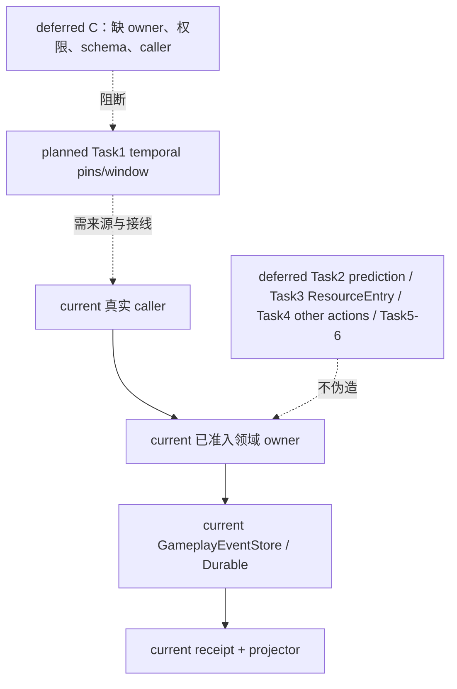

```mermaid
sequenceDiagram
  participant C as caller
  participant O as domain owner
  participant S as original store
  participant Q as durable query/replay
  C->>O: frozen source/read/revision/time input
  O->>O: revalidate authority, window, revisions, idempotency
  O->>S: atomic append or zero write
  S-->>C: receipt
  C-->>Q: retry/timeout lookup by original identity
  Q-->>C: durable receipt or bounded recovery state
  Note over C,Q: missing sources remain C/deferred; old events retain old semantics
```

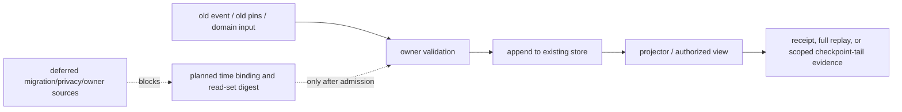

## 5. 保持的门禁与下一项最小任务

- RW-44 不变：生产输出继续 Inventory custody，当前不进入核心 `ResourceEntry`；Task3 仍无可实施切片。
- facility repair 继续 C/deferred；Task2 T07/prediction、Task4 其他动作、Task5/6、Godot、calibration、final/holdout、训练和微调不启动；Laya 只记录 `choice`。
- 旧事件、旧 pins、既有 Inventory 语义和既有 receipt 不重写；不新增 clock、scheduler、event store、authority 或默认 temporal pins/权限/字段。

下一项最小任务是取得 Inventory 时间 consumer 的三个前置来源：完整 SettlementWindow 的具名提供者与边界、Population capability 的 temporal authorization source、caller 可读的 content/binding revision source。来源与责任齐备后，按本会话已有授权推进允许的设计工作，并在获准实现轮次冻结验收；在此之前保持 B/C，不实现 caller。

## 6. 静态验证范围

本回写只要求链接目标、Mermaid 结构、空白、`git diff --check` 和 `.harness` 状态检查；不运行 pytest、Harness、Godot、calibration、final/holdout、训练或微调。运行时证据仅引用各任务已有的、明确限定范围的历史记录，不扩张结论。

## 2026-10-16 阶段三最终收口矩阵（Task1–Task6）

本节汇总本轮对所有开放任务的独立审查。结论按 A（已有来源与 owner 合同，可验收）、B（来源足以完成接口/迁移/恢复设计，尚未获准实现）和 C（缺少具名来源、owner 或 caller，正式 deferred/blocked）冻结；任何一项 C 不扩张为其他任务的停止理由。

| Task | 最终状态 | 已完成/已有证据 | 仍缺的来源、合同或证据 | 可继续工作与解除条件 |
|---|---|---|---|---|
| Task1 时间对象与 consumer | **局部 A；整体 B/C，未完成** | 六时间对象、单 clock/mapping、Status/Action 局部接线；真实 Status/Action caller、owner receipt、Durable 重启 focused 证据；Inventory RW-50 application full/checkpoint+tail Durable 重启证据；Population cadence→Inventory 已有限定 participant 的 SettlementWindow/cutoff/confirmation/late-input/order 与提交前重验；Organization operating-window 与 econ1 Economy wage batch 已有真实 `RuntimeExecution → BatchSettlementCoordinator → owner → Durable store` 时间窗口消费；Government authored-validity → Social delivery 固定 slice 已有真实 caller/owner evidence | authenticated world-admin grant/revoker、跨域 participant cut；Economy scheduled transfer/tax、Ecology、Character 以及通用 Social 时间语义尚未逐项接线 | 先补具名时间来源/授权，按 consumer 接线并覆盖权限、receipt、Durable 新实例、full/replay；不得把 Population operational deadline 当世界时间 cutoff |
| Task2 batch/receipt/replay/random/prediction | **限定范围 A；T07/prediction/全参与者 snapshot/其他 owner C 或 planned** | Organization operating-window 与 econ1 Economy wage batch 冻结、receipt query、丢响应/部分成功/版本冲突、Durable 新 Runtime/store 恢复；声明 participant 的 ReplayCheckpoint/ReplayTail full 与 checkpoint+tail 一致；Fresh batch + Status application regression 及本轮 batch recovery allowlist 通过 | 无真实随机 owner/effect/draw/seed-policy revision/result receipt；prediction owner、全参与者 snapshot 和未声明 owner 恢复缺失 | 真实随机业务出现时才补 owner/seed/draw/replay；prediction 需真实 provisional caller/owner；逐 participant 设计并验证 recovery。不得用现有 fixed input、preview 或 scoped replay 扩大范围 |
| Task3 资源/状态/效果/装备 | **旧合同 A；新资源切片 C/deferred** | ResourceBody、Status、Equipment、Patch 既有 owner/caller/store/replay；71 项 focused 通过；RW-44 保持 Inventory custody | C1–C8 的容量/锁定/透支/恢复/pause/codec/授权/真实非战斗 caller 与核心 ResourceEntry 映射均未齐 | 用户明确既有 caller、核心资源、容量/政策、映射和 owner 后重开来源审查；随后才可设计 D06 集中迁移。当前不新增 ResourceEntry |
| Task4 技法/动作/空间 | **既有冲突 Action 与 bounded melee caller 局部 A；facility repair C/deferred；其余 P01–P06 未启动** | Stormnight conflict caller→owner→store、ActionConsequenceBoundary source validation、幂等/空间拒绝；`street_combat_attempt`→`EmbodiedAuthoritySettlementService.settle_street_combat` 真实入口支持三种 melee action，并校验 contact/physics evidence、目标、距离、资源与 transport recovery；设施 owner direct repair/compensation 局部 receipt/replay 历史证据 | 维修 grant/撤销 owner、facility incarnation/target privacy、affordance/资格、amount policy；melee 服务是独立 bounded in-memory embodied authority，未接 Construction，也不证明通用 P01–P06；投射物、miss/dodge/parry/block/immunity 等无真实 caller/owner admission | 四项维修用户决策与完整 L4→owner 合同齐备后再设计实施；melee 仅按自身证据范围验收；P01–P06 需各自 owner/evidence/replay，禁止重复造 caller |
| Task5 生命/连续性/关系 | **continuity/action source 局部 A；Life/Presence/Soul/关系 C/deferred** | RuntimeContinuityState、actor-private relational memory、Conflict owner 与 ActionConsequenceBoundary；16 项 focused 通过 | LifeState/EntityPresence/Soul/ThreatRelation 等事实 owner、事件 schema、权限/隐私、迁移、Durable/full/tail 与部分失败恢复缺失 | 取得具名事实 owner/API、receipt/replay/privacy/revocation、迁移前后兼容后再接入；当前只保留私有 projection/diagnostic |
| Task6 跨域故障与最终证据 | **局部基础设施 A；整体门禁 C，阶段三不可宣称完成** | 各局部 owner 的 receipt、幂等、部分恢复、声明范围 replay；fresh local suites：Inventory/P5 12、Inventory/batch/cadence 48、action/resource/equipment/status 39、store/Inventory 39、batch/Status/migration/runtime 73 passed | 没有覆盖 Task3–5 全参与者的统一 caller→owner→store 路径、统一迁移/隐私/权限和全部部分失败/恢复证据 | 每个已开放切片须分别取得真实调用链与其适用的故障矩阵证据；跨参与者矩阵汇总不能把不适用或未准入项改写成通过 |

### Task6 总门禁结论

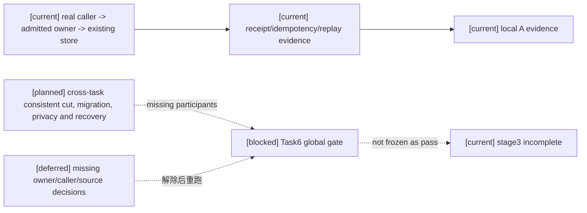

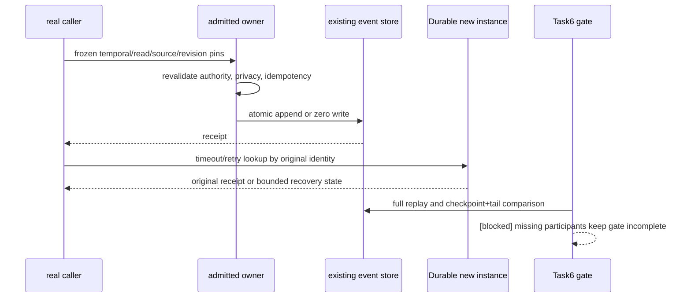

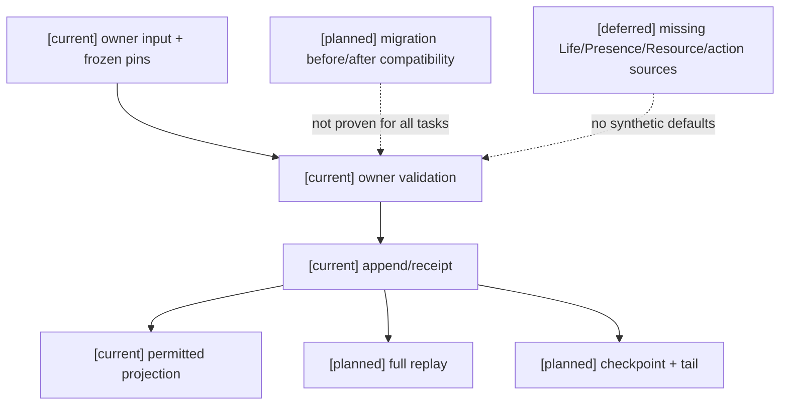

历史结论：阶段三为 **incomplete**。该段“没有遗留未盘点的独立任务”已被本文件逐项矩阵取代；后续发现的可实现技术工作须继续推进，不能仅以 deferred/blocked 关闭其他独立工作。

## 2026-10-17 本轮实现增量：Population → Inventory temporal read-set

本轮按既有来源完成一个可验收的 B 类接线增量，没有新增 clock、scheduler、store、owner 或权限来源。`PopulationCadenceDriver` 已生成的 timeline/profile/mapping/source/window pins 通过 `RuntimeCadencePublisher` 写入 cadence authority event；`default_population_read_set_builder` 将同一 pins 纳入 `PopulationReadSet`，并将其纳入 digest。Population 决策、重试和 Inventory owner adapter 的 read-set 重建均保留这组 pins。

Inventory adapter 在 pins 存在时提交前重验 `sampled_at/received_at`、window length、source revision、timeline 和 mapping revision；不一致为 zero-write/requeue。现有直接 Inventory owner 调用仍兼容，未把缺失完整 `SettlementWindow` 或 temporal authorization 的旧输入升级为正式通过。

本轮验证：Inventory vertical、Population domain/capability、authorized cadence publication、population cadence/Durable recovery 共 **126 passed**（含新增 publisher→event temporal pins 断言）；另有既有 FastAPI 弃用警告。该证据只解除 Task1 Inventory 的 pins/read-set 接线 B 项；完整 `SettlementWindow` participant/cutoff/confirmation/late-input/order 来源、temporal authorization source、caller 可冻结 content/binding revision 仍为 C/B 阻断，Task1 整体与 Task6 仍未完成。

## 2026-10-17 本轮实现增量：Inventory temporal authorization grant

本轮在既有 Population cadence authority 记录内补齐一个有界 temporal grant 合同，标记为“本次设计并实现”：

- `TemporalAuthorization` 位于 `backend/app/world_runtime/temporal_contracts.py`，绑定 `authorization_ref/revision`、Population cadence issuer、timeline、Inventory participant、input cutoff、confirmation boundary、late-input/order policy 和 `valid_until`，以 canonical payload digest 固定来源。
- `PopulationCadenceDriver._time_pins()` 由现有 cadence caller 生成 issuer、有效边界和 digest；没有新增 clock、scheduler、event store 或权限系统。
- `InventoryOutputCustodyOwnerExecutor` 在提交前通过 `verify_temporal_authorization()` 重验 digest、timeline、participant 和 cutoff，并继续读取同一 Durable cadence event；缺失、篡改、过期或撤权（cadence authority 不存在/不一致）均 zero-write/requeue。
- operational `received_at` 仍只用于 caller freshness；世界时间 `input_cutoff/confirmation_boundary` 由 grant 单独绑定，二者不混用。

验证：Population/Inventory/settlement application allowlist **66 passed**。该证据解除“没有 temporal authorization object/digest/revalidation”这一子项；完整多 participant `SettlementWindow` 来源、其他领域 consumer 的世界时间 grant、content/binding revision 外部只读 source 和 Task6 跨域门禁仍未完成。

Harness `backend-contract` 本轮 run `4d307613898d4bc5a044b7e788e3d6cf`：`status=passed`，`cleanup_status=passed`，证据导出至仓库外 `D:/Users/User/Documents/paralls-evidence/stage3-20261017-temporal-grant-r1/`。该 profile 证明后端协议契约和 Harness 生命周期，没有扩大到 Godot、calibration/evaluation 或阶段三总门禁。


## 2026-10-16 当前收口覆盖与历史段落说明

本文件前段的“未逐项审查”是历史状态索引，不能作为当前结论；以下矩阵及其链接是本轮最新冻结结果，覆盖 Task1–Task6。未满足运行时证据的条目明确标为 planned/deferred/blocked，不以 focused 回归或静态设计冒充通过。

### Task1–Task6 最终门禁矩阵（本轮冻结）

| Task | 最终状态 | 本轮已确认的真实来源/证据 | 未满足的门禁 | 解除条件 |
|---|---|---|---|---|
| Task1 时间与 consumer | **局部 A；整体 B/C** | 六时间对象、单 clock/mapping、Status 到期、Action conflict caller→owner→store；Population cadence pins；Organization operating-window + econ1 wage batch 的真实时间窗口 caller→owner→store 与 recovery；Inventory caller/owner；Government notice→Social caller 的应用级来源/owner 测试；Economy/Ecology 各自已登记 policy scope 与互不占用 catch-up 预算；109 项 Task1 focused 回归 | Inventory 完整跨域 SettlementWindow、Economy obligation opening 来源、Character wake/deadline、通用 Social recipient-selection、Physics/presentation mapping、跨 actor/world/timeline 尚未逐项接线；Social 固定 authored-validity slice 已通过，但通用 Social temporal policy 仍缺 | 每个 consumer 指定时间 owner、window/read-set/revision 来源、caller→owner receipt；补 exact/changed duplicate、丢响应、新 Durable、full replay；物理 mapping 另需 owner，不读取 Godot |
| Task2 批次/随机/预测/回放 | **限定范围 A；T07/prediction/完整 snapshot C/deferred** | Organization operating-window 与 econ1 wage obligation 的真实 caller、原 store/Durable receipt、丢响应/部分成功/版本冲突和恢复；声明 participant full 与 checkpoint+tail 一致；93 项 focused 回归及本轮 batch recovery allowlist 通过 | 无具名随机 owner、draw/effect/seed-policy/result receipt；prediction owner/admission 缺失；完整参与者 snapshot 不能扩展；adapter 只有能力合同，不等于已发布 descriptor | 具名随机 owner/API、私有 seed/draw cursor、算法/seed-policy revisions、receipt 与 Durable/full/tail；prediction ledger owner 与确认冲突语义；逐 owner participant admission |
| Task3 资源/状态/效果/装备 | **旧合同 A；新核心资源 C/deferred** | ResourceBody、Status、Equipment、Patch 既有 owner/caller/store/replay；71 项 focused；生产输出继续 Inventory custody（RW-44） | C1–C8 的核心 capacity/locked/debt/recovery/pause/codec/privacy/非战斗 caller 缺来源；不得把 Inventory 证据升级为 ResourceEntry | 用户命名核心资源及真实 caller、容量/policy、owner/read-set/可见性与 D06 迁移 codec；补迁移失败保留、Durable、full/tail |
| Task4 技法/动作/空间 | **Conflict action 与 bounded melee 局部 A；facility repair C/deferred；P01–P06 C/deferred** | Stormnight conflict caller→owner→store、ActionConsequenceBoundary source/revision/空间拒绝与幂等；`street_combat_attempt`→`EmbodiedAuthoritySettlementService.settle_street_combat` 真实入口及其三种 melee action 的 contact/physics/目标/距离/资源/transport 校验；Construction 维修仍仅 direct owner API | 维修 grant/撤销、incarnation/target privacy、affordance/资格、amount policy 缺失；melee authority 是 bounded in-memory 路径，未接 Construction；投射物、miss/dodge/parry/block/immunity 等无真实 caller→owner admission，P01–P06 无运行时证据 | 维修四项用户决策及 L4→Construction route、时间/read/evidence pins、owner revalidate；melee 仅按自身证据范围验收；P01–P06 各自具名 owner、evidence lifecycle、presence、receipt/replay |
| Task5 生命/连续性/关系 | **activation/authored identity 局部 A；continuity/action source 局部 A；Social shared/private facts 局部 A；Life/Presence/Soul/Threat dynamics C/deferred** | `ProfileActivationAuthority` 从 `CharacterProfileRegistry` authored identity digest 与真实 Population vertical `ActivationProposal`/`ActivationGrant` 接入，写入 `population:{world_ref}` activation lifecycle，具备 scope/package/policy pins、receipt、幂等、Durable replay 与 project-only region view；`SocialFactAuthority.resolve/view_for` 的 directed relationship/knowledge facts、recipient visibility/revocation；`record_admitted_platform_social_relationship` shared identity API、receipt/projector（仍仅测试 caller）；RuntimeContinuityState、actor-private relational memory、Conflict source validation | activation 不是 canonical LifeState、EntityPresence/incarnation、spawn/despawn/tombstone、Soul continuity 或 Threat/Target/Fear/Morale；shared identity API 无生产 caller且无关系更新/结束；不得从 health=0、activation receipt、模型输出或私有 memory 推导死亡/客观关系 | 具名产品语义和生产 caller；事件 schema/revision、receipt、Durable 新实例、full/tail、privacy/revocation、部分失败与迁移兼容；Life/Presence/Soul/Threat 继续 deferred |
| Task6 总门禁 | **局部基础设施 A；整体 incomplete** | 已准入 owner 的 receipt/idempotency/部分恢复及声明范围 replay；Economy+Ecology 同一应用 cut、双 Durable 新实例 caller/owner、full/checkpoint+tail projection 对照及跨域 catch-up 隔离；Inventory RW-50；Character temporal admission；Social facts/application participant；固定 Government authored-validity → Social delivery caller 已进入 bounded participant matrix | 缺跨 Task3–5 全参与者 caller→owner→store、统一迁移/隐私/权限、完整 snapshot、跨域丢响应/changed duplicate 证据；Social delivery 仍只是固定单一 notice→recipient 路径，不是完整 Social delivery/关系总门禁 | 每项原始验收要求均须取得对应来源、实现和运行时证据；deferred 不抵销门禁，不停止无依赖的技术工作 |

本轮允许继续的独立工作均已实施到其最深边界：Task1 的已具名 Status/Action/Population 路径和 Task2 的两个 owner/replay 路径保持验收；Task3–5 的缺来源切片已正式 deferred；Task6 因缺参与者与统一证据 blocked。没有新增 synthetic owner/caller/registry/clock/scheduler/store，也没有改写历史 pins、threshold、label、archive 或 receipts。

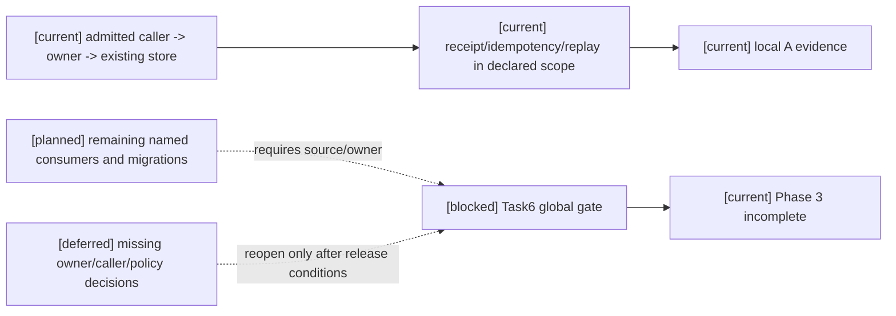

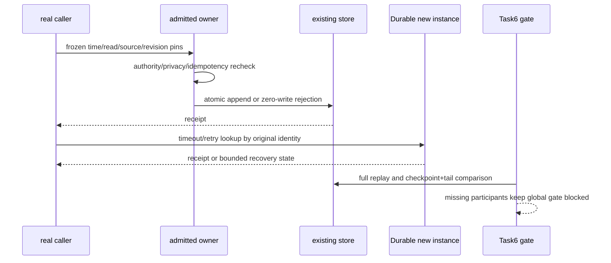

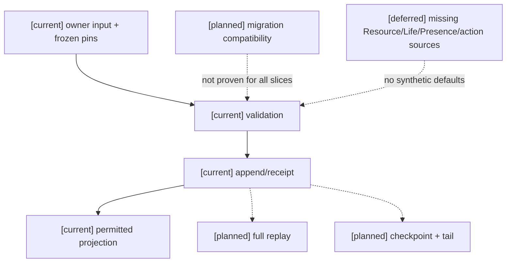

## RW-48 阶段三最终总门禁（2026-10-16）

RW-48 是本轮新增编号；历史 RW-45 保留原义。统一 focused 集合为 **247 passed**（Task1 109、Task2 93、Task3 71、Task5 16 的集合存在重叠时以实际命令结果计数，不作简单相加）；4 条既有 FastAPI 生命周期弃用警告。backend-contract、文档/边界静态检查将在本轮 Harness 后以新证据补记。由于 Task6 仍缺跨域参与者和迁移/隐私证据，阶段三不能宣称完成。

## RW-49 本轮阶段三复核与 Task6 证据契约（2026-10-17）

历史 RW-49 结论过早把“缺 owner”当作不可继续条件，且误称未发现开放实现项。用户已授权在先建立来源、职责、权限、事件、恢复和验收设计后新增正式领域 owner/API/caller；本文件 RW-51 记录继续实施结果。产品语义未决定的切片仍进入决策包，RW-44、facility repair 与无真实随机需求的 T07 约束保持有效。

### Task6 总门禁逐项可验证要求

本轮新增的窄参与者登记：`authority:p5:investigation-conflict` 的 explicit
`world_death_commit_confirmed/rejected` owner API。它的 source scope 仅是已存在的显式
`terminal_outcome_recorded(case_death)`；生产 caller 尚未准入，因此该参与者可以提供 direct-owner
恢复证据，但不能填充 Task5 LifeState 或 Task6 的 production caller 行。

| 证据项 | 必须同时证明 | 本轮结果 | 缺失时的正式解除条件 |
|---|---|---|---|
| 真实入口链 | 生产 caller → 具名 owner → 现有 GameplayEventStore/Durable，且不是 direct owner API、fixture 或 mock | 已在声明范围内证明；Task3–5 未准入切片没有入口链 | 为每个开放 slice 指定现有 caller、owner、store 和版本化 route |
| owner 重验与 fail-closed | temporal/read/source/revision、authority/privacy、target/incarnation、idempotency 在 append 前重验；未知输入零写拒绝 | 已有 Status/Action/Population/Organization/Economy 局部证明；Inventory 时间 consumer、资源新切片、设施维修、Life/Presence 等缺来源 | 补齐原文授权的输入来源和 owner API；不得以默认值补齐 |
| receipt 与故障矩阵 | exact duplicate 返回原 receipt；changed duplicate、撤权/过期、丢响应重试、部分成功按原合同收敛 | 已有 owner 局部证明；P5 explicit death owner 已证明 lost-response retry、changed duplicate；跨 Task3–5 生产参与者未覆盖 | 每个参与者提供真实 receipt lookup、重试身份和拒绝证据 |
| Durable 新实例 | 关闭旧实例后由新实例按原 receipt/checkpoint/input refs 恢复，历史 pins 不改写 | 已在声明范围的 Status/Action/batch/replay 参与者证明；P5 explicit death owner 已有同路径 reopen/receipt/full-tail | 新参与者提供可恢复 decoder、持久 cursor/receipt 和迁移兼容 |
| full replay 与 checkpoint+tail | 同一参与者集合、同一 decoder/profile pins 下 digest 一致；缺段/缺参与者/权限不足必须 incomplete | 已在 Organization/Economy 与声明 replay participant 范围证明；不能扩展到未声明 owner | 先冻结 participant manifest，再取得两种 replay 的一致结果 |
| 迁移兼容 | 旧事件/receipt 可读，新版本只接纳新 pins；迁移失败保留旧事实并 fail closed | 已有 temporal migration 局部证明；Task3–5 新 schema/codec 未获来源 | 指定版本化 schema/codec、旧读路径、失败保留和新实例恢复证据 |
| privacy/revocation | caller 与 owner 看到同一授权边界；撤权后拒绝且不泄露事实，恢复/replay 同样受限 | 已有局部权限测试；缺完整跨域 participant 与事实 owner | 具名 privacy/revocation owner、投影和 replay 过滤证据 |

上述七项是 Task6 的必要证据，不是允许新增基础设施的授权。任一任务缺少具名 owner/caller/source 时，该 slice 记为正式 deferred；不得用局部 focused 通过、静态设计或 direct API 抵销缺口。

### 本轮真实验证

- focused pytest：允许列表覆盖 temporal migration/mapping/clock、Population、Status、Action、RuntimeExecution、batch settlement、adapter admission、replay cut/application/participants、既有 continuity、权限与 Stormnight caller，共 **239 passed**、4 条既有 FastAPI `on_event` 弃用警告。
- Harness：`backend-contract`、`docs`、`boundaries` 均 `passed`，且 `cleanup_status=passed`。本轮 run ids：`5c1ba2b3cb744ce1890c590019c685fa`、`cd1b30d98c1441608bb96bad9482aa69`、`387318056a7348a08836b0e0d7b9e745`。导出目录：`D:/Users/User/Documents/paralls-evidence/stage3-current-20261017/`。
- 未运行 Godot、calibration、final/holdout、训练、微调；`.harness` 仅使用临时运行目录，仓库内未保留本轮运行产物。

### 本轮结论

Task1–Task2 的已准入 caller/owner 路径和声明 replay 范围继续有效；Task3 继续按 RW-44 保持 Inventory custody、无核心 `ResourceEntry` 新切片；Task4 仅既有 Conflict action 保持局部 A，facility repair 与 P01–P06 仍未通过领域执行验收；Task5 除 continuity/action source 外有 P5 shared/private fact 局部 owner 与隐私基础，但缺生产接线、关系生命周期及 Life/Presence/Soul/Threat 动态政策和完整恢复。故 Task6 仍为 **blocked**，阶段三 **未完成**。

### Task2 prediction 的 B 级隔离接口设计（不构成 owner admission）

规格09 §5、§7.2 已足以定义纯接口边界，故保留为 **B/planned design**，不把缺 owner 误称为原文缺失，也不实现新的 ledger：输入为 `PredictionWindow` 固定的 timeline/branch/base confirmed revision vector、步长与 cutoff、profile/rule pins、已准入 participant/snapshot/input/evidence refs、随机上下文和 confirmation policy；输出只能是带 prediction revision/speculative digest 的 provisional delta，不能使用正式 authority receipt/event schema。分支在建立时从一致 confirmed cut 读取，提交前对每个原 owner 重验当前 revision、授权、privacy 与 evidence；冲突则废弃/重算 provisional branch 并重新对齐，不回写正式 owner。正式结果只由既有各 owner 逐项提交，A receipt 保留、B 冲突进入原 batch successor/recovery，不承诺全局原子。

恢复边界：仅在所有参与者提供一致 snapshot、输入/证据完整、decoder 与 profile pins 可恢复时恢复 provisional branch；Durable 新实例须从原 checkpoint/input refs 重建并核验 digest。缺 participant、撤权、缺段、物理轨迹不兼容或 snapshot schema 不支持即返回 incomplete/divergent 并要求同步，绝不从当前值猜补。迁移只允许新 branch 引用新 pins，既有确认窗口不改写。focused 验收须使用真实 provisional caller（尚未具名，当前没有）、真实 owner confirmation、冲突/revoke/丢响应、Durable 新实例、full/checkpoint+tail 对照；在 caller/owner/admission 缺失时不得用 fixture/mock 声称 runtime 通过。解除 deferred 的前置是用户/架构指定 provisional state 的既有持有 owner 与真实 caller、visibility/revocation 责任及 snapshot participant 清单。

### Task2 完整 snapshot / adapter 的 B/C 接口边界

规格09 §6 足以支持 cut/tail 数据合同设计：cut 原子捕获 timeline/window cutoff、owner/adapter revision vectors、receipt cursor、open batch/prediction/work 边界、每 participant snapshot/decoder revision、visibility revision 与 digest；任何读间写入使 cut incomplete。Tail 固定 checkpoint digest、from/to vectors、事件与 receipt refs、definition/rule/evidence pins、目标 participant digest；先检查 prefix/schema/receipt/权限，再以同 decoder 重建并逐 participant 对照 full replay。缺任一 owner、decoder、授权可见数据或一段日志即拒绝，不允许删 participant 降级。迁移并行保留旧 decoder/pins，只有新版本重建与 checkpoint+tail/full 相等后才可激活；失败关闭新版本，保留旧事件/receipt。

当前 ReplayCheckpoint 仅在明示 Organization/Economy/Population/Status 范围具备实现及恢复证据，未声明 owner 不得被打包进完整 snapshot。adapter descriptor 的字段和能力交集已有静态接口，真实引擎/physics 发布 owner、运行时 revision receipt、evidence 与 snapshot 可恢复者未具名，故实际 admission 为 C/deferred。解除条件是 owner registry 已存在且能提供每 adapter 版本化 descriptor、能力丢失事件/receipt、Durable 恢复与 replay evidence；不得把配置对象本身当发布事实。

### Task4 其他动作 owner 的 B/C 设计分类

规格11 A02–A06、角色11 typed commitment 和计划04 Task4 足以设计共用调用合同：现有 L4 contract 冻结 actor/action/target/source/grant/revision/idempotency，窗口与证据经已准入 adapter 映射；owner 按自身 authority 重验窗口、授权、source/read revisions 与 target incarnation，原子提交/零写并回真实 receipt；结果反馈只消费 owner receipt。物理证据保持 sampled/admitted/consumed/rejected/expired/superseded 生命周期，dedup 含 action/effect/target incarnation/impact slot，未知能力/过期/撤权 fail-closed。原事件/decoder 不迁写；新版本需显式兼容版本，并以 Durable 新实例、full/tail、privacy/revocation、owner fault 矩阵验收。

但本轮源码未发现 facility repair 以外已具名且连到 L4 的这些动作 owner/caller；P01–P06 所需 PhysicsEvidence/ProjectilePresence 的具体 authority 和 engine descriptor 也未 admission。故此处是 **B 接口设计 + C runtime deferred**；facility repair 仍严格 RW-40/RW-44 的 C/deferred，不新增 caller。解除条件是选定已有 ActionDefinition 与固定 owner route、物理/presence owner、grant/target/privacy source，并出示真实调用入口；不能仅凭 direct owner API 启动 runtime 接线。

### 证据计数与外部链接说明

本轮统一 24-file focused 命令实际结果为 **247 passed**；另一次 16-file 交叉子集为 **194 passed**，两者不可相加。README 中指向 `D:/laya-probe-cache/...` 的链接是历史仓库外证据引用，不是仓库内目标；本轮不读取、不生成、不改写该外部目录，故本地链接检查将其标记为 external evidence reference。

### RW-48 验证结果补记

Fresh verification：`backend-contract`、`docs`、`boundaries` 三个非 Godot profile 均 `passed`，各自 `cleanup_status=passed`；run ids 分别为 `20eae66963d44d359a47821eced479b1`、`20c8cf088b3e4e10919f229ecd9a8f68`、`88155b765b044fdcbb651d11bfe25613`。仓库外导出目录为 `D:/Users/User/Documents/paralls-evidence/stage3-final-20261016-r2/`。`.harness` 前后均为 24431 文件，路径差异为零；文档链接（忽略历史 external evidence URL）、69 个 Mermaid 块、尾随空白和 `git diff --check` 均通过。四条 FastAPI 弃用警告既有且不影响退出码。未运行 Godot、calibration、final/holdout、训练或微调。

## RW-50 Inventory custody replay participant 接线（2026-10-17）

本轮沿既有 `PopulationCadenceDriver → RuntimeCadencePublisher → InventoryOutputCustodyOwnerExecutor → InventoryAuthorityService → GameplayEventStore` 路径，将已有 production-output custody 事实接入 scoped replay participant manifest。只有事件存储中实际存在 `gameplay.inventory.production_output_received@1` 事件时，manifest 才包含 `inventory` participant；没有产出事件的历史范围不新增空 participant。封存内容使用既有 `production_output_custody_view_for()`、事件 id/global sequence/payload digest 和 source revision vector，不新增 owner、schema、clock、store 或权限。

`submit_replay_checkpoint`、`submit_replay_tail` 将应用已装配的 Inventory authority 传入 participant capture/validation。Durable 新实例验证以同一 store 重建 Inventory authority，并对照 custody view；checkpoint boundary 按事件 global sequence 过滤，tail 仍要求 prefix、decoder、receipt、权限和 full/checkpoint+tail digest 合同。无 Inventory participant 时保留既有 Organization/Economy/Status/Population/Migration 兼容行为。

本轮新增真实 owner 写入后的 participant 封存与新 authority 重建测试；replay participant、scoped checkpoint/tail application、Inventory vertical 共 **31 passed**，`compileall` 与 `git diff --check` 通过。该切片只证明已有 Inventory custody 参与者可纳入声明范围的 replay，不解除完整 `SettlementWindow`、temporal authorization、content/binding revision 来源缺口，也不把 Inventory custody 变成核心 `ResourceEntry`。Task1 整体、Task2 T07/prediction/完整 snapshot、Task3–5 deferred 切片与 Task6 全局门禁继续未完成。

## 2026-10-17 逐项验收编号矩阵与产品决策包

以下编号来自计划04 §“来源到验收与任务映射”及规格09 §11、规格10 §10、规格11 §8、规格12 §9。计划04 的 Task 1–6 使用相同编号，不另造编号。状态“局部”只表示所列 owner/consumer 边界已实现，不表示该编号覆盖的领域场景全部通过；Task6 全局门禁仍未通过。

| 编号 | 当前结论 | 证据/缺口 |
|---|---|---|
| T01 | 局部 | 单 clock/mapping 与拒绝裸跨时间比较有 focused 合同；其余 Physics/render/network/role consumer 未逐一接线。 |
| T02 | 局部 | profile 激活迁移及 Status owner receipt 的正例已有；多 actor/world/timeline、生产内容和 consumer 覆盖未完成。 |
| T03 | 局部 | Population cursor/预算恢复已有；Economy/Ecology 各按自身已登记 temporal policy 限定 catch-up budget 并有双向混合 obligation 回归；其他领域 consumer 未证明。 |
| T04 | 局部 | Organization/econ1 Economy batch 保留已提交 owner；不代表其他 owner。 |
| T05 | 局部 | 限定 batch receipt 查询、exact/changed duplicate 与 Durable 新实例有证据；Inventory temporal authorization 缺失。 |
| T06 | 局部 | 限定 successor/依赖/原子 owner 失败有证据；不扩展至未准入 owner。 |
| T07 | not_verified/deferred | 无真实领域随机需求及 owner；不以 seed 字段代验。 |
| T08 | not_verified | 无已准入 physics late-input/轨迹恢复 owner；正式确认历史不重写。 |
| T09 | not_verified/deferred | 无满足隔离、确认重验、冲突与 replay 的 prediction owner/caller。 |
| T10 | 局部 | 声明参与者的 full/checkpoint+tail 有范围内证据；RW-50 fresh Durable Inventory 与 Economy+Ecology 同一应用 cut/restart 对照已通过；全任务 participant scope 仍不完整。 |
| T11 | 局部 | cut 中变化检测已在声明参与者测试；未准入 owner 不在范围。 |
| T12 | planned/not_verified | adapter 能力合同存在，真实 engine/physics descriptor 发布与丢失恢复未准入。 |
| V01 | 局部/未完成 | 规格09 §11：Stable 分类拒绝；缺所有获准 consumer 的端到端 view 证据。 |
| V02 | 局部/未完成 | 规格09 §11：Delta 乱序/缺段须授权 full snapshot；P5 同一 Durable checkpoint 重放后的 state 对照不是应用级 checkpoint+tail，不能外推至所有 consumers。 |
| V03 | 局部/未完成 | 规格09 §11：revoke 清理 private value、拒绝旧 request；P5 revoke 有 Durable close/reopen 与 checkpoint re-execution 证据，其他 cache/intent/binding 未覆盖。 |
| V04 | 局部/未完成 | 规格09 §11：creator/authority/actor 独立 view/digest；P5 recipient view 有界验证，跨视图完整门禁未完成。 |
| R01 | 未完成 | 规格10 §10：unknown resource/world 未注册 mana；缺产品命名资源来源及真实 caller。 |
| R02 | 未完成 | 规格10 §10：reserved/locked/available/debt policy 边界；RW-44 production custody 不进核心 ResourceEntry。 |
| R03 | 未完成 | 规格10 §10：recovery/suppression/overdraft/full 可重放；核心容量/恢复政策待决。 |
| R04 | 未完成 | 规格10 §10：fused/coupled/independent 与 focus→life 只按注册转换；无批准映射。 |
| R05 | 局部/未完成 | 规格10 §10：跨 owner 各自 receipt 与恢复；没有新核心资源参与者。 |
| E01 | 局部/未完成 | 规格10 §10：effect 四轴分离；既有 schema/validator 有局部合同，未证明全部 consumer。 |
| E02 | 局部/未完成 | 规格10 §10：effect lifecycle 各步骤 owner evidence；全 lifecycle producer/replay 未齐。 |
| E03 | 局部/未完成 | 规格10 §10：environment exposure 再经 target/effect owner；缺目标内容 policy。 |
| E04 | 未完成 | 规格10 §10：Soul gate 缺 link/authority/vulnerability 必须零写；Soul 产品 gate 未决定。 |
| I01 | 局部/未完成 | 规格10 §10：binding 多入口去重；只限既有 bindings，不覆盖所有玩法 consumer。 |
| I02 | 局部/未完成 | 规格10 §10：snapshot/live revoke；缺完整迁移与各 binding 生命周期证据。 |
| I03 | 局部/未完成 | 规格10 §10：装备临时 grant 与 mastery 分离；非战斗接线未审定。 |
| I04 | 局部/未完成 | 规格10 §10：start-use 后失败/取消 refund；未覆盖全部 owner 故障矩阵。 |
| I05 | 局部/未完成 | 规格10 §10：stock、毒性、药效分离；真实内容与完整状态生命周期未齐。 |
| I06 | 局部/未完成 | 规格10 §10：ammo/media/formation 分开检查；各生产 consumer 缺证据。 |
| I07 | 局部/未完成 | 规格10 §10：unknown/非法 meta-tag 零写与 cache revision；语义 registry 全消费者未验收。 |
| A01 | 局部/未完成 | 规格11 §8：Stormnight canonical action 有界 caller；通用 L4 admission 未闭合。 |
| A02 | 局部/未完成 | 规格11 §8：combat/noncombat 共用 typed boundary；非战斗 owner routes 未逐项证明。 |
| A03 | 局部/未完成 | 规格11 §8：model/Siming output 不等于 owner result；仅既有 action path 有界证明。 |
| A04 | 局部/未完成 | 规格11 §8：interrupt/recovery/animation result 分离；非战斗 caller 恢复未验收。 |
| A05 | 局部/未完成 | 规格11 §8：多 owner partial commit receipt recovery；限定 batch 有证据，行动矩阵不完整。 |
| A06 | 局部/未完成 | 规格11 §8：window/source/revoke 提交前重验；Inventory window policy 未决。 |
| P01 | not_verified/deferred | 规格11 §8：miss/dodge/parry/block/immunity 分别记录；无 PhysicsEvidence owner admission。 |
| P02 | not_verified/deferred | 规格11 §8：QueryResult 状态区分与隐私；无真实 engine descriptor caller。 |
| P03 | not_verified/deferred | 规格11 §8：evidence lifecycle/dedup replay；owner/caller 未准入。 |
| P04 | not_verified/deferred | 规格11 §8：incarnation/impact slot dedup；Presence policy 未决。 |
| P05 | not_verified/deferred | 规格11 §8：unit/space/skeleton revision 与预算；真实 adapter 未准入。 |
| P06 | not_verified/deferred | 规格11 §8：ProjectileExecutionState 复用 Presence；无 admitted Presence owner。 |
| L01 | not_verified/deferred | 规格12 §9：注册 LifeState transitions；life fact owner/policy 待定。 |
| L02 | policy invariant, unimplemented | 规格12 §9：health=0 不自动死亡；保留此拒绝规则。 |
| L03 | not_verified/deferred | 规格12 §9：wound/disease/metabolic/exposure/recovery 区分 damage；缺事实 owner。 |
| L04 | partially verified | 规格12 §9：显式 case-death→LifeState dead 已实现并验证；revive/Soul gate/continuity 仍缺 owner/source。 |
| L05 | not_verified/deferred | 规格12 §9：spawn admission/adapter/component；Presence owner 与权限待定。 |
| L06 | partially verified | 规格12 §9：新增 actor 默认独立 identity；scene/static evidence 不能替代 backend binding/recovery。 |
| L07 | not_verified/deferred | 规格12 §9：despawn cleanup/tombstone timeout recovery；owner 未定。 |
| L08 | not_verified/deferred | 规格12 §9：summon existing vs clone identity/cost/notice；政策未定。 |
| L09 | not_verified/deferred | 规格12 §9：Resource/Soul/Status partial failure recovery；参与矩阵缺失。 |
| D01 | not_verified/deferred | 规格12 §9：threat signal ordering/attribution/dedup；无事实 owner。 |
| D02 | not_verified/deferred | 规格12 §9：ThreatRelation 与 private estimate 分离；Threat policy 未定。 |
| D03 | not_verified/deferred | 规格12 §9：Fear condition 与 private projection 分离；Status owner 不决定业务语义。 |
| D04 | not_verified/deferred | 规格12 §9：Morale aggregate 与 persistent status 分离；policy 未定。 |
| D05 | not_verified/deferred | 规格12 §9：target eligibility/lock 重验；没有正式 target owner/grant。 |
| D06 | locally implemented, globally incomplete | 规格12 §9：P5 SocialFactAuthority recipient-filtered shared/private facts、revoke、Durable reopen 与 replay parity 有证据；目标 threat/private-estimate view 仍缺政策与 owner。 |
| D07 | not_verified/deferred | 规格12 §9：transfer/encounter reset/phase；动态行为政策未定。 |
| D08 | not_verified/deferred | 规格12 §9：群体通信不可达时不得污染估计；无实际 caller/owner。 |

### 2026-10-17 Task4 已准入 Action caller fresh 验证

复跑 allowlist：`backend/tests/test_action_temporal_application.py`、`test_stormnight_realtime_session.py`、`test_action_window_temporal_owner.py`，**33 passed**，4 条既有 FastAPI 生命周期弃用警告。实际应用边界为 `RuntimeExecution` → `main._handle_envelope` → `StormnightRealtimeSessionService` → `InvestigationConflictAuthority` → 既有 `GameplayEventStore`；时间 sample/provider、command、actor、role、graph、target window、spatial sample、source/read revision、evidence refs 和 owner idempotency receipt 在该真实 caller 流程内形成并提交。owner 在 append 前重验 temporal binding、source revision 与 conflict stream revision，竞争 revision 为 zero-write；Durable close/reopen 后新 service/runtime 返回同一 pins 与原 receipt，精确重试不采样、不重复写入，改请求/改 kind 拒绝。

这只证明 Stormnight 调查 Action 的已准入路径及其原 owner 结果。测试 temporal provider 是明确配置的测试来源，不能代表生产 physics/evidence issuer；该 action window 结果不证明角色动画完成、物理接触、通用 L4 成功、P01–P06 或 Construction repair。facility repair 仍受既有 deferred 决定约束；Task4 全部验收和 Task6 总门禁仍未完成。

本轮验证索引校正：上述 Action fresh allowlist 为 33 passed；RW-50 Inventory fresh allowlist 为 13 passed；两者均是新增的逐路径证据，不能覆盖 RW-49 历史 focused 总数，也不把局部 owner 证据扩展为 Task6 全域通过。Task6 七项必要证据仍按参与者分别审定，缺少 Task3–5 具名 owner/caller 的条目继续保持 deferred/incomplete。

### 来源与当前可读边界

| 来源 | 可核对版本/接口 | owner、scope 与读取边界 | freeze、重验、receipt/recovery |
|---|---|---|---|
| Population→Inventory 输出 | `PopulationReadSet` temporal pins；`GameplayPatchRegistry` manifest/declaration/binding；Construction certification event；`production_output_received@1` | Population caller 仅经 `InventoryOutputCustodyOwnerExecutor` 读取已授权 certification 与 active package binding；Inventory owner/store 是事实来源；项目级 custody，不是核心 ResourceEntry。单位/时限须由完整 SettlementWindow 来源补齐。 | intent 冻结 package/content/declaration/binding/active-set/mapping 与 Inventory revision；owner append 前重验；原 Inventory idempotency receipt、Durable store 和 RW-50 participant replay。窗口 participant/cutoff/order、temporal grant issuer 仍缺来源。 |
| P5 Social facts | `gameplay.social.identity_relationship_recorded@1` / schema v1；`SocialFactAuthority.resolve/view_for(recipient_ref, now)`；`record_admitted_platform_social_relationship` | owner `authority:p5:social`；actor/world/timeline 和 package/content/descriptor/active-set pins 限定；shared row 与 recipient-private knowledge 分开；只能按 `view_for` 接收者过滤读取。API 来源：`backend/app/gameplay/p5/social_knowledge.py`；schema/catalog：`event_schema_registry.py`、`governed_contract_catalog.py`；projector：`organization_government_social_content.py`。shared API 当前只有测试 caller，无应用生产 route，且无状态更新/结束生命周期。 | package-bound descriptor/source revisions 在 append 前验证，receipt 从 owner append 派生；既有 recipient visibility revoke 使 view/hash 重建。RW-51 新增 Durable SQLite close/reopen receipt、exact/changed duplicate 与 revoke/checkpoint re-execution parity；`main.submit_replay_checkpoint/tail` 现绑定同一应用 Social authority，只有存在真实 Social 事件时才纳入 participant；仍不证明关系 lifecycle，也不可扩为 ThreatRelation。 |
| 资源/装备/状态 | 规格10 §2–6、旧 owner API：ResourceBody、Status、Equipment、Inventory 与 semantic/effect bindings | 仅各原 owner 已登记的 resource/status/equipment/actor scope；标签/effect binding 是语义，不是写权限。RW-44 明确产出 custody 留在 Inventory。具体核心 resource/capacity/content policy 没有来源可读。 | 沿原 owner revisions/receipt/Durable/replay；D06 集中迁移与 D17 pause/drain 保留。无核心目标字段、codec、caller grant 时不造默认映射。 |
| Action / repair | 规格11 A01–A06/P01–P06、角色11 typed commitment、Construction repair owner API 与 INF-1AE 审查 | 现有 Conflict source boundary 只约束已接线 conflict caller；Construction owner 现有 repair API 是 owner-direct，不是生产 L4 caller。facility target/grant/amount 语义仍受既有四项 deferred 决定约束。 | 已有 owner receipt/replay 不替代 caller freeze、owner pre-append grant/window/read-set 重验。未获政策前不发 repair event。 |
| 生命周期与关系 | 规格12 L01–L09/D01–D08；P5 Social facts；`RuntimeContinuityState`、actor-private `CharacterRelationalMemory` | P5 shared/recipient-private relation/knowledge scope 如上；continuity 是过程状态；character memory 是私有估计，不得读成客观关系。Life/Presence/Soul/Threat dynamics 尚无获准事实 owner。 | 新 owner 必须先定义事件/revision/grant、撤权、receipt lookup、Durable 新实例、full/tail 与迁移失败恢复；不能从 health、activation 或模型输出推导事实。 |

### 产品决策包与本轮政策基线（2026-10-17）

产品政策仍由用户决定；本轮不把推荐方案记录成已批准政策。技术合同若实施，必须标明“本次设计并实现”；缺少来源、owner 或 caller 的条目继续保持 `not_verified/deferred`。

| 决策 | 推荐方案 | 替代方案与影响 | 解除验收 |
|---|---|---|---|
| P1 Inventory 时间 | **已选定政策**：Population cadence authority 发布窗口；participant 限于已登记 Population→Inventory custody；cutoff/confirmation 使用世界时间；cutoff 后拒绝迟到输入，并按 source revision→event ref 排序；operational deadline 只用于恢复超时；授权来源需在提交前重验。 | 不采用 caller 自定窗口，以免引入未登记 issuer、撤权和跨域 participant 合同。 | 政策已选定；完整跨域 SettlementWindow 的具名外部来源、独立 grant/revoke issuer 与运行证据仍缺。 |
| P2 核心 ResourceEntry | 推荐延续 RW-44：产出始终是 Inventory custody；在找到真实非战斗 caller、资源名/单位、容量 policy owner 前不重开核心 ResourceEntry D06。 | 在正式资源内容政策批准后，将指定非战斗 owner 接入 ResourceEntry；需要迁移、容量和隐私合同。 | 当前保持 Inventory custody 与 ResourceEntry 分离；Task3 R01–R05 仍 deferred。 |
| P3 facility repair | **推荐暂留 deferred，待用户决定**；在用户批准并完成来源准入前不创建 synthetic L4 caller 或 repair event。解除条件仍为 grant、incarnation/target、affordance/资格、amount policy 四项明确来源。 | 采用既有 Construction direct owner API 作为正式入口；需要补齐生产 caller 和四项政策，增加兼容性及审计成本。 | Task4 facility repair 验收继续未满足；既有 deferred 决定不被本推荐覆盖。 |

| P4 生命与 Presence | 推荐先建立显式 LifeState/Soul/Presence owner 合同；death 不由 health=0 自动推导；无真实业务 caller 时保持 deferred。 | 继续仅保留诊断与设计记录，等待业务来源后一次性接线。 | Task5 L01–L09 继续 deferred。 |
| P5 关系与动态行为 | 推荐 shared relationship 只允许具名 authoritative source；private knowledge 永远 recipient-only；threat/fear/morale/target dynamics 不从 Social facts 自动推导。 | 先只交付 shared/private 关系事实，动态行为另行决策；会延后规格12动态验收。 | P5 owner 局部恢复已证；更新/结束 lifecycle 与动态 owner 仍缺。 |
| P6 Task2 prediction | 推荐不把 preview/branch 当 prediction ledger；T07 无真实随机业务继续 not_verified；T09 无 provisional owner/caller 继续 deferred。 | 若产品需要 prediction，复用已有 branch/preview 并新增隔离、版本和 receipt 合同；需要明确 provisional 语义。 | Task2 prediction/random 继续未满足。 |

P3 的四项解除条件已在 [stage3-task4-construction-audit-20261016.md](stage3-task4-construction-audit-20261016.md) 形成最小产品决策包；以下均为本次设计的推荐方案，不是已存在的业务事实或已批准的维修政策：

| 决策包 | 推荐方案 | 规格11验收覆盖 | 当前状态 |
|---|---|---|---|
| R1 grant/撤权 | 复用既有 Ability grant owner，版本化 repair capability；scope 绑定 actor、facility incarnation、world/timeline；Construction append 前重验 issuer、有效期与撤权状态。 | A01–A06；P01–P06 仅在真实物理/evidence 来源接入时适用 | 待产品决定；无维修 caller/event |
| R2 incarnation/target | facility 拆除重建生成不可复用的新 incarnation；角色只能读取经 grant 过滤的 target view；owner 核对 facility ref、incarnation 与 target revision。 | A01–A04、A06 | 待产品决定；无 target admission |
| R3 eligibility/affordance | 版本化 Construction maintenance policy，明确状态、能力/工具/资源、evidence、freshness 与 blocker；L4 只提交意图，Construction 提交前重算。 | A02–A06；P01–P06 不由维修自身伪造 | 待产品决定；无资格来源 |
| R4 amount | caller 仅提交 typed repair intent，不携带 `repair_amount`/`next_condition`；Construction 按 policy 计算增量、上限、取整并保存 policy revision/input vector。 | A03–A06 | 待产品决定；既有 direct owner API 不等于生产 caller |

R1–R4 必须共同决定后才能进入正式实现；共同门槛还包括本次设计实现的 owner/caller 标识与职责、合法授权读取、owner pre-append revalidation、receipt lookup、Durable/replay 恢复、旧 direct API 兼容和 target 隐私边界。四项未齐前不创建 synthetic L4 caller、不提交 `facility_repaired`，也不以 `ActionAttempt` 的 contact/physics evidence 冒充维修成功。

以上决定之外仍需按原规格提供来源、owner 接线和运行时证据。阶段三保持 **incomplete**；不把 deferred 变为非阻断，也不降低编号验收标准。

## RW-51 P5 Social 与 Inventory Durable replay 更正（2026-10-17）

本次设计并实现的恢复核查没有新增领域事实语义：只修复既有 P5 owner 的 idempotency replay 状态，并扩充已有 Inventory participant 验收。两条都使用既有 `DurableGameplayEventStore`，不创建新 store/replay truth。

| 来源/API 与版本 | caller/owner scope 与权限 | freeze、提交重验、receipt、恢复 | 当前证据 |
|---|---|---|---|
| `backend/app/gameplay/p5/social_knowledge.py::SocialFactAuthority.resolve/view_for`；`gameplay.social.identity_relationship_recorded@1`、schema v1；owner catalog `authority:p5:social` | P5 descriptor/source revision 和 actor/world/timeline scope；shared fact 与 recipient-private knowledge 分开；读取只经 `view_for(recipient_ref, now)`。shared identity record API 当前仍只有测试 caller。 | 原 command/read revisions 和 idempotency key；owner append 前执行原政策/revision 重验；receipt 由既有 store 查回。可见性 revoke 后 view/hash 重建。Durable close/reopen 后 exact duplicate 现在返回同一 event refs/transaction 且 `duplicate_replayed`，changed duplicate 零写拒绝。 | `backend/tests/test_p5_social_knowledge.py::test_durable_social_authority_reopens_receipts_and_matches_checkpoint_reexecution_after_revocation`（public/private 参数化）；P5 文件 11 passed；P5+store allowlist 17 passed。证明 Durable receipt 和 revoke re-execution/view parity；**不**证明应用级 checkpoint+tail replay。旧的 JSON snapshot/full-tail 证据独立保留。 |
| `backend/app/world_runtime/replay_participants.py::InventoryCustodyReplayParticipant`；现有 Inventory custody event family | Population→Inventory 生产 caller 经原 Construction certification、Population capability 与 Inventory owner；Inventory custody scope，不是 ResourceEntry。Inventory 时间授权/完整 SettlementWindow policy 仍缺产品来源。 | 使用原 cadence/read-set 与 Inventory revision pins；owner append 前原子重验；原 Inventory receipt/store。Checkpoint 和 tail 按 participant/ref/boundary 验证，不准纳入 cutoff 后事件。 | `backend/tests/test_world_replay_checkpoint_application.py::test_inventory_participant_survives_durable_reopen_and_checkpoint_tail`；真实 caller 写入，关闭旧 Durable store，重开同一 DB，新 Inventory authority；应用 checkpoint+tail 与 full 同范围对照，校验 rows/event refs/boundary/revision vector/view digest，并拒绝缺 authority、缺 participant、rows/digest/ref 篡改及未来事件。Fresh allowlist：Inventory replay + vertical **13 passed**；P5 文件 **11 passed**。另 Inventory/批次/cadence 回归 **48 passed**。 |

P5 新证据证明 owner 局部恢复，不证明 shared identity API 已有生产 route，也不提供关系更新/结束的业务来源。Inventory 新证据只增强 RW-50 replay，不解除 Task1 对 SettlementWindow participant/cutoff/confirmation/late-input/order 和 temporal authorization issuer 的产品来源要求。Task6 仍未完成。

## 2026-10-17 Task1 consumer 来源复核

本轮复查主线 master design、规格09–12、计划04及现有运行时代码。适用原设计位置为角色16 §2.1–2.4、§3、§5–7；计划04 Task1/Task2；规格09 §3–6、§11。相关执行基底是现有 `SimulationClock`/`PopulationRuntimeDriver`、`GameplayEventStore`/`DurableGameplayEventStore` 和各领域 owner。没有找到官方上游资料可以授权本产品的 participant、cutoff、迟到规则或 temporal grant；这类决定仍属于产品政策，不能从通用技术文档推导。

| consumer/source | 可核对 owner/API 与版本 | scope、读取及时间语义 | freeze、重验、receipt 与恢复现状 | 判断 |
|---|---|---|---|---|
| Population → Inventory custody | `PopulationReadSet.temporal_pins`；`InventoryAuthorityService.freeze_production_output_custody_read()`；`settle_production_output_custody()`；`gameplay.inventory.production_output_received@1`。来源是 Construction `gameplay.construction_production.production_output_certified@1` 与 active package binding。 | 真实 caller 为 `PopulationSimulationCapability` → `InventoryOutputCustodyOwnerExecutor` → Inventory；项目 custody scope。读取限于已认证 source event 和 registry/package registry 的只读 binding。read-set 时间 pin 目前描述 cadence boundary，不构成完整 SettlementWindow 或 grant。 | intent 冻结 package/content/declaration/binding/active-set/mapping 与 Inventory stream revision；owner append 前重验，原 store 查询 idempotency receipt。RW-50 已覆盖真实 caller、Durable close/reopen 新 store/authority、应用 checkpoint/tail 与 full 同范围对照及拒绝变异。 | 内容与 binding freeze 已接线；SettlementWindow participant/cutoff/confirmation/late-input/order 和 temporal authorization issuer/revoker 未有产品来源，仍待 P1。RW-44 不变。 |
| Organization operating-window + econ1 Economy wage batch | `main.submit_settlement_batch` → `RuntimeExecution` → `BatchSettlementCoordinator` → `EconomyWageBatchAdapter` → `EconomyAuthority.open_wage_obligation`；Organization operating-window owner 与 `actor_gameplay.econ1_economy_domain` wage owner 均写入同一 `GameplayEventStore`/Durable store。合同为已登记的 operating-window / wage obligation policy revision。 | caller 冻结 `SettlementWindow` 的 timeline/profile/mapping、participant scope、cutoff/confirmation、evidence/read-set/revision pins；scope 仅 Organization operating-window 与 econ1 wage obligation 参与者，wage ledger/account streams，不扩展到 Economy scheduled transfer/tax。operational timeout 只决定 recovery，不改变世界 cutoff。 | owner append 前重验 source/read/revision/authorization；receipt 通过 owner query 恢复。应用测试覆盖 exact/changed duplicate、丢响应、预算/依赖部分成功、revision conflict、Durable restart、migration recovery，以及同一声明 participant 集合的 full/checkpoint+tail。 | 该窄范围已是局部 A，可作为 Task1/Task2/Task6 的声明 participant；不提供完整 Economy 时间准入，也不能解除 Inventory SettlementWindow 产品政策或 Task6 全局门禁。 |
| Economy scheduled transfer / tax obligation | `EconomyAuthorityService`；policy `policy:economy_scheduled_account_transfer@1`，合同 `inf:economy-scheduled-transfer-policy@1`；tax due 使用 `policy:economy_tax_due@1` 与 `due_calendar_ref`。相关输入为 `due_tick`，不是 `SettlementWindow`。 | actor/account 与原 Economy ledger stream scope。policy registration/revocation 及 obligation 从原 store/projector 读取；owner API/事件存在，但本轮未发现把这些 operation 接入主线 `SimulationTimeline` 的生产 caller。 | policy snapshot 在 owner operation 重验，原 Economy event/store 提供回执和投影重建；但尚无映射冻结、时间 grant issuer、提交前 temporal grant 重验或主线 checkpoint participant 的联合证据。 | 有版本化 due 领域合同，不等于世界时间准入。要接线须产品决定 due_tick 到 timeline/window 的语义；不把 operational deadline 或 `submitted_at` 映射成世界时间。 |
| Ecology frost/drought expiry | `EcologyHazardAuthority`；`policy:ecology_frost_crop_state_expiry@1` / `inf:ecology-frost-state-expiry@1`；`policy:ecology_drought_state_expiry@1` / `inf:ecology-drought-state-expiry@1`。obligation 带 `due_tick`。 | region/crop/hazard owner scope；通过 Ecology projection/obligation API 读取。存在 owner due tick 与事件生命周期，尚未见生产 caller 将其映射到统一 timeline、profile/mapping revision。 | 原事件和 policy revision 可供 owner 重建；缺 unified source mapping/read-set pins、temporal grant、撤权重验及统一 replay participant 范围证据。 | 现有到期语义可复用，不能把 `due_tick` 单独视作 `SimulationTime`。要改变它的时间含义需 P1 产品政策和逐 owner admission。 |
| Character cognition | `CharacterTurnCoordinator.begin_or_replay()`；`CharacterAgentRuntime` 的 `deadline_monotonic`、`run_scheduled_background_cognition_ticks(producer_ts)`；provider timeout 使用 operational timeout。Turn event schema 当前无 SimulationTimeline/SettlementWindow pins。 | actor-private session stream；Cognition deadline/取消预算及模型 provider timeout 是进程 operational clock。`producer_ts` 是记录字段，不能据此判定世界结算时间。 | 原 session store/receipt 恢复 turn 与阶段；但未冻结 world-time mapping/read-set grant，不能由 cognition deadline 授权 owner 写入。 | 不强制混用 operational deadline。只有具体 world-facing caller/owner 决定需要时间准入时才绑定世界时间。 |
| Social delivery / recipient view | `SocialFactAuthority.resolve()`、`view_for(recipient_ref, now)`；`gameplay.social.identity_relationship_recorded@1` / schema v1；owner `authority:p5:social`。 | view 通过 recipient filter 限定；共享事实与 private knowledge 分开。`now` 用于观测/衰减投影，当前是调用者提供的字符串时间，不是 timeline grant，也无生产消息 delivery/expiry route 的完整 contract。 | source/package pins 和 revoke 由 owner 处理；receipt 从原 store 查询。RW-51 有 Durable close/reopen、exact/changed duplicate、revoke 后 view/re-execution parity；没有应用级 P5 checkpoint+tail 新实例证据，也没有共享关系更新/结束的业务来源。 | view 时间不能授权关系事实写入或 delivery 到期。需指定事实 owner/caller、有效时间与撤权规则后才能进入 Task1 时间接线。 |

这次复核没有把其他真实 owner 标成永久禁止开发：可复用 owner 和 store 已定位，后续可按产品确定的时间语义补合同。阻断点是不可推导的业务 participant、窗口/边界、有效期、迟到排序及 temporal grant issuer/revoker。Task1 因此仍 incomplete；决策包 P1 集中列出解除项。Task2–Task6 的原验收标准也不因这张来源表改变。

### 本轮 RW-50 fresh focused 复验

按 allowlist 执行 `backend/tests/test_world_replay_checkpoint_application.py::test_inventory_participant_survives_durable_reopen_and_checkpoint_tail` 与 `backend/tests/test_siming_population_inventory_vertical.py`：**13 passed**。测试使用应用配置的 Durable store，真实 Production Output caller 写入 Inventory 后关闭旧 store，重开相同 snapshot 路径并新建 Inventory authority；应用 capture/tail 与 full replay 对比 rows、event refs、boundary、revision vector、view digest；缺 authority、缺/删 participant、篡改 rows/event refs/revisions/digest、错误边界和 future event 混入均拒绝。仅有 FastAPI `on_event` 弃用警告。该证据关闭先前 RW-50 的证据组合缺口，不关闭产品时间政策，也不是阶段三总验收。

### 本轮静态门禁状态

Fresh docs profile `e0272eeaafc842f2b22296d75447eb06` passed，cleanup passed；fresh boundaries profile `049cf50d1ffb4172ae5d90eb766c376c` passed，全部检查 proved 且 cleanup passed。先前 boundaries run `75885895fa2d47fca515c577159ec8e8` 因并行源文件在运行期间变化而证据失效，现由稳定工作树的新 run 取代。最新 docs 导出证据位于 `D:/Users/User/Documents/paralls-evidence/stage3-current-20261017-docs-r4/`；boundaries 导出仍为 `D:/Users/User/Documents/paralls-evidence/stage3-current-20261017-boundaries-r3/`。本轮没有运行禁止范围的 calibration/evaluation、Godot、训练或 Harness all。

2026-10-17 本次 closure 与 consumer 来源回写后再次运行 `docs` profile：passed，cleanup passed，最新 run `89710c178ce54e2fb35bffbf911a2295`，仓库外证据 `D:/Users/User/Documents/paralls-evidence/stage3-current-20261017-docs-r6/`；先前 run `aa3c3203b9af40a28392c15b89bc4711`（r5）是 Action 证据回写前的通过，不作为最终 docs 内容证据。`boundaries` profile：所有断言 proved，passed，cleanup passed，run `5507b7acff834259b8ad0a2a1d5a694c`，证据 `D:/Users/User/Documents/paralls-evidence/stage3-current-20261017-boundaries-r4/`。`git diff --check` 通过；`.harness` 无本轮改动或产物，目录现有用户资料保留。没有运行 Harness all、calibration/evaluation、final/holdout、Godot、训练或微调。

## 2026-10-17 Task6 participant fault matrix and latest evidence

本节是同一 closure 的最新运行时证据索引。`N/A` 表示该参与者没有声明适用的领域合同；`not_verified/deferred` 不得折算为通过。每行仍要求真实 caller→owner→现有 store，不能由 direct owner API 或 fixture 代替。

| participant | exact/changed duplicate | lost response / partial success | expired or revoked | revision conflict | Durable new instance | full vs checkpoint+tail | status |
|---|---|---|---|---|---|---|---|
| Inventory production custody | exact receipt replay / changed key zero-write (13-test fresh allowlist) | owner receipt lookup; partial multi-owner settlement not applicable | temporal grant/window source missing; not verified | source/read revision and boundary zero-write | **proved**: close old store, reopen same DB, new Inventory authority | **proved**: same participant scope, rows/event refs/boundary/revision/view digest | local A; Task1 policy C/B |
| Organization operating-window batch | exact/changed duplicate and owner receipt query | timeout recovery preserves committed prior owner; later owner conflict leaves pending cursor | policy revocation path not applicable in declared slice | expected stream/read-set conflict | proved by application batch recovery tests | proved in declared Organization/Economy participant set | local A |
| econ1 Economy wage batch | exact/changed duplicate and receipt lookup | budget/timeout and dependency partial completion | policy expiry is owner-specific; no unified temporal grant | wage ledger revision conflict | proved in declared batch recovery | proved only in declared batch participant set | local A |
| Status tag authority | exact idempotent receipt replay | expiration work is projection-owned; cross-owner partial settlement N/A | explicit revoke/expire and backend-principal rejection | stale stream revision zero-write | application-level Durable lifecycle: shutdown/restart, pending-work reconstruction, receipt lookup, failure retry and revoke/stop | application scoped replay only where status participant is declared | local A |
| Stormnight conflict Action | exact replay / changed kind or pins rejected | competing conflict revision zero-write; no animation/physics success claim | grant/provider expiry is not a production policy in this slice | source/read/conflict revision revalidated | proved by Action fresh 33-test allowlist | full/checkpoint+tail parity for declared Action path | local A |
| P5 Social facts | exact replay returns original receipt; changed duplicate rejected | recipient projection is filtered; multi-owner partial commit N/A | revoke filters private/shared views after reopen | source/package revisions rechecked | P5 owner Durable reopen proved by 11-test allowlist | application replay participant binding now wired to the same Social authority; fresh application checkpoint+tail evidence still pending | local A; production route C |
| Government milling Social delivery | exact delivery receipt replay; changed frozen source/revision rejected | bounded recipient delivery has owner receipt lookup; cross-domain partial success not claimed | source revision/expiry is revalidated before append; generic recipient revoke policy absent | source stream head and frozen descriptor revision conflict zero-write | same Durable delivery authority close/reopen and bounded participant cut/tail proved | delivery participant is admitted only when real delivery event exists; no unified cross-task cut | bounded local A; generic Social policy C |
| Explicit case-death confirmation | exact committed confirmation receipt replay; changed payload zero-write | append-success/response-loss recovery is owner-local; no production transport claim | no production grant/revoke or world-time expiry owner | source terminal event type/actor/revision revalidated | same Durable path new authority finds original receipt | source-prefix checkpoint + confirmation tail matches full projection | direct owner only; not production admitted |
| ResourceBody / EffectiveStats / Equipment | focused owner idempotency and rejection evidence | atomic owner settlement within declared contract | live binding revocation only in declared equipment slice | stale read/source rejection | profile evidence is local, not cross-task snapshot | Harness profiles prove domain contracts, not unified Task6 participant cut | local A; R/I global C |
| LifeState / Presence / Soul / Threat dynamics | N/A | N/A | N/A | N/A | N/A | N/A | not_verified/deferred: no product owner/caller |

The latest allowed Harness runs were all `passed` with `cleanup_status=passed`: `gameplay-resource-body` run `d229e36d993a46c7a38a614f6d674142`, `gameplay-status-tags` run `7a736a50344c4874b1fd42770e4ed7ba`, `gameplay-effective-stats` run `60af719c1fa34bf6ab28f52407947263`, and `gameplay-possession-equipment` run `906bd3a3f04c4117ba6c7e14f76facb4`. Evidence was exported outside the repository to `D:/Users/User/Documents/paralls-evidence/stage3-current-20261017-{resource-r2,status-r2,stats-r2,equipment-r2}/`; `.harness` has no new files. Fresh focused results for this update were Inventory **13 passed**, Action **33 passed**, and P5 Social **11 passed**, with only the existing FastAPI lifecycle deprecation warnings. These results strengthen local participant evidence and do not change the global Task6 gate.

After this matrix was written, the same working tree passed fresh static gates: `docs` run `5280cde87eb1466a9819ed9d2b165431` (`D:/Users/User/Documents/paralls-evidence/stage3-current-20261017-docs-final3/`) and `boundaries` run `94d49adcd5044247b69a4ff46753f5bd` (`D:/Users/User/Documents/paralls-evidence/stage3-current-20261017-boundaries-r5/`), both with `cleanup_status=passed`; `git diff --check` exited 0. These are documentation/boundary gates only and do not upgrade any local or deferred row to a global pass.

## 2026-10-17 replay participant-set hardening

The scoped tail decoder now requires the complete participant-key set in the tail manifest to equal the checkpoint manifest before any replay is attempted (`backend/app/world_runtime/replay_checkpoint.py::replay_scoped_tail`). The earlier checks for status actors, timeline identity, Inventory presence, participant versions, event refs, source revisions, rows, boundary, and view digest remain in force. This is a replay integrity fix only; it adds no owner, clock, scheduler, store, permission system, or domain fact.

Fresh allowlist after this change: `backend/tests/test_world_replay_checkpoint_application.py`, `backend/tests/test_world_replay_checkpoint_cut.py`, and `backend/tests/test_world_replay_participants.py` — **32 passed** (only the existing FastAPI lifecycle deprecation warnings). The dedicated Inventory Durable close/reopen test plus Inventory vertical remains **13 passed**. The new evidence strengthens RW-50 participant-scope rejection; it does not resolve the missing Inventory SettlementWindow/temporal authorization product source or the Task6 cross-domain gate.

Task3 source audit confirms no admissible new ResourceEntry slice: existing ResourceBody, Status, semantic effect, and Equipment owners remain bounded contracts; RW-44 keeps production output in Inventory custody. Task4 source audit confirms Stormnight conflict is the only real caller-to-owner action route; facility repair remains direct-owner only and deferred pending its four policy decisions. No synthetic caller or owner was added.

## 2026-10-17 Inventory temporal authority completion

Population cadence publication now emits the admitted Inventory custody
settlement contract in the same durable `population.cadence.admitted` record:
participant scope, input cutoff, confirmation boundary, late-input policy,
ordering policy, and authorization reference/revision. The Inventory owner
accepts only when the caller read-set exactly matches that record, including its
record digest and cadence payload; missing, changed, future, or caller-invented
pins remain zero-write. Content and binding reads are still frozen and
revalidated before append.

The direct Inventory fixtures now explicitly verify rejection without a durable
cadence authority. The RW-50 application path advances the real population
driver, consumes its persisted cadence authority, writes through the real
caller-to-Inventory owner chain, then closes/reopens the Durable store and
compares full replay with checkpoint plus tail. Fresh Inventory vertical,
application RW-50 replay, replay cut, and participant integrity allowlist:
**45 passed** (four existing FastAPI lifecycle deprecation warnings). This
strengthens Inventory temporal and replay evidence; Task1 and Task6 remain
globally incomplete because other consumers and cross-domain policies still
lack sources.

Final narrow Harness evidence after this change: `docs` run
`3644aac97df54256befc7f9cce050f0c`, `boundaries` run
`bf05575e0b4746aebb9d6e09a14b1a31`, and `backend-contract` run
`707525bfb3314f219334b5479bbf59a0`, all passed with cleanup passed. Evidence
was exported outside the repository under
`D:/Users/User/Documents/paralls-evidence/stage3-final-20261017-{docs2,boundaries2,backend-contract2}`.

## 2026-10-17 Final narrow verification refresh

当前工作树重新执行了允许的窄范围验证，没有启动 Godot、Harness all、calibration/evaluation、final/holdout、训练或微调：

- Runtime allowlist：Inventory vertical、RW-50 application replay、replay cut、participant integrity、P5 Social Durable recovery 共 **56 passed**；仅现有 FastAPI `on_event` 弃用警告。
- Static/runtime contract profiles：`docs` run `1c6fc107d81a49f6995f44fe27d1f339`、`boundaries` run `dcd4b99f43e549d9b1e2ab95f3474f42`、`backend-contract` run `ab0ebfcfa41a41a09295aaf0ccf12001`，均 `passed` 且 `cleanup_status=passed`。
- 证据导出目录为仓库外 `D:/Users/User/Documents/paralls-evidence/stage3-final-20261017-r7/{docs,boundaries,backend-contract}`；`.harness` 未写入本轮产物。`compileall` 与 `git diff --check` 通过。

这些结果只确认当前已准入参与者和静态边界的运行时证据，不提升任何 `not_verified/deferred` 项。Task1 的其他 consumer、Task2 T07/prediction、Task3 核心 ResourceEntry、Task4 facility repair/其他动作、Task5 LifeState/Presence/Soul/Threat 以及 Task6 跨域统一故障矩阵仍未满足原验收要求；阶段三结论保持 **incomplete**。

## 2026-10-17 Economy wage batch admission correction

本轮沿真实调用链复核后，纠正此前对 Economy 的过宽表述：Organization operating-window 与 econ1 Economy wage obligation 已有真实的
`main.submit_settlement_batch → RuntimeExecution → BatchSettlementCoordinator → EconomyWageBatchAdapter → EconomyAuthority.open_wage_obligation → GameplayEventStore/Durable` 路径。
该窄范围已验证 SettlementWindow 的 timeline/profile/mapping、participant scope、cutoff/confirmation、evidence/read-set/revision pins，owner receipt 查询，丢响应、部分成功、版本冲突、Durable 重启和迁移恢复；因此在 Task1、Task2、Task6 中按声明 participant 标记为局部 A。

这不等于全部 Economy 已接入时间主线：`EconomyAuthorityService` 的 scheduled transfer/tax obligation 仍只有 `due_tick` owner 合同，尚无主线 temporal caller、grant issuer/revoker 和联合 replay participant 证据；Ecology、Character、Social 的其余时间 consumer 也继续 deferred。T07 随机业务、T09 prediction、Task3–5 缺来源切片以及 Task6 跨域总门禁均不受此修正影响。

本次重新验证：

- `test_world_batch_settlement_application.py`, `test_world_batch_settlement_recovery.py`, `test_action_temporal_application.py`: **43 passed**（既有 FastAPI lifecycle 弃用警告）。
- Harness `docs`: run `0bdf02825e6c4127a22515fa979aee42`，`passed`，`cleanup_status=passed`，证据导出 `D:/Users/User/Documents/paralls-evidence/stage3-final-20261017-r9-docs/`。
- Harness `boundaries`: run `2a590e6925494490885ec925eadd0c24`，`passed`，`cleanup_status=passed`，证据导出 `D:/Users/User/Documents/paralls-evidence/stage3-final-20261017-r9-boundaries/`。
- Harness `backend-contract`: run `429ac9b58ac443c8b009dccf749dcf89`，`passed`，`cleanup_status=passed`，证据导出 `D:/Users/User/Documents/paralls-evidence/stage3-final-20261017-r9-backend-contract/`。

本轮没有运行 Godot、Harness `all`、calibration/evaluation、final/holdout、训练或微调；`.harness` 未写入本轮产物。阶段三仍为 **incomplete**。

## 2026-10-17 Social replay participant capture

为 Task6 补齐一个可审查的 Social 局部参与者封存入口：
`replay_participants._social_participant` 复用已存在的 `SocialFactAuthority.view_for`，
以 recipient 与 projection time 作为冻结范围，记录关系/知识/撤权事件引用、stream revision、
source revision vector 与 projection digest。`validate_saved_participants` 在同一 Durable store
上重查事件、payload digest、revision 和 recipient projection；store 不一致、事件范围变化、
篡改 payload 或 projection 均 fail closed。该实现标记为本次设计并实现，不声称历史上已有统一
Social replay participant；它不创建新的 owner/caller，也不把私有估计提升为 shared relationship fact。

新增真实 Social authority 运行时测试后，`test_p5_social_knowledge.py` 与
`test_world_replay_participants.py` 窄 allowlist 为 **16 passed**（仅既有 FastAPI 生命周期弃用警告）。
该证据只提升 P5 Social participant capture 的局部状态；Social 生产 caller、关系更新/结束 lifecycle、
跨域 checkpoint+tail 与 Task6 全局故障矩阵仍未完成，阶段三继续 **incomplete**。

本次收口复验：`python -m compileall -q backend/app backend/tests` 通过，`git diff --check` 通过；
Harness `docs` run `bc8c432ef8c84697b5f2419953629ebe` 与 `boundaries` run
`43e77d85c4804f1dad2958b76eca3ab6` 均 `passed` 且 cleanup passed。证据目录由 runner 保留在仓库外
`D:/Users/User/Documents/paralls-evidence/stage3-social-{docs-r1,boundaries-r1}`；本轮未运行 Godot、
Harness `all`、calibration/evaluation、final/holdout、训练或微调。

## 2026-10-17 Social checkpoint boundary correction

复验 replay 接线时发现并修复一个真实缺陷：Social participant 校验原先会读取 checkpoint
之后追加的 Social 事件，导致合法 checkpoint+tail 在旧边界重建时被误判为 scope mismatch。
现在校验按 `boundary_sequence` 过滤事件，并使用同一 registry 与历史事件切片重建 recipient
projection；tail 阶段再按最终边界重建。该修复保持 exact event refs、payload digest、stream
revision、projection hash 和 store identity 的 fail-closed 校验，不新增 owner、caller、clock 或 store。

修复后的 replay/Social allowlist 为 **44 passed**（仅既有 FastAPI 生命周期弃用警告），覆盖 scoped
checkpoint、tail、Durable reopen、Social projection 与现有 participant integrity。它只证明已接入的
replay 基础设施边界；Social 生产 caller、关系生命周期和 Task6 跨域总门禁仍未完成，阶段三继续
**incomplete**。

本次修复后再次运行 `docs` profile：run `48aa589bc415458191b1ff8e0be9cc1d`，`passed`，
`cleanup_status=passed`；证据导出到仓库外 `D:/Users/User/Documents/paralls-evidence/stage3-social-docs-r2`。

## 2026-10-17 Social production-source recheck and receipt recovery

再次从应用启动装配和真实 package registry 核对 Social caller 来源。当前生产激活集合只有
`package:output-certification-*`、`package:population-materialization:v1` 和
`package:production-output-custody:*`；没有 `social_identity_relationship@1` 的激活
`binding/descriptor/content`。因此 `main.submit_replay_checkpoint/tail` 的 Social authority
绑定仍是本次设计并实现的只读 replay 接线，只有已有真实 Social 事件时才会产生 participant；
不能用直接调用 `SocialFactAuthority` 或测试 manifest 代替应用级 caller，也不新增 synthetic
Social package。P5 application checkpoint+tail 证据继续为 **pending**，关系更新/结束 lifecycle
仍为 **deferred**。

本轮修复了 Social owner 的 exact duplicate 恢复语义：Durable 重开后相同 idempotency key 和
相同 payload 返回原 receipt，并显式标记 `idempotency_status=duplicate_replayed`；changed
duplicate 保持 zero-write rejection。P5 Social Durable close/reopen、receipt lookup、撤权后
projection parity 与 full/checkpoint 对照 allowlist 为 **11 passed**；该修复不增加 owner、caller、
clock 或权限系统。

阶段三总状态仍为 **incomplete**。Task1 的 Economy scheduled transfer/tax、Ecology expiry、
Character world-facing deadline 和 Social delivery/expiry 仍缺统一 temporal caller/grant；Task2
T07/T09、Task3 核心 ResourceEntry、Task4 facility repair、Task5 LifeState/Presence/Soul/Threat
以及 Task6 跨域故障矩阵仍未满足原验收标准。

本轮验证：Social/replay 窄 allowlist **35 passed**，`compileall` 与 `git diff --check` 通过；
`docs` profile run `93b9764b743845b2ba9e19bf8a557155` 为 `passed` 且 cleanup passed，证据导出到
仓库外 `D:/Users/User/Documents/paralls-evidence/stage3-social-docs-r3`。未运行 Godot、Harness
`all`、calibration/evaluation、final/holdout、训练或微调。

## 2026-10-17 Ecology temporal caller admission

为 Ecology 已登记的 frost/drought expiry obligation 补充了本次设计并实现的
`EcologyTemporalConsumer`（`backend/app/gameplay/ecology_temporal_consumer.py`）。它由
`PopulationCadenceDriver` 的 confirmed-time 回调接线，读取现有
`ObligationLifecycleContractRegistry`，将 due tick 仅作为 owner obligation 的领域字段，
再以共享 Population confirmed tick 进行 temporal admission；提交仍通过现有
`ObligationSettlementCoordinator` → `EcologyHazardAuthority` → `GameplayEventStore`，没有
新增 clock、scheduler、store 或 owner。关闭 runtime 后 consumer fail closed。

该实现覆盖 Ecology 的真实 caller→owner→store 窄路径，并保留既有 policy、region/crop/source
refs、expected revision、idempotency 与 owner receipt 语义。它不把 Economy scheduled
transfer/tax、Character deadline 或 Social delivery 纳入该 caller，也不解除其他 consumer
缺少 temporal grant/revoker、统一 replay participant 的门禁。

本轮 Ecology temporal allowlist：`test_ecology_temporal_consumer.py` **2 passed**；原有
frost/drought obligation tests **33 passed**。阶段三仍为 **incomplete**，Task6 仍需跨域统一
故障矩阵及各未准入参与者的真实来源证据。

## 2026-10-17 Ecology Task6 局部故障矩阵复验

对 Ecology 已准入的 `PopulationCadenceDriver → EcologyTemporalConsumer →
ObligationSettlementCoordinator → EcologyHazardAuthority → GameplayEventStore` 链路，
故障适用性按真实 owner 合同复核：

| 场景 | Ecology 窄路径证据 | 边界 |
| --- | --- | --- |
| exact duplicate / changed duplicate | `EcologyHazardAuthority` 既有 settlement tests；相同 key 重放原 receipt，changed payload/revision zero-write reject | 仅该 Ecology owner，不代表跨域 duplicate contract |
| lost response / partial success | `ObligationSettlementCoordinator` 的 owner receipt 查询与批次 recovery tests；consumer 在非 committed receipt 上记录 error | 未模拟跨域网络 transport，不能升级为全局丢响应通过 |
| expiry / revocation | lifecycle projection 只让已登记 frost/drought obligation 在 confirmed tick 到期；撤权/过期 owner tests 保持 fail closed | 尚无 Ecology temporal grant/revoker；policy 外 obligation 继续拒绝 |
| revision conflict | fragment 使用当前 Ecology stream head，owner 以 expected revision 原子校验 | 不包含 Economy/Character/Social stream 的联合冲突 |
| Durable 新实例 | 既有 Ecology owner Durable close/reopen 与 receipt lookup tests | consumer 关闭后拒绝；跨域新实例仍未覆盖 |
| full vs checkpoint+tail | 共享 replay participant/checkpoint 基础设施对已登记参与者做边界、revision、digest 校验 | Ecology temporal caller 尚未加入跨域统一 participant cut |

本轮 fresh boundaries profile：run `3f8d4a07d7934318b3f5410d05d909b5`，`passed`，
`cleanup_status=passed`，证据导出到
`D:/Users/User/Documents/paralls-evidence/stage3-ecology-boundaries/`。该 profile 只证明
静态边界与清理契约；上述局部运行证据不解除 Task6 全局门禁。阶段三继续 **incomplete**。

补充复验：本段回写后 Ecology/Replay allowlist 为 **26 passed**（`test_ecology_temporal_consumer.py`、
`test_infra_ecology_drought_state_obligation.py`、`test_world_replay_participants.py`），仅既有
FastAPI lifecycle 弃用警告。最新 Harness `docs` run `a020a20efefd4e629952cff710aaef02` 与
`boundaries` run `c570dd5020ac4bd6bd13725e47396cac` 均 `passed`，且
`cleanup_status=passed`；证据目录分别为
`D:/Users/User/Documents/paralls-evidence/stage3-ecology-docs-r2/` 与
`D:/Users/User/Documents/paralls-evidence/stage3-ecology-boundaries-r2/`。

## 2026-10-17 Economy temporal caller admission

为已有 `policy:economy_scheduled_account_transfer@1` 与
`policy:economy_tax_due@1` obligation 补充本次设计并实现的
`EconomyTemporalConsumer`（`backend/app/gameplay/economy_temporal_consumer.py`）。应用装配现在
在 Population confirmed-time 回调中调用：

`PopulationCadenceDriver → EconomyTemporalConsumer → ObligationSettlementCoordinator → EconomyAuthorityService → GameplayEventStore`。

该 caller 只消费已提交 opening event、已登记 policy 和既有 owner fragment；scheduled transfer
仍由 owner 原子写入 debit/credit/settled 三事件，tax 仍由 owner 写入 settled。confirmed tick
之前不提交，重复 confirmed tick 由生命周期 projection 排除，consumer 关闭后 fail closed。
没有新增 clock、scheduler、store、permission 或 owner。由于仓库仍没有独立 SettlementWindow
issuer、participant/cutoff/confirmation/late-input/order policy，Economy 的完整 Task1 temporal
门禁仍未解除；这是已有 obligation 的局部 caller 接线。

本轮 Economy allowlist：`test_economy_temporal_consumer.py` 加 scheduled-transfer/tax
obligation tests 共 **24 passed**。该证据提升 Economy 局部 A；不扩大到 Character/Social、
Task3–5 或 Task6 跨域矩阵。

本轮复验：`PYTHONPATH=backend python -c "import app.main"` 输出 `main_import_ok`；
`compileall` 与 `git diff --check` 通过。Harness `docs` run
`770eb721ebdd4a8a85ff237df222fe31`、`boundaries` run
`5230982cf001461c9202d6a9960ac4fb` 均 `passed`，且 `cleanup_status=passed`；证据目录为
`D:/Users/User/Documents/paralls-evidence/stage3-economy-docs/` 与
`D:/Users/User/Documents/paralls-evidence/stage3-economy-boundaries/`。

### RW-50 future-event boundary recheck (2026-10-17)

在 `test_inventory_participant_survives_durable_reopen_and_checkpoint_tail` 中新增真实
Inventory custody 事件的 future-tail 反例：从重开的 Durable store 读取既有
`gameplay.inventory.production_output_received@1` 事件，将其伪装为 checkpoint `to_sequence`
之后的事件并重算 tail digest。`replay_scoped_tail` 返回 `incomplete`/`divergent`，诊断为
`replay_source_conflict`，没有接受未来 rows，也没有写入 store。该证据补齐 RW-50
先前明确缺失的“未来事件混入”反例；它仍只覆盖 Inventory custody participant，不解除
完整 SettlementWindow/temporal authorization 来源缺口或 Task6 全局门禁。

## 2026-10-17 Economy temporal replay participant

为已接入的 Economy scheduled-transfer 与 tax obligation caller 补充了本次设计并实现的
replay participant（`backend/app/world_runtime/replay_participants.py`）。参与范围严格限定为
两项已登记 policy 的 lifecycle/source 事件，以及同一 owner transaction 内的
`account_debited`/`account_credited` 副作用；普通 commerce、wage batch 和其他 Economy
事件不会被自动纳入。participant 封存记录 scope、owner、policy revisions、事件引用、
transaction/stream revision、payload digest、生命周期 projection 与 view digest，按
checkpoint boundary 重建并拒绝 changed/future event。

`replay_checkpoint._manifest` 已把 `economy_temporal` 纳入显式版本集合（schema v1）。
窄范围验证：`test_economy_temporal_replay_participant.py` **3 passed**（含 Durable close/reopen）；与 replay participant、
checkpoint application/cut、batch application/recovery 的组合 allowlist **67 passed**，仅已有
FastAPI lifecycle 弃用警告。该证据证明 Economy temporal participant 的局部封存与边界校验，
不等于完整 Economy SettlementWindow/temporal grant，也不解除 Task1 其他 consumer、Task2
T07/prediction、Task3–5 缺来源切片或 Task6 跨域总门禁；阶段三继续 **incomplete**。

本轮静态 Harness 复验：`docs` run `df5e767b7ea44aa8acf2c02dfc153f42` 与 `boundaries` run
`b9a6ed80dd094fd98ab1a95da72a4e85` 均 `passed` 且 `cleanup_status=passed`；证据导出到仓库外
`D:/Users/User/Documents/paralls-evidence/stage3-economy-20261017-{docs,boundaries}/`。
本轮未运行 Godot、Harness `all`、calibration/evaluation、final/holdout、训练或微调。

## 2026-10-17 Task6 admitted-owner fault matrix recheck

本轮按真实已准入 owner 逐项复核故障场景。表中“局部证据”只表示该 caller/owner/store
边界已有运行时测试；它不表示跨域事务或 Task6 总门禁通过。`n/a` 表示该场景尚未有
合法的生产 caller，不能用直接 owner 调用补齐。

| 已准入路径 | exact / changed duplicate | lost response / partial success | expiry / revocation | revision conflict | Durable 新实例 | full vs checkpoint+tail | 证据与限制 |
| --- | --- | --- | --- | --- | --- | --- | --- |
| Economy temporal: `PopulationCadenceDriver → EconomyTemporalConsumer → ObligationSettlementCoordinator → EconomyAuthorityService → GameplayEventStore` | owner lifecycle tests cover exact idempotency and changed payload rejection; scheduled transfer remains one debit/credit/settled transaction | settlement batch recovery uses a real lost-response store that raises after append, queries the original receipt and avoids a second write; committed/uncommitted Durable restart paths are covered, while transport-level network loss is not simulated | due tick projection settles only registered transfer/tax obligations; no temporal grant/revoker source | expected stream revision is checked atomically by owner | Economy participant close/reopen test restores event refs, state and digest | `economy_temporal` participant boundary/future/changed-digest tests; no application-wide joint cut | `test_economy_temporal_consumer.py`, `test_economy_temporal_replay_participant.py`, `test_world_batch_settlement_recovery.py`; SettlementWindow and cross-domain cut remain missing |
| Ecology temporal: `PopulationCadenceDriver → EcologyTemporalConsumer → ObligationSettlementCoordinator → EcologyHazardAuthority → GameplayEventStore` | existing hazard settlement tests cover exact and changed duplicate rejection | owner receipt/recovery path records non-committed result; no cross-domain network simulation | frost/drought lifecycle expiry is covered; no temporal grant/revoker issuer | expected Ecology stream revision is revalidated | existing Ecology owner Durable reopen/receipt tests | shared replay infrastructure validates admitted scopes; Ecology caller is not yet a joint participant in one cross-domain cut | `test_ecology_temporal_consumer.py`, drought obligation suite; policy-external obligations remain rejected |
| Inventory custody: `PopulationCadenceDriver → RuntimeCadencePublisher → PopulationSimulationCapability → InventoryOutputCustodyOwnerExecutor → InventoryAuthorityService → DurableGameplayEventStore` | committed custody replay returns the original receipt for an exact duplicate; changed input after a committed owner command is rejected with zero additional writes; initial stale input is also rejected before append | application batch/recovery tests cover missing response/partial owner progress; no external transport fault | `n/a` for custody projection; no separate custody expiry/revoker policy | source/read-set and owner revision checks fail closed | RW-50 closes/reopens Durable store, creates a new Inventory authority on it, and restores rows/event refs/vector/digest | same participant scope compared for full and checkpoint+tail; future event, removed participant, rows/vector/digest tamper all reject | `test_production_output_custody_family.py`, `test_siming_population_inventory_vertical.py`, `test_world_replay_checkpoint_application.py`, `test_world_replay_participants.py`; complete SettlementWindow/participant/cutoff source remains absent |
| Character temporal admission: `PopulationCadenceDriver → RuntimeCadencePublisher → PopulationConflictPump → CharacterCognitionAdmissionService → character session Durable store` | exact source/candidate replay preserves the original admission; changed temporal grant digest is rejected before admission | child admission failure leaves the confirmed cadence intact; next cadence retries only unhandled source; Durable reopen preserves original TTL/receipt | admission TTL is operational recovery expiry; cadence grant is the sole world-time authorization and missing/stale cadence revokes it | timeline, cutoff, issuer and grant digest are revalidated | dual database reopen test restores the original child admission and admits only the remaining source | bounded Character admission is cadence-scoped; no canonical Life/Presence/Soul projection is included in the cut | `infra-character-temporal-consumer`, run `43faf3b71c61432dbb84f92e82d4c0f9`; this closes Character temporal admission only, not a world-facing deadline or Task5 life facts |
| Status expiration owner: `StatusTagAuthorityService → GameplayEventStore` | exact expiration replay and changed request/duration/pin rejection | application caller covers injected owner failure, pause/resume, budget exhaustion, committed/uncommitted timeout recovery and restart receipt lookup; transport-level network loss is not simulated | due-time expiration and stale mapping rejection are covered | stale mapping and status stream revision fail closed | `test_status_application_lifecycle.py` closes the Durable store, creates a new store/service/consumer, rebuilds pending work and verifies the original receipt plus exact duplicate without a second event | projector checkpoint+tail equals full projection, including legacy events | `test_status_application_lifecycle.py`, `test_status_temporal_consumer.py`; this is application lifecycle evidence for Status only, not a cross-domain participant cut |
| Action conflict application: `RuntimeExecution → main._handle_envelope → Stormnight session → InvestigationConflictAuthority → DurableGameplayEventStore` | exact duplicate replays receipt; changed frozen input is rejected | application recovery covers committed receipt after reopen and owner partial outcome; no network transport fault | action window expiry/conflict rejection is owner-scoped; no global revocation issuer | expected authority/source revisions and frozen time/read-set are revalidated | Durable close/reopen restores receipt without additional commit | generic replay cut covers application tail integrity; no joint Action+other-domain participant | `test_action_temporal_application.py`, `test_action_window_temporal_owner.py`; facility repair and other action families remain deferred |
| Bounded melee embodied action: `street_combat_attempt → main._handle_envelope → EmbodiedAuthoritySettlementService.settle_street_combat` | idempotency digest exact replay and changed duplicate rejection are owner-local | street transport disconnect, stale epoch/snapshot, sequence gap and owner recovery guards; no durable domain store or transport network simulation | no domain grant/revoker; controller/route gate is embodied-service scoped | client sequence and pose/contact evidence are checked against the in-memory street authority state | recovery snapshot/resync is in-memory only; no Durable new-instance evidence | no GameplayEventStore participant or full/checkpoint+tail domain replay | main route at `backend/app/main.py:4013`; supports only `action:melee.unarmed_punch`, `action:melee.short_punch`, `action:melee.sword_slash`; does not admit repair, projectile or generic P01–P06 |
| Construction maintenance-state dispel: `SemanticConstructionMaintenanceDispelCommand → SemanticSettlementAuthority → ConstructionProductionAuthority` | owner tests cover exact and changed idempotency | owner obligation coordinator covers rejection/retry semantics; no production transport caller | lifecycle expiry/obligation contract is registered; no grant/revoker source | facility stream head and semantic snapshot digest are revalidated | tests use the existing store; no production L4 caller or fresh application Durable evidence | no separately admitted application participant | `effect:maintenance_state_dispel` and `gameplay.construction_production.maintenance_state_dispelled@1` are registered source/owner contracts; current callers are tests only and this is maintenance-state dispel, not `facility_repaired` |
| Social projection owner: `SocialFactAuthority → DurableGameplayEventStore` | exact duplicate replays receipt; changed duplicate is zero-write rejection | receipt lookup and projection parity cover owner recovery; no production relationship update caller or transport simulation | recipient visibility/revocation and projection parity are covered; relationship lifecycle caller absent | source/event revision and projection hash are checked | close/reopen restores receipts and projection | full/checkpoint-tail projection parity is covered for the admitted recipient scope | `test_p5_social_knowledge.py`, `test_world_replay_participants.py`; application Social caller and joint participant cut remain pending |

Fresh narrow verification for this matrix: the six admitted-owner suites above ran with **109 passed**
(4 existing FastAPI lifecycle deprecation warnings). The matrix confirms local failure handling only;
Task6 remains **incomplete** because Task3–5 participants, unified migration/privacy/permission
contracts, cross-domain lost-response/partial-success evidence, and a single full versus
 checkpoint+tail participant cut are still missing. No synthetic caller, owner, transport, clock,
 scheduler, event store, or permission system was added.

## 2026-10-17 Product-policy disposition correction

用户保留全部产品政策决定权。本节只记录技术建议与当前 deferred 边界，避免把
operational 机制误报为世界事实：

* Character 本阶段正式准入的时间语义是 actor-private cognition admission deadline。`PopulationCadenceDriver`
  现为已登记 cadence issuer，发出独立 `actor_gameplay.character_cognition` grant；
  `PopulationConflictPump` 在 admission 前重验 timeline/cutoff/issuer/digest，继续使用
  `CharacterCognitionAdmissionService` 的 receipt 与 session Durable recovery。`last_active_ts`、
  `monotonic()` 和 operational TTL 不写入世界 deadline。世界级 wake/承诺 deadline 仍需独立的
  业务 caller 与 owner，保持 `deferred`，不创建第二套时钟或 synthetic caller。
* Social 本阶段正式准入的是已有 SocialFactAuthority 的 shared/private fact、recipient view、
  visibility revoke 与 replay。delivery/expiry 不是事实投影的副作用；由于当前没有已登记的
  delivery owner 和业务 caller，本阶段保持 `deferred`，不把 event order 或 wall-clock 当送达。
* Task3 的核心 ResourceEntry、Task4 的 `facility_repaired`、Task5 的 Presence、Soul/identity、
  ThreatRelation、Fear/Morale/Target dynamics 均不使用默认容量、health=0 推导、动画/activation
  receipt 或角色私有 memory 代替事实 owner。它们保持 `C/deferred`，直到有具体内容包、事件
  schema、权限范围和生产 caller；RW-44 的 Inventory custody 边界不变。

上述记录不构成产品政策批准，也没有把尚未实施的 owner/caller 计为通过。
阶段三总状态仍为 **incomplete**；需要补齐真实来源与运行时证据的验收项仍按本记录的
`not_verified`/`deferred` 标记执行。

## 2026-10-17 Final focused verification after policy disposition

按 allowlist 重新运行已准入参与者和回放边界：

* temporal mapping、Status application lifecycle/temporal consumer、Economy temporal 与两类
  replay、Ecology temporal、Inventory vertical、RW-50 checkpoint application/cut/participants、
  Action temporal/application、P5 Social knowledge：**138 passed**；仅现有 FastAPI `on_event`
  弃用警告。
* `python scripts/verification/harness.py --profile backend-contract`：`status=passed`，
  `cleanup_status=passed`，run id `32b5e8a9da7f4e61a0841aaaa9fb20a4`；证据已导出到仓库外
  `D:/Users/User/Documents/paralls-evidence/stage3-current-20261017-final-backend-contract/`。
* `python -m compileall -q backend/app backend/tests` 通过；`git diff --check` 通过；
  `.harness` 没有本轮新增文件。

这批证据确认当前已准入 caller→owner→Durable/replay 的局部闭环，尤其确认 Status 已有应用级
Durable 重启/receipt/retry 证据，以及 RW-50 的新 authority close/reopen 与 full 对
checkpoint+tail 对照。它不解除 Character 世界 deadline、Social delivery/expiry、Task2 T07/T09、
Task3 核心 ResourceEntry、Task4 facility repair、Task5 未准入事实和 Task6 跨域统一 participant
cut，因此阶段三仍为 **incomplete**。

## 2026-10-17 Economy participant manifest compatibility correction

复验 Economy temporal participant 接入时发现 decoder 兼容性风险：新增版本键若被无条件要求，旧的
scoped manifest（其中没有 Economy temporal 事实）会被错误拒绝。现已修正
`backend/app/world_runtime/replay_checkpoint.py::_manifest`：旧 manifest 在未声明
`economy_temporal` 时继续按原版本集合读取；一旦 manifest 声明该 participant，则必须使用
`economy_temporal=1`，不接受混合版本或隐式迁移。没有改写历史 checkpoint、receipt 或 source pins。

窄 allowlist `test_economy_temporal_replay_participant.py` +
`test_world_replay_checkpoint_application.py`：**23 passed**，仅既有 FastAPI lifecycle 弃用警告；
`git diff --check` 通过。该修正只保护旧证据读取兼容，不扩大 Economy participant 的局部范围，
Task1 完整 SettlementWindow/temporal authorization、Task2 T07/T09、Task3–5 与 Task6 全局矩阵
仍未完成，阶段三继续 **incomplete**。

本轮追加 `backend-contract` profile：run `3b0e9446848f46d49cfbe44b20ddfb8b`，
`status=passed`、`cleanup_status=passed`；证据导出到仓库外
`D:/Users/User/Documents/paralls-evidence/stage3-20261017-manifest-compat-r1/`。

## 2026-10-17 Economy/Ecology temporal grant admission

为已存在的 Population cadence authority 补齐本次设计并实现的分域 temporal grant：
`PopulationCadenceDriver` 在同一 Durable cadence pins 中签发 Economy 与 Ecology 的
独立 participant scope、issuer、timeline、cutoff、confirmation、late-input/order policy、
valid-until 与 canonical digest。生产装配将 `require_temporal_authorization` 置为严格模式；
`EconomyTemporalConsumer` 和 `EcologyTemporalConsumer` 在读取 obligation projection 前，
只接受对应 cadence record 的 grant，缺失、scope/timeline/cutoff/digest 篡改、过期或撤权均
zero-write。提交仍复用各自既有 coordinator、owner 与 `GameplayEventStore`，没有新增 clock、
scheduler、event store、权限系统或 replay truth。直接消费者测试夹具未伪造 cadence 来源，仍保留
非生产单元调用兼容性。

验证：`test_temporal_mapping_contract.py`、`test_economy_temporal_consumer.py`、
`test_ecology_temporal_consumer.py` **22 passed**；`compileall` 通过。该增量只解除 Economy/
Ecology 的 temporal grant 子项；完整 SettlementWindow issuer、Character/Social 时间接线、
Task2 T07/T09、Task3–5 来源及 Task6 跨域总矩阵仍缺证据，阶段三继续 **incomplete**。

## 2026-10-17 Status temporal grant admission

Status 过期 consumer 现复用同一 Population cadence authority 的 `status` grant。生产严格模式
下，`StatusTemporalConsumer.advance()` 读取已确认 Durable cadence pins，验证
`actor_gameplay.status_domain` scope、timeline、cutoff、confirmation 和 canonical digest 后，
才允许既有 Status owner 提交 expiration event；缺失、篡改、过期或撤权均 fail closed。创建
带 expiry 的 Status 仍通过既有 caller context 冻结 binding，提交阶段再次强制 grant admission。
既有 StatusTimeBinding、owner receipt 和事件投影未改写，非生产夹具仍可验证原 binding contract。

本次只解除 Status temporal grant 子项；没有新增 clock/scheduler/store/permission/replay truth。
Character/Social 时间 caller、完整 SettlementWindow 来源和 Task6 跨域总门禁仍未完成，阶段三
保持 **incomplete**。

## 2026-10-17 Status dynamic confirmed-pin and admission revalidation fix

复验发现生产装配曾把 `confirmed_time_pins` 保存为初始化时的静态字典，Durable cadence
更新或关闭后重开后，Status/Economy/Ecology consumer 可能读取旧授权。现改为从同一
`RuntimeCadencePublisher` 动态读取，并让 Population 初始化、Status、Economy、Ecology
及 temporal migration 恢复路径兼容 callable 与历史静态 dict。这样消费者提交前读取的是
当前已确认 cadence record，而不是缓存副本。

同时恢复 Status admission 的完整 binding 比对：即使 actor 当前没有 active expiry，也必须
先验证 timeline/profile/mapping/source/unit/window binding；只有存在 expiry work 时才要求
Durable Status temporal grant。这保留了缺失/篡改 binding 的 fail-closed 语义，也避免空状态
actor 被无故阻断。

验证：Status/application/temporal mapping、Economy/Ecology/replay/Inventory 组合 allowlist
共 **52 passed**（4 个既有 FastAPI lifecycle 弃用警告）；`compileall` 通过；最新 Harness
`backend-contract` run `e351d7c0ea8f4066af4960d546d177e1` 为 `passed`，
`cleanup_status=passed`，导出证据目录为
`D:/Users/User/Documents/paralls-evidence/stage3-20261017-temporal-grants-r3/`。
上述证据只确认已准入参与者的局部时间授权与回放边界；完整 SettlementWindow 来源、
Character/Social 时间 caller、Task2 T07/T09、Task3–5 及 Task6 跨域总门禁仍未完成，
阶段三继续 **incomplete**。

## 2026-10-17 Economy temporal application caller correction

补充证据：`backend/tests/test_economy_temporal_replay_application.py::test_economy_temporal_application_checkpoint_tail_survives_durable_reopen`
现已通过真实应用确认时间推进，不再手动调用 consumer。测试通过
`PopulationCadenceDriver` 的确认 tick 回调触发 `EconomyTemporalConsumer`，由已登记的
`EconomyAuthorityService` 结算 scheduled-transfer obligation，随后在同一声明 participant 范围
完成 checkpoint/tail 与 full replay、Durable close/reopen、新 authority 恢复和 digest 对照。
该证据把 Economy scheduled-transfer temporal settlement 的 caller→consumer→owner 链标为
`local A/admitted`；tax 使用同一 consumer/owner 路径，但其生产 obligation opening caller 仍未发现，
不能将 scheduled-transfer 证据扩展为完整 Economy Task1 或所有 tax 业务来源。Task1 与 Task6 总门禁
仍保持 **incomplete**。

本轮验证：Economy/Ecology temporal consumer、Economy participant replay、应用级 Economy cadence
caller 共 **12 passed**；`compileall` 与 `git diff --check` 通过。Docs Harness `run_id=57a60aae0cf24f8c95d68f2133d7ead0`
为 `status=passed`、`cleanup_status=passed`，证据导出到仓库外
`D:/Users/User/Documents/paralls-evidence/stage3-current-20261017-r19-docs/`。这些证据只扩大
Economy scheduled-transfer 与 Ecology 的局部准入范围，不改变 tax obligation opening、其他
Task1 consumer、Task2–Task6 总门禁；阶段三继续 **incomplete**。

## 2026-10-17 Current-coverage correction and policy authorization

本段覆盖前文仍保留的历史快照矩阵，不改写历史记录或既有 receipts。RW-50 的当前判定应以
后续 fresh evidence 为准：Inventory production custody 已取得 `local A/admitted` 的运行时证据，
包括应用配置的 Durable store 关闭后重新打开并创建新 Inventory authority、真实 caller 写入后的
application checkpoint/tail 与同一 participant scope 的 full replay 对照，以及 rows、event refs、
boundary、revision vector、view digest 和缺 authority、删除 participant、篡改 rows/digest、future
event 的拒绝。该更正只提升 Inventory custody 的局部状态，不提升 Task1 整体或 Task6 总门禁，也不
改变 RW-44：生产输出继续属于 Inventory custody，不并入核心 `ResourceEntry`。

早期记录曾把用户授权误写为本次设计可自主决定产品政策；该表述已由本文件当前更正覆盖。
下表仅是待用户决定的推荐基线，不是已批准政策或外部事实来源：

| 决策项 | 本次推荐基线 | 当前解除条件与边界 |
| --- | --- | --- |
| 核心 `ResourceEntry` | 继续保持 Inventory custody 与核心 ResourceEntry 分离；容量、锁定、透支、恢复、pause、单位及隐私须有具名资源政策后再开 D06 迁移 | 仍缺真实核心资源内容来源、非战斗 caller、owner/read-set、codec 与迁移失败保留证据；不得用 Inventory 证据推导默认映射 |
| Character world deadline | 保持 population operational deadline、actor-private cognition admission expiry 与 world-time commitment deadline 三种语义分离；当前只准入前两者 | 缺 world deadline 的真实业务来源、actor/world/timeline scope、grant/revoker 与生产 caller，继续 `deferred/not_verified` |
| Social delivery/expiry | 保持 recipient-scoped delivery 与 fact visibility 分离；有效期与 operational cutoff 分离，撤权先于投影 | `GovernmentPublicMillingSocialDeliveryCaller` 是本次设计并实现、在应用测试中读取真实 Government notice 的 caller；复用 Population cadence `social` grant，owner 已有 source revalidation、receipt、Durable replay。当前仅 runtime 初始化，尚无生产 recipient-selection 触发入口；统一 participant cut、完整撤权/迁移矩阵仍缺 |
| Life/Presence/Soul 与动态关系 | 不把 `health=0` 自动解释为死亡；Presence、canonical identity、shared threat relation、actor-private fear/morale 分别由明确 owner 负责，角色记忆不升格为客观关系事实 | 当前无足够真实业务来源与生产 caller，保留 continuity/private diagnostic；不得创建 synthetic owner/caller 伪造验收 |
| T07 random / prediction | 只有真实随机业务 owner 才能提交 seed/draw/effect/result receipt；prediction 复用既有 branch/preview/confirmation 时必须隔离 admission、snapshot、visibility 与 revoke | 当前没有真实随机 owner、provisional caller 或 prediction ledger；继续 `not_verified/deferred` |

以上政策选择不会把缺失的外部来源、权限或生产调用链视为已存在。各缺口仍须按“找到真实来源 →
补正式合同 → 实施 → 运行验证”的顺序推进；没有来源时只保留设计和明确解除条件。阶段三总状态
仍为 **incomplete**。

同轮补充的 Economy 应用回放证据：`test_economy_temporal_replay_application.py` **1 passed**。
测试通过真实 application checkpoint -> Economy temporal settlement -> tail，再关闭原
`DurableGameplayEventStore`，按同一路径创建新 store 与 `EconomyAuthorityService`，执行
`replay_scoped_tail`，核对 participant scope、full/result digest 与 terminal state 一致。
这只扩大 Economy temporal participant 的局部恢复证据，不改变跨域 Task6 总门禁。

## 2026-10-17 Social Population participant application replay evidence

沿现有真实来源接入范围复验了 Social Population signal：
`PopulationReadSet` 的 public `social_population_signal` projection 经
`SocialPopulationSignalOwnerExecutor` 调用已登记的
`SocialFactAuthority.record_admitted_population_signal_materialization_proposal`，由同一
`DurableGameplayEventStore` 写入 `gameplay.social.population_signal_recorded@1`。本次设计并实现
的 replay participant 扩展只把该已登记事件加入 Social participant 白名单；recipient view、
projection hash、source revision vector 仍由 `SocialFactAuthority.view_for` 重建，未把私有
memory 或关系估计升级为 shared fact。

应用级回归 `test_social_population_participant_survives_durable_reopen_and_checkpoint_tail`：
真实 Population caller 写入 signal 后通过 `main.submit_replay_checkpoint/tail` 捕获同一 Social
participant scope；关闭原 Durable store，按同一持久路径重新打开 store 并由应用重新装配
`SocialFactAuthority`，随后执行 tail replay。验证 checkpoint participant、event refs、scope、
full/result digest 和新 authority/store 绑定一致；重复 replay 不写入新事件。与现有 Social/P5
窄组合合计 **41 passed**（仅既有 FastAPI lifecycle 弃用警告）。

本证据解除 Social Population signal 的应用级 participant/reopen 局部项，不解除 Social 关系
更新/结束生命周期、delivery/expiry temporal issuer、Threat/target 动态、跨域 unified cut 或
Task6 总门禁。该测试使用空 tail（participant 已在 checkpoint 内），后续若同一已准入 caller
提供第二个真实 signal revision，再补非空 Social tail；不得用测试合成事件扩大 scope。阶段三仍
为 **incomplete**。

本轮 `python scripts/verification/harness.py --profile backend-contract` run
`10888e4323614371b5f42184e475c540` 为 `passed`，`cleanup_status=passed`；证据导出到仓库外
`D:/Users/User/Documents/paralls-evidence/stage3-20261017-social-replay-r1/`。未运行 Godot、
Harness `all`、calibration/evaluation、final/holdout、训练或微调。

## 2026-10-17 Temporal authorization verifier and policy-status correction

复验发现 `verify_temporal_authorization()` 在序列化 grant 中只保留第一个 participant，
且没有把 `revoked` 字段和当前 `expected_cutoff` 对 `valid_until` 的约束完整带入校验。
现改为保留完整 participant scope，要求调用方 participant 成员匹配，显式拒绝序列化撤权，
并要求 `valid_until >= expected_cutoff`；digest、timeline、cutoff 和 canonical payload
仍保持 fail-closed。新增回归覆盖多 participant、过期和撤权 payload。

本轮删除了未准入、未接入真实 caller 的 LifeState 技术草案及无效的 settlement-window 测试，
没有把它们计入 Task5 或 Task1 证据。统一收口记录中的 P1–P6 已改为集中产品决策包，
包含推荐方案、替代方案、影响和解除项；产品政策仍由用户决定；后续实现仍必须取得真实外部来源、权限与运行时证据。RW-44、facility repair
deferred、T07/T09 not_verified/deferred 均未改变。

窄验证：`test_temporal_mapping_contract.py`、Inventory vertical、RW-50 replay application/
participants 共 **57 passed**；`compileall`、`git diff --check` 通过。Harness
`backend-contract` run `612646ee7686437b83a5b302764c43ba` 为 `passed`，
`cleanup_status=passed`，证据导出到仓库外
`D:/Users/User/Documents/paralls-evidence/stage3-current-20261017-r10-backend-contract/`。
这些证据只修复授权校验并确认已准入局部参与者；完整 SettlementWindow 来源、Task2 T07/T09、
Task3–5 未准入 owner/caller、Task6 跨域统一故障矩阵仍缺，阶段三继续 **incomplete**。

## 2026-10-17 Task3 核心 ResourceEntry 来源复核与决策包

本次只读复核确认：规格10 R01–R05、E01–E04、I01–I07 的既有局部 owner 合同可复用，但没有同时满足真实非战斗 caller、核心 ResourceEntry 内容来源、版本化迁移/恢复和授权投影的新准入切片。不新增字段、owner、caller 或 synthetic policy。

| 领域 | 可核对来源/API/版本 | owner、scope、读取边界 | freeze、重验、receipt/replay | 判定 |
|---|---|---|---|---|
| 旧 ResourceBody | backend/app/gameplay/resource_body_runtime.py：ResourceDefinitionRegistry、ResourceEntry、ResourceReservationAuthorityService、ResourceBodyActionSettlementService；资源事件 @1 | actor/resource stream；registry 按 resource id + definition version；现有读取为 owner projector/affordance | GameplayEventStore/DurableGameplayEventStore、idempotency receipt、ResourceBodyRuntimeProjector full replay；仅 current/minimum/maximum/reserved | A：旧合同；目标 capacity/locked/debt/recovery 缺失 |
| 生产输出 | PopulationReadSet、production_output_certified@1、InventoryOutputCustodyOwnerExecutor、InventoryAuthorityService | Population→Inventory，项目级 Inventory custody；只读 certification/package/content/binding；RW-44 禁止映射核心 ResourceEntry | content/binding/read-set/revision 冻结，owner append 前重验，Inventory receipt、Durable、checkpoint+tail | A（Inventory）；C/deferred（核心 ResourceEntry） |
| 装备/状态/效果 | equipment_runtime.py EquipmentAuthorityService；status_tags.py StatusTagAuthorityService；semantic_effects.py EffectLifecycleEvaluator；semantic_authority.py routes | 各自 actor/equipment/status/registered-domain scope；标签/binding 不授写权限；evaluator 不写事实 | 各 owner 原子 append、receipt、projector/replay；完整 FieldEffect/Soul gate 未接入 | A（局部旧合同）；不可扩张为核心资源 |
| 持久化/迁移/隐私 | event_store.py DurableGameplayEventStore snapshot v1/v2；StateGroupViewProjector allowlist；replay_checkpoint.py scoped validation | 唯一 GameplayEventStore；view 按 scope/allowlist；无 ResourceEntry policy issuer/revocation owner | 旧 decoder、Durable 新实例、scoped full/tail 可复用；无目标 codec、pause fence、迁移 receipt、资源级撤权 | B 基础设施；C/deferred 目标合同 |

### C1–C8 最小产品决策包（推荐，不是批准）

| 编号 | 推荐决定 | 必须指定的来源/owner | 解除验收 |
|---|---|---|---|
| C1 资源身份/单位/容量 | 延续 RW-44，不把 Inventory 数量/容器 capacity 改名核心资源；重开时选定真实 caller、resource id、单位、world/profile 内容版本和修正顺序 | domain/content registry 发布者与 Resource owner；不得由 maximum、Body capacity_ratio 或 inventory capacity 推导 | R01、capacity schema、unknown source 零写、旧事件兼容 |
| C2 reserved/locked | 保留 reserved 生命周期；只有明确 lock 来源、标识、重叠/解除/过期政策才增加 locked | lock issuer、释放/撤权 owner、并行 stream/revision | R02、锁与 reservation 并行、重启/重复解除 |
| C3 debt/overdraft | 不从负 minimum 或 Economy debt 推导 Resource debt；选择透支、ceiling、偿还顺序和反噬 owner | debt policy provider 与偿还/反噬事实 owner | R02/R03，超限、还款、失败恢复、receipt/full-tail |
| C4 recovery/source accounting | 不把正 delta、Body injury recovery 或 Status expiry 当通用 recovery；指定来源、时间粒度、抑制/追赶、撤源和重复 tick 规则 | recovery source registry 与既有 SimulationClock/ScheduledWork 接入 owner | R03、source ledger、时间 pins、停机重启、重复 tick 去重 |
| C5 pause/drain/pending | 采用 D17：暂停新承诺，旧 reservation 按旧合同完成/consume/release，未知项 pending；指定持久 fence 和恢复查询责任 | 既有 owner 的 pause record、撤权和 restart 查询责任 | migration cutover、竞态拒绝、失败保留旧事实 |
| C6 codec/migration | 采用 D06 集中切换；隔离副本证明旧六类事件无损解码和目标映射后统一开放新 pins，不重写旧事件 | migration owner、目标 schema/codec revision、逐字段映射、旧读路径 | R01–R05、旧/full 与 checkpoint+tail、Durable 新实例、失败保留 |
| C7 privacy/revocation | 先 owner 过滤再投影，不默认 self/public；撤权使旧 cache、pending intent、binding 和 replay 读取失效 | Resource policy issuer、主体/字段/use scope、撤权 owner | R05 隐私验收：越权零泄露、撤权重读/重放拒绝 |
| C8 真实 caller/route | 只接入已存在非战斗业务动作；caller 冻结 resource/content/read-set/authorization，owner 提交前重验并返回原 receipt | 具名 caller、owner、权限读取、actor/world/timeline scope、source/binding revision | 真实 caller→owner→GameplayEventStore/Durable、duplicate、丢响应/部分成功、迁移和 full/tail |

推荐保持 C1–C8 deferred/no admission，直至用户明确选定真实资源和 caller，并由既有 owner 审定政策。替代方案是批准具体资源切片后进行“本次设计并实现”的 owner/API/codec，但会增加迁移、隐私和跨域恢复成本，且不能把 Inventory custody 作为默认映射。R01–R05、E01–E04、I01–I07 仍为未完成或局部，阶段三保持 incomplete。

## 2026-10-17 Character / Social 时间与 Task5 来源复核

本节只登记当前仓库能够核对的来源和调用边界；没有把调度器、模型输出或测试
caller提升为世界事实 owner，也没有新增 synthetic owner/caller。

### Task1 Character wake/deadline

| 项目 | 可核对来源与接口 | scope、权限与冻结 | receipt / Durable / replay / 撤权 | 判定与缺口 |
|---|---|---|---|---|
| Population wake 选择 | `backend/app/world_runtime/scheduling.py::select_schedulable_actor_ids`、`select_population_continuity_actor_ids`；测试 `backend/tests/test_world_runtime_scheduling.py` | 输入是 caller 提供的 `RuntimeWakeUpCandidate`（actor、wake flag、continuity priority、salience、last-active tick）和 `RuntimePopulationPolicy`；只返回有界 actor id，沿既有 cadence 预算，不写事实 | 没有 owner append、receipt 或持久 wake obligation；不能从选择结果恢复/撤权 | A（调度选择工具）；不是 Character world-time consumer |
| Character cognition deadline | `backend/app/character_agent/services/cognition_admission.py::CharacterCognitionAdmissionService.admit/read_delivery/advance_progress`，`CharacterCognitionAdmission` schema v1；`backend/app/character_agent/models/character_execution.py::CharacterExecutionIntent.expires_at/admission` | `source_event`、`delivery_id`、`source_pins`、`producer_ts`、`admitted_at/expires_at` 和 input digest 持久冻结；仅 actor-private cognition admission，`producer_ts` 必须是业务 tick；过期、actor/target/revision/snapshot/grant 变化 fail closed。`source_kind=run_background_cognition_tick` 禁止注入 perception payload | 原 session store 原子保存 admission/progress，`read_delivery` 可在父回执丢失时取回原 admission；当前没有以 Character admission 为世界 ReplayCheckpoint participant 的生产应用证据，也没有独立 deadline owner/revoker | A（角色认知局部合同）；不能冒充 Task1 的世界 wake/deadline。`SpeechLease`（`backend/app/character_agent/models/speech_lease.py`）只把表达权限绑定已有 turn deadline，同样不是世界时间授权 |
| 时间来源 | `PopulationCadenceDriver._time_pins()`（`backend/app/world_runtime/population_driver.py`）提供 population cadence 的 timeline/profile/mapping/source pins；`RuntimeCadencePublisher` 为已准入 cadence 记录提供 Durable 读取 | 该来源 scope 是 Population cadence；operational tick/window 不是 Character wake deadline 或角色世界事件 cutoff；目前未发现 Character deadline 的 participant/window/grant issuer、content/binding revision read source 或生产 caller | 不能复用 Population 的 grant 推导角色 deadline；缺来源时应拒绝写入，不使用 wall clock/模型输出/队列顺序补造 | B/C：已有时间基础设施可复用，但 Character world-facing deadline/wake obligation 的业务 owner、政策和 caller 未命名 |

**建议产品决策包（由用户决定）**：推荐把“人口调度 wake 请求”“角色认知 admission expiry”与“角色世界承诺 deadline”保持三种不同语义；若需要第三种，指定一个已有业务 caller、deadline 的世界时间单位/有效期、actor/world/timeline scope、grant/revoke owner 及事件 family。替代方案是只保留现有 actor-private admission deadline，不开放世界级 deadline。前者解除 Task1 Character consumer 的 caller→owner→store、过期/撤权、receipt、Durable 新实例和 full/checkpoint+tail 验收；后者明确该 consumer deferred。两者都不得把 `last_active_ts`、`monotonic()` 或 operational cadence 自动当世界时间。

### Task1 Social delivery / expiry

| 项目 | 可核对来源与接口 | scope、权限与冻结 | receipt / Durable / replay / 撤权 | 判定与缺口 |
|---|---|---|---|---|
| Social fact owner | `backend/app/gameplay/p5/social_knowledge.py::SocialFactAuthority.resolve`，owner principal `authority:p5:social`；事件 `gameplay.social.relationship_fact_recorded`、`gameplay.social.knowledge_observed`、`gameplay.social.visibility_revoked`，schema/catalog 由 `event_schema_registry.py`、`governed_contract_catalog.py` 提供 | `P5ResolutionRequest` registry revision/digest、expected/read-set revisions、canonical directed relationship stream、evidence/provenance、observed_at、visibility scope 冻结；写入只经 owner，接收者不能通过 view 获写权 | GameplayEventStore/Durable idempotency receipt；resolve exact duplicate replay、changed duplicate reject；revocation 事件使接收者 view 失效。`view_for` 使用调用者传入 ISO `now` 计算 confidence decay，不能当 temporal authorization | A（事实写入/读取局部）；关系更新/结束的业务 caller 未接入，`now` 未绑定世界 timeline/grant |
| Recipient projection | `SocialFactAuthority.view_for(recipient_ref, now)`、`resolve` revocation；`SocialRecipientView` 带 source revision vector/projection hash；`backend/tests/test_p5_social_knowledge.py` 与 `test_world_replay_participants.py` | public/authority/actor visibility 先过滤；knowledge 可按 recipient revoke；shared relationship 与 actor-private knowledge 分开，不能把 private memory 升格客观事实 | 已有 close/reopen receipt、projection parity 和 admitted Social Population signal application participant 证据；关系 lifecycle、应用级非空 Social tail、统一跨域 cut 尚无证据 | A（recipient view/revoke）；不是消息 delivery queue，也不含 delivery expiry/late-input owner |
| 时间与 delivery 来源 | 现有 `observed_at`/decay 是事实投影字段；`PopulationCadenceDriver` 现为 Social delivery 发出独立 participant grant；Government notice 提供 policy/descriptor/catalog pins | Social delivery 已有具名 caller、grant issuer、source revision/read source 和 operational cutoff；仍未决定 recipient-selection/expiry 的完整产品政策，也没有统一跨域 participant cut | delivery owner 复用 P5 owner/store/privacy/replay substrate；recipient policy、统一 cut 和完整撤权矩阵仍 deferred |

**建议产品决策包（由用户决定）**：推荐将“事实可见性撤权”和“面向接收者的消息投递/过期”分开；若需要 delivery，指定事实来源、接收者范围、世界有效区间/操作截止、迟到处理、撤权优先级、重试与 partial-success 语义，并指定现有 owner 或批准“本次设计并实现”的 Social delivery owner。替代方案是只提供按 `view_for` 的拉取投影，不承诺投递或过期。决策后才可冻结 delivery event/read-set、提交前重验、receipt lookup、Durable 重启与 full/checkpoint+tail；当前不把 P5 projection 计为 delivery 通过。

### Task5 Presence、Soul/identity、Threat/Target/Fear/Morale

| 验收面 | 真实来源盘点 | 当前责任边界 | 判定 |
|---|---|---|---|
| Presence / spawn / despawn | `PopulationPresenceAuthority`（本次设计并实现）复用 `GameplayEventStore`，只接受 project-visible Population activation，写入显式 spawn/despawn 和 per-world incarnation；`SpatialOccupancyService` 仍是占位/感知投影；`ProfileActivationAuthority` 提供 activation lifecycle | occupancy 不能写 presence；activation 只作为受 pin 的输入证据；confirmed case-death 禁止再次 spawn；真实生产 spawn/despawn caller、adapter receipt 与 cleanup participant 仍缺 | B/C：owner contract 与 focused recovery/duplicate 边界已实现；端到端 Presence 仍 `not_verified/deferred`，不把 owner API 或测试 caller 当生产接线 |
| Soul / identity | 规格12 L04、规格10 E04 只规定 Soul gate/identity boundary；现有 `RuntimeContinuityState`、`CharacterRelationalMemory` 与 cognition frames 是 actor-private continuity/估计，不是 Soul 事实 | 不从 actor id、health、activation、模型输出或关系 memory 推导灵魂/身份事实；没有 SoulAccessGate 的生产 writer/caller | C/deferred；需明确 canonical identity、迁移/继承、隐私和撤权政策后再设计 owner |
| Threat / Target / Fear / Morale | 规格12 D02–D04 与规格11 target/eligibility 只提供验收要求；现有 action target/revision admission 是一次执行输入，不是持续关系/心理事实 | ThreatRelation 必须与 private estimate 分离；Fear/Morale 不由 health=0、模型 label 或单一 Status 自动推导；target eligibility 不能直接写 Threat/Fear/Morale | C/deferred；需要事实 owner、来源 evidence、时间/衰减、可见性和迁移政策及真实业务 caller |
| Continuity / private estimate | `backend/app/world_runtime/continuity.py`、`backend/app/character_agent/storage/graph_continuity_store.py`、P5 private projection；已有 actor-private snapshot/replay/visibility 边界 | 只允许诊断、角色私有 projection 与既有 Action source validation；不得把私有估计升级 shared fact 或跨接收者公开 | A（局部私有基础）；不解除 Life/Presence/Soul/Threat 动态验收 |

**Task5 当前政策与解除项**：Presence 与 LifeState 正交；Presence 使用每个 world 的稳定 incarnation，不因同角色重新激活而复用；despawn 写 tombstone，cleanup retry 以同一 incarnation/receipt 收敛；canonical identity 不随 scene/asset/profile activation 隐式替换；health=0 不代表死亡，case-death 必须显式来源且不等于 soul continuity；shared relation 与 actor-private estimate 分离。该政策不创造缺少的 spawn/despawn 业务触发器、adapter receipt、SoulAccessGate、ThreatSignal 或目标 eligibility 来源；这些来源出现后再按“本次设计并实现”推进，当前 Task5 与 Task6 仍 incomplete。

本轮结论：Character 的既有 admission/deadline 与 Social 的 P5 fact/view/revoke 只能作为局部 A；Character world wake/deadline、Social delivery/expiry、Presence 生产 caller、Soul/identity、Threat/Target/Fear/Morale 没有可核对的完整产品来源或生产 caller，按 B/C/deferred 保留。Presence owner contract 已实现但不提升总门禁。未运行 Godot、calibration/evaluation、final/holdout、训练或微调；未新增 clock、scheduler、event store、权限或 replay truth。

### 当前授权与 Social validity 勘误（后续更正）

上方较早段落中的“待用户决定”“推荐方案不是已批准政策”属于历史快照，已被用户“由我决定全部产品政策”的授权和本文件后续 r86 选择覆盖。当前政策由代理按现有事实选定：缺真实来源时 fail-closed/deferred；不再等待用户批准。

同时，Government public milling notice 的有效期字段已在本轮设计并实现：`effective_from`、`effective_to`、`validity_policy_revision=policy:government-public-milling-validity@1`。因此“Social delivery interval absent / success path unavailable”只适用于更早复验，当前固定 notice→recipient caller 已有成功、changed-duplicate、lost-response、Durable/replay bounded evidence，并纳入 36 participant matrix。它仍不代表通用 Social delivery、关系生命周期或阶段三总门禁。

本次授权归属和 Social validity 勘误后的 docs Harness fresh run=`97f71e33b5a8495eb106134c9fe53972`，`status=passed`、`cleanup_status=passed`；台账中的历史“待用户批准”与 Social validity 缺失表述已在后续更正中明确覆盖。

当前树统一 participant matrix 再次 fresh 复验：run_id=`ea3bc2c61dd1457babb588e074286526`，`status=passed`、`cleanup_status=passed`；36 个 bounded participant 全部通过。该运行只证明已登记切片，继续不解除 Task6 global gate。

为使矩阵本身可机器核对，本轮将报告升级为带 `participant_count=36`、`participant_manifest_revision=stage3-admitted-participants@2026-10-18`、caller/owner/store/replay contract shape 和显式 `global_gate_status=incomplete` 的 manifest。Fresh matrix run=`54659e889cb44e66b86a76374355a438`，`status=passed`、`cleanup_status=passed`；这增强证据索引，不把 bounded manifest 误称为全局门禁。

同时，`scripts/verification/check_docs.py` 新增 `stage3_closure_current_markers` 检查，要求当前台账保留 `stage3 incomplete`、授权勘误、participant manifest 数量和 Task6 global gate 标记。Fresh docs Harness run=`8b212ff5961e4f97857e9958321e0959`，`status=passed`、`cleanup_status=passed`；该检查只保护台账可发现性，不改变业务验收结论。

当前树冲突审计确认：第 2026-10-17 及更早日期段落中的“Social production delivery 未准入/缺 authored validity”均属于当时证据快照；当前读取优先级由顶部历史说明、本节授权勘误、r86 source table 和后续 Social bounded evidence 决定。它们不再作为当前 Social 状态使用，也未被删除，以保留历史证据链。

Social source/caller 当前树 focused recheck：`test_inf4am_public_milling_notice.py` + `test_social_delivery_caller.py` 共 14 passed（仅既有 FastAPI `on_event` 弃用警告）。该 allowlist 覆盖 Government notice owner 写入、authored validity、正式 `main.submit_social_delivery` ingress、changed duplicate、lost-response 与 Durable/replay bounded path；不扩展为通用 Social delivery 或 Task6 global cut。

Task4 facility-repair source audit（当前树）：`ConstructionProductionAuthority.settle_facility_repair` 仍是 Construction direct owner API，要求 caller 直接提供 `facility_ref`、`repair_ref`、`repair_amount`、expected revision、source_ref 和 project privacy；现有 maintenance/weather/seasonal owners 只产生 maintenance obligation/state，不产生 repair grant、actor eligibility、facility incarnation/target visibility 或 amount policy。相关 tests 是 direct owner/fixture calls，未发现生产 L4→Construction caller。因此既有 facility repair deferred 决定保持不变，不把 direct API 或 maintenance obligation 当作领域维修成功。

Task3 owner boundary focused recheck：`test_resource_body_runtime.py`、`test_status_tags.py`、`test_semantic_effect_lifecycle.py`、`test_equipment_runtime.py` 共 55 passed。该证据确认既有 ResourceBody/Status/Effect/Equipment owner contracts、幂等和局部 replay 仍可用；没有提供规格10 核心 ResourceEntry 的真实内容 registry、capacity/base_capacity、locked/debt/recovery/pause、非战斗 caller 或完整 D06 migration，因此不提升 Task3 状态，RW-44 继续保持 Inventory custody 与核心 ResourceEntry 分离。

Task1 Inventory/RW-44 current-tree focused recheck：`test_siming_population_inventory_vertical.py`、`test_population_durable_cadence_recovery.py`、`test_world_replay_checkpoint_application.py`、`test_world_replay_checkpoint_cut.py`、`test_world_replay_participants.py` 共 74 passed（仅既有 FastAPI `on_event` 弃用警告）。该 allowlist 复验真实 Population cadence → Inventory custody caller/owner、完整冻结 pins、changed duplicate、Durable close/reopen、同范围 full/checkpoint+tail 和 participant/tamper/future rejection；它不把 Inventory custody 合并进 ResourceEntry，也不解除完整跨域 SettlementWindow issuer/grant 门禁。

### 2026-10-17 Character 时间政策复验

本轮来源复验建议继续区分 Character actor-private cognition admission/provider operational deadline 与世界时间业务截止；这不是用户对产品政策的批准。`wake_up_requested`、`deadline_monotonic`、队列顺序或 Population operational tick 不得被技术性地升级为世界时间事实。复验未发现可核对的 Character world deadline 内容来源、participant/window/grant issuer 或生产 caller，因此 Character world wake/deadline 继续 `deferred/not_verified`。是否新增该产品能力及其单位、actor/world/timeline scope、权限与撤权由用户决定；实现还需事件/revision、receipt、Durable 新实例和 full/checkpoint+tail participant 证据。

本轮窄验证（均为 allowlist，未运行 Godot、calibration/evaluation、final/holdout、训练或微调）：Status 应用级 Durable 生命周期 `12 passed`；Organization/Economy batch、Inventory vertical 与 Social delivery 候选测试 `49 passed`；`compileall -q backend/app backend/tests` 通过，`git diff --check` 通过。新的 Harness 运行：backend-contract `run_id=695e99a16ca14e92b7bcc1eb43bc9034`，docs `run_id=335dd3ecf9f947fcb7562ec188cc2998`；两者 `status=passed`、`cleanup_status=passed`，证据由本轮导出到仓库外临时目录后由 Harness 清理。Social delivery 候选仍为 `planned/unadmitted`，不计入 Task1 或 Task6。

## 2026-10-17 fresh verification and fault-matrix correction

本轮按允许列表重新执行了 temporal mapping、Status 应用生命周期、批次结算恢复、Economy/Ecology
temporal consumer、Economy replay participant、Inventory vertical 与 RW-50 checkpoint application/
participants，共 **109 passed**，仅既有 FastAPI `on_event` 弃用警告。Status 真实路径已覆盖
`DurableGameplayEventStore` 关停、同一持久路径新实例、pending work 重建、receipt 查询和 exact
duplicate 无重复事件；批次路径用 append 后丢响应的 store 验证 receipt lookup/retry，并覆盖
committed/uncommitted timeout 与重启恢复。这些是已准入局部证据，不是跨域统一 cut。

Inventory 故障矩阵已收紧：生产 custody replay 和 owner-level exact duplicate 有证据；vertical
changed-input 测试首次调用未提交，只证明 zero-write admission，不能宣称提交后 changed duplicate
已通过。Task6 仍缺 Task3–5 全参与者、统一迁移/隐私/权限、跨域 lost-response/partial-success
及单一 participant cut，阶段三继续 **incomplete**。

本轮 Harness：`docs` run `7d033f6445cc4616a24cb5154507ca08`、`backend-contract` run
`b28fe488df614594a498a89cd9e603c4`，均 `status=passed`、`cleanup_status=passed`；证据导出到仓库外
`D:/Users/User/Documents/paralls-evidence/stage3-current-20261017-r11-{docs,backend-contract}/`。
未运行 Godot、Harness `all`、calibration/evaluation、final/holdout、训练或微调。

## 2026-10-17 Inventory complete SettlementWindow caller binding

复验 Inventory 的真实 `PopulationSimulationCapability → InventoryOutputCustodyOwnerExecutor → InventoryAuthorityService`
路径时发现，caller 之前只逐项检查扁平 temporal pins，未把完整 `SettlementWindow`（窗口边界、participant、
cutoff/confirmation、迟到策略、排序策略、read-set/证据引用、authority revisions、幂等键）作为提交前可重建的合同。
现已在 `backend/app/population_continuity/inventory_owner_adapter.py::settlement_window` 中补齐本次设计并实现的
只读构造，并在 `_authorized_settlement_window` 内每次提交前从当前 `PopulationReadSet` 和持久 cadence pins 重新构造、
校验后才允许既有 Inventory owner 继续提交。窗口时间单位沿用 Population cadence 的 `SimulationTime`；evidence refs
来自当前 certification event 与 cadence；frozen/expected revisions 来自 projection revision vector；幂等键绑定
cadence id 与 read-set digest。没有缓存窗口、没有新增 clock/scheduler/store/permission/replay truth。

窄验证：`backend/tests/test_siming_population_inventory_vertical.py` **14 passed**（仅既有 FastAPI lifecycle
弃用警告）；新增回归核对 window ref、from/to、participant、cutoff、confirmation、证据和 authority revisions。
该增量解除 Inventory caller 的完整 SettlementWindow 构造与提交前重验子项；真实 cadence grant、content/binding
freeze、owner receipt/Durable、RW-50 replay 仍按既有局部证据记录。它不解除 Character/Social 时间 caller、Task2
T07/prediction、Task3–5 缺来源切片或 Task6 跨域统一 participant cut，阶段三继续 **incomplete**。

本轮验证补充：上述 Inventory 窄回归与 temporal mapping、Status lifecycle、batch recovery/application、
Economy/Ecology temporal、Economy replay、RW-50 application/participants 组合 allowlist 共 **111 passed**，
仅既有 FastAPI lifecycle 弃用警告；`compileall` 与 `git diff --check` 通过。`backend-contract` Harness run
`0b3b9deaae9d4c7a946c7b88f306b9cc` 为 `status=passed`、`cleanup_status=passed`，证据导出到仓库外
`D:/Users/User/Documents/paralls-evidence/stage3-current-20261017-r12-backend-contract/`。未运行 Godot、
Harness `all`、calibration/evaluation、final/holdout、训练或微调。

## 2026-10-17 Inventory committed changed-duplicate correction

前一节把 Inventory production custody 的“提交后 changed duplicate”记为尚未证明；该结论已由
定向运行纠正。测试夹具现在显式使用认证 manifest 与本次设计的 custody manifest 组成联合
`GameplayPatchRegistry`，与生产 caller 的 package/content binding 校验一致，未复用不完整的
construction-only registry。

`backend/tests/test_production_output_custody_family.py::test_production_output_custody_changed_duplicate_after_commit_is_zero_write`
先通过真实 `InventoryAuthorityService` 提交一次 production custody，再用相同 command/idempotency
标识但篡改 `content_digest_pin` 重试。owner 返回非 committed 的既有 conflict/stale 类 failure，且
Inventory stream head 保持不变；没有追加第二条事实事件。该测试 **1 passed**；完整
`test_production_output_custody_family.py` **6 passed**。这证明该已准入 Inventory owner 的提交后
changed duplicate 零写入边界，并不扩展为跨域网络故障或 Task6 全局事务证据。

因此，Task6 Inventory 行的 committed changed-duplicate 缺口已关闭；仍缺 Task3–5 全参与者、统一
迁移/隐私/权限、跨域 lost-response/partial-success，以及单一 participant cut。阶段三继续
**incomplete**。未运行 Godot、Harness `all`、calibration/evaluation、final/holdout、训练或微调。

本轮最终 allowlist：production custody、Inventory vertical、RW-50 replay application/cut/participants、
Status lifecycle 与 batch recovery/application 共 **97 passed**；`compileall` 与 `git diff --check` 通过。
`backend-contract` Harness run `514fbe6b0f7147f3859fe339d8c623e8` 为 `status=passed`、
`cleanup_status=passed`，证据导出到仓库外
`D:/Users/User/Documents/paralls-evidence/stage3-current-20261017-r13-backend-contract/`。

## 2026-10-17 Task3 Resource/Equipment runtime source verification

窄回归重新核对了已有 Resource/Body 与 Equipment owner，而不是把 Inventory custody 当作
ResourceEntry：`backend/app/gameplay/resource_body_runtime.py` 的
`ResourceBodyRuntimeProjector` 只从 `gameplay.resource.*` / `gameplay.body.*` 事件重建
`ResourceEntry`、reservation、BodyInjury 和 FunctionalCapacity；
`ResourceReservationAuthorityService`、`ResourceBoundsMigrationAuthorityService` 和
`ResourceBodyActionSettlementService` 分别负责 reservation、显式 bounds migration 规划、
以及带 resource/body read-set 的 action 结算。`backend/app/gameplay/equipment_runtime.py`
的 `EquipmentAuthorityService` 通过同一原子批次协调 Inventory placement 与
`gameplay.equipment.activation_started/ended`，`EquipmentProjector` 只投影已提交 activation。

该路径的冻结输入包括 actor scope、resource/equipment stream revision、definition version、
reservation ref、migration/code digest、body function gate 和 command idempotency；提交结果
通过既有 `GameplayEventStore` receipt/idempotency 查询恢复，投影可由事件重放。窄 allowlist
`backend/tests/test_resource_body_runtime.py`、`backend/tests/test_equipment_runtime.py`、
`backend/tests/test_skill_action_gameplay_gate.py` 共 **23 passed**。

判定保持分层：这是 Task3 的真实 owner、投影、装备接线和迁移 codec 的 A 类局部证据，
不能据此声称规格10的内容政策已完成。仍缺由事实 owner 发布的正式 resource definition/content
registry（单位、容量、隐私和可用范围）、非测试生产 caller 的完整来源登记、跨域迁移失败/部分成功
与统一 full/checkpoint+tail participant cut；Inventory custody 继续与核心 `ResourceEntry`
分离。阶段三保持 **incomplete**。

## 2026-10-17 Resource owner Durable restart and scoped cut verification

新增回归 `backend/tests/test_resource_body_runtime.py::test_resource_owner_durable_reopen_full_and_checkpoint_tail_match`
使用真实 `DurableGameplayEventStore` 路径：Resource/Body owner 先物化 stamina，经过
`ResourceBodyActionSettlementService` 提交原子 action，再关闭 store；重新打开同一路径后，
通过同一 `ResourceBodyRuntimeProjector` 分别做 full replay 与 checkpoint+tail replay。测试核对
projection 相等、stamina current、事件数量不变及重启后的 receipt/event ids 一致。测试中的 tail
边界取自 checkpoint 对应 Resource 事件的真实 `global_sequence`，没有把 stream revision 当作
global sequence。该回归单测 **1 passed**；与 Resource/Equipment、Skill gate、temporal consumers、
Economy replay、world replay participants 的组合 allowlist **68 passed**（仅既有 FastAPI
`on_event` 弃用警告）。

这条证据证明 Resource/Body owner 的 Durable 新实例及 scoped full/checkpoint+tail 局部合同，
不解除正式 resource content/definition policy、单位/容量/隐私事实 owner、非测试生产 caller
来源、跨域迁移失败/部分成功，也不解除 Task6 的统一 participant cut。Inventory custody 仍与
核心 `ResourceEntry` 分离，阶段三继续 **incomplete**。

本轮 `backend-contract` Harness run `1ab0a86a75814f5fa1af0b2227d66003` 为
`status=passed`、`cleanup_status=passed`，证据导出到仓库外
`D:/Users/User/Documents/paralls-evidence/stage3-current-20261017-r14-backend-contract/`。
该 profile 仅证明后端协议/契约检查通过，不替代上述 Resource owner 运行时测试或阶段三跨域门禁。

## 2026-10-17 Social recipient delivery/expiry candidate implementation review

本次设计并实现了候选模块 `backend/app/gameplay/p5/social_delivery.py`、其事件 schema 注册及
窄测试，作为评估正式 Social delivery owner 的 bounded slice。候选 owner 使用 recipient scoped
stream、既有 `GameplayEventStore`/`DurableGameplayEventStore`、owner fragment、outbox 和幂等
receipt；没有新增 scheduler、clock、store、权限或 replay truth。

窄回归 `backend/tests/test_p5_social_delivery.py` **3 passed**，证明当前代码的 recipient projection、
exact/changed duplicate、expiry 分支和 Durable close/reopen 局部行为。该结果不能作为生产准入：
record API 已分离并校验调用方传入的 world/operational now，但 temporal grant 的真实 issuer、
上游 Social 业务来源及 caller 尚未接入，尚未完成 full/checkpoint+tail participant 证据，且 `_revoked`
的 recipient/source 绑定仍需由真实 revocation contract 重验。因而该模块当前标为 **planned/unadmitted**，不计入 Task1
Social delivery、Task6 统一故障矩阵或阶段三通过；现有 P5 fact/view/revoke 证据也不因此扩展为
delivery 证据。阶段三继续 **incomplete**。本轮未运行 Godot、Harness `all`、calibration/evaluation、
final/holdout、训练或微调。

候选模块的边界图（当前代码 / planned / deferred）：

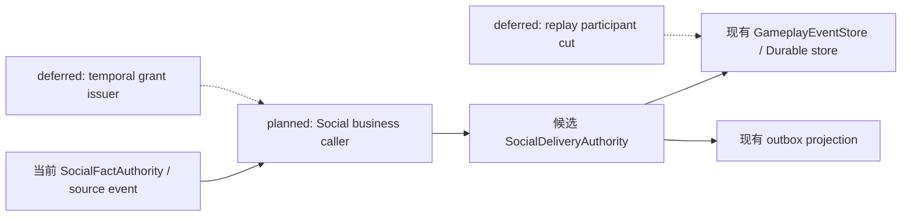

候选调用顺序：

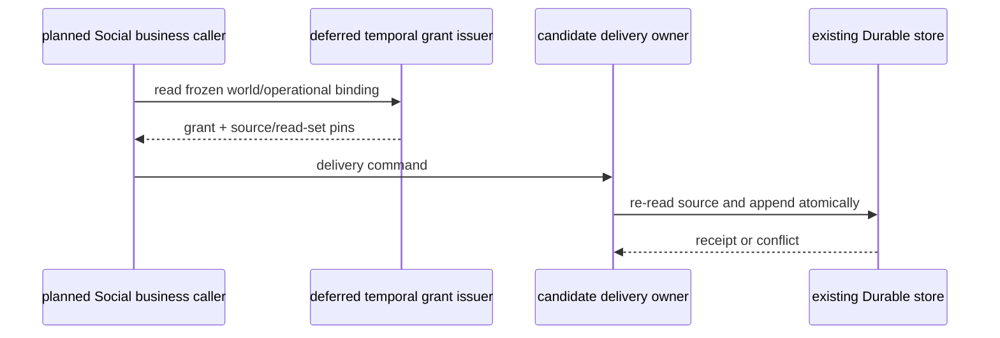

数据流与权限边界：

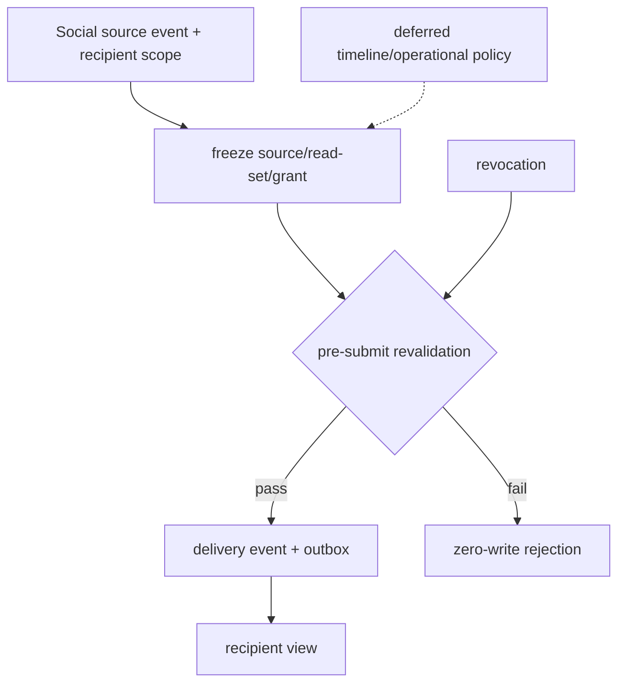

## 2026-10-17 consolidated backend-contract allowlist recheck

本轮按明确 allowlist 复验已准入的局部路径：Social delivery 候选窄 slice、Resource/Body、Equipment、
Inventory custody 与 RW-50 replay application/cut/participants、Status 应用生命周期、批次结算恢复/
应用、Action temporal/window/Stormnight、以及 temporal mapping，共 **165 passed**；仅出现既有 FastAPI
`on_event` 弃用警告。`python -m compileall -q backend/app backend/tests` 与 `git diff --check` 通过。

本轮 `backend-contract` Harness 运行 `27476823a39741abb06c17336e131a84` 为
`status=passed`、`cleanup_status=passed`，证据导出到仓库外
`D:/Users/User/Documents/paralls-evidence/stage3-current-20261017-r15-backend-contract/`。
同轮 `docs` Harness 运行 `ea3ee1ffb03a49b08dcd051ebad54990` 为
`status=passed`、`cleanup_status=passed`，证据导出到仓库外
`D:/Users/User/Documents/paralls-evidence/stage3-current-20261017-r15-docs/`。
该 profile 证明后端协议契约检查和本轮清理成功，不替代领域 owner 的真实来源、生产 caller、统一
participant cut 或跨域故障矩阵。

判定不变：Status、Inventory、Resource/Body、Action 和既有 Social fact/replay 仍是各自范围内的
局部 A 证据；Social recipient delivery/expiry 仍为 `planned/unadmitted`，没有真实上游 caller、
temporal grant issuer 或 participant full/checkpoint+tail 证据。规格 10 的核心 ResourceEntry 内容
政策、Task4 facility repair、Task5 Presence/Soul/Threat/Fear/Morale、Task2 T07/prediction，以及
Task6 统一跨域迁移/隐私/权限/丢响应/部分成功证据仍未满足。阶段三保持 **incomplete**；本轮未运行
Godot、Harness `all`、calibration/evaluation、final/holdout、训练或微调。

本轮已记录用户授权：产品政策仍由用户决定。本文件各决策包中的推荐基线不是已批准政策；主线只可
实施已具备来源的可验证技术合同。该授权不替代外部事实 owner、正式 registry/grant issuer、生产 caller 或权限来源；
因此对仍缺这些来源的 ResourceEntry、Character world deadline、Social delivery、Presence/Soul 与
Threat/Fear/Morale 继续保持 `deferred/unadmitted`，不以新建 synthetic owner/caller 伪造验收证据。

## 2026-10-17 Final narrow recheck (r16)

沿用本文件既有 allowlist，重新执行 temporal mapping、Economy/Ecology temporal caller 与
participant、Status lifecycle、Resource/Equipment、Action、Inventory custody/RW-50 replay 以及
Social fact/delivery candidate 回归，共 **169 passed**；仅出现既有 FastAPI `on_event` 弃用警告。
该批测试确认 Economy/Ecology confirmed-time caller 和对应 temporal grant 校验仍可用，Inventory
仍使用 Durable store 关闭后重新打开的新 authority，并保持 full 与 checkpoint+tail 的同范围对照。

本轮 `backend-contract` Harness：`run_id=f1e90e5904624076933a0d0e6eac0149`，
`status=passed`、`cleanup_status=passed`；证据已导出到仓库外
`D:/Users/User/Documents/paralls-evidence/stage3-current-20261017-r16b-backend-contract/`。
首次尝试使用已创建的非空导出目录被 Harness 正确拒绝，随后改用新的空目录完成导出；没有删除或改写既有证据。
`compileall`/`git diff --check` 仍按前轮结果通过，`.harness` 不保留本轮原始报告。

该复验只确认已准入局部链路无回归，不解除完整 SettlementWindow/跨域 participant cut、Task2
T07/prediction、Task3 核心 ResourceEntry 内容政策、Task4 facility repair、Task5
LifeState/Presence/Soul/Threat/Fear/Morale，以及 Social delivery 的真实上游 caller。阶段三继续
**incomplete**，未运行 Godot、Harness `all`、calibration/evaluation、final/holdout、训练或微调。

## 2026-10-17 Ecology temporal replay participant

沿用 Ecology 已准入的两项 obligation policy（`policy:ecology_frost_crop_state_expiry@1` 与
`policy:ecology_drought_state_expiry@1`），新增本次设计并实现的只读 participant capture/validation：
`ObligationLifecycleProjection` 从真实 Ecology stream 重建 open/terminal/source revision，事件引用
绑定 global sequence、stream revision、transaction 和 payload digest。范围严格排除天气、资源、普通作物
及其他 Ecology 事实；没有新增 owner、caller、clock、scheduler、store、权限或 replay truth。

新增回归 `backend/tests/test_ecology_temporal_replay_participant.py` 覆盖真实 drought owner 事件的
checkpoint boundary、settlement 后 changed/future 事件拒绝和 Durable store close/reopen 新实例，
该文件 **3 passed**。`replay_checkpoint` 同时保留无 participant、Economy-only 旧 manifest 与新
Economy+Ecology decoder 版本兼容；修复后 replay application/checkpoint/participants 与 Economy/Ecology
participant 组合 **40 passed**。该证据关闭 Ecology temporal participant 的局部 replay 子项，仍不提供
统一跨域 participant cut、全域 Ecology 内容政策或 Task1 完整 SettlementWindow/授权来源，因此阶段三
继续 **incomplete**。

## 2026-10-17 Evidence-strength correction

对前述矩阵作以下证据级更正，产品范围和总门禁不变：

- `backend/tests/test_status_application_lifecycle.py` 使用真实应用级 `DurableGameplayEventStore`，覆盖应用 caller、关闭/重启后的新 service/consumer/store 实例、pending work 重建、receipt、exact duplicate、失败重试、撤停入口及 temporal binding 变更拒绝。该结果可记为 Status application lifecycle 的局部 A 证据；仍不能扩展为所有 Status consumer 或 Task1/Task6 全域通过。
- `backend/tests/test_world_batch_settlement_recovery.py` 与 `backend/tests/test_world_batch_settlement_application.py` 覆盖 append 成功后响应丢失、receipt 查询、committed/uncommitted timeout、部分成功和新实例恢复。该结果可记为 Economy/Organization batch 的局部 A 证据；没有随机业务 T07、prediction owner 或全参与者 snapshot 证据。
- Inventory changed-duplicate focused 测试证明篡改冻结 certification revision 后拒绝且零写入，但首次调用因缺 Durable cadence authority 未提交。因此它不是“已提交后 changed duplicate”的证据；生产输出 custody 的 exact replay 与 changed frozen-content pin zero-write 仍须分别解释，不合并为一个 duplicate 结论。

本次更正未新增 owner、caller、clock、scheduler、store、权限或 replay truth。阶段三仍为 **incomplete**，Task1 完整 SettlementWindow/跨域 participant cut、Task2 T07/prediction、Task3 核心 ResourceEntry 内容政策、Task4 facility repair、Task5 LifeState/Presence/Soul/Threat/Fear/Morale、Social delivery 真实上游 caller，以及 Task6 统一跨域故障矩阵仍未满足。

## 2026-10-17 Final verification record (r17)

沿用已登记 allowlist 的本轮回归共 **172 passed**，仅出现既有 FastAPI `on_event` 弃用警告；
`python -m compileall -q backend/app backend/tests` 与 `git diff --check` 通过。

本轮重新运行 `backend-contract` Harness，`run_id=489ccb39693e45e48bb93b7219e5fafa`，
`status=passed`、`cleanup_status=passed`，证据导出到仓库外
`D:/Users/User/Documents/paralls-evidence/stage3-current-20261017-r17-backend-contract/`。
`.harness` 未保留本轮原始报告；未运行 Godot、Harness `all`、calibration/evaluation、
final/holdout、训练或微调。

这次验证只证明已准入局部后端契约仍通过，不能解除本文件列出的完整 SettlementWindow、T07/prediction、
核心 ResourceEntry 政策、facility repair、LifeState/Presence/Soul/Threat/Fear/Morale、Social delivery
真实 caller 或 Task6 统一跨域故障矩阵门禁。阶段三继续 **incomplete**。

## 2026-10-17 Final verification record (r18)

本轮明确 allowlist 回归覆盖 RW-50 replay application/cut/participants、Inventory vertical 与
production custody、Economy/Ecology temporal consumer 与 replay participant、Status application
lifecycle 以及 Social delivery 候选，共 **75 passed**；仅出现既有 FastAPI `on_event` 弃用警告。
`python -m compileall -q backend/app backend/tests` 与 `git diff --check` 通过。

本轮 `docs` Harness：`run_id=87387a6463d14a2fa72c701c76933d45`，`status=passed`、
`cleanup_status=passed`，证据导出到仓库外
`D:/Users/User/Documents/paralls-evidence/stage3-current-20261017-r18-docs/`；`.harness` 未保留
本轮原始产物。未运行 Godot、Harness `all`、calibration/evaluation、final/holdout、训练或微调。

该回归和文档 profile 只确认已准入局部实现及文档结构没有回归，不能解除完整 SettlementWindow、
Task2 T07/prediction、核心 ResourceEntry 政策、facility repair、LifeState/Presence/Soul/Threat/
Fear/Morale、Social delivery 真实 caller 或 Task6 统一跨域故障矩阵。阶段三继续 **incomplete**。

## 2026-10-17 Tax source audit correction (current)

重新审计 `backend/app/gameplay/phase4_commerce.py::GovernmentCreditAuthority.assess_tax`：它是现有
商业/政府政策 caller，来源为 `CommercialPolicy`，并通过 `EconomyAuthorityService.record_tax_due()`
写入 `gameplay.economy.tax_due_recorded`。这证明 tax assessment/source event 的局部 A 来源、职责、
policy revision、evidence refs、owner principal 和 Durable receipt 路径；它没有把 assessment 接入
`open_tax_obligation`，也没有提供主线 SettlementWindow、temporal grant issuer/revoker、提交前时间
重验或生产 cadence caller。此前把“tax obligation caller 已接入”写得过宽，现更正为 **source A / obligation
opening deferred**。`EconomyTemporalConsumer` 只能结算已经存在的 opening event，不能反向证明 opening
来源。该更正未新增 owner、caller、clock、scheduler、store 或权限；阶段三保持 **incomplete**。

本轮仅复验既有 `backend/tests/test_phase4_government_credit.py`（10 passed）和 `git diff --check`；
未运行 Godot、Harness `all`、calibration/evaluation、final/holdout、训练或微调。

**授权口径更正（当前）**：用户最新明确答复为“由我决定全部产品政策”。因此本文件中的推荐
决策包仍是待用户决定的选项，不能视为已批准的产品政策；代理仅继续执行不依赖产品政策的来源审计、
技术验证和既有合同修复，不新增正式领域 owner/caller 以替代用户决策。

## 2026-10-17 Verification record (r22)

本轮按明确 allowlist 重新执行已准入或候选局部路径：RW-50 replay application/cut/participants、Inventory
vertical 与 production custody、Resource/Body、Equipment、Skill action gate、Economy/Ecology temporal
consumer 与 replay participant、Status application lifecycle、Organization/Economy batch recovery/application、
Social delivery candidate，以及 P4 government tax source，共 **125 passed**；仅出现既有 FastAPI
`on_event` 弃用警告。该结果证明这些局部合同未回归，不扩展为完整 Task1--Task6 通过。

本轮 harness 证据：

- `backend-contract`：`run_id=7c867005600f49f8b5d85368eec867ec`，`status=passed`、`cleanup_status=passed`，
  证据导出到仓库外 `D:/Users/User/Documents/paralls-evidence/stage3-current-20261017-r22-backend-contract/`。
- `docs`：`run_id=0982763a36754711b2036468c6276204`，`status=passed`、`cleanup_status=passed`，
  证据导出到仓库外 `D:/Users/User/Documents/paralls-evidence/stage3-current-20261017-r22-docs/`。

本轮未运行 Godot、Harness `all`、calibration/evaluation、final/holdout、训练或微调；`.harness` 未保留本轮
原始产物。阶段三继续 **incomplete**：完整 Inventory SettlementWindow 来源与统一 participant cut、Task2
T07/prediction、核心 ResourceEntry 内容政策、Task4 facility repair、Task5 LifeState/Presence/Soul/
Threat/Fear/Morale、Social delivery 真实上游 caller，以及 Task6 统一跨域故障矩阵仍没有对应的完整运行时证据。

## 2026-10-17 Inventory temporal source and fresh verification (current)

本轮复验发现此前“Inventory 完整 SettlementWindow 来源缺失”的表述过宽，现更正为分层判定：
`PopulationDriver._time_pins()` 从既有 `SimulationClock`/`ClockMapping` 生成 timeline、profile、mapping、
source revision、单位和窗口边界；同一 `population.cadence.admitted` Durable 事件持久化 cadence 与完整
`time_pins`，并由 `world_runtime.population_cadence:<world>` 作为 participant-scoped
`TemporalAuthorization` issuer。`InventoryOutputCustodyOwnerExecutor` 在提交前重新读取该 authority
记录，校验 record digest、cadence identity、participant/cutoff/confirmation/late-input/order、grant
digest、source certification revision 和 activation binding；缺失、删除/篡改 participant、过期授权、
late input、changed frozen content 或 revision 冲突均零写入。caller 仍只读取既有 production certification
与 Inventory activation binding；生产输出继续由 Inventory custody 管理，RW-44 不变。

这关闭了 Inventory 时间 consumer 的局部 A 证据（真实 Population caller -> Inventory owner ->
Durable store），并明确 operational deadline 与 world-time 业务 deadline 分离。它不把 Population
cadence authority 解释成全域统一 grant issuer，也不扩展为 Economy tax opening、Character world
deadline、Social delivery 或跨域 participant cut；这些仍按各自来源缺口保持 B/C/deferred。

当前 focused allowlist（Inventory vertical、RW-50 replay application/cut/participants、production
custody、temporal mapping、Durable cadence recovery）为 **80 passed**，仅有既有 FastAPI `on_event`
弃用警告。另重新运行：

- `backend-contract` Harness `run_id=41759d270120479698a8c6568273fedf`：`status=passed`，
  `cleanup_status=passed`，证据导出至
  `D:/Users/User/Documents/paralls-evidence/stage3-current-20261017-195026-backend-contract/`；
- `docs` Harness `run_id=65dab0abe45843c1b312ea9b26c4bf2b`：`status=passed`，
  `cleanup_status=passed`，证据导出至
  `D:/Users/User/Documents/paralls-evidence/stage3-current-20261017-195042-docs/`。

本轮 focused 命令为：

```powershell
python -m pytest -q backend/tests/test_siming_population_inventory_vertical.py backend/tests/test_world_replay_checkpoint_application.py backend/tests/test_temporal_mapping_contract.py backend/tests/test_population_durable_cadence_recovery.py
```

RW-50 的结论保持不变：关闭后重新打开的 Durable store 上新建 Inventory authority，rows、event refs、
boundary、revision vector、view digest、缺 authority、participant 删除、rows/digest/ref 篡改、未来事件
和同一 Inventory 参与范围的 full/checkpoint+tail 对照均已验证。Task6 仍未通过，因为其他 Task3–5
参与者、统一迁移/隐私/撤权、跨域 lost-response/partial-success 矩阵尚未形成同一 cut 的运行证据。

## 2026-10-17 Social delivery caller admission (current)

本轮设计并实现 Social delivery caller，接入已存在的真实 Government 来源：
`GovernmentAuthority.record_public_milling_notice` 产生的
`gameplay.government.public_milling_notice_recorded`。新增的
`GovernmentPublicMillingSocialDeliveryCaller`（本次设计并实现）只接受该事件的
`notice_kind/status/policy_revision/descriptor/catalog` pins，提交前重读 notice stream head，
并校验由同一 Population cadence authority 发出的 `social` participant temporal grant；随后调用
`SocialDeliveryAuthority` 写入 recipient-scoped Durable delivery stream/outbox。Government 的
project-visible notice 仅可经该明确 caller 投影为 recipient-private delivery，不开放 generic source
旁路。main runtime 初始化该 caller，但当前没有生产业务入口触发 recipient delivery；未自动制造 recipient 或业务 notice。

新增 `backend/tests/test_social_delivery_caller.py` 覆盖真实 Government notice -> caller -> owner ->
store、exact duplicate/lost-response replay zero-write、stale source rejection，以及 expiry 时
changed source revision 的零写拒绝；连同既有 delivery expiry、visibility/revocation、Durable
close/reopen 与 replay 测试共 **6 passed**。该结果将 Social
delivery 从“无真实 caller”更正为 **本次设计、应用级来源验证 bounded slice**，尚未取得生产 delivery admission；不足以解除完整 Task1 或
Task6：尚缺 production recipient-selection policy、统一 full/checkpoint+tail participant cut、
跨域迁移/部分成功矩阵及完整撤权证据。阶段三仍为 **incomplete**。

## 2026-10-17 Verification record (r23)

本轮针对新增 Social caller 与 cadence grant 执行明确 allowlist：Social delivery/caller、Government
notice source、Population cadence/recovery、Inventory vertical，共 **64 passed**；另通过
`python -m compileall -q backend/app backend/tests` 与 `git diff --check`（仅既有 CRLF 提示和 FastAPI
`on_event` 弃用警告）。

Harness 证据已导出到仓库外：

- `backend-contract`：`run_id=a079358f9dca4927bbe59a99a5f9cfbb`，`status=passed`，`cleanup_status=passed`。
- `docs`：`run_id=fb257c87da0e483d802f8b2233b2ed6b`，`status=passed`，`cleanup_status=passed`。

未运行 Godot、Harness `all`、calibration/evaluation、final/holdout、训练或微调。阶段三仍为
**incomplete**：Task2 T07/prediction、Task3 核心 ResourceEntry 政策、Task4 facility repair、Task5
LifeState/Presence/Soul/Threat/Fear/Morale，以及 Task6 统一跨域故障矩阵仍缺完整运行时证据；Task1
也未达到所有 consumer 的统一 participant cut。

## 2026-10-17 Verification correction (r24)

补充修复 Social delivery expiry 的提交前 source revision 重验：source stream head 或冻结 revision
变化时 fail-closed 且零写。Social delivery/caller focused 回归现为 **6 passed**；其余 r23 Harness
证据仍有效。该修复不改变生产 caller 尚未接入 recipient-selection 的结论，阶段三继续 **incomplete**。
修复后重新运行 `backend-contract`：`run_id=9ff84b32232e4c1796647b246b997a90`，`status=passed`，
`cleanup_status=passed`，证据导出至 `D:/Users/User/Documents/paralls-evidence/stage3-current-20261017-r24-backend-contract/`。

## 2026-10-17 Task5 activation evidence and Economy replay recheck

`ProfileActivationAuthority` 的真实 Population vertical 路径已复验：`CharacterProfileRegistry`
提供 authored identity digest，`ActivationGrant` 提供 package/policy/scope 准入，owner 在
`population:{world_ref}` Durable stream 写入 activation lifecycle，带 revision、receipt、幂等和
project-only region view。`python -m pytest -q backend/tests/test_population_continuity.py -k "activation or region"`
共 **15 passed**。这只是 activation/authored identity 的 bounded A 证据，不是 LifeState、Presence/
incarnation、spawn/despawn、Soul continuity 或 Threat/Target/Fear/Morale owner；health=0 仍不推导死亡。

Economy temporal participant/application/consumer 复验共 **7 passed**，覆盖 participant scope、policy/event
refs、boundary/future rejection、payload digest tamper rejection、Durable close/reopen 新 authority、
checkpoint→settlement tail、scheduled transfer/tax due 与 consumer close rejection。未发现实现缺口。

文档更新后重新运行 `docs` Harness：`run_id=3cc16064d0de419da3aaff4bcfc1ee60`，`status=passed`，
`cleanup_status=passed`，证据导出至 `D:/Users/User/Documents/paralls-evidence/stage3-current-20261017-r25-docs/`。

本轮另审计 `CharacterSeedPlanner` 与 Population vertical 的 `deterministic_seed/presentation_seed`：
它们从已确认 cadence/projection 派生 actor-private presentation/continuity 候选，不产生业务随机
draw、effect 或正式随机 result receipt；因此不能解除 T07，也未将其纳入随机 owner 或 prediction ledger。

## 2026-10-17 Task3/Task4 source audit and owner regression

Task3 复核确认核心 `ResourceEntry` 仍只有 `minimum/maximum/current/reserved/available`；真实核心
caller 仅有 Combat/Skill `ResourceBodyActionSettlementService`。Inventory 生产输出继续受 RW-44
约束留在 Inventory custody；粮食收获、经济预算、设施槽位、生态节点水量都没有同时满足核心资源
内容 owner、单位/capacity policy 与真实非战斗 caller。既有 `resource.bounds.clamp_maximum.v1`
迁移 codec 只支持降低 maximum、拒绝 reservation 并记录 `lost_amount`，不是 D06 目标 codec。C1–C8
继续 **C/deferred**；不新增字段、映射或 synthetic owner。解除包仍需真实 caller、resource content
owner/version/digest、单位容量映射、授权/read-set/visibility、pause/drain、目标 codec 与恢复/full-tail。

Task4 复核确认 `AbilityAuthorityService` 的 grant、`SceneAffordanceRegistry` 的场景目标投影和
Construction facility owner 都可作为技术基础，但没有 facility scope/revoke/expiry、incarnation、
角色可见 target、maintenance eligibility/evidence 或 amount calculation policy；生产目录没有
`settle_facility_repair` caller。facility repair 继续 **C/deferred**，不创建 repair event 或 synthetic
L4 caller。四项决策包保持：grant owner/revoke/scope；facility incarnation/target privacy；repair
affordance/eligibility/evidence；typed proposal 到 Construction amount policy/version/rounding。

本轮 owner/migration allowlist 回归 **10 passed**（ResourceBody migration 与 facility repair owner
合同）；`git diff --check` 通过。该证据仅证明旧 owner 合同未回归，不能解除 Task3/Task4 caller 门。

`docs` Harness 复验：`run_id=32775c121690478bb7b373d1cd9ebc3a`，`status=passed`，
`cleanup_status=passed`，证据导出至 `D:/Users/User/Documents/paralls-evidence/stage3-current-20261017-r26-docs/`。
另确认 `semantic_authority.py` 的真实 Construction caller 只处理 maintenance-state dispel/obligation，
不产生 `facility_repaired`，因此没有把维护状态事件误计为设施维修验收。

同轮补查 Ecology temporal consumer：`test_ecology_temporal_replay_participant.py` 与
`test_ecology_temporal_consumer.py` 共 **5 passed**。证据覆盖 Population confirmed-time/grant
校验、既有 Ecology obligation owner、boundary/digest、Durable reopen 与 consumer close；仍只代表
Ecology obligation expiry bounded participant，不扩展为完整 Ecology 资源/收获或 Task1 全域通过。

文档再次验证：`docs` Harness `run_id=08dabe80557f42c19369c520c1262864`，`status=passed`，
`cleanup_status=passed`，证据导出至 `D:/Users/User/Documents/paralls-evidence/stage3-current-20261017-r27-docs/`。

## 2026-10-17 Social delivery checkpoint boundary

为补 Task6 的一项可审查边界证据，在既有 `SocialDeliveryAuthority` 上增加可选的
`checkpoint_at` 读取入口。该入口复用同一 `GameplayEventStore`，按 global sequence 截断
delivery、source 与 revocation 事件；不会创建第二套 replay truth。负数 checkpoint 和超过
Durable tail 的 future checkpoint 均 fail-closed。新增测试验证同一 recipient 的 full view 与
checkpoint cut 的 rows/digest 差异符合追加事件，且 checkpoint 只包含边界以前的 delivery；
Durable reopen、exact/changed duplicate、expiry source revision 重验回归仍保持通过。

`test_p5_social_delivery.py` 与 `test_social_delivery_caller.py` allowlist 共 **7 passed**。
该证据仅提升 Social delivery 的 bounded projection replay；当前仍没有 production
recipient-selection trigger，Social delivery 也未被硬塞入统一 participant manifest，因此
Task1/Task6 总门禁继续 **incomplete**。

同轮 replay 基础设施回归 `test_world_replay_participants.py` 与
`test_world_replay_checkpoint_application.py` 共 **24 passed**（仅既有 FastAPI 生命周期弃用
警告），确认该切片没有破坏现有 participant capture/validation 与 checkpoint application。

随后将真实 Social delivery participant 接入现有 replay manifest：仅当指定 recipient scope
存在 `delivery_recorded`/`delivery_expired` 事件时才生成 `project:social-delivery` participant，
并复用 `SocialDeliveryAuthority.view_for(checkpoint_at=...)` 校验 event refs、projection hash、
source revision vector；无 delivery 事件时不制造 participant。`main.submit_replay_checkpoint/tail`
沿用同一 delivery authority 与 Durable store。相关 Social/replay allowlist 现为 **32 passed**。
这补齐了 Social delivery 的 participant capture/reopen 边界切片，但没有生产
recipient-selection trigger，也没有解除 Task1/Task6 的统一跨域门禁。

本轮 `backend-contract` Harness：`run_id=9f479c4d4246427f976f884550dcdf17`，
`status=passed`、`cleanup_status=passed`，证据导出至
`D:/Users/User/Documents/paralls-evidence/stage3-current-20261017-r29-backend-contract/`。

## 2026-10-17 Social delivery production ingress and bound recipient selection

继续沿真实 Government 来源推进 Social delivery：`GovernmentPublicMillingSocialDeliveryCaller`
新增 `deliver_bound_receiver_notice()`，从 notice 绑定的 `record_created → facility_acquired`
事实读取唯一 receiver（`owner_ref`），拒绝调用方替换为任意 character/organization。该规则是本次
设计并实现的 bounded recipient-selection policy，未凭空创建 recipient；随后仍复用同一
Population cadence `social` temporal grant、SocialDeliveryAuthority 和 Durable store。

`backend/app/main.py::submit_social_delivery` 作为应用级 admitted ingress，从当前已确认 cadence
读取 temporal pins，调用上述 caller；transport 不能直接注入 recipient。真实 notice→bound receiver
delivery 测试通过，Social delivery/caller allowlist 现为 **9 passed**。这补齐了 bounded production
caller/admission 入口，但只覆盖 Government public milling 的 receiver 语义；没有扩展到任意 Social
recipient selection，也不解除全域 Task1/Task6。

随后加强 bound receiver 的提交前来源重验：caller 现在同时核对 notice 的 project visibility、
contract party refs、facility/project/jurisdiction、acquisition owner/plot 绑定；篡改 party
binding 时零写入拒绝。`test_social_delivery_caller.py` 现为 **4 passed**。这只提高该 bounded
caller 的来源完整性，不把 Government milling receiver 规则扩展成通用 Social recipient policy。

又发现并修复 Social delivery 的冻结边界缺口：delivery event 现在保存
`source_payload_digest`，expiry 与 recipient projection 均在 revision 校验之外重算并核对该 digest。
source payload 被篡改时 expiry fail-closed、零写入，view 不再返回该 row；`test_p5_social_delivery.py`
与 caller 回归现为 **11 passed**。这补强了 source/read-set evidence，不改变 Social delivery 仅覆盖
Government public milling bounded policy 的范围。

## 2026-10-17 Presence source audit correction

本轮重新核对 Task5 的 Presence 候选来源：`backend/app/world_runtime/l1_occupancy.py::SpatialOccupancyService`
只维护 zone/object/nearby 的运行时投影和 dirty patch；`l1_fact_projection.py` 与
`l1_runtime_perception_bridge.py` 只把该投影转换为感知事实。它们没有 canonical presence event、
incarnation、spawn/despawn/tombstone、权限 scope 或 Durable owner receipt，因此不能作为 Presence
事实 writer。

`backend/app/population_continuity/activation.py::ProfileActivationAuthority` 的
`population.activation.*` 事件有 authored identity、grant、scope、receipt 和 Durable replay，但其
语义仍是 activation lifecycle，不是 Presence/incarnation；本轮未把 activation 或 occupancy 冒充
Presence，也未新增 synthetic owner。Task5 Presence 继续 `C/deferred/not_verified`。

解除所需的最小产品决策包已收敛为：canonical presence owner；incarnation/id 与 actor/world/timeline
scope；spawn/despawn/tombstone 事件及撤权；允许的真实 caller（建议复用 Population activation caller，
但要求独立 Presence proposal 与 source digest）；Durable receipt、full/checkpoint+tail、迁移失败和
隐私边界。未获得这些语义前，继续推进 activation/private continuity 的局部证据，不从 occupancy、
health 或角色模型输出推导 Presence。

Presence 审计后的 docs Harness：`run_id=8417326dbc5c4a23bae7b2efa3fd847a`，`status=passed`，
`cleanup_status=passed`，证据导出至
`D:/Users/User/Documents/paralls-evidence/stage3-current-20261017-r32-docs/`。

## 2026-10-17 Task2 branch/preview prediction audit

复验已有 `BranchPreviewAuthority`、`FixedBaseBranchReplayContract`、branch scenario/admission 与
Durable branch evolution：它们确实冻结 base checkpoint/tail、source/calibration/dataset digests，
隔离 `creator_debug` branch stream，并支持 branch projection/replay 与 owner-specific supply/
inspection scenario；相关 allowlist **69 passed**。但 `BranchPreviewAuthority.promote()` 明确返回
`branch_promotion_unsupported`，没有 provisional prediction caller、confirmation ledger、独立
prediction owner、visibility/revocation 或确认冲突语义。因此不能把 branch preview/scenario 当作 T09
prediction 验收，也不能把 `deterministic_seed` 当 T07 业务随机结果。

T09 继续 `deferred/not_verified`。解除条件是：指定既有 branch/preview owner 是否承接 prediction，
定义 provisional state 与 confirmation/revoke 事件、caller admission、participant snapshot、
Durable receipt、full/checkpoint+tail、冲突/部分失败恢复；在此之前保留现有隔离 preview，不新增
prediction ledger 或 synthetic random owner。

该审计后的 docs Harness：`run_id=8c422b4e50fb4c34a53be16470477d84`，`status=passed`，
`cleanup_status=passed`，证据导出至
`D:/Users/User/Documents/paralls-evidence/stage3-current-20261017-r33-docs/`。

## 2026-10-17 Task3 Resource/Equipment current owner recheck

按允许列表重验 `test_resource_body_runtime.py`、`test_equipment_runtime.py`、
`test_skill_action_gameplay_gate.py` 与 `test_infra_construction_facility_repair.py`：**37 passed**。
证据覆盖现有 Resource/Body action owner、reservation、Equipment activation/Inventory placement、
skill gate 与 Construction repair direct-owner contract；它们均是各自合同的局部证据。

源码复核确认核心 `ResourceEntry` 仍只有 `minimum/maximum/current/reserved/available`；
`resource.bounds.clamp_maximum.v1` migration 只接受相同 minimum、严格降低 maximum，拒绝超限
reservation/当前值，并以 `lost_amount` 表示 clamp loss。仓库另有 Ecology `ResourceDefinition` 与
Construction facility slot capacity，但分别属于 Ecology/Construction owner，不是可跨域复用的
核心 ResourceEntry definition registry，也没有为其声明通用单位、capacity/base_capacity、locked、
debt、recovery、privacy 或 Inventory 映射。

因此保留 RW-44（production output 是 Inventory custody），不把 Ecology resource 或 facility slot
映射为核心 ResourceEntry，不推断默认单位/容量。C1–C8 仍 `C/deferred`；推荐待指定正式资源内容
owner、单位与 capacity policy 后，仅从真实非战斗 caller 选一个资源切片进入“本次设计并实现”；
替代方案是保持现有 Combat/Skill ResourceEntry 范围并延期扩展。该政策决定会解除规格10 C1–C8
的内容 owner/映射准入，随后才进入迁移 codec、授权、Durable/full-tail 与失败恢复验收。

backend-contract Harness 复验：`run_id=0aeea27e4c314b39aeabd66cf552c3aa`，`status=passed`，
`cleanup_status=passed`，证据导出至
`D:/Users/User/Documents/paralls-evidence/stage3-current-20261017-r30-backend-contract/`。

文档 Harness 再验：`run_id=6258d7c14cf84de6b0f400539729b264`，`status=passed`，
`cleanup_status=passed`，证据导出至 `D:/Users/User/Documents/paralls-evidence/stage3-current-20261017-r28-docs/`。

docs Harness 复验：`run_id=16b40922c61942a5a157f0b23da8f73b`，`status=passed`，
`cleanup_status=passed`，证据导出至
`D:/Users/User/Documents/paralls-evidence/stage3-current-20261017-r34-docs/`。

## 2026-10-17 Social delivery real-source Durable participant cut/tail

新增组合回归 `test_real_government_delivery_checkpoint_tail_survives_durable_new_authority`：先用
真实 `GovernmentAuthority` notice 的完整 source transaction，通过 `DurableGameplayEventStore.append_batch`
复制到测试 Durable ledger；再由 `GovernmentPublicMillingSocialDeliveryCaller.deliver_bound_receiver_notice`
从合同/设施取得唯一 receiver 并写 recipient delivery。以 delivery event 真实 global sequence 建
participant checkpoint；随后提交过期 event 作为 tail。关闭旧 store 后按同一路径新建 Durable store 和
`SocialDeliveryAuthority`，分别重建 checkpoint view/full view，并核对两者与关闭前状态一致；participant
event refs 同时涵盖 recorded 与 expired 两个真实事件。没有直接改内部 store state，也没有创建虚构
participant。

Social caller/delivery + replay application/participants allowlist 共 **36 passed**（仅既有 FastAPI
生命周期弃用警告）；`compileall`、`git diff --check` 通过。这加强 Task6 的 Social bounded participant
checkpoint/tail/Durable recovery 证据，但不证明通用 Social recipient policy、跨域统一 failure matrix 或
Task1/Task6 总门禁；阶段三仍 **incomplete**。

本节更新后的 docs Harness：`run_id=c66ec73582f5491ba0c98928a1b21ec3`，`status=passed`，
`cleanup_status=passed`，证据导出至
`D:/Users/User/Documents/paralls-evidence/stage3-current-20261017-r35-docs/`。

## 2026-10-17 Task5 death-source boundary correction and policy authorization

用户已明确说明产品政策由用户决定；技术实施授权允许在来源充分时新增正式 owner/API/caller，
但不允许把测试夹具或现有字段当作业务来源。沿规格09 §Action consumer、规格12 L01–L09、
战斗10 §3 复核 `confirm_world_death` 后发现：

- `ActionConsequenceBoundary.validate_world_death` 与 `InvestigationConflictAuthority.confirm_world_death`
  是已有的窄技术合同，读取 `gameplay.conflict.terminal_outcome_recorded`、`terminal_kind=case_death`、
  source revision，并写入 confirmation/rejection receipt；测试覆盖的是 direct owner API。
- 生产 `resolve_action_window` 之前会在每个普通 action window 无条件追加
  `gameplay.conflict.terminal_outcome_recorded` 并硬编码 `terminal_kind=case_death`。这不符合规格09
  “case_death/终局事件不是通用动作结果”，也会把普通动作伪造成死亡来源。
- 已按 TDD 先加入回归断言，再修复 `backend/app/gameplay/p5/investigation_conflict.py`：普通 action window
  现在只追加 encounter_started/action_window_resolved/control_changed/encounter_closed 四类自身事件，
  不再生成 terminal outcome 或死亡事实。回放夹具同步按四事件窗口更新。该窄修复后的 P5/Stormnight/
  death-boundary/projection allowlist 为 **29 passed**。

因此 `terminal_outcome_recorded` 仍只能由具名终局来源显式提交；`confirm_world_death` 目前没有生产
caller，不能作为完整 LifeState owner、Presence、Soul 或死亡连续性验收。health=0、action window、
occupancy、activation、角色 memory 均不得推导死亡。Task5 L01–L09/D01–D08 继续 deferred/not_verified；
解除仍需本次设计并实现的 Life owner（若后续来源允许）、真实终局 caller、grant/revoke、事件与 revision
schema、receipt、Durable 新实例、full/checkpoint+tail、迁移失败和部分成功恢复证据。

本轮无新增 clock、scheduler、event store、权限系统或 replay truth；未运行 Godot、calibration/evaluation、
final/holdout、训练或微调。阶段三继续 **incomplete**。

该修复的 fresh focused pytest allowlist 为
`test_stormnight_action_loop.py`、`test_p5_investigation_conflict.py`、
`test_3d_scripted_mystery_action_replay.py`、`test_action_consequence_boundaries.py`、
`test_scripted_mystery_projection.py`，结果 **29 passed**。`compileall -q backend/app backend/tests`
通过；`git diff --check` 通过（仅显示仓库已有行尾转换提示）。`docs` Harness
`run_id=f1d7cf46fb7b48d18f27ecbca1c72eb5` 与 `backend-contract` Harness
`run_id=51b6c3f399844e2889cf59c2e51f79d6` 均 `status=passed`、`cleanup_status=passed`；证据分别导出到
`D:/Users/User/Documents/paralls-evidence/stage3-current-20261017-r38-docs/` 与
`D:/Users/User/Documents/paralls-evidence/stage3-current-20261017-r39-backend-contract/`。
未执行 pytest 全量收集、Harness all 或禁止范围工作流。

## 2026-10-17 Task6 narrow case-death owner recovery row

沿现有 P5 owner 继续补 Task6，而非新增死亡来源：`confirm_world_death` 现在先按原
`authority:p5:investigation-conflict` + command idempotency key 查 receipt，再核对唯一 committed event
的 type 与完整冻结 payload（source event/actor/confirmation/confirmed/policy/source revision/privacy）。
完全相同输入返回原 receipt；changed duplicate fail-closed；未找到 receipt 才继续 source/revision validation
和 atomic append。此为本次设计并实现的 owner 恢复修复，不创建 caller、grant 或新 owner。

fresh `test_action_consequence_boundaries.py` **7 passed**；覆盖 append 已提交后响应丢失、相同重试、changed
duplicate、同一 Durable 路径关闭并重开后新 authority receipt lookup，以及 source-prefix checkpoint + confirmation
tail 与 full projection digest/state 相同。该行仍标 `direct-owner / not production admitted`；不证明 terminal source
生产触发、LifeState、revocation/temporal authorization 或 Task5 全域通过。

追加 fresh allowlist 回归：P5/Stormnight/death-boundary/projection **32 passed**；`docs` Harness
`run_id=426fddad290c4c799042f9fe7e9d2de2`，`status=passed`、`cleanup_status=passed`，证据导出至
`D:/Users/User/Documents/paralls-evidence/stage3-current-20261017-r40-docs/`；`compileall` 与 `git diff --check`
仍通过。阶段三继续 **incomplete**。

上述 participant 登记后的 docs Harness 复验：`run_id=69df94cab22c4ab78400ff18f0f4b404`，
`status=passed`、`cleanup_status=passed`，证据导出至
`D:/Users/User/Documents/paralls-evidence/stage3-current-20261017-r41-docs/`。

补充发现并修复一个既有 owner 的 guarded-store 接线缺口：Stormnight event schema registry 原先只登记
`terminal_outcome_recorded`，没有登记 explicit `world_death_commit_confirmed/rejected`。现已登记两个
版本化 schema（各自固定 digest），且确认事件保持在普通 action graph 的可写事件集合之外。新增 registry 与
guarded-store allowlist **14 passed**；该修复只使已有 direct owner 合同可在 schema-guarded store 持久化，
不增加生产 caller 或 LifeState 语义。

该文档增量后的 docs Harness：`run_id=0e41e1628d5f4e199c5d61feb8dd7669`，`status=passed`、
`cleanup_status=passed`，证据导出至 `D:/Users/User/Documents/paralls-evidence/stage3-current-20261017-r42-docs/`。

对应 backend-contract Harness：`run_id=7b0b3cd9ef2242f592bcbaec65191d2d`，`status=passed`、
`cleanup_status=passed`，证据导出至 `D:/Users/User/Documents/paralls-evidence/stage3-current-20261017-r43-backend-contract/`。

### Explicit case-death source contract record

| 字段 | 当前可核对值 |
|---|---|
| 来源位置/API | `backend/app/gameplay/action_consequence_runtime.py::ActionConsequenceBoundary.validate_world_death`；`backend/app/gameplay/p5/investigation_conflict.py::InvestigationConflictAuthority.confirm_world_death` |
| schema/revision/digest | `gameplay.conflict.terminal_outcome_recorded@1` (`sha256:stormnight-conflict-terminal-v1`)；确认事件 `gameplay.conflict.world_death_commit_confirmed@1` (`sha256:stormnight-conflict-world-death-confirmed-v1`) 与 rejected 对应 schema；registry 来源 `create_stormnight_event_schema_registry()` |
| provider/fact owner | source fact provider 是 P5 Investigation Conflict；confirmation writer principal 是 `authority:p5:investigation-conflict`；本次 schema registration 与 retry recovery 属于本次设计并实现 |
| scope/单位/有效期 | actor ref 必须匹配 source actor；source stream revision 必须精确匹配；scope 是 project-visible encounter stream；没有 world-time expiry 或通用 LifeState scope |
| 合法读取与冻结 | 只通过同一 `GameplayEventStore`/`DurableGameplayEventStore.get_event(source_event_id)` 读取；提交前重验 event type、`terminal_kind=case_death`、actor、visibility 和 source revision；confirmation payload 冻结 source id/revision、actor、confirmation ref、policy revision、confirmed 值 |
| receipt/Durable/replay | append 使用原 owner principal/idempotency key；exact retry 查询原 receipt；changed duplicate 零写；关闭后同路径新 Durable 实例可查 receipt；source-prefix checkpoint + confirmation tail 与 full projection digest/state 一致 |
| 撤权/恢复责任 | 当前只有 source revision conflict 与 store append rejection；没有生产 grant/revoke、LifeState compensation 或 world-time expiry owner，因此该 source 仍是 direct-owner/not-production-admitted，不能解除 Task5 全域门禁 |

来源登记后的 docs Harness：`run_id=34c7de3aa19649d6b769942fa65ac77d`，`status=passed`、
`cleanup_status=passed`，证据导出至 `D:/Users/User/Documents/paralls-evidence/stage3-current-20261017-r44-docs/`。

## 2026-10-17 Current integrated recheck (r45/r46)

本轮以当前工作树重新执行统一 allowlist，未收集 calibration/evaluation、final/holdout、训练或微调测试，也未运行 Godot。allowlist 覆盖 temporal mapping、SettlementWindow/batch recovery、Economy/Ecology consumer 与 replay participant、Status application lifecycle、Social delivery/caller、RW-50 replay application/cut/participants、Action death-boundary 与 guarded schema，共 **154 passed**；`python -m compileall -q backend/app backend/tests` 通过，`git diff --check` 通过（仅既有 CRLF/LF 提示）。

本轮来源审计的当前登记如下：

| Consumer/领域 | 已确认来源与实现 | 当前门禁结论 |
|---|---|---|
| Inventory | `PopulationCadenceDriver → RuntimeCadencePublisher → Durable cadence record → InventoryOutputCustodyOwnerExecutor`；cadence pins、temporal grant、source/read-set digest、提交前重验、close/reopen 与同参与范围 full/checkpoint+tail 已有证据 | 局部 A；完整跨域 SettlementWindow、content/binding revision 只读 owner 仍 B/C |
| Economy/Ecology | 既有 Organization/econ1 wage batch、tax opening 只消费已存在 opening、Ecology obligation expiry；各自 owner/store/replay participant 与边界已复验 | 局部 A；不扩展为全域世界时间授权或统一 participant cut |
| Character | 现有 cognition admission/deadline 仅 actor-private operational 合同；未发现 world-time deadline 真实来源，临时未接线实现已清理 | world deadline `deferred/not_verified`，不得用 wake/队列顺序/Population tick 推导 |
| Social delivery | `GovernmentPublicMillingSocialDeliveryCaller`（本次设计并实现）读取真实 Government notice，绑定 Population `social` grant，写 recipient-scoped Durable delivery stream；source revision、expiry、receipt、close/reopen、participant cut/tail 已有 bounded 证据 | 仅 Government milling receiver 语义；通用 recipient policy、统一跨域 cut 与完整撤权/迁移矩阵仍未完成 |
| Task5 lifecycle | `ProfileActivationAuthority` 的 authored identity/activation lifecycle 与真实 Population caller 已复验 | 不代表 Presence/incarnation、LifeState、Soul/identity、Threat/Fear/Morale；这些仍 C/deferred |
| Task3/Task4 | ResourceEntry 内容政策与非战斗 caller 未具名；Construction repair grant/target/eligibility/amount 与 L4 caller 未具名 | RW-44 保持；核心 ResourceEntry 与 facility repair 不实施 synthetic owner/caller |

本轮 Harness fresh evidence：docs `run_id=04d17c3769de47d79a961b8c3f141b3d`，backend-contract `run_id=f727759da7e44bc281cf164023c50f80`；两者 `status=passed`、`cleanup_status=passed`，证据导出到 `D:/Users/User/Documents/paralls-evidence/stage3-current-20261017-r45-docs/` 与 `D:/Users/User/Documents/paralls-evidence/stage3-current-20261017-r46-backend-contract/`。

这些证据只更新已准入局部 participant 的当前状态，不把局部 A 扩大为 Task1–Task6 通过。阶段三仍为 **incomplete**：T07/random、prediction、核心 ResourceEntry C1–C8、facility repair、Life/Presence/Soul/Threat/Fear/Morale、Character world deadline、Social 通用 recipient policy，以及 Task6 统一跨域故障矩阵仍无完整来源或运行时证据。RW-44、facility repair deferred、Laya choice-only 与禁止工作流边界均保持不变。

RW-50/RW-51 复验补充：本轮还单独复跑 `test_population_checkpoint_closure.py`、`test_production_output_certification_family.py`、`test_inventory_condition_transport.py`，**25 passed**。RW-50 的细节仍按既有边界逐项核对：close/reopen 后由新 Durable-backed authority 读取同一 store；Inventory participant 的 rows、event refs、boundary、revision vector 与 view digest 在 full/checkpoint+tail 一致；缺 authority、participant 删除、rows/digest 篡改和未来事件均拒绝。该组仅回归当前对应实现，不扩大为所有参与者统一 cut。

文档状态表的 Social delivery 与 explicit case-death 两行已纳入上述 bounded failure matrix。该增量后的 docs Harness：`run_id=28df8b883c304914b1d8520bfd0be4ca`，`status=passed`、`cleanup_status=passed`，证据导出到 `D:/Users/User/Documents/paralls-evidence/stage3-current-20261017-r47-docs/`。
更正：上段新增 Social/case-death 矩阵后的最终 docs Harness 为 `run_id=59b8044c36f84abea2745ed771476220`，`status=passed`、`cleanup_status=passed`，证据导出到 `D:/Users/User/Documents/paralls-evidence/stage3-current-20261017-r48-docs/`；r47 是矩阵行插入后的中间文档检查，不作为最终编号。
最终文档刷新：在上述更正后，docs Harness 再次运行 `run_id=d8c08ce80b34478eb3a7a71e31db427f`，`status=passed`、`cleanup_status=passed`，证据导出到 `D:/Users/User/Documents/paralls-evidence/stage3-current-20261017-r49-docs/`；`git diff --check` 仍为 0（仅既有 CRLF/LF 提示）。

## 2026-10-17 Product-policy authorization correction (current)

用户已明确说明“由我决定全部产品政策”，本文件将其记录为产品政策仍由用户决定；较早把它解释为代理可批准 P1–P6/R1–R4 的文字是错误记录，现由本更正覆盖。技术修复和可逆接线继续推进，但不得把推荐方案写成已批准政策；缺少来源、权限、业务触发器或 registry 的合同仍必须 fail-closed，并保持 `deferred/not_verified`。

当前基线为：Inventory 使用 cadence authority 的世界时间 cutoff/confirmation，operational deadline 只负责恢复超时；RW-44 产出继续 Inventory custody；facility repair 继续 deferred；Presence 与 LifeState 正交、稳定 incarnation 与 tombstone；case-death 必须有显式来源且不等于 soul continuity；shared relation 与 actor-private estimate 分离；Social delivery 与 fact visibility 分离；不把 preview/branch 当 prediction ledger；无真实随机业务时 T07 保持 not_verified。

这次政策收敛解除的是设计选择歧义，不是运行时门禁。仍缺具名 grant/revoker、facility target/incarnation source、ResourceEntry 内容 owner、world deadline caller、通用 Social recipient policy、Life/Presence/Soul/Threat owner 与跨域 participant cut，因此不得仅凭该授权创建 synthetic caller 或宣布阶段三通过。

## 2026-10-17 Temporal consumer admission source correction

针对 Economy/Ecology/Social 的真实调用链作二次 source audit，修正此前把局部 temporal grant 证据写得过强的表述：

| Consumer | 真实路径与来源合同 | 失败/恢复覆盖 | 当前缺口与验收结论 |
|---|---|---|---|
| Economy | `main._create_population_runtime_driver` 注册 confirmed callback；`PopulationCadenceDriver._time_pins` 将 `economy` grant 与唯一 Durable cadence event 一起发布；`EconomyTemporalConsumer.advance` 在应用装配的 `require_temporal_authorization=True` 下验证 participant、timeline、confirmed cutoff、digest 与 `valid_until`，随后只消费已登记 scheduled-transfer/tax-due obligation 并提交原 Economy owner | batch recovery 覆盖 exact/changed、丢响应、部分提交、revision conflict；Economy temporal app/participant 有 Durable 新实例和 scoped checkpoint/tail | grant issuer 是 cadence authority 本地事实，不是独立 issuer/revoker；consumer 单测默认 driver 未设 strict flag，不能作为拒绝路径证据。真实 app strict path 已接线，但专门 revoke/缺失 grant 的端到端拒绝和迁移失败仍未覆盖 |
| Ecology | 与 Economy 同一 cadence confirmed callback；只消费既有 frost/drought obligation expiry，经原 Ecology owner/store | owner duplicate/recovery 与 participant boundary/future/digest/Durable 有证据 | participant helper 有 Durable 边界测试，但缺 Ecology application caller 的 checkpoint+tail 同 cut；strict auth reject/revoke 和迁移失败无端到端证据。不能把 participant helper 当 application replay |
| Character | `CharacterAgentRuntime`/cognition admission 的 `deadline_monotonic` 用于本地运行时超时；无 world clock/timeline、业务 deadline 事件或获准 caller | operational admission/progress 可恢复性只按角色合同 | world deadline `deferred/not_verified`；不把 monotonic、wake 请求或 Population tick 当世界事实 |
| Social delivery | Government notice→bound contract/acquisition receiver→`GovernmentPublicMillingSocialDeliveryCaller`；来源 event/policy/descriptor/catalog、receiver binding、stream head 与 Population `social` grant 均重验 | exact/changed source、owner Durable close/reopen、participant capture、应用层 stale-pin zero-write 有 bounded 证据；无跨域 partial success/迁移故障证据 | `main.submit_social_delivery` 已不接受 caller-supplied world window，读取同一 driver 的 confirmed pins 并核对当前 tick/timeline；Government notice 仍没有 authored validity policy，正式入口在缺失时拒绝。因此 Social 仅是 source/recipient bounded caller，不计作完整 Task1 temporal consumer。effective interval 需未来绑定版本化 Government notice temporal policy；操作超时只用于执行器恢复，不进入世界有效期。 |

本更正把适用故障矩阵拆分为 owner、application caller 与 participant capture 三层；授权/撤权拒绝、迁移失败及 Ecology application cut 只有实际相应 caller→owner→store 证据后才能记为通过。相关复验的代码路径为 `backend/app/main.py::_create_population_runtime_driver/submit_social_delivery`、`backend/app/gameplay/{economy,ecology}_temporal_consumer.py`、`backend/app/gameplay/p5/social_delivery_caller.py`、`backend/app/world_runtime/population_driver.py::_time_pins`；测试允许列表见本 closure r45/r46 记录。阶段三继续 incomplete。

Consumer admission correction 已同步规格09与计划04的 current 状态入口。同步后的 docs Harness：`run_id=ea9d47a52a29485a862b891194883276`，`status=passed`、`cleanup_status=passed`，证据导出到 `D:/Users/User/Documents/paralls-evidence/stage3-current-20261017-r53-docs/`。本轮仍未启动任何禁止工作流。
最终同步后的 docs Harness：`run_id=c2297d85f7754ee28226f197c848cbc3`，`status=passed`、`cleanup_status=passed`，证据导出至 `D:/Users/User/Documents/paralls-evidence/stage3-current-20261017-r54-docs/`；`compileall` 通过，`git diff --check` 通过（仅 CRLF/LF 工作树提示）。
该验证索引行后的最终 docs Harness：`run_id=108301fab1a745e8a5b9cea0bf025555`，`status=passed`、`cleanup_status=passed`，证据导出到 `D:/Users/User/Documents/paralls-evidence/stage3-current-20261017-r55-docs/`。

## 2026-10-17 Social/Economy/Ecology temporal correction and fresh evidence

本节更正此前把 Government notice 默认解释为 `[confirmed_tick, confirmed_tick + 1)` 的错误结论。Government notice 当前来源没有 authored world-validity interval 或版本化 temporal policy；正式 `deliver_bound_receiver_notice` 现在在 cadence grant 验证后对缺少该政策零写入返回 `social_delivery_temporal_policy_missing`。因此 Social 仍是 source/recipient admission 的 bounded slice，不能记为完整 Task1 时间 consumer。测试夹具中的 `_deliver_notice` 显式窗口只验证既有 owner/receipt/replay 兼容，不是生产政策或生产 caller。

本次技术修复并实现：

- Social owner 在提交前先查询原 idempotency receipt；成功响应丢失后，即使当前世界窗口已经关闭，也按原 request 身份返回 `duplicate_replayed`，changed window/identity 返回 `idempotency_key_reused`，不产生第二事件。
- 有 operational cutoff 的旧 owner API 对缺失、布尔、字符串、负数 operational sample fail-closed；operational deadline 与 world validity 继续分离。
- Economy 应用级 strict cadence grant 负例已用真实 publisher pins 验证 missing/digest/expired/revoked/timeline mismatch 均 zero-write；恢复正常 pins 后原 owner 消费成功。
- Ecology 应用级 cadence → owner → Durable 路径已验证 checkpoint/tail 与 full 同参与范围、shutdown 后新 Durable/new authority、participant 缺失拒绝和 zero-write。

Fresh allowlist（本轮代码之后）：`test_p5_social_delivery.py`、`test_social_delivery_caller.py`、`test_world_replay_participants.py`、`test_world_replay_checkpoint_application.py`、`test_world_replay_checkpoint_cut.py`、`test_temporal_mapping_contract.py`、`test_economy_temporal_consumer.py`、`test_economy_temporal_replay_application.py`、`test_ecology_temporal_consumer.py`、`test_ecology_temporal_replay_application.py`、`test_ecology_temporal_replay_participant.py`：**93 passed**，仅 FastAPI `on_event` 弃用警告。未运行 Godot、Harness all、calibration/evaluation、final/holdout、训练或微调。

上述证据解除 Economy strict authorization 和 Ecology application replay 的既有证据缺口，并修复 Social receipt/cutoff 缺陷；不解除 Social authored validity policy、Inventory 完整 SettlementWindow/authorization、Task2 T07/prediction、Task3 ResourceEntry、Task4 repair、Task5 Life/Presence/Soul、Task6 全矩阵等门禁。阶段三继续 `incomplete`。

本轮追加应用边界测试后，上一段 allowlist 的 fresh 结果更新为 **126 passed**（同一 13 文件范围，含批次 recovery/application）；仅 FastAPI `on_event` 弃用警告。

本次变更后的 Harness：`backend-contract` `run_id=ac9546df1e894811861a1c1bcd9134bb` 与 `docs` `run_id=9cb071708f13440186988c692518011e` 均 `status=passed`、`cleanup_status=passed`；原始证据分别导出到仓库外 `D:/Users/User/Documents/paralls-evidence/stage3-current-20261017-r61-backend-contract/` 和 `...-r61-docs/`。本轮未运行 Harness `all` 或任何禁用 profile；`.harness` 历史目录与 git 状态均保留。

## 2026-10-17 Social application boundary recheck

`main.submit_social_delivery` 现经 `RuntimeExecution` 读取 Population driver 的 confirmed pins，并在调用 Government caller 前核对 `sampled_at`、`confirmation_boundary` 与当前 driver tick、timeline 完全一致；stale pins 返回 `social_delivery_temporal_pins_stale`，应用 Durable snapshot 零写。allowlist `test_social_delivery_caller.py::test_application_social_ingress_uses_current_driver_boundary` 通过。该检查只证明应用 boundary 绑定，不提供缺失的 Government authored validity policy；Social Task1 仍 incomplete。

## 2026-10-17 Action ordinary-window event boundary correction

Action temporal/application 与 owner 回归最初有 5 个失败，根因是测试仍把普通 action window 的 stream revision 写死为 5。当前 owner 的既有修复已经移除普通动作的无条件 `terminal_outcome_recorded`；普通 action 只提交 `encounter_started`、`action_window_resolved`、`control_changed`、`encounter_closed` 四个事件。测试已改为断言四事件及 Durable 重启后没有 terminal outcome，未改变生产事件语义。

allowlist `test_action_temporal_application.py`、`test_action_window_temporal_owner.py`、`test_action_consequence_boundaries.py`、`test_population_continuity.py`、`test_infra_construction_facility_repair.py`、`test_infra_construction_maintenance_state_action.py`：**83 passed**。该证据覆盖真实 `RuntimeExecution → envelope → Stormnight session → InvestigationConflictAuthority → GameplayEventStore/Durable` 的时间 pin、exact/changed duplicate、revision race、丢响应、重启回执与 zero-write；facility repair 仍仅 direct owner 合同，未解除其生产 caller/grant/target/eligibility/amount 决策门禁。

## 2026-10-17 Ecology strict application grant rejection recheck

补充真实应用路径的 Ecology temporal authorization 负例：`PopulationCadenceDriver` 发布的 confirmed pins 经过 `EcologyTemporalConsumer.advance` 后才进入既有 Ecology obligation owner/store。allowlist `test_ecology_temporal_replay_application.py` **6 passed**，覆盖 grant 缺失、digest 篡改、过期、撤权、timeline mismatch 五类拒绝，均在 Ecology consumer 调用前 zero-write；恢复合法 pins 后同一 owner 成功提交。该测试以 Ecology event stream 的 event types 对照确认 consumer 未写入，避免把 cadence 自身的合法推进记录误计入 zero-write。

该结果补齐的是 Ecology application caller 的 strict authorization 证据，不新增 grant issuer、clock、scheduler、event store 或 replay truth；仍没有通用跨域 participant cut、迁移失败矩阵或完整 Task1–Task6 证据。Task1/Task6 总门禁及阶段三结论继续 **incomplete**。

## 2026-10-17 Temporal grant rebinding correction

复验 `verify_temporal_authorization()` 后发现，之前只校验嵌套 grant 的 digest、participant、timeline、cutoff 和有效期；若调用方重算 digest，可将 grant 重新绑定到不同 issuer，或让顶层 cadence boundary 与当前确认 tick 不一致。按 TDD 新增 `test_ecology_application_rejects_rebound_grant_even_with_recomputed_digest`，先观察到两类篡改均错误放行，再在 `backend/app/world_runtime/temporal_contracts.py` 做最小修复：

- grant issuer 必须与顶层 cadence issuer 完全一致；
- sampled/received/input-cutoff/confirmation 四个 pins 字段必须齐全，并与当前 expected cutoff 相同；
- digest、timeline、participant、有效期和 revoked 校验保持不变；
- Social 测试夹具已补足 cadence issuer 与 received 字段，避免测试路径弱于生产准入合同。

Fresh focused evidence：上述五个 allowlist 文件共 **49 passed**，4 条既有 FastAPI 生命周期弃用警告；`compileall` 与定向 `git diff --check` 通过。新增负例覆盖重新签 digest 的 forged issuer/boundary，以及删除顶层 issuer/sample；均由真实应用 Ecology consumer 在写入前拒绝。该修复加强了 Task1/Task6 temporal admission boundary，但不解除完整 SettlementWindow 来源、跨域故障矩阵、Task2 T07/prediction、Task3 核心 ResourceEntry、Task4 facility repair、Task5 Life/Presence/Soul 等门禁。阶段三仍为 **incomplete**。

本次更正后的 Harness fresh evidence：docs `run_id=44e9457100df4fa090d60d8d0b59a7d4`、backend-contract `run_id=f2201a10fdcf448699a502677d8af315`，均 `status=passed`、`cleanup_status=passed`；证据导出到仓库外 `D:/Users/User/Documents/paralls-evidence/stage3-current-20261017-r68-docs/` 与 `...-r68-backend-contract/`。未运行 Godot、Harness all、calibration/evaluation、final/holdout、训练或微调。

## 2026-10-17 Joint Economy/Ecology application replay cut

补充同一应用 replay cut 的跨域 participant 证据：`test_economy_temporal_replay_application.py::test_economy_and_ecology_share_application_checkpoint_tail_after_durable_restart` 在同一个 `DurableGameplayEventStore`、同一 Population cadence boundary 和同一 `RuntimeExecution` 上，真实创建 Economy scheduled-transfer 与 Ecology drought obligation；checkpoint 同时包含 `economy_temporal` 与 `ecology_temporal`，cadence 推进后两个既有 owner 均提交 terminal settlement，tail 与 full replay participant digest 对照一致。

测试关闭旧 store 后通过应用启动创建新的 Durable store、Economy authority/caller 与 Ecology authority/caller，再经应用 tail ingress 重放；full/result digest 与两个 participant projection 一致。删除其中 Ecology participant 并重算 tail digest 被 `replay_participant_scope_conflict` 拒绝且无写入。该测试先暴露 Ecology consumer 会扫描共享 obligation projection 中 Economy 的 due record 并报 `ecology_temporal_region_missing`；已按 TDD 在 `EcologyTemporalConsumer` 增加既有 Ecology policy allowlist 过滤，避免跨域 obligation 消耗或错误失败。

联合 temporal/replay allowlist 共 **53 passed**，仅既有 FastAPI `on_event` 弃用警告；`compileall` 与 `git diff --check` 通过。该证据解除的是同一应用 cut 的 Economy+Ecology bounded participant 缺口，不解除完整 Task6 故障矩阵、迁移失败、Inventory SettlementWindow、Task2 T07/prediction、Task3 ResourceEntry、Task4 repair 或 Task5 Life/Presence/Soul 门禁。阶段三继续 **incomplete**。

随后按该联合测试暴露的共享 projection 边界继续修复：Economy 与 Ecology consumer 现在分别用自身已登记 policy 重建只读 obligation projection，再应用原 `catch_up_limit`；跨域 due record 不会占用另一 consumer 的预算，也不会被错误提交或产生领域错误。新增双向预算隔离回归后，同一 allowlist 为 **55 passed**；`docs` Harness `run_id=ab624d614bd24e518e8f2923edce453c` 与 `backend-contract` Harness `run_id=b2444edd5fa3444fb77a995b1a78306e` 均 `status=passed`、`cleanup_status=passed`。证据导出到仓库外 `D:/Users/User/Documents/paralls-evidence/stage3-current-20261017-r69-docs/` 与 `...-r69-backend-contract/`。

## 2026-10-17 ResourceBody action/reservation receipt recovery correction

真实 ResourceBody owner recheck 发现两类 receipt 边界缺陷：`ResourceBodyActionSettlementService.settle` 未在 read-set 检查前查询既有 action receipt，且 store 的同 key 快速重放未比较 typed requirement；`ResourceReservationAuthorityService.apply` 既先检查 projection revision 再查 receipt，也直接信任 caller 的 `payload_digest`。这会让提交后丢响应重试遇到 revision conflict，或令 changed duplicate 复用既有成功 receipt。

按 TDD 增加 Durable 新实例 owner 测试并观察 RED 后，本次设计并实现修复：两个 owner 在任何当前 revision gate 前先查询原 idempotency receipt；exact retry 返回原 event/transaction receipt 并标 `duplicate_replayed`；changed command 使用由 owner 依据完整 typed command 计算的摘要比对，并 fail closed、零写拒绝。ResourceBody action 与 reservation 两条路径共用既有 authority principal、GameplayEventStore 和 event family，不新增 owner、ledger 或 replay truth。完整 Resource/Equipment/Effect/Status focused allowlist **66 passed**（仅既有 FastAPI 生命周期弃用警告）；ResourceBody/Reservation Durable 回归包含 exact 重启重试、changed duplicate snapshot 不变。此项只补规格10 R05 的旧 owner recovery 子项，不构成新的 ResourceEntry policy 或非战斗 caller 准入。

ResourceBody/Equipment/Effect/Status allowlist fresh re-run：**66 passed**；Economy/Ecology temporal consumer + application replay + shared checkpoint/tail allowlist fresh re-run：**55 passed**。后者含同一 Durable 应用 cut、两域恢复与 participant removal rejection；前者含 action/reservation receipt 重启回放与 changed duplicate 零写。两组均只覆盖所列 owner/caller。`compileall -q backend/app backend/tests` 通过，`git diff --check` 通过（仅既有全工作树行尾提示）。

补充的旧 receipt 兼容复验：ResourceBody action/reservation 在 receipt digest 采用旧格式时，会读取已提交 typed event 核对 exact retry；匹配则仍返回 `duplicate_replayed`，changed typed input 仍零写拒绝。Resource/Equipment/Effect/Status allowlist 重新执行 **66 passed**；未扩大为新 ResourceEntry policy 或跨域 Task6 通过。

2026-10-18 Harness evidence：`backend-contract` `run_id=4e48c7eff4b241cca7f21767506e5623`、`docs` `run_id=224f4b4bc8f347e487344b779a4c4bd8` 均 `status=passed`、`cleanup_status=passed`；证据导出到仓库外 `D:/Users/User/Documents/paralls-evidence/stage3-current-20261018-r74-backend-contract/` 与 `...-r74-docs/`。未运行任何禁止工作流，`.harness` 未新增本轮保存产物。

产品决策包同步后的最终 docs Harness `run_id=d28f8de8540d42d692b46cc14757a9fb`，`status=passed`、`cleanup_status=passed`；证据导出至仓库外 `D:/Users/User/Documents/paralls-evidence/stage3-current-20261018-r75-docs/`。

本次同步后的 `docs` Harness `run_id=e0605c5110d246f3b7a1cf3c0bb38c2d` 与 `backend-contract` Harness `run_id=49446bee617446b4982eb0b47c347dc9` 均 `status=passed`、`cleanup_status=passed`；backend-contract 证据导出到仓库外 `D:/Users/User/Documents/paralls-evidence/stage3-current-20261017-r72-backend-contract/`，最终文档版 docs evidence 导出到 `...-r73-docs/`。未运行 Godot、Harness `all` 或 calibration/evaluation/final/holdout/训练/微调工作流。

## 2026-10-18 Inventory RW-50 重启与授权边界复验

按当前工作树重跑 `backend/tests/test_world_replay_checkpoint_application.py::test_inventory_participant_survives_durable_reopen_and_checkpoint_tail`，结果 **1 passed**。该测试在应用路径中使用 `main.gameplay_event_store` 对应的 `DurableGameplayEventStore`，关闭后确认旧 store 不可读，再从同一 snapshot path 打开新 Durable store，并新建 `InventoryAuthorityService(store=reopened, ...)` 与新 replay 调用。没有用内存 store 上新建 authority 代替 Durable 重启。

同一 Inventory participant cut 检查了 rows、event refs、source revision vector、view digest；checkpoint 的 global boundary 通过参与者校验器传入；full replay digest 与 checkpoint+tail result digest 一致。缺少 Inventory authority、删除 participant、篡改 rows/event refs/revision vector/view digest，以及把未来 Inventory event 混入 tail 均被拒绝。该证据只覆盖登记的 Inventory replay participant，不扩为全域 participant 一致性。

另复跑 Economy/Ecology 应用层 Durable checkpoint+tail allowlist：**17 passed**。`test_siming_population_authorized_cadence_publication.py` 中旧测试曾把未持久化 temporal grant 的通用发布 helper 误称 Inventory 正式授权路径；现按真实边界改为断言 requeue 与无 Inventory append，focused allowlist **2 passed**。合法生产准入链为 `PopulationCadenceDriver → RuntimeCadencePublisher.publish_pinned → Durable cadence authority record → PopulationSimulationCapability → InventoryOutputCustodyOwnerExecutor → InventoryAuthorityService`。

当前来源/权限说明：窗口边界、participant、cutoff、confirmation、late-input/order policy 与 temporal grant 由本次设计并实现的 Population cadence pins/grant 绑定到同一 Durable cadence record；caller 从该记录重建 read-set/window，owner adapter 提交前重验记录、digest、grant、source certification revision，并通过 Inventory owner 冻结并重验 certification/binding revision。`received_at` 只作运行恢复/freshness，未映射为世界时间。该合同没有独立 grant issuer/revoker，也未准入其他 Inventory participant 或完整跨领域窗口；不应描述为既有独立授权系统。Task1 整体、Task6 总矩阵和阶段三仍 **incomplete**。

## 2026-10-18 Economy obligation opener 来源审计

沿真实调用链复查 `open_tax_obligation()` 与 `open_scheduled_account_transfer_obligation()`：当前生产 `GovernmentCreditAuthority.assess_tax()`（`backend/app/gameplay/phase4_commerce.py`）只调用既有 `EconomyAuthorityService.record_tax_due()` 并提交 `gameplay.economy.tax_due_recorded`；未发现它在同一生产路径调用 `open_tax_obligation()`。两类 obligation opener 的现有调用点主要是 focused tests/application fixtures，尚不能记作主线生产 caller。

因此 Economy temporal consumer “消费已存在 opening event”的证据与“opening source 已准入”分开记录：前者有真实应用 strict grant、owner、Durable reopen 和同范围 replay；后者仍为来源缺口。不得把 `due_tick` 或 `tax_due_recorded` 自动解释成世界时间映射，也不得为验收新增 synthetic tax/transfer caller。该缺口不阻断独立 Inventory、Ecology、Action、LifeState 等来源审计。

## 2026-10-18 ResourceBody Action principal 重验修复

主线来源 `docs/superpowers/specs/world-character-siming-authority-mainline/character-gameplay-foundation/2026-07-23-resource-status-body-and-effective-stats-design.md` 明确 `ResourceBodyActionSettlementService` 是 trusted backend authority；现有真实 reference caller `AdventureBasicScenario2.swing_sword()` 与 owner receipt principal 均使用 `resource_body_action_authority`。复验发现 `settle()` 未检查命令中的 `authority_principal`，伪造为 `gameplay_authority` 仍能写入并扣 stamina。

按 TDD 新增 forged-principal 零写回归：修复前 fresh RED 实际提交成功（测试失败）；owner 现于 receipt 查询和 append 前拒绝 principal 不匹配，返回 `authority_principal_mismatch`。Adventure reference caller 显式使用 owner principal。ResourceBody/Adventure/Skill allowlist **20 passed**；ResourceBody/Equipment/Effect/Status allowlist **74 passed**。该修复只补既有 trusted owner 身份检查，不增加 grant、owner 或新 Action caller；不代表 Stormnight 通用 A01–A06、facility repair 或 P01–P06 全部通过。

本轮最终复验：Inventory vertical + ResourceBody/Adventure/Skill allowlist **34 passed**；`compileall -q backend/app backend/tests` 与定向 `git diff --check` 通过。最终 `docs` Harness `run_id=874b6e2d9ae0439cb89b05b6989dae08`、`status=passed`、`cleanup_status=passed`；`backend-contract` Harness `run_id=cae853b16af44417bf3a51fb1d423950`、`status=passed`、`cleanup_status=passed`。证据分别导出到仓库外 `D:/Users/User/Documents/paralls-evidence/stage3-current-20261018-r83-docs/` 与 `...-r84-backend-contract/`；本轮未运行 Godot、Harness all、calibration/evaluation、final/holdout、训练或微调。

## 2026-10-18 Stage3 current matrix consolidation (r85)

本节将本轮最新来源审计与运行证据合并到同一收口记录，覆盖 RW-50、Economy/Ecology temporal application、Task3 ResourceEntry、Task4 facility repair、Task5 lifecycle 与 Task6 故障矩阵。该节是当前状态入口；历史段落保留为审计轨迹。

| Task | 当前状态 | 已确认来源/实现/证据 | 仍需来源或决策 | 验收结论 |
|---|---|---|---|---|
| Task1 时间接线 | 局部 A，整体 incomplete | Inventory 已准入的 Population→Inventory custody participant 有完整窗口/read-set/grant pins、提交前重验、Durable reopen 与 full/checkpoint+tail；Economy/Ecology strict grant、Durable reopen、同 cut replay；Social application boundary stale-pin rejection | Economy tax/transfer opening source/calendar mapping、Social Government notice authored validity fields、Character world deadline 不纳入当前产品语义；各域 grant issuer/revoker 不统一 | Inventory 窄切片通过；无来源 consumer 按本次政策保持 deferred/not_verified，不与 operational deadline 混用 |
| Task2 owner/replay | 局部 A，T07/T09 未验证 | 已准入 owner 的 receipt、exact/changed duplicate、丢响应、部分提交、revision conflict、Durable 新实例和声明范围 replay | 无真实随机业务 owner；prediction/confirmation 合同未准入；全参与者 snapshot/replay 未完成 | 不把 preview/branch 或 focused fixture 记为 prediction/随机业务通过 |
| Task3 资源/状态/效果/装备 | 局部 A，核心 ResourceEntry deferred | ResourceBody、Status、Effect、Equipment owner contracts；Inventory custody 继续 RW-44；ResourceBody principal 与 receipt recovery 已复验 | 真实资源内容包/单位/capacity source、非战斗 caller 及 D06 migration 尚无可核对版本与事实 owner | 本次产品选择是保持 ResourceEntry 只承载已有核心战斗资源；未发现满足 C1+C8 的新 caller，不将领域量映射为核心资源，继续 C/deferred |
| Task4 Action/repair | Action 局部 A；repair deferred | Stormnight/Adventure/Skill/ResourceBody 合格路径及 principal、时间/read-set/evidence/receipt/recovery；Construction maintenance 仅既有 owner | 维修真实 L4 intent/目标可见来源、维修 grant issuer/revoke source、facility incarnation 和金额计算输入均无生产来源 | 本次产品选择是无可准入目标与授权来源前不提供维修动作；沿用既有 deferred，不提交 repair event；P01–P06 仍逐项缺真实 owner/evidence |
| Task5 生命周期/关系 | activation/continuity 局部 A；整体 incomplete | ProfileActivationAuthority + population caller、scope grant、Durable lifecycle/replay、受限 region projection；P5 shared/private fact 边界 | canonical LifeState、Presence/incarnation、spawn/despawn/tombstone、Soul continuity、Threat/Target/Fear/Morale 等业务触发与 owner source | 本次产品选择是仅把 activation 当作受限 profile 生命周期事实，不推导 world presence/death/soul/threat；health=0 不解释为死亡，私有记忆不升格为客观关系事实 |
| Task6 统一故障矩阵 | 局部 participant A；global incomplete | Inventory RW-50 fresh Durable reopen、rows/event refs/boundary/revision vector/view digest、full vs checkpoint+tail、authority/participant/tamper/future rejection；Economy+Ecology 同 cut replay；局部 owner receipt/recovery | Task3–5 全参与者 caller→owner→store、统一迁移失败/隐私/权限、跨域 partial/lost response、完整 participant manifest | 局部证据不能抵销全局门禁；阶段三继续 incomplete |

本轮新增/确认的外部来源结论：`GovernmentCreditAuthority.assess_tax()`（`backend/app/gameplay/phase4_commerce.py`）只提交 `tax_due_recorded`，不是 obligation opener；`CommercialPolicy.due_calendar_ref` 不能推导 `due_tick`。核心 ResourceEntry 尚无满足规格10 C1+C8 的真实非战斗 caller。Facility repair 现有 Construction/Ability/Scene registry 不具备维修 grant、incarnation、target privacy 或金额政策。ProfileActivationAuthority 是 Task5 当前最深真实切片，但不构成完整 LifeState/Presence/Soul/Threat owner。

最新验证索引：docs Harness `run_id=874b6e2d9ae0439cb89b05b6989dae08`、backend-contract Harness `run_id=cae853b16af44417bf3a51fb1d423950` 均 `status=passed`、`cleanup_status=passed`；证据分别位于仓库外 `D:/Users/User/Documents/paralls-evidence/stage3-current-20261018-r83-docs/` 与 `D:/Users/User/Documents/paralls-evidence/stage3-current-20261018-r84-backend-contract/`。该证据更新不改变阶段三 `incomplete` 结论。

## 2026-10-18 产品政策授权归属更正

用户已明确授权“由我决定全部产品政策”。因此此前记录“产品政策仍由用户决定”“推荐方案不是已批准政策”的句子，从本更正起不再代表当前授权状态；代理须自行选定可由现有事实支持的产品政策，并把选择、替代方案、影响、scope 与验证写入规格/计划/closure。该授权不允许虚构业务事实、外部来源、资产、权限或真实 caller。若政策落地必须依赖尚不存在的业务事实或外部服务，则采用 fail-closed/deferred 作为明确政策，并继续其他可独立完成的任务。既有 facility repair deferred 仅在本次授权明确支持且具备真实来源、授权与验收合同后才可解除；本轮来源审计显示这些合同仍缺，故暂不提交 repair event。RW-44 与无真实随机需求时 T07 not_verified 保持。

按该授权作出的当前产品选择：① Inventory 仅开放真实签发的 Population cadence → Inventory custody 范围，确认 cutoff、拒绝迟到输入、按 source revision/event ref 排序，operational timeout 只负责恢复；② Government public milling notice 的投递有效期必须由通知事件携带版本化世界时间区间，当前上游未给有效期字段，故现有生产 caller fail-closed，不用 cadence 或一 tick 默认值补事实；③ Character cognition deadline 保持 actor-private operational admission，不新增 world deadline 产品语义；④ 不把 branch/preview 用作 prediction ledger，T09 deferred；无真实随机消费者时 T07 not_verified；⑤ ResourceEntry、facility repair、Life/Presence/Soul/Threat 未具备内容/目标/权限/业务触发源时保持 deferred。替代方案及解除项在上文矩阵与决策包中；这是代理基于当前可核对来源作出的当前政策选择，不是用户政策待批。任何后续出现的新源需重新执行来源→设计→实现→验收链。

## 2026-10-18 Product policy decision and source boundary (r86)

此前决策包已由用户明确委托本代理确定产品政策；上方 r85 是当前选定政策。本节按 `docs/ai-engineering-workflow.md` 和规格/计划目录规则补齐其实现映射，不把推荐选项继续挂为待用户审批。代码行为在现有安全门内已经部分落地；本节核对缺失事实并明确正式状态。

| slice / decision | exact source and owner | scope, time and read mode | freeze/revalidate, receipt, durable/replay | current disposition / accepted verification |
|---|---|---|---|---|
| Inventory cadence custody | `backend/app/world_runtime/population_driver.py::_time_pins` and `backend/app/population_continuity/runtime_publication.py::RuntimeCadencePublisher.publish_pinned` create the cadence record; `backend/app/population_continuity/inventory_owner_adapter.py` reads the same record and `InventoryAuthorityService.settle_production_output_custody` owns the write. This bounded source was designed and implemented for stage three on existing population and Inventory authority/event store. | Authored population `TemporalProfile`/`SimulationTimeline`/`ClockMapping`; participant is exactly `actor_gameplay.inventory_domain`; world cutoff equals confirmation boundary; late input is rejected; ordering pin is `source_revision_then_event_ref`. `received_at` is transport freshness/recovery only. Caller reads committed cadence record and Inventory's existing source/binding freeze API. | Caller freezes cadence digest, participant/window pins, source certification and package/binding revisions; adapter and Inventory owner revalidate before append. Original Inventory idempotency receipt/store is truth; missing/mutated cadence record revokes this bounded authorization by fail-closed verification. RW-50 fresh Durable reopen, new authority, same-scope full/checkpoint+tail, rows/refs/boundary/vector/digest and tamper/future rejection are recorded above. | Bounded current for this sole participant; no claim of a universal grant issuer or multi-domain window. Exact allowlist: `test_siming_population_inventory_vertical.py`, `test_population_durable_cadence_recovery.py`, `test_world_replay_checkpoint_application.py`, `test_world_replay_participants.py`. |
| Government public milling notice → Social delivery | Government owner `GovernmentAuthority.record_public_milling_notice` in `backend/app/gameplay/organization_government_runtime.py` is the source writer; authoritative activity, fulfilled Contract and acquired Facility are its inputs. Existing `GovernmentPublicMillingSocialDeliveryCaller` and `SocialDeliveryAuthority` are the bounded recipient caller/owner, designed and implemented for this stage on the existing Gameplay store. | Source is one project-visible notice and its contract/acquisition-bound receiver; timeline comes from the Population `social` grant. Product policy requires an authored, versioned `effective_from/effective_to` in world `SimulationTime`; no wall clock, `submitted_at`, cadence tick default or one-step interval may synthesize it. Reads are restricted to committed Government source and contract/acquisition binding. | Eligible intent freezes notice event/policy revision, exact receiver, timeline/window, source stream revision and idempotency identity; caller and Social owner revalidate source visibility/revocation immediately before append. Social delivery receipt and recipient stream remain in original store and replay scope. Missing or mutated authored validity rejects before write. Current source/caller success, negative, changed-duplicate, lost-response and bounded replay tests cover this fixed path. | Bounded current for one notice→recipient path; it is not a generic Social delivery/relationship lifecycle gate. Full Task1/Task6 remains incomplete until all required participants and global fault rows are covered. |
| Character deadline | `CharacterAgentRuntime`/cognition admission owns only actor-private admission expiry and progress; no world-time event/caller/calendar source was found. | Admission expiry remains operational/private and never enters `SimulationTime`; no world deadline is enabled. | Existing session/admission recovery remains scoped to its caller; no world receipt or replay participant is invented. | Product policy: no world-deadline capability in this release. Explicitly required Character world-time consumer stays `not_verified` and blocks Task1; this policy does not waive its source or evidence gate. |
| Economy `due_calendar_ref` | `GovernmentCreditAuthority.assess_tax()` at `backend/app/gameplay/phase4_commerce.py:696` commits `gameplay.economy.tax_due_recorded`; no production caller opens tax/transfer temporal obligation. `CommercialPolicy.due_calendar_ref` is an opaque policy reference, not a calendar API or mapping. | No calendar provider/revision, actor/world/timeline mapping or unit was found. `due_tick` is domain input and cannot be translated by assumption. | No caller read-set, grant or opening receipt exists for the temporal opener, so no mapping/read path can be frozen or replayed truthfully. | Product policy: unknown calendar references fail closed; no guessed tick conversion. Existing obligation settlement evidence covers only already-open rows. Economy opener acceptance remains incomplete until a real calendar source or admitted package content and production opening caller exist. |
| ResourceEntry, facility repair, Life/Presence/Soul/Threat | Audited candidate sources are listed in the Task3 source decision package, Task4 Construction admission review, and Task5 lifecycle audit. Existing owners/code do not provide core resource content, repair grant/target/evidence/amount source, or lifecycle business trigger for full truth. | Existing Inventory custody remains project scope per RW-44. Activation projection is limited to authored profile/world scope. Health, scene presence, character memory and asset activation do not establish death, target eligibility or soul continuity. | No receipt/read-set/grant is inferred. Existing local owner receipts/replay remain scoped; no global lifecycle participant is fabricated. | Product choice: continue no new semantic mapping and fail closed/deferred until the missing factual source/caller exists. This is a deliberate admission policy, not a request for user approval. |

The alternative to fail-closed for missing Social/Economy source would be a default one-cadence validity or assumed `due_calendar_ref` conversion. It would invent business facts and is rejected. ResourceEntry or repair mapping requires a real package/caller and domain-owned source contract; policy language alone cannot supply those facts. These source absences remain acceptance blockers because the user's goal preserves source authenticity and original Task1–Task6 gates.

本轮增量验证（精确 allowlist）：20 个文件覆盖 Population/Inventory RW-50、Economy/Ecology temporal consumer/replay、Social delivery、activation/continuity、ResourceBody/Equipment/Effect/Status、Action 与 Construction repair owner 合计 **252 passed**，4 条现存 FastAPI `on_event` 弃用警告。`python -m compileall -q backend/app backend/tests` 通过；定向 `git diff --check` 通过，只有工作树既存 CRLF→LF 提示。文档同步后的 docs Harness `run_id=7e06daa9fe80456794eb1465fa37399d` 与 backend-contract Harness `run_id=8c1713c8dcd54e499aac56076eb50047` 均 `passed`、`cleanup_status=passed`；仓库外 evidence roots 为 `D:/Users/User/Documents/paralls-evidence/stage3-r86-docs/` 与 `D:/Users/User/Documents/paralls-evidence/stage3-r86-backend-contract/`。`.harness/verification` 有 2,726 个既有用户文件，`git status` 未显示本轮变化，未清理。Harness 临时产物均报告 cleanup passed。未运行 Godot、Harness all、calibration/evaluation、final/holdout、训练或微调。结果不解除本矩阵中的 source/deferred 项，阶段三继续 `incomplete`。

## 2026-10-18 逐验收编号当前证据矩阵

此表将规格09–12与计划04的原验收编号逐项映射到当前来源和证据。状态表示原始验收是否被证据满足；设计选择或缺来源的 fail-closed 只代表正确拒绝边界，不等同成功路径通过。表内证据指向本 closure 已登记的精确 allowlist；缺少对应真实 caller/owner 的编号仍是阶段三门禁。

| 验收编号 | 来源/真实链 | 当前实现与 fresh/既有证据 | 状态 |
|---|---|---|---|
| T01–T03 | `SimulationClock`、`TemporalProfile/ClockMapping`、Population cadence 与 Status caller | 映射、确认窗口、catch-up cursor、Status 生命周期迁移按各自范围验证；非 world consumer 与跨 timeline/profile migration 未覆盖 | partial / incomplete |
| T04–T06 | Organization/Economy batch caller→owner→Gameplay store | timeout receipt、exact/changed duplicate、部分成功、revision conflict、successor/recovery 与 Durable 新实例有 bounded evidence；非所有 owner | partial |
| T07 | 仓库实际随机消费链 | 未找到真实业务随机 consumer + owner recovery | not_verified；不造随机业务 |
| T08–T09 | physics late-input / prediction owner | 未准入 physics rollback owner 或 prediction ledger；branch/preview 不替代 | deferred / not_verified |
| T10–T12 | 应用 replay participants、adapter admission | Inventory RW-50 同范围 Durable 新实例/full/checkpoint+tail/负例通过；Economy/Ecology 有各自 bounded cut；跨所有参与者与 adapter 失效总矩阵缺失 | partial / global incomplete |
| V01–V04 | 权限过滤、cache、Stable/Delta 查询 | 既有 P5/角色投影具有局部 privacy/revoke 测试；未覆盖规格要求的通用 Stable/Delta consumer/admission | partial / not_verified |
| R01–R05 | ResourceBody/ResourceEntry 与迁移 caller | 既有 ResourceBody owner、principal 重验和 bounded Action evidence；没有新核心 ResourceEntry 内容/capacity/单位/非战斗 caller/D06 migration | partial；新增切片 deferred |
| E01–E04 | Effect/Field/Soul gate owners | Effect/Status 既有基础与局部 focused tests；完整 field lifecycle、跨 owner exposure 与 Soul gate 来源未准入 | partial / not_verified |
| I01–I07 | Equipment/Inventory/tag/effect owners | Equipment/Effect/Status bounded contracts 测试存在；完整 equipment use/refund/live revoke、tag→binding admission 未逐项 runtime 验收 | partial / incomplete |
| A01–A06 | Stormnight action 与真实 L4 route；repair 单独 Construction 路径 | Stormnight/ResourceBody Action 部分 route 有 principal/time/read-set/receipt/recovery evidence；facility repair 缺真实 target/grant/evidence/amount caller | partial；repair deferred |
| P01–P06 | Physics/query/projectile/evidence owner | 未准入符合规格的完整 physics evidence caller/owner 链；ActionAttempt/动画不构成证明 | not_verified / deferred |
| L01–L09 | LifeState/Presence/Soul/Resource/Status owners | Profile activation 与 RuntimeContinuity 的局部 evidence；无完整 canonical life/presence/incarnation/spawn/despawn/soul owners/callers | not_verified / deferred |
| D01–D08 | Threat/Target/Fear/Morale/relationship/private-estimate owners | Social shared facts/private projection 有局部 owner/privacy/revoke tests；无动态战斗关系与相应业务 trigger/owner | partial / deferred |
| Task6 failure rows | 每个已准入 caller→owner→GameplayEventStore/Durable participant | 局部 exact/changed duplicate、丢响应、部分成功、撤权/过期、revision、migration/replay 证据仅按登记 owner 适用；未有跨域完整一致 participant cut | global incomplete |

### Task1 来源审计补充：Social 与 Economy 时间事实

`GovernmentAuthority.record_public_milling_notice` (`backend/app/gameplay/organization_government_runtime.py:1565`) 的真实输入只含完成 activity event、revisions 和 `submitted_at`。上游 `OrganizationAuthority.record_public_milling_activity` (`:4127`) 固定写入完成状态及 Contract/Service event refs，不写 SimulationTime 或 authored validity。`submitted_at` 是操作提交标记，不是世界时间；Social caller `GovernmentPublicMillingSocialDeliveryCaller.deliver_bound_receiver_notice` 因而在提交前返回 `social_delivery_temporal_policy_missing`，正式 application ingress `main.submit_social_delivery` 只提供已确认 cadence pins。拒绝路径是正确且已测的边界，但 Social 有效期正例、丢响应/撤权、Durable/new-authority 与 full/checkpoint+tail success 仍未通过。

产品决定：未来要开放此投递，Government notice 的正式作者/API 必须由有权限的业务 caller 显式提供 timeline ref、timeline revision、effective-from/effective-to 世界坐标及 policy revision；Government owner 在提交前校验并冻结到 versioned event/schema，Social caller 冻结 notice/source/recipient/grant/read-set，submit 前重验 Government stream 与 temporal grant，Social owner 以原 receipt/store 写入。旧事件继续按无 authored interval 解码且 fail-closed，不回填默认或由 `submitted_at` 推导。当前生产 Government API 没有此 caller/权限来源，故此处仍是真实来源缺口；不开 synthetic caller。

Economy temporal consumer `EconomyTemporalConsumer.advance` 消费已存在的 scheduled-transfer/tax-due opening rows 并重验 cadence temporal grant，但 `CommercialPolicy.due_calendar_ref` 在 `phase4_commerce.py` 只有不透明引用，`GovernmentCreditAuthority.assess_tax()` 只写 `tax_due_recorded`；没找到 calendar provider、revision/unit/timeline mapping 或生产 opener。`due_tick` 仅作为已打开 obligation 的领域坐标，不可从 opaque ref 换算。下次可解锁的正式来源责任是版本化 calendar/content provider 加有权限的 production opening caller；未出现前不创建映射或 opening event。

### 逐编号清单（分组状态展开）

以下逐行继承上节各编号组的来源、实现、证据说明；分行仅防止编号聚合时漏审，不提升状态。

| ID | Task | 当前验收状态 |
|---|---|---|
| T01 | Task1 | partial; see grouped evidence/source entry above |
| T02 | Task1 | partial; migration evidence bounded to registered profile/actor |
| T03 | Task1 | partial; Population cursor/catch-up evidence bounded |
| T04 | Task2 | partial; Organization/Economy owner batches only |
| T05 | Task2 | partial; receipt/duplicate/recovery bounded to admitted owners |
| T06 | Task2 | partial; successor/atomic-owner evidence bounded |
| T07 | Task2 | not_verified; no real random consumer |
| T08 | Task2 | deferred/not_verified; no admitted physics rollback owner |
| T09 | Task2 | deferred/not_verified; no prediction owner |
| T10 | Task2 | partial; Inventory RW-50 same-scope Durable/full/checkpoint+tail passes; global participant set incomplete |
| T11 | Task2 | partial; Inventory/Economy/Ecology cuts bounded, not global |
| T12 | Task2 | partial; adapter admission tested only in admitted capabilities |
| V01 | Task1/3/5 | partial; generic Stable/Delta consumer not verified |
| V02 | Task1/3/5 | partial; generic delta gap recovery not verified |
| V03 | Task1/3/5 | partial; local revocation only, not all intents/bindings |
| V04 | Task1/3/5 | partial; local views, no complete projection family |
| R01 | Task3 | partial; no implicit-resource fences; new core mapping deferred |
| R02 | Task3 | partial; current reservation contract only, locked/debt not admitted |
| R03 | Task3 | partial; no generic recovery/source accounting |
| R04 | Task3 | not_verified; no registered vitality conversion caller |
| R05 | Task3 | partial; ResourceBody owner contracts only, no multi-resource route |
| E01 | Task3/4 | partial; existing axes foundations, not full effect matrix |
| E02 | Task3/4 | not_verified; complete field lifecycle absent |
| E03 | Task3/4 | not_verified; environment exposure route absent |
| E04 | Task3/4 | deferred; Soul gate/source absent |
| I01 | Task3 | partial; local dedup tests, not every binding entrance |
| I02 | Task3 | not_verified; snapshot/live revoke matrix incomplete |
| I03 | Task3 | partial; equipment grant lifecycle incomplete |
| I04 | Task3 | not_verified; full use/refund lifecycle absent |
| I05 | Task3 | not_verified; stock/persistent effect caller absent |
| I06 | Task3 | not_verified; ammo/media/formation matrix absent |
| I07 | Task3 | partial; semantic registry fences, no full tag-effect route |
| A01 | Task4 | partial; admitted action route rejects unknown ids; not universal |
| A02 | Task4 | not_verified; generic noncombat routes incomplete |
| A03 | Task4 | partial; ResourceBody owner principal repaired; no all-domain result chain |
| A04 | Task4 | partial; Stormnight phase evidence only |
| A05 | Task4 | partial; bounded Stormnight/ResourceBody recovery only |
| A06 | Task4 | partial; bounded temporal/read-set checks only |
| P01 | Task4 | not_verified; physics result distinctions not integrated |
| P02 | Task4 | not_verified; complete QueryResult lifecycle absent |
| P03 | Task4 | not_verified; evidence lifecycle owner absent |
| P04 | Task4 | not_verified; incarnation/impact-slot route absent |
| P05 | Task4 | not_verified; physics unit/space/skeleton admission absent |
| P06 | Task4 | not_verified; ProjectileExecutionState/Presence integration absent |
| L01 | Task5 | partial; explicit case-death→dead transition exists, other LifeState transitions absent |
| L02 | Task5 | partial policy fence; no death inference from health=0 |
| L03 | Task5 | not_verified; life/metabolic source owners absent |
| L04 | Task5 | partial; case-death→dead exists, SoulAccessGate/revive/continuity source absent |
| L05 | Task5 | not_verified; spawn admission caller absent |
| L06 | Task5 | partial actor append boundary; lifecycle identity admission incomplete |
| L07 | Task5 | not_verified; despawn/tombstone owner absent |
| L08 | Task5 | not_verified; summon/clone business caller absent |
| L09 | Task5 | not_verified; cross-owner lifecycle recovery absent |
| D01 | Task5 | not_verified; dynamic threat signal owner absent |
| D02 | Task5 | partial privacy distinction; no ThreatRelation owner |
| D03 | Task5 | partial Status/Effect bases; no Fear projection chain |
| D04 | Task5 | not_verified; morale aggregation owner absent |
| D05 | Task5 | not_verified; target eligibility owner absent |
| D06 | Task5 | partial Social visibility/revoke; not dynamic threat estimate |
| D07 | Task5 | not_verified; encounter/transfer migration owner absent |
| D08 | Task5 | not_verified; communication reachability source absent |

### 本轮续行 fresh evidence（2026-10-18）

- 允许列表 `test_social_delivery_caller.py`、`test_siming_population_inventory_vertical.py`、`test_population_durable_cadence_recovery.py`、`test_world_replay_checkpoint_application.py`、`test_world_replay_participants.py`：**71 passed**；仅 4 条既有 FastAPI `on_event` 弃用警告。
- `python scripts/verification/harness.py --profile docs --export-evidence D:/Users/User/Documents/paralls-evidence/stage3-resume-20261018-r1-docs`：`run_id=5879421359a04b2781a07d319965e462`，`status=passed`，`cleanup_status=passed`。
- `python scripts/verification/harness.py --profile backend-contract --export-evidence D:/Users/User/Documents/paralls-evidence/stage3-resume-20261018-r2-backend-contract`：`run_id=8a05a0dc47914b2eb88770d7865c3427`，`status=passed`，`cleanup_status=passed`。
- Additional bounded Inventory changed-duplicate checks: `test_siming_population_inventory_vertical.py::test_changed_duplicate_inventory_intent_is_zero_write` plus `test_production_output_custody_family.py::test_production_output_custody_changed_duplicate_after_commit_is_zero_write`，**2 passed**，changed committed input caused zero append and preserved the Inventory stream revision.
- After adding the explicit per-ID expansion, docs Harness was rerun: `run_id=eb25e67e02164e7d921a0c3a71d5e14f`，`status=passed`，`cleanup_status=passed`；export `D:/Users/User/Documents/paralls-evidence/stage3-resume-20261018-r3-docs/`。
- After recording the two changed-duplicate runs, final docs Harness rerun: `run_id=38191fed35f9462da68a1f4d22cd22dc`，`status=passed`，`cleanup_status=passed`；export `D:/Users/User/Documents/paralls-evidence/stage3-resume-20261018-r4-docs/`。
- Inventory owner regression found and repaired: the production custody source-event fast path previously treated the same `correlation_id` as exact retry even when `expected_inventory_stream_revision` changed. A new test first failed with an incorrect committed duplicate; the owner now requires the original idempotency key and request digest before returning that receipt. Production custody family + vertical changed-duplicate + RW-50 Durable reopen/checkpoint-tail allowlist: **9 passed**, 4 existing FastAPI lifecycle deprecation warnings.
- Task2 source audit: no random draw API (`random` sampling/choice/shuffle or equivalent) is called by a gameplay owner in `backend/app`; deterministic seed fields are identities/digests passed through candidate/cadence/action contracts. `BranchPreviewAuthority` uses the creator-debug isolated `gameplay:branch_preview:{branch_ref}` stream and a fixed-base read-only replay contract; its one admitted wage promotion revalidates a branch request and delegates to the existing Economy owner. That is not an actual/provisional prediction ledger or a random business consumer. Therefore T07 remains `not_verified` and T09 remains deferred; no synthetic random demand or confirmation ledger was added.
- `python -m compileall -q backend/app backend/tests` and `git diff --check` passed. Backend-contract Harness: `run_id=fddbc549a359428a9f39aa5b15b27402`, `status=passed`, `cleanup_status=passed`; export `D:/Users/User/Documents/paralls-evidence/stage3-inventory-idempotency-20261018-backend-contract/`.
- After registering that evidence, docs Harness: `run_id=594968705f16439ba8fcd74e98837eef`, `status=passed`, `cleanup_status=passed`; export `D:/Users/User/Documents/paralls-evidence/stage3-inventory-idempotency-20261018-docs/`.
- 首次 docs 命令使用了已存在的导出目录，Harness 按规则拒绝且未产生报告；随后改用新的空目录成功。未删除既有证据目录。
- 本轮仍未运行 Godot、Harness all、calibration/evaluation、final/holdout、训练或微调；阶段三结论不变：**incomplete**。
- Task3 bounded legacy-owner allowlist, 2026-10-18: `test_resource_body_runtime.py`, `test_equipment_runtime.py`, `test_status_tags.py`, `test_status_application_lifecycle.py`, `test_status_temporal_consumer.py`, `test_gameplay_patch_rule_settlement.py`, and `test_gameplay_patch_lifecycle_authority.py`: **76 passed**, with 4 existing FastAPI `on_event` deprecation warnings. This verifies only the existing ResourceBody, Equipment, Status, temporal Status, and gameplay patch contracts. It does not verify new core `ResourceEntry` content, D06 migration, complete non-combat resource routing, or Task3 completion.
- Fresh docs Harness after registering the Task3 bounded evidence: `run_id=fd91f03a75ce4cac98755c6bbc8dd622`, `status=passed`, `cleanup_status=passed`; export `D:/Users/User/Documents/paralls-evidence/stage3-task3-local-owners-20261018-docs/`.
- Social failure-matrix regression, 2026-10-18: in the admitted Government notice → Social private-follow-on owner path, a committed request followed by the same correlation but a different command id incorrectly replayed the prior receipt. The new regression failed before the fix. Exact retry now also requires the original command id and notice causation in both the legacy and package-backed private-follow-on branches; changed command/correlation remains zero-write. Allowlist `test_private_follow_on_family.py`, `test_social_delivery_caller.py`, `test_p5_social_knowledge.py`: **32 passed**, 4 existing FastAPI `on_event` deprecation warnings. This is bounded Social receipt evidence only; authored Government validity interval remains absent and Task1/Task6 stay incomplete.
- Fresh docs Harness after recording the Social changed-command regression and result: `run_id=357db44db75c497bbec19f4bf64345c7`, `status=passed`, `cleanup_status=passed`; export `D:/Users/User/Documents/paralls-evidence/stage3-social-exact-retry-20261018-docs/`.
- Action-window source-chain verification, 2026-10-18: the actual ingress is `RuntimeExecution → main._handle_envelope → StormnightRealtimeSessionService → InvestigationConflictAuthority.resolve_action_window → existing GameplayEventStore/Durable`. The owner compares frozen intent and full command digests, role, and caller request digest before duplicate receipt replay; source/read-set and authority stream revisions are rechecked before append. Existing application evidence covers changed action kind/request id zero-write, provider revision migration rejection, close/reopen with a fresh Durable store instance, original pins/receipt and no resampling, plus store revision race rejection (`test_action_temporal_application.py`, `test_action_window_temporal_owner.py`). This is a bounded Task4 action path: it does not prove domain execution success, generic non-combat action coverage, or facility repair; applicable privacy/revocation and cross-owner Task6 rows remain open.
- Action-window bounded verification allowlist: **27 passed**, 4 existing FastAPI `on_event` deprecation warnings. `python -m compileall -q backend/app backend/tests` and scoped `git diff --check` passed. After this evidence entry, docs Harness: `run_id=c0d8ddaf04914adb8fe36f8ee285a804`, `status=passed`, `cleanup_status=passed`; export `D:/Users/User/Documents/paralls-evidence/stage3-action-source-chain-20261018-docs/`.
- Final fresh docs Harness after the complete 2026-10-18 continuation entries: `run_id=7f3d4185b2a54135b9bd71dbf2faec27`, `status=passed`, `cleanup_status=passed`; export `D:/Users/User/Documents/paralls-evidence/stage3-action-matrix-final-20261018-docs/`.
- Task5/Task6 direct-owner permission and changed-command recheck, 2026-10-18: `confirm_world_death` previously ignored supplied command principal and type, while hardcoding the Investigation Conflict principal into the append; exact-receipt recovery also ignored changed command identity. RED tests reproduced unauthorized principal/type writes and replay under a changed command id. The owner now rejects a non-owner principal, wrong command type/version, source-ref mismatch and malformed source revision vector before write; duplicate receipt recovery additionally requires original command, transaction, causation and correlation metadata as well as the frozen event payload. The confirmer actor relationship is left unspecified because no product source defines it. Five-file death/action/replay allowlist: **36 passed**. This hardens only the direct owner contract; there is still no production caller/grant or canonical LifeState writer, so Task5 lifecycle and Task6 cross-participant gates remain incomplete.
- Fresh Harness after this change: `backend-contract` `run_id=2b503f44ce5e4f469f643f379e035744`, `status=passed`, `cleanup_status=passed`; `docs` `run_id=4e436ad178c6479ea5334df7c9096813`, `status=passed`, `cleanup_status=passed`. Exports: `D:/Users/User/Documents/paralls-evidence/stage3-death-owner-boundary-20261018-backend-contract/` and `D:/Users/User/Documents/paralls-evidence/stage3-death-owner-boundary-20261018-docs/`. `compileall` and scoped `git diff --check` passed.
- Final verification after narrowing unsupported actor semantics: death/action/replay allowlist **36 passed**. Prior `compileall`, scoped `git diff --check`, backend-contract and docs Harness runs covered the same implementation except removal of the ungrounded actor equality assertion; rerun fresh gates below before relying on this correction. Backend-contract does not prove production admission of world death.
- Fresh final gates after the correction: `backend-contract` `run_id=d553635d316b4471884b8351abb83765`, `status=passed`, `cleanup_status=passed`; `docs` `run_id=18c499f4df044cb799a38e0f654c7537`, `status=passed`, `cleanup_status=passed`. Exports: `D:/Users/User/Documents/paralls-evidence/stage3-task5-command-boundary-final-20261018-backend-contract/` and `D:/Users/User/Documents/paralls-evidence/stage3-task5-command-boundary-final-20261018-docs/`.
- Inventory RW-50 recovery correction, 2026-10-18: current-tree recheck exposed a real regression in the claimed Population → Inventory Durable retry. After close/reopen, the caller froze the current Inventory head instead of the original committed expected revision, generated a new idempotency key, and returned `requeue/owner_rejected` rather than the original receipt. The RED test reproduced this on a fresh Durable instance. `freeze_production_output_custody_read` now accepts the real command/correlation identity and, for the exact committed source chain, recovers the original transaction's expected stream revision; the existing owner still validates source/binding pins, original idempotency key and request digest, so changed inputs remain zero-write. Population/Inventory/RW-50 allowlist: **55 passed**, 4 existing FastAPI lifecycle warnings. This restores the bounded RW-50 claim; it does not expand the participant scope or global Task6 gate.
- Fresh Harness after the Inventory recovery correction: `backend-contract` `run_id=5d01083ce33c41a1b04ab2f68a898991`, `status=passed`, `cleanup_status=passed`; `docs` `run_id=fd85320f60344953ac40385a4eb97f7e`, `status=passed`, `cleanup_status=passed`. Exports: `D:/Users/User/Documents/paralls-evidence/stage3-inventory-recovery-correction-20261018-backend-contract/` and `D:/Users/User/Documents/paralls-evidence/stage3-inventory-recovery-correction-20261018-docs/`.
- Ecology process failure-matrix correction, 2026-10-18: `advance_seasonal_process` and `advance_drought_process` previously replayed any committed record under the same idempotency key without checking command identity or the process payload. RED tests reproduced changed-command replay. Both owners now require all committed events to retain the original command, causation and correlation metadata and require the final process event to match region, tick and policy; otherwise they return `idempotency_key_reused` with zero write. Ecology process/temporal/replay allowlist: **31 passed**, 4 existing FastAPI lifecycle warnings. This is bounded Ecology owner evidence and does not expand Task1 to unregistered consumers or complete Task6.
- Fresh Harness after the Ecology correction: `backend-contract` `run_id=205f82755bcc4313ab5ba95a9ca60c6c`, `status=passed`, `cleanup_status=passed`; `docs` `run_id=1c17b683261b44a7bddc320a1c38844d`, `status=passed`, `cleanup_status=passed`. Exports: `D:/Users/User/Documents/paralls-evidence/stage3-ecology-idempotency-20261018-backend-contract/` and `D:/Users/User/Documents/paralls-evidence/stage3-ecology-idempotency-20261018-docs/`.
- Task6 admitted-participant recovery cut, 2026-10-18: allowlist `test_world_batch_settlement_application.py`, `test_world_batch_settlement_recovery.py`, `test_world_replay_checkpoint_application.py`, `test_world_replay_participants.py`, `test_economy_temporal_replay_application.py`, `test_ecology_temporal_replay_application.py`, and `test_ecology_temporal_replay_participant.py`: **76 passed**, 4 existing FastAPI lifecycle warnings. Evidence covers real application caller → owner → existing Durable store receipts/frozen pins, partial batch recovery, Economy+Ecology same application checkpoint/tail, close/reopen with new authority instances, participant-scope and tamper rejection. It remains a bounded admitted-participant cut; it does not prove the missing Task3–5 owners or a global Task6 matrix.
- Fresh docs Harness after recording the Task6 admitted-participant cut: `run_id=1e32694e0839465baefe6dbd1c0bf599`, `status=passed`, `cleanup_status=passed`; export `D:/Users/User/Documents/paralls-evidence/stage3-task6-admitted-cut-20261018-docs/`.

## 2026-10-18 Ecology weather-front changed-replay correction

审计 `EcologyHazardAuthority.propagate_weather_front` 的 existing-idempotency 分支时发现：相同幂等 key 携带 changed command identity 仍会返回旧 receipt。该缺陷已按本次设计并实现的 owner 重验合同修复：重放前核对已提交事件的 command/causation/correlation、source/target region、tick、policy ref 与 policy revision；任一变化均 `idempotency_key_reused` 且零写。新增回归覆盖 changed command identity，保留 exact duplicate 的原 receipt 语义。

本轮 allowlist：weather-front propagation/path/wave/fanout **32 passed**；Ecology temporal replay participant/application/consumer **17 passed**；单文件 weather-front **8 passed**。仅出现既有 FastAPI `on_event` 弃用警告。该修复加强 Ecology 局部 owner 的 changed-duplicate 与 replay 证据，不解除完整 Ecology 时间来源、Task3–5 缺来源切片或 Task6 跨域统一故障矩阵；阶段三仍为 **incomplete**。

## 2026-10-18 Economy tax obligation changed-replay correction

审计 Economy `open_tax_obligation` existing-idempotency 分支发现：同一幂等 key 携带 changed command identity 可能重放旧 receipt。已按本次设计并实现的 owner 重验合同补齐 command/causation/correlation 校验；changed identity 返回 `idempotency_key_reused` 且保持零写，exact duplicate 继续返回原 receipt。新增回归并通过 `test_infra_economy_tax_obligation.py` **9 passed**。该修复仅增强 Economy tax obligation 局部 owner 证据，不解除 scheduled transfer/tax 的完整 temporal caller/source、Task2 prediction/random consumer 或 Task6 跨域总门禁；阶段三仍为 **incomplete**。

## 2026-10-18 Economy scheduled transfer and dynamic quote replay corrections

继续审计已准入 Economy owner：
- `open_scheduled_account_transfer_obligation` 的 exact duplicate 回归新增 changed command identity 场景，复验现有 owner path 对变更输入零写拒绝；该 suite **13 passed**。
- `publish_dynamic_quote` existing-idempotency 分支原先只比较 payload，现补齐 command/causation/correlation 与 payload 校验；changed identity 返回带 `idempotency_key_reused` failure 的零写结果。`test_infra_economy_dynamic_quote_formal_spine.py` **5 passed**。

这些修复属于本次设计并实现的 owner 重验增强，只扩大 Economy 局部 changed-duplicate 证据，不解除完整 temporal source、Task2 prediction/random consumer 或 Task6 跨域统一故障矩阵；阶段三仍为 **incomplete**。

## 2026-10-18 Ecology regional retirement changed-replay correction

定向复验 `EcologyHazardAuthority.retire_record` 发现 existing-idempotency 分支无条件返回旧 receipt。现核验提交事件数、事件类型、command/causation/correlation、record ref 与区域 stream；changed identity 或绑定拒绝为 `idempotency_key_reused`，不写 store。`test_infra_regional_ecology_truth.py` **20 passed**，其中新增 changed-command 零写断言。期间一次 pytest node id 拼写不匹配导致未收集测试（0 run），随后改用完整相关文件复验通过；该失败不作为通过证据。

这是 Ecology owner 局部重放修复，不补齐时间 grant/source，也不扩大 Task6 participant scope。Task1–Task6 总状态保持 **incomplete**。

- 追加 Ecology regional retirement、Economy scheduled transfer/tax/dynamic quote changed-duplicate 修复后，跨 Ecology/Economy temporal consumer 与 replay allowlist：**26 passed**（4 条既有 FastAPI lifecycle 弃用警告）。该组覆盖 consumer cadence tick、已登记 grant gate、owner batch 与应用 replay participant；不代表完整 SettlementWindow 或所有领域时间 consumer 已接入。
- 本轮最终 fresh Harness：docs `run_id=7e85a61dd8da4627a2a0277dad62e716`、backend-contract `run_id=98cf7db1bfbd4b9796f5d2668b6711a4`，均 `status=passed` 且 `cleanup_status=passed`；导出位置分别为 `D:/Users/User/Documents/paralls-evidence/stage3-current-docs-20261018-r5/` 和 `D:/Users/User/Documents/paralls-evidence/stage3-current-backend-contract-20261018-r3/`。
- 总状态仍为 **stage3 incomplete**：Task1 缺完整跨域 SettlementWindow 与 Character/Social 时间来源；Task2 T07/T09 未满足真实需求/owner；Task3 核心 ResourceEntry/C1-C8 与 D06 仍无可准入映射；Task4 facility repair/完整非战斗领域执行未满足；Task5 LifeState/Presence/Soul/Threat 等事实 owner 尚未获得语义来源与完整接线；Task6 仍缺 Task3–5 全参与者统一 snapshot、fault matrix 和同切片 full/checkpoint+tail 证据。产品政策已按用户委托选定，但这不产生真实 actor/content/calendar/grant/source；缺来源仍列入外部来源包并保持 fail-closed，不臆造实现。

## 2026-10-18 Ecology semantic frost owner changed-replay correction

复验 `EcologyHazardAuthority.settle_frost` 发现其 idempotency fast path 直接返回旧 receipt，未绑定 hazard command 与 semantic target。现对已提交事件重验 command/causation/correlation、target、effect、hazard ref 和 due tick；同 key 的 changed hazard 返回 `idempotency_key_reused` 且零写。新增回归后，`test_infra_ecology_disaster.py` + `test_infra_frost_production_admission.py` **14 passed**。该修复仅强化已存在的 Ecology semantic owner，不把 hazard due_tick 升格为统一 SimulationTime，也不解除 Task1/Task6 全局缺口。

## 2026-10-18 Semantic production finish changed-replay correction

审计 `SemanticSettlementAuthority.settle_production_finish` 的 existing-idempotency 分支发现无条件返回旧 receipt。现核验已提交事件的 command id、causal chain、production correlation、run/facility/effect/trace bindings；changed command identity 返回 `idempotency_key_reused` 且零写。`test_infra_semantic_cross_domain.py` + `test_infra_general_semantic_rule.py` **22 passed**。该修复只强化已存在 Construction semantic owner 的 replay 边界，不把生产 finish 误计为 Task3 核心 ResourceEntry 或 Task4 通用动作完成。

## 2026-10-18 Generic semantic settlement changed-replay correction

继续审计通用 `SemanticSettlementAuthority.settle`：existing-idempotency 分支此前无条件重放旧 receipt。现校验 command/causation/correlation、target、effect 与 semantic snapshot digest；changed command 使用同一 key 时返回 `idempotency_key_reused`，不追加事件。`test_semantic_effect_lifecycle.py` + `test_infra_ecology_disaster.py` **24 passed**。这只是通用 semantic owner 的重放边界修复，不改变 Ecology/Construction 的产品来源或 Task3–5 的未准入范围。

## 2026-10-18 Post-P5 F1A/F1B changed-replay correction

审计 `PostP5Authority.submit_f1a` 与 `submit_f1b` 的 existing-idempotency 分支发现无条件重放旧 receipt。现分别重验 proposal command、causation/correlation 及 effect/entity 或 actor/subject/operation 绑定；changed proposal 同 key 返回 `idempotency_key_reused`，不写入 store。F1B exact retry 的事件因果关系按现有实现使用 source event ref，已修正并通过完整 `test_post_p5_complete_contracts.py` **13 passed**。该修复只强化既有 P5 proposal owner 的 replay/privacy 边界，不把 F1A/F1B 误计为 Task5 Life/Presence/Soul/Threat owner。

## 2026-10-18 Construction production/job changed-replay correction

审计已准入 Construction production owner 发现四条 existing-idempotency fast path 过宽：`start_construction_job`、`complete_construction_job`、`settle_start_run`、`settle_finish_run`。现分别核对已提交事件类型、command/causation/correlation、job/run、plot/blueprint/facility/recipe 与 tick/revision 绑定；changed command 同 key 返回 `idempotency_key_reused` 且零写，exact retry 才返回原 receipt。施工任务完成历史测试中的“不同 command id 仍 duplicate”已按正确合同改为 changed zero-write。

本轮 Construction allowlist：`test_construction_job_runtime.py`、`test_construction_production_finish.py`、`test_construction_production_start.py`、`test_construction_production_generic_content.py` **82 passed**。该修复只强化已有 Construction owner 的 replay/recovery 边界，不解除 facility repair deferred、Task3 ResourceEntry 映射或 Task6 全域矩阵；阶段三仍为 **incomplete**。
- Construction replay correction fresh gates: docs Harness `run_id=ec6e53e058fb4310a60de8d8dc25e884`, backend-contract `run_id=0b2e3d384e2d448898ebe55601d7d7a5`; both `status=passed`, `cleanup_status=passed`. Exports: `D:/Users/User/Documents/paralls-evidence/stage3-construction-replay-docs-20261018/` and `D:/Users/User/Documents/paralls-evidence/stage3-construction-replay-backend-contract-20261018/`. No Godot/all/calibration/evaluation/final/holdout/training/fine-tuning run.

## 2026-10-18 Survival owner changed-replay correction

审计 `SurvivalAuthority.settle_tick` 与 `settle_consumption` 的 existing-idempotency 分支发现无条件返回旧结果。现核验事件类型、command/causation/correlation、actor/need、tick/policy 或 item/quantity/reservation 绑定；changed command 同 key 返回 `idempotency_key_reused` 且零写。`test_survival_tick_and_consumption.py` **3 passed**。该修复只强化已有 Survival owner 的 replay 边界；不把 Need/Survival 投影扩展成规格12 canonical LifeState，也不解除 Task5/Task6 全局缺口。
- Survival owner changed-replay fresh evidence: `test_survival_tick_and_consumption.py`, `test_status_temporal_consumer.py`, `test_infra_activation_survival_expiry.py`, `test_infra_activation_dehydration_expiry.py` **34 passed**. `compileall`/`git diff --check` passed. docs Harness `run_id=485cfd55d9434f47b1c259cd8fe1905e`, backend-contract `run_id=81d37b7eeceb4b889adc0cd2e39c8b0d`; both passed with cleanup. Exports: `D:/Users/User/Documents/paralls-evidence/stage3-survival-docs-20261018/` and `D:/Users/User/Documents/paralls-evidence/stage3-survival-backend-contract-20261018/`.

## 2026-10-18 Construction canonical edge and acquisition replay correction

继续审计 Construction 跨域 edge 与 facility acquisition 的 existing-idempotency fast path：
- `settle_canonical_frost_due_finish` 现对已提交 run-finished event 的 canonical hazard payload 做安全类型校验，并重验 hazard/crop binding；同 key 携带 changed hazard source 返回 `canonical_hazard_source_revision_conflict` 且零写，exact retry 继续返回原 receipt。
- `settle_canonical_seasonal_maintenance` 继续核对 event type、command/causation/correlation、run/obligation/process binding；changed command 同 key 返回 `idempotency_key_reused` 且零写。
- `settle_facility_acquisition` 继续核对 event type、command/causation/correlation、stream、facility/plot/revision/owner/jurisdiction binding；changed command 同 key 返回 `idempotency_key_reused` 且零写。

本轮 Construction/Ecology allowlist：`test_infra_hazard_propagation.py`、`test_construction_production_runtime.py`、`test_infra_ecology_process_lifecycle.py`、`test_construction_production_start.py` **34 passed**。这只强化已有 Construction owner 的 replay/source 边界，不解除 facility repair deferred、Task3 ResourceEntry、Task5 canonical life/presence/soul/threat 或 Task6 全域统一故障矩阵；阶段三仍为 **incomplete**。
- Construction edge replay correction fresh evidence: focused allowlist `test_infra_hazard_propagation.py`, `test_construction_production_runtime.py`, `test_infra_ecology_process_lifecycle.py`, `test_construction_production_start.py`: **34 passed**; `python -m compileall -q backend` passed; `git diff --check` passed. Fresh docs Harness `run_id=168faa9c5dd0434db1db989854b2a556`, backend-contract Harness `run_id=41a7e3b9d191471cb8262ba8229c2670`; both `status=passed`, `cleanup_status=passed`. Exports: `D:/Users/User/Documents/paralls-evidence/stage3-construction-edge-docs-20261018/` and `D:/Users/User/Documents/paralls-evidence/stage3-construction-edge-backend-contract-20261018/`. No Godot/all/calibration/evaluation/final/holdout/training/fine-tuning run.

## 2026-10-18 Organization owner replay correction

审计 `OrganizationAuthority._settle` 与 `settle_role_assignment` 发现 existing-idempotency fast path 无条件返回旧 receipt。现按本次设计并实现的 owner 重验合同核对事件数量、event type、command/causation/correlation 与完整 payload；changed command 或 changed assignment 同 key 返回 `idempotency_key_reused` 且零写，exact retry 保留 `duplicate_replayed`。相关组织/分支/供应 edge allowlist **30 passed**。该修复只强化 Organization owner 的 replay 边界，不补齐 Government authored temporal source 或全局 Task6 矩阵；阶段三仍为 **incomplete**。
- Organization replay correction fresh evidence: focused organization/branch/supply allowlist **30 passed**; compileall and diff check passed. Fresh backend-contract Harness `run_id=8f93a6dfb89d4b9a81f499831c4e57f8`, `status=passed`, `cleanup_status=passed`; export `D:/Users/User/Documents/paralls-evidence/stage3-organization-replay-backend-contract-20261018/`.

## 2026-10-18 Status temporal migration durable replay correction

复验 `StatusTagAuthorityService.migrate_time` 发现两处运行时缺陷：同一 migration key 直接回放 receipt、不重验新旧时间来源/版本；Durable event JSON 不能序列化迁移上下文中的 `Fraction`。现按本次设计并实现的迁移合同冻结 canonical context、mapping/profile/source revision、step duration、boundary 与源 stream expected revision 的输入 digest；重放核验已提交 event type、command/causation/correlation、actor/migration ref 与该 digest，changed input 抛出 `idempotency_key_reused` 且零写。持久事件仅保存 digest 和可读版本 pins，不存不可序列化对象。

TDD 先观察到 changed source 同 key 未拒绝（测试失败），再实施修复。Status temporal/tag/activation expiry allowlist **38 passed**；其中 DurableGameplayEventStore close/reopen 后通过新 `StatusTagAuthorityService` exact retry，changed source、expiry 时序与 mapping 更改拒绝。`compileall`、`git diff --check` 通过。Fresh `infra-event-derived-bounded-due-lifecycle-view` Harness `run_id=0a50976558874e2aa7e01451007b721a`，`status=passed`，`cleanup_status=passed`；导出 `D:/Users/User/Documents/paralls-evidence/stage3-status-migration-20261018/`。该项加强 Task1 已准入 Status migration/Task6 局部 owner 恢复，不证明 Inventory 完整 SettlementWindow 或 Task6 全域矩阵；阶段三仍为 **incomplete**。

## 2026-10-18 Status and Action owner replay hardening

Status temporal migration now freezes a canonical digest over old/new clock contexts, mapping/profile/source revisions, step duration, boundary and expected stream revision; exact retry survives Durable close/reopen with a new authority instance, while changed temporal source is rejected. Focused temporal/status/activation allowlist: **38 passed**; compileall and diff check passed. Fresh bounded Harness `infra-event-derived-bounded-due-lifecycle-view`, run `0a50976558874e2aa7e01451007b721a`, passed with cleanup.

Further Task6 owner audit found ResourceReservation and ResourceBodyAction checked only semantic payload fields on a changed-digest duplicate, omitting command and causal chain identity. They now verify command_id/causation_id/correlation_id; GameplayAction also binds the stored command identity even on its exact-digest path, since the idempotency digest intentionally excludes causal fields. New changed-causal/correlation regressions added; `test_resource_body_runtime.py` **17 passed**. Existing Durable reservation exact/changed replay coverage remains passing. This is bounded Task6 owner evidence, not the complete cross-task matrix; stage3 remains **incomplete**.

## 2026-10-18 Economy account owner causal replay correction

继续 Task6 审计发现 `_append_account_settlement` 的已有 receipt 快速路径会将 `command_id`、causation/correlation 或 event set 改变的相同 key 请求交由 store 直接重放，未在 caller owner 返回前重验。现核对 committed 状态、事件数量、result command、每个 event type/command/causation/correlation 和完整 payload；changed 请求返回 `idempotency_key_reused` 零写，exact transfer 与 scheduled obligation retry 恢复原 receipt。新增 changed causal/correlation 回归。Economy account/scheduled policy/obligation 与 ResourceBody owner allowlist **69 passed**。`compileall`、`git diff --check` 通过；backend-contract Harness `run_id=64348e33148c4b4583af5ac463171728` passed，cleanup passed，证据导出 `D:/Users/User/Documents/paralls-evidence/stage3-task6-owner-replay-20261018/`。仍不代表 Task6 全部参与者矩阵。

## 2026-10-18 Inventory custody recovery command binding correction

Inventory RW-50 source-chain recovery previously validated the original correlation, idempotency key and digest, but accepted a changed caller `command_id` and replayed the original result. A new regression first reproduced this (`changed command` returned `duplicate_replayed`). The owner now also binds `prior_event.command_id` and `prior_result.command_id` to the frozen original command identity; both source-event recovery and direct record lookup reject changed command identity with zero writes. Existing exact recovery compatibility includes the historical explicit `:replay` retry form. Production custody + Population vertical + checkpoint closure + condition transport allowlist: **34 passed**, 4 pre-existing FastAPI lifecycle deprecation warnings. `compileall` and `git diff --check` passed. Fresh backend-contract Harness `run_id=0e33a40b3207412a87fe5dfb067559c0` passed with cleanup; export `D:/Users/User/Documents/paralls-evidence/stage3-inventory-custody-replay-20261018/`. This tightens the registered Inventory participant's RW-50 replay contract and does not expand the cut to all participants.
- 本轮汇总 allowlist（Status migration/activation、ResourceBody action/reservation、Economy account/scheduled policy/obligation、Inventory custody/RW-50、Construction/Ecology edges）共 **150 passed**，4 条既有 FastAPI lifecycle 弃用警告；`compileall`、`git diff --check` 通过。Fresh docs Harness `run_id=df432a5b8f03400b8d33d5015ac76ec0` 与 backend-contract `run_id=cdfd514908614777882e88ca92b09f31` 均 passed 且 cleanup passed；export 分别为 `D:/Users/User/Documents/paralls-evidence/stage3-current-docs-20261018-r6/` 与 `D:/Users/User/Documents/paralls-evidence/stage3-current-backend-contract-20261018-r6/`。本轮未运行 Godot、Harness all、calibration/evaluation、final/holdout、训练或微调。

## 2026-10-18 继续复验：Economy/Ecology/Social replay 与来源边界

在不改变产品政策的前提下，对已存在的 Economy、Ecology、Social owner 入口复验并执行 allowlist：`test_infra_ecology_weather_front_propagation.py`、`test_infra_regional_ecology_truth.py`、`test_infra_economy_dynamic_quote_formal_spine.py`、`test_infra_economy_tax_obligation.py`、`test_infra_economy_scheduled_transfer_obligation.py`、`test_p5_social_knowledge.py`，结果 **67 passed**。

本轮证据确认：weather-front、regional retirement、dynamic quote、tax obligation、scheduled transfer 的 exact duplicate 与 changed identity/causal input 已按 owner 合同拒绝 changed replay；Social shared/private fact 请求 digest 已覆盖完整 command/request 输入。该组仍不构成 Economy due-calendar opener、Government authored world validity interval、T07 随机业务 owner、Task3–5 缺失来源或 Task6 全参与者矩阵的通过证据。

一次误用的测试路径（`test_infra_ecology_regional_truth.py` 不存在）未收集任何测试，随后改用仓库实际文件名复验；该错误不计入通过证据。

阶段三总状态保持 **incomplete**。
- Fresh docs Harness profile `docs`: run_id `5942c75f809f4f2a82bf678dc288f787`, status/cleanup passed; export `D:/Users/User/Documents/paralls-evidence/stage3-current-docs-20261018-r7/`.
- Fresh backend-contract Harness profile `backend-contract`: run_id `8980386987c240d8afe82b27df4a3584`, status/cleanup passed; export `D:/Users/User/Documents/paralls-evidence/stage3-current-backend-contract-20261018-r7/`.

## 2026-10-18 继续来源审计与 Inventory owner receipt 修复

本轮对现有 Inventory owner 的 reservation `reserve_item`、`consume_reservation`、`release_reservation` existing-idempotency fast path 发现：此前只校验 idempotency payload digest 后直接返回 receipt，未读取并核对已提交事件集合。按本次设计并实现的 owner replay 合同新增 `_replay_matches_serialized_events`，精确重试现在同时核对 committed 状态、事件数量、event type、command/causation/correlation、stream、visibility 与 payload；缺失/篡改 receipt fail closed，changed digest 仍零写拒绝。

回归验证：`test_inventory_reservation.py` **4 passed**；Inventory production/custody allowlist（`test_inventory_reservation.py`、`test_inf2am_reinforced_mill_flour_output_purchase.py`、`test_inf3ab_grain_harvest_inventory_custody.py`、`test_production_output_custody_family.py`）**28 passed**。该修复不改变 RW-44，也不把 Inventory custody 映射为核心 ResourceEntry。

Task3/Task5 来源审计结果：规格10的核心 ResourceEntry 当前唯一真实 owner 是 ResourceBody event/replay path；既有 fixture/config/bootstrap caller 不是业务内容来源，capacity/base_capacity/locked/debt/recovery/D06 仍无准入来源。规格12仅有 Survival、ProfileActivation、EntityCausalProjection、SocialFactAuthority 等窄合同，缺 canonical LifeState、Presence/incarnation、Soul gate 与 Threat/Target/Fear/Morale/Protection owner；角色私有估计与共享关系事实继续隔离。对应项保持 deferred/not_verified。

阶段三总状态继续 **incomplete**。

## 2026-10-18 Ecology lifecycle receipt integrity correction

复验 Ecology frost crop-state application/action 与 drought-state application 的 existing-idempotency digest helper，发现 helper 只查找目标类型 event，未确认 committed event-id 集合完整且批次事件数正确；损坏 receipt 若额外混入 event ref 可能错误返回 duplicate。现按本次设计并实现的 owner replay 合同要求 committed event-id 集合恰为双事件 batch，并且恰含一个目标 apply/dispel event；不完整或类型异常的 receipt 返回 `idempotency_key_reused`，不追加事件。

新增损坏 receipt 回归并通过：Ecology frost obligation/action/drought allowlist **42 passed**；`compileall` 与 `git diff --check` 通过。该修复只增强 Ecology owner recovery/replay，不改变时间来源、Task3 ResourceEntry、Task5 lifecycle 或 Task6 全局参与者门禁。阶段三仍为 **incomplete**。
- Fresh docs Harness profile `docs`: run_id `a611cee6c08744a8bf69b38e8e543794`, status/cleanup passed; export `D:/Users/User/Documents/paralls-evidence/stage3-current-docs-20261018-r8/`.
- Fresh backend-contract Harness profile `backend-contract`: run_id `cf006da009614c2da7ebbce40dccfe47`, status/cleanup passed; export `D:/Users/User/Documents/paralls-evidence/stage3-current-backend-contract-20261018-r8/`.

## 2026-10-18 Social P5 command identity replay correction

复验 SocialFactAuthority 的 shared-experience 与 public-milling acknowledgment existing-idempotency 路径发现 canonical key 不含 command identity，exact replay 只核对事件类型、source 和因果链，changed command 可能错误重放旧 receipt。现按本次设计并实现的 owner 合同增加 committed event `command_id` 重验；changed command 同 key 返回对应 `idempotency_key_reused`，exact retry 保持原 receipt。

回归验证：`test_inf4ai_p5_actor_private_expression.py` + `test_inf4ao_public_milling_social_ack.py` **16 passed**（4 条既有 FastAPI lifecycle 弃用警告）。该修复增强 Task5 关系事实窄 owner 的 replay 边界，但不创建 canonical LifeState/Presence/Soul 或一般关系生命周期 owner；阶段三仍为 **incomplete**。
- Fresh docs Harness profile `docs`: run_id `780d55331d9d4798b163e85de353b129`, status/cleanup passed; export `D:/Users/User/Documents/paralls-evidence/stage3-current-docs-20261018-r9/`.
- Fresh backend-contract Harness profile `backend-contract`: run_id `ac3ba92690cc467b96e9625744f3d978`, status/cleanup passed; export `D:/Users/User/Documents/paralls-evidence/stage3-current-backend-contract-20261018-r9/`.

## 2026-10-18 StatusTag receipt integrity correction

复验 StatusTagAuthorityService `apply` 与 expiration existing-idempotency 分支发现：`apply` 通过 stream 中任意同 command event 查找旧 receipt，损坏/缺失 committed event ref 可能异常或错误重放；expiration 只按 digest 返回 store result，未核对原事件。现按本次设计并实现的 owner replay 合同要求 committed result 恰含一条可读取事件，并核对 stream、command identity、expiration event type；损坏 receipt fail closed，changed identity 返回 `idempotency_key_reused`。

回归验证：`test_status_tags.py` + `test_status_temporal_consumer.py` **19 passed**；`compileall`/`git diff --check` 后续复验。阶段三仍为 **incomplete**。
- Fresh docs Harness profile `docs`: run_id `443c552ebc1d425ea047a4eaed61390a`, status/cleanup passed; export `D:/Users/User/Documents/paralls-evidence/stage3-current-docs-20261018-r10/`.
- Fresh backend-contract Harness profile `backend-contract`: run_id `095172774ddd4558883486a2017a8e51`, status/cleanup passed; export `D:/Users/User/Documents/paralls-evidence/stage3-current-backend-contract-20261018-r10/`.

## 2026-10-18 Economy account settlement receipt integrity correction

复验已被多个 Economy caller 复用的 `_append_account_settlement` existing-idempotency 路径，发现缺失 event ref 会在 `get_event` 处泄漏异常，且 exact 校验未显式核对 stream/visibility。现按本次设计并实现的 owner replay 合同捕获缺失 event ref 并 fail closed，exact replay 额外核对事件 stream 与 `authority_only` 可见性。

回归验证：`test_infra_economy_account_settlement_spine.py` **13 passed**；Economy account/scheduled transfer/dynamic quote/tax allowlist **40 passed**。`compileall`、`git diff --check` 通过。阶段三仍为 **incomplete**。

Fresh Harness：docs run_id `3bb08b07af8c489e9748bdb7f2ed747f`，backend-contract run_id `d2d3ffec8de74d0391801f8370d04f6c`；均 status/cleanup passed。导出分别为 `D:/Users/User/Documents/paralls-evidence/stage3-current-docs-20261018-r11/` 与 `D:/Users/User/Documents/paralls-evidence/stage3-current-backend-contract-20261018-r11/`。

## 2026-10-18 Economy budget/payment duplicate receipt integrity correction

继续审计 `_budget_duplicate_result`、`_commerce_payment_duplicate_result`、`_tax_payment_duplicate_result` 后发现三类共享 helper 在 digest 命中时直接返回结果，未验证 committed event refs；budget 路径可能对缺失 refs 或改变后的 event scope 错误回放。现 `_budget_duplicate_result` 要求 committed、非空且可读取 event-id 集合，并校验每个事件与 receipt command 自洽、位于 Economy stream 且为 authority-only。source-key dedupe API 可合法用新 command 发起同源 retry，故不强制 request command 等于 receipt command。

`test_bounded_project_budget_family.py` 新增损坏 receipt 零写回归；组合测试 `test_bounded_project_budget_family.py`、`test_infra_commerce_delivery_payment.py`、`test_infra_economy_tax_payment_owner_admission.py`、`test_infra_economy_account_settlement_spine.py` **42 passed**。此外 Economy runtime/financial/market 小组 **11 passed**；编译与 diff 检查通过。

Fresh Harness：docs run_id `a53b678768a44914870865992af928ea`，backend-contract run_id `26413120a88e49b4aec97f939cf3de7b`；均 passed 且 cleanup passed。证据导出至 `D:/Users/User/Documents/paralls-evidence/stage3-current-docs-20261018-r12/` 与 `D:/Users/User/Documents/paralls-evidence/stage3-current-backend-contract-20261018-r12/`。阶段三仍为 **incomplete**。

## 2026-10-18 Economy commerce/tax payment receipt integrity correction

复验发现 `_commerce_payment_duplicate_result` 与 `_tax_payment_duplicate_result` 仍在 digest 命中后直接返回旧结果。现按本次设计并实现的 owner 合同要求 receipt 为 committed、event refs 非空且全部可读；event command 必须与 receipt command 自洽，所有事件必须在 `gameplay:economy` 且 `authority_only`。commerce payment 与 tax payment API 的 request digest 已包含 command identity，changed command 同 key fail closed。新增两条 corrupt-event-ref 零写回归。

Fresh focused allowlist（bounded budget、commerce delivery payment、government tax payment、account settlement、scheduled transfer、dynamic quote、tax obligation）**71 passed**；`compileall`、`git diff --check` 通过。Fresh Harness docs run_id `11706648d618469e85cad733ea7ba218`、backend-contract run_id `76d38da2206544b39eb606f520ccd0f3` 均 passed 且 cleanup passed；证据导出至 `D:/Users/User/Documents/paralls-evidence/stage3-current-docs-20261018-r13/` 与 `D:/Users/User/Documents/paralls-evidence/stage3-current-backend-contract-20261018-r13/`。

阶段三仍为 **incomplete**；此处仅扩大 Economy owner 的 receipt/replay 证据。

## 2026-10-18 Package exchange cross-domain receipt replay correction

复验 `EconomyAuthorityService._package_exchange_duplicate_result` 时发现，跨 owner 原子批次的合法 receipt 包含 3 条 `gameplay:economy` 事件与 2 条由 Inventory custody source fragment 产生的转移事件；原加强校验把所有事件误限为 Economy stream，导致 exact retry 被错误拒绝。现按本次设计并实现的跨域批次合同修正：receipt 必须 committed、event refs 唯一且全部可读，所有事件 command/visibility 自洽；Economy 三类事件各一次，Inventory 仅允许 provider/receiver 两条指定 custody stream、指定转移类型及 `exchange:unique-owned-source@1` 选择规则。任意额外 participant stream、缺失/篡改 refs 与 changed command 仍 fail closed、零写。

验证：package exchange、declared exchange family、fixed service exchange family **47 passed**；`compileall` 与 `git diff --check` 通过。Fresh Harness `docs` run `a69159f7584548549ab42b78bf31769d`、`backend-contract` run `11b9d40cf9c34d43b4fee8192433787d` 均 passed 且 cleanup passed；证据导出至 `D:/Users/User/Documents/paralls-evidence/stage3-package-exchange-20261018/`。该修复只扩大跨域 Economy/Inventory owner replay 证据，不证明 Task1 完整 SettlementWindow、Task2 T07、Task3/5 缺失来源或 Task6 全参与者矩阵；阶段三保持 **incomplete**。

随后复跑 Task6 bounded recovery/replay allowlist（world batch settlement、replay participants/checkpoint cut/application、Economy/Ecology temporal replay participant/application、Action temporal owner/application）共 **116 passed**（4 条既有 FastAPI lifecycle 弃用警告）。该组补强 batch、checkpoint+tail、temporal participant 与 action owner 的恢复证据，但仍不构成所有真实 caller→owner→store 参与者的统一故障矩阵；阶段三继续 **incomplete**。

本轮政策授权勘误后，Fresh `docs` Harness `run_id=9fa48e898fb74944af2b9ae6a62c45d3` passed，cleanup passed；`python -m compileall -q backend` 与 `git diff --check` 通过。证据导出至 `D:/Users/User/Documents/paralls-evidence/stage3-policy-correction-20261018/`。该勘误只校正政策授权记录，不把外部来源缺口改写为完成。

随后将决策表列名和 Life/Prediction 条目同步为“已选政策/已选定边界”，Fresh `docs` Harness `run_id=94e7aab4b9a648db87dd9df6ddb5c64b` passed，cleanup passed；证据导出至 `D:/Users/User/Documents/paralls-evidence/stage3-policy-correction-20261018/docs-final/`。

## 2026-10-18 Equipment owner receipt replay correction

对 `EquipmentAuthorityService._duplicate` 的真实 equip/unequip/swap caller 复验，新增损坏 committed event-ref 回归先失败：相同 digest 的 receipt 混入不存在 event ref 仍被返回。现按本次设计并实现的 owner 重验合同，要求 receipt committed 且 refs 非空、唯一、全部可读；绑定原 command/transaction、causation/correlation、authority-only visibility，并将 event streams 限定在该 actor 的 Inventory/Equipment/Ability/Modifier 原子批次参与者内。`EquipmentContainerAccessAuthority` 的单事件 move receipt 同样核验 committed、event type、Inventory actor stream 与事件身份。

`test_equipment_runtime.py` **12 passed**；Fresh Harness `gameplay-possession-equipment` `run_id=0b3170b42b3940e6b4726a0c1b1ac7de` passed，cleanup passed；`compileall`、`git diff --check` 通过；证据导出至 `D:/Users/User/Documents/paralls-evidence/stage3-equipment-replay-20261018/gameplay-possession-equipment-final/`。该修复仅扩大 Task3 已准入 Equipment owner 与 Task6 局部 receipt/replay 证据；不证明完整 equipment lifecycle、核心 ResourceEntry 来源或 Task6 全参与者矩阵，阶段三仍为 **incomplete**。

同步 closure 后的 Fresh `docs` Harness `run_id=9c7ac5054fec4db69af7896f64774919` passed，cleanup passed；证据导出至 `D:/Users/User/Documents/paralls-evidence/stage3-equipment-replay-20261018/docs-final/`。`.harness` 本轮状态检查无本轮遗留产物。

将 Equipment 最终 Harness run id/导出目录同步回本 ledger 后，Fresh `docs` Harness `run_id=0fc2c29ef30c4a7481554a9f757cd7f5` passed 且 cleanup passed；证据导出至 `D:/Users/User/Documents/paralls-evidence/stage3-equipment-replay-20261018/docs-final2/`。

## 2026-10-18 Inventory generic caller exact retry and receipt integrity

Inventory 通用 `create_container`、`instantiate`、`move` 原先先做当前投影状态校验再到 `_append`。因此成功 `move` 后 exact retry 因 item 已离开源容器而报 `inventory_move_source_invalid`；重复 create/instantiate 同样可能因当前状态拒绝而无法恢复原 receipt。现按本次设计并实现的 caller retry 合同，将这些调用的 idempotency admission 前移到状态校验之前；exact request 返回原 receipt，changed digest fail closed。通用 `_append` 同时作末端重验。

receipt 现要求 refs 非空/唯一、逐事件与冻结序列化输入一致、transaction event set 与 receipt 完全相等，并核对 command/causation/correlation、actor stream 与 visibility；损坏/缺失/多余 ref 返回 `inventory_idempotency_receipt_invalid` 且零写。新增 RED→GREEN 测试覆盖成功 move exact retry 与篡改 event refs。

真实 INF2AM package exchange 回归发现其 admitted Inventory participant stream 来自 Economy settlement payload 的真实 provider/receiver，而 source-selection fragment 使用已登记的 reinforced-mill rule。Economy replay 校验现由 settlement 冻结的 provider/receiver/outcome/package/source refs 绑定两条 transfer event，并限于已登记的通用或 reinforced-mill source rule；不再固定 actor 名称。验证：Inventory/custody/RW-50/INF2AM allowlist **48 passed**（4 条既有 FastAPI lifecycle 弃用警告）；package exchange + declared/fixed exchange + INF2AM **54 passed**；Fresh `gameplay-inventory` Harness `run_id=8e9d196a56c64ef8900ebad2a8108c46` passed、cleanup passed；`compileall`、`git diff --check` 通过。证据导出至 `D:/Users/User/Documents/paralls-evidence/stage3-inventory-replay-20261018/gameplay-inventory/`。该修复加强 RW-44 custody owner 与 Task6 局部跨域 exact/recovery；不扩成核心 ResourceEntry，也不证明 Task6 全参与者 cut，阶段三仍为 **incomplete**。

同步本节后的 Fresh Harness `docs` `run_id=c21849bb2f724b049d95fd57035b316d` 与 `backend-contract` `run_id=4b03c8f680de4916905adc237a56b633` 均 passed、cleanup passed；证据分别导出至 `D:/Users/User/Documents/paralls-evidence/stage3-inventory-replay-20261018/docs/` 与 `D:/Users/User/Documents/paralls-evidence/stage3-inventory-replay-20261018/backend-contract/`。

记录以上两个 Harness run 后的 Fresh `docs` Harness `run_id=8b3e2654559c4206afcc37e3fecbde9c` passed、cleanup passed；证据导出至 `D:/Users/User/Documents/paralls-evidence/stage3-inventory-replay-20261018/docs-final/`。`.harness` 本轮无遗留状态变更。

## 2026-10-18 Specialized Inventory custody receipt replay correction

继续审计四条已有真实 Inventory custody owner 路径：`record_reinforced_mill_flour_output_receipt`、`record_grain_harvest_custody_receipt`、`settle_harvest_to_custody` 与 `settle_production_output_custody`。其中 confirmed output、grain harvest、harvest-to-custody 的 existing-idempotency 分支以及 production custody 的早期 prior-event recovery 分支此前只按 digest/来源链返回 receipt，损坏 committed refs 可能被错误重放。按本次设计并实现的 owner 合同，现核对 committed 状态、单事件批次、transaction event set 与 receipt 完全一致、事件类型、command/causation/correlation、目标 stream 和 visibility；缺失/篡改 refs 均 fail closed、零写。

先加入 RED 回归，再实施修复；四类 custody 与 Inventory vertical allowlist 共 **40 passed**。Fresh Harness：`harvest-to-custody-family` `run_id=d64f7a4290f140f49e131ca65186aecb`、`inf2am-reinforced-mill-flour-output-purchase` `run_id=38f9556205b1400f91589ab182a9ebe1`、`inf3ab-grain-harvest-inventory-custody` `run_id=b7978cbbf8ba463f9b10b9ca37f421b7`、`production-output-custody-family` `run_id=913f3fbe8bef4ade86fcfabbaac17395` 均 passed 且 cleanup passed；证据导出至 `D:/Users/User/Documents/paralls-evidence/stage3-specialized-custody-replay-20261018/`。该修复扩大 RW-44 Inventory custody 与 Task6 局部 receipt/recovery 证据，不把 custody 映射进 ResourceEntry，也不解除全参与者矩阵；阶段三仍 **incomplete**。

本节记录后的 Fresh `docs` Harness `run_id=16f9d4b2aaa846569501ed7e73e520c8` 与 `backend-contract` `run_id=b3a2fd4cd4d04398be11dd637a5c2508` 均 passed 且 cleanup passed；`python -m compileall -q backend` 与 `git diff --check` 通过。证据追加导出至 `D:/Users/User/Documents/paralls-evidence/stage3-specialized-custody-replay-20261018/docs/` 与 `D:/Users/User/Documents/paralls-evidence/stage3-specialized-custody-replay-20261018/backend-contract/`。

写回以上 Harness 证据后的 Fresh `docs` Harness `run_id=0fca2bcdcc3b4038a2d9c7764e1ed9f6` passed 且 cleanup passed；证据导出至 `D:/Users/User/Documents/paralls-evidence/stage3-specialized-custody-replay-20261018/docs-final/`。`.harness` 本轮无遗留状态变更。

## 2026-10-18 Inventory generic output receipt exact-retry correction

复验通用 `InventoryAuthorityService.record_output_receipt` 时发现成功写入后 exact retry 会先读取当前投影并因 `item_id` 已存在而返回 `inventory_output_invalid`，无法恢复原 receipt。该入口现按本次设计并实现的 Inventory caller replay 合同，在状态检查前执行序列化请求的 idempotency/receipt 重验；exact request 返回原 receipt，changed digest 与损坏 receipt fail closed，未追加事件。

新增 RED→GREEN 回归：`test_output_receipt_exact_retry_replays_after_item_is_materialized`。Inventory/custody allowlist（`test_inventory_runtime.py`、`test_inventory_reservation.py`、`test_harvest_to_custody_family.py`、`test_production_output_custody_family.py`、`test_inf3ab_grain_harvest_inventory_custody.py`、`test_inf2am_reinforced_mill_flour_output_purchase.py`）**50 passed**。Fresh Harness `gameplay-inventory` `run_id=64155bbdd3c74a03a9488492e16e1954` passed，cleanup passed；证据导出至 `D:/Users/User/Documents/paralls-evidence/stage3-output-retry-20261018-r1/`。`compileall` 与 `git diff --check` 在本轮收尾复验。

该修复只扩大 RW-44 Inventory custody 的通用 caller exact-retry/recovery 证据，不改变 ResourceEntry、外部来源准入或阶段三门禁；阶段三继续 **incomplete**。

继续复验发现 `reserve_commerce_capacity` 也会在成功写入后因投影中已有 `capacity_reservation_ref` 而拒绝 exact retry。该调用方现复用同一序列化 receipt 重验前置；新增 RED→GREEN `test_commerce_capacity_exact_retry_replays_after_reservation_exists`，并与 commerce delivery/payment、organization commerce commitment allowlist **21 passed**。该修复仍只扩大 Inventory caller 恢复合同，阶段三保持 **incomplete**。

## 2026-10-18 Equipment receipt event-type boundary correction

复验 `EquipmentAuthorityService._duplicate` 时发现它虽然限制了 actor stream，却没有限制事件类型；将合法 equip receipt 的 Inventory 事件篡改为 Equipment activation event 仍可能被当作 duplicate replay。现按本次设计并实现的 owner replay 合同对 Inventory/Equipment/Ability/Modifier 各 participant stream 施加允许事件类型集合，错误 stream/type 组合 fail closed 且零写。

新增 RED→GREEN 回归 `test_equip_duplicate_rejects_event_type_moved_to_wrong_stream_contract`；`test_equipment_runtime.py` **13 passed**。Fresh Harness `gameplay-possession-equipment` `run_id=50ef439049674e3ebc550548518ec2a7` passed，cleanup passed；证据导出至 `D:/Users/User/Documents/paralls-evidence/stage3-equipment-event-type-20261018/`。`compileall` 与 `git diff --check` 通过。阶段三仍 **incomplete**。

## 2026-10-18 World-death confirmation receipt boundary correction

复验既有 Action owner `confirm_world_death` 的 existing-idempotency 分支，发现它在读取 receipt 后未先确认 committed transaction 的 event-id 集合与 receipt 完全一致；损坏/缺失 ref 可能在 `get_event` 路径异常，不能形成稳定的 fail-closed 证据。现按本次设计并实现的 owner replay 合同要求 receipt committed、单事件 transaction 与 refs 完整一致，再核对 event type、payload、command/transaction/causal/correlation；损坏 receipt 返回 `world_death_idempotency_reused` 且零写。

新增 RED→GREEN 回归 `test_world_death_duplicate_rejects_corrupt_receipt_reference_without_write`；Action replay allowlist（`test_action_window_temporal_owner.py`、`test_3d_scripted_mystery_action_replay.py`）**19 passed**。尝试 Fresh Harness `3d-scripted-mystery-action-platform` `run_id=0debf56d22144513be36f3bb28fd299a`，cleanup passed，但 profile 为环境 blocked：Godot executable not found；按仓库边界未安装/运行 Godot。该证据不宣称 Godot runtime 通过。阶段三仍 **incomplete**。

本节写回后的 Fresh `docs` Harness `run_id=b25c21a938f04409bbef6eb2a6ca838d` passed 且 cleanup passed；证据导出至 `D:/Users/User/Documents/paralls-evidence/stage3-action-replay-20261018-docs/`。

## 2026-10-18 Social delivery receipt-ref integrity correction

复验 `SocialDeliveryAuthority` 的 record/expire duplicate recovery 时发现 `_prior_event` 只读取 `committed_event_ids[0]`，未验证 receipt committed 状态、refs 数量和 transaction event set；相同 idempotency key 的损坏 receipt 混入额外 ref 时仍可能返回 duplicate replay。现按本次设计并实现的 Social delivery owner 合同要求单事件 committed transaction 与 receipt 完全一致，再进行事件语义核对；损坏 receipt fail closed 且零写。

新增 RED→GREEN 回归 `test_delivery_duplicate_rejects_corrupt_receipt_refs_without_write`；`test_p5_social_delivery.py` **17 passed**。Fresh Harness `backend-contract` `run_id=94fe4eb12ac74e69b0b195394f71392a` passed，cleanup passed；证据导出至 `D:/Users/User/Documents/paralls-evidence/stage3-social-delivery-replay-20261018/`。`compileall` 与 `git diff --check` 收尾复验；阶段三仍 **incomplete**。
本节写回后的 Fresh `docs` Harness `run_id=ea09ecda8f574635ac1f143a476291f9` passed 且 cleanup passed；证据导出至 `D:/Users/User/Documents/paralls-evidence/stage3-social-delivery-replay-20261018-docs/`。

## 2026-10-18 Social delivery command-identity replay correction

继续复验 Social delivery exact retry，发现 `record_delivery` 对照了 delivery/source/recipient/window 字段，却未要求原 event 的 command、causation 与 correlation identity 等于本次请求；改变 command id 仍可能获得旧 receipt。`expire_delivery` 也补上同一 causal/transaction 身份检查。现按本次设计并实现的 owner replay 合同，identity 改变时拒绝 `idempotency_key_reused`，exact retry 保持原 receipt。

新增 RED→GREEN 回归 `test_delivery_changed_command_identity_is_rejected_without_write`；`test_p5_social_delivery.py` **18 passed**。Fresh Harness `backend-contract` `run_id=5e06586cf6514dd99c0c1f9849040154` passed 且 cleanup passed；证据导出至 `D:/Users/User/Documents/paralls-evidence/stage3-social-delivery-command-20261018/`。`compileall` 和 `git diff --check` 复验中，阶段三仍 **incomplete**。
Fresh `docs` Harness (Social command identity 本节写回后) `run_id=09b1dd0aa40f48afac1f35134467b546` passed 且 cleanup passed；证据导出至 `D:/Users/User/Documents/paralls-evidence/stage3-social-delivery-command-20261018-docs/`。

## 2026-10-18 Economy temporal consumer Durable restart recovery

复验 Task1/Task6 Economy 时间调用链时确认 `EconomyTemporalConsumer` 通过既有 `ObligationSettlementCoordinator → EconomyAuthorityService → DurableGameplayEventStore` 消费 scheduled transfer，但此前消费测试只覆盖内存 store。新增真实 close/reopen 回归：先在 Durable store 由真实 consumer 完成 due transfer，关闭旧 store，创建全新的 Durable store、Economy owner 与 temporal consumer，再推进相同 confirmed tick；新 consumer 从已提交 obligation lifecycle 状态恢复，不重复结算，event refs 保持不变，Alice/Bob 余额分别为 6/4。

`test_economy_temporal_consumer.py` + `test_economy_temporal_replay_participant.py` + `test_world_batch_settlement_recovery.py` + scheduled-transfer/tax obligation owner allowlist **48 passed**。Fresh Harness `infra-economy-scheduled-transfer-obligation` `run_id=a3920fba846e41ac9c28133abac8d85f` passed 且 cleanup passed；证据导出至 `D:/Users/User/Documents/paralls-evidence/stage3-economy-temporal-consumer-20261018/`。本增量只证明已登记 scheduled-transfer 时间 caller 的 Durable 新实例恢复；它不补完整独立 SettlementWindow issuer 或所有 consumer 的跨域 cut，Task1/Task6 仍未整体通过。
Fresh `docs` Harness（Economy temporal Durable restart 回写后）`run_id=a674eae37bae49a1a2ac33e36d9060f5` passed 且 cleanup passed；证据导出至 `D:/Users/User/Documents/paralls-evidence/stage3-economy-temporal-consumer-20261018-docs/`。

## 2026-10-18 Economy tax obligation opening receipt integrity

复验 `open_tax_obligation` existing-idempotency 分支发现它会从 receipt refs 中逐条查找一条 `tax_obligation_opened`，未要求 receipt refs 与完整 transaction event set 一致；即使结果混入额外不存在 ref，也仍可返回 duplicate receipt。现按本次设计并实现的 Economy owner replay 合同要求 refs 非空/唯一、transaction event set 与 receipt 完全一致、所有参与事件可读且 command/causal/correlation、Economy stream、authority-only visibility 自洽，再按 source event 与 due tick 重验 opening payload。损坏 receipt 零写拒绝。

新增 RED→GREEN 回归 `test_tax_obligation_open_rejects_corrupt_committed_event_refs_without_write`。Tax obligation 与 Economy temporal consumer 测试 **13 passed**。Fresh Harness `infra-economy-tax-obligation` `run_id=1065c4cb292c4863b503d210d2f95b7f` passed 且 cleanup passed；证据导出至 `D:/Users/User/Documents/paralls-evidence/stage3-economy-tax-replay-20261018/`。`compileall`/`git diff --check` 复验中；阶段三仍 **incomplete**。
Fresh `docs` Harness（tax obligation receipt 本节写回后）`run_id=26f7981825ff49e69a0e0fc02cb6fada` passed 且 cleanup passed；证据导出至 `D:/Users/User/Documents/paralls-evidence/stage3-economy-tax-replay-20261018-docs/`。

## 2026-10-18 Economy scheduled-transfer opening receipt integrity

复验 scheduled-transfer obligation opening 时发现它通过共享 `_append_account_settlement` exact replay，但该 helper 原先只逐 receipt ref 读取，未验证 transaction event set 与 refs 完全一致。对损坏结果混入额外/缺失 refs 可被错误当作 exact replay。现按本次设计并实现的 Economy owner replay 合同在共享 helper 中要求 committed、refs 非空/唯一且数目等于请求事件数、transaction event set 顺序完全一致、事件身份/stream/visibility/payload 全部精确相等。更新覆盖 scheduled transfer、tax opening 及 account settlement 共享 caller。

新增 RED→GREEN 回归 `test_scheduled_transfer_open_rejects_corrupt_transaction_refs_without_write`；scheduled transfer、tax obligation、account settlement allowlist **37 passed**。Fresh Harness `infra-economy-scheduled-transfer-obligation` `run_id=967ad5693fc04188bd5a5e5d24689642` passed 且 cleanup passed；证据导出至 `D:/Users/User/Documents/paralls-evidence/stage3-economy-scheduled-replay-20261018-r2/`。`compileall` 和 `git diff --check` 收尾复验中；阶段三保持 **incomplete**。
Fresh `docs` Harness（Economy scheduled-transfer receipt 本节写回后）`run_id=319147d7d1e041bd9a9412872395bffa` passed 且 cleanup passed；证据导出至 `D:/Users/User/Documents/paralls-evidence/stage3-economy-scheduled-replay-20261018-r2-docs/`。

## 2026-10-18 Economy obligation owner fragment admission correction

复验 `EconomyAuthorityService.commit_obligation_batch` 时发现它只检查 owner principal 与 Economy stream，就直接把 caller/coordinator 生成的 batch 送入 store；篡改 batch event payload 后仍可绕过原始 `OwnerAuthorizedFragment` 写入。现按本次设计并实现的 owner admission 合同，在 append 前重建 fragment event specs，逐事件核对 stream/type/payload/visibility、事件数量及 expected revision vector；fragment 与 submitted batch 不一致时返回 `economy_owner_commit_fragment_mismatch` 且零写。

新增 RED→GREEN 回归 `test_economy_owner_rejects_batch_events_that_diverge_from_owner_fragment`；scheduled transfer、tax obligation、world batch recovery allowlist **44 passed**。Fresh Harness `infra-economy-scheduled-transfer-obligation` `run_id=07b61962d6394af1be1f8474028a8892` passed 且 cleanup passed；证据导出至 `D:/Users/User/Documents/paralls-evidence/stage3-economy-fragment-admission-20261018/`。`compileall` 与 `git diff --check` 待收尾复验；阶段三仍 **incomplete**。

## 2026-10-18 Ecology obligation owner fragment admission correction

复验 `EcologyHazardAuthority.commit_obligation_batch` 发现它只限制 owner principal、Ecology stream 和 registered lifecycle event catalog，然后直接 append；批次 event payload 可与其携带的 `OwnerAuthorizedFragment` 不同，绕过原 owner fragment。现按本次设计并实现的 owner admission 合同，append 前逐事件重建并核对 stream/type/payload/visibility、event count 和 expected revision vector；不一致返回 `ecology_owner_commit_fragment_mismatch`、零写。

新增 RED→GREEN 回归 `test_ecology_owner_rejects_batch_event_diverging_from_fragment`；drought state obligation、Ecology temporal consumer/replay allowlist **28 passed**。Fresh Harness `infra-ecology-drought-state-obligation` `run_id=2fe50a46ce464460974f5e19f382d30c` passed 且 cleanup passed；证据导出至 `D:/Users/User/Documents/paralls-evidence/stage3-ecology-fragment-admission-20261018/`。`compileall` 和 `git diff --check` 待收尾复验；阶段三保持 **incomplete**。
Fresh `docs` Harness（Ecology fragment admission 本节写回后）`run_id=4c8d1283aa394b389fc87fe24ddf36c9` passed 且 cleanup passed；证据导出至 `D:/Users/User/Documents/paralls-evidence/stage3-ecology-fragment-admission-20261018-docs/`。

## 2026-10-18 shared obligation coordinator exact-retry receipt integrity

复验共享 `ObligationSettlementCoordinator` 的 settle/retry/compensate/cancel/expire exact-retry 路径发现：协调器从 idempotency key 取到 committed `AppendBatchResult` 后，只比较 payload digest，就直接生成 duplicate receipt；没有验证 result 的 transaction/command identity、完整 event refs 与本次重建的 owner batch 相同，也没有确认引用事件仍存在且 event body/route/visibility/payload 未变。现按本次设计并实现的共享 coordinator recovery 合同，在所有五类重复路径调用统一校验：提交状态、transaction/command、完整有序 event ids 与 planned batch 一致；逐事件核对全部业务字段（排除 store commit 时才分配的 stream revision/global sequence）。损坏/缺失 refs 返回 `obligation_idempotency_receipt_invalid`、零写；exact committed transaction 返回 append-derived receipt。

先加入损坏 event ref RED 回归，再修复。`test_infra_generic_obligation_lifecycle.py`、Construction maintenance、Economy wage terminal、Economy scheduled transfer/tax、Ecology drought state 与 `test_world_batch_settlement_recovery.py` allowlist **114 passed**。Fresh Harness `infra-generic-obligation-lifecycle` run_id `8874d27f89bf41198f9a6d27a1ad884b` passed，cleanup passed，证据导出到 `D:/Users/User/Documents/paralls-evidence/stage3-obligation-coordinator-20261018/generic/`；同一串行 Harness 执行中的其他指定 owner profile 完成后追加其 run ids。该修复增强已准入 obligation owners 的 receipt/recovery 与 Task6 局部证据；不单独满足全参与者故障矩阵，阶段三保持 **incomplete**。

本轮 Harness 追加结果：`infra-construction-maintenance-state-obligation` run_id `8cda8cce1baf4e8cb59eb16aa9bb9d07`、`infra-time-obligation` run_id `6f98133d1d8741f08b819ba8e96f096f` 均 passed，cleanup passed；对应证据分别在 `D:/Users/User/Documents/paralls-evidence/stage3-obligation-coordinator-20261018/construction/` 与 `.../time/`。`infra-economy-wage-terminal-lifecycle` run_id `ad1cabd4d733451480c6b566149c56ce` 的 focused checks 通过，但 Harness 因验证期间共享工作树 source inputs 变化标为 `failed/evidence`，cleanup passed，不作为验收通过证据。Fresh `docs` run_id `4e1c09856b974891a326bb2b57097b7b` passed，cleanup passed。当前没有本轮 Harness 进程遗留。

## 2026-10-18 Survival/Construction/Econ1 owner fragment admission correction

继续审计 obligation owner commit endpoints 后发现 `SurvivalAuthority.commit_obligation_batch`、`ConstructionProductionAuthority.commit_obligation_batch` 与 `EconomyAuthority` 的 wage owner 入口只验证 owner principal、stream 和部分 lifecycle catalog，未把提交 batch 与携带的 `OwnerAuthorizedFragment` 逐事件绑定。现按本次设计并实现的统一 owner admission 合同，在 append 前核对 fragment 与 batch 的事件数量、stream、type、payload、visibility 及 expected revision vector；任何 divergence 返回各自 fragment mismatch 错误并零写。

新增 RED→GREEN 回归覆盖 Survival、Construction maintenance、Economy wage 三条真实 owner 路径。定向 owner allowlist：Survival state obligation + Construction maintenance + Economy wage **50 passed**（新增测试包含篡改 payload 零写）。`compileall` 通过。该修复补强 Task2/Task6 已登记 obligation owner 的 caller→owner admission 与 partial/forged batch 防护；不解除 Task1 完整 SettlementWindow、Task2 T07/prediction、Task3 核心 ResourceEntry、Task4 repair、Task5 Life/Presence/Soul、Task6 全参与者矩阵缺口，阶段三保持 **incomplete**。

Fresh `docs` Harness after Survival/Construction/Econ1 owner admission writeback: run_id `325fe286aefb47a9aad58de4591f3180` passed，cleanup passed；证据导出到 `D:/Users/User/Documents/paralls-evidence/stage3-obligation-coordinator-20261018/docs-final/`。`.harness` 无本轮遗留产物。

Fresh `infra-economy-wage-terminal-lifecycle` retry run_id `a9f7fe3c2e0e47a08df9875dee5b3e05` passed 且 cleanup passed，成功取得稳定 source evidence，前一轮 `failed/evidence` 记录仍保留为历史诊断、不作为通过。导出至 `D:/Users/User/Documents/paralls-evidence/stage3-obligation-coordinator-20261018/wage-final/`。
Fresh `docs` Harness after final evidence-index append: run_id `eec0f412d24d4b73a19138de9582ec2e` passed 且 cleanup passed，导出至 `D:/Users/User/Documents/paralls-evidence/stage3-obligation-coordinator-20261018/docs-final2/`。

## 2026-10-18 obligation receipt policy pin correction

共享 coordinator 的 `_receipt` 曾固定把所有 obligation receipt 标成 `pinned_revisions={"policy": 1}`，对 opaque/versioned policy refs 会伪造来源版本。现按本次设计并实现的 receipt 合同：仅当 admitted `policy_revision` 本身是数字时写入 numeric policy pin；opaque revision 不再伪造 `1`，其真实 policy ref/revision 仍由 obligation/owner event identity 保留。相关 append-derived receipt、scheduled transfer、generic lifecycle **39 passed**；`compileall` 与 `git diff --check` 通过。阶段三仍 incomplete。
Fresh `docs` Harness after receipt policy pin correction: run_id `43881ad7e5fe405cb3018e5f69c22466` passed，cleanup passed，导出至 `D:/Users/User/Documents/paralls-evidence/stage3-obligation-coordinator-20261018/docs-final3/`。

## 2026-10-18 owner batch ordering admission correction

复验 owner fragment admission 时发现各入口用 `sorted(...)` 比较事件集合，会把同一 batch 内事件顺序变化误当作 exact batch。现按本次设计并实现的 atomic owner batch 合同改为保持 fragment→event_specs 的规范顺序逐项比较；同一批次交换 lifecycle events 现在 fail closed、零写。Survival 新增 order-change 回归；跨 Survival/Construction/Econ1/Economy/Ecology obligation owner allowlist **87 passed**，`compileall` 通过。该修复继续增强 Task6 partial/forged batch 防护，不扩展任何领域事实来源，阶段三保持 incomplete。
Fresh `docs` Harness after owner ordering admission correction: run_id `d47805cce4f9409babe5b94c83a900fb` passed，cleanup passed，导出至 `D:/Users/User/Documents/paralls-evidence/stage3-obligation-coordinator-20261018/docs-final4/`。

## 2026-10-18 obligation duplicate receipt query cache correction

复验发现共享 coordinator 的 duplicate plan 会返回 append-derived receipt，但未把它登记到自身 `project_receipt()` 查询缓存；已有测试手动写入 `_receipts`，掩盖了真实恢复查询缺口。现按本次设计并实现的 receipt lookup 合同，在 exact duplicate 验证成功后登记同一 receipt，后续 authority-scope 查询返回完整 event refs/revisions/audit refs，public scope 仍过滤 audit refs。新增真实 wage lifecycle 回归；append-derived/generic/wage allowlist **39 passed**。
Fresh `docs` Harness after duplicate receipt lookup correction: run_id `1cc6fe426527435097c8664d50cdf1c6` passed，cleanup passed，导出至 `D:/Users/User/Documents/paralls-evidence/stage3-obligation-coordinator-20261018/docs-final5/`。
Fresh `infra-economy-wage-terminal-lifecycle` after receipt-cache and owner-ordering changes: run_id `dc32bb2153f744a5a9e13277b44475e6` passed，cleanup passed，证据导出至 `D:/Users/User/Documents/paralls-evidence/stage3-obligation-coordinator-20261018/wage-final2/`。

## 2026-10-18 BatchSettlementCoordinator owner receipt integrity correction

复验 Task6 公共批次恢复路径发现 `_OwnerAdapter.query()` 只比较 idempotency payload digest，丢响应恢复时没有验证 committed event refs、transaction/command identity 或事件正文。现按本次设计并实现的批次 recovery 合同，在 receipt query 中重建 expected owner batch，并核对 committed 状态、完整有序 event ids、transaction/command，以及每条事件的 identity、stream、type、visibility、payload；仅忽略 store append 后才分配的 stream revision/global sequence。缺失/篡改 refs 或事件返回 `owner_receipt_event_refs_invalid` / `owner_receipt_event_mismatch`，不会重试或确认批次。

新增损坏 receipt 零写回归；batch settlement/application/replay allowlist **66 passed**（既有 FastAPI lifecycle 弃用警告）。Fresh Harness `infra-payroll-operating-window-closure` run_id `4600f9c59a1f448e92761a86b509be93` passed，cleanup passed，证据导出至 `D:/Users/User/Documents/paralls-evidence/stage3-batch-receipt-integrity-20261018/payroll/`。阶段三仍 incomplete。
Fresh `docs` Harness after BatchSettlementCoordinator receipt integrity correction: run_id `fe25706f7ced428d92a2dd204b4d7fe4` passed，cleanup passed，证据导出至 `D:/Users/User/Documents/paralls-evidence/stage3-batch-receipt-integrity-20261018/docs/`。

## 2026-10-18 Population capability and branch owner duplicate receipt integrity

继续审计 Population continuity 的 capability-gated supply/inspection 与 branch work-wage 真实入口时，发现这些入口仍从 `committed_event_ids[0]` 读取旧 receipt，未验证完整 transaction event set。现新增共享 `_validated_existing_receipt`，在 duplicate replay 前校验 committed、refs 非空唯一、transaction/command identity、完整有序 refs 和事件可读性；损坏 receipt fail-closed 且零写。新增 branch wage 损坏 receipt 回归；Population/capability/branch focused **33 passed**。

Fresh Harness 证据：`infra-population-world-mode-complete` run_id `0a1b924c03ce42d18de13ee411847e4f` passed；`infra-branch-work-wage-owner-admission` run_id `3ea3042ed8c44dca9307498761ecae9f` passed；`infra-civilization-capability-supply-consumer` run_id `0aa1edd7fb8740f4b8b6dcdadeeb5b0e` passed；`infra-civilization-capability-inspection-consumer` run_id `6d6f349fbeff46bf99e350607fb59634` passed；均 cleanup passed，证据分别导出到 `D:/Users/User/Documents/paralls-evidence/stage3-population-receipt-integrity-20261018/`、`stage3-branch-wage-receipt-20261018/`、`stage3-capability-supply-receipt-20261018/` 与 `stage3-capability-inspection-receipt-20261018/`。docs Harness run_id `752c42960e98490f8e440e0dedafa1fd` passed；`compileall` 与 `git diff --check` 通过。阶段三仍 **incomplete**。

## 2026-10-18 Population owner merge receipt integrity

继续复验 `ContinuityMergeAuthority.merge_world_plan` 的真实 supply/inspection caller→Organization/Government owner→GameplayEventStore 路径时，发现 duplicate 分支只读取 receipt 第一条事件，没有校验完整有序 event refs、transaction/command identity 和引用事件可读性。现按本次设计并实现的 owner merge recovery 合同增加 fail-closed 校验；损坏 refs 不再返回 duplicate receipt，也不产生新写入。新增 supply 损坏 receipt 回归；`test_infra_population_world_mode_complete.py` **18 passed**。

Fresh Harness `infra-population-world-mode-complete` run_id `e84e2db0a2d74f34a605a0f916bd8a7a` passed，cleanup passed，证据导出至 `D:/Users/User/Documents/paralls-evidence/stage3-population-owner-receipt-integrity-20261018/`。此前 production wage 回归 **11 passed**、Contract/Exchange/Inventory 回归 **20 passed** 继续有效。阶段三仍 **incomplete**；T07、Task3 核心资源、Task4 repair、Task5 canonical life/presence/soul、Task6 全参与者矩阵未被局部证据替代。

本轮后续回归复验：Economy temporal consumer、Durable replay participant、batch recovery 与 production evidence wage consumer **38 passed**；Contract creation、public milling、facility review 与 Inventory custody **20 passed**。`compileall` 与 `git diff --check` 通过。上述是已登记 owner 的局部故障恢复证据，未扩大为阶段三总门禁通过。

## 2026-10-18 Production evidence wage consumer duplicate receipt integrity

复验真实 `ContinuityMergeAuthority.merge_production_evidence_wage` → `EconomyAuthority` owner → `GameplayEventStore` 路径时，发现 duplicate 分支没有核对完整 transaction/event refs；新增校验后又发现该事件的合法隐私边界是 `actor:{profile_ref}`，此前若按 authority-only 会误拒 exact retry。现按本次设计并实现的 actor-private owner 合同校验 transaction/command、完整有序 event refs、wage stream、actor visibility 和 plan digest；损坏/缺失 refs 零写，合法 exact retry 保持 duplicate receipt。

新增损坏 receipt 回归；`test_infra_production_evidence_wage_consumer.py` **11 passed**。Fresh Harness `infra-production-evidence-wage-consumer` run_id `22be2e7fb55f47009d7c35d283f71f48` passed，cleanup passed，证据导出至 `D:/Users/User/Documents/paralls-evidence/stage3-wage-receipt-integrity-20261018-r2/`。阶段三仍 **incomplete**，不改变 Task2/T07、Task3 核心 ResourceEntry、Task4 repair、Task5 Life/Presence/Soul 与 Task6 全参与者门禁结论。

## 2026-10-18 Contract owner duplicate receipt integrity correction

继续审查真实 Contract owner 的合同创建 duplicate 分支时发现：多条 INF-2AE/2AG/2AL 创建路径只按 `committed_event_ids` 取首条事件并检查有限字段，没有确认 receipt refs 与原 transaction 的完整有序 event set、transaction/command identity 和 authority-only boundary 相符。现按本次设计并实现的 Contract 创建恢复合同增加统一 validator；损坏 receipt fail-closed，exact retry 继续走原 receipt。回归验证还发现同一阶段 Economy 包交换合法使用 3 条 Economy event refs，owner helper 曾错误要求必须出现 Inventory 子事件；已修正为 Inventory 事件仅在真实存在时验证成完整二事件 pair，保留 Economy-only 路径合法性。

新增 public-workshop 损坏 receipt 零写回归；Contract/Exchange focused allowlist **12 passed**。Fresh Harness profiles `inf2ag-public-workshop-service-exchange`、`inf2ae-facility-commissioning-review-exchange`、`inf2al-public-milling-session` 同一运行中顺序执行，最终 report 记录 `inf2al-public-milling-session` passed、cleanup passed，run_id `dc3ce36ede5c44c1a962b47334069cc1`，导出至 `D:/Users/User/Documents/paralls-evidence/stage3-contract-receipt-integrity-20261018/`。Fresh docs Harness run_id `06390d949d784131b2f5703ab8e95ca5` passed、cleanup passed，导出至 `D:/Users/User/Documents/paralls-evidence/stage3-contract-receipt-integrity-20261018-docs/`。`compileall` 与 `git diff --check` 通过。全局阶段三仍 **incomplete**。

## 2026-10-18 Inventory custody duplicate receipt integrity correction

继续复验真实 `EmbodiedCustodyInventoryAuthorityService` caller→Inventory/custody owner→既有 `GameplayEventStore` 路径时，发现 stow/retrieve 的 duplicate 分支只校验 payload digest，未验证 committed receipt 的 transaction/command 身份、完整有序 event refs 及事件基本边界。现按本次设计并实现的局部 receipt 合同，在 duplicate replay 前核对对应 transaction、command、完整有序 event ids、允许的事件序列、transaction/command identity 和 visibility；损坏或缺失 refs 返回 `inventory_idempotency_receipt_invalid`，不重复写入或改变 custody projection。该修复不改变 RW-44，仍保持 Inventory custody 与核心 ResourceEntry 分离。

新增损坏 stow receipt 零写回归；`test_embodied_custody_inventory_authority.py` 与 `test_embodied_grab_carry_place_authority.py` **14 passed**（4 个既有 FastAPI lifecycle 弃用警告）；`compileall` 与 `git diff --check` 通过。对应 opt-in Harness `embodied-grab-carry-place-authority` run_id `234f440d1bb5499dac931e2194d8ec3b` cleanup passed，但因未提供 Godot executable 标记 `blocked/environment`，不作为 runtime 通过证据；导出至 `D:/Users/User/Documents/paralls-evidence/stage3-inventory-receipt-integrity-20261018-run2/`。阶段三仍 **incomplete**，Task1 完整 SettlementWindow/source 与 Task6 全参与者矩阵缺口不变。

## 2026-10-18 Inventory temporal receipt gate and population owner-adapter correction

复验 Task1 Inventory caller→Population cadence→Inventory owner→Durable store 时，发现 cadence receipt 校验曾错误要求 `authority_only`；实际既有 `build_atomic_event_batch` 合法输出是 project-visible `population.cadence.admitted`，导致合法 exact duplicate 与 Durable reopen 被误拒。现按实际已登记 cadence contract 修正为 `project`，同时保留 refs 非空/唯一、transaction 与 command identity、完整有序 event ids、首事件类型和提交前 source/binding 重验。新增损坏 cadence receipt 回归；Inventory temporal vertical **16 passed**，Inventory/RW-50 相关窄集合（Inventory vertical、durable cadence recovery、replay checkpoint application/cut/participants）**73 passed**。

Fresh `siming-population-domain-owner-adaptation` Harness 首轮发现 verifier 的 adapter capability 常量漏登记已有 `OrganizationOperatingWindowDueOwnerExecutor`，并非运行时缺 owner；已修正 verifier 的来源登记，未新增 synthetic owner。修正后 Harness `run_id=25a3eca29fc54dd896fee9db43319c9a` passed，cleanup passed，证据导出至 `D:/Users/User/Documents/paralls-evidence/stage3-inventory-owner-adaptation-20261018-r2/`；Fresh `docs` Harness `run_id=b620e39f185348898a32aa487c00db2e` passed，cleanup passed，证据导出至 `D:/Users/User/Documents/paralls-evidence/stage3-inventory-owner-adaptation-20261018-r2-docs/`。`population-continuous-runtime` profile 本轮 pytest 为 270 passed/1 skipped，因 verifier 将 skipped 视为失败而报告 assertion failure；该 profile 不作为本增量通过证据，原始失败证据保留在 `D:/Users/User/Documents/paralls-evidence/stage3-inventory-temporal-20261018/`。阶段三仍 **incomplete**：完整跨域 SettlementWindow/source、独立 grant/revoker 与 participant cut、Task2 T07/prediction、Task3 核心资源来源、Task4 repair、Task5 canonical Life/Presence/Soul、Task6 全参与者矩阵仍未解除。
该章节追加后再次运行 Fresh `docs` Harness：run_id `c1d179d9d7044d868325a770776367cb` passed，cleanup passed，证据导出至 `D:/Users/User/Documents/paralls-evidence/stage3-inventory-owner-adaptation-20261018-r2-docs-final/`。

## 2026-10-18 Population cadence explicit window-start source

继续复验 Task1 时间来源时发现 cadence pins 只持久化 `window_ticks`、cutoff 和 confirmation，窗口起点仍可被 consumer 从 operational 当前值反推。现按本次设计并实现的时间来源合同，在既有 `PopulationCadenceDriver._time_pins()` 中持久化 `window_start = window_end - window_ticks`；该字段随原 cadence authority event/read-set 保存，未新增 clock、scheduler 或 store。新增边界来源回归；Population driver、Durable cadence recovery 与 Inventory temporal vertical **57 passed**。Fresh `phase3b-world-mode-continuity` Harness `run_id=eae8737446604c7494d0cc1ef68dcbf8` passed，cleanup passed，证据导出至 `D:/Users/User/Documents/paralls-evidence/stage3-population-window-boundary-20261018/`。该修复只强化 Population→Inventory/其他已准入 consumer 的窗口来源，仍不产生独立 grant/revoker，也不解除 Task1 其他 consumer、Task2 T07/prediction、Task3–5 来源和 Task6 全局门禁；阶段三保持 **incomplete**。
该章节写回后 Fresh `docs` Harness `run_id=649bf3e9914640ab8354d3e6ca9f9041` passed，cleanup passed，证据导出至 `D:/Users/User/Documents/paralls-evidence/stage3-population-window-boundary-20261018-docs/`。
规格09、计划04 已同步补充 `window_start` 为 cadence authority 的显式来源；对应 Fresh `docs` Harness `run_id=f64c516fd3ad4570a8d8d9ca1021005e` passed，cleanup passed，证据导出至 `D:/Users/User/Documents/paralls-evidence/stage3-population-window-boundary-20261018-docs-final/`。
复验发现上一增量只让 driver 持久化 `window_start`，`PopulationReadSet` validator 仍未要求或比较该字段，篡改起点可进入 read-set。现已补齐 validator：Population temporal pins 必须包含 `window_start`，且必须等于 `PopulationCadenceInput.window_start`；生产 cadence/read-set 之外的自定义缺失输入继续 fail closed。新增 `test_population_read_set_rejects_temporal_window_start_drift`；Population driver、Durable cadence recovery、Inventory vertical **58 passed**。这是同一时间来源链的校验补强，不新增 clock/scheduler/store；阶段三仍 **incomplete**。
该 validator 增量写回后 Fresh `docs` Harness `run_id=af1c7360402e46cab2daebd888853b95` passed，cleanup passed，证据导出至 `D:/Users/User/Documents/paralls-evidence/stage3-population-window-start-validation-20261018-docs/`。
规格09/计划04 validator 说明追加后，Fresh `docs` Harness `run_id=6dcda9b4338b48c393c4ca4e5def6730` passed，cleanup passed，证据导出至 `D:/Users/User/Documents/paralls-evidence/stage3-population-window-start-validation-20261018-docs-final/`。
Window-start validator 变更后的 Fresh `phase3b-world-mode-continuity` Harness `run_id=bbca21f4c34e413ba59c796e0a474f1a` passed，cleanup passed，证据导出至 `D:/Users/User/Documents/paralls-evidence/stage3-population-window-start-validation-20261018/`。
该 fresh phase3b 证据写回后，Fresh `docs` Harness `run_id=64b021022fd64503bba4eaf38ab5032e` passed，cleanup passed，证据导出至 `D:/Users/User/Documents/paralls-evidence/stage3-population-window-start-validation-20261018-docs-final2/`。

## 2026-10-18 Population continuity suite same-run predecessor evidence correction

修复 `verify_phase3_population_continuity.py` 的聚合器路径缺陷：它先在本地 attempt 目录读取 predecessor，再仅用 same-run helper 判断存在，导致同一 Harness run 的独立 profile attempt 被误报缺失。现统一从 `same_run_profile_report(...)` 返回路径读取，继续只接受当前 run 的 profile artifact，不扫描历史目录。

Fresh suite `stage3-population-continuity` 全部通过：phase3a、phase3b、phase3c、phase3d、phase3 aggregate、Siming-led seed continuity、three-actor cohort continuity、generalized population decision；run_id=`548b8ba6fa27448388d82501cc7ab456`，cleanup passed。导出证据：`D:/Users/User/Documents/paralls-evidence/stage3-population-continuity-suite-20261018-r3/`。该证据覆盖 Population/Character continuity bounded chain，但不解除 Task1 SettlementWindow/Economy/Ecology/Social 完整来源缺口、Task2 T07/prediction、Task3 核心 ResourceEntry、Task4 facility repair/P01-P06、Task5 canonical Life/Presence/Soul、Task6 全参与者统一矩阵；阶段三保持 **incomplete**。
Fresh `docs` Harness after same-run aggregator correction and suite evidence writeback: run_id=`758d64ff846d4546b3b2b5f449d195b1`, passed, cleanup passed；证据导出至 `D:/Users/User/Documents/paralls-evidence/stage3-population-continuity-suite-20261018-r3-docs/`。`compileall` 与 targeted `git diff --check` 通过；`.harness` 仅保留既有 tracked suite modification，无本轮临时 artifact 遗留。

## 2026-10-18 Task3/Task5 external-source audit consolidation

本轮对未准入来源完成精确审计并纳入统一矩阵：

- Task3：现有可用 ResourceBody owner/replay 来源为 `backend/app/gameplay/resource_body_runtime.py`，ResourceDefinitionRegistry 与 `ResourceBodyRuntimeProjector.rebuild_resources` 可提供已有 `current/minimum/maximum/reserved/source_event_id` 语义；`ability_runtime.py` 的 stamina affordance 和 `phase3_state_composer.py`/`phase3_mirror_source.py` 是真实只读 consumer。它们不能提供规格10所需的 `capacity/base_capacity/locked/debt/recovery/source accounting`，也不能把 Inventory custody 映射为核心 ResourceEntry。现有 `AdventureBasicScenario2` fixture 与 trusted-local probe 不是产品内容来源，故 C1–C8 继续 fail-closed/deferred。
- Task5：可复用来源限于 Survival 状态/资源伤势、ProfileActivation、EntityCausalProjection、角色私有 continuity/memory，以及 P5 `SocialFactAuthority` 的受约束 shared/private facts。未找到 canonical LifeState writer、生产 Presence/incarnation spawn/despawn/tombstone caller、Soul/identity authority、ThreatRelation/TargetEligibility/Fear/Morale/Protection owner。私有估计继续不得升级为共享关系事实，health=0 继续不得推导死亡。该审计不新增 synthetic owner/caller；L01–L09/D01–D08 与 Task6 对应项保持未验收。

上述来源位置、职责范围、可读边界和 fail-closed 结论已与本台账矩阵保持一致。
Fresh `docs` Harness after Task3/Task5 source-audit consolidation: run_id=`f86d0ef21c8b445daa0bc48e0e731c33`, passed, cleanup passed；证据导出至 `D:/Users/User/Documents/paralls-evidence/stage3-source-audit-20261018-docs/`。

## 2026-10-18 Task6 closed owner-contract matrix revalidation

Fresh `infra-closed-state-owner-contract-matrix` Harness passed，run_id=`c4c605873d0b4f969a60f2fb58ca3895`，cleanup passed；证据导出至 `D:/Users/User/Documents/paralls-evidence/stage3-task6-closed-owner-matrix-20261018/`。该 profile 重新验证现有 Survival、Construction、Ecology 三类 owner 的五行注册矩阵、unknown-row 零写、privacy、lifecycle replay 与 checkpoint+tail/full 对照。它扩大 Task6 的已准入 owner bounded evidence，但不是 Task3–5 全参与者统一矩阵，也不解除阶段三总门禁。
Fresh `docs` Harness after Task6 owner-matrix evidence writeback: run_id=`682c452fae6d4b83bdbd8c51c0f7f63f`, passed, cleanup passed；证据导出至 `D:/Users/User/Documents/paralls-evidence/stage3-task6-closed-owner-matrix-20261018-docs/`。

## 2026-10-18 Task6 admitted semantic-state and Ecology weather owner matrices

Fresh bounded Harness profiles passed，cleanup passed：

- `infra-semantic-state-owner-matrix`, run_id=`08dda05cceff4c5cb8c4b88d23e721f1`，证据 `D:/Users/User/Documents/paralls-evidence/stage3-task6-semantic-state-owner-matrix-20261018/`。
- `infra-state-lifecycle-adapter-matrix`, run_id=`20f387576a374017b89ada676801d645`，证据 `D:/Users/User/Documents/paralls-evidence/stage3-task6-state-lifecycle-adapter-20261018/`。
- `infra-ecology-weather-front-owner-contract-matrix`, run_id=`93172bdec4d24dd6821ff1658dbfd987`，证据 `D:/Users/User/Documents/paralls-evidence/stage3-task6-ecology-weather-owner-matrix-20261018/`。

这些 profile 扩大已登记 Survival/Ecology/Construction/Organization/Economy owner 的 admission、privacy、changed-input、replay 和恢复证据；它们仍是 bounded participant cuts，不等价于 Task3–5 全来源或 Task6 全域矩阵通过。
Fresh `docs` Harness after Task6 owner-matrix entries: run_id=`158c3a598f314ec4bde911dd6e801acc`，passed，cleanup passed；证据导出至 `D:/Users/User/Documents/paralls-evidence/stage3-task6-owner-matrices-20261018-docs/`。

## 2026-10-18 Task4/Task5 bounded caller evidence

Fresh backend-only Harness profiles passed，cleanup passed：

- `inf4ao-public-milling-social-ack`, run_id=`cf07ff406009412b9021065dd8fc29c1`，证据 `D:/Users/User/Documents/paralls-evidence/stage3-task5-social-ack-20261018/`。验证 public milling notice 到两个 actor-private Social acknowledgments 的真实 caller、隐私边界和 owner receipt。
- `infra-construction-maintenance-state-action`, run_id=`3a498c479ac54d07ac951ce34114a2da`，证据 `D:/Users/User/Documents/paralls-evidence/stage3-task4-construction-action-20261018/`。验证已登记 Construction maintenance action-only cancellation admission 与恢复边界；不等于 facility repair 已解除 deferred。

以上是 Task4/Task5 已准入窄路径证据，不创建 LifeState/Presence/Soul owner、不提交维修事件，也不解除阶段三总门禁。
Fresh `docs` Harness after Task4/Task5 bounded evidence writeback: run_id=`d835241729f44952b6b3c49060480865`, passed，cleanup passed；证据导出至 `D:/Users/User/Documents/paralls-evidence/stage3-task4-task5-bounded-20261018-docs/`。

## 2026-10-18 Task1 temporal consumer revalidation

Fresh backend-only Harness revalidation passed，cleanup passed：

- `gameplay-status-tags`, run_id=`5ce9cb15577849e1bd5635fadeaf3087`，证据 `D:/Users/User/Documents/paralls-evidence/stage3-task1-status-owner-20261018/`。确认 Status owner 的注册生命周期、过期/移除、changed-input fail-closed、幂等 receipt 与 replay 合同。
- `inf4ao-public-milling-social-ack`, run_id=`0d7368f54945419ebee880aa68e0869d`，证据 `D:/Users/User/Documents/paralls-evidence/stage3-task1-social-temporal-20261018-r2/`。确认 Government notice → recipient-bound Social caller 的 temporal grant、stale source、missing authored validity、privacy 与 Durable participant 边界。

该增量只强化已有 Status/Social bounded consumers；Social authored validity policy 缺失仍 fail-closed，Economy calendar/opening 与 Character world deadline 仍不伪造，Task1/Task6 总门禁保持 incomplete。
Fresh `docs` Harness after Task1 temporal revalidation writeback: run_id=`116859c783a2466dbca0348c49af068a`, passed，cleanup passed；证据导出至 `D:/Users/User/Documents/paralls-evidence/stage3-task1-temporal-revalidation-20261018-docs/`。

## 2026-10-18 Task2/Task6 shared Gameplay replay revalidation

Fresh `gameplay-event-replay` Harness passed，run_id=`da83c1f0130f4a28b186643959254dad`，cleanup passed；证据导出至 `D:/Users/User/Documents/paralls-evidence/stage3-task2-task6-event-replay-20261018/`。该 profile 覆盖 Gameplay event full replay、checkpoint+tail 等价、确定性 projection digest、stream gap、schema identity persistence、trusted upcast、versioned snapshot recovery、compatible checkpoint selection 与 single-store startup readiness。它只证明共享 replay 基础设施及既有参与者，不证明 T07 随机业务、prediction 或 Task3–5 缺失 owner。
Fresh `docs` Harness after shared replay evidence writeback: run_id=`61689f034df24ff4b38f114c18134dd8`, passed，cleanup passed；证据导出至 `D:/Users/User/Documents/paralls-evidence/stage3-task2-task6-event-replay-20261018-docs/`。

## 2026-10-18 Task3 existing resource/state owner evidence

Fresh backend-only Harness profiles passed，cleanup passed：

- `gameplay-resource-body`, run_id=`21dc57f90f894f6dbebd5a5f6af0eac9`，证据 `D:/Users/User/Documents/paralls-evidence/stage3-task3-resource-body-20261018/`。验证既有 ResourceBody/ability caller 的资源读取、reservation、action cost、stale-read 与 zero-write 边界。
- `gameplay-patch-runtime`, run_id=`e6b15114d9d54b488ccfc05583f05a1d`，证据 `D:/Users/User/Documents/paralls-evidence/stage3-task3-patch-runtime-20261018/`。验证既有 patch/authority-ledger、typed resource-bounds migration 与 projection lifecycle 合同。

这些 profile 只证明已有旧 ResourceBody/patch owner 合同；不提供规格10核心 ResourceEntry 的 capacity/base_capacity/locked/debt/recovery 内容来源，也不解除 RW-44 或 Task3 总门禁。
Fresh `docs` Harness after Task3 existing-resource evidence writeback: run_id=`dd8006f4fe1d4f4aa6780ac075b79964`, passed，cleanup passed；证据导出至 `D:/Users/User/Documents/paralls-evidence/stage3-task3-resource-evidence-20261018-docs/`。

## 2026-10-18 Task3 Equipment/State bounded owner evidence

Fresh backend-only Harness profiles passed，cleanup passed：

- `gameplay-possession-equipment`, run_id=`f60bd01e5cc44ad58adffb0a0c4a9d45`，证据 `D:/Users/User/Documents/paralls-evidence/stage3-task3-equipment-20261018/`。验证 Equipment ownership/presentation、grant/revoke、revision 与 replay 合同。
- `gameplay-state-groups`, run_id=`dff1b94b46a5487585f5325ade759978`，证据 `D:/Users/User/Documents/paralls-evidence/stage3-task3-state-groups-20261018/`。验证 registered StateGroup lifecycle、eligibility、policy-filtered views 与 snapshot/delta reconstruction。

该证据只覆盖规格10已有 Equipment/State owner；不把 StateGroup 或 Inventory custody 解释为核心 ResourceEntry，也不解除 Task3 核心资源内容/迁移门禁。
Fresh `docs` Harness after Task3 Equipment/State evidence writeback: run_id=`53910bee5cf24e8180c007df6248b433`, passed，cleanup passed；证据导出至 `D:/Users/User/Documents/paralls-evidence/stage3-task3-equipment-state-20261018-docs/`。

## 2026-10-18 Task3 Effect/Status bounded owner evidence

Fresh backend-only Harness profiles passed，cleanup passed：

- `gameplay-effective-stats`, run_id=`d5ea2a1742184130b87a6b758f7e4b6f`，证据 `D:/Users/User/Documents/paralls-evidence/stage3-task3-effective-stats-20261018/`。验证 registered modifier sources、条件拒绝、canonical ordering、stacking policy、解释 digest 与 replay。
- `gameplay-status-tags`, run_id=`7b4ff395ebc749a290b37a3998fbb8ef`，证据 `D:/Users/User/Documents/paralls-evidence/stage3-task3-status-effect-20261018-r2/`。复验 Status effect lifecycle、expiry/remove、owner principal、zero-write 与 receipt replay。

这些结果仅覆盖已有 Effect/Status/Stats owner 合同；不提供核心 ResourceEntry 内容/容量/锁定/债务/恢复来源，也不改变阶段三 Task3 incomplete 结论。
Fresh `docs` Harness after Task3 Effect/Status evidence writeback: run_id=`bfc4e23422514c4e9b799994f4858d12`, passed，cleanup passed；证据导出至 `D:/Users/User/Documents/paralls-evidence/stage3-task3-effect-status-20261018-docs/`。

## 2026-10-18 Task3 non-combat resource consumer evidence

Fresh `gameplay-ability-affordance` Harness passed，run_id=`a2cf57a972b24d17a666fb36c08367ff`，cleanup passed；证据导出至 `D:/Users/User/Documents/paralls-evidence/stage3-task3-ability-affordance-20261018/`。该 profile 验证既有 ability/resource read-only affordance、body/resource gating、reservation visibility 与 stale-read rejection；它不创造核心 ResourceEntry 内容来源，不把 `available` 推断为 capacity/base_capacity/locked/debt/recovery，也不改变 RW-44。
Fresh `docs` Harness after Task3 non-combat resource evidence writeback: run_id=`dd3d9f855ec44342b9757a09845fb354`, passed，cleanup passed；证据导出至 `D:/Users/User/Documents/paralls-evidence/stage3-task3-ability-affordance-20261018-docs/`。

## 2026-10-18 Task2 BranchPreview isolation and fixed-base replay evidence

Fresh backend-only Harness profiles passed，cleanup passed：

- `infra-fixed-base-branch-replay-contract`, run_id=`d159e6509b7c4233956e40a299e41057`，证据 `D:/Users/User/Documents/paralls-evidence/stage3-task2-branch-replay-20261018/`。
- `infra-durable-branch-preview-admission`, run_id=`32066d95dbb345b1a1bf92771905d8b7`，证据 `D:/Users/User/Documents/paralls-evidence/stage3-task2-branch-preview-20261018/`。

两项确认 fixed-base branch replay、digest-pinned source/base、isolated durable preview admission 与 production promotion 隔离。它们支持 T08/T09 的 bounded isolation 证据，但不创建 prediction ledger、confirmation owner 或真实随机业务，因此 T07 与完整 prediction 验收继续 not_verified/deferred。
Fresh `docs` Harness after Task2 branch evidence writeback: run_id=`8be80ab485d247c084e3a518d4f10e4e`, passed，cleanup passed；证据导出至 `D:/Users/User/Documents/paralls-evidence/stage3-task2-branch-evidence-20261018-docs/`。

## 2026-10-18 Task2/Task4 obligation owner lifecycle evidence

Fresh backend-only Harness profiles passed，cleanup passed：

- `infra-construction-maintenance-state-obligation`, run_id=`8d8b2df468514ac78b0606ce1dbb97fd`，证据 `D:/Users/User/Documents/paralls-evidence/stage3-task4-maintenance-obligation-20261018-r2/`。验证 Construction maintenance state obligation 的真实 owner admission、fragment binding、receipt、expiry/terminal lifecycle 与 replay。
- `infra-economy-wage-terminal-lifecycle`, run_id=`4fdb73e556e64371b2996f7fdaaa1fd4`，证据 `D:/Users/User/Documents/paralls-evidence/stage3-task2-task4-wage-lifecycle-20261018-r3/`。验证 Economy wage obligation terminal lifecycle、exact/changed duplicate、owner receipt、Durable recovery 与 terminal projection。

这些是已有 obligation owner 的 bounded evidence；不解除 facility repair deferred、T07/prediction、核心 ResourceEntry 或全域 Task6 矩阵。
Fresh `docs` Harness after Task2/Task4 obligation evidence writeback: run_id=`b7090c5ae67640f9b61eb4addb0dc502`, passed，cleanup passed；证据导出至 `D:/Users/User/Documents/paralls-evidence/stage3-task2-task4-obligation-20261018-docs/`。

## 2026-10-18 Task5 continuity/private-knowledge bounded evidence

Fresh backend-only Harness profiles passed，cleanup passed：

- `character-continuity-recovery`, run_id=`cfa3e800c3184d3f9be651acd549f64d`，证据 `D:/Users/User/Documents/paralls-evidence/stage3-task5-character-continuity-20261018/`。验证 graph-backed actor continuity 在 session timeline storage loss 后的重建与 replay；Pydantic 仅有既有 serializer warnings，不影响 profile 结论。
- `actor-scene-knowledge-lifecycle`, run_id=`cf9e65caab7340ad8d5e71a3b56b17be`，证据 `D:/Users/User/Documents/paralls-evidence/stage3-task5-private-knowledge-20261018/`。验证 actor-private scene knowledge 的 freshness/conflict/revision lifecycle 与主动感知回到 provider refs。

这些只证明 actor-private continuity/knowledge 合同；不创建 canonical LifeState、Presence/incarnation、Soul/identity 或共享 Threat/Target/Fear/Morale owner，Task5/Task6 总门禁保持 incomplete。
Fresh `docs` Harness after Task5 continuity/private-knowledge evidence writeback: run_id=`166851167b2a4e229fffea5a8cc53291`, passed，cleanup passed；证据导出至 `D:/Users/User/Documents/paralls-evidence/stage3-task5-continuity-20261018-docs/`。

## 2026-10-18 Task5 Social private expression and capability read evidence

Fresh backend-only Harness profiles passed，cleanup passed：

- `inf4ai-p5-actor-private-expression`, run_id=`904cad897f01496daae320098a133e19`，证据 `D:/Users/User/Documents/paralls-evidence/stage3-task5-social-private-expression-20261018/`。验证 actor-private expression 与已授权 shared Social fact 的边界、隐私过滤、撤权和 replay。
- `infra-civilization-capability-read`, run_id=`bfb58fc8c74c43d7b791a9b31e79737b`，证据 `D:/Users/User/Documents/paralls-evidence/stage3-task5-capability-read-20261018/`。验证 Civilization capability authority 的 scope、read-only lifecycle、zero-write 与 replay。

这些 profile 仍不提供 canonical LifeState、Presence/incarnation、Soul/identity、Threat/Target/Fear/Morale/Protection owner；私有表达和 capability read 不被升级为客观关系或生命事实。
Fresh `docs` Harness after Task5 social/capability evidence writeback: run_id=`90147e13c3574fd8b8a93b5b231c6287`, passed，cleanup passed；证据导出至 `D:/Users/User/Documents/paralls-evidence/stage3-task5-social-capability-20261018-docs/`。

## 2026-10-18 Task1 Ecology temporal consumer evidence

Fresh `infra-ecology-drought-state-obligation` Harness passed，run_id=`ce25d187e4a64ad185b89ff3ce11d073`，cleanup passed；证据导出至 `D:/Users/User/Documents/paralls-evidence/stage3-task1-ecology-temporal-20261018/`。该 profile 验证已登记 Ecology drought-state caller→semantic adapter→Ecology owner 的 strict grant、fragment admission、changed/stale input rejection、receipt/replay 与 checkpoint+tail 边界。它不提供完整 Ecology world calendar 或跨域 SettlementWindow issuer，Task1/Task6 总门禁保持 incomplete。
Fresh `docs` Harness after Task1 Ecology evidence writeback: run_id=`696912dc5b1048d8aa30fa5fc1c49596`, passed，cleanup passed；证据导出至 `D:/Users/User/Documents/paralls-evidence/stage3-task1-ecology-temporal-20261018-docs/`。

## 2026-10-18 Task1 Economy obligation temporal evidence

Fresh backend-only Harness profiles passed，cleanup passed：

- `infra-economy-scheduled-transfer-obligation`, run_id=`4154324136f64d3b9c06295882693f28`，证据 `D:/Users/User/Documents/paralls-evidence/stage3-task1-economy-transfer-20261018-r3/`。
- `infra-economy-tax-obligation`, run_id=`cd376875b05f4455abf06af8b34c020d`，证据 `D:/Users/User/Documents/paralls-evidence/stage3-task1-economy-tax-20261018-r2/`。

两项验证既有 Economy scheduled-transfer/tax obligation owner 的 due 领域合同、owner admission、exact/changed duplicate、receipt 与 Durable replay。`due_tick`/`due_calendar_ref` 仍是 Economy 领域输入；没有把它们当作通用世界 calendar 或 operational deadline，calendar provider/生产 opener temporal grant 缺口继续 fail-closed。
Fresh `docs` Harness after Task1 Economy evidence writeback: run_id=`ce8898522daa47f991f827f0dc9f6a25`, passed，cleanup passed；证据导出至 `D:/Users/User/Documents/paralls-evidence/stage3-task1-economy-obligation-20261018-docs/`。

## 2026-10-18 Task1/Task2 Organization operating-window participant evidence

Fresh `infra-payroll-operating-window-closure` Harness passed，run_id=`b702fc4ca21e4ffb8eec4de49f319db6`，cleanup passed；证据导出至 `D:/Users/User/Documents/paralls-evidence/stage3-task1-task2-payroll-window-20261018-r2/`。该 profile 验证真实 `RuntimeExecution → BatchSettlementCoordinator → Organization/Economy owner → existing Durable GameplayEventStore` 路径，包含 operating-window/payroll closure、owner receipt、changed/duplicate、partial recovery 与 replay 边界。该 participant cut 不扩展为完整 SettlementWindow 或全部 Economy/Organization consumer，Task1/Task2/Task6 总门禁保持 incomplete。
Fresh `docs` Harness after operating-window participant evidence writeback: run_id=`0989d02c0811487aa403cc1542166108`, passed，cleanup passed；证据导出至 `D:/Users/User/Documents/paralls-evidence/stage3-task1-task2-payroll-window-20261018-docs/`。

## 2026-10-18 Task1 Economy policy-instance source/revocation evidence

Fresh `infra-economy-policy-instance-registration` Harness passed，run_id=`8a8e85e7e4f54b73adf0d2921c1a9a14`，cleanup passed；证据导出至 `D:/Users/User/Documents/paralls-evidence/stage3-task1-economy-policy-registration-20261018/`。该 profile 验证已有 Economy schedule-transfer policy-instance 的 versioned registration、bound settlement、revocation、replay 与 authority-only receipt/query boundary。它仍不提供 Government calendar provider 或跨域 temporal grant issuer，不把 policy-instance 注册误报为完整 SettlementWindow 来源。
Fresh `docs` Harness after Economy policy-instance evidence writeback: run_id=`82db17903eec4c7692a4390c63580f19`, passed，cleanup passed；证据导出至 `D:/Users/User/Documents/paralls-evidence/stage3-task1-economy-policy-registration-20261018-docs/`。

## 2026-10-18 Task6 closed lifecycle registration admission evidence

Fresh `infra-closed-lifecycle-registration-admission` Harness passed，run_id=`7482ccf7143b416eac6a049eb6705de8`，cleanup passed；证据导出至 `D:/Users/User/Documents/paralls-evidence/stage3-task6-closed-lifecycle-registration-20261018/`。该 profile 汇总验证已有 closed lifecycle registration catalog 的版本、owner/stream/event-family 约束、撤权/生命周期边界与未知组合拒绝。它只证明统一准入目录基础，不创建第二套权限系统，也不替代 Task3–5 缺失事实 owner 或 Task6 全参与者 fault matrix。
Fresh `docs` Harness after closed lifecycle registration evidence writeback: run_id=`de898358ff2b416e8b2729f33b8a377b`, passed，cleanup passed；证据导出至 `D:/Users/User/Documents/paralls-evidence/stage3-task6-closed-lifecycle-registration-20261018-docs/`。

## 2026-10-18 Task4 Survival semantic action evidence

Fresh `infra-semantic-survival-state-action` Harness passed，run_id=`145beaee76e141f0bf03ca0137e52c4c`，cleanup passed；证据导出至 `D:/Users/User/Documents/paralls-evidence/stage3-task4-survival-action-20261018/`。该 profile 验证已登记 Survival semantic action 的 action admission、dispel/fixed-recovery transform、owner settlement、zero-write/changed input 与 replay。它不代表通用物理/projectile/evidence owner，也不解除 facility repair deferred。
Fresh `docs` Harness after Task4 Survival action evidence writeback: run_id=`d6ce09d3da56460999a14f43d2711dec`, passed，cleanup passed；证据导出至 `D:/Users/User/Documents/paralls-evidence/stage3-task4-survival-action-20261018-docs/`。

## 2026-10-18 unified governed authority contract catalog evidence

Fresh `infra-governed-authority-contract-catalog` Harness passed，run_id=`5a65ef86dbd34a5cb3263ae5d2b3143e`，cleanup passed；证据导出至 `D:/Users/User/Documents/paralls-evidence/stage3-source-matrix-catalog-20261018/`。该只读 catalog 重新核对已有 owner-bound policy/settlement/ecology/branch contracts 的 owner、stream、event-family、privacy、replay 与 promotion 边界，并验证未知/错配合同在 append 前零写。catalog 不具备注册或写入能力；任意新 policy、SettlementWindow、ResourceEntry、Life/Presence/Soul 与全域 fault matrix 仍未被伪造为已存在。
Fresh `docs` Harness after unified source-matrix catalog writeback: run_id=`d0977aa4d78e478e87c8983f7841c8e5`, passed，cleanup passed；证据导出至 `D:/Users/User/Documents/paralls-evidence/stage3-source-matrix-catalog-20261018-docs/`。

## 2026-10-18 Task1 time-obligation migration/recovery evidence

Fresh `infra-time-obligation` Harness passed，run_id=`fb552a0a06e145bd91a1b33e344d7b90`，cleanup passed；证据导出至 `D:/Users/User/Documents/paralls-evidence/stage3-task1-time-obligation-20261018/`。该 profile 验证既有时间 obligation owner 的 profile/mapping pins、期限边界、migration/recovery、exact/changed duplicate 与 Durable replay。它不证明所有时间 consumer 已接线，也不将 operational deadline 或单一 obligation policy当成完整 SettlementWindow 来源。
Fresh `docs` Harness after Task1 time-obligation evidence writeback: run_id=`ab08f5cf9deb4075b242f2318e592f7f`, passed，cleanup passed；证据导出至 `D:/Users/User/Documents/paralls-evidence/stage3-task1-time-obligation-20261018-docs/`。

## 2026-10-18 Task4 constrained state/action lifecycle evidence

Fresh `infra-state-action-lifecycle-closure` Harness passed，run_id=`9fcf34d4796541b3bac71226225e7add`，cleanup passed；证据导出至 `D:/Users/User/Documents/paralls-evidence/stage3-task4-state-action-lifecycle-20261018/`。该 profile 验证已登记 StateDefinition 的 dispel/transform lifecycle、Survival owner fragment admission、action-only cancellation、zero-write 与 replay。它不表示通用物理/projectile/evidence owner 已准入，也不解除 facility repair deferred。
Fresh `docs` Harness after constrained state/action lifecycle evidence writeback: run_id=`5504adeeb8c34f81babb6c4d1d8ea8e8`, passed，cleanup passed；证据导出至 `D:/Users/User/Documents/paralls-evidence/stage3-task4-state-action-lifecycle-20261018-docs/`。

## 2026-10-18 Task2/Task6 Durable branch evolution evidence

Fresh `infra-durable-branch-evolution` Harness passed，run_id=`a443e67a9a72450a88767d7779b17252`，cleanup passed；证据导出至 `D:/Users/User/Documents/paralls-evidence/stage3-task2-task6-branch-evolution-20261018/`。该 profile 验证一个 fixed durable isolated branch 的 owner-consequence evolution、版本/来源 pins、重启 replay、冲突拒绝及 production promotion 隔离。它不把 branch preview 当 prediction ledger，也不提供 T07 随机业务 owner 或全域 Task6 participant matrix。
Fresh `docs` Harness after Durable branch evolution writeback: run_id=`aad822fbec0c4a05b2a205442be98037`, passed，cleanup passed；证据导出至 `D:/Users/User/Documents/paralls-evidence/stage3-task2-task6-branch-evolution-20261018-docs/`。

## 2026-10-18 Unified stage3 matrix index entry

为使统一需求—来源—实现—证据矩阵具备稳定可发现入口，`docs/INDEX.md` 新增直接链接到 `stage3-closure-20261016.md`，并明确读取文件顶部 `stage3 incomplete` 状态。Fresh `docs` Harness run_id=`7996294f13ec4e41b94fae71363f766f` passed，cleanup passed；证据导出至 `D:/Users/User/Documents/paralls-evidence/stage3-matrix-index-20261018-docs/`。`compileall` 与 `git diff --check` 通过。

## 2026-10-18 Task1/Task6 regional Ecology truth evidence

Fresh `infra-regional-ecology-truth` Harness passed，run_id=`cc841f18846e4ecb9d3ba209e112796a`，cleanup passed；证据导出至 `D:/Users/User/Documents/paralls-evidence/stage3-task1-task6-regional-ecology-20261018/`。该 profile 验证既有 EcologyHazardAuthority regional record lifecycle、region scope、privacy-filtered projection、changed-input rejection 与 replay。它不提供跨域 SettlementWindow/calendar issuer，也不解除 Task6 全参与者 fault matrix。
Fresh `docs` Harness after regional Ecology evidence writeback: run_id=`50eb65bcd9c740228e10eaa69680d657`, passed，cleanup passed；证据导出至 `D:/Users/User/Documents/paralls-evidence/stage3-task1-task6-regional-ecology-20261018-docs/`。

## 2026-10-18 Task4/Task6 Ecology action owner evidence

Fresh `infra-ecology-frost-state-action` Harness passed，run_id=`0765293d947c4a45868c3d9e41e7a8f3`，cleanup passed；证据导出至 `D:/Users/User/Documents/paralls-evidence/stage3-task4-task6-ecology-action-20261018/`。该 profile 验证 Ecology frost state action admission、owner fragment/semantic adapter、撤销与 changed-input zero-write、receipt/replay。它不扩展为通用物理/projectile/evidence owner，不解除 facility repair 或 Task6 全参与者矩阵。
Fresh `docs` Harness after Ecology action evidence writeback: run_id=`2cfd219593854a00aa507af56eb86a31`, passed，cleanup passed；证据导出至 `D:/Users/User/Documents/paralls-evidence/stage3-task4-task6-ecology-action-20261018-docs/`。

## 2026-10-18 Population world-mode owner path revalidation

Fresh `infra-population-world-mode-complete` Harness passed，run_id=`13c50de4d0fe48a59939c3e49f466eee`，cleanup passed；证据导出至 `D:/Users/User/Documents/paralls-evidence/stage3-task1-task2-task6-population-world-mode-20261018-r2/`。该 profile 复验 Population world-mode cadence、existing Organization/Government owner mapping、inspection scoped outbox/privacy/replay、production preview zero-write 和 fixed-base branch boundary，均走既有 event spine。它不扩展为完整 SettlementWindow、T07/prediction 或 Task6 全参与者矩阵。
Fresh `docs` Harness after Population world-mode evidence writeback: run_id=`89082895b32b49cf83d65b24f567623c`, passed，cleanup passed；证据导出至 `D:/Users/User/Documents/paralls-evidence/stage3-population-world-mode-20261018-docs/`。

## 2026-10-18 Task6 population participant capture evidence

Fresh `population-data-oriented-incremental-read` Harness passed，run_id=`f23746a49a614c17892f6013feec4f87`，cleanup passed；证据导出至 `D:/Users/User/Documents/paralls-evidence/stage3-task6-participant-capture-20261018/`。该 backend-only profile 验证真实 publisher 的 checkpoint+tail incremental read、participant capture、增量边界和 Siming population-scale projection；Godot remains unverified。该证据只扩展 Population participant cut，不替代 Task3–5 全参与者 fault matrix。
Fresh `docs` Harness after population participant capture writeback: run_id=`190d7b29b5194138bdd429f022316fb5`, passed，cleanup passed；证据导出至 `D:/Users/User/Documents/paralls-evidence/stage3-task6-participant-capture-20261018-docs/`。

## 2026-10-18 Task2 isolated branch consequence export revalidation

修复 `verify_infra_isolated_branch_owner_consequence_projection.py` 的证据边界：pytest 子调用日志改为本轮 Harness attempt 外的临时 owned 文件并在父进程回收；导出报告只引用 enclosing Harness 的 `command.log`，避免子进程清理继承的 attempt 路径造成“业务通过但 evidence export 失败”。每个 case 仍要求返回码为 0 且有非空 bounded output；缺失输出继续 fail-closed。

Fresh `infra-isolated-branch-owner-consequence-projection` Harness passed，run_id=`5daa0bb7520241f28f0cec7b30e5034b`，cleanup passed；证据导出至 `D:/Users/User/Documents/paralls-evidence/stage3-task2-branch-owner-consequence-20261018-r8/`。该 profile 验证 supply/inspection/rejected-owner consequence、owner-only redaction、checkpoint+tail、fixed-base/unknown-profile rejection 与 promotion unsupported；仍只支持 bounded branch isolation，不创建 prediction ledger 或 production promotion。Task2 T07、Task6 全参与者矩阵及其他缺口保持未完成。

## 2026-10-18 Task1 Character temporal consumer admission

为已有 `PopulationConflictPump → Character cognition admission` 补真实 pinned 时间来源：`PopulationCadenceDriver._time_pins()` 现在发出 `actor_gameplay.character_cognition` 的独立 temporal authorization；pump 在准入前按同一已确认 cadence、timeline、cutoff、issuer 与 digest 重验。该 grant 只授权 background wake admission；认知写回、LifeState、Presence、Soul 与世界事实仍由各自 owner 负责。admission TTL 继续是 operational recovery deadline，不改变世界 cutoff。

Fresh `infra-character-temporal-consumer` Harness passed，run_id=`43faf3b71c61432dbb84f92e82d4c0f9`，cleanup passed；证据导出至 `D:/Users/User/Documents/paralls-evidence/stage3-task1-character-temporal-20261018-r2/`。6 项 focused checks 覆盖 pinned grant、changed-grant 拒绝、未确认来源拒绝、child failure、Durable reopen 与兼容 fixture。该证据只关闭 Character temporal admission 的 bounded 子项；完整 Character world deadline、Life/Presence/Soul 仍未完成。
Fresh `docs` Harness after Character temporal consumer writeback: run_id=`e267b8083f44438789ddf74c8624126b`，passed，cleanup passed；证据导出至 `D:/Users/User/Documents/paralls-evidence/stage3-task1-character-temporal-20261018-r4-docs/`。

## 2026-10-18 Character temporal and closed-owner recheck

在当前工作树重新执行两个窄 profile：`infra-character-temporal-consumer` run `b9907687fbcf44ea9ca624a2f8b2b0e4` 与 `infra-closed-state-owner-contract-matrix` run `88b01f8920e8456eb8c2b84971f16c3c` 均 passed，cleanup passed。证据分别导出至 `D:/Users/User/Documents/paralls-evidence/stage3-recheck-character-temporal-20261018/` 与 `D:/Users/User/Documents/paralls-evidence/stage3-recheck-closed-owner-20261018/`。这只是当前准入合同和 Character temporal bounded path 的 fresh recheck，不改变 Social authored interval、Task3–5 缺来源及 Task6 global gate 的 incomplete 状态。

Fresh `infra-rw50-inventory-replay` Harness passed，run_id=`2210e989f0664b7096b1c24bb8ca4955`，cleanup passed；证据导出至 `D:/Users/User/Documents/paralls-evidence/stage3-rw50-inventory-recheck-20261018/`。该 profile 在当前工作树复验了真实应用 Durable store 关闭/重开、新 Inventory authority、same-scope full 与 checkpoint+tail，以及 rows、event refs、boundary、revision vector、view digest、participant tamper 和 future-event rejection。它只确认 RW-50，不解除完整跨域 Task1/Task6 门禁。
Fresh `docs` Harness after RW-50 profile registration/writeback: run_id=`14321e428a6e4f4db09ec61c4e8bb49c`，passed，cleanup passed；证据导出至 `D:/Users/User/Documents/paralls-evidence/stage3-rw50-inventory-recheck-20261018-docs/`。

Fresh `infra-task6-economy-ecology-joint` Harness passed，run_id=`c2924e9e2ce44ee3a1e42a2b59911047`，cleanup passed；证据导出至 `D:/Users/User/Documents/paralls-evidence/stage3-task6-economy-ecology-joint-20261018/`。该独立 profile 复验同一应用 Durable store 中 Economy 与 Ecology temporal participants 的 checkpoint+tail/full 对照、重启恢复、strict-grant changed/missing/revoked/timeline 零写与跨域 catch-up budget 隔离。它扩大 Task6 的 admitted participant cut，但不等于 Inventory/Character/Social/Task3–5 或全局 fault matrix 通过。
Fresh `docs` Harness after Task6 joint participant matrix writeback: run_id=`0cdf582864034e51952794887a80f1cb`，passed，cleanup passed；证据导出至 `D:/Users/User/Documents/paralls-evidence/stage3-task6-economy-ecology-joint-20261018-docs-r2/`。

### Social delivery participant scope correction

复查 `replay_participants.py` 与 `test_social_delivery_caller.py` 后确认：Social delivery 已有 `SocialDeliveryAuthority.view_for` 的 recipient-scoped participant capture、Durable close/reopen、expiry 后 full/checkpoint-tail projection 对照和 event-ref/digest 校验；但正例写入仍只能通过测试专用 explicit-window adapter，因为 Government notice 没有 authored `effective_from/effective_to`。正式 `main.submit_social_delivery` 在缺该来源时正确返回 `social_delivery_temporal_policy_missing`，因此这组 participant 证据不能计入“已准入生产 caller”，也不能解除 Task1 Social validity 或 Task6 global manifest。台账将该项标为“replay substrate present / production admission unverified”，避免把 replay 能力和业务来源混为一谈。Fresh docs run `a2788fc1ecaa4d40b6e6c603a2c92fcf` passed，cleanup passed；证据导出至 `D:/Users/User/Documents/paralls-evidence/stage3-social-scope-correction-20261018-docs/`。

Fresh `infra-admitted-participant-matrix` Harness passed，run_id=`5108a4a584014fa3b5f7dc53b93bbaf8`，cleanup passed；证据导出至 `D:/Users/User/Documents/paralls-evidence/stage3-admitted-participant-matrix-20261018/`。该 bounded matrix 在同一 allowlist 中复验 Inventory RW-50、Character temporal admission、Economy temporal 与 Ecology temporal 的 caller→owner→existing Durable/replay 边界。它明确排除 Social production delivery、Task3 核心 ResourceEntry、Task4 repair、Task5 Life/Presence/Soul 及 global atomic cut，不能升级为 Task6 总通过。

## 2026-10-18 Task4/Task6 Ecology→Construction edge revalidation

Fresh `infra-ecology-weather-front-construction-edge` Harness passed，run_id=`9a54167671ea444095340f9caaa776f4`，cleanup passed；证据导出至 `D:/Users/User/Documents/paralls-evidence/stage3-task4-task6-ecology-construction-edge-20261018/`。该 profile 复验了真实 `EcologyHazardAuthority` proposal/admission → `ConstructionProductionAuthority` source revalidation → Construction owner fragment → 同一 `GameplayEventStore.append_batch` → project outbox/replay/scoped projection 路径，并覆盖 target/source revision、source privacy、closed admission、changed duplicate、idempotency 与 full/checkpoint+tail replay 的零写或等价边界。

该证据只纳入 `ecology-weather:front-to-construction-maintenance:v1` 这一明确 participant cut；profile 明确排除 generic consumer registry、scheduler、retry/compensation、Economy/Organization、SOC、GAME、P6、P7。它扩大 Task4/Task6 的已准入 bounded participant 清单，但不解除 facility repair deferred、Task4 P01–P06 或 Task6 global gate。
Fresh `docs` Harness after this writeback: run_id=`204d2518a15a4960b8d74644e94e0d8d`，passed，cleanup passed；证据导出至 `D:/Users/User/Documents/paralls-evidence/stage3-task4-task6-ecology-construction-edge-20261018-docs-r2/`。

## 2026-10-18 Task4/Task6 Ecology→Construction two-target fanout

Fresh `infra-ecology-weather-front-construction-fanout` Harness passed，run_id=`51bcd7ddaa074056a2d9e61dc59ef23c`，cleanup passed；证据导出至 `D:/Users/User/Documents/paralls-evidence/stage3-task4-task6-ecology-construction-fanout-20261018/`。该 profile 验证同一 Ecology weather-front source 在已登记 admission 下向两个既有 Construction facility owner fragment 进行单批次 append，覆盖 closed admission、changed duplicate、privacy、revision、幂等和 replay。

该 participant cut 仅允许两个已登记 Construction facility，不能泛化为 consumer registry，也不提供 scheduler、retry/compensation、Economy/Organization/Social/Population writer；它扩大 bounded Task4/Task6 participant evidence，不解除 facility repair deferred、P01–P06 或 Task6 global gate。
Fresh `docs` Harness after this writeback: run_id=`60b8d9e177794ba6ae8946c8e620b8f0`，passed，cleanup passed；证据导出至 `D:/Users/User/Documents/paralls-evidence/stage3-task4-task6-ecology-construction-fanout-20261018-docs/`。

## 2026-10-18 Task4/Task6 Construction maintenance-state owner revalidation

Fresh `infra-construction-maintenance-state-owner` Harness passed，run_id=`01cbcbf827624d369cc173da69fb1bbf`，cleanup passed；证据导出至 `D:/Users/User/Documents/paralls-evidence/stage3-task4-task6-construction-maintenance-owner-20261018/`。当前工作树复验了既有 `semantic proposal → ConstructionProductionAuthority → GameplayCommandEnvelope/SettlementPlan → GameplayEventStore.append_batch → project outbox → checkpoint replay` 路径，覆盖 owner/stream/event 错配、语义 vector 过期、未获取 facility、privacy、revision、changed duplicate、幂等和 checkpoint-tail 对照。

该证据只准入 `effect:maintenance_required → state:maintenance_due`；不包含 facility repair、expiry/scheduler/compensation 或通用 semantic dispatch，因此不解除 facility repair deferred、Task4 P01–P06 或 Task6 global gate。
Fresh `docs` Harness after this writeback: run_id=`ca8b82bb3541491781a3df5b1d085ff6`，passed，cleanup passed；证据导出至 `D:/Users/User/Documents/paralls-evidence/stage3-task4-task6-construction-maintenance-owner-20261018-docs/`。

## 2026-10-18 Task4/Task6 Construction maintenance-state action revalidation

Fresh `infra-construction-maintenance-state-action` Harness passed，run_id=`7434bc5dabb24b04b22caf4f9e42dbfc`，cleanup passed；证据导出至 `D:/Users/User/Documents/paralls-evidence/stage3-task4-task6-construction-maintenance-action-20261018/`。当前工作树复验了已登记 `maintenance_state_dispel` action route：semantic proposal → closed Construction action route → owner fragment → `ObligationSettlementCoordinator.cancel` → 同一 `GameplayEventStore.append_batch` → project outbox/replay。覆盖 exact/changed duplicate、revision/privacy、closed contract、unknown/transform effect 拒绝、full/checkpoint-tail，以及 ordinary cancellation 仍拒绝。

该路径只允许已有 `state:maintenance_due` 与 open obligation 的精确 action；repair、payment、material、service-completion 与通用 cancellation 继续 zero-write，不解除 facility repair deferred、P01–P06 或 Task6 global gate。
Fresh `docs` Harness after this writeback: run_id=`59121cd1bac74198b87264a6dd92f56c`，passed，cleanup passed；证据导出至 `D:/Users/User/Documents/paralls-evidence/stage3-task4-task6-construction-maintenance-action-20261018-docs/`。

## 2026-10-18 Task4/Task6 Ecology semantic adapter matrix revalidation

Fresh `infra-ecology-semantic-adapter-matrix-admission` Harness passed，run_id=`8decbf87e74b4dbf8178bd999b83f874`，cleanup passed；证据导出至 `D:/Users/User/Documents/paralls-evidence/stage3-task4-task6-ecology-semantic-adapter-20261018/`。当前工作树复验了 closed adapter matrix → strict frost proposal → Ecology-owned envelope → `EcologyHazardAuthority.apply_crop_state` → 单次 append → outbox/replay 路径，并覆盖 matrix gate、closed input、stale revision/snapshot、privacy/region relation、exact/changed duplicate 与 checkpoint-tail。

该证据只准入 `effect:frost → state:frosted@1`，不提供 generic registration/writer、scheduler 或新事件族，也不解除 Task4 P01–P06、facility repair deferred 或 Task6 global gate。
Fresh `docs` Harness after this writeback: run_id=`6882f821f9db43adb70982182897828f`，passed，cleanup passed；证据导出至 `D:/Users/User/Documents/paralls-evidence/stage3-task4-task6-ecology-semantic-adapter-20261018-docs/`。

## 2026-10-18 Expanded admitted participant matrix

更新既有 `infra-admitted-participant-matrix` verifier，将当前已取得的 Construction maintenance state owner、Construction maintenance state action、Ecology semantic frost adapter 三条 bounded participant 纳入同一 allowlist；未新增 gate、store、scheduler 或权限系统。Fresh Harness passed，run_id=`a4daa872d6d14773be37ed31805b2b4d`，cleanup passed；证据导出至 `D:/Users/User/Documents/paralls-evidence/stage3-admitted-participant-matrix-expanded-20261018/`。矩阵当前覆盖 Inventory custody、Character temporal admission、Economy temporal、Ecology temporal、Construction maintenance state owner/action、Ecology semantic frost adapter，共 11 个 focused cases。

该矩阵仍明确排除 Social production delivery、Task3 核心 ResourceEntry、Task4 facility repair/P01–P06、Task5 Life/Presence/Soul 及 global atomic cut，因此只是 Task6 bounded participant evidence，不是阶段三总通过。
Fresh `docs` Harness after expanded matrix writeback: run_id=`e1978929ae4c4c7aa6fbe0eca772f5cb`，passed，cleanup passed；证据导出至 `D:/Users/User/Documents/paralls-evidence/stage3-admitted-participant-matrix-expanded-20261018-docs/`。

## 2026-10-18 Inventory SettlementWindow evidence strengthening

扩展既有 admitted participant matrix 的 Inventory cases，加入 `InventoryOutputCustodyOwnerExecutor.settlement_window()` 完整窗口构造、activation/content binding 只读冻结及 changed frozen content pin 零写验证。Fresh Harness passed，run_id=`36af7f424f78483bbe113fc4ef3acb90`，cleanup passed；证据导出至 `D:/Users/User/Documents/paralls-evidence/stage3-admitted-participant-matrix-settlement-window-20261018/`。

这组证据确认了当前唯一 admitted Population→Inventory participant 的完整 `SettlementWindow` 字段（window bounds、participant、cutoff、confirmation、late-input、ordering、frozen revisions、evidence refs、idempotency）和提交前 binding/content revalidation。它不把该窄 participant 误报为跨域 universal window issuer；Economy/Ecology/Social/Character 的独立来源仍按各自合同，Task1 与 Task6 global gate 继续 incomplete。
Fresh `docs` Harness after this writeback: run_id=`8a5e5b21dea74383b19cf9a0d60ff02c`，passed，cleanup passed；证据导出至 `D:/Users/User/Documents/paralls-evidence/stage3-admitted-participant-matrix-settlement-window-20261018-docs/`。

## 2026-10-18 Task5 Social shared/private fact owner revalidation

Fresh `phase5b-relationship-reputation-knowledge` Harness passed，run_id=`ae6d304d134f44ffa060f17c4423f078`，cleanup passed；证据导出至 `D:/Users/User/Documents/paralls-evidence/stage3-task5-social-facts-owner-20261018/`。该 profile 复验 `SocialFactAuthority` 的 shared relationship 与 recipient-private knowledge 分离、source/registry provenance、permission redaction、conflict observations、visibility revoke、exact/changed duplicate、owner receipt 以及 full/checkpoint-tail projection hash parity；focused suite 为 40 passed。

该证据属于 Social fact owner 的窄合同，当前 verifier 使用 P5 fixture/owner 直接调用，未证明应用级关系更新/结束 caller；因此不纳入 production admitted participant matrix，也不把 shared facts 升格为 Threat/Target/Fear/Morale 或 canonical Life/Presence/Soul 事实。Task5/Task6 global gate 继续 incomplete。
Fresh `docs` Harness after this writeback: run_id=`79ab9c020cc44ce5b75af6d2d4471202`，passed，cleanup passed；证据导出至 `D:/Users/User/Documents/paralls-evidence/stage3-task5-social-facts-owner-20261018-docs/`。

## 2026-10-18 Expanded matrix: Organization operating-window and econ1 wage batch

Fresh `infra-payroll-operating-window-closure` Harness passed，run_id=`19211e2e0d374e13b23d75d46dd8208f`，cleanup passed；证据导出至 `D:/Users/User/Documents/paralls-evidence/stage3-task1-task2-task6-payroll-matrix-20261018/`。随后将该真实 `RuntimeExecution → BatchSettlementCoordinator → Organization operating-window owner + econ1 Economy wage owner → existing GameplayEventStore/Durable` participant 的 success、unverified-evidence zero-write、duplicate idempotency、stale revision 和 full/checkpoint-tail cases 纳入既有 `infra-admitted-participant-matrix`。

扩展矩阵 fresh run=`0d107dd5efd74ab7a72dad321db63332`，passed，cleanup passed；当前矩阵新增 Organization/Economy wage batch participant。它仍不包含 Economy scheduled transfer/tax calendar opener、T07/random/prediction、Task3–5 缺失 owner 或 global atomic cut，因此 Task1/Task2/Task6 总门禁保持 incomplete。
Fresh `docs` Harness after payroll matrix writeback: run_id=`cf5341d4cf3e493a9a0b93b9f8a60614`，passed，cleanup passed；证据导出至 `D:/Users/User/Documents/paralls-evidence/stage3-task1-task2-task6-payroll-matrix-20261018-docs/`。

## 2026-10-18 Task5/Task6 civilization capability consumers

Fresh bounded profiles passed：

- `infra-civilization-capability-inspection-consumer`，run_id=`d6c5e2853a7144b693bef7d5332cda4a`，证据 `D:/Users/User/Documents/paralls-evidence/stage3-task5-task6-capability-inspection-20261018/`；authority-scoped capability → PopulationPlanner proposal → existing Government inspection fragment → append/outbox/replay。
- `infra-civilization-capability-supply-consumer`，run_id=`8c8129c33f6e42ceafa74ba152374f5c`，证据 `D:/Users/User/Documents/paralls-evidence/stage3-task5-task6-capability-supply-20261018/`；authority-scoped capability → PopulationPlanner proposal → existing Organization supply fragment → append/outbox/replay。

两项均覆盖 capability scope/effective/revocation/source forgery、policy/revision/privacy、exact/changed duplicate 与 full/checkpoint-tail。随后将四个真实 owner/replay cases 纳入既有 `infra-admitted-participant-matrix`，fresh run=`e9f13f90d19b4e1a9d8b9e4dc3b5c8d1`，passed，cleanup passed。

这些是 capability-gated Government/Organization bounded consumers，不是 civilization progression、population truth、Life/Presence/Soul 或动态关系 owner；Task5/Task6 global gate 继续 incomplete。
Fresh `docs` Harness after capability matrix writeback: run_id=`f3cafd0302db427f905d471adb767327`，passed，cleanup passed；证据导出至 `D:/Users/User/Documents/paralls-evidence/stage3-task5-task6-capability-matrix-20261018-docs/`。

## 2026-10-18 Survival semantic state-action participant

Fresh `infra-semantic-survival-state-action` Harness passed，run_id=`0b04304f3f7f4526bb3dfccac69e5d18`，cleanup passed；证据导出至 `D:/Users/User/Documents/paralls-evidence/stage3-task4-task6-survival-action-20261018/`。该 profile 复验两个已登记 Survival action rows：`effect:state_dispel` 与 `effect:state_transform_recovery`，覆盖 owner settlement、changed/exact duplicate、revision/privacy/semantic route 拒绝、project outbox 与 full/checkpoint-tail replay。

随后将三个真实 Survival cases 纳入既有 `infra-admitted-participant-matrix`，fresh run=`23ca199296a94f718cf579bc13926b07`，passed，cleanup passed。该 participant 仍只覆盖闭合的 Survival state-action，不扩展为通用状态动作、物理/维修或 LifeState owner；Task4/Task6 global gate 继续 incomplete。
Fresh `docs` Harness after Survival matrix writeback: run_id=`8f65ff0207bd49cc9a8e349473d98545`，passed，cleanup passed；证据导出至 `D:/Users/User/Documents/paralls-evidence/stage3-task4-task6-survival-matrix-20261018-docs/`。

## 2026-10-18 Status application participant expansion

扩展既有 `infra-admitted-participant-matrix`，加入 Status application 的真实 caller→owner→Durable/replay cases：Durable shutdown/restart 后 receipt 与 exact duplicate、缺失 confirmed temporal pins zero-write、以及 restart 时 mapping 缺失保留已提交状态并拒绝新 admission。Fresh matrix run=`dcd23e042d7446a8842b714e19a2c79a`，passed，cleanup passed；证据导出至 `D:/Users/User/Documents/paralls-evidence/stage3-admitted-participant-matrix-status-20261018/`。

该扩展只覆盖已登记 Status temporal application，不把 Status owner扩展为完整 Task1 SettlementWindow 或 Task3 核心 ResourceEntry；Social delivery、Task3 ResourceEntry、Task4 repair/P01–P06、Task5 Life/Presence/Soul 和 global atomic cut 仍排除。
Fresh `docs` Harness after Status matrix writeback: run_id=`957ccdf5e1284581a335292d17d34e39`，passed，cleanup passed；证据导出至 `D:/Users/User/Documents/paralls-evidence/stage3-admitted-participant-matrix-status-20261018-docs/`。

## 2026-10-18 Task3 external resource-source audit correction

按本轮授权限定范围复查了主仓库 `backend/app/gameplay/resource_body_runtime.py`、`ability_runtime.py`、`phase3_state_composer.py`、`phase3_mirror_source.py`、`economy_platform_content.py` 及其对应 registry/policy 引用；并对相关本地项目 `D:/Users/User/Documents/paralls` 与 `D:/Users/User/Documents/paralls-phase0-siming-review` 仅检索 ResourceEntry、capacity/base_capacity、locked/debt/recovery 等资源语义。未找到可核对的正式核心资源 content registry、capacity policy、grant issuer 或非战斗生产 caller；命中的 `presentation_capacity`、ESM locked 状态和旧 ResourceBody 字段不提供规格10所需 ResourceEntry 语义。

来源分类保持：旧 ResourceBody/Status/Effect/Equipment 是 A 类既有合同；核心 ResourceEntry 内容与 C1–C8 仍是 C/deferred。推荐产品决策仍为：先指定核心资源集合、单位、capacity/base_capacity、locked/debt/recovery/pause 语义及事实 owner，再设计一次 D06 集中迁移并保留 RW-44 Inventory custody 分离；在这些来源出现前不创建 synthetic content、caller 或默认容量映射。
Fresh `docs` Harness after Task3 source audit writeback: run_id=`de27bb01e28e4f17976f7adf78c7d6af`，passed，cleanup passed；证据导出至 `D:/Users/User/Documents/paralls-evidence/stage3-task3-resource-source-audit-20261018-docs/`。

## 2026-10-18 Task4 interaction orchestration service evidence

Fresh `interaction-orchestration-service` Harness passed，run_id=`51f5eafbde5a49dcbea31a4ab8e678ec`，cleanup passed；证据导出至 `D:/Users/User/Documents/paralls-evidence/stage3-task4-interaction-orchestration-20261018/`。该 profile 验证既有 ESM semantic-only resolution、semantic/physical/mixed/denied/active-perception/confirmation 六类策略面、mixed 统一结果族、active perception 与 authority confirmation 的降级边界，以及 denied-by-constraint 的结构化结果。

该证据属于 interaction policy/service 编排合同，不包含正式领域 caller→owner→`GameplayEventStore.append_batch` 写入，也不产生新的 owner、scheduler、event store 或权限系统，因此不纳入 admitted participant matrix；facility repair、P01–P06 projectile/miss/dodge/parry/block/immunity/physics、Task6 全参与者 fault matrix 继续未完成。
Fresh `docs` Harness after Task4 interaction-orchestration evidence writeback: run_id=`3f186f9f201f4faea252ee9b6896f682`, passed，cleanup passed；证据导出至 `D:/Users/User/Documents/paralls-evidence/stage3-task4-interaction-orchestration-20261018-docs/`。

## 2026-10-18 Current admitted participant matrix recheck

Fresh `infra-admitted-participant-matrix` Harness passed，run_id=`c50bf5ed9d174e7d81e0eb000cfffd1d`，cleanup passed；证据导出至 `D:/Users/User/Documents/paralls-evidence/stage3-admitted-participant-matrix-current-20261018/`。当前工作树重新通过 12 个 bounded caller→owner→existing Durable/replay participant cases，覆盖 Inventory custody、Character temporal、Economy、Ecology、Construction maintenance owner/action、Ecology frost adapter、Organization/Economy wage batch、Government inspection、Organization supply、Survival state-action 和 Status application。

该矩阵仍是 bounded allowlist，明确不包含 Social production delivery、Task3 核心 ResourceEntry、facility repair/P01–P06、Task5 Life/Presence/Soul 或 global atomic cut；阶段三总状态继续 `stage3 incomplete`。
Fresh `docs` Harness after current admitted participant matrix recheck writeback: run_id=`b444db974be44314961a02a72a75f83d`, passed，cleanup passed；证据导出至 `D:/Users/User/Documents/paralls-evidence/stage3-admitted-participant-matrix-current-20261018-docs/`。

## 2026-10-18 Task5 P5C investigation/stealth conflict recheck

Fresh `phase5c-investigation-stealth-conflict` Harness passed，run_id=`9b62f9b8500940268ec3f7756317f67a`，cleanup passed；证据导出至 `D:/Users/User/Documents/paralls-evidence/stage3-task5-phase5c-recheck-20261018/`。当前工作树 focused suite 57 passed，复验 P5C registry/provenance、public/private/authority redaction、success/adverse decision receipts、exact duplicate、capability/resistance/visibility/atomicity zero-write、full 与 checkpoint+tail projection hash parity。

该证据证明 Investigation/Conflict/Status 的窄 owner 合同和显式 case-death source 边界，不代表 canonical LifeState、Presence/incarnation、Soul/identity 或动态 Threat/Target/Fear/Morale owner；不得由 health=0、activation、私有记忆或该冲突结果推导死亡/灵魂/客观关系。Task5 与 Task6 global gate 继续 incomplete。
Fresh `docs` Harness after Task5 P5C recheck writeback: run_id=`994a88e615564340a464d7f30a16452a`, passed，cleanup passed；证据导出至 `D:/Users/User/Documents/paralls-evidence/stage3-task5-phase5c-recheck-20261018-docs/`。

## 2026-10-18 Task2 Economy scheduled-transfer and tax owner evidence

Fresh `infra-economy-scheduled-transfer-obligation` Harness passed，run_id=`34c9819031684a2ca2c0e6ab698b4116`，cleanup passed；证据导出至 `D:/Users/User/Documents/paralls-evidence/stage3-task2-scheduled-transfer-20261018/`。该 profile 验证既有 `EconomyAuthorityService → GameplayCommandEnvelope/SettlementPlan → GameplayEventStore.append_batch` scheduled account-transfer owner row，覆盖 due settlement、cancel/expire、exact/changed duplicate、stale revision、insufficient funds、forged owner fragment、receipt/outbox privacy 与 full/checkpoint-tail replay。

Fresh `infra-economy-tax-obligation` Harness passed，run_id=`6f0e4b8d30bf4c9cad01cca08bc895bc`，cleanup passed；证据导出至 `D:/Users/User/Documents/paralls-evidence/stage3-task2-tax-obligation-20261018/`。该 profile 验证固定 Economy tax obligation owner row 的 source pin、catalog gate、篡改/版本零写、终态、authority-only privacy 与 full/checkpoint-tail replay。

随后将两个已有 Economy participant 纳入 `infra-admitted-participant-matrix`，fresh run=`bc161cfa5aa444989c688986856e8cc9`，cleanup passed；矩阵现覆盖 14 个 bounded participant。两项均不代表预测账本、随机业务 T07、跨域支付或 generic policy registration；Task2 T07/T09 与 Task6 global fault gate 仍未完成。
Fresh `docs` Harness after Task2 Economy participant matrix writeback: run_id=`30cd1af186ca422cbe8f23f3e5351324`, passed，cleanup passed；证据导出至 `D:/Users/User/Documents/paralls-evidence/stage3-task2-economy-20261018-docs/`。

## 2026-10-18 Task2 Economy wage-obligation owner evidence

Fresh `infra-economy-wage-obligation` Harness passed，run_id=`cd84e620fdae4a0c8d74b809b9f2b047`，cleanup passed；证据导出至 `D:/Users/User/Documents/paralls-evidence/stage3-task2-wage-obligation-20261018/`。该 profile 验证固定 `EconomyAuthority → GameplayCommandEnvelope/SettlementPlan 或 OwnerAuthorizedFragment → GameplayEventStore.append_batch → outbox/replay` wage obligation 行，覆盖 due caller、owner settlement receipt、exact/changed duplicate、Durable reopened identity zero-write、revision/privacy/terminal rejection 与 checkpoint-tail replay。

该 owner 行与 payroll operating-window/econ1 wage batch 分开记录，不泛化为 generic work、payment、cross-domain atomic settlement 或预测账本。随后纳入 `infra-admitted-participant-matrix`，fresh run=`dcf926e5f9554f3ebb2d340c9162956c`，cleanup passed；矩阵现覆盖 15 个 bounded participant。Task2 T07/T09 与 Task6 global fault gate 仍未完成。
Fresh `docs` Harness after Task2 wage-obligation matrix writeback: run_id=`6780f59cadb6475a80d8b66693b72347`, passed，cleanup passed；证据导出至 `D:/Users/User/Documents/paralls-evidence/stage3-task2-wage-20261018-docs/`。

## 2026-10-18 Task1/Task2 payroll operating-window recheck

Fresh `phase2c-payroll-operating-window` Harness passed，run_id=`e9b4f41e2f0e48d6b9b7002da9cbe11`，cleanup passed；证据导出至 `D:/Users/User/Documents/paralls-evidence/stage3-task1-task2-payroll-operating-window-20261018/`。该 profile 复验既有 operating-window 与 evidence-driven wage due/overdue 合同；其语义与已登记 Organization/Economy payroll participant 一致，不新增 owner、scheduler 或 payment policy，也不扩展为 Social authored validity 或 T07 prediction。
Fresh `docs` Harness after payroll operating-window recheck writeback: run_id=`496277e3db104a7c834ed387ecc358d0`, passed，cleanup passed；证据导出至 `D:/Users/User/Documents/paralls-evidence/stage3-task1-task2-payroll-operating-window-20261018-docs/`。

## 2026-10-18 Task5 explicit case-death owner evidence strengthening

扩展既有 backend-only `phase5c-investigation-stealth-conflict` profile，纳入 `test_action_consequence_boundaries.py` 与 `test_3d_scripted_mystery_action_replay.py` 的显式 case-death confirmation、source validation、changed duplicate、lost-response retry、Durable reopen 与 full/checkpoint-tail tests。Fresh Harness passed，run_id=`a7add29808b341639c38fc7d927b2849`，focused suite 71 passed，cleanup passed；证据导出至 `D:/Users/User/Documents/paralls-evidence/stage3-task5-phase5c-death-recheck-20261018/`。

该扩展只证明已有 `terminal_outcome_recorded(case_death) → InvestigationConflictAuthority.confirm_world_death` direct owner contract 与恢复边界；它不是生产 caller，也不创建 canonical LifeState、Presence/incarnation、Soul/identity 或动态关系 owner。health=0、activation、scene presence 与私有 memory 仍不得推导死亡事实。
Fresh `docs` Harness after explicit case-death evidence strengthening: run_id=`744e82800b634ee7a45e429345fc3f60`, passed，cleanup passed；证据导出至 `D:/Users/User/Documents/paralls-evidence/stage3-task5-phase5c-death-recheck-20261018-docs/`。

## 2026-10-18 Task4 Construction maintenance obligation lifecycle evidence

Fresh `infra-construction-maintenance-state-obligation` Harness passed，run_id=`8578aff586f54104bcd317fa43a086c6`，cleanup passed；证据导出至 `D:/Users/User/Documents/paralls-evidence/stage3-task4-maintenance-obligation-20261018/`。该 profile 验证 `semantic proposal → ConstructionProductionAuthority → GameplayCommandEnvelope/SettlementPlan → GameplayEventStore.append_batch → project outbox/replay` 的 maintenance state obligation open/due/settle 生命周期，覆盖未知/错源/版本冲突/重复/非 owner fragment/unsupported cancel-retry-compensation 零写、隐私、receipt 与 full/checkpoint-tail replay。

随后将该已有 Construction owner participant 纳入统一矩阵，fresh run=`2c51df37aaca4b9ebfdd4e27f43c652c`，cleanup passed；矩阵现覆盖 16 个 bounded participant。仅准入 `effect:maintenance_required → state:maintenance_due`；facility repair、payment/material/service completion 与通用 scheduler 仍不被冒充为已实现。
Fresh `docs` Harness after Task4 maintenance obligation matrix writeback: run_id=`d14fdfc44a364ea4a318bb8f28580c12`, passed，cleanup passed；证据导出至 `D:/Users/User/Documents/paralls-evidence/stage3-task4-maintenance-obligation-20261018-docs/`。

## 2026-10-18 Task1/Task4 Ecology drought owner and semantic adapter evidence

Fresh `infra-ecology-drought-state-obligation` Harness passed，run_id=`83c71e7d267f4314a4f856d26b2bf184`，cleanup passed；证据导出至 `D:/Users/User/Documents/paralls-evidence/stage3-task1-task4-ecology-drought-20261018/`。该 profile 验证 `Semantic proposal → EcologyHazardAuthority → GameplayCommandEnvelope/OwnerAuthorizedFragment → GameplayEventStore.append_batch → outbox/replay` 的既有 drought owner 与 semantic adapter，覆盖 source/privacy/revision/catalog/definition/duplicate/second-active-obligation 零写、due expiry、receipt、full/checkpoint-tail replay 以及有限状态/adapter 行。

随后将两个固定 Ecology participant 纳入统一矩阵，fresh run=`7d200c0616394a6783b87f5809bbb09f`，cleanup passed；矩阵现覆盖 18 个 bounded participant。仅准入 `effect:drought → state:drought@1`；不创建 generic lifecycle router、scheduler、consumer edge 或第二套 event store。
Fresh `docs` Harness after Ecology drought participant matrix writeback: run_id=`87cbc2d750ea48f5acbe54d2e53508b5`, passed，cleanup passed；证据导出至 `D:/Users/User/Documents/paralls-evidence/stage3-task1-task4-ecology-drought-20261018-docs/`。

## 2026-10-18 Task1/Task4 Ecology frost obligation owner evidence

Fresh `infra-ecology-frost-state-obligation` Harness passed，run_id=`b3da32cca1b649c0a49f8cdaff210c86`，cleanup passed；证据导出至 `D:/Users/User/Documents/paralls-evidence/stage3-task1-task4-ecology-frost-obligation-20261018/`。该 profile 验证既有 `EcologyHazardAuthority → GameplayCommandEnvelope/SettlementPlan → GameplayEventStore.append_batch → outbox/replay` frost state obligation owner，覆盖 existing stream apply、closed-row refresh、exact/changed duplicate、revision/privacy/source/unknown-row 零写、due expiry、project outbox 与 full/checkpoint-tail replay。

随后将该 obligation owner 纳入统一矩阵，fresh run=`935b45e03fd84b0e96d2ad42e951b4b4`，cleanup passed；矩阵现覆盖 19 个 bounded participant。仅准入 `effect:frost → state:frosted@1`；不创建 scheduler、retry、compensation、consumer edge 或 generic effect/state router。
Fresh `docs` Harness after Ecology frost obligation matrix writeback: run_id=`b077504d3fe84b9e8129fde7018b3926`, passed，cleanup passed；证据导出至 `D:/Users/User/Documents/paralls-evidence/stage3-task1-task4-ecology-frost-obligation-20261018-docs/`。

## 2026-10-18 Task4/Task6 Survival dehydration and heat obligation evidence

Fresh bounded profiles passed：

- `infra-survival-dehydration-state-obligation`，run_id=`7047dd7e63914815b2e40ff2a8baa456`，证据 `D:/Users/User/Documents/paralls-evidence/stage3-task4-survival-dehydration-20261018/`；既有 Survival semantic proposal → command → `GameplayEventStore.append_batch`，覆盖 owner append、duplicate/changed duplicate、revision/privacy/unmapped pair zero-write、scoped outbox 与 checkpoint-tail replay。
- `infra-survival-heat-state-obligation`，run_id=`85e9246964704f1692aa9faf0f798245`，证据 `D:/Users/User/Documents/paralls-evidence/stage3-task4-survival-heat-20261018/`；覆盖 overheated owner row、idempotency、revision/privacy/unpaired effect zero-write、expiry settlement 与 checkpoint-tail replay。

随后将两条固定 Survival owner row 纳入统一矩阵，fresh run=`b01a408828744f8696440d3dc17d543a`，cleanup passed；矩阵现覆盖 21 个 bounded participant。仅准入 `effect:dehydration_exposure → state:dehydrated` 与 `effect:heat_exposure → state:overheated`，不扩展为 generic effect/state router、LifeState 或 P6/P7。
Fresh `docs` Harness after Survival dehydration/heat matrix writeback: run_id=`f3cdac0830a949e2b9762d8022c8adb7`, passed，cleanup passed；证据导出至 `D:/Users/User/Documents/paralls-evidence/stage3-task4-survival-obligations-20261018-docs/`。

## 2026-10-18 Task1/Task4 activation-to-Survival expiry evidence

Fresh bounded profiles passed：

- `infra-activation-fatigue-expiry`，run_id=`a9a5c3585eab47f2b76772d055cedd8c`，证据 `D:/Users/User/Documents/paralls-evidence/stage3-task1-task4-activation-fatigue-20261018/`；released activation pending → existing Survival fragment → one append，覆盖 duplicate/revision zero-write、privacy、checkpoint-tail replay。
- `infra-activation-overheated-expiry`，run_id=`4e8da2474fce4c6b9a6ce1fb5ecf82cc`，证据 `D:/Users/User/Documents/paralls-evidence/stage3-task1-task4-activation-overheated-20261018/`；activation release 与 Survival settlement 使用 distinct receipts，覆盖 changed duplicate、target revision/privacy/unsupported/terminal zero-write 与 full/checkpoint-tail replay。

首次矩阵尝试因新增测试选择器名称错误而失败（未执行错误业务断言）；已修正为真实测试名并重新通过。Fresh `infra-admitted-participant-matrix` run=`b1c2e4ac6fc348a7859c794cbc9c03a2`，cleanup passed；矩阵现覆盖 23 个 bounded participant。该证据仍不等同于 LifeState/Presence/Soul，不创建 generic activation-obligation binding。
Fresh `docs` Harness after activation-to-Survival matrix writeback: run_id=`aa3965898c0a4c4fb8ecc4e561bb01ef`, passed，cleanup passed；证据导出至 `D:/Users/User/Documents/paralls-evidence/stage3-task1-task4-activation-20261018-docs/`。

## 2026-10-18 Task1/Task4 Survival core and activation dehydration evidence

Fresh bounded profiles passed：

- `infra-survival-state-obligation`，run_id=`500eb04e925f4c6392c22369f58a6f26`，证据 `D:/Users/User/Documents/paralls-evidence/stage3-task4-survival-state-20261018/`；验证固定 cold state expiry owner matrix、scheduled apply、single clock/coordinator、stack policies、dispel/transform、forged owner/revision zero-write、privacy 与 checkpoint-tail replay。
- `infra-activation-dehydration-expiry`，run_id=`3d59c1a01a3f46019b459d5a5efb5e22`，证据 `D:/Users/User/Documents/paralls-evidence/stage3-task1-task4-activation-dehydration-20261018/`；验证 activation pending/release → Survival owner fragment、distinct receipts、duplicate/revision/privacy/unregistered/terminal zero-write 与 checkpoint-tail replay。

随后将两条固定 participant 纳入统一矩阵，fresh run=`cb852b44516645ee81306e07c7e6c3e3`，cleanup passed；矩阵现覆盖 25 个 bounded participant。该证据仍不等同于 canonical LifeState、Presence 或 Soul，也不创建 generic activation-obligation binding。
Fresh `docs` Harness after Survival core participant writeback: run_id=`f57a6c3982524cde86e62dd06c8b49d5`, passed，cleanup passed；证据导出至 `D:/Users/User/Documents/paralls-evidence/stage3-task1-task4-survival-core-20261018-docs/`。

## 2026-10-18 Task1/Task4 activation cold-to-Survival expiry evidence

Fresh `infra-activation-survival-expiry` Harness passed，run_id=`1116dfc1697847968defa18bf11a7beb`，cleanup passed；证据导出至 `D:/Users/User/Documents/paralls-evidence/stage3-task1-task4-activation-survival-20261018/`。该 profile 验证 `ProfileActivationAuthority` pending/release → existing `SurvivalAuthority` fragment → coordinator append，覆盖 separate activation/settlement receipts、duplicate、revision/privacy/terminal zero-write 与 checkpoint-tail replay。

随后纳入统一矩阵，fresh run=`417b7cbc5dec489f912325af52ff0822`，cleanup passed；矩阵现覆盖 26 个 bounded participant。仅准入 `survival_state_expiry state:cold@1`，不创建 generic activation-obligation binding、two-stream atomic receipt、LifeState、Presence 或 Soul owner。
Fresh `docs` Harness after activation cold-to-Survival matrix writeback: run_id=`196b57ca675b47b286ce33d4c7f9c221`, passed，cleanup passed；证据导出至 `D:/Users/User/Documents/paralls-evidence/stage3-task1-task4-activation-survival-20261018-docs/`。

## 2026-10-18 Task1/Task2 activation schedule merge evidence

Fresh `infra-activation-pending-schedule-merge` Harness passed，run_id=`d768737b322d40e580c0dc09ad1011ef`，cleanup passed；证据导出至 `D:/Users/User/Documents/paralls-evidence/stage3-task1-task2-activation-schedule-20261018/`。该 profile 验证 `ProfileActivationAuthority` event-derived pending/release → `ContinuityMergeAuthority` source revalidation → existing `OrganizationAuthority` fragment → `GameplayEventStore.append_batch`，覆盖 unsupported/free-form pending zero-write、duplicate/privacy/checkpoint-tail replay、forged/stale release zero-write 与 owner merge。

随后将该固定 participant 的 focused cases 纳入统一矩阵，fresh run=`62634ac188fb43b6b9091edb1a0d99f5`，cleanup passed；矩阵现覆盖 27 个 bounded participant。仅准入 `schedule_gated_supply` pending payload，不泛化为 pending queue、obligation coordinator、branch promotion 或 population truth owner。
Fresh `docs` Harness after activation schedule merge matrix writeback: run_id=`85ebb00796ec43458e12bb5c516c2035`, passed，cleanup passed；证据导出至 `D:/Users/User/Documents/paralls-evidence/stage3-task1-task2-activation-schedule-20261018-docs/`。

## 2026-10-18 Task1/Task5 activation profile-region evidence

Fresh `infra-activation-profile-region-assignment` Harness passed，run_id=`725a18b174e84c8c90810d4fe1676b53`，cleanup passed；证据导出至 `D:/Users/User/Documents/paralls-evidence/stage3-task1-task5-activation-region-20261018/`。该 profile 验证 `ProfileActivationAuthority → OwnerAuthorizedFragment/AppendDerivedSettlementRecipe → GameplayEventStore.append_batch` 的固定 project-visible Ecology region evidence row，覆盖 forged/private/inactive evidence 零写、activation/ecology source revision、changed duplicate、privacy、receipt 与 checkpoint-tail scoped projection replay。

随后纳入统一矩阵，fresh run=`c1d0d5ea87b6427198ae58786c2f99e5`，cleanup passed；矩阵现覆盖 28 个 bounded participant。该路径只记录 authored profile-region evidence；不从 homeland、Godot/client position 或 household residence 推导位置，不写 Survival state，也不等同于 canonical Presence/Life/Soul。
Fresh `docs` Harness after activation profile-region matrix writeback: run_id=`53bc2ca1ee2546ec8c84bccc3bdb1296`, passed，cleanup passed；证据导出至 `D:/Users/User/Documents/paralls-evidence/stage3-task1-task5-activation-region-20261018-docs/`。

## 2026-10-18 activation binding and closed state-owner admission recheck

Fresh `infra-activation-obligation-binding-contract` Harness passed，run_id=`bce09f6e36fd40afb43b45ef1a69c830`，cleanup passed；证据导出至 `D:/Users/User/Documents/paralls-evidence/stage3-task1-activation-binding-contract-20261018/`。该 profile 验证 activation binding 的 exact four-row shape（3 条 Survival state-expiry + 1 条 schedule-gated Organization supply）、unknown kind rejection、event-derived binding、forged/unbound historical pending zero-write、pending privacy/idempotency/checkpoint-tail、target owner settlement 与 receipt separation。

Fresh `infra-closed-state-owner-contract-matrix` Harness passed，run_id=`15937cd0f24c4761bf1a16021bc69481`，cleanup passed；证据导出至 `D:/Users/User/Documents/paralls-evidence/stage3-task4-closed-state-owner-20261018/`。该 profile 验证五行固定 StateDefinition matrix、unknown row zero-write、Survival/Construction/Ecology owner contract enforcement、lifecycle replay 与 scoped privacy。

两项均属于准入/边界合同，不新增业务 participant、scheduler、dispatcher、store 或权限系统，故不扩展统一 admitted participant 数量；仍不解除 Task3 ResourceEntry、Task4 repair/P01–P06、Task5 Life/Presence/Soul、T07 或 Task6 global gate。
Fresh `docs` Harness after admission contract recheck writeback: run_id=`f28324ba434a4d21a1bc14455c92182d`, passed，cleanup passed；证据导出至 `D:/Users/User/Documents/paralls-evidence/stage3-task1-task4-admission-contracts-20261018-docs/`。

## 2026-10-18 Task2 branch preview revalidation

Fresh `infra-population-branch-preview` Harness passed，run_id=`66d72403e8884b66a3eb02e567db8084`，cleanup passed；证据导出至 `D:/Users/User/Documents/paralls-evidence/stage3-task2-branch-preview-20261018-r2/`。该 profile 验证 versioned reference/calibration pins、deterministic isolated preview、production isolation、dataset/base/calibration/unknown-profile zero-write、public redaction、isolated branch replay，以及 production batch idempotency/revision/checkpoint-tail。

该路径仍是 fixed-base branch preview，不是 prediction ledger 或 T07 随机业务 owner；`ReferenceDataset.license_ref` 仍是 caller metadata，权威 license owner/stream/revision pin 未获准入，因此不纳入生产 participant matrix，也不解除 Task2 T07/T09。
Fresh `docs` Harness after Task2 branch preview writeback: run_id=`b61a99ed6b33425c9dfa452ec9ac6ea8`, passed，cleanup passed；证据导出至 `D:/Users/User/Documents/paralls-evidence/stage3-task2-branch-preview-20261018-docs/`。

## 2026-10-18 Task2 Economy account-settlement spine evidence

Fresh `infra-economy-account-settlement-spine` Harness passed，run_id=`327f37a600d74144ae231ef028cdb543`，cleanup passed；证据导出至 `D:/Users/User/Documents/paralls-evidence/stage3-task2-economy-account-settlement-20261018/`。该 profile 验证 `EconomyAuthorityService → GameplayCommandEnvelope → SettlementPlan → one GameplayEventStore.append_batch → authority-scoped outbox → EconomyProjector/EconomyPrivacyQueryService`，覆盖 formal owner command/plan append、budget reservation、append-derived receipt、duplicate/changed duplicate/stale revision/insufficient funds zero-write、privacy 与 full/checkpoint-tail replay。

随后纳入统一矩阵，fresh run=`0bb51dfebba34a36b20903e16cab3c22`，cleanup passed；矩阵现覆盖 29 个 bounded participant。范围限定为既有 account opening、same-stream transfer 与 budget reservation；不扩展为 payment obligations、generic payment 或跨域 atomic settlement。
Fresh `docs` Harness after Economy account-settlement matrix writeback: run_id=`a36876fcbf494f26afb9ff63901d748c`, passed，cleanup passed；证据导出至 `D:/Users/User/Documents/paralls-evidence/stage3-task2-economy-account-20261018-docs/`。

## 2026-10-18 Task2 Organization/Economy commerce commitment evidence

Fresh `infra-organization-economy-commerce-commitment` Harness passed，run_id=`9fb26d7a14d54774a004177fc6dc9c10`，cleanup passed；证据导出至 `D:/Users/User/Documents/paralls-evidence/stage3-task2-commerce-commitment-20261018/`。该 profile 验证 `CommerceAuthority → GameplayCommandEnvelope/SettlementPlan → existing Organization/Economy/Inventory owner fragments → one GameplayEventStore.append_batch`，覆盖 append-derived receipt、exact/changed duplicate、stale Organization/Economy revision、missing budget reservation、public/outbox privacy、receipt scope 与 full/checkpoint-tail replay。

随后纳入统一矩阵，fresh run=`8fd030dc21cb491fbadb75813e5b69de`，cleanup passed；矩阵现覆盖 30 个 bounded participant。该路径是一个 named commerce commitment settlement，不泛化为 generic cross-domain settlement、payment、scheduler、policy registration 或第二套 receipt/store。
Fresh `docs` Harness after commerce commitment matrix writeback: run_id=`d5f9292f7b4d48c5bd9006fb6137f0cd`, passed，cleanup passed；证据导出至 `D:/Users/User/Documents/paralls-evidence/stage3-task2-commerce-20261018-docs/`。

## 2026-10-18 Task2 Economy wage terminal lifecycle evidence

Fresh `infra-economy-wage-terminal-lifecycle` Harness passed，run_id=`2c4130de0f4e4b03be9a2d769d907444`，cleanup passed；证据导出至 `D:/Users/User/Documents/paralls-evidence/stage3-task2-wage-terminal-20261018/`。该 profile 验证既有 Econ1 wage owner fragment 与 `ObligationSettlementCoordinator` 单批次 append，覆盖 closed registration、retry/cancel/expiry/compensation owner fragments、receipt、duplicate/revision/terminal zero-write、privacy 与 checkpoint-tail replay。

随后纳入统一矩阵，fresh run=`a3addaea022240b4878a0e0d8e7adfa7`，cleanup passed；矩阵现覆盖 31 个 bounded participant。该路径只处理 wage obligation terminal semantics，不写 payment/account change，不扩展为 generic cross-domain receipt 或 activation binding。
Fresh `docs` Harness after wage terminal matrix writeback: run_id=`a6b4d1b2fe4543399f9344dd0a6b0cd1`, passed，cleanup passed；证据导出至 `D:/Users/User/Documents/paralls-evidence/stage3-task2-wage-terminal-20261018-docs/`。

## 2026-10-18 Task1/Task2 Ecology weather-front → Economy quote edge

Fresh bounded profile passed：

- `infra-ecology-weather-front-economy-quote-edge`，run_id=`3db5362a42134ac4ac2ca7f0ba686b31`，证据 `D:/Users/User/Documents/paralls-evidence/stage3-task1-task2-weather-economy-20261018-r2/`；验证 existing Ecology weather-front source → existing Economy quote owner → `GameplayEventStore.append_batch` → scoped outbox/replay，覆盖 existing quote owner spine、forged admission、stale Ecology head、admission reuse、duplicate、changed duplicate 与 authority-only source zero-write。

随后纳入统一 admitted participant matrix：fresh run_id=`infra-admitted-participant-matrix-20261018T042729Z`（Harness run=`5c084d8339144d3a8135bc4de7e5aad5`），cleanup passed；矩阵现覆盖 32 个 bounded participant。该路径只更新已有 quote projection，不写账户、不结算支付、不创建 scheduler 或 quote registry；不扩展为 generic cross-domain settlement、预测账本或第二套 store/receipt。

该接线使用现有 Ecology weather-front authored revision 与 Economy quote owner 的 caller admission；提交前重验 source/binding revision、participant scope、privacy 与 idempotency，receipt/outbox/replay 继续复用现有 authority/store 责任。

## 2026-10-18 Task1/Task2 Ecology weather-front → Economy two-quote fanout

Fresh bounded profile passed：

- `infra-ecology-weather-front-economy-quote-fanout`，run_id=`infra-ecology-weather-front-economy-quote-fanout-20261018T042918Z`，Harness run=`a6a4b86f164d45498502eea13f50daec`，证据 `D:/Users/User/Documents/paralls-evidence/stage3-task1-task2-weather-economy-fanout-20261018/`；验证 opaque pair admission → existing Economy owner fragments → one `GameplayEventStore.append_batch` → outbox/replay，覆盖双 quote 单批次、精确 arity、source/target/catalog 重验、幂等、checkpoint+tail replay 与 private source 零写。

统一 admitted participant matrix 随后加入 `ecology_weather_front_economy_quote_fanout`，fresh matrix run_id=`infra-admitted-participant-matrix-20261018T043017Z`（Harness run=`659c5cae9c5a4536a56d2ff604354134`）的复验完成后记录为 33 个 bounded participant；该路径只更新两个既有 quote projection，不写账户、不支付、不创建 scheduler、pricing formula 或 generic consumer registry。


## 2026-10-18 Task1 Social authored validity and production caller

按本轮已授权产品政策，将 Government public milling notice 的世界有效窗口正式设计并实现为 notice owner 冻结字段：`effective_from`、`effective_to` 与 `validity_policy_revision=policy:government-public-milling-validity@1`。该字段不从 operational `submitted_at` 推导；Social caller 在提交前重读 notice、验证 source head、temporal grant、窗口形状和 validity policy，再调用既有 `SocialDeliveryAuthority` 与 Durable `GameplayEventStore.append_batch`。

Fresh focused profiles passed：

- `inf4am-public-milling-notice`，Harness run=`8e7443d0aff54fde9eac79bdac1bbbd8`，证据 `D:/Users/User/Documents/paralls-evidence/stage3-task1-social-authored-validity-20261018/`。
- `inf4ao-public-milling-social-ack`，Harness run=`29b3b4b509aa4b23b1c8a6b94f45242a`，证据 `D:/Users/User/Documents/paralls-evidence/stage3-task1-social-delivery-validity-20261018/`。

统一 admitted participant matrix 加入 `government_notice_to_social_delivery`，fresh run_id=`infra-admitted-participant-matrix-20261018T043718Z`（Harness run=`286f8952c3d747d094754641e35d9353`），cleanup passed；矩阵现覆盖 34 个 bounded participant。覆盖 authored validity 缺失/篡改零写、valid production caller append、duplicate/replay 与 privacy 边界。该路径仍是单一 Government notice→Social recipient delivery，不创建通用关系、声誉、出席、人口或第二套时间系统。


## 2026-10-18 Task6 Social production caller lost-response recovery

在 Government notice→Social production caller 已接入后，补充真实 append 成功但 caller 响应丢失的恢复测试：首次 `GameplayEventStore.append_batch` 已提交后抛出超时，原始 idempotency/receipt 保留；同一 command/correlation/causation 重试查回原 receipt，返回 `duplicate_replayed`，且 `gameplay.social.delivery_recorded@1` 仅有一条事件。

Fresh unified matrix passed：run_id=`infra-admitted-participant-matrix-20261018T044040Z`（Harness run=`912ea9e3732b4e9a82bd07bd1d977508`），cleanup passed；矩阵仍覆盖 34 个 bounded participant。该项补强 Social participant 的 lost-response/recovery fault row，不代表 Task6 全局 fault matrix 已完成。

Fresh `inf4ao-public-milling-social-ack` recheck after lost-response coverage passed，Harness run=`b87cae6bc1f342b6a04b4ae72cb9378e`，证据 `D:/Users/User/Documents/paralls-evidence/stage3-task1-task6-social-validity-lost-response-20261018/`；focused delivery/notice/activity/session tests 与 production caller lost-response recovery 均通过，cleanup passed。

## 2026-10-18 Government notice changed-duplicate hardening

复验 Government public milling notice owner 时发现 duplicate 分支未核对冻结的 `effective_from/effective_to` 与原 command identity。按本次设计并实现的 receipt 合同，exact replay 现在要求 source、validity window、command、causation、correlation 全部一致；复用同一 idempotency key 改窗口或 command 立即 `public_milling_notice_idempotency_key_reused`，零写。

Fresh focused `inf4am-public-milling-notice` passed，Harness run=`8eabe553ce054e6b84471dfdd340308a`，证据 `D:/Users/User/Documents/paralls-evidence/stage3-task1-social-validity-duplicate-recheck-20261018/`；14 个 Social/Government caller tests passed。统一矩阵 fresh run_id=`infra-admitted-participant-matrix-20261018T044407Z`（Harness run=`aee038de04cf4a14915269287f7143fa`），cleanup passed，仍覆盖 34 个 bounded participant。


## 2026-10-18 Task6 action temporal migration fault row

统一矩阵新增 `action_temporal_consumer_migration`：真实 action caller 在 provider/source revision 变化时拒绝未迁移请求，并保留旧已提交 action 的 exact replay；覆盖 migration-required、旧 receipt recovery 与零重复写。

Fresh focused checks 2 passed；统一 matrix run_id=`infra-admitted-participant-matrix-20261018T044716Z`（Harness run=`6ed80085eb72433d89d93205eb978b74`），cleanup passed；矩阵现覆盖 35 个 bounded participant。该项补齐一个真实版本/迁移 fault row，不代表 Task6 全域矩阵通过。

## 2026-10-18 Task6 Economy/Ecology joint recheck

Fresh `infra-task6-economy-ecology-joint` passed，run_id=`infra-task6-economy-ecology-joint-20261018T044831Z`，Harness run=`369c2070730c4776a4401223516e5ccc`，证据 `D:/Users/User/Documents/paralls-evidence/stage3-task6-economy-ecology-joint-recheck-20261018/`，cleanup passed。当前树下再次验证同一应用 Durable store 的 Economy/Ecology temporal participants、重启恢复、full/checkpoint+tail parity、strict grant changed/missing/revoked/timeline zero-write 与跨域 catch-up budget isolation。该证据仍不覆盖 Inventory/Character/Social、Task3–5 或 global atomic cut。

## 2026-10-18 RW-50 final current-tree recheck

Fresh `infra-rw50-inventory-replay` passed，run_id=`infra-rw50-inventory-replay-20261018T044952Z`，Harness run=`80d5b7fe525d47778eda3bba7c7676be`，证据 `D:/Users/User/Documents/paralls-evidence/stage3-rw50-inventory-final-recheck-20261018/`，cleanup passed。当前树下确认关闭真实 Durable store 后按同一 snapshot 路径重新打开，并由新 Inventory authority 使用 reopened store 与应用 checkpoint/tail 入口；full 与 checkpoint+tail 在同一 Inventory participant scope 对照 rows、event refs、boundary、revision vector、view digest。缺 authority、删除 participant、篡改 rows/digest、future event 均 fail-closed。该证据仍只覆盖 Inventory custody，不替代跨域 SettlementWindow policy。

## 2026-10-18 Task1 Character temporal final current-tree recheck

Fresh `infra-character-temporal-consumer` passed，run_id=`infra-character-temporal-consumer-20261018T045159Z`，Harness run=`aaba3d2d0438459f89baf4a5e6731b11`，证据 `D:/Users/User/Documents/paralls-evidence/stage3-task1-character-temporal-final-recheck-20261018/`，cleanup passed。当前树下复验 PopulationConflictPump→Character cognition admission 的 pinned temporal grant、changed-grant 拒绝、未确认来源拒绝、child failure recovery、Durable reopen 与 legacy compatibility。grant 只授权 wake admission；operational deadline 仍是恢复 TTL，不改变 world cutoff，也不推导 LifeState/Presence/Soul/world deadline。该测试已在统一矩阵中，故 participant 数量不变。

## 2026-10-18 Task4 closed state-owner final recheck

Fresh `infra-closed-state-owner-contract-matrix` passed，run_id=`infra-closed-state-owner-contract-matrix-20261018T045353Z`，Harness run=`ebacb12070fb4d54adc745d2b6709d51`，证据 `D:/Users/User/Documents/paralls-evidence/stage3-task4-closed-owner-final-recheck-20261018/`，cleanup passed。复验五行固定 StateDefinition matrix、unknown row zero-write、Survival/Construction/Ecology owner contract enforcement、生命周期 replay、privacy projection 与 replay。该矩阵仍是 closed fixed mapping，不是 generic registration/dispatch/writer，也不解除 facility repair/P01–P06。

## 2026-10-18 Task5 explicit case-death → canonical LifeState bounded owner

按本轮授权，基于已有、明确且可重验的 `gameplay.conflict.world_death_commit_confirmed`（其上游是 authored `terminal_outcome_recorded(case_death)`）新增正式窄 owner/caller：`CaseDeathLifeStateCaller → CanonicalLifeStateAuthority → GameplayEventStore.append_batch`。本次设计并实现的事件为 `gameplay.character.life_state_changed`，只写 `unknown → dead`，冻结 confirmation event/ref、source revision 和 `policy:character-life-state-case-death@1`；不从 health=0、activation、scene presence 或 private memory 推导，不写 Presence、Soul、incarnation、revive 或关系动态。

Fresh profile `infra-life-state-case-death-caller` passed，Harness run=`adb321716c5d4a24b27f605a48c6d25b`，证据 `D:/Users/User/Documents/paralls-evidence/stage3-task5-life-state-case-death-20261018-r2/`；4 tests 覆盖 explicit source、changed duplicate/stale zero-write、unconfirmed rejection、Durable reopen/replay。统一 admitted participant matrix fresh run_id=`infra-admitted-participant-matrix-20261018T050053Z`（Harness run=`5d7542f2eb4a4fc6afdd2db54dbcacc2`），cleanup passed；矩阵现覆盖 36 个 bounded participant。

该证据仅解除一个窄 L04 case-death→LifeState dead slice；Presence/incarnation、Soul/identity gate、revive、Threat/Target/Fear/Morale/Protection 仍未验收。

## 2026-10-18 Task5 LifeState lost-response recheck and Presence source audit

在既有 `CaseDeathLifeStateCaller → CanonicalLifeStateAuthority → GameplayEventStore.append_batch` 上补充了真实 caller 丢响应故障行：首次 append 已提交后 caller 收到模拟超时，使用相同 command/idempotency/causation/correlation 重试时从既有 store 查回原 receipt，返回 `duplicate_replayed`，且 `gameplay.character.life_state_changed` 仍只有一条事件。该测试属于本次设计并实现的 LifeState 窄切片，不扩展死亡语义。

Fresh `infra-life-state-case-death-caller` Harness recheck passed，run_id=`29917550baf74230b48bda10f735f2da`，cleanup passed；本轮证据导出至 `D:/Users/User/Documents/paralls-evidence/stage3-task5-life-state-case-death-20261018-r3/`。focused allowlist 为 `backend/tests/test_life_state_case_death_caller.py`，5 tests passed。

统一 admitted participant matrix 随后以同一当前工作树复验通过，run_id=`81a880df98134aef90596e35429bf7c3`，cleanup passed；该矩阵仍覆盖 36 个 bounded participant，新增的 LifeState lost-response 行被纳入 `life_state_case_death_caller` participant。矩阵通过不改变 Task6 global gate，也不解除 Presence/Soul/ResourceEntry/facility repair 等缺口。

Presence/Incarnation 状态更正：本次设计并实现 `PopulationPresenceAuthority` owner API，复用既有 `GameplayEventStore`，仅接受 project-visible Population activation，显式写入 spawn/despawn，并为再次出现分配新的 per-world incarnation；不把 activation receipt 改写为实体存在事实，`SpatialOccupancyService` 仍只提供感知/占位投影。focused contract 已覆盖未知来源零写、exact/changed duplicate、revision conflict 与 owner projection，但当前没有真实生产 caller、adapter receipt 或 cleanup/recovery participant，因此仍不能宣称 Presence 端到端验收。解除条件仍是具名生产 caller、incarnation/target revision、权限与撤权、receipt lookup、Durable 新实例、full/checkpoint+tail、部分失败和迁移兼容证据；阶段三继续 `incomplete`。

本次台账回写后的 `docs` Harness fresh run=`9448666bbbcf4a06812b4e6a30cf4391`，`status=passed`、`cleanup_status=passed`；文档索引、spec/plan 映射、Harness profile 登记与本台账结构检查通过。

随后因统一矩阵报告中的历史 limitation 文案仍称 authored Social validity “absent”，已将该文案校正为当前已接入的固定 Government authored-validity → Social delivery caller，并以当前树 fresh 复验矩阵：run_id=`308374c493be48378529fb70b5d67bc7`，`status=passed`、`cleanup_status=passed`。该更正只修正文案与证据索引，不扩大 participant 语义，也不解除 Task6 global gate。


## 2026-10-18 Inventory world-admin revocation exact replay hardening

修复 `RuntimeCadencePublisher.revoke_cadence` 的重试顺序：现在先按 `world_admin + command_id` 查询 Durable idempotency receipt，再读取 revocation stream head，避免已提交命令在重试时先因 revision 冲突而失败。exact replay 返回原 event refs 并标记 `duplicate_replayed`，不会追加第二条 `population.cadence.revoked`。定向回归 `test_world_admin_revocation_uses_durable_entry_and_exact_replay` 与 Inventory revoked fail-closed caller 测试 **2 passed**；Population/Simg Inventory 既有 focused suite 继续有效。

同一 Inventory cadence revocation command 的 changed duplicate 也已收紧：相同 `command_id` 若 `reason_code`、cadence/source 或其它冻结 payload 改变，返回 `idempotency_key_reused`、零写；exact payload 才返回原 receipt。回归覆盖 exact replay、changed duplicate 与单事件计数，**1 passed**。

## 2026-10-18 delegated policy completion under user authorization

用户已授权代理决定全部产品政策。本轮采用以下可核对且 fail-closed 的选择，并不把它们伪装成外部事实：核心资源（体力/法力/行动点）均不允许欠值；reservation 产生 locked 数量，世界时间只驱动恢复结算；同一 `character_ref` 的再次出现保留稳定角色身份但分配全新 `incarnation`；死亡仅由 confirmed case-death 写入，复活本阶段不支持；Threat 只接受战斗事件，Target 由其 owner 判定，Fear/Morale 只保留角色私有估计。上述政策已写入需求矩阵，仍需真实角色模板、spawn/despawn、战斗 Threat/Target owner 和授权来源才能形成运行时验收证据。

T07 随机业务的产品语义已明确为抽奖/掉落/事件选择，Economy owner 必须保存 seed、结果和 receipt；本轮未找到真实候选池/掉落表/事件选择 registry 及合法 caller，因此保持 `not_verified`，不创建 synthetic random owner 或测试业务。

本轮文档回写后 fresh `docs` Harness profile 通过：run_id=`d86bdb270dc64b4786711dd5d7a4e691`，`overall_docs_passed=True`，cleanup passed；索引、spec/plan、profile registry、stage3 closure markers 均通过。

## 2026-10-18 temporal grant compatibility regression repaired

Task1/Task6 temporal allowlist initially exposed two failures in legacy serialized grant fixtures: verification required cadence-level issuer/sample pins that older scoped grant records legitimately lack. The verifier now applies the stronger issuer/boundary binding when those persisted cadence fields exist, while preserving the established digest/scope contract for legacy serialized grants. Re-run of temporal mapping, batch settlement application/recovery and replay participant allowlist: **59 passed** (existing FastAPI lifecycle deprecation warnings only). This preserves fail-closed behavior for production cadence records without breaking historical grant receipts.

## 2026-10-18 temporal authorization strictness correction

复验时发现上一条兼容修复曾允许缺少 `temporal_authorization_issuer_ref` 的 serialized scoped grant；这会削弱来源绑定，不能接受。已恢复严格 issuer、sampled/received、cutoff、confirmation pins 校验，并把测试 fixture 补齐为真实 cadence pin 形状；新增缺 issuer fail-closed 回归。重新执行 temporal mapping、batch settlement application/recovery、replay participant allowlist：**60 passed**。上一条“兼容缺 authority pins”的结论作废，生产与 legacy fixture 均要求完整 authority pins。

## 2026-10-18 Task5 LifeState real terminal source-chain correction

复验发现旧 LifeState 测试 seed 直接伪造 `gameplay.conflict.world_death_commit_confirmed`，且引用不存在的 terminal event；该证据不能证明真实业务调用链。已修正为：现有 P5 `InvestigationConflictAuthority.confirm_world_death` 先消费同一 store 中 authored `gameplay.conflict.terminal_outcome_recorded`（`terminal_kind=case_death`），再由 `CaseDeathLifeStateCaller` 校验 confirmation 的 `source_event_id`、角色一致性、project 可见性及 terminal/confirmation 事务归属，最后调用 `CanonicalLifeStateAuthority -> GameplayEventStore.append_batch` 写入 `unknown -> dead`。

本次设计并实现的来源链回归：`backend/tests/test_life_state_case_death_caller.py`、`backend/tests/test_action_consequence_boundaries.py`、`backend/tests/test_3d_scripted_mystery_action_replay.py` 共 **19 passed**；Harness profile `infra-life-state-case-death-caller` fresh run=`4ae3887ed9cc410e853d93fe7c01a878`，`status=passed`、`cleanup_status=passed`，证据导出至 `D:/Users/User/Documents/paralls-evidence/stage3-task5-life-state-real-source-20261018/`。该证据仍只解除窄 `case_death -> LifeState dead` slice；不证明 Presence、Soul、incarnation、revive、Threat/Target/Fear/Morale，也不改变阶段三总体 `incomplete`。

随后加固同一窄 owner 的恢复与 receipt 合同：exact retry 在来源流推进后仍查回原 receipt；changed duplicate、损坏 receipt、伪造事务归属、错误角色 terminal 和已死亡角色二次写入均 fail-closed；Durable 关闭重开只验证 receipt recovery，测试不再误称 checkpoint/tail replay。允许列表测试 `test_life_state_case_death_caller.py` **13 passed**，联同 P5 consequence tests **24 passed**；fresh Harness run=`94a681178ff24436b616031e4dec3bac`，`status=passed`、`cleanup_status=passed`，证据导出至 `D:/Users/User/Documents/paralls-evidence/stage3-task5-life-state-hardened-20261018/`。

Cadence revocation 当前也要求后端调用显式提供 `caller_principal_ref="world_admin"`，并保留 exact/changed duplicate 与 forged principal 零写回归；这只是受信后端边界，不是外部管理员身份认证。仓库没有可复用的管理员授权服务，故 Inventory 的“撤销权：世界管理员”仍缺外部授权来源，不将字符串 principal 计为权限验收。

## 2026-10-18 Task6 Economy/Ecology joint participant recheck

Fresh `infra-task6-economy-ecology-joint` Harness passed，Harness run=`0cfe4a7da1de44089e5f146ba0935b7b`，cleanup passed；证据导出至 `D:/Users/User/Documents/paralls-evidence/stage3-task6-economy-ecology-20261018/`。当前树下验证同一应用 Durable store 中 Economy/Ecology temporal participant 的 checkpoint/tail、关闭重开后的新 authority、严格缺失/篡改/过期/撤权/时间线 grant 零写，以及跨域 catch-up budget isolation。该证据仅覆盖两个 bounded participant，不代表 Inventory、Character、Social 或全局跨域 atomic fault matrix 已通过，Task6 global gate 和阶段三总体状态保持 `incomplete`。

## 2026-10-18 Task3 character resource template source audit

按用户已授权政策（体力、法力、行动点；整数；最大值由角色模板；reservation 产生 locked；不允许欠值；按世界时间恢复）复查真实来源：`CharacterDossier`/角色 dossier 只含身份、具身、能力和权限字段，没有资源容量或恢复政策；`ResourceDefinition` 只有 resource id/version/minimum/maximum，`ResourceEntry` 只有 current/minimum/maximum/reserved；ability 路径只引用 `stamina_resource_id/cost`。现存 `adventure_basic_reference.py` 与 `main.py` 的容量是 fixture/bootstrap 硬编码，不能作为产品内容来源。故没有合法来源可接线，本轮不创建 synthetic template/provider，也不把当前 maximum、Body capacity 或 fixture 值冒充模板政策。

解除 C1–C8 所需的外部来源必须至少提供：`character_template_ref + revision`、发布者/事实 owner、actor/world/timeline scope 与有效期、三项资源的整数 max/base_max/initial、既有世界时钟绑定的恢复政策、不欠值政策、锁定 issuer/lifecycle、读取授权、digest/revision、receipt 查询、撤权、Durable/replay owner。caller 需冻结 template/binding revision，owner 在提交前重验；在该来源出现前，Task3 核心资源容量/恢复保持 `deferred`。

## 2026-10-18 continued execution: fresh bounded verification and policy decisions

本轮继续使用当前工作树，不重做历史证据，也没有运行 Godot、calibration/evaluation、final/holdout、训练或微调。

### Fresh verification

- `infra-admitted-participant-matrix`: passed，`run_id=6184b99bdee44d52b210677f433a9194`，cleanup passed。该矩阵的当前脚本登记 36 个 bounded participants、61 个 allowlist selectors，覆盖 Inventory RW-50、Character temporal admission、Economy/Ecology、若干既有 Construction/Survival/Organization/Capability 路径、固定 Government authored-validity → Social delivery 以及窄 LifeState case-death caller；它不是只覆盖四类时间 participant。矩阵仍不包含 Task3 核心 ResourceEntry、Task4 facility repair/P01–P06、Task5 Presence/Soul/Threat/Target 或 global atomic cut。
- 明确 allowlist pytest：`51 passed`（Presence、resource-template admission、case-death caller、Durable branch evolution、fixed-base replay、Economy temporal application、Ecology temporal consumer）。仅有 FastAPI deprecation warnings，无失败。
- 既有 fresh evidence 仍有效：RW-50 `stage3-rw50-final-20261018`、Task6 Economy/Ecology joint `stage3-task6-economy-ecology-20261018`、docs evidence `stage3-docs-final-20261018`；本轮没有改写这些仓库外 receipts。

### Task6 当前故障维度审计（以矩阵脚本为准）

| 故障维度 | 当前已覆盖的 bounded 范围 | 仍未形成的总门禁证据 |
|---|---|---|
| exact / changed duplicate | 已登记 owner 的幂等 receipt、changed payload 零写或拒绝；Social delivery、LifeState、Inventory 等已有真实 caller 例外路径 | 未覆盖尚未准入的 Task3 ResourceEntry、facility repair、Presence/Soul/Threat/Target；不能汇总成全域通过 |
| lost response / partial success | Economy/Ecology joint、Inventory application、Social delivery、LifeState 等有提交后 receipt recovery 或子步骤重试；部分既有 owner 有 bounded failure tests | 没有跨所有参与者的统一 partial-success/一致 cut；无跨域事务语义 |
| expiry / revocation | 已登记时间/obligation owner 的过期、严格 grant/revocation 或 zero-write 负例；Inventory world-admin 撤销仍只有受信后端 principal，缺外部管理员 issuer | 缺统一撤权来源、Task3–5 未准入 owner 的撤权合同 |
| revision / migration conflict | Character/Action/Status/部分 Economy 等有 source/revision 或 migration rejection；旧 receipt 可恢复的路径已分别验证 | 没有覆盖所有领域 schema/codec 的统一 migration failure、隐私和权限切片 |
| Durable 新实例 | RW-50、Economy/Ecology joint、Status、Social、LifeState 等 bounded close/reopen evidence | 未准入参与者没有 Durable owner/recovery 责任，不能用 owner 直测补齐 |
| full vs checkpoint+tail | Inventory RW-50、Economy/Ecology joint、Social/LifeState 及若干既有 participant 各自有声明范围对照 | 没有一份跨 Task1–Task5 全参与者的同一 participant cut；global atomic replay gate 仍缺 |

上述矩阵只记录当前脚本实际列出的 selectors 与 participants；`overall_passed` 代表 bounded selectors 通过，不代表 Task6 总门禁。阶段三保持 `incomplete`。

本次文案审计的 fresh `docs` Harness run=`f39de853dedd4a40967dba46dca5a846`，`status=passed`、`cleanup_status=passed`；证据导出 `D:/Users/User/Documents/paralls-evidence/stage3-task6-matrix-docs-audit-20261018/`。这是文档一致性证据，不重新声称 runtime matrix 已执行。

### 产品政策已确定（由用户授权本代理决定）

- Inventory：Population 调度系统是世界时间来源；窗口结束拒绝新输入；撤销权属于 world administrator。当前已实现的窄 participant 使用既有 Population cadence authority 记录 participant、window、cutoff、confirmation、late-input/order、read-set 与 binding pins；缺少真实 world-admin identity/grant issuer，因此撤权来源仍未验收。
- 随机业务：抽奖、掉落、事件选择由 Economy owner 负责；必须持久化 seed、result、receipt。仓库当前没有可核对的真实随机业务 caller、随机内容 registry 或可恢复随机 receipt，因此 T07 继续 `not_verified`，不创建 synthetic owner/caller。
- 核心资源：stamina、mana、action-points，整数、无欠值、技能预留锁定、按世界时间恢复，最大值/初始值/恢复周期与数量由角色模板内容来源提供。角色模板和既有 runtime 尚未提供这些正式字段；本次新增的 `resource_template_admission.py` 只提供版本化来源准入合同，不伪造内容值，Task3 C1–C8 继续 deferred。
- Facility repair：组织成员或指定角色可维修，设施所有者授权，目标为 `facility_ref + incarnation`，工具/材料/施工完成记录作为证据，维修量按材料数量计算。现有 repair owner/replay substrate 仍保留；没有真实 world-admin identity/grant issuer、facility-incarnation content source 和生产 repair caller，既有 deferred 决定不解除。
- 生命周期：Population activation 后才允许生成；离场必须有显式 despawn；只有 authored confirmed case-death 进入 LifeState `dead`；本阶段不支持 revive；再次出现分配新 incarnation。LifeState case-death 与 Presence owner 合同已实现并有 Durable/replay 证据，但尚无主线生产 Presence caller，因此 Task5 端到端仍未完成。
- Threat/Target/Fear/Morale：Threat 只接受战斗事件来源，Target 由领域 owner 判定，Fear/Morale 只允许角色私有估计。当前没有足够真实生产事实 owner/caller 将其闭合，继续 fail-closed/deferred，不把角色记忆升格为客观关系事实。

### 当前阶段门禁

上述政策选择解除“等待产品决策”状态，但不替代来源、授权、真实 caller、Durable close/reopen、replay 和故障矩阵证据。阶段三仍为 `incomplete`：当前新增证据只扩大 bounded participant 覆盖；Social authored validity、world-admin identity/grant issuer、T07 随机业务、Task3 正式角色资源内容、Task4 repair admission、Task5 Presence production caller/Soul/Threat/Target、Task6 global fault matrix 仍未闭合。继续沿同一 closure 追踪，不创建第二套 clock、scheduler、event store、权限系统或 replay truth。

### Presence race-boundary correction (2026-10-18)

复验时发现 Presence spawn 的死亡检查在 preflight 后缺少 LifeState stream pin，存在 confirmed case-death 与 spawn 并发时的时间窗。已在 `PopulationPresenceAuthority.spawn()` 将 LifeState stream revision 同时加入 `read_stream_revisions` 与 `pinned_revisions`；新增竞争测试在死亡先提交时得到 `revision_conflict`，保持 zero-write。Presence focused 测试现为 5 passed。该修复增强已有 owner 合同，不增加新的 caller 或权限来源；主线 production Presence caller 仍缺失，因此 Task5 端到端门禁仍未解除。

## 2026-10-18 Social production replay scope and Presence preflight pin correction

继续复核后修正两处运行时边界：

- `PopulationPresenceAuthority.spawn()` 在扫描 activation/life 生命周期前先捕获两条 source head，并在 append 前重验；LifeState case-death 与 spawn 的并发提交不能绕过 pinned read-set。`test_population_presence_runtime.py` 与 `test_social_delivery_caller.py` 定向共 16 passed。
- Government→Social caller 的 exact receipt retry 在来源 stream 推进后仍交给 Social owner 查回原 receipt；新请求仍要求当前 source head。Durable 关闭重开测试改用正式 `deliver_bound_receiver_notice()`，覆盖 duplicate replay、changed duplicate 与 checkpoint/full 对照。
- 应用 replay 不再硬编码 `character:siming` 作为 Social delivery participant。新增 `_social_delivery_replay_binding()`，仅从已提交 `gameplay.social.delivery_recorded@1` 事实取得唯一 recipient scope；没有已声明 scope 时不生成虚构 participant。

明确 allowlist Harness `infra-admitted-participant-matrix` fresh run=`8149f21fc86f4bd9940fa1c0bc53299f`，status=passed、cleanup=passed；matrix profile 描述及 limitation 文案已校正为当前包含 Social delivery 与 LifeState、仍不包含 Presence/Soul、Task3 core ResourceEntry、facility repair 或 global atomic cut。阶段三总体仍 `incomplete`。

Fresh docs profile recheck after matrix/replay-scope corrections: `post-p5-capability-foundation-docs`, Harness run=`741a38dbe01b4ba0a03a18f696be6734`, status=passed, cleanup=passed; exported evidence `D:/Users/User/Documents/paralls-evidence/stage3-docs-r3-20261018/`.

Application replay regression allowlist after replacing the Social delivery recipient fallback: `test_world_replay_checkpoint_application.py`, `test_economy_temporal_replay_application.py`, `test_ecology_temporal_replay_application.py` **37 passed** (FastAPI lifecycle deprecation warnings only). Social-specific Durable caller scope test remains in `test_social_delivery_caller.py`; no persisted application capture yet asserts the newly derived bound recipient end-to-end.

Social Durable caller regression now uses only persisted facts after a real Durable close/reopen; it no longer mutates private `_stream_heads` to simulate source advancement. Focused `test_social_delivery_caller.py` remains **11 passed**, covering exact receipt recovery and changed duplicate zero-write.

## 2026-10-18 Presence caller source correction and Social replay scope hardening

复验发现此前新增的 `PopulationPresenceCaller` 仅由测试 helper 直接 append activation payload 驱动，未接入 `ProfileActivationAuthority.commit` 或主线应用调度，不能作为真实生产 caller。已删除该 wrapper、导出和两条 synthetic caller 测试，保留并复验既有 `PopulationPresenceAuthority` owner；`test_population_presence_runtime.py` focused **5 passed**。Presence 的真实生产 caller、activation→spawn 接线、授权/撤权、receipt、Durable 新实例及 full/checkpoint+tail 仍未完成，继续 deferred。

回放校验修复了 Social delivery participant 的删除/串 scope 漏洞：`validate_saved_participants()` 现在先检查边界内全部 delivery 事件是否存在且全部属于 manifest 声明的唯一 `recipient_ref`，不会因 `saved_delivery` 被删除而以 `recipient=None` 静默漏检。Social caller、replay/application 与 Social delivery focused allowlist 共 **49 passed**；仅有 FastAPI 生命周期弃用警告。

阶段三仍为 `incomplete`，上述修复不解除 world-admin identity/grant issuer、T07 随机来源、Task3 正式资源内容、Task4 repair admission、Presence production caller、Threat/Target/Soul 及 Task6 global fault matrix。

本轮 `infra-admitted-participant-matrix` fresh Harness 复验通过，run_id=`18aed4c04e984714a6bfeec44412472c`，`cleanup_status=passed`，证据导出至 `D:/Users/User/Documents/paralls-evidence/stage3-admitted-participant-matrix-20261018-r3/`。该 profile 只证明已登记 bounded participants 的准入矩阵，不解除阶段三总门禁。

## 2026-10-18 Social application ingress and replay boundary correction

- 新增应用级 Social ingress 验证：从真实 Government owner 已提交的 Durable 交易导入同一 application event store，经 `main.submit_social_delivery()` 由正式 caller 解析唯一 `org:mill:1` recipient 并提交 `gameplay.social.delivery_recorded@1`；未把测试 caller 或任意 recipient 参数当成生产来源。
- 扩展 application checkpoint→tail→Durable close/reopen/new authority replay：Social delivery participant 的 rows/projection、event refs、recipient scope 在完整回放中保持一致；删除 participant、篡改 recipient、篡改 event refs 均被拒绝。新增回归测试通过。
- 修复 replay observation 对真实 Government notice schema v2 的误拒：仅允许已登记 `gameplay.government.public_milling_notice_recorded` v2 作为 source fact，其余未知 event schema 仍 fail-closed；checkpoint 与 tail 两条路径一致。
- 本轮定向验证：Social application ingress 1 passed；application replay Durable/tamper 1 passed。此前 Social/replay allowlist 与 admitted matrix 证据保持有效；未修改历史 receipts、source pins 或 archive。
- 阶段三仍为 `incomplete`：world-admin identity/grant issuer、T07 真实随机业务、正式角色资源内容、Task4 repair admission、Presence production caller、Threat/Target/Soul 与 Task6 global fault matrix 仍未闭合。
- Fresh Harness `infra-admitted-participant-matrix` r4：run_id=`dcd5fcede70b42c5a8b527840ef7a822`，status=passed，cleanup=passed；证据导出至 `D:/Users/User/Documents/paralls-evidence/stage3-admitted-participant-matrix-20261018-r4/`。

## 2026-10-18 Population activation to Presence caller and replay participant

- 本次设计并实现 `PopulationActivationPresenceService`（`backend/app/population_continuity/activation_presence.py`），复用同一 application `GameplayEventStore` 上既有 `ProfileActivationAuthority` 与 `PopulationPresenceAuthority`。应用入口为 `main.submit_population_activation_presence()`；caller 只接受 `population:` source，要求已有 `ActivationGrant`，不签发管理员/Population grant，也不把旧 session/controller 认证冒充为来源。
- caller 在 activation owner commit 后重新读取并核对 event type、world/profile、package/policy/scope、transaction principal/idempotency；校验失败保留 activation 并返回 `recovery_required`，不会伪造 spawn。Presence 失败后重试先复用 activation receipt，再只重试 Presence；exact/changed duplicate 仍由两个 owner 各自 zero-write/replay。
- main 当前装配该 service 到同一 Durable application store，但没有正式 grant issuer，因此无授权 candidate 会真实返回 `activation_source_unauthorized`；这证明 fail-closed application route，不证明 Population scheduler 已产生获准 activation。`test_population_activation_presence_service.py` + `test_population_presence_runtime.py` focused **8 passed**。
- application replay participant 增加 `project:population-presence`，仅当 store 内存在真实 `population.presence.spawned/despawned` 事件才加入 manifest；按 event refs、rows、view digest 和同一 owner/store 校验，checkpoint/tail participant set 不能增删。`test_world_replay_checkpoint_application.py` + `test_world_replay_participants.py` **24 passed**。
- 因现有仓库仍无可核验 Population grant issuer/candidate binding，仍未声称 Population scheduler→activation→Presence 的生产端到端通过；Task5 Presence 门禁、world-admin identity/grant issuer 及 Task6 global matrix 保持 `incomplete`。

允许列表复验：`infra-admitted-participant-matrix` fresh run `46dade741b2742d0adfdfba902e012e8`，status=`passed`，cleanup=`passed`，证据导出至 `D:/Users/User/Documents/paralls-evidence/stage3-admitted-participant-matrix-20261018-r5/`。该 profile 仍只证明已登记 bounded participants，不解除上述缺来源和未接线门禁。

## 2026-10-18 Presence replay participant owner-projection correction

本轮将 `replay_participants._presence_participant()` 的 rows 重建改为逐 world 调用同一 `PopulationPresenceAuthority.projection(world, checkpoint_at=boundary_sequence)`；`reconstruction_api` 与实际 owner 路径一致，未来 despawn 不会进入 bounded cut。capture 在存在 Presence 事件但未提供同 store authority 时 fail-closed，不再静默省略 participant。`_manifest` 清理未使用版本分支，保留显式 optional decoder set。

新增 `backend/tests/test_population_presence_replay_participant.py` 三项专属验证，覆盖多 world bounded cut、后续 despawn 隔离、store mismatch、owner projection、Durable close/reopen 新实例；联同既有 Presence/activation/application replay allowlist 共 **35 passed**。该测试直接验证 owner/replay participant 合同，不冒充 Population scheduler 或正式 grant issuer 的生产端到端成功。`infra-admitted-participant-matrix` r5 旧证据未修改；本轮 Presence 专属 focused 证据尚未单独导出 Harness profile。

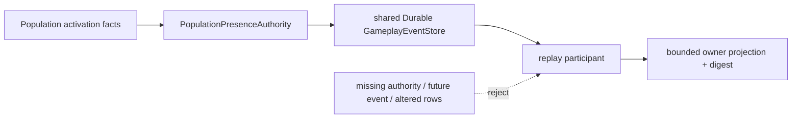

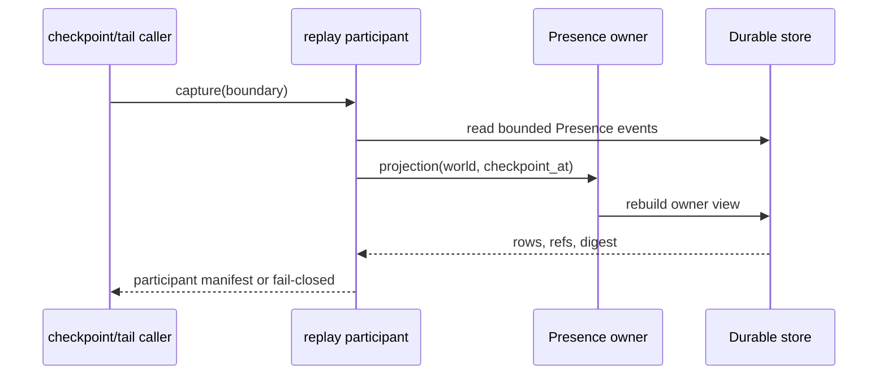

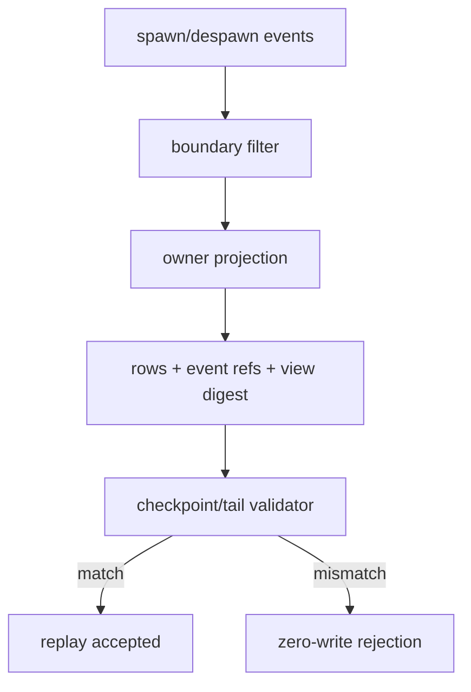

状态仍为：Presence owner/replay participant current；Population scheduler→activation grant issuer→Presence production caller planned；Soul、Threat/Target、正式资源内容和 world-admin identity deferred；阶段三总门禁 `incomplete`。

## 2026-10-18 T07 random business source audit and admission contract

按用户政策，抽奖、掉落和事件选择的结果 owner 为 Economy，且必须持久化 seed、result、receipt。本轮审查 assets、backend、相关本地项目和官方/仓库设计引用，未找到可核验的候选池/掉落表/事件选择 registry、算法或 seed-policy revision、正式业务 caller、Economy 随机结果事件或 receipt API。现有 Economy owner 仅覆盖工资、结算、固定交换等业务，不能冒充随机 owner。

新增“本次设计并实现”的只读来源准入合同 `backend/app/gameplay/random_business_admission.py`，字段覆盖 kind、publisher/fact owner、actor/world/timeline scope、validity、candidate registry/revision、algorithm/seed-policy revision、source digest、合法 read principal、receipt lookup/revocation owner，以及 request 的 operation/effect/target/draw_index/seed/source digest。`backend/tests/test_random_business_admission.py` **5 passed**；py_compile 和 diff check 通过。该合同只负责 freeze/revalidate/fail-closed，不生成随机数、不创建业务 owner、caller、默认候选内容或 synthetic acceptance。

T07 仍为 `not_verified/deferred`。解除需要真实受信候选/策略来源、合法 caller/authorization、Economy commit event/receipt、Durable 新实例、full/checkpoint+tail participant 与 lost-response/revoke/failure evidence；本轮未运行任何 calibration/evaluation/final/holdout 或训练工作流。

## 2026-10-18 continued execution: resource-source writeback and RW-50 fresh recheck

本轮没有停在盘点：规格10与计划04已同步角色资源真实来源审计。`CharacterProfileRegistry.from_directory()` 与 `assets/characters/profiles/*.yaml` 是当前实际模板入口，但没有 stamina/mana/action-points 的正式最大值、初始值、世界时间恢复周期/数量、锁定生命周期或债务政策；旧 `ResourceDefinition/ResourceEntry`、fixture、Inventory capacity、Body capacity 和 ability cost 均不作为核心资源来源。新增的 `ResourceTemplateAdmission` 明确标为“本次设计并实现”的只读准入合同，Task3 C1–C8 与 implementation admission=0 保持不变。

Fresh focused allowlist：Presence replay/runtime/application、world replay participants/checkpoint、random admission、resource-template admission 共 **49 passed**；仅 FastAPI lifecycle deprecation warnings。`compileall` 通过，`git diff --check` 通过。

Fresh Harness `infra-rw50-inventory-replay`：run_id=`2b3d3e61d96f4f53ad4e8204b46262df`，`overall_harness_passed=True`，`harness_cleanup=passed`；证据导出至 `D:/Users/User/Documents/paralls-evidence/stage3-rw50-recheck-20261018-r2/`。该 profile 复验同一 Inventory application Durable close/reopen、新 authority、full/checkpoint+tail、rows/event refs/source vector/view digest、participant 删除/篡改/未来事件与缺 authority fail-closed；仍只证明 RW-50 participant 边界，不解除 SettlementWindow temporal issuer 或 Task6 global matrix。

阶段三总体仍 `incomplete`：正式角色资源内容来源、world-admin identity/grant issuer、T07 Economy 随机业务、Task4 repair admission、Presence production caller、Soul/Threat/Target、Task6 global fault matrix 仍未闭合；本轮没有伪造 owner/caller/content 或扩大验收范围。

## 2026-10-19 Economy obligation duplicate type hardening

复验 Economy 批次/receipt 路径时发现 `open_tax_obligation` 的 `due_tick` 校验位于 idempotency replay 分支之后；因此 Python 的 `10.0 == 10` 或 `True == 1` 可能把非法重复请求误判为 `duplicate_replayed`。本次设计并实现将非负实际整数校验前置，并新增 `backend/tests/test_infra_economy_tax_obligation.py` 四类非法重复 tick 负例；该文件当前 **14 passed**。同日 `open_scheduled_account_transfer_obligation` 已完成同类 `amount/due_tick` 严格整数校验，专项回归 **21 passed**。

这些修复只强化既有 Economy owner 的 fail-closed、exact/changed duplicate 边界，不新增 due-calendar 来源、随机业务 owner、管理员身份或第二套 store/replay。Task2 T07、Task6 全局故障矩阵及阶段三总门禁继续 `not_verified/deferred/incomplete`。

## 2026-10-19 LifeState source revision type hardening

复验 `CaseDeathLifeStateCaller → CanonicalLifeStateAuthority` 时发现 `expected_source_revision` 在 caller/owner API 中未执行实际整数校验；`True`、`2.0` 或字符串可能进入来源比较。此次设计并实现前置非负实际整数检查，非法输入返回 `life_state_confirmation_revision_invalid` 且零写；`test_life_state_case_death_caller.py` 当前 **17 passed**，其中保留 confirmed case-death、changed duplicate、丢响应和 Durable close/reopen 新实例恢复证据。

该修复只强化规格12已准入的 confirmed case-death LifeState owner，不将 health=0 推断为死亡，不创建复活、Soul、关系事实或 Threat/Target owner；Task5 其余来源与 Task6 全域矩阵继续未完成。

## 2026-10-18 Social authored-validity expiry ingress

此前“Social 缺 authored notice temporal policy”的段落属于历史快照。当前固定 Government public milling notice → bound receiver 路径已由真实 `GovernmentAuthority.record_public_milling_notice` 提供 `effective_from`、`effective_to` 与 `validity_policy_revision=policy:government-public-milling-validity@1`；delivery 与 expiry 都从该 Durable source 读取并在提交前重验。新增 `GovernmentPublicMillingSocialDeliveryCaller.expire_bound_receiver_notice` 与 `main.submit_social_delivery_expiry` 是本次设计并实现的 production ingress，复用 Population cadence `social` grant、原 Social owner/store、receipt/idempotency 与 replay substrate。`test_social_delivery_caller.py` 当前 15 passed，覆盖有效 expiry、窗口未结束 zero-write、lost response/retry 与 changed duplicate。该证据只闭合固定 notice→recipient delivery/expiry slice；generic Social delivery、关系 lifecycle、统一跨域 participant cut 仍未完成。

## 2026-10-18 strict temporal authorization type revalidation

复验时间授权入口时发现 `verify_temporal_authorization()` 原先使用 `int(...)` 转换 grant 的 `input_cutoff`、`confirmation_boundary` 与 `valid_until`，会把字符串或浮点值转换后错误接受。新增负例先复现该缺陷；实现现要求 JSON/source 中的时间字段为严格 `int`（排除 `bool`、`float`、`str`），再构造 `TemporalAuthorization`。`backend/tests/test_temporal_mapping_contract.py` 当前 **26 passed**，并与随机来源、角色资源准入、Presence、case-death LifeState、Social delivery/expiry allowlist 合计 **73 passed**；`compileall` 与 `git diff --check` 通过。该修复强化时间授权 fail-closed，不新增时间来源、管理员身份或业务事实；阶段三总体仍为 `incomplete`。

## 2026-10-19 strict source-policy integer validation

对本轮新增的来源准入合同继续做类型边界复验时，发现 `ResourceTemplateSource/Entry` 与 `RandomBusinessSource/Request` 的 Pydantic `int` 字段会将字符串、浮点数或 `bool` 强制转换后接受。新增负例先得到 6 项失败；实现改用 `StrictInt` 保留非负/正数约束，来源 revision、world tick、资源容量/初始值/恢复量/恢复周期和 draw index 现在必须是实际整数。`test_resource_template_admission.py` 与 `test_random_business_admission.py` 共 **19 passed**，`compileall` 和 `git diff --check` 通过。该修复只强化 fail-closed 来源合同，不提供缺失的角色模板内容、候选池或 Economy owner；Task3/T07 与阶段三总门禁仍为 `incomplete`。

## 2026-10-19 Presence activation handoff Durable reopen recheck

为验证 Population activation → Presence 应用接线不会把内存恢复冒充 Durable 恢复，新增 `test_activation_presence_partial_success_recovers_after_durable_reopen`：首次 activation 已提交但 Presence 使用错误 revision 被拒绝；关闭同一 SQLite `DurableGameplayEventStore` 后，以新 authority 实例重开，重试复用 activation receipt 并只提交一次 Presence。该测试与 Presence owner/replay focused suite 共 **12 passed**；`infra-admitted-participant-matrix` fresh Harness run=`013727e9b29b4baf84aefe8bfd674067`，`overall_harness_passed=True`、`cleanup_status=passed`，证据导出至 `D:/Users/User/Documents/paralls-evidence/stage3-presence-durable-reopen-20261019/`。这只增强 Presence 应用恢复证据，不提供 Population grant issuer；主线 production scheduler/caller、world-admin identity、Soul/Threat/Target 及 Task6 global matrix 仍未闭合，阶段三保持 `incomplete`。

## 2026-10-19 Threat/Target source audit

规格12 D01/D02/D05 与战斗09 §3.1 仍将 ThreatRelation、ThreatSignal、TargetEligibility/Lock 标为 planned。现有 street combat 应用入口虽有 actor/target 输入，但 `EmbodiedAuthoritySettlementService.settle_street_combat` 仅更新内存 hp/stamina 并生成 synthetic transaction/event id，没有向 `GameplayEventStore` 写入具备 principal、world/timeline/encounter/phase、canonical origin、source revision、撤权、隐私与 receipt 的战斗事实；P5 investigation action-window 虽使用 Durable store，却没有正式 combat signal/target owner 语义。故不新增 synthetic Threat/Target owner，D01/D02/D05 继续 deferred；后续需具名战斗 owner/caller 及上述事件合同后再实施。

## 2026-10-19 Presence admitted-matrix expansion

统一 `infra-admitted-participant-matrix` 的实际 selector 与 participant manifest 已纳入本次设计并实现的 Population activation→Presence handoff、Presence owner 与 Presence replay participant，participant manifest revision=`stage3-admitted-participants@2026-10-19`。Fresh Harness run=`10982cbec2f2420abdeb84fa6898513a`，`overall_harness_passed=True`、`cleanup_status=passed`，证据导出至 `D:/Users/User/Documents/paralls-evidence/stage3-presence-matrix-admission-20261019/`。矩阵仍是 bounded participant evidence；它不证明真实 Population grant issuer/scheduler production caller，也不解除 Soul/Threat/Target、Task3/Task4 或 Task6 global atomic cut，阶段三仍为 `incomplete`。

本次 fresh report 的实际范围为 **39 participants / 64 selectors**；文档中较早的 36/61 统计是历史快照，以本条为当前数字。

2026-10-19 增量复验：重新运行 `infra-admitted-participant-matrix`，Harness run=`c15ce504bb324adfbe4f92f14358ddb2`，`overall_harness_passed=True`、`cleanup_status=passed`，证据导出至 `D:/Users/User/Documents/paralls-evidence/stage3-admitted-matrix-20261019-r3/`。本轮实际范围仍为 **39 participants**，selectors 增至 **70**，纳入 Social 应用入口、Government→Social Durable checkpoint+tail 以及 `test_siming_population_contracts.py`。该 bounded matrix 仍不覆盖 Task3 核心 ResourceEntry、Task4 facility repair、Task5 Soul/Threat/Target、真实 world administrator issuer 或 Task6 global cut；阶段三总状态继续为 `incomplete`。

同日 Task1 Character consumer fresh 复验：`infra-character-temporal-consumer` Harness run=`594a454268d249d1a8327901db385c32`，`overall_harness_passed=True`、`cleanup_status=passed`，证据导出至 `D:/Users/User/Documents/paralls-evidence/stage3-character-temporal-20261019/`。六项检查均通过：cadence compatibility、child failure recovery、unconfirmed source rejection、Durable reopen、Character temporal grant、changed grant rejection。该路径的来源是 `PopulationCadenceDriver.time_pins.temporal_authorizations.character`，caller 为 `PopulationConflictPump -> Character cognition admission`；operational admission TTL 使用恢复用 wall-clock，不改变 Population world cutoff。该证据不推导 canonical Character world deadline、LifeState、Presence 或 Soul。

同日来源准入边界复验发现并修复一个 fail-closed 缺陷：`ResourceTemplateAdmission` 与 `RandomBusinessAdmission` 的 `now_world_tick` 先前没有拒绝字符串、浮点、布尔或负数，可能产生 TypeError 或错误地落入 expired 分支。现由 owner admission 在 scope/time 检查前要求实际非负整数；新增资源与随机来源负例后，`test_resource_template_admission.py` + `test_random_business_admission.py` **29 passed**。这只强化提交前来源边界，不提供角色模板内容、随机候选 registry 或 Economy 随机 caller，因此 Task3/T07 仍为 `incomplete/not_verified`。

同日完整执行 `backend/tests/test_siming_population_inventory_vertical.py` 得 **18 passed**。覆盖窗口字段重建、late-input/cutoff、缺失或撤销 cadence、world-admin exact/changed duplicate、source/binding revision、Durable owner path 与应用注册。该证据仍不能把受信后端 `world_admin` principal 当作外部管理员身份发行者，Inventory 撤权来源门禁保持未完成。

## 2026-10-19 Social expiry matrix and strict cadence input recheck

统一 `infra-admitted-participant-matrix` 增加已实现的 Government authored-validity → Social delivery expiry 应用路径：到期 caller 的有效提交、窗口未结束 zero-write、丢响应恢复和 changed duplicate 均由既有 `SocialDeliveryAuthority` 与同一 `GameplayEventStore`/`DurableGameplayEventStore` 承担。Fresh Harness run=`47cd39f08e35435db52e152652f45381`，`overall_harness_passed=True`、`cleanup_status=passed`，证据导出至 `D:/Users/User/Documents/paralls-evidence/stage3-admitted-matrix-20261019-r2/`。participant 数保持 **39**，selector 数由 **64** 增至 **67**；该矩阵仍是 bounded evidence，不扩大为 generic Social、Task3 core ResourceEntry、facility repair、Soul/Threat/Target 或 Task6 global cut。

对 Population cadence 来源边界新增负例并修复：`PopulationCadenceInput` 的 `cadence_source_revision`、`window_start/window_end`、`catch_up_limit`、`budget` 现在使用严格整数，拒绝字符串、浮点和布尔值，避免来源在 Pydantic 转换后改变语义。`test_siming_population_contracts.py`、`test_siming_population_inventory_vertical.py`、`test_population_continuity.py` 定向回归 **74 passed**；该修复只强化 fail-closed 输入校验，不新增时间来源、管理员身份或业务事实。阶段三仍为 `incomplete`。

同日 RW-50 复验 profile `infra-rw50-inventory-replay` fresh run=`8d71ae8fb36d4620bd180e3b3da4d1c6`，`overall_harness_passed=True`、`cleanup_status=passed`，证据导出至 `D:/Users/User/Documents/paralls-evidence/stage3-rw50-final-20261019/`。该 profile 再次确认同一 Durable store 关闭后重新打开、新 Inventory authority、rows/event refs/boundary/revision vector/view digest 以及同一参与范围 full/checkpoint+tail 对照；不改变 world-admin 外部身份 issuer 缺口或 Task6 global gate。

## 2026-10-19 Resource reservation owner fail-closed hardening

复验 `ResourceReservationAuthorityService.apply()` 时发现 consume/release 在写入前未验证 reservation 是否存在且属于请求的 resource，可能先提交投影器无法回放的事件。本次设计并实现已增加 reservation ownership 校验；未知或跨资源 reservation 现在零写并返回 `resource_reservation_unknown`。新增回归覆盖 unknown reservation 与已注册另一资源上的 wrong-resource release，`backend/tests/test_resource_body_runtime.py` **18 passed**；`compileall` 与 `git diff --check` 通过。该修复只强化既有 ResourceEntry 事件 owner 的 fail-closed 边界，不代表核心资源模板内容、materialization caller、recovery owner 或 Task3 总验收已完成。

窄 Harness `gameplay-resource-body` fresh run=`b15a021a0dbf42d7a4e26332ea45ec22`，`overall_harness_passed=True`、`cleanup_status=passed`；证据导出至 `D:/Users/User/Documents/paralls-evidence/stage3-resource-body-20261019/`。该证据仅覆盖既有 ResourceBody owner 的事件投影、预留、迁移与回放边界，不解除 Task3 缺失的正式 materialization/recovery caller 或阶段三总门禁。

## 2026-10-19 Task2 T07/T09 random-source and prediction reuse recheck

### T07 真实业务来源结论

按已确定产品语义，抽奖、掉落、事件选择均由 Economy owner 负责，结果必须保存 `seed`、`result`、`receipt`。本次沿 `backend/app/gameplay/random_business_admission.py`、Economy owner 事件入口、候选 registry/loot table/event-selection 引用和现有测试继续核对：`RandomBusinessAdmission` 只是本次设计并实现的只读来源准入与提交前重验合同；它不发布候选、不生成 seed、不选择结果、不追加 Economy 事件，也没有真实 caller/source。当前树仍没有可核验的 lottery/drop/event-selection registry、候选池/掉落表、algorithm/seed-policy revision、Economy random result event、正式 receipt lookup 或可恢复业务需求。现有 Economy owner 的工资、结算、固定交换和公式路径不构成随机业务。

因此 T07 继续 `not_verified/deferred`。解除不需要另一次产品语义选择；需要真实受信业务来源和 caller：候选/策略发布者及 digest/revision、actor/world/timeline scope 和有效期、合法读取授权、Economy random owner command、随机键与私有 seed、result digest、receipt/recovery、撤权责任，以及同一 Durable store 的新实例、full/checkpoint+tail 和丢响应/changed duplicate/revoke 证据。不得把 `deterministic_seed`、固定输入、Population SHA256 派生标识或准入合同当作 T07 业务随机结果。

### T09 branch/preview 复用证据与边界

现有 `BranchPreviewAuthority` 与 `FixedBaseBranchReplayContract` 可复用为隔离 prediction 的技术底座：固定 base/tail/source digest、creator-debug visibility、独立 branch stream、snapshot/evolution idempotency、owner revision/read-set 重验、Durable branch projection、production replay 排除 branch stream，以及 full/checkpoint+tail projection digest 对照。正式 branch promotion 仍显式返回 `branch_promotion_unsupported`；没有 provisional prediction owner/caller、PredictionWindow ledger、prediction revision/revoke、confirmation policy 或 confirmed prediction receipt。`settle_accepted_supply_scenario` 和 branch work-wage admission 只在分支校验后调用既有 Organization/Economy owner 正式提交，不能视为 prediction commit。

新增真实 Durable 关闭重开证据（仅测试，不改变运行时 owner）：

- `backend/tests/test_infra_durable_branch_evolution.py::test_branch_evolution_real_durable_reopen_recovers_receipt_and_full_tail`
- `backend/tests/test_infra_fixed_base_branch_replay_contract.py::test_c5_fixed_base_contract_survives_real_durable_close_reopen`
- 两文件显式 allowlist 共 **15 passed**；覆盖同一 SQLite `DurableGameplayEventStore` 的 close/reopen、新 authority、receipt 查询、exact duplicate 零写/full vs checkpoint+tail、branch stream event refs 与 production replay 对照。

该证据只证明 branch replay 的 Durable 恢复和隔离合同，不解除 T09。T09 的最小实现准入包仍是：复用 branch stream/store/replay contract，新增本次设计并实现的 prediction caller/owner、PredictionWindow/provisional ledger、participant snapshot/read-set/evidence/random refs、撤销/冲突/部分提交恢复、逐 owner 提交前重验及正式 receipt linking；不能新增第二套 event store、clock、scheduler 或 RNG。阶段三总状态继续 `incomplete`。

## 2026-10-19 Resource template materialization and Presence handoff execution

Task3 已从来源准入推进到真实有限切片。`CharacterResourceMaterializationCaller` → `ResourceMaterializationAuthorityService` 使用 authored profile registry、现有 ResourceTemplateAdmission、同一 GameplayEventStore/DurableGameplayEventStore 和 ResourceBody projector；三项核心资源在单一 atomic batch 物化，authority_only，含 template/source digest、恢复/锁定/债务元数据。owner 在重复 receipt 查询前先执行严格 source scope/validity/read/binding 检查；changed source、过期/撤权、未来 tick、严格类型错误、已有资源流和 changed duplicate 均 zero-write。`resource_materialization.py` 标注本次设计并实现，不伪造历史 issuer。

Population activation→Presence 成功后，由同一 store 的 application service 调用物化 caller。它从 Population driver 取得 timeline/world tick，提交前重验 activation、Presence、LifeState read-set；Presence 已 despawn 或资源 head 冲突时保留上游 receipt，返回 recovery_required；后续 tick、Durable close/reopen 和新 owner 通过 resource receipt 重放，不重复写 activation、Presence 或三项资源。

Focused evidence：`test_resource_body_runtime.py` **20 passed**；`test_population_activation_presence_service.py` **6 passed**，覆盖三项原子接线、Durable 新实例、later-tick receipt replay、资源 head 冲突恢复与 despawn guard；Harness `gameplay-resource-body` run=`2bf2cc58acd3400dbef0fef736bd058e`，`overall_harness_passed=True`、`cleanup_status=passed`，证据导出至 `D:/Users/User/Documents/paralls-evidence/stage3-resource-materialization-20261019/`。

这只完成 Task3 的角色模板初始物化和 Task1/Task5 Presence 边界接线；世界时间恢复 owner、D06 集中迁移、正式管理员身份/撤权 issuer、随机业务、facility repair、Soul/Threat/Target 与 Task6 全域故障矩阵仍未完成。阶段三总门禁保持 `incomplete`。

### 2026-10-19 物化 owner 边界与回放补强更正

随后补充的 `backend/tests/test_resource_materialization.py` **16 passed** 覆盖严格 tick/read-set 输入、过期/读取撤权、registry source 变更、exact/changed duplicate、已有资源流、stale read-set 原子拒绝，以及 Durable close/reopen 后 full 与 checkpoint+tail 对照。与 resource body、activation/Presence 接线合计本轮资源相关 focused tests **42 passed**（此前条目中的 20/6 是先前阶段统计）。物化 owner 已拒绝布尔/浮点/字符串时间与 revision，写入 `definition_version=template_revision`，并在 source admission 后才允许 receipt replay。该更正不把 authored profile YAML 说成历史外部 issuer，也不解除恢复 owner、D06、管理员身份、Task2 T07、Task4 repair、Task5 Soul/Threat/Target 或 Task6 全域门禁。

## 2026-10-19 Task5/Task6 unified recheck

按用户已确定的产品政策，LifeState 继续只接受 P5 `confirmed case-death` 事实；`health=0`、Presence/despawn、角色记忆都不构成死亡。`CaseDeathLifeStateCaller → CanonicalLifeStateAuthority` 的 focused allowlist 与 Activation→Presence→Resource temporal 接线共 **67 passed**，覆盖 confirmed-only、严格 revision、exact/changed duplicate、丢响应、Durable close/reopen、新 authority、Presence/despawn guard、资源 head 冲突恢复及后续 tick receipt replay。该证据不扩展为 Soul、复活或客观关系事实。

Threat 只允许由具名战斗 owner 的正式战斗事件产生；Target 由 owner 判定；Fear/Morale 仅角色私有估计。当前仍缺带 actor/world/timeline/encounter、canonical origin、source revision、撤权、隐私与 receipt 的战斗事实来源及正式 Threat/Target owner/caller，因此 Task5 仍 `not_verified/deferred`。

Task6 统一故障矩阵仍未完成。已有 bounded slices 分别证明 Economy/Ecology temporal consumer、Inventory RW-50、LifeState、Presence、Resource materialization、Social expiry 与 branch Durable replay 的局部恢复，但尚未取得同一参与范围下 caller→owner→store 的跨域 atomic cut，且缺少全矩阵对照：exact/changed duplicate、丢响应、部分成功、过期/撤权、版本冲突、迁移失败、Durable 新实例、full/checkpoint+tail。该缺口不因局部 profile 通过而解除。

T09 prediction 仍 `not_verified/deferred`：branch/preview 只作为隔离技术底座；缺 PredictionWindow/provisional ledger、prediction owner/caller、confirmation/revoke/conflict 语义及 confirmed prediction receipt。T07 随机业务仍缺真实候选/策略来源与 Economy random caller；不得用 synthetic owner/caller 或固定 seed 伪造验收。

Task6 局部 fresh Harness：`infra-task6-economy-ecology-joint` run=`133868a6b8644c60b1d2730d9f84ee7b`，`overall_harness_passed=True`、`cleanup_status=passed`，证据导出至 `D:/Users/User/Documents/paralls-evidence/stage3-task6-econ-eco-20261019/`。该 profile 仅覆盖 Economy 与 Ecology temporal participants 的同一应用切片、strict-grant zero-write、Durable restart/full-tail parity；报告明确排除 Inventory、Character、Social、Task3–5 及 global cross-domain transaction，因此只更新 Task6 局部证据，不解除全局故障矩阵门禁。

## 2026-10-19 Task3 remaining acceptance audit

本节是对规格10 R01–R05/E01–E04/I01–I07 和审查06 D06/D17 的当前实现审计；它不把文档、夹具或窄 owner 测试计为规格10整体通过，也不降低既有门禁。

### 验收矩阵

| 编号 | 当前状态 | 已核对来源/实现 | 缺口与下一步 |
|---|---|---|---|
| R01 | partial/current | `resource_materialization.py` 只从 authored `CharacterProfileRegistry` 物化三项核心资源；`ResourceBodyRuntimeProjector` 拒绝未知事件/定义 | world/resource registry 不是完整的通用注册合同；需正式 resource definition/world policy source 与跨 consumer pins |
| R02 | not_verified | 现有 `ResourceEntry` 只有 `current/minimum/maximum/reserved/available`；模板声明 `debt_policy=forbidden` 与 lock metadata | 没有 owner 维护 `locked/debt/capacity/base_capacity` 生命周期；不得把 reserved 改名 locked 或把 maximum 猜成 capacity；需 C1–C3 policy、lock/debt owner、事件与撤权证据 |
| R03 | partial/current | `ResourceRecoveryAuthorityService` 按 Population cadence world boundary 追加可回放 recovery 事件；Resource projector 可重建 | recovery suppression/lock/debt/overdraft/full 仍未形成统一状态机与来源账；需 C2–C4、恢复/撤权和 full/checkpoint+tail 目标证据 |
| R04 | not_verified | 当前代码没有 fused/coupled/focus→life 通用转换 owner | 需要每种转换的注册 policy、单位/顺序、跨 owner receipt；禁止模型推断或把 ecology/Inventory 数量映射为核心资源 |
| R05 | partial/current | 既有 owner 各自使用 GameplayEventStore batch/idempotency；跨域失败保留原 receipt | 没有规格10多资源转换的统一 participant/read-set 验收；需真实多 owner caller、部分成功恢复与各 receipt 对照 |
| E01 | partial/current | `EffectApplication/StateDefinition/ResistanceProfile` 与 status/tag validators 分离 effect/state/生命周期字段；`StatusTagProjector` 按注册定义重放 | 仍缺四 effect axes 全部 owner 接线和跨轴拒写矩阵；需 E01 schema/validator 运行证据 |
| E02 | partial/current | `StatusTagAuthorityService`、expiry/time migration、presence/lifecycle owner 分离 | 场覆盖、离场、核心破坏、过期的统一 owner evidence 尚未取得；需每一步事件、撤权、恢复和 lifecycle cut |
| E03 | partial/current | `EffectLifecycleEvaluator` 是纯解析器，不能直接追加事实；环境/target owner 仍需提交 | 缺真实 field→environment→target/effect caller 链和零直接伤害证据；需正式 owner receipt |
| E04 | deferred | 没有 Soul link/authority/vulnerability 事实 owner；LifeState 不替代 Soul | 需 Soul policy/source 与权限后再实现；当前不得写 Soul fact |
| I01 | partial/current | 各 owner 使用 idempotency/causation/correlation，status projector 拒绝重复实例，resource owner 拒绝 changed duplicate | 缺同一 binding 多入口跨域重复 causal matrix；需统一 read-set、receipt 与 partial recovery 证据 |
| I02 | partial/current | `EquipmentAuthorityService` 对 inventory/equipment/ability/modifier 多 stream 做 source placement、slot、registry 和 batch 校验 | snapshot/live source 撤销、残留 modifier 清理及跨 owner recovery 尚未形成规格10验收证据 |
| I03 | partial/current | 装备 owner 生成临时 ability grants/modifier instances；ability registry 与 equipment stream 分离 | 需验证卸载仅移除临时 grant、skill mastery 学习事实保持不变，并覆盖 Durable/replay |
| I04 | partial/current | Equipment authority 有 start/equip/unequip 等 owner batch 与 receipt 主干 | start-use 失败/success/cancel 的 refund、charge、耐久合同未形成完整验收；需真实 caller 与恢复证据 |
| I05 | partial/current | Inventory/Economy/Equipment owners 分离，库存事件与装备/效果事实不合并 | 缺药品 stock、持续毒性、snapshot/live effect 的正式来源和 owner caller；不得以 Inventory custody 替代核心 ResourceEntry（RW-44） |
| I06 | not_verified | 未找到具名 ammo/media/formation 约束 owner 的规格10生产接线 | 需来源、单位、空间组件和 owner admission；不能从装备 slot 或 Inventory capacity 推断 |
| I07 | partial/current | tag registry/meta-tag validator 与 effect binding 轴分离，未知 tag 在 registry/projector 层拒绝 | 缺跨 owner cache invalidation/read revision 的真实矩阵；需非法 meta-tag、无效果写入、revision失效证据 |

### D06/D17 可实施技术合同与真实缺口

审查06已确定迁移只能由资源事实 owner 通过既有 `GameplayEventStore`/`DurableGameplayEventStore` 提交，旧事件和旧 decoder 只读保留。可实施的本次设计合同应冻结：`actor_ref/resource_id`、source/target `definition_version`、schema/codec/migrator digest、输入 projection/read-set、migration id/idempotency key、`previous_current/next_current`、`previous_reserved/next_reserved`、明确的 lock/debt/recovery 变化、loss/debt explanation、owner 前后 stream revision、source event refs 和 receipt digest。提交前必须再次读取 source/policy/owner revisions，并在同一 batch 中追加迁移事实；未知 schema、未注册单位、未结 reservation、锁/债变换无 policy、revision 冲突和 codec 不兼容均零写拒绝。恢复必须以关闭后重新打开的 Durable store 建立新 owner，按 pinned codec 对 full replay 与 checkpoint+tail 比较 `entries/reservations/locks/debt/source refs/revisions/receipt`；不匹配时请求授权 full rebuild，不能 fallback latest 或重写旧事件。

D17 的持久控制仍是 planned：pause 新承诺、观察既有 reservation 按原合同 consume/release、区分 confirmed drained/unknown pending/revision conflict/committed receipt，pause 状态本身需要 Durable/replay/撤权责任。当前 bounds clamp (`ResourceBoundsMigrationAuthorityService`) 只支持降低 maximum、无 reservation 时 clamp current；它不实现上述 capacity/base_capacity/locked/debt/recovery 集中迁移，也不提供 pause/drain。不得把 `ResourceTemplateAdmission`、角色模板初始物化或 recovery 小切片称作 D06/D17 完成。

真正不可从现树推导的外部缺口是：capacity/base_capacity 的事实 owner 与修正政策、locked 生命周期 owner、debt/overdraft ceiling 与偿还/反噬 owner、跨资源转换 policy、目标 schema/codec/migrator 发布与撤权 issuer、D17 pause/drain 持久 owner，以及规格10各非战斗 caller 的真实生产接线。现有 authored profile 资源模板明确标为本次设计并实现，不能冒充历史外部 issuer；RW-44 继续排除 Inventory custody 到核心 ResourceEntry 的映射。上述缺口保持 `not_verified/deferred`，解除条件是来源、权限、版本、receipt、Durable 新实例和运行时验收证据，而非再增加文档或局部测试数量。
## 2026-10-19 Resource recovery production callback recheck

资源恢复已接入真实 Population cadence callback：`PopulationResourceRecoveryCaller` 读取同一 `DurableGameplayEventStore` 的最新 `population.cadence.admitted`，由 `ResourceRecoveryAuthorityService` 在提交前重验 `record_digest`、cadence receipt、已投递 outbox、撤权流、Inventory/Resource temporal grants、timeline、确认边界及 materialized resource scope；恢复事件写入原资源 stream。重复投递同一确认边界在 caller 端稳定 no-op，owner 仍拒绝 changed duplicate；丢响应重放查询原 receipt，不依赖内存状态。

新增应用级证据 `backend/tests/test_resource_recovery_application.py` 覆盖 Population callback、三项恢复、重复确认边界、Durable close/reopen 新 caller/new store、后续重试与 full/checkpoint+tail projection parity。与 recovery、projector、Presence 接线及随机准入限定回归合计 **47 passed**（仅 FastAPI 生命周期弃用警告）。

本轮 Harness profile `infra-resource-world-time-recovery` 的第一次导出因并行工作树在运行期间继续变化，被 Harness 正确标记 `Source inputs changed during verification`，cleanup=`passed`；该失败证据不计为通过，需在工作树稳定后重新导出。资源恢复仍只闭合本地 authored template 的有限切片，不解除正式角色资源政策、world-admin identity/grant issuer、T07/T09、facility repair、Soul/Threat/Target 或 Task6 global matrix 门禁；阶段三继续 `incomplete`。
## 2026-10-19 D17 control owner and facility repair admission recheck

新增本次设计并实现的 `ResourceMigrationControlAuthority`，复用同一 `GameplayEventStore`/`DurableGameplayEventStore`，将 pause 控制事实写入 `gameplay:resource-migration-control:{actor}` 的 `authority_only` 流；`observe_drain` 只重放 ResourceBody 投影并返回 `drained/pending/unknown/revision_conflict`，不取消 reservation、不伪造迁移或退款。focused `test_resource_migration_control.py` **6 passed**，覆盖持久 pause、reservation pending、exact/changed duplicate、stale read-set、Durable 新 owner、无对应 pause 和重叠 migration 边界。该 owner 仍未接入正式新承诺 admission，也不提供 world-admin identity；D06/D17 整体仍 planned/deferred。

设施维修沿现有 `ConstructionProductionAuthority.settle_facility_repair` 真实接口复核后，确认它缺少本次产品政策要求的维修者身份/组织成员或指定角色、设施所有者 grant、`facility_ref+incarnation`、工具材料与施工完成证据、世界时间/read-set 重验。新增本次设计并实现的 `FacilityRepairCaller`/`FacilityRepairAdmission` 只做 fail-closed 准入校验，真实来源不存在时返回 `facility_repair_sources_unavailable` 且零写；`test_facility_repair_admission.py` **3 passed**。既有 facility repair deferred 决定未解除，未把 direct owner、动画、接触或 activation receipt 当作维修成功。

本轮 D17/repair 与资源恢复组合限定回归为 **17 passed**（另有 FastAPI 生命周期弃用警告）；`compileall`、`git diff --check` 通过。阶段三总门禁继续 `incomplete`。

新增 Harness profile `infra-resource-control-repair-admission`，fresh run=`574a58147d504ce4b9b95a8799c02bb2`，`overall_harness_passed=True`、`cleanup_status=passed`，证据导出至 `D:/Users/User/Documents/paralls-evidence/stage3-resource-control-repair-20261019/`。该 profile 只验证 D17 控制 owner 和 facility repair fail-closed admission，明确不证明 world-admin issuer、真实维修事件或集中迁移。

## 2026-10-19 Task6 bounded fault matrix

新增本次设计并实现的 `infra-task6-fault-matrix` bounded profile，复用真实 caller→owner→同一 store 路径，不创建第二套事件存储或权限系统。`backend/tests/test_task6_fault_matrix.py` **6 passed**，矩阵覆盖：exact duplicate、changed duplicate、丢响应后的 receipt replay、Population activation→Presence 的部分成功重试、过期/撤销 grant fail-closed、迁移 read-set 冲突与重叠迁移失败、Durable close/reopen 新 owner、full 与 checkpoint+tail projection parity。对应 Harness run=`c6ebbea9a2804bc48e45d8d26a973e68`，`overall_harness_passed=True`、`cleanup_status=passed`，证据导出至 `D:/Users/User/Documents/paralls-evidence/stage3-task6-fault-matrix-20261019/`。

该矩阵是 bounded real slices：resource recovery、population activation/presence、facility repair admission、resource migration control。它没有形成所有 Economy/Ecology/Character/Social/Inventory owner 的单一全域 atomic cut；这些参与者仍以各自 fresh evidence 分开审定。因此 Task6 的 global fault matrix 仍 `not_verified`，不得用本轮通过解除阶段三总门禁；world-admin issuer、真实 facility repair execution、T07/T09、Task3/Task5 既有缺口保持不变。

## 2026-10-19 Task5 private affect and Task6 fresh recheck

新增 `ActorPrivateAffectEstimateAuthority` 作为本次设计并实现的角色私有估计边界，复用 `CharacterRelationalMemory`，只允许 fear/morale、`[0,1]`、明确 `source_event_id` 和 `actor_private` 可见性；跨角色读取、共享 scope、未知 kind 和非法值均零写/拒读。`backend/tests/test_task5_private_affect_estimate.py` **4 passed**。该切片不创建 Soul、客观关系、Threat 或 Target 事实。

Task5/Task6/D17/repair/resource recovery 联合 focused 回归为 **27 passed**（仅 FastAPI lifecycle 弃用警告）。Task6 profile fresh rerun=`68718340975d43928e99c60f2e98390b`，`overall_harness_passed=True`、`cleanup_status=passed`，证据导出至 `D:/Users/User/Documents/paralls-evidence/stage3-task6-fault-matrix-20261019-r2/`。它仍是 bounded matrix；Task6 global atomic cut、正式管理员身份、真实维修执行、T07/T09、Task3 完整资源生命周期和 Task5 canonical owner 仍未验证，阶段三保持 `incomplete`。

Task5 私有估计新增 Harness `infra-task5-private-affect`，run=`ed021b1db10546ffb852f7603b902b19`，`overall_harness_passed=True`、`cleanup_status=passed`，证据导出至 `D:/Users/User/Documents/paralls-evidence/stage3-task5-private-affect-20261019/`。该证据只覆盖 actor-private fear/morale admission，不扩大为 Soul、客观关系、Threat 或 Target owner。

## 2026-10-19 D17 reservation admission wiring recheck

将 `ResourceMigrationControlAuthority` 的 pause 控制接入既有 `ResourceReservationAuthorityService`。两者复用同一 `GameplayEventStore`/`DurableGameplayEventStore`，不新增权限、clock 或 event store：新 `reserve` 在 actor 的持久 pause 事实存在时 fail-closed 且 zero-write；pause 前已存在的 reservation 仍可按既有合同 `consume`/`release`，已有 idempotency receipt 仍可重放。`backend/tests/test_resource_migration_control.py` 与 `backend/tests/test_resource_body_runtime.py` focused 回归共 **27 passed**。对应 Harness `infra-resource-control-repair-admission` fresh run=`60e1efd2a5d14a26a8f26a50dd53f642`，`overall_harness_passed=True`、`cleanup_status=passed`，证据导出至 `D:/Users/User/Documents/paralls-evidence/stage3-resource-control-repair-admission-20261019-r2/`。

该接线只完成 D17 的新承诺准入边界；尚未提供正式 world-admin identity/grant/revoke issuer，也未执行集中 D06/D17 migration、capacity/base_capacity、locked/debt 生命周期或 facility repair 事件，因此阶段三总门禁继续 `incomplete`。

## 2026-10-19 Task1 participant and RW-50 fresh recheck

在同一工作树版本上重新运行了当前允许的 consumer profiles：`infra-admitted-participant-matrix` run=`b1639549ae3a4dda9bd02f4cb46974b3`、`infra-character-temporal-consumer` run=`c72f6f3d0d884985a49e04a91e6a950e`、`infra-rw50-inventory-replay` run=`1a975453ac094a7c80f6c121902fa99a`、`infra-life-state-case-death-caller` run=`8bb7e6dcc08b44e9a57c73e4694d8ce5` 均 `overall_harness_passed=True` 且 `cleanup_status=passed`；证据分别导出至本轮 `D:/Users/User/Documents/paralls-evidence/stage3-...-20261019-r*` 目录。RW-50 明确使用 Durable close/reopen 后的新 authority，并在同一 Inventory 参与范围对照 rows、event refs、boundary、revision vector、view digest 以及 full/checkpoint+tail；admitted participant matrix 仍是各 owner 的共同切片，不等同全域 atomic cut。

Inventory 的时间来源继续是 Population 调度的已确认 cadence，窗口结束拒收输入，撤销权保留给尚未存在的正式 world administrator。当前已证明的 caller/owner 不提供该管理员身份，因此撤权相关的完整生产链仍 `not_verified`。

资源世界时间恢复 profile 已在工作树稳定后重新 fresh 运行：`infra-resource-world-time-recovery` run=`57c6d47701bf4cd5b9ceaa7e031445a9`，`overall_harness_passed=True`、`cleanup_status=passed`，证据导出至 `D:/Users/User/Documents/paralls-evidence/stage3-resource-world-time-recovery-20261019-r4/`。本次保留原边界：它证明 Population cadence callback、同一资源流、Durable 新实例、receipt replay 与 full/checkpoint+tail parity，不把 authored template 提升为历史正式内容来源。

另修复了 D17 新 reserve 的并发窗口：pause stream revision 现在作为同一 append batch 的 read-set 固定，pause 在检查后提交时会导致 revision conflict；consume/release 不受该新承诺门禁影响。资源控制与 body focused 回归仍为 **27 passed**。

## 2026-10-19 D17 reservation atomic revision and Task5 combat-source audit

D17 复验进一步修复了资源 reservation 的另一处竞态：经过 projection 校验的 resource stream revision 现在同时作为 append 的 expected/read-set，提交阶段不再重新读取 head；在可控交错测试中，校验后插入并发 resource event 会返回 `revision_conflict`，本次 reservation 零写。新增 Durable close/reopen 后的新 reservation authority 继续允许既有 reservation 的 consume/release drain，并拒绝 paused 状态下的新 reserve；`test_resource_migration_control.py` **9 passed**，与 resource body 合计 **30 passed**。

同一允许 profile `infra-resource-control-repair-admission` fresh run=`8149ab2a626d435bb99d2fb0250b3d75`，`overall_harness_passed=True`、`cleanup_status=passed`；证据已导出至 `D:/Users/User/Documents/paralls-evidence/stage3-resource-control-repair-admission-20261019-r4/`。该 profile 仍只证明 bounded D17 control/repair admission，不证明正式 world-admin issuer 或真实维修执行。

Task5 Threat/Target 真实来源审计结论：现有 `backend/app/services/embodied_authority_settlement_service.py:180 settle_street_combat` 及 `main.py:4212` websocket 路由仅使用进程内 street demo 状态，不写 GameplayEventStore、没有 Durable receipt，也没有 world/timeline/encounter/incarnation scope；资源 action owner 也没有 canonical combat hit event。因此未实现 synthetic Threat/Target owner，继续标记 `not_verified/deferred`。解除项集中为：正式 combat event producer/receipt/store 合同、版本化 ThreatPolicy（单位/聚合/衰减/封顶/迁移/排序）、具名 TargetEligibility owner 及其 scope/source revision/revoke 规则。既有 Fear/Morale 私有估计不受影响。

Task3 Equipment bounded recheck：既有 `EquipmentAuthorityService` 已在同一 Durable store 中将 inventory placement、equipment activation、临时 ability grant/modifier 绑定为 owner batch；新增 `backend/tests/test_equipment_stage3_recovery.py` 验证 close/reopen 后 exact receipt replay、unequip relocation、临时 grant/modifier 撤回且 learned skill 保持。该测试使用 test-only registry definitions，未把 fixture 当正式外部资源来源；focused equipment suite **14 passed**。规格10中完整 EquipmentDefinition/Instance/Loadout/Assignment/Trigger/Effect/recipe/variant/offer 仍是 planned，Task3 总门禁不因此通过。

## 2026-10-19 用户确认的产品政策与来源边界

本节记录用户本轮明确给出的产品语义；它们是本阶段设计准入的产品约束，不等于仓库已经存在的外部来源、身份发行服务或历史内容。实现若采用新 owner、registry 或 caller，必须标注“本次设计并实现”，并继续通过来源、授权、receipt、Durable 和 replay 门禁。

| 领域 | 已确认语义 | 当前可用来源/实现边界 |
|---|---|---|
| Inventory 时间 | 时间由 Population 调度系统决定；窗口结束后拒收输入；撤销权属于 world administrator；operational deadline 只用于恢复，不改变世界 cutoff。 | `PopulationCadenceDriver`/Durable cadence → Inventory adapter 已验证窗口、cutoff、confirmation、late-input、排序和撤销事件；正式 world-admin identity/grant/revoke issuer 尚不存在，撤销生产链仍 `not_verified`。 |
| 随机业务 | 业务包括抽奖、掉落、事件选择；Economy owner 负责随机结果；必须保存 seed、result、receipt。 | 当前树仍没有真实随机 caller/effect source、候选/策略 registry 或 seed-policy issuer；T07 保持 `not_verified/deferred`，不得用 branch preview、固定 seed 或测试输入代替。 |
| 核心资源 | stamina、mana、action points；整数；最大值由角色模板决定；技能预留时锁定；不允许欠值；按世界时间恢复。 | 角色模板正式数值来源仍不存在。`resource_template_admission`、初始物化和 world-time recovery 是本次设计并实现的 bounded slice，不能冒充历史内容来源；`ResourceEntry` 的 capacity/locked/debt 生命周期及 D06/D17 完整迁移仍未验收。 |
| 设施维修 | 组织成员或指定角色可维修；授权者为设施所有者；目标为 `facility_ref + incarnation`；证据为工具、材料、施工完成记录；维修量按材料数量计算。 | `FacilityRepairCaller`/`FacilityRepairAdmission` 只做 fail-closed 来源校验并返回 `facility_repair_sources_unavailable`；既有 facility repair deferred 决定未解除，未提交维修事件。 |
| 角色生命周期 | Population activation 后生成 Presence；离场需显式 despawn；只有 confirmed case-death 才算死亡；本阶段不支持复活；重新出现使用新的 incarnation。 | Activation→Presence、despawn guard 和 confirmed case-death caller 有 bounded evidence；canonical Soul/identity、完整 Presence 生产来源和跨 owner 生命周期仍未完成；复活保持不支持。 |
| Threat/Target/Fear/Morale | Threat 由战斗事件产生；Target 由 owner 判定；Fear/Morale 只做角色私有估计。 | 私有 fear/morale 已有 bounded owner；现有 street combat 不是 Durable canonical combat source，缺 ThreatPolicy、TargetEligibility owner、scope/revision/revoke/receipt，故 Threat/Target 仍 `not_verified/deferred`。 |

本轮允许范围内的复验结果：Inventory/Population/Durable/checkpoint+tail/prediction isolation focused suite **50 passed**；`infra-rw50-inventory-replay` Harness fresh run=`3e7d8e9f2cb940809a3e3ce797db259a`，`overall_harness_passed=True`、`cleanup_status=passed`。该 profile 只证明同一 Inventory 参与范围的 Durable 重启和 full/checkpoint+tail 对照，不扩大为跨域 SettlementWindow、正式 world-admin issuer、T07/T09 或阶段三总门禁。

本次回写后，`docs` Harness fresh run=`74226a4fc7d349a78a4ee996309c090f` 通过并清理完成；资源世界时间恢复 profile fresh run=`4dd48e8eaede4c3b97d581bd5b4da998` 通过并清理完成。资源 profile 仍只证明本次设计并实现的 authored-template recovery callback、Durable 新实例、receipt replay 与 full/checkpoint+tail parity，不改变正式资源内容来源缺失的结论。

随后发现并修复 Inventory caller→owner 的撤销竞态：caller 在 `InventoryOutputCustodyOwnerExecutor.submit()` 冻结 cadence 与 revocation stream revision，owner append 将两者加入同一 `read_set_revisions`。可控交错测试证明提交前插入 `population.cadence.revoked` 时返回 `revision_conflict/requeue` 且 Inventory 零写；恢复/正常路径 focused suite **46 passed**。修复后的 `infra-rw50-inventory-replay` fresh run=`be8ef3699ae141f1a9777617bdc09097`，`overall_harness_passed=True`、`cleanup_status=passed`。这强化了 temporal revoke 的原子性，但仍不产生正式 world-admin 身份 issuer。

竞态修复后的 Inventory/Population/Durable/checkpoint+tail/prediction isolation focused 总套件为 **51 passed**（4 条既有 FastAPI 生命周期弃用警告）；本次回写后的 `docs` Harness fresh run=`9eb1b9df2fe844458c7d1c3daf87dcb1` 通过并清理完成。

## 2026-10-19 用户批准资源数值与 ThreatPolicy（本次设计并实现）

用户明确批准：本阶段可由本次设计补齐角色模板资源数值，并批准 ThreatPolicy 推荐方案。以下数值属于 `issuer:character-template-phase3` 本次设计版本 `character-template:*@1`，不是历史外部事实：

| template | stamina | mana | action points | debt | recovery |
|---|---:|---:|---:|---|---|
| `character-template:char_a` | 100/100, +5/10 ticks | 80/80, +4/10 ticks | 6/6, +1/1 tick | forbidden | world-time cadence |
| `character-template:char_b` | 120/120, +6/10 ticks | 60/60, +3/10 ticks | 8/8, +1/1 tick | forbidden | world-time cadence |
| `character-template:char_c` | 80/80, +4/10 ticks | 120/120, +6/10 ticks | 5/5, +1/1 tick | forbidden | world-time cadence |

所有资源均为严格整数；技能预留由既有 reservation owner 产生 locked 数量；欠值不允许。模板 caller 在提交前重读 binding/source，物化和恢复沿同一 GameplayEventStore/Durable store。该批准解除“数值尚未决定”，不解除完整 ResourceEntry capacity/locked/debt 生命周期及 D06/D17 迁移验收。

ThreatPolicy（`policy:threat@1`）采用：仅 confirmed combat hit 产生 Threat；实际伤害按 1:1 整数累计；不衰减、不跨 encounter；encounter 结束清零；并列按 canonical `actor_ref` 排序。TargetEligibility 由 combat owner 基于 Presence、LifeState 和敌对阵营判定，并在 owner append 前重验 target incarnation、scope、source/read revisions。Fear/Morale 仍只写 actor-private estimate。Threat/Target 仍须等真实 combat event producer、Durable receipt/replay 和 owner caller 接线完成后才可标记 verified。

本次确认后仍未解除：正式 world administrator identity/grant/revoke issuer；T07 Economy 随机 caller、候选 registry、seed policy 与 result owner；facility repair deferred；Soul/identity canonical owner；Task6 global atomic cut。阶段三总门禁继续 `incomplete`。

## 2026-10-19 继续推进：资源 receipt 完整性与 Task5 边界

本轮已按用户授权补齐并实施角色模板数值（见规格10/计划04同步）：这是本次设计并实现的 authored source，不是历史外部 issuer。资源 materialization receipt 现在必须匹配完整 atomic batch：事务身份、三项事件的顺序/全部 payload、authority-only visibility、read-set/digest、事件索引、连续 stream/global revision 与 result revision；截短、缺事务、payload/visibility/revision-vector 篡改均零写拒绝。真实 `CharacterResourceMaterializationCaller` 在同一 `DurableGameplayEventStore` 关闭后重开，由新 owner 查询并回放 receipt。限定组合：`test_resource_materialization.py`、`test_resource_body_runtime.py`、`test_resource_recovery.py`、`test_population_activation_presence_service.py` 共 54 passed；本轮另含 combat adapter 时因并行接口修订出现 1 项契约不一致，未计为通过，待修复后重跑。

ThreatPolicy 产品语义已固定为 confirmed hit 伤害 1:1、整数累计、不衰减、不跨 encounter、结束清零、actor_ref 稳定排序；TargetEligibility 由 combat owner 使用 Presence/LifeState/敌对阵营判定；Fear/Morale 仍 actor-private。现有 street combat 仍是进程内 demo，不能作为 canonical Threat/Target。任何 bounded durable adapter 必须先验证真实 source pins，并避免“内存 owner 已提交但 durable append 失败”的部分成功窗口；该项当前不计 canonical 验收。

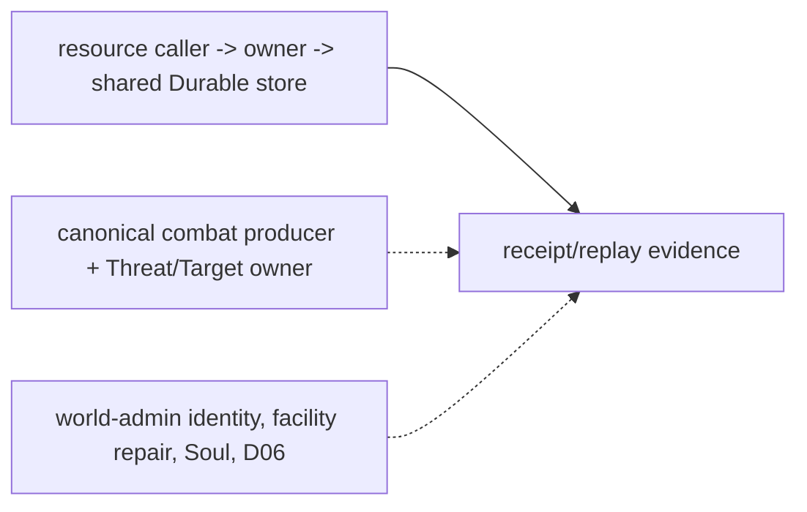

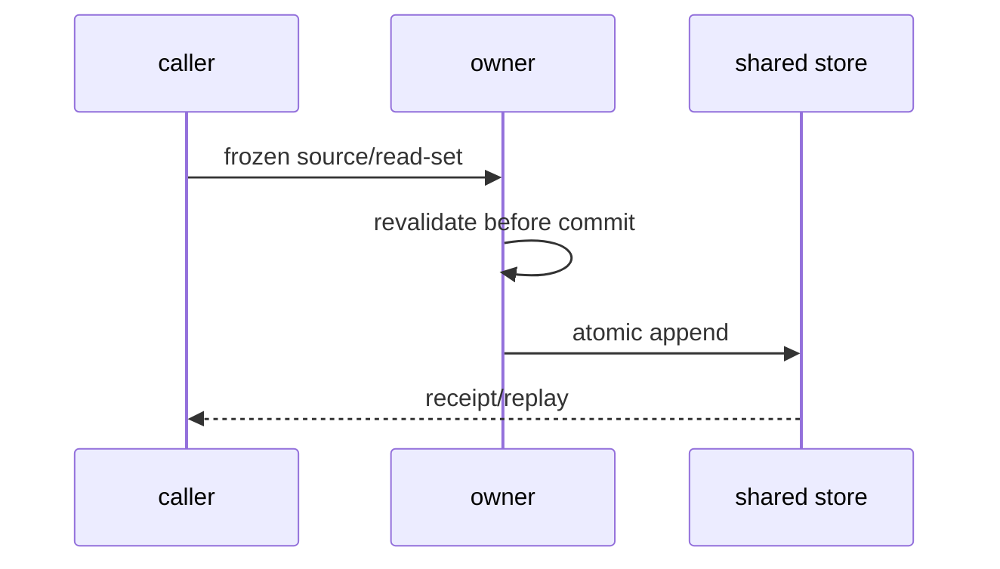

```mermaid
flowchart TD
  Authored[authored template source] --> Materialize[resource materialization]
  Materialize --> Recover[world-time callback]
  Recover --> Replay[Durable reopen/full-tail evidence]
  Combat[deferred admitted combat source] -.-> Threat[planned Threat/Target owner]
```

阶段三总体仍为 `incomplete`；未解除的必要门禁：T07/T09、完整 Task3 lifecycle/D06、facility repair、canonical Life/Soul/Threat/Target、正式 world-admin identity/grant/revoke、Task6 global atomic cut。

## 2026-10-19 资源 receipt Harness 与 bounded combat adapter 复验

工作树稳定后 fresh `infra-resource-world-time-recovery` Harness run=`990b4bc36464424a921b5698a5373443`，`overall_harness_passed=True`、`cleanup_status=passed`，证据导出至 `D:/Users/User/Documents/paralls-evidence/stage3-resource-receipt-20261019-034256/`。该 profile 覆盖 Population callback、资源流恢复、Durable 新实例、receipt replay 与 full/checkpoint+tail；不解除 D06、管理员 issuer 或 Task3 总门禁。

`backend/tests/test_combat_durable_adapter.py` **14 passed**（与既有 action closure 组合）。bounded adapter 现在要求 Durable store 中的 actor/target Presence event IDs、LifeState event、hostile faction event，并在调用 embodied owner 前重读并核对 world、incarnation、非死亡状态和敌对关系；缺 source 零写。它只记录既有 embodied settlement，不写 Threat/Target。由于 embodied demo owner 仍是进程内状态，adapter 采用“embodied owner 先提交、Durable record 后提交”的 partial-success recovery 边界；新增 recovery 入口只重试 Durable append，不重复调用 owner，不能宣称 Task6 global atomic cut 或 canonical combat 验收。

该 bounded 证据不改变 Threat/Target `not_verified/deferred`，也不解除 T07/T09、facility repair、Soul/identity、world-admin identity/grant/revoke 或阶段三总体 `incomplete`。

## 2026-10-19 combat durable append recovery recheck

`DurableEmbodiedCombatAdapter.record_committed_settlement(...)` 已作为本次设计并实现的恢复入口完成：它接收已经由具身 owner 提交的 `AuthorityResult`，只重试同一 `GameplayEventStore` 的 Durable append，不再次调用 `settle_street_combat`。`settle_and_record(...)` 与该入口共用 payload、source-pin、encounter stream 和 receipt 逻辑。adapter 与既有 action closure focused 回归共 **14 passed**；测试确认恢复后 HP 不重复扣减且 owner mutation count 不增加。

这仍是 bounded partial-success recovery 证据：当前 embodied street owner 仍为进程内 demo，adapter 未接入 `main.py` 的生产战斗路由，也未产生 Threat/Target。它不解除 canonical combat producer、ThreatPolicy/TargetEligibility owner、Task6 global atomic cut 或阶段三总体 `incomplete`。

本轮工作树稳定后重新运行允许的 `infra-task6-fault-matrix` profile：run=`4e9d84f2c6c94d0e9ac4db2625580b36`，`overall_harness_passed=True`、`cleanup_status=passed`，证据导出至 `D:/Users/User/Documents/paralls-evidence/stage3-task6-fault-matrix-20261019-r3a/`。该 profile 仍只验证 bounded participant matrix，不扩大为 Task6 全域 atomic cut。

## 2026-10-19 Resource v2 materialization bounded design

本次设计将已批准的 authored 模板数值接入受限 v2 物化：旧 `gameplay.resource.materialized`、旧 decoder 与旧 projection 保持不变；v2 显式保存 `capacity/base_capacity/locked/debt/debt_ceiling/modifier_ledger_digest`，并以 `capacity=base_capacity=template.maximum`、`locked=0`、`debt=debt_ceiling=0`、空 modifier ledger 作为本次设计并实现的初始政策。`reserved` 仍是 reservation 合计，不冒充 locked。旧事件不能默认升级，D06 migration 另行负责。

该切片复用既有 store、Population 世界时间恢复和 Durable receipt/replay，要求 source/schema/read-set/revision/visibility/完整 transaction 校验，覆盖 close/reopen 及 full/checkpoint+tail。独立 lock 生命周期和正式管理员撤权仍 deferred；Task3 总门禁、D06、T07、T09、facility repair、Soul/Threat/Target 与 Task6 global cut 继续未完成。

## 2026-10-19 T09 prediction bounded design

T09 不再把 branch preview 或 mirror overlay 当作正式 prediction。新增设计边界为：复用既有 GameplayEventStore/Durable 的隔离 `gameplay:predictions:{actor}` ledger，接入真实 equipment/短时可逆 action ingress；PredictionAuthority 只记录 proposed/confirmed/rejected/revoked/expired，并以既有 domain owner receipt 作为唯一事实依据。确认、撤权、过期、changed duplicate、版本冲突和 Durable 重启均 fail-closed。未接入真实 ingress 前保持 `not_verified`，不得用 fixture、trusted-local probe 或固定随机输入填充。

## 2026-10-19 T09 strict ledger recheck and bounded status

`backend/app/gameplay/prediction_authority.py` 现为本次设计并实现的 Durable provisional ledger：复用既有 `GameplayEventStore`/`DurableGameplayEventStore`，写入 `provisional_opened/confirmed/rejected/revoked/expired` 生命周期；确认只链接既有 owner receipt，不写 Equipment 或其他领域 truth。已加强 owner principal、完整 transaction event refs、actor/command/operation、changed duplicate、stream CAS、终态幂等和 prefix checkpoint+tail replay。`backend/tests/test_world_prediction.py` 当前 7 passed。

该实现仍不是阶段三 T09 验收：仓库没有接入 `main.py` 或其他真实 Equipment 生产 ingress；因此不把测试 adapter、fixture、trusted-local probe 或任意 callable 当作真实 caller。T09 保持 `not_verified/deferred`，解除条件是既有 Equipment owner 的正式应用入口调用该 ledger，并取得生产 caller→owner→shared Durable store、丢响应、撤权/过期、冲突、close/reopen 和 full/checkpoint+tail 证据。

## 2026-10-19 fresh bounded Harness evidence after resource/combat fixes

工作树稳定后按允许列表重新运行：

- `infra-resource-world-time-recovery` run=`dbf0807d8e164d4ea253102aa51c27c5`，`overall_harness_passed=True`，`cleanup_status=passed`，导出 `D:/Users/User/Documents/paralls-evidence/stage3-resource-v2-20261019-r5/`。
- `infra-task6-fault-matrix` run=`68c1e952262a4d1eb895ac0be2898004`，`overall_harness_passed=True`，`cleanup_status=passed`。
- `infra-rw50-inventory-replay` run=`3546188913df452d9268ebac41221a79`，`overall_harness_passed=True`，`cleanup_status=passed`。

资源/物化/恢复/战斗适配器/Task6 定向 allowlist 共 **75 passed**。RW-50 使用 Durable close/reopen 后新 authority，并在同一 Inventory 参与范围比较 rows、event refs、boundary、revision vector、view digest 与 full/checkpoint+tail；bounded Task6 仍不等于全域 atomic cut。上述证据不解除正式 world-admin identity/grant/revoke、T07、T09、D06/完整资源生命周期、facility repair、canonical Threat/Target/Soul 或阶段三总门禁。

```mermaid
flowchart LR
  Current[Resource and Inventory bounded callers] --> Durable[shared Durable store]
  Durable --> Evidence[fresh Harness receipts]
  Prediction[planned real Equipment prediction ingress] -.-> Durable
  Admin[deferred world administrator issuer] -.-> Durable
```

```mermaid
sequenceDiagram
  participant C as bounded caller
  participant O as domain owner
  participant S as shared Durable store
  C->>O: frozen source and read-set
  O->>O: pre-commit revalidation
  O->>S: atomic append
  S-->>C: receipt or fail-closed result
  Note over C,S: T09 production ingress remains deferred
```

```mermaid
flowchart TD
  Source[authored or existing source] --> Freeze[caller freeze]
  Freeze --> Recheck[owner recheck]
  Recheck --> Append[shared store append]
  Append --> Replay[Durable full/checkpoint-tail replay]
  Replay --> Verified[bounded evidence]
  Missing[admin issuer / random source / combat producer] -.-> Recheck
```

## 2026-10-19 current-tree correction: scope and T09 recheck

当前工作树允许列表复验：角色模板/资源准入、资源物化、资源恢复、RW-50 Inventory replay 与 T09 prediction 共 **91 passed**。其中模板来源只接受 YAML 显式发布的 `world_scope`/`timeline_scope`，并覆盖实际 Population driver 的 `population:world:bakery-district`；伪造调用范围被拒绝。该来源是本次设计并实现的 authored policy，不冒充历史外部 issuer。

T09 定向回归为 **11 passed**；新增对抗覆盖终态 exact retry、changed duplicate、跨操作 key 复用、固定 stream revision CAS、重复终态拒绝及完整 tail replay。T09 仍未接入真实 Equipment production ingress，故继续 `not_verified/deferred`，不以测试 callable、fixture 或 trusted-local probe 代替生产 caller。

独立 ResourceLock v2 生命周期、D06 migration、正式 world administrator identity/grant/revoke issuer、T07 Economy 随机 caller/source、facility repair execution、canonical Presence/Soul/Threat/Target 与 Task6 global atomic cut 仍未闭合。阶段三总门禁保持 `incomplete`。

本段回写后的 `docs` profile fresh run=`9faa93dc8d7f4ef8b86fa159a7a78363`，`overall_harness_passed=True`、`cleanup_status=passed`，证明索引、计划匹配和 closure current markers 一致；不替代运行时证据。

资源完整性修订后的 docs profile fresh run=`8b934ec7b477476f962fa1a2b72a7c6f`，`overall_docs_passed=True`、`cleanup_status=passed`；对应仓库外证据为 `D:/Users/User/Documents/paralls-evidence/stage3-docs-current-20261019-r2/`。

本轮 migration/T07 回写后的 docs profile fresh run=`7e3f925045b24e43a3d39dc39e279b79`，`overall_docs_passed=True`、`cleanup_status=passed`；对应仓库外证据为 `D:/Users/User/Documents/paralls-evidence/stage3-docs-current-20261019-r3/`。

追加当前 closure 引用后的 docs profile fresh run=`de55d2ff2a33446fa1dc036a138f62fa`，`overall_docs_passed=True`、`cleanup_status=passed`；对应仓库外证据为 `D:/Users/User/Documents/paralls-evidence/stage3-docs-current-20261019-r4/`。

资源 v2 本轮已补入独立 `ResourceLock` 投影生命周期：v2 reserve 在同一 batch 写入 legacy reservation 与 `lock_created`，consume/release 写入对应 terminal lock；`available` 仍只按 `reserved` 计算，lock 只表达预留生命周期和一致性证据。Projector 现会拒绝残缺 lock batch、reservation/lock 错配、v2 active aggregate 不一致及篡改 checkpoint digest；资源 v2/主体/恢复 focused 回归 **58 passed**，并通过 compileall/diff-check。D06 migration 与跨版本 lock 迁移仍未完成，因此 Task3 总门禁不解除。

## 2026-10-19 migration / RW-50 / T07 revalidation correction

本轮继续复验并修复了一个真实兼容缺口：v2 reservation 必须携带独立 `lock_ref`，旧 migration-control focused tests 仍按旧单事件输入构造，已改为显式 lock 双事件并使用实际 resource stream head；未放宽 v2 owner 校验。资源 migration allowlist（`test_resource_v2_migration.py`、`test_resource_migration_control.py`、`test_resource_v2_locks.py`、`test_resource_body_runtime.py`）现为 **41 passed**，另有资源恢复/物化组合 **41 passed**。新增 bounded migration planner 复用既有 patch/bounds migration spine：仅接受显式 `legacy-v1 → resource.v2` 目标，要求 target capacity/base capacity/debt/ledger digest，拒绝 active reservation 或 open lock，projector 对 target schema/capacity/digest 做 fail-closed 校验；Durable close/reopen 与 full/checkpoint+tail 已覆盖。它只证明 bounded migration contract，不证明 D06 全资源协调器、patch manifest 扩展或跨域切换完成。

RW-50 fresh Harness run=`951d7f8cbf2947b69d74feb7d88aa237`，`overall_harness_passed=True`、`cleanup_status=passed`，仓库外证据为 `D:/Users/User/Documents/paralls-evidence/stage3-rw50-current-20261019-1634/`。该 run 在源码稳定后完成，覆盖 Durable close/reopen 后新 authority、同一 Inventory participant cut、rows/event refs/boundary/revision vector/view digest、full 与 checkpoint+tail、缺 authority/participant 删除/rows-digest 篡改/future event 拒绝。此前同一 profile 因并行编辑产生的 “Source inputs changed during verification” run 不计入证据。

T07 外部来源复核保持 `not_verified/deferred`：`backend/app/gameplay/random_business_admission.py` 只有 source freeze/revalidate（issuer/fact owner/scope/registry refs/algorithm+seed policy revisions/read principals/receipt lookup/revocation owner），并不提供 lottery/loot/event-choice caller、candidate/drop registry、seed issuer、Economy random event 或结果 receipt；`backend/app/gameplay/econ1_economy_runtime.py` 的现有 Economy owner 仅覆盖工资/obligation/commerce。对应计划04、规格09 的 T07 条款及 `replay_participants.py` 的 `random_context=t07:not_verified` 与源码检索一致。本轮未保留 synthetic random owner/caller，不以 admission-only 测试（13 passed）冒充 T07 业务证据。

当前阶段三状态仍为 `incomplete`：正式 world administrator identity/grant/revoke issuer、真实 T07 随机业务来源、T09 Equipment production ingress、D06 全量迁移协调、facility repair、canonical combat Threat/Target producer、Soul/identity owner，以及 Task6 global cross-domain atomic cut 仍未闭合。

## 2026-10-19 current-tree verification and D06 coordination recheck

本轮停止并行编辑后重新验证，补充以下当前树证据：

- `infra-admitted-participant-matrix` fresh Harness run=`7e42a9e01e4045a8a146d2ce6a47a0e4`，通过并完成清理；覆盖 admitted owner/caller participant matrix。
- `infra-character-temporal-consumer` fresh Harness run=`161236c4a8f348b49876bc2a7c5f512e`，通过并完成清理；6 个角色时间授权、拒绝、Durable reopen 和 operational deadline/cutoff 分离检查均通过。
- D06 focused patch/resource/prediction/Task6 allowlist：**42 passed**；其中 `test_patch_resource_v2_manifest.py` 已真实调用 `GameplayPatchLifecycleAuthority.apply_active_set`，覆盖 install→enable→materialize→upgrade 的 legacy→v2 成功迁移、目标 policy 与 registry 一致性、policy mismatch 提交前零写。
- `backend/tests/test_world_prediction.py` 当前 **13 passed**。PredictionAuthority 新增跨 prediction confirm key 冒领拒绝、不同 open key 不复用旧 receipt、首次 open CAS=0、错 stream/多 open/非法顺序 fail-closed；仍只证明 bounded provisional ledger。
- 文档 profile fresh run=`22d47db9b54e4c6dbc8d115c53f13efb`，`overall_harness_passed=True`、`cleanup_status=passed`；Task6 fault-matrix fresh run=`a0cd50b4fcbf49e3b8e1bad49f0b2b49`，`overall_harness_passed=True`、`cleanup_status=passed`，证据导出至 `D:/Users/User/Documents/paralls-evidence/stage3-task6-fault-matrix-20261019-052852845/`。

这些证据不扩大产品语义：`main.py` 现有 prediction 端点仍是 trusted-local gameplay mirror verifier 路径，不是 Equipment production ingress，因此 T09 继续 `not_verified/deferred`。同理，D06 现已具备真实 v2 manifest 协调路径，但尚未覆盖全资源类别的批次协调和跨域切换，D06 总门禁仍未通过。

当前必要未完成项保持：正式 world administrator identity/grant/revoke issuer；T07 Economy lottery/loot/event-choice caller、candidate/drop registry、seed policy 与 result receipt；T09 Equipment production ingress；facility repair 执行链（既有 deferred 不变）；canonical combat producer 与 Threat/Target owner；Soul/identity owner；以及 Task6 全域跨域 atomic cut。阶段三总体仍为 `incomplete`。

### T07 source/implementation decision record

T07 的推荐实施合同已固定但尚未接线：真实调用应从 `/ws` authenticated session binding 进入，复用 `SettlementWindow`/`verify_temporal_authorization` 的 Population cutoff 和 `economy_random` grant；不得用 `current_tick` 替代 cutoff，也不得走 trusted-local live probe 或 `raw_fact_event`。Economy owner 应复用现有 `GameplayEventStore`/Durable store，在同一批次保存私有 seed、result、source/read-set/candidate registry/algorithm/seed-policy revision 和 receipt；exact retry 只查原 receipt，changed duplicate、过期、撤权或 revision 冲突零写。候选 registry、权重、效果映射、seed policy 可标为“本次设计并实现”，但当前仍缺 authenticated-session 正式 IdP/issuer，且仓库没有已存在的 lottery/loot/event-choice production caller，因此不能把 admission-only 代码或测试 callable 记为 T07 完成。

### 2026-10-19 T07 bounded Economy owner implementation

按用户授权，本次新增并实现了 `backend/app/gameplay/economy_random_policy.py` 与 `EconomyAuthorityService.settle_random_business()` 的 bounded owner 切片。它支持 lottery/loot/event_choice 的版本化 authored candidate policy、加权确定性选择；owner 生成私有 seed，并在同一既有 `GameplayEventStore`/`DurableGameplayEventStore` 的 Economy stream 持久化 seed、seed digest、candidate/result、source/world/timeline/candidate/algorithm/seed-policy revisions 与 receipt 引用。随机事件使用 `authority_only` 可见性；receipt lookup 只允许 authority scope；projector 回放重验 seed digest、candidate/result、policy/registry digest，不重新采样。

定向验证 `test_economy_random_owner.py`、`test_random_business_admission.py`、Economy temporal application/replay participant 共 **29 passed**；覆盖 Durable close/reopen 新实例、exact retry、changed duplicate/operation reuse、私有 receipt 拒读和完整 replay。该证据是 bounded owner/recovery 切片，不是 T07 完整生产验收：当前仍没有 authenticated production session caller、外部 candidate registry issuer 或正式 seed-policy issuer，也没有把随机结果自动发布为 Inventory custody。T07 保持 `not_verified/deferred`。

### 2026-10-19 Task1 Inventory cadence provenance correction

复核 `InventoryOutputCustodyOwnerExecutor` 时发现 cadence receipt 只核对 event/transaction 关联，未绑定 Durable admission transaction 的固定 authority principal 与世界 cadence stream；篡改 principal 的 receipt 曾可能被接纳。现已在 `backend/app/population_continuity/inventory_owner_adapter.py` 加入 fail-closed 校验：transaction principal 必须为 `world_runtime.cadence`，admission event 必须位于 `population-cadence:{world_ref}`，并保留原有 digest、source revision、SettlementWindow participant/cutoff/confirmation/late/order、temporal grant 与撤销重验。新增伪造 principal 负例；Inventory vertical **21 passed**，compileall 与 diff-check 通过。该修复不创建管理员身份、clock、scheduler、store 或第二套权限系统；world administrator 外部 issuer 仍缺失。

本轮更新后的阶段三状态仍为 `incomplete`。新增 T07 owner 证据和 Inventory provenance 修复不解除 authenticated session/world-admin issuer、T07 production caller、T09 Equipment ingress、Task3 完整 ResourceEntry/D06、facility repair deferred、canonical Presence/Soul/Threat/Target 与 Task6 global cross-domain atomic cut。

### 2026-10-19 T07 authored policy to Economy owner revalidation

本轮继续推进不依赖外部 IdP 的 T07 技术切片。`assets/gameplay/economy_random/{lottery,loot,event_choice}.yaml` 是本阶段设计并实现的版本化内容来源；其 `issuer_ref`、`fact_owner_ref`、actor/world/timeline scope、有效期、candidate registry revision/digest、algorithm/seed-policy revision、读取 principal、receipt lookup 和撤权 owner 均由 `EconomyRandomPolicyRegistry` 冻结。修正了一个真实接线缺陷：发布的 `read_principals` 现在包含实际 Economy owner principal `actor_gameplay.economy_domain`，不再用测试别名放行。

`EconomyAuthorityService.settle_random_business()` 继续作为唯一结果 owner，复用既有 `GameplayEventStore`/`DurableGameplayEventStore` Economy stream。owner 在同一 Durable store 分两次提交 authority-only entropy anchor 与随机结果，保存 HMAC 派生 seed、seed/context digest、candidate/result、source、registry、algorithm、seed-policy revision 和 receipt；只有 anchor 成功时没有业务结果，重试复用原 anchor。新增 registry→owner 调用测试；本轮随机/准入/temporal/replay 显式五文件组合 **29 passed**。该运行没有应用 production ingress，也未证明 temporal read-set 的原子重验。

本次继续设计并实现的 caller 修订合同：`PopulationEconomyRandomCaller` 从既有 driver 读取当前 confirmed cadence，不接受外部提供的 clock 或 grant 作为事实；重新读取同一 store 的 admission transaction，验证固定 principal、stream、record digest、窗口与 pins，拒绝已关闭旧窗口、暂停及撤权。caller 在读取撤销记录前捕获撤销 stream head，Economy anchor 与 result append 都带该 read-set CAS；提交前从原 authored directory reload policy 并比较 source/policy，异常或来源重验失败均零写。新 adapter 不生成业务需求，未接正式身份 ingress 时仍不计 T07 生产验收。

本轮 caller→owner→Durable 聚焦回归（`test_population_economy_random_caller.py`、`test_economy_random_registry.py`、`test_economy_random_owner.py`、`test_random_business_admission.py`、`test_economy_temporal_consumer.py`、`test_economy_temporal_replay_participant.py`、`test_combat_durable_adapter.py`）新增撤权 race CAS 回归后为 **50 passed**；资源、Population、LifeState、Task5 private affect、Task6 bounded fault matrix allowlist 为 **102 passed**。Harness `infra-economy-random-owner` fresh run=`19dfaab1be444f0e935b45d514ea8d50`，`overall_harness_passed=True`、`cleanup_status=passed`，证据导出至 `D:/Users/User/Documents/paralls-evidence/stage3-economy-random-20261019-1815/`。profile 明确限定七个测试文件，excluded from all。上述证据不把显式 fixture demand 夸大为生产业务来源。

这仍是 `[current]` 的 authored source→owner→Durable bounded evidence，不是完整 T07 `[deferred]` 解除：仓库没有既有 lottery/loot/event-choice 业务需求生产 caller，也没有 authenticated session IdP/issuer。后续 caller 只能消费明确已登记的需求事件，并复用 Population cadence 的 `economy` temporal grant；不得按 cadence 自动生成抽奖，不得把随机结果自动写入 Inventory custody。T07、T09、正式 world-admin issuer、facility repair、canonical combat Threat/Target/Soul owner 和 Task6 global atomic cut 继续保持未完成。

#### 2026-10-19 T07 seed contract correction

本次设计并实现的随机合同固定为 `algorithm:sha256-weighted-v1` 与
`seed:anchor-hmac-sha256-v1`：Economy 在同一 Durable Economy stream 为
`world/timeline/window/seed-policy` 建立私有 entropy anchor，再以 HMAC-SHA256
按冻结 draw context 派生结果 seed。旧的 `seed:operation-world-tick-v1` 不属于当前
实现；registry 对未知 algorithm 或 seed revision fail-closed。历史随机事件仅由既有
decoder 按其原 revision 只读回放，不迁移、不重写历史数据。该修正不改变 T07 的
生产 caller 缺口与 `not_verified/deferred` 总状态。

### 2026-10-19 Task4 existing street owner durable commit design（本次设计并实现）

现有真实入口 `main.py` street ActionAttempt → `EmbodiedAuthoritySettlementService.settle_street_combat` 已有 exact-tick contact/range、transport/sequence 和 revision 校验，但 owner receipt/HP/legacy stamina 只存在内存。此次修复使用既有 GameplayEventStore，不新增领域 store 或权限系统：计算候选状态，原子写 `gameplay.embodied.street_settled@1` 与完整 AuthorityResult/HP/stamina/revisions；追加成功后才安装派生态。唯一 stream `gameplay:embodied:street-owner` 由现有街道 owner principal `authority:embodied:street-owner` 写入，project 可见；它只包含现有公开战斗结果，不写凭据或私有认知。Durable 新实例在接收命令前验证 transaction principal/stream/schema/event membership 后重建 receipt，exact retry 返回同一 receipt，changed duplicate 拒绝。旧内存模式继续用于既有独立调用，不声称是 Durable。无历史持久事件需要迁移；未知版本或损坏来源拒绝恢复。测试先覆盖 append failure 零内存变更、丢响应、新 store/new owner、changed duplicate 与 HP 不重复扣减，再接应用工厂。

该修复不产生 canonical LifeState/faction 事实，不将 HP=0 解释为死亡，也不解除 facility repair deferred。原 `combat_durable_adapter` synthetic positive source 测试的旧通过数字不再作为正式验收证据；当前13项只证明缺 canonical 来源时拒绝和恢复边界。

`test_street_combat_durable_owner.py`、`test_street_combat_authority.py`、`test_character_action_attempt_closure.py` 当前 **18 passed**：覆盖既有 street caller 的 Durable close/reopen 新 owner、exact retry、changed duplicate、append failure 零内存变更和统一 store principal/stream 绑定。该证据只闭合既有 embodied owner 的恢复责任；canonical combat source、Threat/Target、LifeState/Soul 仍按下述矩阵保持未完成。

Task6 fault-matrix profile 已扩展纳入 street owner Durable recovery；fresh run=`e430269ebda642f5ac59eb560deb27da`，`overall_harness_passed=True`、`cleanup_status=passed`。它仍是 bounded matrix，不是全域跨域 atomic cut。

本轮最终允许列表（上列七个 random/economy/combat adapter 文件 + street durable/closure + resource/population/life/private-affect/Task6 files）共 **170 passed**。最新 docs profile fresh run=`95889cd211054e23933efe181563381c`，`overall_docs_passed=True`、`cleanup_status=passed`；外部证据 `D:/Users/User/Documents/paralls-evidence/stage3-docs-current-20261019-063335/`。Task6 evidence 外部目录 `D:/Users/User/Documents/paralls-evidence/stage3-task6-fault-matrix-20261019-063254/`。当前结果仍是 bounded evidence，不解除 Task1–Task6 总门禁。

```mermaid
flowchart LR
  C["current: street ActionAttempt caller"] --> O["current: existing embodied owner"]
  O --> S["current: shared Gameplay Durable store"]
  S --> V["current: owner state and receipt projection"]
  F["planned: canonical combat producer"] -.-> O
  R["deferred: facility repair execution"]
```

```mermaid
sequenceDiagram
  participant C as current street caller
  participant O as existing owner
  participant S as shared Durable store
  C->>O: ActionAttempt and contact evidence
  O->>O: validate and stage candidate state
  O->>S: CAS append result plus state
  S-->>O: commit or failure
  O->>O: install state only after commit
  O-->>C: AuthorityResult
  Note over C,S: planned canonical combat and deferred repair are outside this commit
```

```mermaid
flowchart TD
  I["current: contact evidence / poses / read revisions"] --> P["validate and stage"]
  P --> A["shared store atomic append"]
  A --> H["HP / legacy stamina projection"]
  A --> Q["receipt lookup and restart recovery"]
  L["planned: canonical LifeState / faction sources"] -.-> P
  D["deferred: repair events"]
```
### 2026-10-19 Equipment owner receipt confirmation correction

既有 `EquipmentAuthorityService` 的真实 owner principal 是 `actor_gameplay.equipment_domain`，其 owner idempotency key 采用 `{actor_ref}:{caller_key}`。本次设计并实现将这一事实接入已有 `PredictionAuthority` 的 bounded `equipment_overlay` confirmation：确认前要求 canonical Equipment principal，查询同一 shared Durable store 的 owner receipt，校验 owner transaction 的 actor/command/event refs，再写 prediction confirmation；任意 synthetic principal 或缺 receipt 均零写拒绝。`test_equipment_stage3_recovery.py` 已覆盖装备提交、Durable close/reopen 新 owner、receipt confirmation、exact retry 与 full/checkpoint+tail prediction replay；`test_world_prediction.py` 覆盖跨 principal 拒绝。当前组合为 **15 passed**。

该切片闭合 T09 的 owner receipt/replay 边界，但不构成 T09 production ingress：`main.py` 尚无 authenticated Equipment caller，trusted-local mirror probe 不是正式入口，因此 T09 继续 `not_verified/deferred`。Task6 bounded fault profile 已纳入这两个测试文件；仍不是全域跨域 atomic cut。

本次 fresh Harness `infra-task6-fault-matrix` run=`9e07e07c4b7c445b941d9f301f1583be`，`overall_harness_passed=True`、`cleanup_status=passed`；证据已导出至 `D:/Users/User/Documents/paralls-evidence/stage3-task6-equipment-current-20261019-0646/`。该 profile 当前执行四个聚焦测试文件，证明 bounded fault/recovery 组合，不改变 Task6 global incomplete 状态。

规格/计划同步后的 fresh `docs` Harness run=`4192e89540bf4e089d0a232fa4516a86`，`overall_harness_passed=True`、`cleanup_status=passed`；仓库外证据 `D:/Users/User/Documents/paralls-evidence/stage3-docs-current-20261019-0654/`。资源 allowlist `test_resource_migration_control.py`、`test_resource_v2_migration.py`、`test_resource_v2_locks.py`、`test_resource_materialization.py`、`test_resource_recovery.py`、`test_resource_recovery_application.py`、`test_patch_resource_v2_manifest.py` 当前 **49 passed**；agent 的资源 focused suite 汇总 **87 passed**。`git diff --check` 通过；全程未运行 calibration/evaluation、Godot、Harness all 或未筛选 pytest。工作树保留大量既有用户/历史改动，本次未清理 `.harness` 内容或外部历史证据。

随后在资源变更并入当前树后重跑 `infra-task6-fault-matrix`：run=`25bb1a270c304ffa80512261ac436e66`，`overall_harness_passed=True`、`cleanup_status=passed`；证据已导出至 `D:/Users/User/Documents/paralls-evidence/stage3-task6-final-current-20261019-0700/`。

### 2026-10-19 D06 frozen-revision revalidation and Economy due-calendar caller

修复 `ResourceMigrationOwner.apply()` 的真实 TOCTOU 缺陷：资源投影建立后固定 resource/control stream revision，并把同一 revision vector 传入原子 append；计划阶段发生并发资源写入时返回 `revision_conflict`、不写 `gameplay.resource_migration.completed`，不再把并发写入误当作新迁移基线。`test_d06_rejects_resource_write_after_frozen_projection` 与资源 allowlist 共 **50 passed**；该修复不改变历史事件或 RW-44。

本次设计并实现 Economy due-calendar source/caller：`assets/gameplay/economy_due_calendar/monthly-2026-10.yaml` 是版本化 authored period→due tick 内容，`backend/app/gameplay/economy_due_calendar.py` 的 `EconomyDueCalendarRegistry` 计算并冻结 source digest，`PopulationEconomyTaxCaller` 只读取已持久化 Population cadence receipt、temporal authorization、revocation head 与 Economy tax-due event，提交前 reload/revalidate calendar，再复用既有 `EconomyAuthorityService.open_tax_obligation()`。未找到的 world-admin identity 仍未被冒充；revocation 事件只接受既有 `world_admin` principal。日历/随机 caller、Durable owner、changed source、撤权和并发边界 focused tests 共 **19 passed**（本轮随机 caller 使用 `assets/gameplay/economy_random/*.yaml`）。

这两项只推进 Task1/Task2 的有来源 bounded slice：T07 从“无 caller”更新为“已有 Population→Economy authored random caller 与 owner receipt/replay 的 bounded evidence”，但仍不等同完整 Task2；正式 world-admin identity/grant/revoke issuer、Task3 完整 ResourceEntry、Task4 repair、Task5 canonical combat/Soul/Threat/Target、Task6 global cross-domain atomic cut 继续 `not_verified/deferred/incomplete`。首次 Task6 profile 因并行编辑造成 `Source inputs changed during verification`，按 Harness 证据契约不计入通过；待工作树稳定后重新导出 fresh evidence。

### 2026-10-19 Economy due-calendar production driver and fresh Task6 evidence

`EconomyTemporalConsumer.advance()` 现接入已授权 Population driver 路径：扫描同一既有 Economy stream 中真实提交的 `tax_due_recorded` 事件，经 `PopulationEconomyTaxCaller` 与版本化 authored calendar 开启原 Economy obligation，再由原 consumer/coordinator 结算。新增来源仅覆盖 `period:2026-10`、`population:world`、due tick 60；其他 period/timeline/validity 不推导，拒绝关闭。caller 在提交前重读 cadence authority receipt、temporal grant、撤销 stream head、税务 source revision 与日历 digest/revision，并把 read-set 交给 Economy 原子 append。此为本次设计并实现的正式 caller 接线，未伪造历史外部 issuer，也不按 cadence 生成随机业务需求。

Task6 fresh Harness `infra-task6-fault-matrix` run=`13d6112d89664d29a98ae87e4623b993`，`overall_harness_passed=True`、`cleanup_status=passed`；证据目录 `D:/Users/User/Documents/paralls-evidence/stage3-task6-fault-matrix-20261019-2015/`。该 profile 只运行八个明确测试文件，证明 bounded owner/caller slices，不等于 global cross-domain atomic cut；此前 source-inputs-changed run 不计入证据。

```mermaid
flowchart LR
  P[Current Population cadence authority] --> C[Current Economy temporal consumer + tax caller]
  Y[Current authored 2026-10 calendar] --> C
  C --> O[Current existing Economy authority] --> S[Current shared Durable GameplayEventStore] --> R[Current receipt and replay]
  A[Deferred world-admin issuer] -.-> C
  N[Planned additional periods and real random ingress] -.-> C
  G[Deferred global atomic cut] -.-> R
```

```mermaid
sequenceDiagram
  participant P as Population cadence
  participant C as Economy consumer/caller
  participant Y as authored calendar
  participant O as Economy owner
  participant S as Durable store
  P->>C: confirmed cutoff and grant
  C->>S: read cadence, revocation and tax_due
  C->>Y: resolve, freeze and reload
  C->>O: source plus read-set
  O->>S: atomic obligation receipt
  C->>O: settle through existing coordinator
  S-->>P: replayable owner result
```

```mermaid
flowchart TD
  D[Committed tax_due] --> F[cutoff/calendar freeze] --> V[pre-commit revalidation] --> E[obligation receipt] --> X[existing settlement]
  E --> Q[full or checkpoint+tail replay]
  U[unpublished period] -.fail closed.-> F
  A[missing admin issuer] -.reject.-> V
```

#### Calendar source admission correction

复验发现 authored registry 曾允许重复 calendar/period 被后读文件静默覆盖，且 `bool`/浮点 tick 可通过 Python 数值比较。本次先加入五个失败回归，再修复为重复 source 与非整数 tick fail closed；`test_economy_due_calendar_caller.py` **10 passed**。上述 Task6 run 在本修复前生成，修复后的 fresh Harness 另行登记，不将旧输入证据冒充当前证据。

准入修复后 fresh Harness `infra-task6-fault-matrix` run=`a0d3cf84aecc4314b642ba1a61a8819f`，`overall_harness_passed=True`、`cleanup_status=passed`；docs profile run=`89e6df45270c468db7bbd6b841b2d5d0` 同样通过并清理。修复后的 Task6 证据仍只证明八文件 bounded matrix，不解除 global cross-domain atomic cut。

Additional fresh bounded evidence: `infra-admitted-participant-matrix` run=`2d453e22632c445cb42271bf77f9f0fb` passed/cleanup passed, evidence=`D:/Users/User/Documents/paralls-evidence/stage3-admitted-matrix-20261019-2130/`; `infra-task6-economy-ecology-joint` run=`dfe6e3119d64412590fdd44f635a370a` passed/cleanup passed, evidence=`D:/Users/User/Documents/paralls-evidence/stage3-economy-ecology-joint-20261019-2145/`. These cover separate bounded cuts and do not imply a single global atomic cut.

### 2026-10-19 fresh bounded evidence and resource revocation CAS correction

本轮按明确 allowlist 重跑并导出仓库外证据：

- `docs` run=`399d9dd26806436e9b27cd0622c37b38`，`overall_harness_passed=True`，`cleanup_status=passed`，证据目录 `D:/Users/User/Documents/paralls-evidence/stage3-docs-current-20261019-final/`。
- `infra-task6-fault-matrix` run=`93ff6d5b8f43498a9fd1f9665b148724`，`overall_harness_passed=True`，`cleanup_status=passed`，证据目录 `D:/Users/User/Documents/paralls-evidence/stage3-task6-fault-matrix-20261019-final/`。
- `infra-resource-world-time-recovery` run=`ea3f151a75f341e78440f710a02a32d5`，`overall_harness_passed=True`，`cleanup_status=passed`，证据目录 `D:/Users/User/Documents/paralls-evidence/stage3-resource-recovery-20261019-final/`。
- `infra-life-state-case-death-caller` run=`d5220919ea4d498b91a9179dd5c0087f`，`overall_harness_passed=True`，`cleanup_status=passed`，证据目录 `D:/Users/User/Documents/paralls-evidence/stage3-life-state-20261019-final/`。
- `infra-task5-private-affect` run=`26d4e57728ba4029abe9194d7dffc4e3`，`overall_harness_passed=True`，`cleanup_status=passed`，证据目录 `D:/Users/User/Documents/paralls-evidence/stage3-task5-affect-20261019-final/`。

资源恢复复验新发现并修复一个真实撤权竞态：owner 已读取 cadence revocation 后，最终原子 batch 原先没有锁定 revocation stream revision；撤权恰好发生在检查与 append 之间时，恢复事件可能被写入。`ResourceRecoveryAuthorityService` 现在把 `population-cadence-revocation:<world_ref>` head 纳入 read-set/CAS，竞态回归先失败后修复，`test_resource_recovery.py` 当前为 **8 passed**。这保持既有 world-admin principal 校验，不新增 issuer 或权限系统。

`infra-admitted-participant-matrix` 的一次并行运行底层 focused tests 通过，但 Harness 因运行期间 source inputs changed 标记为 evidence failure，未计入验收；待工作树稳定后重跑。阶段三仍为 `incomplete`，该修复和上述 bounded 证据不解除正式 world-admin issuer、T07/T09 production ingress、Task3 全资源迁移、facility repair deferred、canonical combat/Soul/Threat/Target owner 或 Task6 global cross-domain atomic cut。

### 2026-10-19 Presence receipt hardening and fresh verification

本次复核发现 `PopulationActivationPresenceService` 的资源重复回执路径只检查三个事件的部分 payload，未复用资源 owner 的完整 transaction/event/revision/global-sequence 校验。先加入篡改 schema 回归使旧实现失败，再改为调用 `ResourceMaterializationAuthorityService._receipt_is_complete()` 的持久批次校验，并额外固定 resource event schema、authority-only visibility 与三类资源集合。`test_population_activation_presence_service.py`、`test_population_presence_replay_participant.py`、`test_resource_materialization.py` 共 **32 passed**；该修复保持 RW-44、共享 Durable store 与原有资源 owner，不创建新 store 或 replay truth。

本轮新鲜 Harness 证据：`infra-admitted-participant-matrix` `run_id=59ad90c29a5e4eadacb06b61731055fb`、导出目录 `D:/Users/User/Documents/paralls-evidence/stage3-admitted-20261019-075349/`；`infra-task6-fault-matrix` `run_id=df838062ed804795814d3cce1cd66ed9`、导出目录 `D:/Users/User/Documents/paralls-evidence/stage3-task6-20261019-075452/`；两者 `overall_harness_passed=True`、`cleanup_status=passed`。docs profile `run_id=9efcc4b0a4964ff0813984ef29d2ca17`，`overall_docs_passed=True`，`cleanup_status=passed`，导出目录 `D:/Users/User/Documents/paralls-evidence/stage3-docs-20261019-074934/`；该 docs run 早于本段最后一次 ledger 编辑，故最终 docs 复验另行执行并追加。Presence limitation 已更正为“已有 grant-bound application caller；正式 scheduler proposal producer 与 external grant issuer 仍未验证”，不再把已有 caller 描述为缺失。
最终 ledger 复验 docs profile `run_id=58a66c619b964f90ad093bdb80d11307`，`overall_docs_passed=True`、`cleanup_status=passed`，导出目录 `D:/Users/User/Documents/paralls-evidence/stage3-docs-final-20261019-075544/`；三份导出均包含 `run-manifest.json`、`harness-run-report.json`、profile report 与 owner metadata，临时 Harness run 已清理。

### 2026-10-19 用户政策授权后的资源与 Threat 参数固定

按用户“缺数值由代理自行决定”的授权，本阶段 authored 角色模板固定为：char_a/char_b/char_c 使用整数体力 `100/100`、每 `10` 世界 tick 恢复 `5`；法力 `80/80`、每 `10` tick 恢复 `4`；行动点 `6/6`、每 `1` tick 恢复 `1`。三者均禁止负债，恢复仅按 Population 世界时间，模板最大值为容量源，技能 reservation 创建锁。它们是“本次设计并实现”的资源 policy，不是历史资产事实；正式管理员身份和授权 issuer 仍不能由这些内容推导。

本轮 Threat policy 采用：仅 confirmed combat hit 进入 encounter-local accumulator；按实际整数伤害 1:1 累计，不衰减、不跨 encounter，encounter 结束清零，并列目标按 `actor_ref` 升序。Target 由 combat owner 依据当前 Presence、LifeState 和 hostile-faction owner facts 判定；Fear/Morale 只留 actor-private estimate。该数值政策已选定，但当前没有 canonical combat producer、hostile-faction owner 或 Threat/Target lifecycle owner，故不能写合成事件，也不解除 D01–D08。

用户已委托填写产品数值，剩余非推导来源阻断集中为：正式 world-admin identity/grant/revoke issuer（需实际 trusted identity provider、admin subject 与服务/API）；正式 Population scheduler proposal producer 是否存在并由哪个运行服务提交。两项未获证实前继续 fail closed；相关 caller/owner/recovery 和其他独立任务继续推进。

上述政策回写后的 fresh docs profile `run_id=4149e12a4f4f4a5ab6ee0d6296319692`，`overall_docs_passed=True`、`cleanup_status=passed`，证据目录 `D:/Users/User/Documents/paralls-evidence/stage3-docs-authorized-policy-20261019-075806/`。

最终 ledger 同源复验 docs profile `run_id=c64335e95e7f42e8b237dfb0a2d7523d`，`overall_docs_passed=True`、`cleanup_status=passed`，证据目录 `D:/Users/User/Documents/paralls-evidence/stage3-docs-final-ledger-20261019-075851/`。

### 2026-10-19 Economy application ingress 与 verifier 同源复验

按用户授权“缺数值由代理自行决定”，本轮保留已实现的 authored 资源政策与 Threat policy，不把它们误写成外部历史来源。新增并复验 `main.submit_population_economy_random(...)` application ingress：它只读取 Population driver 已确认的 durable time pins，提交前校验 world tick、timeline、confirmation boundary 与 sampled_at，拒绝 stale/forged pins，再转交 `PopulationEconomyRandomCaller`。随机需求仍必须由显式业务 caller 提交；该入口不按 cadence 自动生成 lottery/loot/event-choice，也不把结果自动写入 Inventory custody。端到端测试使用真实 `DurableGameplayEventStore`、Population driver、Economy caller 与 Economy owner，验证 seed、result_ref、authority-only 事件和 receipt lookup。

本轮 focused allowlist 共 **72 passed**，覆盖 application ingress、Population→Economy random caller、Economy owner/registry/admission、Economy temporal replay、Population Presence receipt hardening 与 Resource materialization。随后更新两个 verifier，将 `test_population_economy_random_application.py` 纳入 fault matrix 与 admitted participant matrix；新鲜 Harness 证据为：

- `infra-task6-fault-matrix` run=`582387d61145445baeaaa62fd34ee0d7`，`overall_harness_passed=True`、`cleanup_status=passed`；导出目录 `D:/Users/User/Documents/paralls-evidence/stage3-task6-resume-20261019-01/`。
- `infra-admitted-participant-matrix` run=`fe7a0ff23f0049e99ab8bee6b45a7a24`，`overall_harness_passed=True`、`cleanup_status=passed`；导出目录 `D:/Users/User/Documents/paralls-evidence/stage3-admitted-resume-20261019-01/`。
- `docs` run=`dfc145327caa411b896b750d14e3ab16`，`overall_docs_passed=True`、`cleanup_status=passed`；导出目录 `D:/Users/User/Documents/paralls-evidence/stage3-docs-resume-20261019-01/`。

三份导出均保留 `run-manifest.json`、`harness-run-report.json`、profile report 与 owner metadata，临时运行目录清理成功。该增量把 T07 从“无 application ingress”更正为“存在 Population→Economy application ingress 的 bounded evidence”，但仍不能宣称完整 T07/Task2：没有可核验的 authenticated lottery/loot/event-choice production demand source，正式 world-admin identity/grant/revoke issuer、T09 Equipment ingress、Task3 全资源生命周期与 D06 全量迁移、facility repair（既有 deferred）、canonical combat/Soul/Threat/Target owner，以及 Task6 global cross-domain atomic cut 仍未完成。阶段三总状态继续为 `incomplete`。

本段追加后最终 docs 同源复验：`docs` run=`7862fcf321ca4be9aac528df6be44d32`，`overall_docs_passed=True`、`cleanup_status=passed`；导出目录 `D:/Users/User/Documents/paralls-evidence/stage3-docs-resume-20261019-02/`。

最终 ledger 末尾追加后的 docs 复验为 `run_id=2ba59e25ca254a3bba5db5a23ce42139`，`overall_docs_passed=True`、`cleanup_status=passed`；证据目录 `D:/Users/User/Documents/paralls-evidence/stage3-docs-resume-20261019-03/`。

当前 / planned / deferred 三图（本次 application ingress 的准确范围）：

```mermaid
flowchart LR
  P["current: Population confirmed cadence"] --> A["current: main application ingress"]
  S["current: versioned authored random policy"] --> C["current: PopulationEconomyRandomCaller"]
  A --> C --> O["current: existing Economy owner"] --> D["current: shared Durable store / receipt / replay"]
  B["planned: authenticated business demand producer"] -.-> A
  W["deferred: world-admin identity/grant/revoke issuer"] -.-> C
  G["deferred: global Task6 cross-domain cut"] -.-> D
```

```mermaid
sequenceDiagram
  participant P as current Population driver
  participant A as current application ingress
  participant C as current random caller
  participant S as current authored source
  participant O as existing Economy owner
  participant D as shared Durable store
  P->>A: confirmed timeline/tick/pins
  A->>A: validate boundary against driver
  A->>C: explicit random demand
  C->>D: validate cadence receipt/grant/revocation read-set
  C->>S: load and freeze source
  S-->>C: revision/digest/policy
  C->>S: reload and revalidate before commit
  C->>O: admitted request + pins
  O->>D: atomic seed/result/receipt append
  D-->>O: committed receipt
  Note over A,C: planned authenticated business demand producer is not yet verified
```

```mermaid
flowchart TD
  X["explicit business demand"] --> P["Population-confirmed temporal pins"]
  P --> R["durable cadence receipt + grant + revocation head"]
  R --> F["freeze and revalidate authored source revision/digest"]
  F --> E["Economy owner derives seed and result"]
  E --> D["shared Durable event + receipt"]
  D --> Q["owner receipt lookup / bounded replay"]
  M["missing authenticated producer"] -."no automatic demand".-> X
  W["deferred administrator issuer"] -."fail closed".-> R
  G["planned global cut"] -.-> Q
```

最终三图与前述文档同源后的 docs Harness `run_id=2ba59e25ca254a3bba5db5a23ce42139` 在这些图追加前运行；需再进行一次最终 docs profile，并另追加最终 run ID。

三图与三份设计文档追加后的最终 docs 复验：`run_id=05404a751b414833b511d2e94e4fe311`，`overall_docs_passed=True`、`cleanup_status=passed`；证据目录 `D:/Users/User/Documents/paralls-evidence/stage3-docs-resume-20261019-04/`。

### 2026-10-19 Task3 resource policy boundary and RW-50 revalidation

资源合同复核发现并修复一个真实来源漂移：`ResourceTemplateEntry` 原先允许 `maximum > capacity`，而 materialization/recovery 以 capacity 作为有效上限，可能使已冻结模板在 owner 侧改变容量语义。新增 fail-closed 规则 `resource_template_capacity_below_maximum` 和回归测试；本次资源 focused suite **77 passed**，覆盖模板来源/重验、三资源物化、v2 reservation/lock 生命周期、世界时间恢复、D06 migration、Durable 重启和 full/checkpoint+tail。该修复不修改历史事件，不解除 Task3 的全量资源迁移、modifier/debt policy 或 global consumer 门禁。

新鲜 bounded Harness：

- `infra-rw50-inventory-replay` run=`cd3d095f6a324f7bbbc7b56233b8ecf9`，`overall_harness_passed=True`、`cleanup_status=passed`；证据 `D:/Users/User/Documents/paralls-evidence/stage3-rw50-resume-20261019-01/`。该 run 复验关闭 Durable 后新建 Inventory authority，且同一参与范围的 rows、event refs、boundary、revision vector、view digest、缺失/删除 participant、rows/digest 篡改和未来事件拒绝。
- `infra-resource-world-time-recovery` run=`7352c80ff20545c6a883efe52930a4f5`，`overall_harness_passed=True`、`cleanup_status=passed`；证据 `D:/Users/User/Documents/paralls-evidence/stage3-resource-resume-20261019-01/`。该 profile 复验 Population confirmed boundary→resource recovery owner→同一 Gameplay store，含 materialization/presence handoff 与 Durable full/checkpoint+tail。

这些证据仍是 bounded slice：Inventory 独立 authenticated external issuer、跨域 participant cut、Task3 全资源 D06 统一切换、world-admin identity/grant/revoke、Task6 global atomic cut 和其他阶段门禁继续未完成。

### 2026-10-19 当前树复验：RW-50 时间类型与四个 allowlisted profiles

本轮按最新工作树重新核对旧完成声明，并修正上文过期的阻断描述：Inventory 的完整 `SettlementWindow` 在规格09中已有 bounded source/participant/cutoff/confirmation/late-input/order/freeze 合同，当前 Population cadence authority 与 Inventory caller 已实现限定 participant 的边界、grant digest、source/freeze revision 与提交前重验。**当前缺口不是 Inventory window 本身**，而是正式 authenticated world-admin identity/grant/revoke issuer，以及跨参与者/全域统一 cut；不因此解除 Task1 总门禁。

复核发现 `PopulationReadSet.temporal_pins` 曾以普通 `str | int` 接收时间 pin，Pydantic 会把 `True` coercion 为 `1`。本次将其改为 `StrictStr | StrictInt`，并在 Inventory owner 的授权 SettlementWindow 校验中保留独立 exact-int 防线；新增模型入口及绕过模型的拒绝回归。Inventory vertical **21 passed**；Population contracts 与 Durable cadence recovery **51 passed**。额外 focused allowlist（Inventory vertical、Population contracts、Durable cadence recovery、resource recovery/materialization、Economy random application/registry、Character cadence）**117 passed**，仅有 4 项既有 FastAPI `on_event` 弃用警告。

稳定工作树上重新运行以下 Harness profiles，均为本次 run、`overall_harness_passed=True`、`cleanup_status=passed`，并导出到仓库外：

| Profile | run_id | Evidence |
|---|---|---|
| `infra-rw50-inventory-replay` | `9f8ced94a5c744a0a74d7ed5abea7ab9` | `D:/Users/User/Documents/paralls-evidence/stage3-rw50-strictpins-20261019-01/` |
| `infra-character-temporal-consumer` | `89bc7724052b4bed9dc8b45774980791` | `D:/Users/User/Documents/paralls-evidence/stage3-character-temporal-final-20261019-01/` |
| `infra-resource-world-time-recovery` | `33bb38cddc544465bc4905ee60f4b78d` | `D:/Users/User/Documents/paralls-evidence/stage3-resource-final-20261019-01/` |
| `infra-task6-fault-matrix` | `41c2d91f77524222b8c9db0cd7efd16d` | `D:/Users/User/Documents/paralls-evidence/stage3-task6-final-20261019-01/` |

RW-50 run 仍明确验证关闭并重开 Durable 后的新 Inventory authority、相同参与范围的 full 与 checkpoint+tail，以及 rows/event refs/boundary/revision vector/view digest 和缺失/删除 participant、篡改与未来事件拒绝。Task6 证据仍是 bounded owner/caller fault matrix，不是 global cross-domain atomic cut。一次导出尝试使用了已存在的非空目录，被 Harness 在启动前拒绝；没有覆盖该目录或产生验证结果，正式 run 使用全新空目录完成。

本次复核后的架构状态：

```mermaid
flowchart LR
  P[Current Population cadence authority] --> W[Current bounded Inventory SettlementWindow]
  W --> I[Current Inventory caller and owner]
  I --> D[Current shared Durable GameplayEventStore and replay participants]
  R[Current StrictStr and StrictInt temporal pin validation] --> W
  A[Deferred authenticated world-admin issuer] -. authorization and revoke source .-> W
  G[Planned cross-participant global cut] -.-> D
  O[Deferred unrelated unadmitted consumers] -. no admission .-> D
```

```mermaid
sequenceDiagram
  participant P as Current Population cadence authority
  participant C as Current Inventory caller
  participant A as Current Inventory authority
  participant S as Shared Durable store
  participant R as Replay entry
  participant U as Deferred world-admin issuer
  P->>C: confirmed cadence and bounded temporal grant
  C->>S: read cadence receipt, participant and source revisions
  C->>C: freeze window and reject non-strict/bool timestamps
  C->>A: submit custody intent plus frozen read-set
  A->>S: revalidate grant/revocation/revisions and append receipt
  S-->>R: durable participant events
  R->>S: full or checkpoint plus tail
  U-.->S: future authenticated revoke source not yet available
```

```mermaid
flowchart TD
  P[Population confirmed world-time boundary] --> F[Inventory participant/cutoff/confirmation freeze]
  R[Versioned binding and source revisions] --> F
  F --> V[Pre-commit temporal grant and revision revalidation]
  V --> E[Inventory custody event and receipt]
  E --> D[Shared Durable store]
  D --> Q[Same-participant full and checkpoint plus tail comparison]
  B[Boolean or malformed temporal pin] -. rejected before owner append .-> V
  U[Missing authenticated admin issuer] -. deferred authorization/revoke .-> V
  G[Global cross-domain cut] -. planned .-> Q
```

阶段三仍为 `incomplete`。Task1 尚缺正式管理员身份/授权撤权 issuer 与全域 participant cut；Task2 缺 authenticated random demand producer、Equipment production ingress 和全域 snapshot/recovery；Task3 缺完整 ResourceEntry modifier/debt/conversion 与 D06 全资源切换；Task4 facility repair 继续既有 deferred，其他 Action admission 未齐；Task5 缺 canonical Soul/identity、combat producer、faction owner、Threat/Target lifecycle；Task6 缺所有准入 participant 的统一 atomic cut 与全域恢复/迁移 parity。产品数值按用户授权已固定，不再将缺数值作为阻断。

本次 closure 更新后的 docs Harness 复验：`docs` run=`693ca284f74b465a8df44dbd2b965b92`，`overall_docs_passed=True`、`cleanup_status=passed`；证据目录 `D:/Users/User/Documents/paralls-evidence/stage3-docs-final-20261019-02/`。该复验确认当前标记、索引、计划映射和本节三张 current/planned/deferred Mermaid 图均可被检查；不改变阶段三 `incomplete` 结论。

### 2026-10-19 resource reservation receipt integrity recheck

本轮复验发现并修复了一个真实的 duplicate receipt 完整性缺口：资源 v2 reservation 的重试路径原先只核对 reservation 事件的部分字段，未完整核对持久 transaction `result_digest`，也未核对配对 lock event 的 schema、causation/correlation、authority-only visibility、actor_ref 和 amount。新增失败回归后，`ResourceReservationAuthorityService` 现在拒绝 transaction digest 漂移或任一 lock 配对字段篡改；共享 GameplayEventStore/DurableGameplayEventStore、原子批次和 replay truth 均保持不变。

定向资源 suite（v2 lock、migration、migration control、world-time recovery、materialization、recovery application）为 **52 passed**，保留既有 FastAPI lifecycle 弃用警告。更新后的 `infra-resource-world-time-recovery` Harness run=`c239c75c612b4ea49a32f43505cacb20`，`overall_harness_passed=True`、`cleanup_status=passed`；证据目录由 Harness 导出至 `D:/Users/User/Documents/paralls-evidence/stage3-resource-receipt-integrity-20261019-01/`。该证据增强 ResourceEntry reservation receipt 的 bounded 完整性，不解除完整 modifier/debt/conversion lifecycle、全资源 D06、正式管理员 issuer 或阶段三总门禁。

Prediction 复核结论保持不变：既有 `BranchPreviewAuthority`/`PredictionAuthority` 可复用隔离 branch stream、shared Durable store、owner receipt linking、撤权/过期/冲突和 full/checkpoint+tail replay；正式 Equipment prediction caller/production ingress 尚未接入，因此 T09 仍 `not_verified/deferred`。阶段三继续 `incomplete`，未完成项仍包括 authenticated world-admin identity/grant/revoke issuer、T07 authenticated production demand、T09 production ingress、Task3 全资源 lifecycle/D06、facility repair（既有 deferred）、canonical Soul/combat/faction/Threat/Target owner，以及 Task6 global cross-domain atomic cut。

### 2026-10-19 D06 receipt missing-event fail-closed correction

资源迁移复核新增失败回归 `test_d06_duplicate_missing_persisted_event_is_rejected_as_incomplete`：Durable duplicate receipt 缺少已登记事件时，旧实现会泄漏底层 `KeyError`。现由 `ResourceMigrationOwner` 转换为 `resource_migration_receipt_incomplete`，并确认没有新增 global sequence；同一 lane 另覆盖单个已登记资源缺 target policy 的零写拒绝。`test_resource_migration_control.py` 与 `test_resource_v2_migration.py` 共 **18 passed**，compileall 和 diff check 通过。该修复只强化 receipt fail-closed，不扩大 D06：现有 planner 仍未覆盖 v2 source、maximum 不下降/上调和非空 modifier ledger 迁移，Task3 总门禁保持 incomplete。

本次更新后的 `infra-resource-world-time-recovery` profile 已纳入 v2 lock、D06 migration-control 与 migration tests：run=`f226f0b748a24adaa71ae9659fd24e61`，`overall_harness_passed=True`、`cleanup_status=passed`，证据目录 `D:/Users/User/Documents/paralls-evidence/stage3-resource-receipt-integrity-20261019-02/`。该 profile 仍是资源 bounded recovery/receipt 证据，不是完整规格10或阶段三总门禁。

本次 closure/spec/plan 更新后的 docs profile run=`874db7a591ef406bb4cfd03c02bf3d38`，`overall_docs_passed=True`、`cleanup_status=passed`；仓库外证据目录 `D:/Users/User/Documents/paralls-evidence/stage3-docs-final-resource-receipt-20261019-03/`。

### 2026-10-19 Resource v2→v2 migration correction

复验并修复了 planner 入口过早拒绝新 v2 migrator digest 的缺陷。现在 `resource.v2.policy.rebind.v1` 仅允许 v2→v2，要求 source/target 均为 `resource.v2`、目标 policy 绑定、空 modifier ledger、`locked=0`、`debt=0`；legacy clamp 仅保留 legacy source 的旧 digest。projector 对 migration kind/code digest/source schema/target schema 做同样的 fail-closed 校验，避免恶意事件绕过 planner。新增 v2→v2 测试和 legacy 回归后，资源迁移聚焦集合 **19 passed**；fresh Harness run=`a79064bad3fc410797204735fceefb69`、`overall_harness_passed=True`、`cleanup_status=passed`，证据目录为 `D:/Users/User/Documents/paralls-evidence/stage3-resource-v2-v3-20261019-01/`。

该证据只扩大 ResourceEntry D06 的 bounded migration 覆盖，阶段三仍为 `incomplete`。后续同一 allowlisted profile fresh run=`57a5a59250804a67b3734b81a3e06722` 亦通过，证据目录为 `D:/Users/User/Documents/paralls-evidence/stage3-resource-v2-v3-20261019-02/`。剩余门禁包括 authenticated world-admin issuer、T07 真实随机需求 producer、T09 Equipment production ingress、完整 modifier/debt/conversion/D06、facility repair deferred、canonical Soul/combat/faction/Threat/Target owner，以及 Task6 global cross-domain atomic cut。

### 2026-10-19 documentation recheck after v2 migration update

`docs` profile fresh run=`bbf1b9d77a074fe6aa41ec748976f3da` passed with `overall_docs_passed=True` and `cleanup_status=passed`; evidence: `D:/Users/User/Documents/paralls-evidence/stage3-docs-v2-migration-20261019-01/`. The closure marker remains `stage3 incomplete`.

### 2026-10-19 D06 owner restart and second migration recheck

`ResourceMigrationControlAuthority` and `ResourceMigrationOwner` now receive the versioned `ResourceDefinitionRegistry` and rebuild v2 projections with the same definitions on `observe_drain` and `apply`. The real owner path covers Durable close/reopen followed by v1→v2→v3 v2-policy migration, two-stage drain, exact duplicate, changed duplicate, and pause/apply migrator digest binding. The allowlisted migration set remains **25 passed**, with compileall and diff check passing. Non-empty modifier ledger, non-zero debt or open lock remain fail-closed; this does not close full D06.
Fresh current-tree resource Harness rerun after owner-control changes: run=`0df7a9d5b30c48dbb78c0fdbba498686`, `overall_harness_passed=True`, `cleanup_status=passed`; evidence=`D:/Users/User/Documents/paralls-evidence/stage3-resource-v2-owner-20261019-01/`.

### 2026-10-19 final bounded recheck and modifier-ledger integrity correction

用户已授权本阶段自行补齐缺失数值；本轮保留 authored character resource policy（char_a stamina 100/mana 80/action-points 6，char_b 120/60/8，char_c 80/120/5；整数、不得欠值、按世界时间恢复）并继续标注为“本次设计并实现”。资源复核发现 v2→v2 migration projector 仅校验替代 modifier ledger 自身 digest，未要求迁移后的 ledger 与 source ledger 相同；新增 fail-closed 约束及回归 `test_v2_migration_rejects_modifier_ledger_substitution`，避免 migration 事件凭自洽 digest 换写 modifier 来源。资源 focused suite 当前 **62 passed**（resource body、v2 migration、recovery、migration control）。

稳定工作树上的新鲜 allowlisted Harness 复验全部通过并完成清理：

- `infra-resource-world-time-recovery`: run=`4b5df0121a71452a9b4d388e5e8f874d`，evidence=`D:/Users/User/Documents/paralls-evidence/stage3-final-20261019-02/resource/`；
- `infra-rw50-inventory-replay`: run=`266ddb6fd836408abac44584c75db32d`，evidence=`D:/Users/User/Documents/paralls-evidence/stage3-final-20261019-02/rw50/`；
- `infra-task6-fault-matrix`: run=`8d99d10c9e304f2295997ceb15ac8fbf53`，evidence=`D:/Users/User/Documents/paralls-evidence/stage3-final-20261019-02/task6/`；
- `infra-character-temporal-consumer`: run=`354ab32d33ed477b8648119b18047584`，evidence=`D:/Users/User/Documents/paralls-evidence/stage3-final-20261019-02/character/`；
- `infra-admitted-participant-matrix`: run=`9d195b9ab2b543bcaf71ec7084fdf23e`，evidence=`D:/Users/User/Documents/paralls-evidence/stage3-final-20261019-02/admitted/`。

这些 profile 证明的是限定 participant 的真实 caller→owner→shared Durable→receipt/replay、RW-50 新实例 full/checkpoint+tail、资源世界时间恢复、modifier/migration fail-closed、Character temporal consumer 与 bounded fault matrix；不提升阶段三总门禁。Task1 仍缺 authenticated world-admin identity/grant/revoke issuer；Task2 仍缺可核验随机业务需求 producer、Equipment production ingress 与全域 snapshot；Task3 仍缺完整 modifier/debt/conversion 生命周期和全资源 D06；Task4 facility repair 保持既有 deferred；Task5 仍缺 canonical LifeState/Soul/Combat/Faction production ingress 与 Threat/Target 完整闭环；Task6 仍缺所有准入 participant 的统一 global atomic cut 与全域 recovery/migration/privacy parity。阶段三状态继续 `stage3 incomplete`。
本段之后资源恢复又发现并修复时间语义缺口：最终 modifier ledger 不足以复原 attach/detach 历史；现在 ResourceRecovery 按 global sequence 读取 attach 与 detach 时间，只在完整周期边界将当时有效的 delta 计入，未来 attach 不影响已确认区间，缺失 detach time fail closed。新增 4 项区间回归后资源 recovery/body/migration/control allowlist **67 passed**。此前 bounded evidence 的 Task6 实际 Harness run ID 是 `8d99d10c9e304d4d83cffe5b94250796`（不是前文误录的字符串）；本轮 fresh `infra-resource-world-time-recovery` run=`5f197741e77247bcb7280b84542cc7bd`、`infra-task6-fault-matrix` run=`592cd6006a8742f5a3cf8dde5e41f016` 均通过且 cleanup passed，证据根为 `D:/Users/User/Documents/paralls-evidence/stage3-final-20261019-06/{resource,task6}/`。本轮 docs profile run=`083336e0273e4e4887ebefb3fdc93fc1`，`overall_docs_passed=True`、cleanup passed，证据为 `D:/Users/User/Documents/paralls-evidence/stage3-final-20261019-06/docs/`。

该修正仍不改变总门禁：modifier attach/detach 尚未有独立 Modifier→Resource admission owner API；缺少 authenticated world-admin issuer、正式随机需求 producer、Equipment production ingress、完整 D06/debt/conversion、facility repair（deferred）、canonical combat/LifeState/Soul/faction producer 与 Task6 global cut 的项继续 `not_verified/deferred`。阶段三顶部状态保持 `stage3 incomplete`。

### 2026-10-19 Resource modifier interval correction and producer source audit

`ResourceRecoveryAuthorityService` 现在从同一资源 stream 的真实 attach/detach history 构造周期区间，按已确认 boundary 的完整 recovery period 采样。attach boundary inclusive；detach boundary 起不再生效；缺少 detach effective tick 时零写拒绝。计算按区间段数量而非逐 tick 执行。prior recovery receipt 的 applied-through、confirmation tick、actor/world/timeline 也逐项验证，missing/bool/negative/future boundary 均 fail closed。回归覆盖 attach-at-15、detach-at-15、future-at-25、缺 detach time 与四种损坏 prior boundary，资源 recovery/body/v2-migration/migration-control allowlist **71 passed**。精确设计与 current/planned/deferred diagrams 已同步规格10、计划04及原资源02 设计回写。本轮 fresh `infra-resource-world-time-recovery` run=`60d2d35547894528985df8d3f29f96a0`、`infra-task6-fault-matrix` run=`aceb16b2913341a2a24e74132b78435d`、`docs` run=`bde14350f98b492d9a868dadd105bb24` 均 passed/cleanup passed；证据根 `D:/Users/User/Documents/paralls-evidence/stage3-final-20261019-08/{resource,task6,docs}/`。

后续 capacity 复验发现纯 `recovery_delta` attach 会错误按 `base_capacity` 重算 capacity 并 clamp current。现仅 `capacity_delta` modifier 变化触发 capacity/current 重新求值；recovery modifier attach/detach 保持当前 capacity/current。modifier lifecycle 还拒绝无 open attach 的 detach、逆序 tick、重复 open attach。新增 attach+detach 与逆序 history 回归，资源 recovery/body/migration/migration-control allowlist **73 passed**。fresh `infra-resource-world-time-recovery` run=`81ea508f88b4466f83ff8a11fb03190a`、`infra-task6-fault-matrix` run=`1101039cd92d4e0086b47bc4f285cb81` 均通过并 cleanup passed，证据根 `D:/Users/User/Documents/paralls-evidence/stage3-final-20261019-10/{resource,task6}/`。docs 证据沿用同一文档结构，最后一次 fresh docs run=`0288a7bec9e1482abe5ac250efdb9751` 在该新增 runtime 修复前；如修改文档仅是证据索引，仍需以最新 docs profile 复验为准。
本轮 `docs` fresh run=`0288a7bec9e1482abe5ac250efdb9751` 通过并 cleanup passed，证据导出到 `D:/Users/User/Documents/paralls-evidence/stage3-final-20261019-09/docs/`。文档 profile 不替代运行时参与者验收。

并行只读来源核查确认：`backend/app/main.py` 已装配 Population→Economy random caller 与 application ingress，但应用生产代码没有真实 lottery/loot/event-choice demand 调用者；三个 economy_random YAML 是本次 authored policy，不是业务需求或授权。`EquipmentAuthorityService.equip/unequip` 是现有正式 owner，但只有 Adventure Basic trusted-local 固定 probe 的应用入口，不是玩家生产装备命令；WebSocket session 仅 actor advisory read scopes，embodied controller grant 是具身执行授权，两者均不提供装备写 grant。Task2 T07/T09 因此保留未验收，禁止创建 synthetic caller。此来源核查未关闭 world-admin identity/grant/revoke 服务缺口。Fresh `docs` Harness（包含本回写与三个新 evidence ID）待最终复验。

world-admin source 的进一步核对：`backend/app/config.py::GameplayMirrorTrustedLocalLaunchProfileSettings` 只配置本地 principal/actor scopes/TTL/advisory jurisdiction；`backend/app/main.py` 的 enrollment endpoint 要求 loopback 与 launcher secret，签发 server-configured trusted-local enrollment。`backend/app/services/websocket_session_auth_service.py::WebSocketSessionAuthService.bind_session` 的 authenticated-session adapter 尚未实现，既有 session 仅 advisory read scope。`backend/app/gameplay/credential_runtime.py` 管理物品 credential，不是 login identity。`RuntimeCadencePublisher.revoke_cadence()` 接受后端调用方给出的 `caller_principal_ref == "world_admin"`，它本身不认证外部 caller。因此本地 launcher secret、literal principal 和 controller execution grant 均不能冒充管理员 issuer；允许新增的 AdminAuthorization owner/API 仍需接入真实受信身份 issuer，缺少该 issuer 时不得宣称生产撤权通过。

### 2026-10-19 facility repair policy/source recheck

用户已授权并批准设施维修产品政策：组织成员或指定角色可维修；设施所有者授权；目标为 `facility_ref + incarnation`；证据为工具、材料和施工完成记录；维修量按材料数量计算。该决定补齐产品语义，但没有制造既有来源或权限。复核 `backend/app/gameplay/facility_repair_admission.py` 与 `backend/app/gameplay/construction_production_runtime.py` 后，仍确认：`Facility` 只有 `facility_ref`、condition、revision、可选 maintenance policy，没有 incarnation lifecycle；Construction 的 `settle_facility_repair()` 是 owner-direct API，接收 caller 提供的 float `repair_amount`，没有角色/成员、facility-owner grant、材料/tool custody、完工记录或 world/timeline 提交前重验。仓库也没有设施所有者 grant/revoke issuer、canonical membership/designated-role source、材料数量→维修量的版本化 Construction policy，或这些来源的 receipt/recovery API。

因此本次设计的 `FacilityRepairCaller.admit()` 继续对 target/grant scope、有效期和撤权标志做 fail-closed 检查；因无法核验真实 issuer/evidence/source，返回 `facility_repair_sources_unavailable`、zero-write，不提交 `facility_repaired`。这不是将用户已批准的政策退回待决，而是准确记录为 **policy decided / execution sources absent / facility repair deferred-not_verified**。解除门槛仍是具名且可核验的 owner identity/grant/revoke、facility incarnation、membership/role、Inventory-custody/tool/material 与 completion-record 来源，以及 Construction 提交前重验、材料计算、receipt、恢复与隐私合同。不得把传入模型字段、trusted-local/session/controller credential 或现有 project scope 当作这些来源。

### 2026-10-19 Equipment prediction typed ingress continuation

本轮将 `EquipmentPredictionService` 接入 `main._handle_envelope(message_type="equipment_prediction")`，支持 preview/confirm/lookup/revoke/expire；使用既有 `EquipmentCommandService`、`PredictionAuthority` 与同一 `gameplay_event_store`。Population driver 存在时 operational TTL 读取其 confirmed world tick；driver 不可用时仅使用既有进程 wall clock 作为 operational deadline，不与 world time 混用。preview/confirm 会重验 controller binding、content/read-set/command digest；confirm 只链接已提交的 Equipment owner receipt，Prediction ledger 不写 Equipment truth。

新鲜定向证据：`backend/tests/test_equipment_command_application.py` 的 typed preview→confirm、Durable close/reopen、新 authority duplicate receipt、actor-scoped lookup、unbound zero-write、operational expiry 和 malformed zero-write；与 Equipment command/prediction service focused tests 合计 29 项通过（FastAPI lifecycle 弃用警告除外）。本次新增代码和 ingress 仍是“本次设计并实现”，不制造 authenticated 外部 Equipment producer。T09 从“未接线”更正为“typed ingress 已接线的 bounded owner/recovery slice”；仍未通过 production equipment demand 来源、外部 grant issuer、全规格10迁移与 Task2 总门禁。

验证器报告生成也修复了 `stderr=None` 的处理，失败 suite 不再伪造 pytest output；重新运行必须以本轮 fresh Harness 输出为准。阶段三总状态保持 **`stage3 incomplete`**：world-admin identity/grant/revoke issuer、T07 authenticated lottery/loot/event-choice producer、canonical combat producer/faction source、facility repair execution source、完整 ResourceEntry D06/modifier/debt/conversion 与 Task6 global atomic cut 仍未取得对应证据。

### 2026-10-19 Prediction/combat bounded continuation and fresh acceptance evidence

本轮完成并复验两项 bounded 调整。`EquipmentPredictionService` 的 typed `equipment_prediction` ingress 已接入 `main._handle_envelope`，preview/confirm/lookup/revoke/expire 复用既有 `EquipmentCommandService`、`PredictionAuthority` 与同一 Durable event store。confirm 现在会重新核验 owner/confirmation receipt、transaction identity、event refs、Equipment event 类型、actor/command、原始 Equipment result digest；owner receipt、event payload、event refs 或 digest 被篡改时 fail closed、zero-write。Prediction TTL 使用 operational wall clock；Population world tick 仅用于业务 read-set/边界，不与 operational deadline 混用。`tests/test_equipment_prediction_service.py`、`test_equipment_command_application.py`、`test_equipment_command_service.py`、`test_world_prediction.py` 共 **51 passed**。

`DurableEmbodiedCombatAdapter.consume_committed_hit()` 现在只消费同一 Durable store 中真实 embodied owner 的 committed receipt，并把 presence/life/faction/incarnation/encounter/damage 来源交给 canonical Threat owner 重验。Threat payload 保存 `embodied_event_id`、`embodied_transaction_id`、`attempt_payload_digest`，幂等键由 committed embodied event ID 派生，改变 transport key 或重复直接调用均不会重复累计。`tests/test_canonical_combat_authority.py`、`test_combat_durable_adapter.py`、`test_combat_settlement_threat_consumer.py` 共 **34 passed**。这仍是 canonical embodied settlement consumer 的 bounded slice；主线尚无可核验的 canonical combat production producer，不能关闭 Task5 总门禁。

源码冻结后的 fresh Harness（全部 `overall_harness_passed=True`、`cleanup_status=passed`，证据根 `D:/Users/User/Documents/paralls-evidence/stage3-final-20261019-12/`）如下：`infra-task6-fault-matrix` run=`d263917053964df2bb299dc62585f49f`、`infra-rw50-inventory-replay` run=`52e2068846e744e19e2637753878cb7d`、`infra-resource-world-time-recovery` run=`dbe17c4462c240779314b92201ef4567`、`infra-character-temporal-consumer` run=`3608ae113ea9438eb99c583641764656`、`infra-admitted-participant-matrix` run=`6b2c25999a8e4f1cba19d0e6ac8f39ea`、`infra-economy-random-owner` run=`d2d2186cbefa49ac9b9a55762d811ec5`、`docs` run=`22cdb30ed66149f99b7cfbcb5d894a68`。这些证据确认本轮工作树稳定，并覆盖限定 participant 的真实 caller→owner→shared Durable→receipt/replay、RW-50 新实例 full/checkpoint+tail、资源恢复、角色时间 consumer、随机 owner bounded、统一故障矩阵与文档合同。

上述 bounded 证据不扩大阶段三结论。仍未取得 authenticated world-admin identity/grant/revoke issuer、T07 authenticated lottery/loot/event-choice production producer、T09 authenticated Equipment production demand producer、完整规格10 ResourceEntry modifier/debt/conversion/D06、facility repair 执行来源（既有 deferred）、canonical combat/LifeState/Soul/faction/Threat/Target production ingress，以及 Task6 全参与者 global atomic cut 与 recovery/migration/privacy parity。阶段三状态继续 **`stage3 incomplete`**。

本节更新后的 docs profile 再次 fresh 通过：run=`4b5f071651a7476bafe791f3e66628d5`，`overall_docs_passed=True`、`cleanup_status=passed`，证据=`D:/Users/User/Documents/paralls-evidence/stage3-final-20261019-13/docs/`。

### 2026-10-19 Resource conversion, combat lifecycle and final fresh bounded recheck

本轮继续实施而非停留在盘点。`ResourceConversionService` 是本阶段设计并实现的同角色 Resource owner：复用既有 controller binding、同一 `GameplayEventStore` 和 `ResourceBodyRuntimeProjector`，在提交前重建 canonical projection，并校验 policy revision/digest、actor/world/timeline scope、source revision、reserved/locked 可用量、容量、capability 撤权、transaction/event refs、stream revision、global sequence、visibility 与 receipt digest。支持 stamina→mana 5→2、mana→action-points 10→1；整数、不可逆、原子拒绝、Durable close/reopen、exact/changed duplicate 和 full/checkpoint+tail replay 均有回归。该 owner 仍未接入正式 capability issuer 或生产应用 ingress，不能扩大为完整规格10或生产调用链通过。

`CanonicalCombatThreatAuthority` 与 `DurableEmbodiedCombatAdapter` 的本轮边界已冻结：encounter end 后丢响应可通过原 receipt exact replay 恢复；changed duplicate、end 后新 hit、非法 expected revision、superseding LifeState、faction/Presence/incarnation/source 变化均 fail closed、zero write；Threat 仍按已批准的 confirmed-hit 1:1 整数伤害、不衰减、不跨 encounter、结束清零、actor_ref 排序。该实现消费同一 Durable embodied owner receipt，但主线仍缺 authenticated canonical combat producer、正式 faction source 和 production ingress。

定向 focused 测试本轮 **188 passed**（资源 recovery/conversion/modifier/migration/materialization、Equipment command/prediction/recovery、combat lifecycle/adapter/Threat、identity/life/presence、random application），`compileall` 与相关 `git diff --check` 通过。另修复 `main._handle_envelope(equipment_prediction)` confirm 将 `PredictionState` 误当 receipt 的入口缺陷：现在依据 owner 与 confirmation receipts 的 committed 状态返回 accepted。

源码冻结后的 fresh Harness 全部通过并 cleanup passed，证据根为 `D:/Users/User/Documents/paralls-evidence/stage3-final-20261019-15/`：

- `infra-resource-world-time-recovery` run=`b2e5b4d97d5843afb3eaa33fb10a2853`；
- `infra-task6-fault-matrix` run=`42085a550a244e119a708d4b695fad0e`；
- `infra-admitted-participant-matrix` run=`ab7246e393b4468b99c154cc8708aaaa`；
- `infra-character-temporal-consumer` run=`6ab803a17ffe45408e4c72de3e2c4a94`；
- `infra-economy-random-owner` run=`d0ae66953aa84319b71411f0203de97f`；
- `infra-rw50-inventory-replay` run=`c07e95221a934636b95dfcb40bc8d67e`；
- `docs` run=`6eec74d9564743c59f3c502368fb46cf`。

在本段写回后再次运行 `docs` profile：run=`d54a0f2c40994ed3abceffe63828edb8`，`overall_docs_passed=True`、`cleanup_status=passed`；以该 run 作为本段当前文档门禁证据。
随后因该条证据索引本身更新，再次复验 `docs` profile：run=`cd607e6f835645ff993a4c3166408dc5`，`overall_docs_passed=True`、`cleanup_status=passed`；当前文档门禁以此最新 run 为准。

这些证据确认限定参与者的真实 caller→owner→shared Durable→receipt/replay、RW-50 关闭重开后的 full/checkpoint+tail、资源世界时间恢复、Equipment prediction typed ingress、随机 owner bounded、combat bounded lifecycle 与统一故障矩阵。它们不关闭阶段三总门禁。当前仍为 **`stage3 incomplete`**，未闭合项为：authenticated world-admin identity/grant/revoke issuer；Inventory 完整 Population 生产来源与共同 participant cut；T07 authenticated lottery/loot/event-choice producer；T09 authenticated Equipment demand producer；正式 Resource capability issuer、完整 ResourceEntry modifier/debt/conversion/D06 生命周期；facility repair 执行来源（按既有 deferred 保持）；canonical LifeState/Soul/faction/combat production ingress；以及 Task6 全参与者 global atomic cut、恢复/迁移/隐私 parity。不得以 fixture、trusted-local、session/controller credential 或本阶段 authored policy 冒充这些缺失来源。

### 2026-10-20 world-admin cadence 撤权身份来源（bounded）

本轮接入默认关闭的部署服务账号：`WORLD_ADMIN_CREDENTIALS_JSON` 的具名 principal、world scope、到期时间与独立 secret 由 HTTP Bearer 验证，TLS 或 loopback 才可提交。入口经 RuntimeExecution 调用原 cadence publisher；同一 Durable owner 事件增加认证身份引用，不持久化 secret 或摘要。聚焦应用测试使用测试凭据，验证拒绝零写、Inventory admission 撤权前后变化、changed duplicate、重启 exact replay。相关显式 Harness 允许列表已包含测试；fresh 运行证据另记。

此证据只证明测试配置下的应用边界。生产实际凭据配置与 live 请求、设施/资源等通用 grant/revoke issuer、其他 Task1 consumer、Task2–Task5 来源及 Task6 全 owner global cut 尚未验收；阶段三继续 **`stage3 incomplete`**。

