# 阶段三 Task1–2 局部实施回写（2026-10-15）

本轮阶段三仅指规格09–12／计划04通用领域接入，不指计划03，也不指A/B/C场景。用户授权按局部依赖进入后端实施；Godot未验证、模型质量未验收、资源集中迁移和未来soul owner缺失，不阻断与其没有依赖的任务。原规格/计划仍保留 `analysis/planned/non-authorizing` 文档身份，执行授权来自本轮用户指令。

## 状态与证据

下表是 2026-10-15 初始矩阵，原 Action/Status B 类审查作为历史记录保留；当前状态以紧接的 2026-10-16 表及后文各切片证据为准。历史 B 不再表示现有配置范围内的 Action/Status 未接线。

| 2026-10-16 当前切片 | 已有接线与证据边界 | 尚缺 |
|---|---|---|
| Population | 实际推进 caller、时间 pins、原持久化 cadence 与恢复证据 | 新 step_duration 的成功迁移及跨 owner 恢复待本轮验证 |
| Status | 显式测试配置下，应用 startup→RuntimeExecution→原 Status owner 到期事件/receipt→Durable 新实例恢复，详见下文 Status 闭环 | 默认生产内容未配置；不同时间来源与迁移待验证 |
| Action | 显式测试来源下，真实 envelope→RuntimeExecution→原 conflict owner 原子提交与历史 receipt/pins→Durable 新实例恢复，详见下文 Action 闭环 | 默认生产来源未启用；长期在途动作无现行能力，迁移中只需历史 pins 不变 |

状态修订只改当前判定，不抹去各轮 focused、cleanup 或 HTTP503 历史。Task1 整体仍未验收；T07 随机与网络顺序确定性归 Task2。

### Task1 有限验收矩阵（2026-10-16）

本轮冻结范围为规格09 T01/T02/T03，来源为角色16 §2.1–2.3、§4、§5–6 与计划04 Task1。T07 的网络顺序/随机键见角色16 §7.1、规格09 T07，归 Task2。这里的“其他 consumer”只取角色16 §6 已逐项列出的领域及 §3 的共享实例；下表 planned 行不是本轮隐式实现授权，也不是擅自延期。既有片段的历史通过只作已有证据，不重复 Population、Status、Action 全面审查。

| 验收 ID | 具体 consumer / 文件 | 实际 owner / caller | 已有证据 | 本轮缺口 | 下一步 |
|---|---|---|---|---|---|
| T01/T03 | Population：`backend/app/world_runtime/population_driver.py`、`simulation_clock.py`、`population_continuity/runtime_publication.py` | `PopulationCadenceDriver.tick/run_forever` 推进既有 clock；cadence publisher 写原 store | 显式 pins、单位/mapping、恢复、预算与 pending 窗口既有 focused 证据 | 新步长激活后 canonical 连续与旧 pending 工作边界 | 本轮用原 caller、原持久化 store 证明成功迁移、重启恢复 |
| T01/T02 | Status：`backend/app/gameplay/status_temporal_consumer.py`、`status_tags.py`、`main.py` | Population confirmed boundary → `RuntimeExecution` → `StatusTagAuthorityService` 原 owner | 显式测试配置应用闭环、到期事件/receipt、Durable 重启；§7.1及后文 | 剩余世界时长转换、舍入、work 身份及迁移 receipt | 本轮原 owner 按冻结输入提交迁移，并验重复/冲突/部分提交 |
| T01/T02 | Action：`backend/app/gameplay/p5/stormnight_realtime_session.py`、`investigation_conflict.py`、`main.py` | envelope → `RuntimeExecution` → `InvestigationConflictAuthority` 原 owner | 显式测试来源原子窗口与历史 receipt/pins、Durable 恢复；后文 Action 闭环 | 激活后历史 pins 不变的回归；现无长期在途动作 | 本轮核对历史 receipt；不创造 pending action |
| T01/T02 | Economy（角色16 §6；债务/工资期限见 §3）：`backend/app/gameplay/economy_runtime.py` | `EconomyAuthorityService`；本轮无已准入时间推进 caller | 领域 owner 存在；Task2 仅特定工资义务有 batch receipt，不等于时间迁移 | `[planned]` deadline/cadence 与迁移接入未验 | 列具体义务的时间 caller、owner receipt 和恢复证据后单独验 |
| T01/T02 | Inventory（角色16 §6）：`backend/app/gameplay/inventory_runtime.py` | 真实领域 caller：`PopulationSimulationCapability` → `InventoryOutputCustodyOwnerExecutor` → `InventoryAuthorityService`；不是已准入时间 consumer | 生产输出认证→Inventory custody 领域事件/receipt 可查；本文件 Inventory 专项审查 | `[planned]` 既有 cadence 时间 pins/冻结窗口未传入 intent/owner；Durable 新实例与本路径 replay 未验 | 按下文 A/B/C 矩阵补时间接线来源、owner 重验和恢复责任后单独验 |
| T01/T02 | Ecology（角色16 §6；天气转换见 §3）：`backend/app/gameplay/ecology_runtime.py` | `EcologyHazardAuthority`；未登记本轮时间推进 caller | 领域模块存在 | `[planned]` 天气/环境 transition 的版本化时源与迁移未验 | 对实际 transition owner/caller 单独准入 |
| T01/T02 | Character cognition（角色16 §6）：`backend/app/character_agent/services/character_turn_coordinator.py` | Character turn coordinator；模型预算属 operational clock | 既有角色服务；无本轮通用时源接入证据 | `[planned]` wake/deadline 映射和私有视图未验 | 日后独立绑定，不以 Laya choice 或模型时间推进世界 |

**2026-10-18 产品政策责任修订（本次授权）**：上表的“日后独立绑定”描述技术来源缺口，但不应把产品政策责任写成等待用户另行批准。用户已明确将全部产品政策决定权委托本代理；来源审计仍未发现真实 Character world-time deadline 业务 caller、participant/window/grant issuer 或可核对内容来源，因此本次决定是**继续只准入 actor-private cognition admission expiry，不新增 world-time deadline 业务语义**。该决定不制造事件或 synthetic caller；Character world wake/deadline 保持 `deferred/not_verified`。若未来出现真实业务需求，再沿已有 Character owner/store 设计 caller→owner→Durable receipt/replay，届时需冻结世界时间单位、actor/world/timeline scope、grant/revoke owner 和事件 family。影响是 Task1 Character world consumer 的验收项继续未解除，但责任不再标记为“待用户决策”。
| T01/T02 | Social / communication（角色16 §6）：`backend/app/population_continuity/social_owner_adapter.py`、`backend/app/character_agent/memory/social_memory.py` | social owner adapter；消息/记忆各自调用方 | 领域模块存在 | `[planned]` delivery/latency/expiry 的 owner 时间合同未验 | 注册具体消息 caller 与权限、期限证据后单独验 |
| T01 | Physics / presentation（角色16 §2.2、§6）：Godot 本地脚本/既有 runtime adapter 边界 | Godot 本地 physics/render；不持有世界时间事实 | T01 静态 render 不推进合同 | `[planned]` 实际引擎 mapping/descriptor 和 Godot 运行证据未验 | 引擎接入轮次验证；本轮不运行 Godot |
| T01/T02 | Combat 除上述 Action/Status（角色16 §6；剑招前摇见 §3）：`backend/app/gameplay/action_window_runtime.py` | 各动作/技能/冷却 owner；无统一在途 caller 已获证 | Action 调查冲突原子切片已验 | `[planned]` 技能/冷却/物理结算接入未验 | 由计划04 Task4 的具体 owner 准入，不扩成 Task1 当前门 |

T03 的预算/cursor 仅要求实际已接入的推进和 work；未来领域无 caller 时不能虚构可验 cursor。生产内容/来源准入与工程合同分别报告。历史 B 类矩阵及其当时解除条件保留在下方作为时点记录，不再覆盖当前表。

本轮 T02 成功正例进一步限于单配置 actor/world/timeline。Status 原 owner 原子提交迁移事件/receipt 后，推进 caller 才激活 clock；Status 失败保留原状态，Status 成功但 clock 异常时保留事实并由新实例按 receipt 恢复激活。无全局事务/回滚承诺。多 actor 及更多 world/timeline 的协调、其他 consumer 期限转换均保持逐项 planned；不得以此单配置闭环关闭这些缺口。

### Task1 T02 本轮工程结果（2026-10-16）

已在测试配置下完成原应用入口 `main.submit_temporal_profile_migration → RuntimeExecution → PopulationCadenceDriver/SimulationClock → StatusTagAuthorityService → DurableGameplayEventStore`。以确认窗口 86400 canonical 秒为界，原 1 秒/step 改为 2/3 秒/step；新 step 为 129600，canonical 值连续。原到期 86401 秒剩余 1 秒，向上取整为 2 新 step，到期 129602 step（259204/3 秒）。Status 原事件保存旧新 expiry、剩余有理秒、舍入政策和稳定 work/trigger 身份；原 Status stream 与激活 stream 各有实际 receipt。prepare 后暂停推进；Status 已提交而激活未完成时，重启按原 receipt 续作。重复身份返回原 receipt，不再次换算。原 Action 即时窗口/receipt/pins 沿用既有应用回归，未改写。

冻结的 12 文件 focused 列表见[计划04](../计划/04-通用合同与领域服务实施计划.md#task1-有限验收冻结与-t02-正例2026-10-16)；最终 **146 passed，7 warnings，28.25 秒**，含实际 owner 提交、Durable 关闭后新实例恢复、部分提交注入、边界/缺映射/revision/unit/scope/owner 拒绝，以及 Population/Status/Action 受影响路径。JUnit 和日志、源码 SHA-256 位于仓库外 `D:/Users/User/Documents/paralls-evidence/task1-migration-20261016`。backend-contract run_id `5162085d8b03406083210ade7fa9b2db`，整体 passed、Harness cleanup passed，仅为静态合同。`git diff --check` 退出码 0，只有既有 CRLF 提示；`.harness` 无本轮变动。

当前接受范围为 Task1 单配置 actor/world/timeline 工程合同及测试配置应用闭环。生产 profile 发布与来源启用仍未完成；矩阵中的 Economy、Inventory、Ecology、Character、Social、Physics、Combat 等具体 consumer 均保持 planned，跨 actor/world/timeline 协调未验收。历史 Status/Action pytest 清理拒绝及 HTTP503 独立审查 incomplete 继续单列；本轮未重试删除，也不以本轮通过覆盖历史状态。

| 任务/切片 | 阶段准备 | 开始实施 | 合同验证 | 最终验收与缺口 |
|---|---|---|---|---|
| Task1 六时间对象 | 已查既有clock、scheduler、population driver | 已实现 | `[current]` 精确有理数、timeline/单位/mapping revision/freshness；初批17项新增测试 | Task1整体未验收；population以外的生产consumer仍未迁移 |
| Task1 时钟入口与激活 | 已确定现有clock仍由调用方推进 | 已接既有SimulationClock可选pins与scheduler到期选择 | `[current]` mapped advance、owner检查、同单位/步长activation；旧对象保持pins；缺迁移拒绝 | `[blocked]` action/status生产pins暂无既有 temporal owner/API 可接；改变时长/单位的显式迁移仍未准入；render只识别明确的render/render_frame来源，不等于完整引擎适配 |
| Task1 population生产consumer | 已核对main构造、真实cadence publisher、event store与恢复游标 | 已接每窗timeline、单位/mapping、freshness、source clock、activation pins并随cadence事件持久化 | `[current]` 正常恢复、重复恢复、pending窗口重试、缺/旧mapping、单位与窗口长度变化拒绝；验证见本节末增量记录 | 旧的无pins持久记录需显式迁移才可恢复；不声称其他consumer已迁移 |
| Task1 action consumer（B：需先补 owner/API 设计） | 已定位 `InvestigationConflictAuthority.resolve_action_window` 及既有 conflict event/receipt/replay | 未接线 | `[blocked]` 现有 action window 只有 graph/spatial/source revision 与 tick 区间，没有 timeline/source clock/mapping/unit/freshness/activation/window pins；`now` 不是 temporal API | 不新造 clock/scheduler；待既有 action temporal owner/API 与 migration boundary 获准后再接入 |
| Task1 status consumer（B：需先补 owner/API 设计） | 已定位 `StatusTagAuthorityService.apply`、`GameplayEventStore` 与 `StatusTagProjector` checkpoint+tail | 未接线 | `[blocked]` status command/lifecycle 只有 owner/idempotency/revision 语义，没有 temporal pins、expiry mapping 或 activation revision；当前恢复是 event projection，不是时间合同恢复 | 不把 status lifecycle 强行改成 scheduled work；待既有 status temporal owner/API 与迁移策略后再接入 |
| Task2 owner批次与恢复 | 复用两个已注册owner合同和现有幂等API | 已实现薄编排层与两个adapter | `[current]` 两个真实owner提交、actual receipt查询、A成功B冲突、timeout后查询、预算/依赖环/变载荷/隐私身份拒绝、原操作不变的successor | Task2整体未验收；仅Organization营业窗口与Economy工资义务，未准入其他owner、自动补偿或替换失败操作的successor政策 |
| Task2 event-projection cut/tail | 复用真实event store及replay decoder | 已实现 | `[current]` revision一致切面、并发提交诊断、缺段、冲突、重复、digest检查；9项新增测试 | `[planned]` 完整owner/physics/work/prediction快照，不以event projection假充完整ReplayCheckpoint |
| Task2 adapter admission | descriptor/requirement来源为角色16 §7.5与规格09 §6 | 已实现能力交集与批次确认门 | `[current]` 缺mapping/evidence/snapshot/determinism等拒绝；fault后停止相关确认；新revision与mapping恢复；4项新增测试 | `[planned]` 真实引擎descriptor发布及动态能力供应；测试descriptor只证明合同，不证明Godot/物理能力 |
| Task2 random/prediction | 设计来源已存在 | 尚未实施 | 无新增通过声明 | `[planned]` 随机键政策、provisional隔离、完整snapshot consumer，缺能力仅局部阻断这些consumer |
| 规格10–12／Task3–5 | 本轮仅标明Task1–2的消费边界 | 未因本轮新增而启动整项 | 无新增领域验收声明 | `[planned]` 资源集中迁移、技法/动作/空间、生命/灵魂/关系领域owner各自准入 |

新增后端实现为 `world_runtime/temporal_contracts.py`、`batch_settlement.py`、`replay_checkpoint.py`、`adapter_admission.py`，修改既有 `simulation_clock.py`、`scheduling.py`。后续population切片复用 `population_driver.py`、`runtime_publication.py` 与 `main.py` 生产构造，时间pins进入既有cadence record及digest，没有新增clock、scheduler、event store或领域authority；batch模块没有append写口。

### 实际owner/API与恢复边界

- Organization：既有 `OrganizationAuthority.open_operating_window`，合同 `inf:organization-operating-window@1`；本轮只准入该operation，不自动开放组织域其他写口。
- Economy：既有 `EconomyAuthority.open_wage_obligation`，合同 `inf:economy-wage-accrual-obligation@1`；本轮只准入该operation，不代表pay_wage、资源或生命owner已接入。
- Receipt：同一owner所用 `GameplayEventStore.get_idempotency_record/get_by_idempotency`；比较既有SettlementPlan生成的归一化owner command digest。adapter冻结request同时保留原输入，重新生成核对，拒绝冒名owner、变更privacy或changed duplicate。
- 依赖：后序operation的frozen read-set必须包含前序实际receipt的stream/revision；现有Economy owner把read-set带到真实event-store原子append重新检查。没有冻结revision的依赖不提交。
- timeout：先查receipt；查到则复用真实event refs/revisions；未知则deferred，后续有界重试仍使用原key。取消服务端计算不在此模块职责内。
- successor：当前仅允许保留原operation身份与幂等键并追加操作；替换失败操作、补偿、reservation等仍须具体owner政策，不能自行改key再次扣费。
- recovery cursor从真实receipt重建，调用方传入的cursor不能跳过未知操作；预算耗尽不确认window。每个owner的原子性不扩张为跨owner事务。
- admission descriptor是合同输入；本轮没有自动声称任一engine发布了能力。显式参与adapter的batch传入admission与current descriptors后才可确认；无engine参与的两个后端owner操作不借此获得引擎能力。

### Task1 剩余 action/status consumer 映射

- **Action**：`InvestigationConflictAuthority.resolve_action_window` 是实际生产写入口，使用既有 P5 registry、`GameplayEventStore.append_batch`、idempotency receipt 和 replay 读取。它目前没有可注入的 `SimulationTimeline`、source clock、`ClockMapping`、单位/ratio、freshness、activation revision 或 `SettlementWindow`。`window_start_tick/window_end_tick` 只表达 action graph 的本地窗口，不能替代 temporal contract，因此本轮标记为 **blocked**。
- **Status**：`StatusTagAuthorityService.apply` 是实际生产写入口，使用既有 status stream、idempotency receipt，以及 `StatusTagProjector` checkpoint+tail 恢复。status command 和 lifecycle event 没有 temporal pins、expiry mapping 或 activation revision；projector 恢复只重放 owner event，不推进时间。因此本轮标记为 **blocked**。
- 两者都保留现有 owner、event store、receipt、pending/replay 边界；没有新增 owner、clock、scheduler、event store、第二套时间系统或隐式 migration。population driver 的 pins 证据不扩展为 action/status 完成证据。

## 架构图

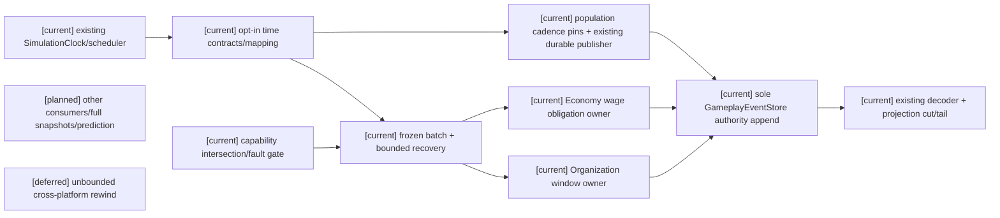

## 主流程时序图

```mermaid
sequenceDiagram
  participant C as current caller
  participant B as current batch coordinator
  participant O as current admitted owner
  participant S as current event store
  Note over C,S: planned additional owners/prediction; deferred unbounded rewind
  C->>B: frozen plan + dependency/read revisions + budget
  B->>S: query original idempotency record/receipt
  alt exact receipt exists
    S-->>B: actual event refs/revisions
  else no receipt and admitted budget/dependencies
    B->>O: original typed operation
    O->>S: owner validation + atomic append
    S-->>O: actual result
    alt lost response
      B->>S: query original receipt before retry
    end
  end
  B-->>C: per-owner receipts + cursor; confirmation only if closed/admitted
```

## 数据流图

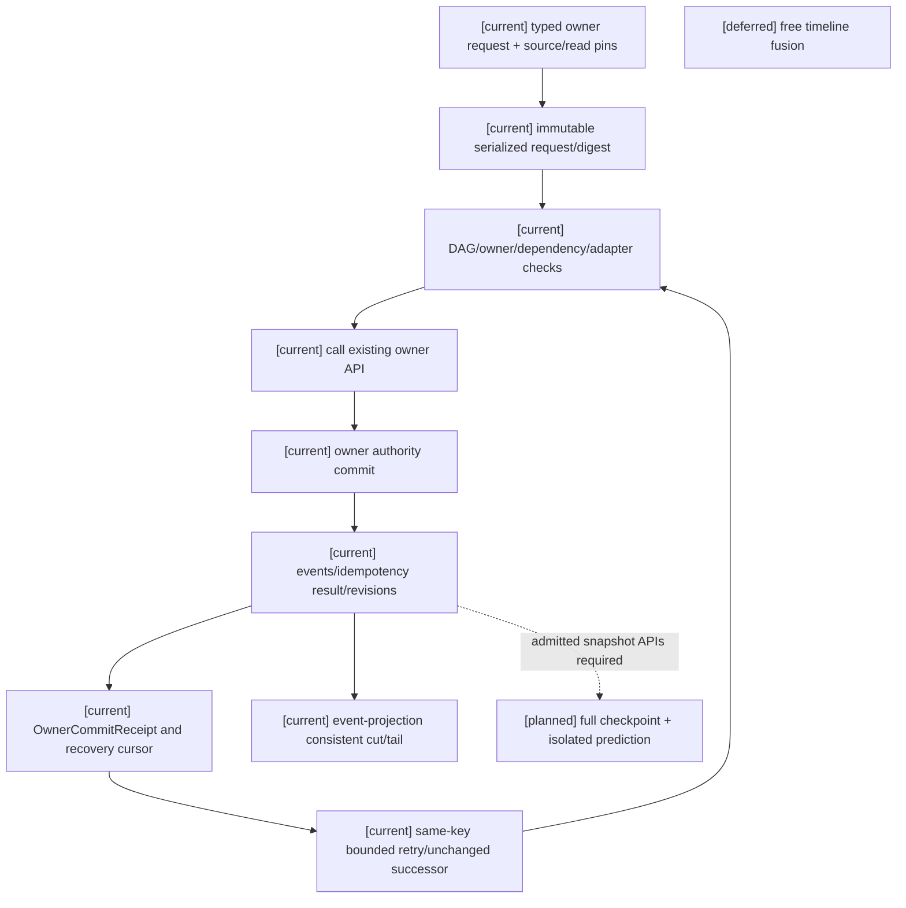

## 验证记录

TDD逐轮先观察新增测试缺模块/缺行为失败，再实现并跑相关回归。最终focused命令（backend目录）：

```powershell
python -m pytest -q tests/test_world_adapter_admission.py tests/test_world_batch_settlement_recovery.py tests/test_temporal_mapping_contract.py tests/test_world_replay_checkpoint_cut.py tests/test_infra_economy_wage_obligation.py tests/test_phase2c_payroll_and_operating_window.py tests/test_simulation_clock.py tests/test_world_runtime_scheduling.py tests/test_population_clock_profile.py tests/test_world_runtime_population_cadence.py tests/test_gameplay_event_replay.py tests/test_action_window_runtime.py tests/test_action_consequence_boundaries.py
```

结果：**102 passed，4条既有FastAPI on_event弃用warning，12.65秒**。新增测试文件分别覆盖17/11/9/4项；其余为相关现有回归。限定改动 `git diff --check` 通过。完整pytest与适用后端Harness由主批次统一执行并记录，不能用本focused结果替代。没有运行Godot，也没有把Harness all历史未通过改为通过。

模型质量仍未验收，Policy A保留autonomous 0/8、explicit diagnostic 0/6、role-sensitive 1/8。真实backend choice回合另见主批次报告，不补算模型正确率。Godot与领域执行均未验收；final/holdout未读取、未训练；B/C、玩法包、编辑器、自走棋、AD/Blender保持关闭。

2026-10-15 population切片增量证据：source pin两份旧fixture均归类为历史fixture过期、需新source revision；分类与旧/新SHA证据写在仓库外 `D:/Users/User/Documents/paralls-evidence/population-time-pins-20261015/source-pin-classification.md`，旧封存未改。生产driver将每窗pins交给既有Scheduler并写入既有cadence event record，经同一publisher确认、event store恢复；不确认pending游标，不重复append。指定8个focused文件从仓库根运行，最终89 passed、4条既有FastAPI弃用warning；`backend-contract` Harness通过且临时目录已清理，`git diff --check`退出码0。完整pytest因包含用户禁止的calibration合同测试，在约11%时停止，不能记为完整通过或失败；没有执行calibration工作流、Godot或final/holdout读取。

后续Task1仍需action/status等生产consumer与显式时长/单位迁移；Task2仍缺完整snapshot、prediction及其他准入owner。Task3–6门禁继续保持，不能据此宣称阶段三完成。

本轮继续未运行完整 pytest：全量选择会触发用户明确禁止的 calibration 合同测试。未读取 final/holdout，未训练或微调，未启动 Godot，未验证 Godot 边界，未启动 Task2 prediction、Task3–5 或 Task6。


## Task1 action/status 阻断审查增量（2026-10-15，本轮）

**结论：action = B，status = B，均保持 blocked。** 本轮仅审查与文档回写，没有新增或修改 runtime schema、owner API、事件、测试或 migration。前文实施及 population 的 current 是先前切片证据，不是本轮 action/status 时间接入证据。Task1 整体门禁未解除。

分类依据：计划04「前置共用约束」第57行要求“原文没有 owner/API 的能力标为阻塞的 admission 子任务，不能臆定实现”；Task1 第64、69、90行分别要求先做 mapping admission、API review 后修改、缺 pins 保留旧语义并登记 consumer 未通过。角色16 §8 的延期只涉及跨平台逐位物理、任意长回滚和自由时间线融合；未找到允许 action/status 独立延期的条款，因此不能选 C。存在通用时间数据类与可扩展事件 payload，不等于两个 consumer 已有合法时间 API，因此不能选 A。

### 来源与原文接口矩阵

以下链接按本文件位置解析，行号为本轮审查定位；章节是规范依据。设计文档仍是 planned/non-authorizing，本节不发布新接口。

| 来源 | 逐项章节与定位 | 对本审查的约束 |
|---|---|---|
| [计划04](../计划/04-通用合同与领域服务实施计划.md) | 前置共用约束 L53–58；Task1 L60–90 | 复用既有 owner/store；六对象、来源映射、activation、预算 cursor；缺 admission 不扩 schema，不改旧事件 |
| [规格09](../规格/09-通用时间权限投影与领域服务接入规格.md) | §3 L39–52；§4 L54–76；§5 L88；§6 L92–96 | 时间字段、原 key receipt 恢复、显式 migration boundary、consistent cut/tail 与 decoder admission |
| [角色16原设计](../角色/16-通用玩法时序模型与编辑器设计.md) | §2.1 L43–57；§2.2 L59–88；§2.3 L90–109 | 原字段见下表；仅调度 owner-bound request，调度不解释领域结果，不引入另一 clock/store/后台循环 |
| 同上 | §4 L178–180；§4.2 L214–216；§5 L226–246；§6 L250–259；§7.4 L322–349；§7.5 L353–355；§8 L359–364 | 活动版本由控制面批准，领域 owner 验证；旧 tick 不等价统一时间；状态到期不是已接统一 tick；重放与能力边界；没有本 consumer 的 C 类延期授权 |
| [角色11](../角色/11-跨玩法动作承诺协议设计.md) | §3 L31–47；§4 L49–63；§7 L101–109 | `commitment_ms:420` 是动作承诺示例，不是 mapping；时间戳需映射结算窗口；Laya intent、Actor execution、Authority result 分离 |
| [规格11](../规格/11-技法动作结算与非战斗语义适配规格.md) | §2 L22–29；§3 L33–35；§4 L41–43；§6 L74–75；A06 L110 | 本地 window/graph/consequence 是当前基础；不造 action clock/authority；冻结 phase evidence，领域 owner 重验；时序图请求 temporal window 是 planned，未给出已准入生产 API |
| [规格10](../规格/10-通用资源状态效果影响源与装备领域规格.md) | §2 L23–30；§4 L52–60；§5 L64–68 | 状态实例与资源独立；attach/active/stack-update/suspend/expire/remove/revoke/rebuild 生命周期；effect binding 不拥有 lifecycle；duration/tick 仍需 owner event/evidence；资源 reservation migration 不能替代 status migration |
| [规格12](../规格/12-生命连续性关系状态与动态行为规格.md) | §2 L26–30；§3 L34–38；§4 L49–53；§5 L59–63 | 缺生命类 owner 只能 unavailable/diagnostic；FearCondition 归 status/effect owner；Morale/派生关系分开；恢复不重复消费，不提供 status timer API |

角色16五对象原字段摘录（保留原名；另一个对象 SimulationTime 在 §2.2 定义）：

```text
TemporalProfile (§2.1): profile_id/revision/content_package_ref;
 advancement_policy/resolution_quantum/scheduling_policy/settlement_policy;
 time_control_policy/determinism_policy/rewind_policy;
 canonical_unit_ref/step_duration{unit_ref,numerator,denominator};
 supported_clock_mappings/rounding_policy/activation_boundary/compatibility_constraints.
SimulationTimeline (§2.2): timeline_id/parent_timeline_id?;
 world_scope_ref/advancement_owner_ref/profile_ref/profile_revision;
 epoch_ref/current_step/current_phase/authoritative_revision/status.
ClockMapping (§2.2): mapping_id/revision/source_clock_ref/source_unit_ref;
 target_timeline_ref/target_profile_revision/source_origin/target_origin;
 ratio{numerator,denominator}/rounding_policy/valid_source_interval;
 max_lateness/evidence_source_policy_ref.
ScheduledWork (§2.3): work_ref/domain_ref/due_time/trigger_ref;
 ordering_key/expected_revision_vector/owner_contract_ref.
SettlementWindow (§2.3): window_ref/timeline_id/from_time/to_time;
 participant_scope/phase_ref/input_cutoff/late_input_policy_ref;
 confirmation_boundary/frozen_read_set/evidence_refs/ordering_policy_ref;
 expected_authority_revisions/settlement_idempotency_key.
```

原文另要求 source sample/received time/source revision（§2.2 L88）。原文定义 profile revision、timeline authoritative revision 与 activation boundary，**没有单独命名通用 `activation_revision` 字段**。不能把 population 的字段命名复制为两个 owner 的既定合同，也不能拿 graph revision、status projection revision 或 source revision 冒充 activation revision。其具体引用与冲突验证形式仍须 API admission。

### 真实接口、持久化与恢复锚点

- **A-event（action，现有）**：[ActionWindowIntent/Validator](../../../backend/app/gameplay/action_window_runtime.py) 是 frozen/extra-forbid，本地 `end_tick-start_tick == 1`；graph/spatial/source revision 校验没有时间单位。[ActionConsequenceBoundary](../../../backend/app/gameplay/action_consequence_runtime.py) 只读校验来源事件与后果 owner，不提供时间写口。[InvestigationConflictAuthority](../../../backend/app/gameplay/p5/investigation_conflict.py) L101–223 的真实 ingress 为 `resolve_action_window(command, intent, graph, spatial_snapshot, role_ref, now)`，L117 丢弃 now；冻结既有 payload 后用原 receipt/idempotency record 比较并原子追加 encounter_started/action_window_resolved/control_changed/terminal_outcome_recorded/encounter_closed 五事件。现有 graph/spatial pins 不能证明 temporal pins。`replay_full` L414、`replay_checkpoint_tail` L429 与 `_projection_state` L814 恢复事件投影；action 新事件仅以 consequence event_type/stream_ref 进入该投影，未恢复开放窗口、mapping 或 pending work。实时调用方 [stormnight_realtime_session.py](../../../backend/app/gameplay/p5/stormnight_realtime_session.py) L239–259 从 action_count 构造 tick，传固定 now，不发布 source clock/mapping；场景脚本入口同样是本地窗口。规格11 planned 时序图不能补出这一生产接口。
- **S-event（status，现有）**：[status_tags.py](../../../backend/app/gameplay/status_tags.py) L72 实例只有身份/source/stack/event；L88 `StatusTagCommand` 仅命令/actor/principal/key/digest/cause/correlation/operation/tag/source/instance；L215 `StatusTagAuthorityService.apply` 用 actor stream `gameplay:status_tags:<actor>`，在 `status_tag_authority` principal 下查询原 receipt，比较调用方 payload_digest；L231 append schema1 生命周期事件，`pinned_revisions={}`。apply/remove/expire 是显式命令，expire 未验证 due time；不能把事件记录时间当到期权威。L122 `StatusTagProjector.rebuild(actor, events, checkpoint=...)` 的 checkpoint 是状态投影，tail 由调用者分割；重复 tail 不具备自动跳过已应用事件的合同。[semantic_effects.py](../../../backend/app/gameplay/semantic_effects.py) L17 的 expires_at_tick 与 L111–120 的 expiry obligation 是纯 evaluator 输出，不是该 owner 的时间 ingress、持久 work 或自动过期服务。
- **共同 store（现有）**：[event_store.py](../../../backend/app/gameplay/event_store.py) `get_idempotency_record/get_by_idempotency`、`load_snapshot/from_snapshot`（L598/612）与 `DurableGameplayEventStore`（L851）恢复事件、批次、receipt、outbox、checkpoint。可恢复旧事件不代表可补出未写入的时间 pins；不新增另一 store。action 的 schema registry 仍是既有 v1，status 亦为 schema1，历史 decoder/版本准入未由通用 payload 扩展自动解决。

下表中“应生成/冻结/验证”是原设计责任与**待准入接口**的区分，不表示已经存在该 API。A-event/S-event 指上述已有持久化锚点，不是新增事件名称。所有新 temporal admission 均不能用诊断代替提交校验；现有 legacy 调用行为本轮未改变。

### Action 字段来源与接口矩阵（B / blocked）

| 字段；原文是否要求 | 当前等价字段？ | 谁生成；何处冻结；谁验证 | 持久化/恢复绑定 | 缺失处置；单位/时长 migration |
|---|---|---|---|---|
| timeline identity / profile / epoch；是，角色16 §2.1–2.2、规格09 §3 | 无；encounter/graph ref 不是 timeline | 既有 timeline advancement owner 提供受准入引用；action 接纳窗口前冻结；action owner 验证领域与时间适配关系，具体读取 API 缺失 | A-event 的已接纳窗口 payload/原 receipt；replay decoder 与 cut 必须保留历史引用，现未支持 | 缺绑定拒绝 temporal admission；旧事件仅能诊断“缺时间证据”。仅 §4/规格09 §5 显式 boundary，禁止重解释旧 tick |
| source clock identity / source revision；是，§2.2 | source stream read-set 有 revision，但无 clock identity | 实际输入来源适配器提供身份与 revision；在接纳映射输入时冻结；action owner 验证受信来源，适配 API 未准入 | A-event evidence/read-set 关联原 receipt；不能由恢复时当前时钟倒填 | 缺或跨来源拒绝；不存在合法已接纳 work 时不能伪造 pending。来源/单位变更须已准入 boundary |
| mapping identity/revision；是，§2.2 | 无；navigation/collision 等 revision 非 mapping | 既有 clock mapping 发布方提供版本；接纳时冻结；action owner 经已准入 mapping 校验（API 缺失） | A-event/receipt 绑定历史 mapping，与现行版本隔离；decoder 缺失则 temporal replay incomplete | 缺失/过期 mapping 拒绝新接纳；在途保留旧 pins，不用新 mapping 重算旧 work |
| source/canonical unit、ratio/origins、step duration、rounding；是，§2.1–2.2 | 本地单 tick 窗口，不是秒或统一 step | profile/mapping 定义发布方生成；映射及 action 窗口接纳前冻结；mapping 校验与 action owner 领域校验 | A-event/receipt pin 原定义/revision；恢复依赖旧定义可解析，不能只存裸 tick | 无单位换算合同拒绝。§4 L178–180：在途 action 原 profile/window pins；无 migration 拒绝切换 |
| freshness/expiry：valid interval、max lateness、sample/received、source rev；是，§2.2 | now 被丢弃；spatial/source rev 不是 elapsed freshness | 受信来源提供 sample，接收边界提供 received，mapping 政策规定期限；接纳时冻结；action owner 验证证据 freshness | A-event evidence + receipt 冻结接纳决定；历史重放不按今天时间重新过期 | 新接纳 stale/missing fail-closed；迟到进入下一窗只在已注册政策下允许，目前无 API，不能自行 pending |
| activation boundary/版本冲突；要求 boundary/profile/timeline revision；未原名定义 activation_revision | 无；graph revision 不等价 | 已有 profile 控制面批准切换、timeline owner 执行；action 接纳 pin 当时版本；action owner 验证与当前激活关系，引用合同待决 | A-event/receipt + 历史 profile；重放旧窗不采用当前 activation | 缺合法版本绑定拒绝新 temporal admission；冲突不可静默刷新。仅显式 activation boundary，在途保留旧版本 |
| settlement window / work pins、cutoff/read-set/idempotency/cursor；是，§2.3、§7.4 | intent 有本地范围、source read-set、原 key/receipt；缺统一 window/phase/cutoff 与 pending cursor | 既有窗口/推进 owner 依获准合同提供窗口；action owner 冻结结算输入并验证；具体 window request API 与 pending 持有人未准入 | A-event/原 receipt、现有 checkpoint/tail；需定义开放窗/cursor 与事件 cut 的一致恢复，当前仅投影 | 缺窗口拒绝；预算耗尽仅保留已经合法接纳的 work/cursor、不确认窗口；不得新造 cursor owner。旧 work 原 pins，迁移仍限显式 boundary |

### Status 字段来源与接口矩阵（B / blocked）

| 字段；原文是否要求 | 当前等价字段？ | 谁生成；何处冻结；谁验证 | 持久化/恢复绑定 | 缺失处置；单位/时长 migration |
|---|---|---|---|---|
| timeline identity / profile / epoch；是，角色16 §2.1–2.2、§5–6 | actor/instance/source identity 存在，但无 timeline | 既有 advancement owner 提供合法引用；status 生命周期接纳时冻结；status owner 校验绑定，API 缺失 | S-event 原实例/lifecycle event/receipt；checkpoint/tail 要保留原时间引用，现投影无此状态 | 缺绑定拒绝 temporal admission；旧 lifecycle 可恢复其原状态，仅时间重建诊断不足；转换只可在显式 boundary |
| source clock identity/revision；是，§2.2 | source_ref/source_event_id 是因果身份，不是 clock | 受信 source 适配器生成；status 接纳时冻结；status owner 验证来源及生命周期权限，时间适配 API 待决 | S-event 因果链与原 receipt；不得由恢复时 now 代填 | 缺失拒绝新时间接纳；不能把因果事件序号当 tick；来源/单位变更不隐式迁移 |
| mapping identity/revision；是，§2.2 | 无；projection_revision 非 mapping | 既有 mapping 发布方生成；attach/期限接纳时冻结；status owner 依准入 API 验证 | S-event/receipt 固定旧 mapping；checkpoint/tail 需支持历史 decoder/定义 | stale/missing 拒绝；旧实例/expiry work 不能换用新 mapping，缺 decoder temporal recovery incomplete |
| unit/ratio/origins/step duration/rounding；是，§2.1–2.2、§4 | instance 无 duration；effect expires_at_tick 非等价 owner 合同 | profile/mapping 发布方提供单位与换算；status owner 按获准 duration 合同冻结剩余时长，当前 API 缺失 | S-event 实例生命周期与 receipt；须有版本化时长状态进入 checkpoint/tail，不能只改 payload | 无合同拒绝。§4 L180/规格09 §5 L88：剩余世界时长或回合转换，不复制裸 tick，声明舍入并诊断；无迁移拒绝切换 |
| freshness/expiry；来源 freshness 是 §2.2；生命周期期限是角色16 §4–6、规格10 §4 | explicit expire 命令存在，但无 due-time 校验；semantic expiry obligation 只是计划输出 | 来源给 sample/接收边界给 received；状态定义及 owner 决定寿命；既有调度仅提交 owner-bound 到期请求；status owner 验证 freshness 与 expire 是否到期，两者不得混同 | S-event applied/expired + 原 receipt，期限/work 引用需在原生命周期事件合法冻结；恢复不能重发 expiry | stale/missing mapping 拒绝新时间接纳；不能因来源过期直接删除状态。缺合法 due/work 不宣称自动 expire；转换按显式 boundary |
| activation boundary/版本冲突；原文要求边界及 profile/timeline revision，未命名独立 activation_revision | command、实例与 checkpoint 都没有；actor stream revision 非激活版本 | 既有 profile 控制面/timeline owner 生成激活决定；status owner 冻结适用版本并验证迁移，API 缺失 | S-event/receipt 记录历史版本，checkpoint/tail 解码旧版本；不得回填现行激活版本 | 缺失/冲突拒绝 temporal admission；必须显式 boundary 转换剩余 duration/turn，周期触发键去重 |
| due/work/window pins、expected revisions、ordering/idempotency/cursor；是，§2.3、§7.4 | lifecycle 原 key/receipt 有；无 ScheduledWork、pending expiry cursor 或窗口 cut | status owner 定义 lifecycle 到期语义，既有 scheduler 只交付 work；接纳时冻结 work/read-set，status owner 验证；对接及 cursor 持有人待准入 | S-event/原 receipt + 现有 store snapshot、status checkpoint/tail；须定义 disjoint tail/已应用身份与 pending 的一致 cut | 缺 work 身份不造 pending；合法预算延期保留 cursor；不能用重复 tail 重新提交。迁移 boundary 保留触发身份、避免双 expiry/周期触发 |

### B 类待决接口与解除条件

**Action**：先明确真实调用方使用哪条既有 timeline、source clock 与 mapping 发布/读取 API，以及 local graph window 如何取得已准入 SettlementWindow；明确 owner 在 receipt 查询/新提交两条路径分别如何验证历史 pins、现行 activation 冲突与 changed duplicate。再定义原 action event schema/decoder 的历史兼容、open-window/pending cursor 的恢复切面与旧 work 隔离。`now`、command 通用 payload 或 wrapper authority 都不是答案。既有 owner 不缺领域写权限，缺的是该 owner 的 temporal admission/API。

**Status**：先定义现有 apply/expire 如何接收已准入时间来源、duration/turn 期限、expected temporal revisions 与 owner-bound expiry work；明确重试 digest 包含哪些冻结输入，不能只信调用方给出的旧 digest。规定 lifecycle event/实例 checkpoint 的版本化期限与历史 decoder，以及 checkpoint/tail 重复输入的去重/拒绝边界、pending expiry work 的合法持有人与恢复切面；在显式 activation boundary 定义剩余时长/回合转换、舍入与周期键去重。不能将 semantic evaluator 的 obligation 升格为时间或 lifecycle authority。

两者的解除条件是上述生产 owner/API、历史兼容与 migration 合同具备可审查依据；随后才可重新分类 A，并在下一轮先加失败测试，再修改真实 ingress。未来验证必须覆盖 missing/stale mapping fail-closed、activation 冲突、重复恢复不重复提交、pending cursor、旧 work/新 mapping 隔离、显式 duration/unit boundary。本轮没有这些新行为的通过证据，也不以既有回归通过替代。

本节复用上文三类图示的现有 owner/store 边界；action/status 处在 planned consumer 接入范围，B 是依赖阻断，不是原设计许可的 deferred。以下补充交互与数据流只标明阻断点，不授权新 API：

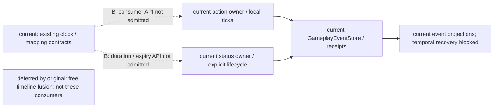

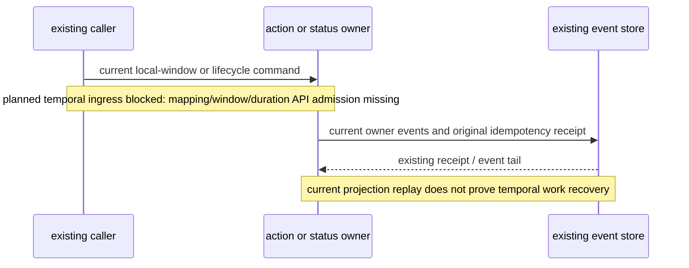

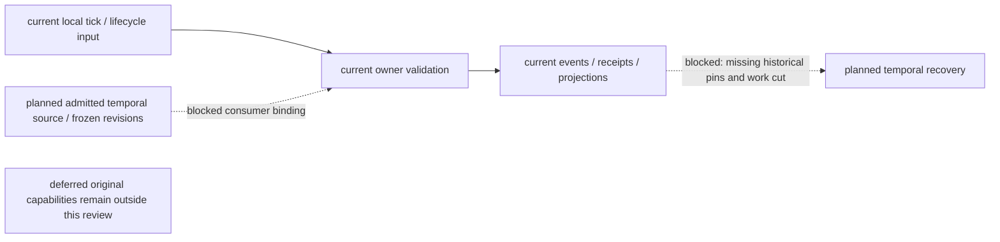

### 本轮验证与未执行范围

仅运行明确文件集合，无完整 pytest discovery（从 backend 目录）：

```powershell
python -m pytest -q -p no:cacheprovider tests/test_action_window_runtime.py tests/test_action_conflict_window.py tests/test_action_consequence_boundaries.py tests/test_3d_scripted_mystery_action_replay.py tests/test_status_tags.py tests/test_temporal_mapping_contract.py tests/test_p5_investigation_conflict.py tests/test_gameplay_event_store_persistence.py
```

本轮结果：**77 passed，5.46 秒**。证明既有 action 校验/提交/receipt、full/checkpoint-tail 投影、status 生命周期/分离 tail、时间合同与 store 持久化回归仍通过；不证明 action/status 已接 temporal pins，也不证明 status 同一 tail 重复输入具有幂等恢复。

`python scripts/verification/harness.py --profile backend-contract` 本轮退出码0，四项静态合同均 proved，profile passed，cleanup passed（run_id `3a900486aaab46a8bd45e2e73f941c00`）。这是静态协议检查，不是 runtime/Godot 或完整后端测试证据。其本轮系统临时报告由顶层 runner 自动清理，没有新建证据 archive。

最终 diff/清理检查结果见下方补记。仅该回写文件由本轮修改；旧 source pins、threshold、label、archive 均未修改。Laya **仍只验证 choice 输出类型**，没有新增模型质量或其他输出类型声明。本轮没有启动 Godot，没有读取 final/holdout，没有运行 calibration、训练/微调、Task2 prediction 或 Task3–6；没有新增 clock、scheduler、event store、authority 或 owner。

最终检查：`git diff --check` 退出码0（已有文件仅有换行归一化 warning）；本回写文件当前为未跟踪文件，另对其完整内容执行 whitespace 检查。`.harness` 本轮前后共24431个文件，路径/大小/mtime清单完全一致，`git status --short -- .harness` 无输出；本轮 runner 临时目录已不存在。保留全部既有数据，没有清理用户历史产物；本轮 metadata 基线临时文件已回收。

## Status consumer 应用生命周期与 Durable 重启闭环（2026-10-16）

本轮仅实施计划04 Task1 的 Status 应用装配与持久化重启闭环，不重复全面来源审查。下列五项分别验收；2026-10-15 的 Status=B 记录仅代表当时缺 owner temporal API 的状态。

| 验收层 | 本轮实现和证据范围 | 限制 |
|---|---|---|
| owner 局部合同 | 原 `StatusTagAuthorityService` 冻结期限，生成 `ScheduledWork`，重验 due/实例/权限/revision/pins，写 expired event 与原 store receipt；exact duplicate 复用原 receipt，changed duplicate 比较实际冻结输入及期限 | 调度选择不等于 expire；不新建 authority |
| 应用生命周期接线 | `main._assemble_status_runtime` 加载原定义配置，原 registry/service/薄 consumer 共享应用 store；原 population confirmed boundary 经 `RuntimeExecution` 串行调原 owner；startup/reset/shutdown 管理引用，停止后拒绝新请求 | 不新增 clock、scheduler、轮询或后台循环 |
| Durable store 重启恢复 | 应用测试使用独立临时持久存储，startup/apply/未到期推进/正常 shutdown 后创建新 store/service/runtime；恢复工作由原实际 caller 派发，产生 expired event/receipt，再次重启及重复派发不产生第二次 expire | 应用路径证据来自测试配置，区别于测试直接串联 work/select/submit；额外 duplicate 断言仍走实际 owner |
| 实际配置启用范围 | 复用 `Phase3MirrorActorConfiguration.status_tag_definitions`，以 `status_time_binding` 显式准入 actor 的 world/timeline/profile/mapping/source/单位/步长/窗口 pins | 默认 `gameplay_mirror_phase3_actor_configs=[]`，真实生产内容未配置；不凭空施加状态/默认期限，不把全部状态强绑 population |
| 未实施或未通过 | Action 仍待设计与实施，其他时间来源与完整 profile/unit/mapping 迁移未准入，无迁移即拒绝切换 | 不接受 Task1、阶段三整体或完整状态/效果领域完成；Task2 prediction、Task3–6未启动 |

同 actor 多状态到期按每项真实提交后的投影重新生成 work、交 owner 重验；不通过只更新 revision 规避冲突。零/多个期限状态、永久状态不入队、remove/expired 不重新激活、预算不足/暂停/调用失败可恢复、missing/stale mapping 拒绝与旧事件兼容均纳入 focused 覆盖。原 driver 在没有新窗口时重试当前已确认边界，未提交状态保持为恢复依据；shutdown/reset 关闭旧 consumer、清除 service 引用，并沿既有 owner 顺序关闭 store。

### 当前应用架构

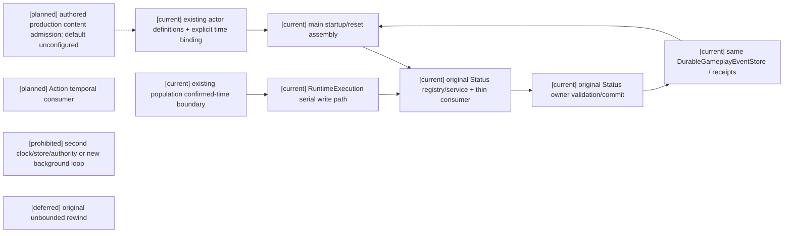

### 实际应用时序

```mermaid
sequenceDiagram
  participant A as Application lifecycle
  participant P as Existing population driver
  participant R as RuntimeExecution
  participant O as Status owner
  participant D as Shared durable gameplay store
  A->>D: startup opens store and replays committed state
  A->>O: assemble existing definitions / explicit binding
  R->>O: lawful apply with explicit duration
  O->>D: applied event and receipt
  P->>R: confirmed time before due
  R->>O: select/revalidate; no expiration commit
  A->>D: normal shutdown in existing owner order
  A->>D: new store/service/runtime startup and recovery
  P->>R: confirmed due boundary, including retry of current boundary
  R->>O: fresh projection/work and owner-bound expiration
  O->>D: expired event and actual receipt
  A->>D: shutdown and another new runtime startup
  P->>R: repeated advance/dispatch
  R->>O: replay terminal state / original receipt
  Note over A,D: no second expire; production content remains unconfigured
```

### 恢复数据流

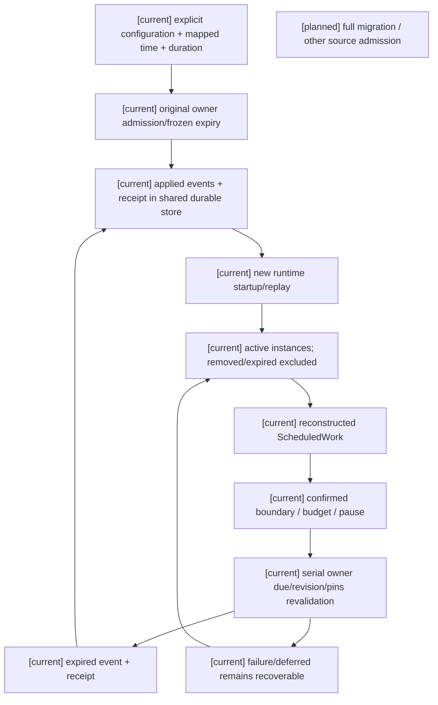

### 本轮测试允许列表与证据

先限定以下七个测试文件后运行 focused，不进行其他 discovery：

- `backend/tests/test_status_temporal_consumer.py`
- `backend/tests/test_status_tags.py`
- `backend/tests/test_status_application_lifecycle.py`
- `backend/tests/test_population_runtime_driver.py`
- `backend/tests/test_population_clock_profile.py`
- `backend/tests/test_runtime_execution.py`
- `backend/tests/test_phase3_mirror_source.py`

最终七文件 focused：**76 passed，4 warnings，18.08 秒**，warnings 为既有 FastAPI `on_event` 弃用提示。其中应用生命周期文件通过 11 项测试。仓库外稳定证据根为 `D:/Users/User/Documents/paralls-evidence/status-task1-20261016-c8ce61c618`，由调用方管理保留期限；原始来源 `C:/Users/User/AppData/Local/Temp/paralls-status-task1-evidence-20261016-c8ce61c618` 保留且未改写。2026-10-16 仅执行证据保全，没有重跑 Status 验收：原导出 15 个文件逐文件核对复制前来源、复制后来源与目标 SHA-256 全部一致，原 `status-acceptance.json` 所引 7 个源码/测试文件也与历史摘要相符，复制至稳定根的 `reference-files/`；四个 Harness artifact-index 引用全部可解析。逐文件来源/目标路径、摘要及 receipt 定位见 `preservation-manifest.json`，该 manifest 的 SHA-256 为 `370781f0c3dbe3d0ead34269941969f508b4921fd5b18a7a6b627311998c9e33`。保全不改变上一轮 Harness cleanup=passed、pytest cleanup=incomplete 或独立审查 HTTP 503=incomplete；没有重试此前被拒绝的删除或更换工具绕过。`focused-tests.log`、`focused-tests.xml` 保存完整输出及同一 durable 重启测试的 applied/expired receipt、实际 caller、新实例与 duplicate 属性。`backend-contract` 导出在其 `backend-contract/` 下，run_id `cea079775ec04b8eabeba05ca9416d24`，`overall_backend_contract_passed=True`、Harness cleanup passed；此结果只代表静态合同，不代替实际 caller、owner receipt 或 durable 重启。

补强历史事件兼容：仅复跑允许列表内 `test_status_temporal_consumer.py`，**11 passed，0.66 秒**，输出为 `legacy-tests.log` / `legacy-tests.xml`。前两条无期限历史事件显式移除新 `request_fingerprint` 后，full 与 checkpoint+tail 仍恢复一致，remove 不重新激活。未在此变更产品代码。

文档更新后 `git diff --check` 退出码0，只有既有 CRLF 归一化提示。Harness 本轮临时目录自动清理 passed；**本轮 pytest 临时产物清理尚未完成**：删除已核实属于本轮的 pytest 临时目录的 PowerShell 操作被自动审批审查拒绝，工具仅给出 `blocked by policy`，未绕过。work 根及前期 `pytest-4776`、`pytest-4777`、`pytest-4778` 仍保留，仓库外导出证据也保留；不能把 Harness cleanup 通过表述为全部产物清理完成。独立代码审查代理因服务503未能执行，未登记为独立审查通过。

未运行未筛选完整 pytest、Harness all、calibration/evaluation 或训练，未读取 final/holdout，未启动 Godot、provider、Task2 prediction 或 Task3–6；Laya 仍仅限 choice。历史 source pins、threshold、label、archive 保留。


## Action consumer 时间接入（2026-10-16）

本轮只处理计划04 Task1 的既有 Action consumer，先补规格09/11与角色11/16接口决定后实施。以下图记录本轮接线及明确边界，实际结果与限制见本节末尾，不将设计图当作运行验收。

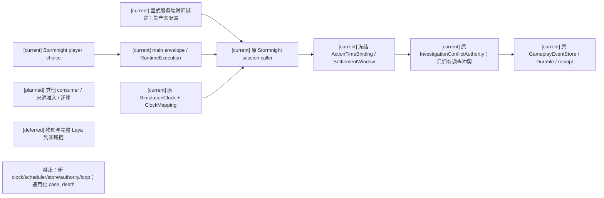

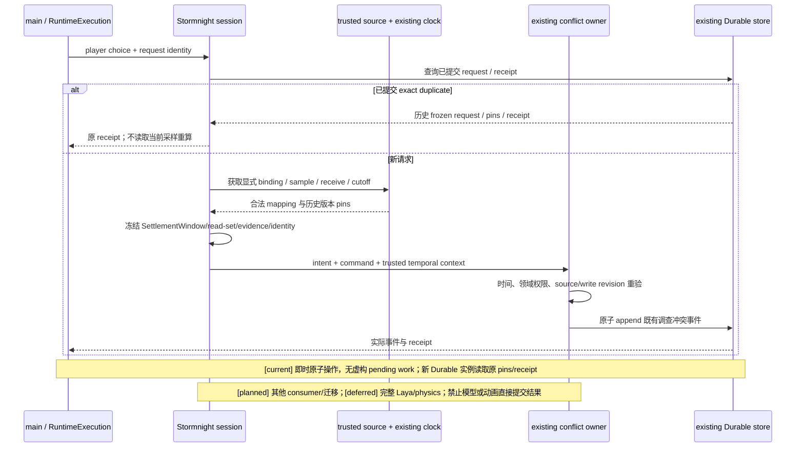

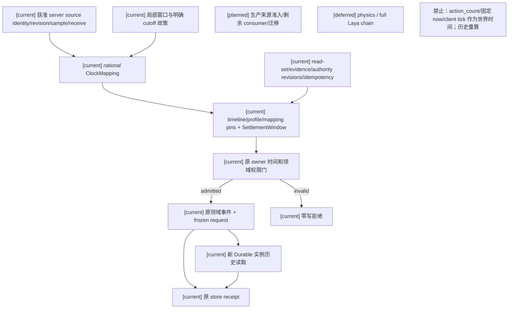

本轮允许列表见[计划04 Task1 执行增量](../计划/04-通用合同与领域服务实施计划.md#task1-action-时间接入执行增量2026-10-16)。时间来源仅在显式配置 scope 获准，默认生产没有新增来源。未运行 Godot、provider、final/holdout、calibration/evaluation、训练、Task2 prediction、Task3–6、B/C、玩法包、编辑器、自走棋、AD/Blender。Laya 仅 choice；历史 fixture pins、threshold、label、archive 不变。

### Action 最终结果与当前阻断矩阵

| 范围 | 当前结果 | 尚未完成 |
|---|---|---|
| 原 Action owner/API | `ActionTimeBinding`/`ActionTemporalContext`/`freeze_action_time_binding`；原 owner 提交前重验时间、graph/spatial、角色权限、read/write revisions | 其他动作领域绑定；不将 investigation conflict 的 case_death/终局扩张为通用动作结果 |
| 实际 caller | `RuntimeExecution → main._handle_envelope → StormnightRealtimeSessionService → InvestigationConflictAuthority → 原 store`，不是测试直接 owner 冒充接线 | 生产来源尚未配置，默认缺绑定拒绝；测试配置通过不等于生产内容启用 |
| 时间来源与准入 | 服务端显式 provider 提供原 clock/timeline/profile、受准入 mapping/source identity/revision、同来源 sample/receive/cutoff/local window；原 clock 精确映射，原 owner 对冻结请求重验 | 没有新来源自动发现或生产准入注册；未知政策不补齐；action_count 仅内容索引，固定 now/client tick 不作世界时间 |
| 历史与恢复 | 原五个调查冲突事件保存完整 profile/mapping/source、SettlementWindow/read-set/evidence/identity 与原请求，原 receipt；Durable close→新 store/service/execution 后相同 pins/receipt，exact retry 零重采样/零重复提交 | 原动作即时原子提交，没有 pending work/cursor；不虚构长期动作恢复能力 |
| 兼容 | 可选 time_binding 与旧 intent digest 保留；原 owner 可重放无绑定历史事件；显式 legacy caller 同进程 exact retry 复用 receipt，重启旧调用请求缺冻结输入则明确拒绝 | 旧事件未获得统一时间证据，不自动补 pins 或按当前时间重算 |
| 激活 | 从历史事件恢复完整 profile/mapping/source/policy 准入 fingerprint；同一 provider 内配置变化、重启后变化均拒绝 migration_required，历史 retry 仍原 pins | 无迁移合同，不允许切换；长期在途动作、通用 migration/control-plane 仍待后续 |
| Task1 总体 | 本轮现有 Action 原子切片已设计、实现并取得实际 caller/owner/Durable 证据；Status 沿用已保全历史证据，未重复验收 | 剩余 consumer、显式单位/时长迁移、生产内容准入与完整验收仍未关闭；Task1、阶段三整体未完成 |

先观察缺失 API 的失败，再实施。RED 记录是工具输出的派生观察说明，不伪称原始日志。最终允许列表 13 文件 focused：**147 passed，4 warnings，21.03 秒**；其后修正跨 kind 的持久幂等身份检查，重新运行允许列表中的 actual caller/session/websocket 三文件：**21 passed，4 warnings，6.71 秒**。仅后面三文件发生变化，其最终 JUnit 保存真实 Durable receipt/pins。拒绝矩阵覆盖缺绑定、跨 timeline、stale profile/mapping/source、cutoff、revision 竞争；source/mapping stale 的应用测试在 caller→owner 冻结输入处显式注入损坏，可信 context 不变。changed duplicate 窗口/采样/cutoff/source 在 owner 合同测试覆盖；实际 choice 重复及跨 kind 改写由应用恢复测试覆盖。

仓库外证据：`D:/Users/User/Documents/paralls-evidence/action-task1-20261016`。`focused-command.json`/`focused-tests.log`/`focused-tests.xml` 与 `final-caller-tests.log`/`final-caller-tests.xml` 保存命令及输出；`actual-action-receipts.json` 从最终 JUnit 提取完整 original/restored receipt、pins 与实际入口标识；`acceptance-manifest.json` 保存最终源码/测试及证据 SHA-256。子 lane 曾额外执行相关 `test_action_conflict_window.py`，超出预先声明的文件允许列表，这是本轮执行偏差；最终 root 验证严格使用允许列表，没有运行完整 pytest、calibration/evaluation 或 Harness all。

最终 `backend-contract-final/` run_id `e215098a2ef54e5fa8222dffe6a2c909`，overall passed、Harness cleanup passed；仅静态合同。此前同 profile 的 `e662315ad9fe4c448c822a4c5e0b73a5` 保留为修正前记录，不替代最终结果。独立 Action 静态复查发现的 provider identity 绕过与 legacy 重试退化已修复并复查；此为本轮局部代码复查，**不改变上轮 HTTP503 独立审查 incomplete**，也不是全面来源审查。

最终 `git diff --check` 通过（既有 CRLF 提示）；`git status --short -- .harness` 无变更。`.harness/verification` 实际存在用户已有 SQLite/目录，未清理；本轮 Harness 临时根自动清理。当前 Action pytest 自有临时目录删除被自动审批 `blocked by policy` 拒绝，**pytest cleanup=incomplete**，未重试或换工具；路径与 Harness 分项状态见 `cleanup-status.json`。上轮被拒绝的 Status 删除未尝试，原 Status Temp 证据未改写。


## Task2 冻结窗口与 Durable 恢复验收（2026-10-16）

来源：角色16 §2.3–2.4、§7.4，规格09 T04–T06，计划04 Task2。用户授权仅补已有两 owner 批次的真实冻结窗口消费和 Durable 新实例恢复。状态 `aligned/narrowed`；未开放其他领域写口或任何预测/训练专项。原设计/规格/计划末尾同名回写给出完整输入与恢复责任合同。

### 架构图

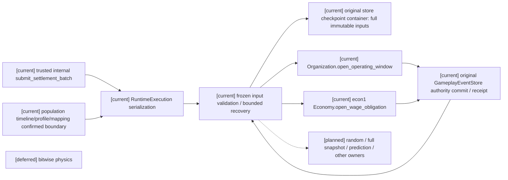

### 主流程时序图

```mermaid
sequenceDiagram
  participant C as current trusted caller
  participant R as current RuntimeExecution
  participant B as current batch coordinator
  participant S as current original Durable store
  participant A as current Organization owner
  participant E as current econ1 Economy owner
  C->>R: plan + legal SettlementWindow + budget
  R->>B: bind current driver pins at confirmed boundary
  B->>S: persist complete immutable input and owner/key claims atomically
  B->>S: query A original receipt
  B->>A: original input if unknown and budget permits
  A->>S: owner atomic event + receipt
  B->>S: query B original receipt
  B->>E: original input only after pinned dependency receipt
  E->>S: commit or revision conflict
  B-->>C: completed boundary or pending; preserve A
  Note over R,S: normal shutdown closes original runtime and store
  C->>R: new runtime/store/owners; batch ref + bounded budget
  R->>B: load original frozen input (old pins)
  B->>S: query both actual owner receipts; rebuild progress
  B->>E: retry unknown B with original revision/key, if permitted
  B-->>C: conflict stays pending; no silent replacement
  Note over B,E: planned replacement/compensation requires owner policy; prediction remains planned
```

### 数据流图

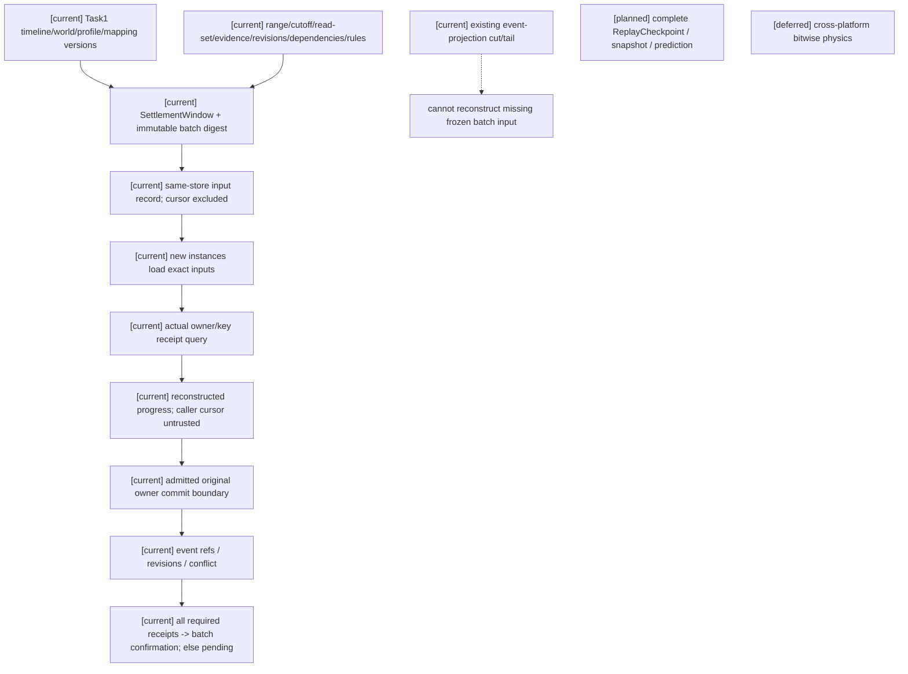

### 验收边界

- Task1 已消费：单配置 actor/world/timeline 的精确 canonical time、原推进 caller 的 profile/mapping pins、确认边界、显式迁移激活及历史 pins 保留；真实应用 RuntimeExecution/Durable 生命周期。原 Task1 验收不被扩大。
- Task2 本轮：两个原 owner 实际事件/receipt，A 成功 B 冲突保留，commit 后丢响应和未知 receipt 查询，正常关闭后新 store/owner/runtime 恢复，预算/依赖 pending、cursor 防跳过、exact/changed duplicate、同 key 禁止跨窗口、旧 pins 恢复与新版本新窗口。
- Task1 具名缺口：跨 actor/world/timeline 协调；EconomyAuthorityService、Inventory、Ecology、Character wake/deadline、Social delivery/expiry、Physics/presentation mapping、其他 Combat 技能/冷却 consumer；生产 profile/内容来源启用。
- Task2 余项：T07 随机/顺序确定性、完整参与者 snapshot、完整 ReplayCheckpoint、prediction 隔离、其他 owner admission；替换/补偿政策仍未批准。既有 event-projection cut/tail 本轮未修改，不作为完整 snapshot 或未完成批次输入证明。
- 测试配置闭环与生产内容启用分别报告：可信内部应用入口已接；没有配置自动生产批次来源、外部端点或新调度循环。缺冻结输入时失败关闭；恢复 caller 必须携带原 batch ref。
- 历史 Status/Action 清理拒绝及 HTTP503 独立审查 incomplete 原样保留，本轮不重试删除。Laya 仍仅 choice；未运行 provider、Godot、prediction、Task3–6、calibration/evaluation、final/holdout、训练、完整 pytest 或 Harness all。


### 本轮最终证据（2026-10-16）

仓库外证据根：`D:/Users/User/Documents/paralls-evidence/task2-frozen-window-20261016-120654/`。`manifest.json` 记录精确六文件允许列表、命令、源码 SHA256、退出码、JUnit 计数与 pytest 清理；`focused.log` / `focused.xml` 为原始运行记录；`receipts-and-frozen-windows.json` 从本次应用测试 JUnit property 提取实际 owner receipts、冲突恢复结果及迁移前后完整冻结输入。

- focused：**79 passed，4 warnings，exit 0**；warnings 为既有 FastAPI `on_event` 弃用。允许列表仅 `test_world_batch_settlement_recovery.py`、`test_world_batch_settlement_application.py`、`test_temporal_profile_migration.py`、`test_temporal_mapping_contract.py`、`test_population_runtime_driver.py`、`test_runtime_execution.py`，均位于 `backend/tests/`。Task1 受影响的时间映射、迁移、driver 和 RuntimeExecution 回归包含其中。
- `backend-contract/`：run_id `ab62481327314961b0ac98dc48c2c184`，overall passed，cleanup passed；仅静态合同检查，不作为运行时里程碑。
- `git diff --check`：exit 0，既有 CRLF 提示见 `diff-check.log`。代码验证后仅补写本证据说明。
- 本轮 pytest 自有临时目录 `C:/Users/User/AppData/Local/Temp/paralls-task2-final-39sda9q1` 已删除并确认不存在；Harness 自有临时根也清理通过。详情见 `manifest.json`、`checks-and-cleanup.json` 与 Harness report。
- `git status --short -- .harness` 为空；实际检查 `.harness/verification` 的 2726 个既有条目，清单导出为 `harness-existing-inventory.json`，全部保留。本轮没有清理历史目录/进程，也没有重试历史被拒绝删除。历史 HTTP503 独立审查仍为 incomplete。

此证据证明显式测试配置下，真实内部应用 caller 经 RuntimeExecution、两个既有 owner 和 Durable 新实例完成窄范围闭环。生产内容/自动批次来源仍未启用；没有完整 ReplayCheckpoint、全世界 snapshot、prediction 或跨 scope 通过声明。

## Task2 限定参与范围 checkpoint 与 replay（2026-10-16）

来源：角色16 §7.4、规格09 T10–T11、计划04 Task2。实现范围为 `ReplayCheckpoint@1` / `ReplayTail@1`，不替代原通用设计；**声明参与范围内的checkpoint/replay通过**。本结论只针对声明参与范围；Task1 整体、Task2 整体及阶段三整体分别保持未完成。下列 `[current]` 表示已有实现位置，不代替测试验收。

### 固定参与范围、代码与版本

实际内部入口为 `backend/app/main.py::submit_replay_checkpoint` 与 `submit_replay_tail`，均经原 `RuntimeExecution.submit`；要求运行中并匹配原 timeline 的 advancement owner。参与范围由显式 `batch_refs`、同一 driver timeline、已配置 Status consumer bindings 固定；缺 driver、coordinator、Status consumer、batch predecessor、原 owner adapter 或必需历史依赖即 incomplete，不删除依赖求通过。既有事件投影需连续读取原 spine，完整 store 观察用于检测竞争，不据此把所有其他领域自动准入为领域快照参与者。

| 参与者 | 实际代码与快照/重建 API | 序列化与保存内容 |
|---|---|---|
| timeline/profile/mapping 与确认边界 | `world_runtime/replay_participants.py::capture_participants`；原 driver/clock；`temporal_migration.restore_clock` | participant manifest schema 1；完整 timeline、profile、mapping、confirmed_tick、window_ticks 及历史 `time_pins`；各对象原 revision 保留 |
| Organization 已准入操作 | `organization_government_runtime.OrganizationAuthority.open_operating_window`；`OrganizationWindowBatchAdapter.query`；原 `GameplayEventStore.read_stream/get_event` | `inf:organization-operating-window@1`；实际 stream revisions、owner receipt、committed event refs；GameplayEvent schema 1 |
| Economy 已准入操作 | `econ1_economy_runtime.EconomyAuthority.open_wage_obligation`；`EconomyWageBatchAdapter.query`；原 store 事件/receipt | `inf:economy-wage-accrual-obligation@1`；principal 为 `actor_gameplay.econ1_economy_domain`；不是 `EconomyAuthorityService` 新准入 |
| 完整冻结批次和未完成窗口 | `batch_settlement.BatchSettlementCoordinator.load`；原 store `get_projection_checkpoint`；原 adapter 查询 receipt 重建 cursor | `world_runtime.batch_input@1`、`world_runtime.batch_operation@1`；projector/schema version 1；完整 frozen input、SettlementWindow/cutoff、read-set/evidence、依赖边、规则 pins、operation claims 和 pending/completed cursor |
| Population 确认与工作 cursor | `WorldContinuityRuntime.export_recovery_state/restore_recovery_state`；`RuntimeCadencePublisher._restore`；回放验证按历史 cadence 重建 | population recovery schema 1；mode/roster/authorized actors、confirmed tick/pins、due entries、原 `population-cadence:<world>` 事件引用 |
| Status 状态与到期工作 | `StatusTagProjector.rebuild`、`StatusTagAuthorityService.expiration_works`、原 consumer `pending_work` | Status events schema 1；显式 actor binding、原 definition 内容/pins、状态 projection 和 ScheduledWork；不执行到期命令 |
| 迁移边界 | 原 `temporal-activation:<timeline>` stream；`temporal_migration.restore_clock`；`driver.migration_pending` 对照事件 | migration events schema 1；完整 prepared/activated 历史、pending 状态和 revision；不由 replay 完成迁移 |
| 外部 read-set 依赖 | 原 `GameplayEventStore.read_stream`，按 `stream@revision` 定位，或批次内待提交 producer ref | 引用 schema 1；owner revision、event ref/digest、reconstruction API、pending producer；未知 revision 且无合法 producer 即拒绝 |
| 随机上下文 | manifest `random_context` | `not_applicable`：本路径仅冻结结构化输入、Status 工作与迁移，没有随机抽样或模型调用；`t07=not_verified`，不登记 T07 通过 |

`world_runtime/replay_checkpoint.py` 复用 `GameplayProjectionReplay` 的 projection schema 1 / projector version `1`，限定信封存于同一 store 的 `world_runtime.replay@1` projector，信封 `version=1`。participant manifest 单列 `batch_input/batch_operation/population_recovery/status_events/migration_events=1`；不兼容 decoder 拒绝，不以当前 mapping 或 definition 补历史。外部引用不获得 owner 写权限；未参与的资源、动作、物理、实体、关系等不获得完整快照声明。

### 一致切面、尾部与权限合同

先固定原批次合法窗口与 cutoff，读取真实 owner revisions/receipts 和事件游标，再固定完整未完成批次、Population cursor、Status 工作与迁移边界，获取参与者状态/重建引用，检查一致性并生成版本化 digest，最后将 checkpoint 写回原 store 供新 Durable 实例读取。原 `RuntimeExecution` 串行应用状态，同一 store 锁保护事件追加和 checkpoint 持久化；前后观察原 `export_snapshot`（排除本类 replay checkpoint）并重复读取 manifest。该观察覆盖不推进 `global_sequence` 的批次输入/claims/其他恢复记录和 receipts；参与 owner、输入或迁移变化须进入另一个可证明 cut，或本次返回 incomplete，不能只比较事件游标或拼接“最新值”。

`capture_scoped_tail` 固定 checkpoint digest、起止 sequence/revision vector、连续原事件、目标 participant manifest 和 result digest。`replay_scoped_tail` 对照历史源、实际 receipt、冻结输入/claims、Status projection/work、Population 恢复状态和迁移事件，再比较同目标边界的 full replay 与 checkpoint+tail。exact duplicate 先按 event identity/sequence 去重；changed duplicate、缺段、缺 receipt/冻结输入、unsupported decoder、checkpoint/tail/result digest 冲突须分别拒绝。旧、新 profile/mapping pins 按各自历史保存；不从当前配置重算旧窗口。

回放只重建和验证，不调用模型、不重提领域命令、不派发 Status 工作、不激活迁移。A 已提交、B 冲突时，历史 A receipt/事实保留、B pending；若恢复后需继续，仍由原 `submit_settlement_batch`/coordinator 查询实际 owner receipt，并按原冻结合同和预算执行。checkpoint 没有领域写能力。

本轮仅增加可信内部应用入口，没有新 HTTP/websocket 读取路由或角色权限。完整 checkpoint 是 authority audit/recovery 依据；creator 仍受原授权范围限制，角色仍只读原 L1 过滤 projection。不能把包含全部 pins、外部依赖、工作和 receipt 的 checkpoint 当角色快照。

### 架构图

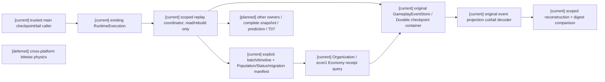

### 主流程时序图

```mermaid
sequenceDiagram
  participant C as trusted application caller
  participant R as existing RuntimeExecution
  participant P as scoped participant reader
  participant S as original Durable store
  participant D as existing event decoder + read-only rebuild
  C->>R: checkpoint ref + explicit batch refs + advancement owner
  R->>S: lock; observe events + receipts + non-event recovery records
  R->>P: fixed window/cutoff; owner receipts/revisions; work/migration boundary
  P-->>R: versioned manifest + reconstructible references
  R->>S: compare second observation; persist digest if consistent
  Note over R,S: changed participant/input/migration => incomplete
  C->>R: normal close; new store/runtime; read checkpoint and capture tail
  R->>S: load original checkpoint; target event sequence + participant boundary
  C->>R: replay saved tail at target boundary
  R->>D: original versions/order/dependencies; validate historical facts
  D-->>R: full and checkpoint+tail result digests
  R-->>C: verified or incomplete/divergent; no owner command submission
  Note over C,D: [planned] whole Task2 / prediction; [deferred] bitwise physics
```

### 数据流图

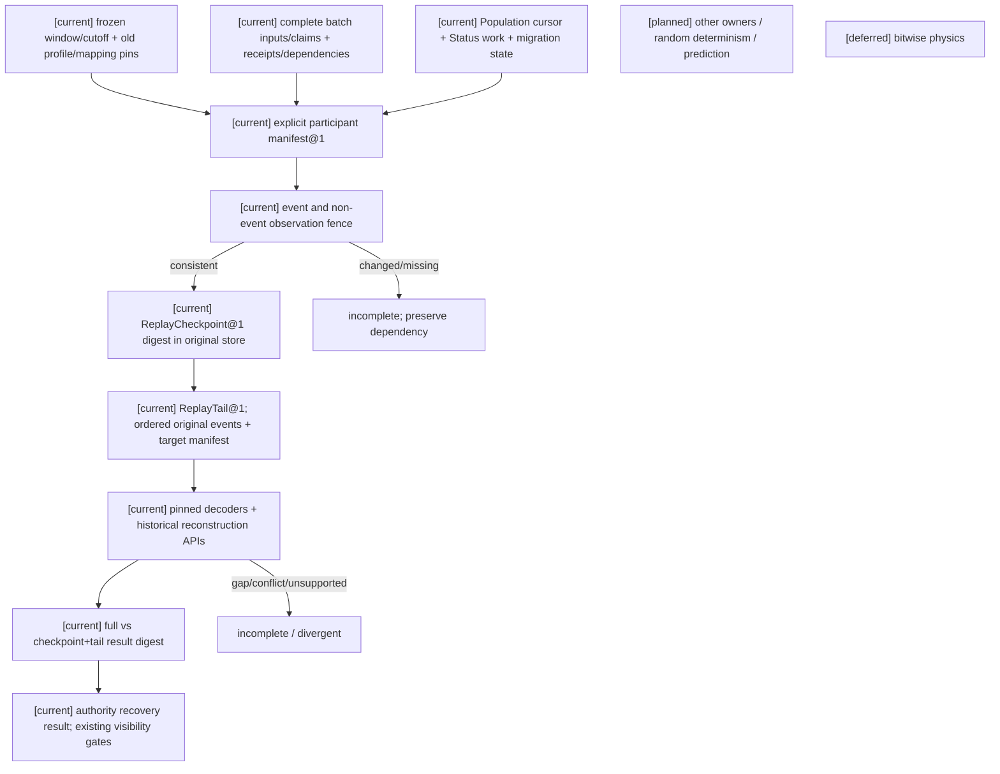

### 验证、历史状态与回滚

本轮测试允许列表由主执行者在运行前声明，focused 覆盖实际 main caller、一致 cut 与并发 owner/非事件输入/迁移变化、Durable 新实例、相同目标的 full/checkpoint+tail、exact/changed duplicate、缺段/receipt/输入/decoder/digest 以及权限边界，并补受影响批次和 Task1 回归。仅运行筛选列表、`backend-contract` 静态合同和 `git diff --check`；最终命令、结果、仓库外证据、源码摘要及清理记录见下一节。

不运行未筛选完整 pytest、Harness all、Godot、prediction、其他 owner、Task3–6、calibration/evaluation、final/holdout 或训练；Laya 仍仅 choice，本轮无需 provider。历史封存、Status/Action 清理拒绝及 HTTP503 独立审查 incomplete 保留，不能被本轮局部通过覆盖。若新 decoder 或信封合同不兼容，关闭新 replay 入口并保留原事件、receipt、冻结输入与历史 checkpoint；不清账、不迁移事实 owner、不回滚已提交 A。


### 本轮最终验证与证据（2026-10-16）

接受结论：**声明参与范围内的checkpoint/replay通过**。实际应用内部入口经 RuntimeExecution、两个原 owner 查询与 Durable 新 store/runtime 完成重建；full replay 与 checkpoint+tail 在相同目标边界 digest 相等，重复 tail 没有新增持久效果。缺段、changed duplicate、缺 receipt/冻结输入、unsupported decoder、digest 冲突分别拒绝；包括重新计算 tail digest 后的缺段/范围缺失拒绝与实际持久依赖缺失。非事件输入变化、owner 提交、迁移状态变化使 capture incomplete；A 已提交/B 冲突重启后仍保留 A 和 B pending。补查修正了外部依赖整组删除未拒绝、manifest decoder 版本未明确拒绝及 timeline 正常迁移进度误判范围变化的问题。

执行前固定的测试文件允许列表（均在 `backend/tests/`）：

- `test_world_replay_checkpoint_cut.py`
- `test_world_replay_checkpoint_application.py`
- `test_world_replay_participants.py`
- `test_world_batch_settlement_recovery.py`
- `test_world_batch_settlement_application.py`
- `test_temporal_profile_migration.py`
- `test_temporal_mapping_contract.py`
- `test_population_runtime_driver.py`
- `test_population_clock_profile.py`
- `test_population_durable_cadence_recovery.py`
- `test_status_temporal_consumer.py`
- `test_status_application_lifecycle.py`
- `test_runtime_execution.py`

最终筛选命令为 `python -m pytest -v -p no:cacheprovider -o junit_family=legacy --basetemp <owned-system-temp>/tests --junitxml <run-scope>/focused.xml <上述13文件>`，**175 passed**，4 项既有 FastAPI on_event 弃用警告。原批次与 Task1 受影响回归包含在该列表。`python scripts/verification/harness.py --profile backend-contract --export-evidence <stable>/backend-contract` 静态合同 passed；`git diff --check` passed，仅已有 CRLF 提示。未运行未筛选全集、Harness all 或任何关闭范围。

仓库外稳定目录：`D:/Users/User/Documents/paralls-evidence/stage3-task2-replay-20261016-1250/`。

- `focused-final/focused.xml`、`focused.log`：实际测试结果与记录属性。
- `focused-final/scoped-replay.json`：完整版本化 cut、tail、原 owner receipts、历史/目标参与范围与相等的 result/full digest；cut/event checkpoint 的序号及 revisions 可复核。
- `focused-final/run-manifest.json`：精确命令、13 文件允许列表、源码 SHA256、临时根、清理与先前失败记录。
- `backend-contract/`：静态报告与 cleanup passed；`harness-inventory.json`、`harness-status.txt`：实际 `.harness` 目录清单及空 git status，既有数据全部保留。
- `delivery-manifest.json`：本轮代码、测试与五份文档最终摘要、diff-check 及清理复核。

首轮扩大后的筛选回归为 172 passed/1 failed（timeline 进度误判），修复后得到上述最终结果。首轮 run_scope 因 pytest 临时链接拒绝导出，run_id `251c747a4521493c93ce03fdd6b454c7`；该次临时根已清除，未绕过链接导出规则。最终将本轮拥有的 pytest 临时目录与可审查证据分开，分别由 TemporaryDirectory 和 run_scope 回收；最终 run_id `3ddf6b9cf6c74442a70d7f689d714cdf`，cleanup passed。没有启动外部服务/provider，也没有删除历史数据或结束用户进程。历史清理拒绝保留；本轮独立审查代理亦遇 HTTP503，独立审查仍 incomplete，不冒充人工/代理审查通过。

Task1 整体、Task2 整体、阶段三整体仍分别未完成。T07 随机确定性未验证；本路径明确 random_context not_applicable。checkpoint 仅为可信内部恢复依据，不扩展 creator 或角色读取权限。生产内容来源未因测试配置通过而启用。

## Task1 Inventory 真实生产输出 consumer 时间合同专项审查（2026-10-16）

本节只审查真实的生产输出入库路径，不修改运行时代码。结论是：**已有可验的 Inventory 领域入库合同，但尚无可接受的 Task1 时间 consumer**。RW-44 保持不变：生产输出继续由 Inventory custody 管理，当前不进入核心 `ResourceEntry`；Task3 仍无可实施切片。领域 receipt/replay 的存在不能替代时间 consumer 验收。

原设计[角色16 §2.3](../角色/16-通用玩法时序模型与编辑器设计.md)明确“`SettlementWindow` 固定时间与读取边界”；§6 对 Economy/Inventory 明列“cadence、deadline、period window”，并规定 Inventory 保留库存/持有事实。本审查只判断这条真实 custody 路径是否消费上述时间合同。

### 真实 caller → owner → store 与恢复入口

真实调用链为：`PopulationCadenceDriver` → `RuntimeCadencePublisher.publish_pinned` → 已授权 cadence/Inventory projection → `PopulationSimulationCapability._run_decision_cycle` → `InventoryOutputCustodyOwnerExecutor.submit` → `InventoryAuthorityService.settle_production_output_custody` → 配置的 `GameplayEventStore`（生产配置可为 `DurableGameplayEventStore`）。caller 的候选构造在 `backend/app/services/siming_population_capability.py:528-610`，adapter 在 `backend/app/population_continuity/inventory_owner_adapter.py:24-79`，owner 重验与提交在 `backend/app/gameplay/inventory_runtime.py:1653-1894`，receipt/重读在 `inventory_runtime.py:1896-1988`，Durable 幂等查询在 `backend/app/gameplay/event_store.py:1242-1248`。

cadence 的 `SimulationTime`/profile/mapping/source pins 由 `backend/app/world_runtime/population_driver.py:105-115,163-201` 与 `backend/app/population_continuity/runtime_publication.py:363-449` 生成并保存于 cadence 记录；静态路径没有证据表明这些 pins 被复制到 Inventory intent 或 owner 的 `SettlementWindow`。Inventory projection 冻结 certification event、source stream revision 和领域幂等键（`backend/app/population_continuity/domain_projection_sources.py:261-340`；`backend/app/population_continuity/siming_contracts.py:205-230`）；Inventory adapter 在提交前另读当前 Inventory stream revision，owner 从 active binding/content 重验。caller **未冻结** content/binding revisions 和 Inventory read-set；这些领域信息不是时间 `ClockMapping`。

### Task1 时间合同 A/B/C 矩阵

| 检查项 | 分类 | 已有证据 | 缺口/解除条件 |
|---|---|---|---|
| 1. SimulationTime/ClockMapping、timeline/profile/mapping/source pins、冻结结算窗口 | **B（pins 传递）/C（窗口语义）** | cadence event 的 committed record 保存 driver 生成的 pins；`PopulationCadenceInput` 有 `window_start/end`。角色16 §2.2–2.3 定义共享时间对象与完整 `SettlementWindow` | pins 未传入 Inventory intent/owner；cadence record 不含完整窗口的 participant/cutoff/confirmation/late-input/order 等边界。pins 接线可设计，完整窗口语义/来源不可推定 |
| 2. caller 冻结 certification、Inventory read-set、content/binding revisions、幂等身份 | **A（认证身份）/B（read-set 接口）/C（caller content/binding 来源）** | projection 冻结 certification event/source revision 与领域幂等键；`PopulationReadSet` 有 digest；adapter 读取当前 Inventory stream revision；intent 只携带认证身份/revisions、command/correlation、`submitted_at` | Inventory revision 是 submit 时读取，非 decision 冻结 read-set；content/binding 由 owner 提交时发现，projection 无该来源。需有来源的 Inventory 只读冻结资料，否则维持 C |
| 3. owner 提交前重验窗口、revision/read-set、权限、幂等输入 | **A（领域）/B（owner 时间接口）/C（时间权限来源）** | `InventoryAuthorityService` 重验认证 provenance、active content/binding、holder/container/capacity、领域 revisions、固定 principal/包绑定与幂等 digest；`mapping_revision` 是 Inventory binding mapping | 无时间重验；未找到该 population capability 的时间消费授权来源。可设计同一 owner 的 fail-closed 边界，具体 temporal grant 来源未知 |
| 4. Durable 新实例 receipt；丢响应、重试、changed duplicate | **B** | owner 查询既有 store idempotency record/result；Durable store 可按 principal/key 查询 | key 在 owner 内按活跃 binding、认证、Inventory revision 推导，caller 无查询 API；时间 pins 未进 v1 digest。新查询接口与旧 key/digest 兼容待设计；无 Durable 新实例/丢响应证据 |
| 5. checkpoint/tail 或 full replay | **B（full replay）/C（checkpoint/tail participant）** | `production_output_custody_view_for()` 全事件读取并校验来源/provenance，构成具名 Inventory full-read reconstruction API；当前 scoped participant 未含 Inventory | 可设计 Durable 新实例 full replay 对照，但尚无 fresh verification；checkpoint/tail 需单独决定是否纳入及 owner 责任 |
| 6. 旧事件、旧 pins、既有 Inventory 语义兼容 | **A（领域）/B（时间）** | 旧 Inventory 事件 decoder/view 保留 item/container/source 语义，旧领域 pins 与 receipt 可查询；RW-44 保留 Inventory custody | 旧事件未绑定共享时间 pins；需定义旧事件时间缺段时的 fail-closed/legacy decoder 规则，不重写历史 pins/事件 |
| 7. 区分领域入库合同与 Task1 时间 consumer 验收 | **A** | 现有领域 owner/receipt 测试证明领域合同；阶段三既有 175 项 scoped replay 仅声明参与范围，不能扩称 Inventory 时间通过 | 本节明确分开；Task1 consumer 仍未验收 |
| 8. RW-44 与 Task3 边界 | **A** | `stage3-task3-production-output-c1-decision-20261016.md:107-115`、回写 README RW-44 明确继续 Inventory custody、核心准入为 deferred/no admission | 无缺口；未来核心需求须重开来源与 D06 审查，不创建 ResourceEntry caller |

### 恢复、兼容与验收边界

当前已知的领域恢复入口是 store idempotency 查询和 `production_output_custody_view_for()` 完整事件重建；`checkpoint_at` 不是持久 ReplayCheckpoint。owner 可按 principal/key 查原结果，但 key 由 owner 根据活跃 binding、认证和 Inventory revision 推导，caller 无直接查询接口。Durable 新实例及时间身份变化下的行为没有本路径验收证据，标为 `unknown/not_verified`。既有 scoped checkpoint/tail 不含 Inventory。

旧事件、旧 pins 和旧 Inventory item/container/source 语义继续由既有 decoder/view 保留；不得重写历史事件或补造时间 pins。下一阶段设计只复用 `RuntimeCadencePublisher` 已持久的 cadence record pins、cadence `window_start/end`、现有 `PopulationReadSet` 与 Inventory owner/store API。B 类接线须把同一已确认 cadence record 与 read-set 身份连续带到 owner；不能从 wall clock、`submitted_at` 或事件顺序反推时间。现有 pins 尚不足以填满完整 `SettlementWindow`；participant、cutoff、confirmation、late-input/order policy 的来源未确认，保持 C/deferred。caller 侧 content/binding revision 也须有获准只读来源，不能把 submit 时 owner 读取伪装成 caller read-set。

owner 设计沿用 `actor_gameplay.inventory_domain`、store `get_by_idempotency` 与现有 principal/key/digest。时间窗口及时间权限必须在原子提交边界重验；temporal authorization source 当前 unknown，来源未确认前 fail-closed。v1 领域 key/digest 与历史 receipt 不改写；如何把时间身份纳入后续输入 digest 并保留旧 retry 语义，先完成兼容设计。恢复验收的最小已有来源选 full replay：Durable 新实例打开同一持久 store 后查询原 owner receipt，并用 `production_output_custody_view_for()` 对比全事件重建结果。其 `checkpoint_at` 不算 checkpoint/tail；participant 扩展保持 C。

缺任一真实时间来源、caller 可读版本来源或时间权限 owner 时保持 C/deferred，不创建 synthetic caller/owner、默认 pins、clock、scheduler、event store 或新核心资源字段。

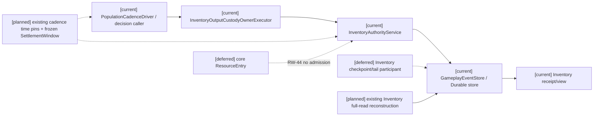

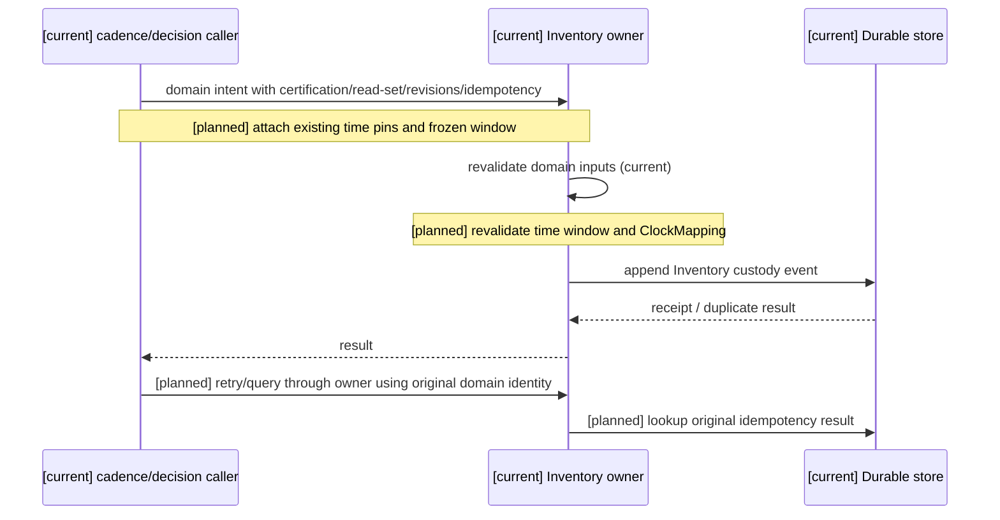

```mermaid
flowchart TD
  I["[current] caller certification / read-set; owner discovers current content/binding"] --> D["[current] Inventory custody validation"]
  TP["[planned] timeline/profile/mapping/source pins + SettlementWindow"] --> D
  D --> E["[current] production_output_received event + domain receipt"]
  E --> V["[current] Inventory view/re-read"]
  V -.-> F["[planned] Durable new-instance full replay comparison"]
  V -.-> P["[deferred] checkpoint+tail participant admission"]
  E -.-> R["[deferred] core ResourceEntry admission (RW-44 closed)"]
```

### 本轮判定与最小下一项

不存在可接受的 Task1 Inventory 时间 consumer；领域入库为 A，pins/owner/recovery 接口为 B，完整窗口和 temporal permission 来源为 C，Task1 验收未通过。接线设计选用原 cadence record 与 read-set、原 Inventory owner 和 store receipt lookup、`production_output_custody_view_for()` full replay，不扩展 checkpoint participant。实施前置仍是完整 SettlementWindow 边界、时间授权来源和 caller 冻结 content/binding 的只读来源；缺失时不进入实现。facility repair C/deferred、Task2 T07/prediction、Task4 其他动作、Task5/6、Laya choice 及所有既有门禁保持不变。


## Task2 T07 真实随机消费者盘点（2026-10-16）

**结论：blocked / not_verified。** 本轮仅规格09 T07，不实施 synthetic random consumer。读取角色16 §7.1、规格09 §5/T07、计划04 Task2，并检索 `backend/app/` 的 random/RNG、随机函数、概率、seed、hash 转整数及其 caller。未找到同时具备真实领域随机消费和可恢复证据的具名 owner。下表的固定公式、canonical digest、排序与 simulation seed 都不是抽样。Task2 整体未完成，既有声明范围 ReplayCheckpoint/ReplayTail 与 Organization/Economy 批次恢复结论独立保留。

### 候选 owner / caller / 恢复链盘点

文件均相对 `backend/app/`；测试均在 `backend/tests/`。测试配置存在只证明该固定路径可执行，不证明随机闭环。

| 候选与实际 owner | 真实 caller / 实际结果与算法、seed policy | 事件、receipt、replay 保存位置 | 已有排序 / 测试配置 | T07 缺口 |
|---|---|---|---|---|
| Action：`InvestigationConflictAuthority.resolve_action_window`，`gameplay/p5/investigation_conflict.py` | `StormnightScenario._resolve_action_window`、`StormnightRealtimeSession` 及时间 owner 测试；`ActionWindowValidator.validate` 从空间证据计算 visible/heard/contact，outcome 固定 resolved；`deterministic_seed` 仅参与 intent digest 并原样写 payload，无抽样/seed policy revision | 原 conflict stream 的 action window 事件、原 store append receipt；时间绑定冻结 request，Durable 保存并返回原 receipt；既有 Conflict projector / event replay | revision items 排序，graph node 按 ref 匹配；target_refs 取首项，不能宣称目标集合已 canonical；`test_action_window_temporal_owner.py`、`test_p5_investigation_conflict.py` | 无 effect/draw 语义、随机算法版本和随机 receipt；现有 project event 的 seed 字符串不是私有 RNG seed，不能据此声称 seed 保密通过 |
| Organization：`OrganizationAuthority`；econ1：`EconomyAuthority` | `main.submit_settlement_batch` → 原 RuntimeExecution/coordinator → `OrganizationWindowBatchAdapter` / `EconomyWageBatchAdapter`；固定 operating window 与工资义务输入，无随机结果、算法/seed policy 不适用 | `gameplay/organization_government_runtime.py`、`econ1_economy_runtime.py` → 原 GameplayEventStore/Durable 事件、idempotency receipt、冻结批次输入/claim；原 ReplayCheckpoint/Tail | 依赖拓扑 ready 按 operation_ref，revision pins 排序；`test_world_batch_settlement_recovery.py`、`test_world_batch_settlement_application.py` | 有恢复证据但没有随机消费；不能把预算 cursor 当 draw_index |
| 账户 Economy：`EconomyAuthorityService`，`gameplay/economy_runtime.py`；市场排序 `phase4_commerce.py` | Bakery reference / AdventureBasic reference 调用 open_account 与原 settlement APIs；金额、报价、义务由明确输入/源事件计算；价格时间排序明确无随机 | 原 economy stream / append receipt / EconomyProjector；与 Task2 econ1 工资 owner 区分，不自动加入 scoped manifest | projector `(global_sequence,event_id)`，账户/义务 key 排序；`test_economy_runtime.py` | 无随机算法、effect/target/draw 或随机 receipt；Task2 scoped replay 不覆盖全部账户路径 |
| Inventory：`InventoryAuthorityService` / 继承的 `InventoryPlatformAuthority` | `main.py` custody wiring、Bakery/Adventure reference、production output custody adapter 调原 instantiate/move/reserve/settle_production_output_custody；物品、数量和容器由输入/源证据指定，不抽掉落 | 原 inventory streams、append / settlement receipts；InventoryProjector 与既有 checkpoint replay | events `(global_sequence,event_id)`，item/container/reservation keys，容器内容按 item_id；`test_inventory_runtime.py` | 未配置随机掉落、draw 游标及其恢复合同 |
| Ecology：`EcologyHazardAuthority` / `EcologyPlatformAuthority` | `advance_seasonal_process` 的可查直接 caller 为 `test_infra_ecology_process_lifecycle.py`；平台写 API 有 `test_ecology_platform_runtime.py` 配置；`semantic_authority.py` 实际调用原 EcologyHazardAuthority 的已提交事实适配。当前天气 clear/rain 切换、资源再生、作物生长为固定公式；事件派生传播/显式 hazard 不等于随机突变 | 原 ecology region stream、append receipt、regional projection / EcologyPlatformProjector checkpoint；未进入 Task2 scoped random manifest | node_ref/crop_ref、邻区 ref、organization_ref 与 quote refs 排序；上述测试 | 无随机算法/seed policy revision、按目标 draw receipt；不能从生态命名推断概率消费 |
| Population / Siming：`PopulationPlanner`、`PopulationDecisionPlanner`、`CharacterSeedPlanner` 是计算者，事实仍由原 domain owner 和 Character Core 接纳 | `services/siming_population_capability.py` → plan_population_cycle / decision_surface.select / seed_planner.derive；按优先级/权重预算选择；`SHA256({base,projection,actor})` 仅派生 deterministic_seed 标识，无抽样 | 原 cadence/read-set/decision/result、ContinuityMerge receipt 与 Character Core seed receipt；原 recovery state / event store；本轮 scoped replay 仅覆盖声明的 cursor 依赖 | `(-priority,actor_ref,projection.ref)`；`(-score,candidate_ref,source_projection_refs)`；seed projections `(actor,ref)`；`test_siming_population_decision_planner.py`、`test_siming_led_population_seed_continuity.py` | selector/ruleset revision 不等于 RNG algorithm revision；seed 可进入 candidate，不能认作私有随机 seed；无 effect/target/draw 恢复 |
| Status：`StatusTagAuthorityService`，`status_tags.py` | main 配置加载与 `StatusTemporalConsumer` expiration request；apply/expire/migrate 为 registry、duration 和 confirmed boundary 的固定变换，无概率触发 | 原 actor status stream、append receipt、request fingerprint、StatusTagProjector；声明的工作/迁移随 scoped checkpoint 恢复 | events `(global_sequence,event_id)`，实例/修订 key 与 time pins 排序；`test_status_tags.py`、`test_status_application_lifecycle.py` | 无随机 effect/draw 合同；不能用到期工作索引代替抽样索引 |
| 其他 hash / 随机来源（排除项） | `l4_adapter._revision_number` 的 SHA256 前8位转整数只编码 revision；semantic/resource/ability/construction 等已查 owner 用固定输入与事件。`secrets.token_urlsafe` 仅 websocket/controller authentication token；模型 provider 的 choice/temperature/probabilities 不是已提交 owner draw | 原认证/模型通道，未提供本 T07 领域随机 receipt/replay；不调用 provider | 不向 T07 准入；Laya 仍只验证 choice 输出类型 | 身份 token、模型采样或散列标识不能充当该最小消费者；prediction 尚未具备 owner/replay 能力，仍未启动 |

### 冻结条件与验收状态

实际验证的随机 owner 范围为 **空集**。随机 algorithm revision、seed-policy revision、随机 result digest、随机 receipt 均 **不存在/不适用**，不是 v1 或通过。`world_runtime/replay_participants.py` 明确返回 `random_context.status=not_applicable,t07=not_verified`，本轮不修改该事实。

具名 owner 后续必须先有实际 effect/target/draw 语义和调用配置，再冻结 timeline、settlement window、operation_ref、effect_ref、target_ref、draw_index、algorithm revision、seed-policy revision。使用其原 owner/event/receipt，不新增 clock/scheduler/store/authority/global RNG。缺 algorithm revision、seed policy、target identity、window 或 owner receipt 必须 fail-closed；旧 algorithm revision 仅显式受支持版本可解码。已确认事件只消费原 receipt/result，不再调用模型或抽样；私有 seed 不进入角色快照/公开角色投影。

T07 要求的同输入同 digest、网络/线程重排、无关目标加入、预算后下一 draw_index、random exact/changed duplicate、随机 owner 冲突/receipt 查询、Durable 重启、full/checkpoint+tail 随机结果一致，以及缺 pin/旧算法/缺 target 拒绝，**全部 blocked，未作为随机用例执行或通过**。下列旧路径回归只检查已有 owner 的固定输入、预算、duplicate、owner 冲突、receipt 查询、Durable 和 replay；缺 decoder/receipt 的拒绝不是缺 RNG pin 的拒绝。

### 执行前冻结的测试文件允许列表

只执行以下12文件，不增加实现镜像测试；文档盘点不需要 synthetic 随机测试。共享 fixtures 的导入不扩展测试收集范围。

- `backend/tests/test_world_batch_settlement_recovery.py`
- `backend/tests/test_world_batch_settlement_application.py`
- `backend/tests/test_world_replay_checkpoint_cut.py`
- `backend/tests/test_world_replay_checkpoint_application.py`
- `backend/tests/test_world_replay_participants.py`
- `backend/tests/test_action_window_temporal_owner.py`
- `backend/tests/test_inventory_runtime.py`
- `backend/tests/test_economy_runtime.py`
- `backend/tests/test_infra_ecology_process_lifecycle.py`
- `backend/tests/test_status_tags.py`
- `backend/tests/test_siming_population_decision_planner.py`
- `backend/tests/test_siming_led_population_seed_continuity.py`

并只运行 `backend-contract` Harness 与 `git diff --check`。证据通过现有 run_scope 导出到仓库外 `D:/Users/User/Documents/paralls-evidence/stage3-task2-t07-audit-20261016/`；首次执行前冻结允许列表与源码 hashes，原始运行产物放系统临时目录并由 run_scope 回收。最终结果在本节追加，不将历史报告当本轮证据。

### 架构图

```mermaid
flowchart LR
  Caller["[current] original application / configured test callers"] --> Owners["[current] named Action / Organization / Economy / Inventory / Ecology / Status owners"]
  Pop["[current] Population stable ranking + seed identifier derivation"] --> Owners
  Owners --> Store["[current] original events / receipts / Durable store"]
  Store --> Replay["[current verified scope] declared batch + Population cursor / Status / migration replay"]
  Audit["[current] T07 audit: verified random consumers = none; blocked"]
  Future["[planned] owner-specific real random effect / target / draw + pins + receipts"] -.-> Owners
  Prediction["[planned, not started] prediction lacks admitted owner / replay capability"]
```

### 主流程时序图

```mermaid
sequenceDiagram
  participant A as T07 audit
  participant O as existing owner and caller code
  participant E as existing event / receipt / replay chain
  A->>O: trace actual calculation, seed use and sorting
  O-->>A: fixed formulas / evidence / ranked choice / seed identifiers
  A->>E: inspect recoverable owner result and manifest
  E-->>A: declared replay exists; random_context not_applicable
  A-->>A: no real random consumer + recoverable evidence; T07 blocked
  Note over A,E: [current] focused regressions verify existing deterministic inputs only
  Note over O,E: [planned] real owner draws require frozen pins and original receipts
  Note over A,E: [planned, not started] prediction owner/replay admission absent
```

### 数据流图

```mermaid
flowchart TD
  Input["[current] structured inputs / evidence / revisions"] --> Calc["[current] fixed owner calculation / stable ranking"]
  Seed["[current] deterministic_seed strings / SHA256 identifiers"] --> Calc
  Calc --> Receipt["[current] original authority append + receipt"]
  Receipt --> Replay["[current verified scope] full vs checkpoint+tail reconstruction"]
  Review["[current] inspect calculation + receipt + caller"] --> Blocked["T07 blocked: no admitted random result digest / draw receipt"]
  Pins["[planned] timeline/window/operation/effect/target/draw + algorithm/seed-policy revisions"] -.-> Random["[planned] genuine owner random effect; original commit chain"]
  Random -.-> Receipt
  Prediction["[planned, not started] provisional prediction; owner/replay absent"]
```

本轮不改变运行时代码或 owner admission，不运行 prediction、Task3–6、Godot、calibration/evaluation、final/holdout、训练或微调。Laya 仍只验证 choice 输出类型，本轮不调用模型。历史封存、清理拒绝与 HTTP503 独立审查 incomplete 状态不被本轮盘点覆盖。


### T07 本轮最终验证与证据（2026-10-16）

**接受结论：完成盘点；T07 blocked / not_verified，Task2 整体未完成。** 本轮无 runtime/test 实现改动，无随机 owner 准入。执行前冻结的12文件 focused：**109 passed，0 failed/0 skipped**，4项既有 FastAPI on_event 弃用警告；执行期间 `backend/app/**/*.py` 及允许测试源码 hashes 一致。`backend-contract`：4项静态合同 passed，不代表随机运行验收。最终 `git diff --check` 与文档链接/三图核验结果另存 closure 证据。

focused 命令：`python -m pytest -v -p no:cacheprovider -o junit_family=legacy --basetemp <run-scope>/tests --junitxml <run-scope>/focused.xml <上述12文件>`。Harness：`python scripts/verification/harness.py --profile backend-contract --export-evidence D:/Users/User/Documents/paralls-evidence/stage3-task2-t07-audit-20261016/backend-contract`。没有运行未筛选 pytest 或 Harness all。

本轮已执行的**确定输入**恢复样例为 `test_application_durable_cut_tail_full_replay_and_old_migration_pins`：原 Durable store/runtime 关闭后新建实例，原 pins 恢复，full digest 与 checkpoint+tail result digest 均为 `6fac5292e4f25e754003a173c3d57c610358968b02a02949fe4c6ed23534c3f2`；checkpoint projection hash 为 `a169340de71084a81fe3dbf518c297bf5a0ed57745da27c28485fdb8457ee8bd`。`batch:1` 的原 Organization receipt：`command_id=window:open`、`transaction:window:open`、`event:window:open:1`；econ1 Economy receipt：`command_id=wage:open`、`transaction:wage:open`、`event:wage:open:1`。重复 tail 后 store snapshot 不变。这些是既有 scoped replay 回归值，**均不是随机 result digest/receipt**。随机算法 revision、seed-policy revision、随机 digest、随机 receipt 仍为空；T07 九类验收要求没有通过声明。

仓库外稳定证据：`D:/Users/User/Documents/paralls-evidence/stage3-task2-t07-audit-20261016/`。

- `focused/allowlist-and-command.json`：冻结的12文件与实际命令；`focused-summary.json`：109项结果、run_id 与源码未变结论。
- `focused/focused.xml`、`focused.log`：原始测试结果；`replay-properties.json`：测试实际记录的 cut/tail/pins/receipts/result，不构造替代结果。
- `focused/source-sha256.json`、`random-source-audit.json`：后端/测试输入 hashes、随机相关 import 与 seed attribute 使用索引。静态扫描与人工 caller/公式盘点共同支持 blocked，扫描本身不是随机确定性证明。
- `focused/temporary-artifact-cleanup.json`：本轮 pytest `*current` 链接与自有 tests 子目录清理说明。首次 run `b7c2d7bd04a84226a819a3c07e591035` 的109测试通过，但 run_scope 因链接拒绝导出，临时根已清理；该次 export **失败**，不作最终证据。按明确产物原因修正 runner 的导出前自有临时产物清理后，仅重跑同一列表。
- 最终 focused run `3feebc2a9311441299669caf79a8c370`：export 成功，`harness_cleanup=passed`，原临时根不存在；Harness run `e48e26cb31e84283857876e670db4f00`：profile passed、cleanup passed。没有启动需回收的 backend/server；测试应用由 fixtures 关闭。

现存 `.harness/verification/` 有用户此前的运行产物，本轮仅盘点实际目录，不删除或作为新证据。旧 Status/Action 清理拒绝、历史封存与 HTTP503 独立审查 incomplete 不被本轮成功导出替代。未覆盖的未来命中/暴击/掉落/生态突变、更多领域随机 owner 和 prediction 仍为 planned/未验证；prediction 未启动，Laya 仍只验证 choice 输出类型。


## Task3 前置审查接续（2026-10-16，RW-39）

Task3 真实 owner/consumer、集中迁移夹具及三图已单列于[本轮接续报告](stage3-task3-20261016.md)。本轮没有满足全部门禁的新资源切片，Task3为implementation blocked，不改变Task2限定通过与T07 blocked/not_verified结论。历史cleanup incomplete、HTTP503审查incomplete及旧source pins/threshold/label/archive保持原状。


## RW-41 Task3 资源前置解阻续记（2026-10-16）

状态 `documentation-only / B design complete / C deferred / implementation admission = 0`。本次逐项区分旧合同 A、可依原文设计的 B 和缺来源/具名责任的 C，完成[Task3 七项矩阵与解除条件](stage3-task3-20261016.md#8-task3-资源切片-abc-准入矩阵2026-10-16rw-41)、[规格10 正式接口设计](../规格/10-通用资源状态效果影响源与装备领域规格.md#rw-41-task3-资源前置接口设计仅文档)及计划04同步；架构/时序/数据流共同使用[Task3 §8.4 三图](stage3-task3-20261016.md#84-rw-41-共同伴随三图)。没有新增资源实现、schema、caller、默认字段/权限/target 或基础设施。

C1–C8：容量来源/政策、锁定、债务、恢复源账与时间准入、持久 pause/drain 责任、目标映射/codec、资源 privacy/revocation、真实非战斗 caller/owner route，全部正式 deferred。A 的旧 decoder/receipt/Durable 历史证据不扩为目标资源通过；B 只形成条件接口设计。下一项最小工作为用户选定已有非战斗入口与真实资源/容量内容的来源决策记录，不默认构造 caller。

阶段三仍未完成：Task1/2 保留局部边界，Task2 T07/prediction/完整 snapshot 未完成且本轮不启动；Task3 缺口未获得运行时证据；facility repair 沿用 RW-40 四项 C/deferred，不重复审查；Task4 其他动作、Task5/6 不启动。Laya 仅 choice 输出类型。只执行文档链接、图表、空白/diff、`.harness` 清单检查；未运行 pytest/Harness/Godot 或任何运行时验收，未运行 calibration/final/holdout/训练/微调。历史证据、source pins、threshold、label、archive、cleanup incomplete 与 HTTP503 独立审查 incomplete 不变。

## RW-42 Task3 C8+C1 来源决策包（2026-10-16）

Task3 本轮只完成文档来源核对，详见[候选非战斗入口与 C8/C1 判定](stage3-task3-c8-c1-source-decision-20261016.md)。生产输出入库、粮食收获入库、公共项目预算、生产设施槽位/产出、生态节点水量/恢复均有不同程度的领域事实，但没有候选同时具备真实核心资源 caller、内容绑定、owner route 与具体核心容量来源/政策/映射，故**可实施切片仍为零**。

用户需明确 caller、资源内容与容量版本/policy、owner/read-set/可见性责任及 D06 集中迁移责任后，才能形成下一份接口设计；本轮不自行选择入口或资源，不创建 synthetic caller、默认值、权限、owner、registry 或字段。阶段三其余门禁保持：Task2 T07/prediction/完整 snapshot、Task4 其他动作、Task5/6、calibration、final/holdout、训练、微调和 Godot 不启动；facility repair 继续 C/deferred，Laya 仅 choice。仅做链接、锚点、表格、Mermaid、空白、diff 和 `.harness` 清单核验。

[current] 既有领域 caller、owner route、内容版本和各自 receipt/replay 边界保持原状；[planned] 用户选择后再形成具体来源与接口责任设计；[deferred] D06 集中迁移、核心 ResourceEntry admission、Task2 T07/prediction 与其余关闭范围继续不启动。

## 2026-10-16 Task1 具名时间 consumer 盘点补记

本轮按计划04逐项检查真实实现。`EconomyAuthorityService` 的 scheduled transfer/hold/deadline 方法、`EcologyPlatformAuthority`/`EcologyHazardAuthority` 的 due tick、Character runtime 的 monotonic wake/deadline、`SocialFactAuthority` 的事件投影与 delivery expiry、以及 presentation/Godot mirror 的映射，均存在局部 owner 或 operational deadline，但未形成同一 `SettlementWindow` caller→owner→store 接线。它们不能用 wall clock、submitted_at、事件顺序或 render cadence 补齐世界时间 pins。该盘点把这些项从“未审定”提升为明确 **B 设计 / C deferred**，不宣称运行时接线完成。

- **B 设计**：Economy scheduled transfer、Ecology due tick、Character wake/deadline、Social delivery/expiry 可沿各自已有 owner/store 设计 `time_binding`、source/read revisions、owner revalidation、receipt query、Durable recovery 与 full replay；解除条件是为每类指定已有 caller、时间 owner、policy/revision source 和真实 receipt。
- **C deferred**：Physics/presentation mapping 以及跨 actor/world/timeline synchronization 依赖未命名的 authority/evidence owner；不创建第二 scheduler/clock 或 Godot caller。解除条件是具名 owner、mapping/evidence schema、privacy/revocation 与 replay boundary。
- 以上均不改变 Task1 已通过的 Status/Action/Population 局部合同，也不把 Inventory 时间 consumer 从 B/C 提升为 A。

## 2026-10-16 Task2 T08–T12 与其他 owner 收口补记

`ReplayCheckpoint`/`ReplayTail` 的实现与 93 项回归只覆盖 Organization operating-window 与 econ1 wage-obligation 参与者，并已证明新 Durable 实例、receipt 查询及 full/checkpoint+tail 一致。T08 顺序确定性在这些固定输入中可复用；它不是随机 T07 证据。T09 prediction 没有 provisional ledger owner、确认冲突策略或 replay admission，正式 deferred。T10–T12 的完整参与者 snapshot、adapter descriptor 发布和未声明 owner 恢复没有来源或 admission，正式 deferred；解除条件为逐 participant 具名 owner、schema/decoder、visibility/revocation、Durable/full/tail 和能力发布 receipt。不得从 seed 字段、确定输入或 scoped replay 扩大结论。
## 2026-10-17 Population → Inventory temporal read-set 增量

本轮实现了两个有既有来源支撑的 B 类接线：PopulationCadenceDriver 已生成的 timeline/profile/mapping/source/window pins 通过 RuntimeCadencePublisher 写入 cadence authority event；default_population_read_set_builder 将其保留到 PopulationReadSet 并纳入 digest；Population 决策和重试保留同一 pins，InventoryOutputCustodyOwnerExecutor 重验 cadence 边界/source/timeline/mapping pins。另在既有 Inventory owner 中新增只读 `freeze_production_output_custody_read()`，从真实 certification、`facility_acquired`、active `GameplayPatchRegistry` manifest/declaration/binding 与现有映射合同冻结 package/content/declaration/binding/active-set/mapping pins 和 Inventory stream revision；真实 Population adapter 将这些 pins 传给原 `settle_production_output_custody()`，owner 提交前重新验证完整绑定及 revision，变化时 zero-write。旧直接 owner API 和历史事件保持兼容；没有改 receipt key 或把 Inventory custody 写入核心 ResourceEntry。

来源边界：package/declaration/binding pins 的事实 provider 是本地已注册且 active 的 `GameplayPatchRegistry` manifest/configured bindings；source certification/facility/holder 来自 Construction owner events；Inventory revision 来自同一 Inventory store。合法读取仅限内部 Population caller 调用原 Inventory owner API；不向 transport/角色提供 registry/store read。freeze 与提交前复验均拒绝 stale/inactive/ambiguous 来源；提交使用现有 owner receipt/idempotency，Durable 和 replay 沿原 Inventory store/participant 责任。现有 mapping revision (`mapping:production-output-custody:*@1`) 仍为 Inventory 代码合同，不是外部授权 registry。

新增 publisher→event、read-set 保留、binding freeze/revocation、stale pin zero-write 测试；`backend/tests/test_siming_population_inventory_vertical.py` 12 项通过；加上 `backend/tests/test_production_output_custody_family.py` 合计 16 项通过。该证据仅解除 Inventory content/binding caller read source B 项和 owner 提交重验接线 B 项。完整 SettlementWindow participant/cutoff/confirmation/late-input/order 来源与 temporal authorization issuer/policy 仍缺失。Operational cadence window 不等于世界时间 cutoff/确认政策。Task1 整体及 Task6 保持未完成。

## 2026-10-17 Inventory custody replay participant 接线（RW-50）

已有 production-output custody 事件现在可作为 scoped replay 的可选 Inventory participant：capture 记录 `production_output_custody_view_for()`、事件 id/global sequence/payload digest 和 source revision vector；只有真实 custody 事件存在时才加入 manifest。应用入口将已装配的 Inventory authority 传入 checkpoint/tail capture 与 validation，恢复时由同一 store 的新 authority 实例重建并比较 custody view；checkpoint boundary 按事件序列过滤，full/checkpoint+tail 仍保持原 digest/fail-closed 合同。

相关 replay participant、scoped checkpoint/tail application、Inventory vertical 共 31 passed，`compileall` 和 `git diff --check` 通过。该证据只扩展声明 replay 范围内的 Inventory custody participant，不解除完整 SettlementWindow、temporal authorization、content/binding revision 来源，也不改变 RW-44 的 Inventory custody 语义；Task1 整体和 Task6 仍未完成。


### RW-50 fresh correction（2026-10-17）

旧 31 项统计没有证明同一 Inventory participant 的 Durable close/reopen，不能继续作该声明的验收依据。本轮关键测试 `test_inventory_participant_survives_durable_reopen_and_checkpoint_tail` 使用应用装配的 Durable store，经真实 Construction certification → Population capability → Inventory owner 写入，随后通过应用 checkpoint/tail 入口封存；关闭原 store，从同一持久路径重新打开新 Durable store 与新 Inventory authority。保存并验证 rows、event refs、boundary、source revision vector、view digest；相同 Inventory 参与范围的 full 与 checkpoint+tail digest 一致。

同一用例拒绝缺 authority、rows/ref/vector/digest 篡改以及 tail 删除 Inventory participant。本轮 replay/application + participants 5 passed；Inventory vertical + production-output custody family 17 passed。未来 Inventory 事件边界的 validator 已实现，但专项用例尚未构造 checkpoint 后第二个真实 custody event；此具体运行时反例仍列为未验证，不将静态推理当作证据。

Fresh Harness：gameplay-event-replay run `3611ebecf0644dc69837e0985e246f64`、gameplay-inventory run `f17c9b4ee0624e6a9bca022e3deceb13`、backend-contract run `bc756d503bc845aa835c8c89e2ba91ed` 均 passed、cleanup passed。导出在 `D:/Users/User/Documents/paralls-evidence/stage3-current-20261017/` 与 `D:/Users/User/Documents/paralls-evidence/stage3-current-20261017-backend-contract/`；首次 backend-contract 导出因目录非空拒绝，改用新目录后通过，失败尝试不作通过证据。

上述只修正 RW-50 强度；完整 SettlementWindow/temporal authorization 未决，Task1、Task2整体、Task6及阶段三仍未完成。

## 2026-10-17 Task1 其他 consumer 来源复核

本次沿真实代码入口复核 Economy、Ecology、Character、Social，未发现可以直接接入 Population `SettlementWindow` 的既有 caller。结论是“已有 owner/store，但缺时间授权 caller 合同”，不将现有 owner API 冒充为已完成接线。

| consumer | 已存在来源与 owner | 合法读取/持久化 | 当前阻断 |
|---|---|---|---|
| Economy | `backend/app/gameplay/econ1_economy_runtime.py:EconomyAuthority.build_wage_obligation_*_fragment`；`backend/app/gameplay/economy_runtime.py:EconomyAuthorityService.build_scheduled_account_transfer_*_fragment`；owner 分别为 `actor_gameplay.econ1_economy_domain` / `actor_gameplay.economy_domain` | 通过 `GameplayEventStore` 的 obligation source/revision 与 owner `append_batch`；已有 `ObligationLifecycleContractRegistry` 注册 policy、visibility、事件族 | 没有 caller 将 operational due tick 映射为已授权 `SettlementWindow` 的 timeline/profile/mapping、cutoff/confirmation、receipt lookup 与 reopen replay 合同；不能用 `submitted_at` 或事件顺序补齐 |
| Ecology | `backend/app/gameplay/ecology_runtime.py:EcologyAuthority.propagate_weather_front*`、`backend/app/gameplay/ecology_consumer_admission.py`；owner `authority:ecology`；survival consumer 为 `SurvivalAuthority.settle_owner_bound_environment_consumer` | 通过已提交 `gameplay.ecology.weather_front.propagated`、admission source/revision 和同一 Durable store；project visibility 由现有 admission 检查 | 没有 Population/clock caller 冻结 weather front 的世界时间窗口并向 Survival owner 传递 temporal authorization；weather propagation 的 step/path policy 不能直接代表 settlement cutoff |
| Character | `backend/app/character_agent/runtime/runtime_loop.py`、`CharacterAgentL4Adapter` 生成 execution/action contract；Character continuity 与 action owner 各有 Durable receipts | 仅按 character execution contract、read-set/evidence revision 和既有 owner receipt；私有角色状态不可由公共 Population caller 读取 | 没有将 character wake/deadline 与世界 timeline/window authority 绑定的正式 caller；monotonic wake 或 transport deadline 不是世界时间授权，不能新增第二 clock |
| Social | `backend/app/gameplay/p5/social_knowledge.py:SocialFactAuthority.record_public_milling_notice_social_acknowledgment/settle_private_follow_on`；owner `authority:p5:social` | 依据已提交 public notice source fact、participant privacy scope 与 Social Durable event store；receipt/replay 沿现有事件链 | 没有把 delivery/expiry 的 operational deadline 接到 Population SettlementWindow，也没有跨 actor participant scope 的 temporal issuer；不得把角色私有估计升级为关系事实 |

### 判定与解除条件

以上四项均列为 **B 设计 / C deferred**：既有 owner、policy registry、source event 和 Durable/replay 责任均可复用，但当前仓库没有真实 caller、时间 owner 或 temporal authorization issuer 可供接线。解除每项 deferred 前必须指定：来源位置及 revision/digest、actor/world/timeline scope、单位和有效期、合法读取方式、freeze 与提交前重验、receipt lookup、Durable reopen 及 full/checkpoint+tail replay 责任。不得为验收创建 synthetic caller/owner，也不得把 facility repair deferred 或 Inventory custody 语义改写。

```mermaid
flowchart LR
  E[现有 Economy/Ecology/Character/Social source + owner] --> O[既有 owner Durable store]
  C[缺失: Population temporal caller/issuer] -.-> W[planned SettlementWindow contract]
  W -.-> O
  O --> R[既有 receipt/replay boundary]
  D[deferred: 产品时间政策/跨 actor scope] -.-> W
```
### 2026-10-17 Inventory temporal authorization implementation

在既有 Population cadence authority event 内，本次设计并实现 `TemporalAuthorization`：以 issuer、timeline、Inventory participant、cutoff/confirmation、late-input/order policy、valid-until 和 canonical digest 组成有界 grant。Population caller 生成并持久化 pin，Inventory caller 在提交前从同一 Durable cadence record 重验 digest 与 scope；记录缺失、摘要篡改、窗口过期或撤权时 zero-write/requeue。`received_at` 仍是 operational freshness，世界时间 cutoff 独立验证。窄回归为 66 passed。该实现不扩张为完整跨 actor SettlementWindow 或其他领域 temporal consumer 的通过结论。

来源合同记录：来源位置为 `backend/app/world_runtime/population_driver.py::PopulationCadenceDriver._time_pins` 与已持久化的 `population.cadence.admitted` event；精确授权实现为 `backend/app/world_runtime/temporal_contracts.py::TemporalAuthorization` / `verify_temporal_authorization`，revision `authorization:population-inventory-output-custody@1`，issuer 为 `world_runtime.population_cadence:<world_ref>`，scope 为 `actor_gameplay.inventory_domain`，单位为现有 Population `second` timeline，valid-until 为该 cadence 的 confirmation boundary。Inventory caller 仅能通过 `RuntimeCadencePublisher.confirmed_time_pins`/同一 Durable event 读取；提交前冻结并重验 cadence record、grant digest、content/binding revision 和 owner stream revision。receipt 仍由 `InventoryAuthorityService` 原有 idempotency record 查询；Durable/replay 继续使用原 `GameplayEventStore`、`ReplayCheckpoint` participant 校验；cadence event 缺失、改变、过期或 grant digest 不一致即撤权并 zero-write。该来源是本次设计并实现的技术合同，不冒充既有外部业务批准。

## 2026-10-19 T07 显式 controller 业务命令 producer（本次设计并实现）

本增量复用 `EmbodiedControllerAuthService.resolve_controller_binding(actor_id, connection_ref)` 的真实连接绑定；由已绑定角色主动发出 lottery/event_choice/loot 选择请求，producer 不按 cadence 自动生成请求。新政策只准入 actor 对自身的选择结果，不授权扣费、奖励发放或 Inventory 创建。lottery 是免费选择，loot 仅选择候选，Economy receipt 不能当 custody receipt。管理员身份服务仍未建立。

来源：controller auth 的 trusted-local enrollment issuer（现有实现，非世界管理员），Population 已提交 cadence/pins/revocation 与 Economy authored policy registry（版本/digest/有效期/actor/world/timeline scope 由原 caller freeze/revalidate）。producer 新增 `economy.random.command.requested@1`，authority-only 记录 operation、command、policy、actor、world、timeline、tick、请求摘要及 binding/principal；不保存登录凭据/nonce/seed。该 trigger 是角色明确请求的 Durable 证据，不是 cadence 业务事实。Economy 保存随机 seed/result/receipt，producer 校验并消费其 receipt，向 caller 只返回 candidate/result 和 receipt refs。

职责与恢复：必须在现有 RuntimeExecution 串行边界执行，绑定撤权也在该边界执行；提交 trigger 前与 Economy 调用前重读连接绑定，禁止把 mutable binding 字符串当 bearer 权限。producer 使用同一 GameplayEventStore，不创建权限服务。exact duplicate 校验 Durable trigger payload、transaction provenance 并返回原 Economy receipt；changed duplicate 拒绝。trigger 已写而 Economy 未写的重试只沿原 operation/key/current temporal admission，不跨窗口 reroll；Economy 已提交但响应丢失则按原 receipt 恢复。重启身份绑定不持久化，必须向原 issuer 重新认证为同 actor/principal，不能重造身份。v1 无旧数据迁移，未知 schema/损坏 trigger 拒绝，不改历史随机 receipt。权限范围仅 self-command；生产外部账号适配器仍 planned，trusted-local 仅开发环境范围。

[current] 服务/正式明确命令合同与 bounded Durable 验证；[planned] main typed ingress/runtime serial wiring 和真实边界运行证据；[deferred] loot custody、收费彩票、管理员 issuer 不由本命令实现，沿原门禁。

```mermaid
flowchart LR
  Current[Current controller auth] --> Producer[Current explicit command producer]
  Producer --> Trigger[Current shared Durable trigger]
  Producer --> Pop[Current Population caller]
  Pop --> Economy[Current Economy owner]
  Economy --> Store[Current shared Durable receipt]
  Planned[Planned typed application ingress] -.-> Producer
  Deferred[Deferred reward custody] -.-> Store
```

```mermaid
sequenceDiagram
  participant C as Current authenticated controller
  participant P as Current producer
  participant S as Current shared Durable store
  participant E as Current Population caller / Economy owner
  C->>P: Explicit self draw command
  P->>P: Resolve binding and freeze request
  P->>S: Append/recover trigger receipt
  P->>P: Revalidate current binding
  P->>E: Original operation/key plus trigger causation
  E->>S: Temporal/source revalidation and random result
  P->>S: Validate Economy receipt and provenance
  P-->>C: Result refs and receipts
  Note over C,P: Planned main ingress; deferred custody is separate
```

```mermaid
flowchart LR
  Input[Current explicit self request + trusted connection] --> Validate[Current identity / request validation]
  Validate --> Frozen[Current private trigger and digest]
  Frozen --> Temporal[Current confirmed cadence and authored policy revalidation]
  Temporal --> Draw[Current Economy seed/result/receipt]
  Draw --> Output[Current filtered result refs]
  Planned[Planned application transport] -.-> Input
  Output -.-> Deferred[Deferred reward grant / Inventory custody]
```

本轮允许列表为 `backend/tests/test_economy_random_command_service.py` 与 `backend/tests/test_population_economy_random_caller.py`，定向运行 **7 passed**。新增四项覆盖：真实 trusted-local issuer enrollment→binding→explicit request→Durable trigger→Population→Economy receipt；真实关闭/重开 Durable、新 owner 与重新认证恢复；changed request duplicate/冒用 actor/未知连接零写；trigger-only partial success 与 Economy commit 后丢响应恢复。该结果是 bounded 服务链证据，不是 main transport 或生产管理员身份验收；main 尚须由主线程接线和 fresh Harness 导出。后续主线程将修复既有 controller epoch 撤权与旧 binding 查询，producer 已执行两次完整 binding snapshot 比对，未增第二套权限。
