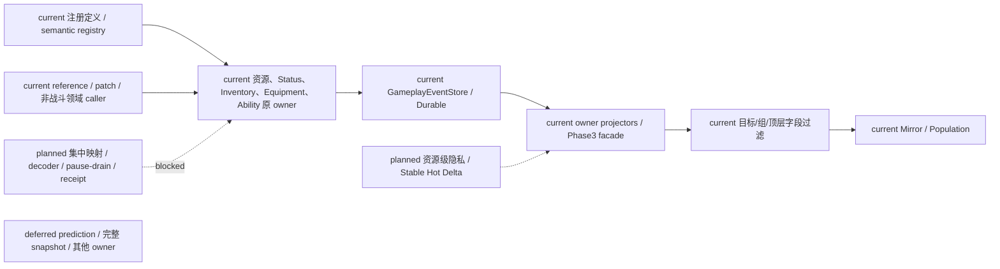
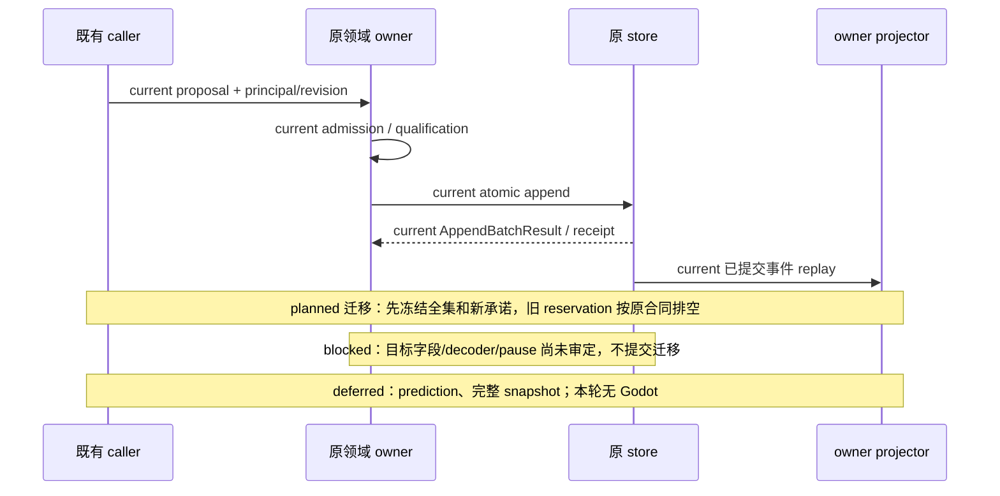
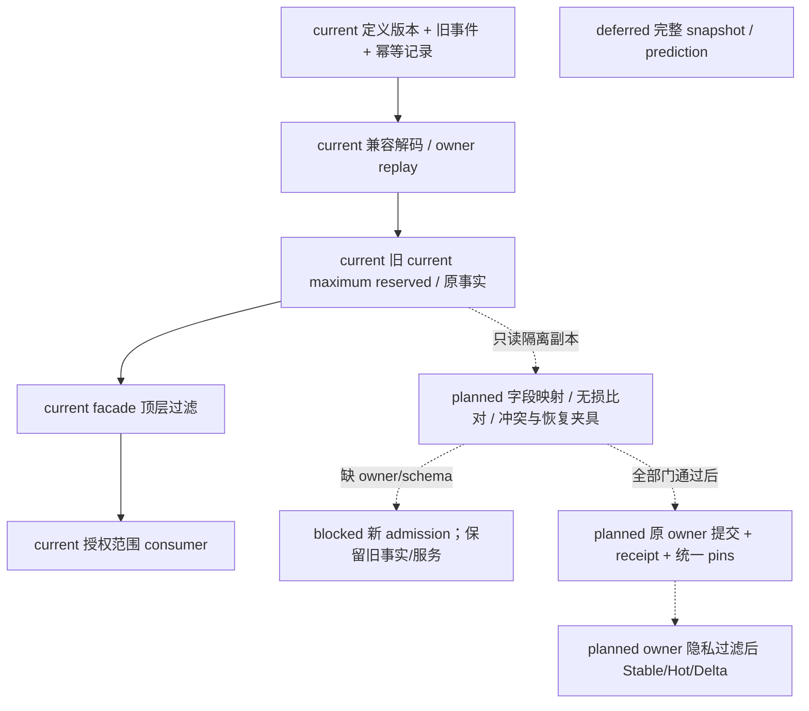
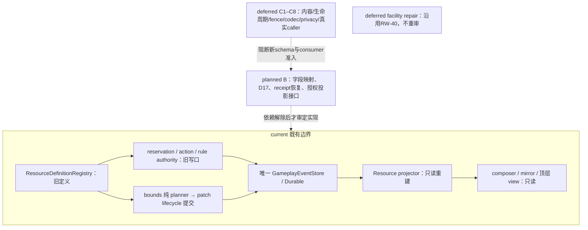
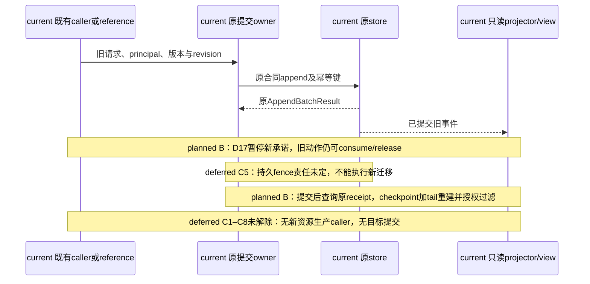
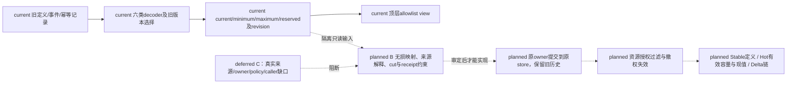
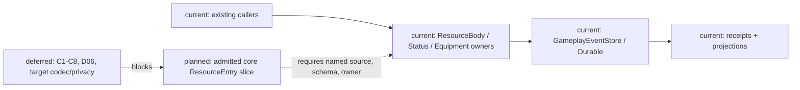
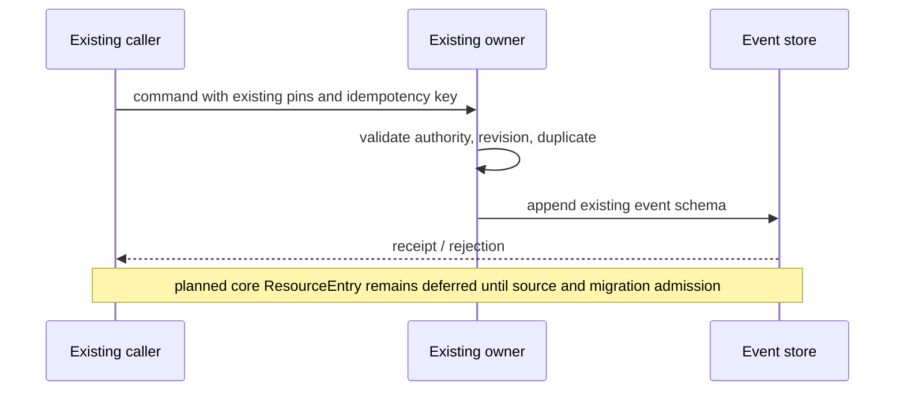
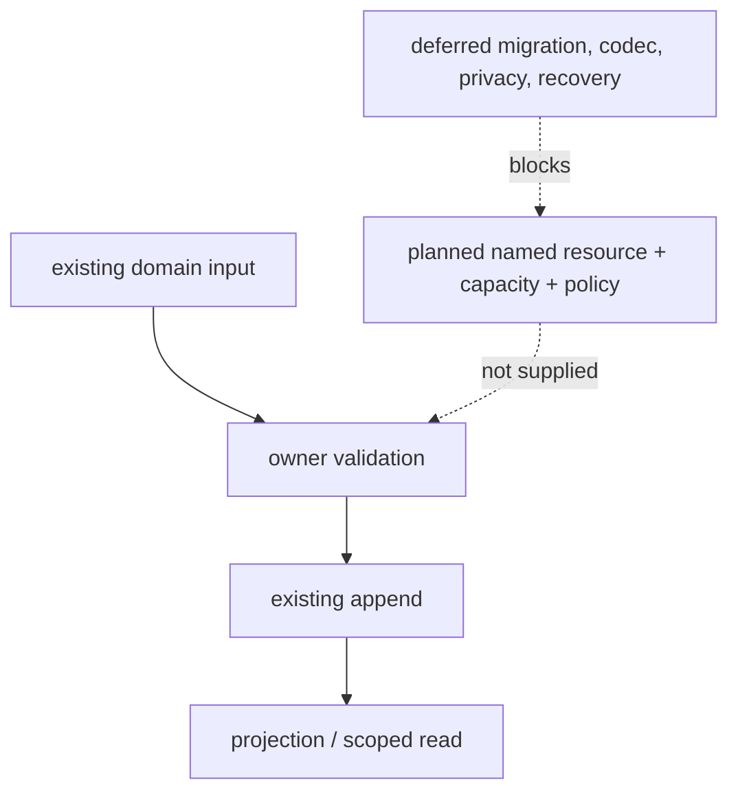

# 阶段三计划04 Task3 前置审查（2026-10-16）

状态：`[current] audit complete / [planned] migration fixtures / blocked implementation / not_verified target migration`。本轮没有合格的新资源实施切片，没有修改运行时代码、注册新 schema 或开放 consumer pins；Task3 不登记实施完成。

依据：规格10 §3–3.1、审查06、D17、计划04 Task3，战斗原设计02/04/05/06/07/08/11。本文三图为本轮各回写入口的共同伴随图。文档分析不构成后续字段或 owner 的实现授权。

## 1. 接续范围与结论

- Task1 已有单配置时间合同、迁移及 Population/Status/Action 局部接线证据；不扩为全 owner 完成。
- Task2 已通过限定 Organization/econ1 Economy 批次、receipt、Durable 恢复及声明参与者的 `ReplayCheckpoint@1` / `ReplayTail@1`。完整 snapshot、其他 owner、adapter 实际 descriptor 和 prediction 未完成。
- T07 为 `blocked/not_verified`：没有具名真实随机 owner 同时具备随机消费与可恢复证据；限定 replay 不能替代随机验收。
- Task3 的资源候选具备旧 owner/API 和旧持久恢复，但不同时具备目标字段语义、集中迁移合同和核心资源非战斗实际接线。生产/经济/交互 owner 已存在，不能把这些领域自己的余额、库存或状态字段视作 ResourceEntry。
- `[deferred]` 本轮不启动 Task2 prediction、随机系统、Godot、calibration/evaluation、final/holdout、训练或微调。Laya 仍仅验证 choice 输出类型。没有新增 clock、scheduler、event store、authority 或第二套投影真相。

## 2. 真实 owner 与准入矩阵

以下为源码静态审计；“可复用”表示既有 API 候选，不表示新增 caller 已接线。路径均在 `backend/app/gameplay/`，应用入口另列。所有事实写入仍走既有 GameplayEventStore；表中的 @1 指事件 envelope 的 schema_version，不能替代注册内容版本。

| 对象 | 定义 owner | 实例/状态 owner | 提案、准入、提交与 receipt 入口 | 当前真实 consumer / 非战斗复用 |
|---|---|---|---|---|
| ResourceDefinition | ResourceDefinitionRegistry，按 resource_id + definition_version 精确注册，禁止 latest | 不拥有余额 | register/resolve；内容注册无余额 receipt | bounds migration 使用定义；非战斗可复用注册但未实际接线 |
| ResourceEntry | 定义只含 minimum/maximum 等旧字段 | ResourceBodyRuntimeProjector 从资源事件重建 | ResourceReservationAuthorityService.apply；ResourceBodyActionSettlementService.settle；GameplayPatchRuleSettlementService；store append/query | adventure_basic_reference、main 受信 live probes、patch resource.consume；未发现生产/经济/交互直接消费核心 ResourceStateProjection |
| current / maximum / reserved | current 为现值，maximum 为旧边界，reserved 为 reservation 合计 | 资源 projector 与上述写服务 | reserve/consume/release；adjusted；bounds planner 交 patch lifecycle 原子提交 | AbilityAffordanceResolver 只读 available；Phase3 composer/mirror 只读 |
| capacity / base_capacity | 未有目标 Resource 字段或已审定来源 | 无具名目标 owner/API | blocked；不得将 maximum 直接改名 | inventory 容器 capacity 不属于资源 capacity |
| locked / debt / recovery | 目标字段、生命周期与源账未审定 | 无已准入目标 owner | blocked；不得将 reserved 当 locked、负 minimum 当 debt、正 delta 当 recovery | 没有这些字段的真实 Resource consumer |
| Status lifecycle | StatusTagRegistry | StatusTagAuthorityService / StatusTagProjector | apply/stack/remove/expire、time migration，既有 receipt 与 temporal caller | main 的显式配置 status consumer；时间闭环已有证据，本轮不重复实现 |
| semantic effect binding | SemanticRegistry 的 ClosedEffectDefinition、OwnerMapping、StateOwnerRow / lifecycle policy | 已映射 Survival/Construction/Ecology/Economy/Production 等原领域 owner | EffectLifecycleEvaluator 只产方案；SemanticSettlementAuthority 路由/重验；真实 owner append 与 receipt | cold/overheated 等闭合 Survival 路径可复用；不因此成为核心资源迁移 |
| influence source / tag | semantic registry TagDefinition/TagAssignment、绑定与治理；Status tag 是独立合同 | tag 不拥有资源/库存/状态事实；StatModifier.source_ref 也不拥有源生命周期 | 仅已注册 owner row 可结算；通用 InfluenceSource 持久实例合同未落地 | effective_stats 消费修饰来源；不得据概念新增源账或第二规则引擎 |
| equipment definition / instance / assignment | EquipmentDefinitionRegistry 的 EquipmentProfile、slot；InventoryDefinitionRegistry 的 ItemDefinition | InventoryItem 与 EquipmentActivation；EquipmentProjector 的活动分配 | EquipmentAuthorityService equip/unequip/swap；原子 inventory placement + grant/modifier lifecycle；AppendBatchResult | 装备调用与 affordance 读取可复用；不是设计中完整 EquipmentDefinition/Instance/Assignment 三实体实现 |
| quantity / durability / uses | ItemDefinition + InventoryItem.quantity | InventoryAuthorityService / InventoryProjector | instantiate/move/reserve_item/consume_reservation/release_reservation | 生产输出、收获入库、commerce custody 等真实非战斗入口；quantity 已实现，durability/uses/charges 的完整实例消耗合同 blocked |
| ability grant / learned ability | AbilityDefinitionRegistry | AbilityAuthorityService / AbilityStateProjector | learn 与 activate_grant 分开；equipment 撤销 grant；事件/receipt | AbilityAffordanceResolver 读 active grants、learned、资源与身体；撤装备不能撤已学能力 |
| effective stats | StatBaseline / StatModifier 定义与有限操作 | EffectiveStatResolver 纯函数，不拥有源生命周期 | 只读 resolve，无 commit/receipt | status/equipment 来源与 composer 消费；不能作为 resource/source authority |

### 2.1 持久版本、兼容 decoder 与时间 pins

| owner/consumer | 当前持久输入和恢复入口 | 兼容规则与缺口 | 时间 pins |
|---|---|---|---|
| Resource projector、reservation/action、patch consume、reference seed | 六种 resource @1：materialized、adjusted、reservation_created、reservation_consumed、reservation_released、bounds_migrated；full replay / typed in-memory checkpoint+tail | materialized 无 definition_version 解为 legacy-v0；bounds_migrated 解析版本定义，验证 source/target/schema/digest；旧 checkpoint 不是完整可移植存档；新字段无 decoder | 旧 adjusted/reservation 不携目标时间合同；即时消费不猜时间，recovery 需 owner 批准的时间 pins |
| bounds patch lifecycle | schema:resource-materialized:v1 / schema:resource-bounds-migrated:v1；patch lifecycle manifest、原子 batch | 仅降低 maximum、显式 clamp loss；有 reservation 拒绝，不能代替集中迁移 pause/drain/pending | 无新增 clock；未来切换必须冻结 revision 与适用时间边界 |
| Status | applied/stack_changed/removed/expired/time_migrated @1；projector 与既有 Durable 恢复 | 无 expiry 的旧 applied 保持永久；既有时间闭环见 RW-35/36 | 显式 temporal context、expiry、ScheduledWork；本轮不重做 |
| semantic registry / effects / owner routes | registry snapshot schema_version=1；from_snapshot；owner 事件、replay_projection / project_scope | evaluator 本身不持久化；只能用已注册 route 的 decoder；不存在统一 effect 事实表或通用 source snapshot | expiry obligation 不是新 scheduler；实际 owner 需适用时间 pins |
| equipment / inventory | equipment activation_started/activation_ended、grant/modifier 与 inventory 事件 @1；各 projector full/checkpoint replay | equipment 老 slot_keys 回退单 slot_key，grant/modifier/container-access 列表可为空；inventory 只按各事件 decoder，不映射 Resource；无目标 durability/uses codec | 即时 equip/custody 不自动需要时间；限时 grant、cooldown 等未准入能力另审 |
| ability / stats | learned/grant 事件 @1；AbilityStateProjector；stats 从 baseline + 已准入来源重算 | learned 与 revoked grant 分开恢复；stats 不是独立事实库 | read-only affordability 不建立时间 pin；持续/冷却功能另审 |
| Phase3StateComposer / MirrorSource / StateGroupViewProjector | 从已提交 owner facts 重建 CharacterGameRuntimeState；现有 facade/checksum、投影 envelope 版本；无独立余额持久写口 | composer 资源 payload 未带 definition_version；无目标 Stable/Hot/Delta decoder；不能把 facade checkpoint 说成完整 snapshot | 保留已有 source_revision_vector；未实现新的 freshness/时间语义 |
| GameplayEventStore / DurableGameplayEventStore | append_batch、get_transaction/get_event/get_by_idempotency/get_idempotency_record；snapshot export v2，from_snapshot 接受 v1/v2；SQLite 恢复 | store envelope 兼容不保证每个领域 payload 可解码；目标 schema 必须显式注册。审查06旧称 SqliteGameplayEventStore，以当前 DurableGameplayEventStore 为准 | store 不成为 clock/scheduler |

资源恒等式只接受现状：`available = current - reserved`。它没有覆盖 locked、完整 available、debt 或 recovery 合同。最大值迁移、库存预留、Status 到期与身体 injury_recovered 均不能被登记为资源恢复系统。

### 2.2 真实非战斗与同名字段排除清单

| 入口（backend/app） | 实际资源/持久版本 | 兼容恢复与集中迁移关系 |
|---|---|---|
| gameplay/construction_production_runtime.py start_run / finish_run | facility/recipe/run 与 input/output/worker refs，原领域事件；非 ResourceEntry | ConstructionProductionProjector full replay、checkpoint_schema_version=1 export/restore；预算来自 Economy；未接核心资源扣减/恢复 |
| gameplay/economy_runtime.py reserve_public_project_budget / consume_public_project_budget / reserve_budget | account balance、amount_minor、BudgetReservation，economy @1 | 原 economy projector/store replay；不能把 budget_reserved 映射为 Resource.reserved；无核心新字段 decoder |
| gameplay/economy_privacy_views.py debt_view / debt_redacted_payload | Economy DebtProjector 的债权债务，按双方/authority 可见 | 原领域恢复与隐私；不是 Resource debt ceiling/source accounting |
| gameplay/ecology_runtime.py recovery outbox / replay provenance | ResourceNode water quantity，gameplay.ecology.resource.recorded；非核心 adjusted | 原 ecology replay/checkpoint；雨水专用 cap/policy 不构成通用资源恢复 codec，不能自动迁入 Resource |
| services/interaction_orchestration_service.py、embodied_interaction_session_service.py、physical_interaction_channel.py | 未发现核心 Resource/stamina 写口；不产生核心资源版本 | 没有可直接登记的核心资源恢复/receipt decoder；接线仍需真实 owner admission |
| gameplay/equipment_runtime.py equip/unequip/swap | 读取 BodyRuntimeProjection.capacity_ratio 与功能资格 | 原 equipment/body projector；capacity_ratio 为身体0–100比例，不是资源 capacity；不消费核心资源 |
| character_agent/mind/regulation_projection.py | mental_resource_summary 为空，policy-unregistered diagnostics | 不是 Resource 私有投影 consumer；不存在可复用目标资源 decoder |

非战斗领域自身更广泛的 schema 清单不是核心 Resource 集中迁移范围；本表只记录本轮实际触及的原事件/恢复入口，不声明完成其他 owner 的全版本盘点。核心六类 @1 的所有实际生产/消费入口已列出；reservation service 仅发现测试实例化，不能称为已接入的应用业务 caller。ordinary materialized 不经定义 registry 验证，默认 store schema registry 可选且未发现 core resource 源码 bundle，因此 generic envelope 解码不等于目标 payload decoder。

### 2.3 投影与隐私边界

| 对象 | Stable 候选（planned 分类） | Hot 候选（planned 分类） | Delta 与私有投影现状 |
|---|---|---|---|
| Resource | 定义 id/version/min/max，不能包含 current | current/reserved/旧 available + owner revision | 事件可回放不等于客户端 Delta；from/to、缺段/invalidation 未完成。每资源隐私过滤未实现 |
| Status/effect/tag | 注册定义、有限 policy/binding | 活动实例、stack、expiry、可见来源 | 只能投影角色可见 owner 结果；闭合 effect privacy 准入测试不等于完整角色投影 |
| equipment/inventory/ability | 定义、slots、能力定义 | assignment、quantity、active grants、learned rank | 私有库存/装备/能力须先按 owner policy 过滤；不得从 authority_only 事件直接生成角色全量视图 |
| stats/source | baseline 和注册操作定义 | effective 值与获准 explanation | source_ref 不自动可见；隐藏来源不能因 explanation 泄露 |

当前 Phase3StateComposer 按 enabled group 和 actor 一致性组合；StateGroupViewProjector 按目标/组/顶层字段 allowlist 过滤，`entries` 等嵌套内容整体通过。MirrorSource 的 Godot/Population 入口存在，websocket 有 session scope 测试；`mind_frame_view` 有定义但本次 app 搜索未发现实际 caller。上述范围不证明资源级隐私、Stable/Hot/Delta 或撤权 cache 清理已完成。角色读取必须在 owner 隐私过滤之后；新私有投影 admission 保持关闭，不能先把 authority 快照送入 MindFrame 再补过滤。

## 3. 集中迁移边界与隔离夹具设计

本节为 `[planned]` 夹具设计，未执行目标迁移、未复制用户真实数据库、未产生新 migration receipt。隔离副本必须含原事件、幂等记录、定义注册版本、checkpoint 来源与只读 digest；先证明旧 decoder 全量无损重建，禁止改写原账。

| 编号 | 隔离旧数据副本 / 注入 | 预期及当前证据范围 |
|---|---|---|
| M01 | 旧 snapshot v1/v2；无 definition_version 的 materialized；负 minimum；有 reserved | 旧值逐字段保留，legacy-v0 不猜新字段；store 兼容与资源 replay 已有测试，完整集中迁移未验证 |
| M02 | 缺 definition/decoder/mapping/source policy 或未知 schema | 新 admission 拒绝且零写；不得默认填 capacity/base_capacity/locked/debt/recovery；目标 schema 尚未审定，blocked |
| M03 | 每个资源 production/recovery/reserve/consume/effect/equipment/projection caller 清单、注册 pins 与输入 digest | 冻结消费者全集；本轮发现的实际路径见矩阵。非战斗核心 Resource 接线缺失，不以空 adapter 补齐 |
| M04 | 新承诺暂停；旧 reservation 正常 consume/release、迟到、超时、进程重启与未知状态 | 旧合同继续，未清项 pending；不取消动作/清零/退款；持久 pause/drain owner/API 尚无完整实现，blocked |
| M05 | 排空快照后另一个写入，或 owner revision 改变 | owner 提交前再次 CAS/重验，冲突零写并 pending；不能以一次空预留快照开新 pins |
| M06 | locked 与 reservation 同源、异源或重叠 | 明确单位、来源、生命周期与冲突政策后才有预期；不能将二者等同，blocked |
| M07 | debt ceiling 边界、超额、偿还、反噬 | 资格/单位/上限/偿还次序/反噬 owner 未裁定，blocked；负 minimum 不产生 debt |
| M08 | recovery 抑制/延迟/满值/先偿债、同源重复、来源撤权 | 时间 pins、精度舍入、source accounting identity 与 owner 未裁定，blocked；正 delta 不证明 recovery |
| M09 | exact duplicate / changed duplicate / 回执未知后重启查询 | 原 receipt、不重复 append；变载荷拒绝。闭合 Survival/equipment 有测试；Resource reservation 接受 caller payload_digest，不能外推为独立内容校验；generic semantic settle 也不能外推闭合路径保证 |
| M10 | 单 owner commit 前故障、commit 后断连、恢复 receipt/replay；多 owner 部分成功 | 前者零事实，后者保留原事实与 receipt；关闭新 consumer，按 owner 后继修复，不制造跨 owner 全局回滚；旧 store 的恢复证据不是目标迁移通过 |
| M11 | 新版本注册切换 + 角色撤权/缺段/隐藏来源 + 非战斗真实 caller | 集中迁移全门通过后统一开放 pins；先过滤再投影，缺段取授权全快照；新隐私合同与真实 Resource 非战斗 caller 仍 blocked |

字段映射须由具名 owner 给出：capacity/base_capacity 的基础来源、modifier 顺序与 maximum 映射资格；locked 的写口/释放/重叠；debt 的初始化与 ceiling；recovery 的时间、source ledger 与去重。现设计只给原则和验收要求，没有这些具体签名或目标 schema revision。故不能编造 mapping manifest、loss 默认值或新字段。

迁移期间只暂停**新的资源承诺**，旧动作按旧合同完成/consume/release。任何未结清或未知 reservation 均保持 pending；提交前失败保留旧服务、旧事实，关闭新 consumer admission；提交后保留已提交事实和 receipt，关闭不兼容 caller 并走 owner 批准的恢复。当前 bounds planner 的“有 reservation 即拒绝”仅是旧局部操作，不能声称已实现持久 pause/drain。

## 4. 最小切片判定

| 候选 | 真实 owner/API | 非战斗 consumer | 持久/恢复 | 规格10目标字段与迁移边界 | 决定 |
|---|---|---|---|---|---|
| 生产/经济消费核心 Resource | 旧 resource 写口有 | 领域 consumer 有，但核心 Resource 实际接线无 | 旧 store 有 | 新 schema/mapping/pause 缺 | blocked，不实现 |
| 复用 patch resource.consume | 有，通用命名 | 可复用候选，尚无本批具名非战斗实际 caller | 有旧事件路径 | 集中迁移未就绪 | blocked，不创建 adapter |
| 现有闭合 Survival effect | 有且真实非战斗 | 有 | 有 owner receipt/replay | 是现有领域状态，不是新资源字段迁移 | 仅审查证据，不冒充新资源切片 |
| Status 时间闭环 | 有 | 已有配置 consumer | 已有 | Task1 旧范围 | 不重复实现 |

本轮实际实施：仅前置审查、矩阵、夹具设计和回写；**新增资源切片为零**。不新造 InfluenceSource、EquipmentInstance、recovery owner、空 adapter 或 Combat 专属路径。

## 5. 三图

## 6. 本轮验证和证据

允许列表在运行前冻结于 `D:\HarnessEvidence\stage3-task3-20261016-160428\allowlist.json`，包括 resource_body、equipment、ability、inventory_reservation、semantic_effect_lifecycle、event store contract/persistence、Phase3 composer/mirror 的整文件，以及 patch lifecycle 的三个明确 bounds migration 节点。只运行该列表：**95 passed，4 warnings**。另运行 `backend-contract` Harness：passed，cleanup passed；这是静态 backend 边界合同，不是新资源集成验收。无未筛选 pytest、Harness all 或 Godot。

| 请求覆盖项 | 本轮已有证据 | 不得扩展的结论 |
|---|---|---|
| owner admission / 现有数值语义 | resource 拒绝不足/陈旧、reservation consume/release；equipment/ability；closed Survival owner/privacy 准入 | 新字段缺失只做源码核对；未新增目标 schema 负例测试 |
| 旧数据与恢复 | store snapshot/SQLite 恢复、旧事件 decoder、资源 full/checkpoint+tail、bounds patch 原子性 | 未迁移真实存档；未证明目标集中迁移恢复 |
| reservation 冲突/pending | bounds migration 拒绝 reservations，旧 consume/release 测试 | D17 持久 pending/pause 与迟到恢复仅夹具设计 |
| duplicate/changed duplicate/receipt replay | store 持久幂等恢复；equipment、闭合 Survival 路径；资源旧 replay | 不保证所有 owner 或 generic semantic 路径；目标迁移 receipt 未生成 |
| 隐私与非战斗 | 闭合 Survival privacy 拒绝；Phase3 actor/session scope；既有非战斗 effect 不依赖 Combat 类型 | 未实现完整资源级先过滤后角色投影；无新非战斗 Resource caller |

源码摘要、审计矩阵副本、focused.log/xml/result、Harness 导出和最终 diff/清理记录保留在上述仓库外目录；最终状态以同目录 `completion.json` 为准。仓库中不保留运行产物。

## 7. 剩余门禁

- Task3：具名字段 owner 与目标 schema/codec；完整 consumer pins；持久 pause/drain + pending；隔离旧数据集中迁移正反例、receipt/recovery；实际非战斗 Resource caller；资源级隐私、撤权与 Stable/Hot/Delta。
- Task4：真实非战斗动作 caller、L4/owner revalidate、多 owner 部分提交 receipt 与恢复；物理证据版本/授权/空间 pins；本轮不实施。
- Task5：生命连续性、presence、关系/encounter 的真实 owner、恢复和可见性门；不由资源/标签推导世界真相。
- Task6：在 Task1–5 实际 owner 合同就绪后执行跨域故障矩阵、完整回归、Harness all 和规格09–12逐验收 ID 的最终证据；本轮明确禁止运行其完整套件。不得用候选 descriptor 或静态映射代替实际接线。

历史 cleanup incomplete、HTTP503 独立审查 incomplete、旧 source pins、threshold、label、archive 全部保持原状；本轮 Harness cleanup passed 不覆盖历史记录。

## 8. Task3 资源切片 A/B/C 准入矩阵（2026-10-16，RW-41）

状态：`documentation-only / source audit complete / implementation admission = 0 / target runtime not_verified`。本节是 RW-39 后的前置解阻续记；§6 的 95 项与 Harness 结果属于上一轮历史证据，本轮未执行或刷新。本节只核对 A、设计 B、正式 deferred C，不更改 D06 集中切换要求。facility repair 沿用 RW-40 的 C/deferred，不重复审查。

### 8.1 判定规则与证据索引

A = 已有可验合同，仅核对既存实现和历史证据；B = 原文足以约束正式接口设计，设计完成仍不等于实现准入；C = 来源或具名责任不足，正式 deferred，待用户决策及新增证据。每一行的子项独立分类，不能以同一行中的 A 为目标字段背书。七项均未形成完整可实施目标切片。

原文定位（本轮不更改来源版本）：

- S1：[资源原设计02](../战斗系统与角色技能，状态和资源/02-角色战斗资源与资源转换计划.md) §1.2 容量/修正来源与 available、§1.3 成本阶段、§1.4 来源、§1.5 恢复状态机、§2 字段。这里有语义建议，没有具体世界资源的注册政策。
- S2：[规格10](../规格/10-通用资源状态效果影响源与装备领域规格.md) §3–3.1、[D06/D17](../审查/03-实施待决收敛与验证闸门.md) 决策表及 §4.6、[审查06](../审查/06-第四项通用资源集中迁移与兼容边界.md)：统一迁移；旧承诺排空；提交前后恢复边界。
- S3：[规格09](../规格/09-通用时间权限投影与领域服务接入规格.md) §4 批次/receipt、§6 checkpoint/tail、§7 投影/权限；[投影原设计04](../战斗系统与角色技能，状态和资源/04-战斗状态、CombatPrefill与高频读取计划.md) §2–5、§13：Stable/Hot/Delta、缓存与撤权。
- S4：[计划04 Task3](../计划/04-通用合同与领域服务实施计划.md#task-3投影分类和通用资源状态效果影响源装备接入)：实际非战斗 consumer、迁移与投影验收。[编辑器03](../编辑器与能力权限治理/03-编辑器版本发布、预览与运行时同步设计.md) §5–6、[编辑器04](../编辑器与能力权限治理/04-十月分析领域接入与编辑器同步矩阵.md) §2/4/7 只提供通用版本/权限原则，不提供资源级具体 ACL。

实现与历史证据定位（均为静态读取，测试文件未在本轮运行）：

| ID | 文件与具体位置 | 当前合同及证据限度 |
|---|---|---|
| I1 | [resource_body_runtime.py](../../../backend/app/gameplay/resource_body_runtime.py) L25/40/72/102/117/184/202/239/304/320/488/542 | Definition/Registry、bounds request、Entry/Projection、reservation authority、纯 bounds planner、六类 @1 decoder、typed checkpoint、action settlement；projector 是只读重建器，不是写 owner |
| I2 | [patch_lifecycle_authority.py](../../../backend/app/gameplay/patch_lifecycle_authority.py) `GameplayPatchLifecycleAuthorityService`、`_plan_resource_bounds_migration`；[patch_rule_settlement.py](../../../backend/app/gameplay/patch_rule_settlement.py) `GameplayPatchRuleSettlementService.settle`；[skill_action_gate.py](../../../backend/app/gameplay/skill_action_gate.py) `SkillPathGameplayGate.settle` | bounds 实际提交在既有 patch lifecycle；rule settlement 可产 resource.consume 结算；Skill gate 读取资格后委托 settlement；存在 API 不代表生产 caller |
| I3 | [phase3_state_composer.py](../../../backend/app/gameplay/phase3_state_composer.py) L19/42/66；[phase3_mirror_source.py](../../../backend/app/gameplay/phase3_mirror_source.py) L40/103/133/169/176；[state_group_views.py](../../../backend/app/gameplay/state_group_views.py) `StateGroupConsumerViewPolicy`、`_project` | composer 的资源 entries 无 definition_version；checkpoint 仅内存；mirror 的 godot_view/population_view 是读路径；facade 只作顶层 allowlist，不等于 entries 内资源 ACL |
| I4 | [event_store.py](../../../backend/app/gameplay/event_store.py) L124/152/399/443/506/552/612/851/1108/1242 | 原 store 的 append、transaction/idempotency 查询、checkpoint、snapshot v2 及 v1/v2 读取、Durable SQLite；不是目标资源 codec |
| I5 | [replay_checkpoint.py](../../../backend/app/world_runtime/replay_checkpoint.py) `capture_scoped_checkpoint` / `capture_scoped_tail` / `replay_scoped_tail`；[replay_participants.py](../../../backend/app/world_runtime/replay_participants.py) `capture_participants` | Task2 限定参与者，未登记目标资源集中迁移可恢复 codec，不外推其成功 |
| I6 | [test_resource_body_runtime.py](../../../backend/tests/test_resource_body_runtime.py) L262/280/305/337/365；[test_gameplay_patch_lifecycle_authority.py](../../../backend/tests/test_gameplay_patch_lifecycle_authority.py) L823/1028/1047；[test_gameplay_event_store_persistence.py](../../../backend/tests/test_gameplay_event_store_persistence.py) L14/191/272/299/319 | 旧 reservation、full/checkpoint-tail、bounds、manifest 和 store/Durable 失败恢复用例；仅引用 §6 历史通过范围，不能证明新字段/真实 caller |
| I7 | [adventure_basic_reference.py](../../../backend/app/gameplay/adventure_basic_reference.py) L212 附近；[main.py](../../../backend/app/main.py) `_commit_configured_trusted_local_gameplay_mirror_live_probe` | 前者 reference/harness 场景；后者 verifier-only 资源写入；两者都不能充当实际非战斗 Resource 生产 caller |

### 8.2 逐切片准入与解除条件

| 切片 / 来源 | 具名 owner、consumer、caller | 已有字段、schema、revision、receipt / 恢复证据 | 判定及当前缺口 | 解除条件与必须新增的证据 |
|---|---|---|---|---|
| 1 capacity/base_capacity；S1 §1.2/§2、S2 §3 | 当前 ResourceDefinitionRegistry 管定义；reservation/action/rule authority 写旧事实，bounds planner 经 patch lifecycle 提交；AbilityAffordanceResolver、composer/mirror 只读；I7 不计生产 caller | I1 minimum/maximum/current/reserved/available；definition_version、source_revision_vector、projection_revision、source_event_id；旧 append result 与 I6 replay；无目标字段/receipt | **A**：旧 maximum 合同；**B**：容量提案/修正解释/owner 提交边界，见规格10 §RW-41；**C/deferred C1**：具体 base_capacity 来源、单位、修正顺序/冲突政策和 maximum 映射没有具名内容及 owner 审定 | 用户指定现有资源及版本化世界/profile 来源、负责审定的既有 owner；提交逐旧值映射、溢出/负下界/舍入政策和来源 ledger 合同；随后才可审定目标 schema、无损夹具及新旧 consumer pins。不能把 maximum 改名开工 |
| 2a locked；S1 §1.2/§1.3、S2 §3 | 当前 ResourceReservationAuthorityService 只拥有 reserve/consume/release；Status/equipment 是影响来源的各自 owner，不拥有目标 resource lock；目标 consumer/caller 均未准入 | reserved 为 reservation 合计；无 locked 字段、事件版本、独立 lock revision、receipt 或恢复证据 | **A**：reservation 旧生命周期；**C/deferred C2**：lock 身份、重叠/优先级、解除/到期、对旧承诺影响缺明确合同，不能用 reserved 代替 | 决定真实锁定来源及其既有生命周期 owner、锁定标识/合并/撤权/迟到事件处理；提供与 reservation 并存、停机和重复解除的映射/恢复设计，再补实际证据 |
| 2b debt；S1 §1.3/§1.5、S2 §3 | 旧 action settlement 做资源资格检查；Economy 的 debt 是另一领域，非核心资源债务 owner；无目标 consumer/caller | minimum 可为负并不生成 debt；无 debt/ceiling/偿还/反噬 schema、revision、receipt | **C/deferred C3**：是否允许透支、负值如何拆债、上限/偿还次序和反噬责任均未注册 | 用户选定资源透支政策和既有结算 owner，提供负值存档逐值映射及超限/还款/中断/重试证据要求；不得默认为允许或禁止来完成迁移 |
| 2c recovery/source accounting；S1 §1.4–1.5、S2 §3 | Status temporal consumer 已存在；effective_stats 读取 StatModifier.source_ref；二者不等于资源 recovery owner/源账；目标 Resource caller 缺失 | adjusted @1 是一般变化；Body injury recovery 非 resource recovery；无 base_regen/recovery state/delay/conditions 或持久 source ledger、恢复游标及目标 receipt | **C/deferred C4**：具体恢复来源、时间粒度、追赶/抑制/偿债次序、source 撤销/去重责任不足 | 指定真实来源及既有 owner/time admission；明确 tick/catch-up、断线/撤源/装备变化和 source revision 映射。复用原 clock/scheduler/store，不新增第二套；目标恢复必须有停机再启动及重复 tick 无重复入账证据 |
| 3 pause/drain/pending；S2 D17/§4.6、规格10 §3 | 旧 reservation authority 可 consume/release；bounds planner 拒绝任何未结 reservation；patch lifecycle 承担旧 bounds cutover；未发现持久 admission fence/drain 控制责任合同 | 旧 revision 冲突拒绝/无预留检查已有；无持久 pause 状态/owner/控制 receipt、恢复记录；一次空快照不证明排空 | **A**：旧拒绝与结算；**B**：D17 状态转换、前后提交恢复边界；**C/deferred C5**：谁持有持久 fence、恢复/解除权限和一致提交检查尚不足 | 用户确认既有 owner 对新承诺暂停、drain 记录和恢复查询的责任与授权；设计持久标识/版本/幂等、并发新承诺隔离。后续需旧承诺迟到、未知 pending、重启、check-to-append 冲突证据，不得取消旧动作排空 |
| 4 decoder/无损映射；S1 §2、S2 D06/§3.1 | ResourceBodyRuntimeProjector 解码；Registry 精确版本；bounds planner + patch lifecycle；所有旧 consumer 的 pins 仍需冻结全集 | materialized/adjusted/bounds_migrated/reservation_created/consumed/released 均 @1；现有缺定义版本走 legacy-v0；bounds digests 为 resource-materialized:v1 / resource-bounds-migrated:v1；I6 旧重建证据 | **A**：六旧 decoder 及兼容行为；**B**：版本选择/逐字段映射/拒绝规则与验证输入输出；**C/deferred C6**：目标字段语义和目标版本映射依赖 C1–C4，尚无可冻结 codec | 先收敛 C1–C4；具名 owner 审定映射及 consumer 全集、定义/schema/migrator/source ledger pins，再设计全历史与 checkpoint-tail 无损比对。现有 clamp 有 lost_amount，只证明显式损失，不能证明目标无损；不为新字段填零或 latest |
| 5 receipt/checkpoint-tail/Durable；S3 §4/§6、S2 D17 | 原 GameplayEventStore/Durable；Resource projector 的 typed checkpoint；patch lifecycle 的旧迁移结果；I5 scoped replay 仅声明参与者 | AppendBatchResult、transaction/idempotency、store snapshot v2(v1兼容)、resource 内存 checkpoint；I6 与 §6 为旧合同历史证据；无目标资源便携 checkpoint codec/迁移 receipt/recovery 参与者 | **A**：旧 receipt/store/恢复能力；**B**：原提交结果查询、超时恢复、checkpoint 一致切面与目标 receipt 内容约束；目标实现 not_verified，受 C5/C6 阻断 | 不需另创 store。C5/C6 明确后由既有提交 owner 审定目标 schema/codec/receipt 字段及参与依赖；后续必须用原持久 store 新实例、丢响应/重载荷/损坏 tail/缺依赖/提交后修复证据。仅 API 或单元测试不算生产恢复闭环 |
| 6 privacy/撤权/Stable-Hot-Delta；S3 §7、原设计04 §2–5/§13 | StateGroupViewProjector 顶层 allowlist；mirror godot_view/population_view 真实只读 consumer；equipment/ability 的 grant 撤销不等于资源可见性撤权；未确立资源级 policy issuer | view envelope version/source_revision_vector/checksum；entries 内部无资源级过滤，composer 未携 definition_version；无资源 Delta chain 或撤权清 cache receipt/版本闭环 | **A**：现有顶层过滤边界；**B**：先授权再三类投影、失效/乱序恢复合同；**C/deferred C7**：具体每资源/字段可见性、授权 issuer/撤权来源及被允许 consumer 尚不足 | 用户指定现有资源 policy/issuer、主体/字段/用途和撤权版本来源；不得默认 self/public 可读。后续需越权、撤权后旧 cache/pending intent/active binding 清理与 delta 缺段恢复证据，owner 快照/历史 replay 也不得泄私有值 |
| 7 真实非战斗 Resource caller/owner route；S4 Task3 | 可写 API 为 I1/I2；reservation、patch rule、SkillPath 的应用构造未形成真实非战斗接线；Production/Economy/Interaction 各有领域 owner，但其自有库存/余额/水量不是 ResourceEntry | reference/live probe 与 tests 不能验收；mental_resource_summary 未注册也不是 caller；无本任务真实请求→资源 owner→receipt→授权可见结果证据 | **C/deferred C8**：没有具名现有业务入口/内容绑定/Resource 消费与失败责任；禁止造 synthetic caller 或挪用 facility repair | 用户选定一个既有真实非战斗业务动作，给出现有 caller 文件/入口、actor/resource 内容绑定、授权和结算 owner；先做来源及 route 审定，之后再授权接口/实现及真实边界证据。若没有来源继续 deferred |

结论：A 只覆盖旧资源与通用基础设施；B 是有来源的条件接口设计；C1–C8 均正式 deferred。**本轮可进入正式实现的新资源切片 = 0**。B 不允许绕过 C，也不允许拆散 D06 迁移范围逐资源上线。

### 8.3 B 类设计完成范围与用户决策点

正式接口的输入/输出/拒绝、责任、迁移与恢复见[规格10 RW-41](../规格/10-通用资源状态效果影响源与装备领域规格.md#rw-41-task3-资源前置接口设计仅文档)。它们是设计责任约束，不注册新 schema/API/owner，不预设目标 revision。

最小下一任务是 **C8 + C1 的来源决策记录**：由用户选择一个已有非战斗业务入口及真实资源，指出世界/profile 容量内容和既有结算责任；只补来源、版本、路由及剩余政策问题。不能由审查者选择默认资源/角色/target。C2–C7 仍需各自决策，单独解除 C8 或 C1 不意味着允许迁移实现。若暂不提供来源，本资源分支继续 deferred，可执行工作仅维护证据矩阵，不制造验收 caller。

阶段三门禁：Task1/Task2 局部证据不扩展全 owner；T07 无真实随机 owner，prediction/完整 snapshot 未完成且本轮不启动；Task3 仍缺本矩阵的 owner/content/codec/fence/privacy/caller 与实际迁移恢复证据；facility repair 继续四项 C/deferred，Task4 其他动作未启动；Task5/6 未启动。Laya 仅 choice 输出类型。历史 cleanup incomplete、HTTP503 独立审查 incomplete 及所有 source pins/threshold/label/archive 保持原记录。

### 8.4 RW-41 共同伴随三图

以下三图供规格10、计划04、资源02、投影04及阶段三回写共同引用；图中的 planned 是条件设计，deferred 是缺来源/责任的阻断点，没有新运行时接线。

架构图：

时序图：

数据流图：

### 8.5 本次文档验证范围

本次 8 份文档的新增链接/锚点共 45 处通过目标检查；3 个新增 Mermaid 图通过声明、围栏、括号、subgraph、时序参与者及 current/planned/deferred 结构检查，3 张新增表格列数一致；新增空白检查及 `git diff --check` 通过。图表仅做结构检查，未调用渲染器。

`.harness` 前置命令输出未完整留存，不能证明全量前后等同；已恢复的 3,723 个前置文件路径/SHA256 与后置逐项一致，后置完整清单为 24,431 个文件，`git status --short -- .harness` 为空。本轮没有写入或清理 `.harness`，没有创建运行时进程。清单检查保留上述覆盖限制，不登记全量一致通过。

未运行 pytest、Harness、Godot 或任何运行时验收，未运行 calibration、final/holdout、训练或微调。源码与测试读取不改变历史验证时间和结论。

## RW-43 生产输出入库 C1 决策单（2026-10-16）

本轮仅核对[生产输出入库 C1 用户决策单](stage3-task3-production-output-c1-decision-20261016.md)，以该单作为此候选的本轮判定，保留 RW-42 历史。当前是 Inventory custody；原设计已定义一般基础容量来源和内容包政策，但本候选核心归属、具体容量 owner/content/policy/mapping 未决。现有 certification event、领域 pins、receipt 和重读验证不构成核心容量合同；`checkpoint_at` 不等于持久 checkpoint。

（历史状态，已由 RW-44 更新。）当时 C1 为 `C/deferred / user decision required`；本轮用户决定不纳入核心。当前状态与后续重开条件见 RW-44 及[决策单](stage3-task3-production-output-c1-decision-20261016.md)。

## RW-42 C8+C1 来源决策包同步（2026-10-16）

本轮对现有非战斗业务入口进行了来源核对，完整候选表、调用路径、字段、版本、owner、可见性、时间/read-set/revision pins、receipt/checkpoint/tail/Durable 与 D06 判断见[来源决策包](stage3-task3-c8-c1-source-decision-20261016.md)。没有候选同时满足 C8 与 C1：生产输出入库最接近，具备真实领域 caller/owner route 和绑定内容，但缺核心 `ResourceEntry` 容量映射；粮食收获缺生产应用 caller且同样缺核心映射；预算、设施槽位/产出、生态节点水量均为领域字段，不满足 C1。

因此**可实施切片仍为零**。本记录不选择业务入口或资源，不创建 synthetic caller、默认容量、默认权限、默认 owner、空 registry 或新字段；不得把 Inventory/Economy/Construction/Ecology 字段升级为核心资源。facility repair 继续 C/deferred，Task2 T07/prediction、Task4 其他动作、Task5/6、calibration、final/holdout、训练、微调和 Godot 不启动；Laya 仍只记录 `choice` 输出类型。

[current] 既有领域 caller、owner receipt 与各自投影恢复边界保持不变；[planned] 用户需明确真实 caller、资源内容/容量版本与 policy、owner/read-set/可见性责任；[deferred] D06 集中迁移、目标 schema/codec、C2–C7 与核心 ResourceEntry admission 仍关闭。下一项最小任务仅是用户选择后的来源责任记录，不是运行时实现。

## RW-44 生产输出继续由 Inventory custody 管理（2026-10-16）

用户决定当前不将生产输出纳入核心 `ResourceEntry`，保留既有 `InventoryItem`、容器容量、Inventory owner receipt 与投影语义。该决定关闭本候选的近期 C1 决策工作，不改变 Inventory 事实，也不创建核心映射、字段或 caller。

生产输出核心映射标记为 `deferred / no admission`；只有出现明确业务需求、命名核心资源及其内容来源后，才重开 C1 与 D06 集中迁移审查。Task3 可实施切片仍为零；其他 C 类、Task2 T07/prediction、Task4 其他动作、Task5/6 和既有关闭范围不变。完整决策及 current/planned/deferred 三图见[生产输出入库 C1 决策单](stage3-task3-production-output-c1-decision-20261016.md)。本轮仅做文档回写。

## RW-45 Task3 focused 验收边界同步（2026-10-16）

本轮复核并运行 Task3 既有 owner/consumer focused 集合：`test_resource_body_runtime.py`、`test_equipment_runtime.py`、`test_status_tags.py`、`test_status_application_lifecycle.py`、`test_status_temporal_consumer.py`、`test_gameplay_patch_rule_settlement.py`、`test_gameplay_patch_lifecycle_authority.py`，结果 **71 passed**（仅 FastAPI 生命周期弃用警告）。这些测试证明旧 ResourceBody/Status/Equipment/Patch 合同的 caller、幂等、拒绝、投影及部分 Durable 重启路径；不扩张为核心资源新字段、生产输出映射或 D06 集中迁移验收。

### 当前 / 计划 / deferred 三图

解除条件：仅当用户命名真实非战斗 caller、核心资源及内容/容量版本、owner/read-set/可见性责任，并由 D06 审定迁移 codec、失败保留、Durable 新实例恢复和 full replay/checkpoint-tail 一致性后，才重新评估 C1–C8。RW-44 的 Inventory custody 决定保持不变。

## 2026-10-16 Task3 最终边界更正

RW-45 作为历史编号保留；本节不重复使用该编号。71 项 focused 只验收既有 ResourceBody/Status/Equipment/Patch owner 合同和其 caller/store/replay 边界。目标核心 ResourceEntry 及 C1–C8 均为 **C/deferred**，不存在可进入阶段三运行时验收的新资源切片；RW-44 的 Inventory custody 决定不变。

解除条件：用户命名真实核心资源 caller、容量与政策来源、owner/read-set/visibility、目标 schema/codec，并完成 D06 迁移前后兼容、失败保留、Durable 新实例、full/checkpoint+tail、privacy/revocation。此前不添加 ResourceEntry 字段、默认容量、registry、caller 或迁移代码。
