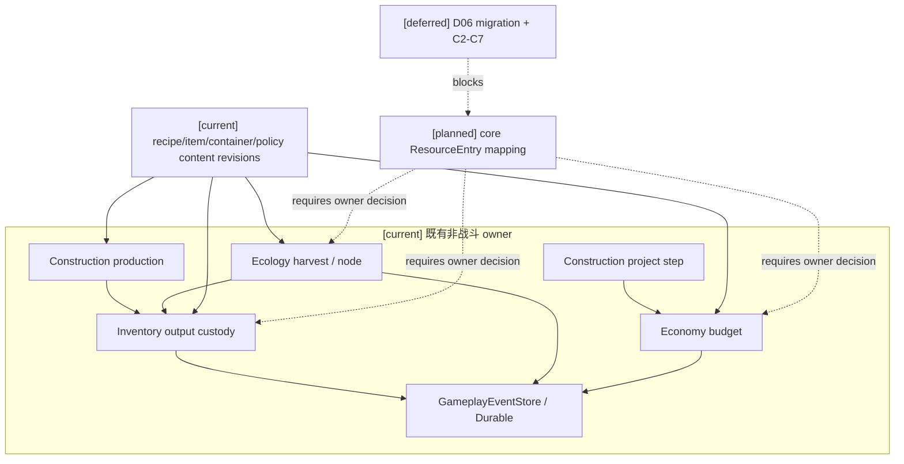
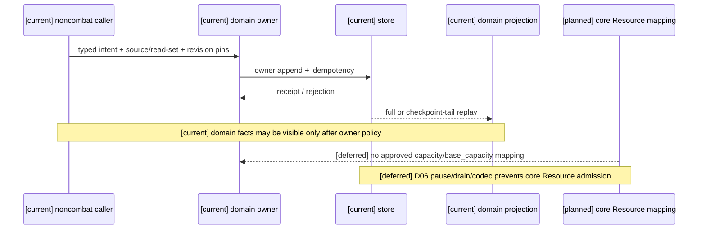
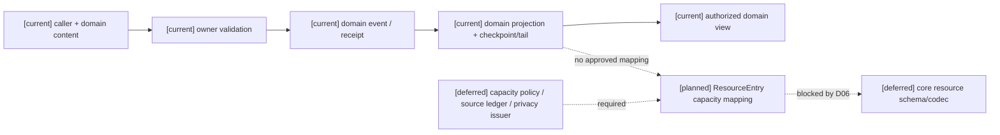

# 阶段三 Task3 C8+C1 来源决策包（2026-10-16，RW-42）

状态：`documentation-only / static source audit / implementation admission = 0 / target runtime not_verified`。

本包只核对现有非战斗入口、领域资源内容和既有 owner route。它不选择业务入口、不把领域库存/余额/水量改名为核心 `ResourceEntry`，不创建 caller、默认容量、默认权限、默认 owner、空 registry 或新字段。facility repair 继续 C/deferred。

## 1. 判定口径

- **C8** 同时要求：源码中存在真实非战斗 caller、资源内容绑定、既有 owner route，以及提交后的 receipt/可恢复边界。测试 helper、reference/live probe 和仅有 direct API 的构造不计生产 caller。
- **C1** 同时要求：有具体容量来源、容量政策和到资源字段的已审定映射。`InventoryContainer.capacity_*`、设施 `slot_capacity`、Economy `amount_minor` 和 Ecology `quantity` 只有在明确映射到核心 `ResourceEntry.capacity/base_capacity` 后才可计入；当前没有这样的审定映射。
- `ResourceBodyRuntime` 仍只有 `minimum/maximum/current/reserved`，`available=current-reserved`。不得把 `maximum` 改名为 `capacity`，也不得把领域 `reserved`/预算/库存容量当作核心资源字段。
- 所有候选仍受 D06 集中迁移与 D17 排空/提交后恢复门禁约束；本包不解除 C2–C7。

## 2. 候选入口清单与逐项判定

| 候选真实入口与调用路径 | 真实资源类型及字段 | 内容/容量版本来源 | 既有结算 owner | 可见性与授权来源 | 时间合同、source/read-set、revision pins | receipt、checkpoint/tail、Durable 恢复 | D06 | C8 | C1 | 分类 |
|---|---|---|---|---|---|---|---|---|---|---|
| **生产输出入库**：`backend/app/services/siming_population_capability.py` 选择 `population:inventory-output-custody:v1` → `backend/app/population_continuity/inventory_owner_adapter.py` → `backend/app/gameplay/inventory_runtime.py:InventoryAuthorityService.settle_production_output_custody`；生产前置为 `ConstructionProductionAuthority` 的 certified output | `InventoryItem.quantity/reserved_quantity/source_event_id`；`InventoryContainer.capacity_weight/capacity_volume/capacity_slots`；`ProductionOutputCustodyBindingContract` 固定 `output_item_ref/holder_ref/container_id/mapping_revision` | `closed_generic_gameplay_families.py` 的 `production_output_custody@1`；`inventory_platform_content.py` 的 package/lot/container/reservation policy refs；生产 recipe 的 `output_quantity` 和 policy revision | Inventory owner append；来源证据由 Construction production certification 提供；人口 executor 只提交 owner-bound intent | family visibility `project`；owner binding/package/descriptor revision 由 active patch set；角色消费必须再走 Inventory privacy projection | intent 的 expected revisions、source owner receipt、inventory stream revision、idempotency key；人口 read-set 要求 owner receipt 先于 seed | `AppendBatchResult` 与 owner receipt；Inventory projector full replay、source revision vector、checkpoint/tail 和 Durable store 可复用；目标资源迁移 codec 未有 | **是**，若纳入核心资源须集中迁移，不能逐项启用 | **是（领域 caller/owner route）**；不存在核心 ResourceEntry consumer | **否（仅领域容量，缺核心映射）** | 需要补接口设计；不得实施 |
| **粮食收获入库**：`backend/app/gameplay/ecology_runtime.py:EcologyHazardAuthority.harvest_grain_crop` → `backend/app/gameplay/inventory_runtime.py:InventoryAuthorityService.record_grain_harvest_custody_receipt`；当前源码搜索未见生产应用层 caller，已见测试/owner API | `Ecology ResourceNode.quantity/regeneration_per_tick/revision`；固定 `grain:wheat@1`/`grain:barley@1` 与 InventoryItem quantity=10；grain intake container 的三类 `capacity_*` | Ecology crop/admission/harvest event schema `@1`；Inventory harvest binding contracts；固定 species/item/policy refs | Ecology owner 写 harvest event；Inventory owner 写 custody receipt | harvest source `project` 且检查 species/item/project/plot；Inventory holder/container binding 固定；角色可见投影未形成新的 Resource ACL | harvest event revision、inventory stream revision、causation/idempotency key、source event pins；没有应用 caller 的完整 read-set 证明 | harvest 与 custody 均有 append receipt、duplicate/changed duplicate rejection、full/checkpoint-tail projector 和 Durable store；无核心资源迁移 decoder | **是**，若迁入核心资源仍需集中迁移 | **否（未发现真实业务 caller）**；owner API/测试不够 | **否（quantity/capacity 未映射核心 ResourceEntry）** | 继续 C/deferred |
| **公共项目预算**：`ConstructionProductionAuthority.settle_bounded_project_budget_project_step` → `EconomyAuthorityService.settle_bounded_project_budget*`（reservation/consumption/close） | Economy account `balance`、`amount_minor`、`currency_ref`、`BudgetReservation`；不是 ResourceEntry | `bounded_project_budget@1`、`BoundedProjectBudgetContent`、Economy monetary/account policy revisions | Economy authority；Construction 只提交 project-step source | reservation/consumption 为 `authority_only`；budget projection 只允许 authority scope | commitment/reservation/activity event ids 与 expected stream revisions；family policy/package revision、idempotency | Economy append receipt、projector、authority projection、checkpoint/tail 与 Durable store 有既有合同 | **是**，若错误纳入核心资源会被 D06 拒绝 | **是（真实跨域 owner route）**，但它是 Economy 余额结算 | **否**；`amount_minor` 是金额，不是容量来源/`base_capacity` | 继续 C/deferred；先由用户决定是否完全排除资源迁移 |
| **生产设施槽位与产出**：`backend/app/gameplay/construction_production_runtime.py:ConstructionProductionAuthority.settle_recipe_production_start/finish`；`ConstructionProductionRuntime.start_run/finish_run` | `Facility.slot_capacity/condition/lifecycle_status`、`ProductionRun.output_quantity/output_item`；不是 ResourceEntry | `FacilityContent.slot_capacity`、RecipeContent `output_quantity/batch_size`、quality/failure policy revisions | Construction production owner | project-scoped production events；worker/facility/recipe refs 由 owner 重验 | run tick/finish tick、facility/recipe revisions、reservation refs、worker contribution refs；跨核心资源 read-set 未接线 | Construction projector full replay/checkpoint export/restore 与 owner receipt 存在；无核心资源 receipt/codec | **是**，只要目标是核心资源就必须集中迁移 | **是（真实 Construction caller/owner route）** | **否（slot capacity 不是 ResourceEntry capacity）** | 继续 C/deferred |
| **生态节点水量/恢复**：`EcologyHazardAuthority` 的 ResourceNode/seasonal recovery 与 ecology outbox/replay provenance API；未发现核心 ResourceBody caller | `ResourceNode.quantity/regeneration_per_tick/revision`；无通用 capacity 字段 | Ecology seasonal/process policy refs 与 event schema；没有 `base_capacity` 内容 | Ecology owner；outbox/replay 只保留 ecology 事实 | 依 region/project visibility 与 ecology consumer admission；不产生角色资源 ACL | ecology event/source revision、policy revision、read provenance；未形成目标资源时间合同 | Ecology projector/replay/checkpoint 可恢复；没有核心 Resource receipt 或迁移 decoder | **是**，若迁移必须集中切换 | **否（无真实核心资源 caller）** | **否（无 capacity 来源/映射）** | 继续 C/deferred |

## 3. 结论与用户需要明确选择的责任

本轮没有一个候选同时满足 C8 和 C1，故**可实施切片仍为零**。现有候选最多只能进入“需要补接口设计”：生产输出入库具备真实人口 owner executor、固定内容 binding、owner receipt 和领域容量字段；它仍缺核心 ResourceEntry 映射、资源级授权和 D06 迁移准入。其他候选保持 C/deferred，尤其不把粮食收获的测试/owner API写成应用 caller。

用户若要解除下一步来源决策，必须明确：

1. 选择哪一个现有非战斗 caller，以及它是否确实要消费核心 `ResourceEntry`；
2. 选择真实资源内容、`definition_version`/package revision、单位与容量来源；
3. 指定容量 policy、修正顺序、冲突/舍入和 `maximum` 旧值的映射责任；
4. 指定既有 owner 对 source/read-set、角色可见性、撤权和最终 receipt 的责任；
5. 指定 D06 集中迁移的 owner、排空窗口、target schema/codec 和 Durable checkpoint/tail 责任。

在这些责任明确前，不得自行把 Inventory、Economy、Construction 或 Ecology 字段升级为核心资源，不得启动运行时实现。facility repair 不在候选之内，继续 C/deferred；Task2 T07、prediction、Task4 其他动作、Task5/6、calibration、final/holdout、训练、微调和 Godot 均不启动。Laya 仍只记录 `choice` 输出类型。

### 2026-10-18 产品授权与当前准入选择更正

用户已授权本代理决定全部产品政策，所以上述“用户若要明确”及“等待用户决定”仅为原始审计快照，不再是待批准决定。本次已选择：不把任何候选资源映射到核心 `ResourceEntry`；Inventory 产出继续 RW-44 custody；若未来真实 caller/content/容量 owner 出现，再按 C1–C8 和 D06 重新准入。当前候选仍为零，不创建 synthetic owner/caller，也不推造单位或 capacity。产品选择已完成，但实现与验收仍因来源不足保持 deferred/not_verified。详见阶段三 closure r86 及规格10当前政策选择。

## 4. 三图

### 4.1 架构图

### 4.2 时序图

### 4.3 数据流图

## 5. 静态核验范围

仅计划执行链接、锚点、表格、Mermaid 结构、空白、`git diff --check` 和 `.harness` 前后清单/hash 检查。未运行 pytest、Harness、Godot 或任何运行时验收；本包中的 receipt/replay 结论均为源码与既有测试静态来源，不是本轮新鲜运行证据。
