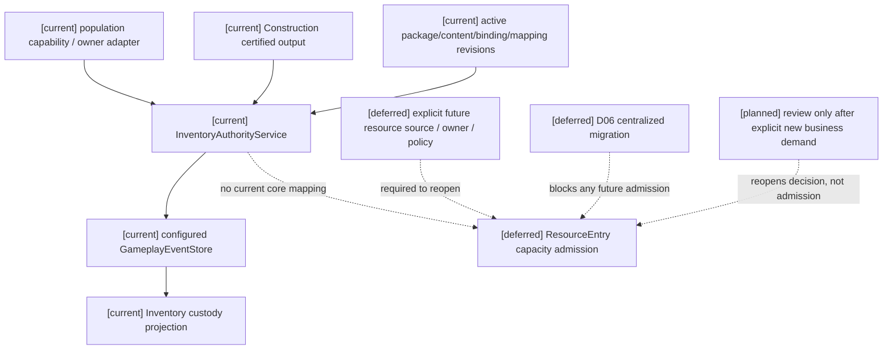
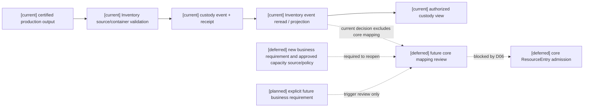

# 阶段三 Task3：生产输出入库 C1 用户决策单（2026-10-16）

登记：RW-43；用户决定续记：RW-44。当前状态：`documentation-only / inventory custody retained / core ResourceEntry admission deferred / implementation admission = 0 / target migration not_verified`。

本单只处理“生产输出入库”候选。它不选择资源、不创建字段/schema/owner/caller/权限/默认容量，也不改变旧 source pins、threshold、label、archive 或历史证据。

### 来源索引

| 来源 | 本单采用的依据 |
|---|---|
| [资源原设计02](../战斗系统与角色技能，状态和资源/02-角色战斗资源与资源转换计划.md) | §1 分类；§1.2 “capacity 当前上限”“base_capacity 角色和世界包提供的基础上限”、世界包注册政策；§12/12.1 D06/D17 |
| [规格10](../规格/10-通用资源状态效果影响源与装备领域规格.md) | §3/3.1 旧实现与目标语义；RW-41 B1–B5 及 C 类责任缺口 |
| [计划04](../计划/04-通用合同与领域服务实施计划.md) / [Task3 准入矩阵](stage3-task3-20261016.md) | Task3、§8.2 C1–C8；领域入口不自动构成核心资源 consumer |
| [Resource 实现](../../../backend/app/gameplay/resource_body_runtime.py) | ResourceDefinition、ResourceDefinitionRegistry、ResourceEntry；精确版本 resolve，旧字段无 capacity/base_capacity |
| [Inventory 实现](../../../backend/app/gameplay/inventory_runtime.py) | ProductionOutputCustodyBindingContract、ItemDefinition、InventoryItem、InventoryContainer；settle_production_output_custody、receipt_for、view_for |
| [生产装配入口](../../../backend/app/main.py) | population_owner_executors 条件装配 InventoryOutputCustodyOwnerExecutor |
| [population caller](../../../backend/app/services/siming_population_capability.py) / [owner adapter](../../../backend/app/population_continuity/inventory_owner_adapter.py) | 真实候选选择、owner dispatch、提交 receipt 后的 continuity；adapter 不允许调用方覆盖 holder/container/quantity/item/stream/owner |

上述代码仅静态读取；既有测试与其他候选不构成本轮验收证据。

## 1. 已由原文和现有实现确定的语义

### 1.1 是否属于 `ResourceEntry` 管理的核心资源

当前结论：**现有实现明确把生产输出入库作为 Inventory 领域产物保管事实；是否将其纳入 `ResourceEntry` 核心资源，原文和实现尚未作出本候选的准入决定。**

原文依据：

- 资源原设计02 §1.2 已定义一般语义：`base_capacity` 由角色和世界包提供，具体上限、软上限、恢复延迟和乘区由世界观内容包注册，并保留修正来源；§12 要求由 Resource owner 审定字段映射、集中迁移和恢复合同。
- 资源原设计02 §12 及规格10 §3/§3.1 明确当前实现的 `minimum/maximum/current/reserved` 不能直接改名为 `capacity/base_capacity/locked/debt/recovery`。
- 规格10 §3、RW-41 B1/B3 规定，未注册的容量来源、政策、单位/舍入、版本映射和兼容 decoder 不得冻结；Inventory 容器容量不能自动成为核心资源容量。

现有类型映射：

| 层 | 现有类型/字段 | 语义 | 是否已映射为核心 `ResourceEntry` |
|---|---|---|---|
| 核心资源 | `ResourceEntry` | `minimum/maximum/current/reserved`，`available=current-reserved` | 是，旧资源合同 |
| 生产产物 | `InventoryItem.quantity/reserved_quantity/source_event_id` | 物品数量、保管预留、来源事件 | 否 |
| 容器 | `InventoryContainer.capacity_weight/capacity_volume/capacity_slots` | 容器承载约束 | 否 |
| 生产内容 | recipe/output quantity 与 `ProductionOutputCustodyBindingContract` | 生产输出包、批次、容器和 policy binding | 否 |

当前不可变绑定表的具体物品映射为：bakery / `recipe:flour-to-bread@1` → `item:bread@1` / `mapping:production-output-custody:bakery@1`；mill / `recipe:industrial-facilities:mill-flour@1` → `item:industrial-facilities:flour@1` / `mapping:production-output-custody:mill@1`；kiln / `recipe:clay-to-brick@1` → `item:brick@1` / `mapping:production-output-custody:kiln@1`。这是 Inventory item/binding 映射，三者均无核心 ResourceEntry 映射；存在绑定表也不等于生产 caller 已装配全部内容。

因此，`quantity` 不能直接成为 `ResourceEntry.current`，`capacity_*` 不能直接成为 `capacity/base_capacity`，`maximum` 也不能被重命名为目标容量。

### 1.2 若用户选择纳入核心资源，`capacity/base_capacity` 的既有 owner、内容版本和政策

一般资源语义已有定义，但**本候选的具体核心 owner、内容版本、政策和映射没有定义**。当前可确认的 owner/content 仅覆盖 Inventory 领域 custody：

- 领域提交 owner：`InventoryAuthorityService.settle_production_output_custody`。
- 来源 owner：Construction 生产认证提供 certified output 证据。
- 内容/版本：`production_output_custody@1`、生产 package/lot/container/policy bindings、recipe output quantity 及其 policy revision。
- 这些版本决定物品保管与容器承载校验，不决定核心 `ResourceEntry.capacity/base_capacity`。资源原设计02 的推荐修正顺序是设计建议，不是本候选已注册政策。

既有核心边界：`ResourceDefinitionRegistry` 只管理旧定义，`ResourceBoundsMigrationAuthorityService` 只生成旧 bounds 计划，旧 bounds 实际提交由 `GameplayPatchLifecycleAuthorityService` 承担。三者均不能据此推定为本候选目标容量结算 owner；projector 仍是只读重建。原设计要求 Resource owner 审定，不代表本候选已经完成具名绑定。

| 资源语义 | 原文一般来源 | 本候选现状 |
|---|---|---|
| `base_capacity` | 角色和世界包提供；具体内容包注册 | 未指定目标 resource、definition/package revision、world/profile 和既有 owner |
| `capacity` | 由基础上限及内容包注册的修正/上限政策派生 | 未指定修正来源、顺序、单位、舍入、溢出或冲突政策 |

若未来出现明确业务需求并重开核心准入；以下容量问题才重新成为审查项：

1. 生产输出是否要消费某个**已命名的核心 ResourceEntry**，以及 actor/resource identity 与单位。
2. `base_capacity` 的唯一内容来源、definition/package revision、适用 world/profile 和来源 owner。
3. `capacity` 是否由 `base_capacity` 加修正得到；修正来源、顺序、叠加/覆盖、单位、舍入、溢出和冲突政策。
4. 生产输出 quantity 与核心 current 的关系：一对一、批次换算、仅作为 proposal，或完全不进入核心资源；该选择必须由用户指定，本文不代选。
5. 既有 Inventory owner、Construction production owner 与 Resource owner 的提交、重验、失败和最终 receipt 责任边界。

### 1.3 现有事件、pins、receipt 与恢复合同

已有的**领域**合同：

- Siming population capability `population:inventory-output-custody:v1` 选择后，经 `inventory_owner_adapter.py` 调用 `InventoryAuthorityService.settle_production_output_custody`。
- `main.py` 只在 active inventory bindings 恰好匹配 bread/flour 的 binding、`package:production-output-custody:bread@1` / `package:production-output-custody:flour@1` 及 `descriptor:inventory-production-output-custody@1` 时装配该 executor；owner 是 `actor_gameplay.inventory_domain`，合同为 `inf:inventory-production-output-custody@1`。不能将表内所有产物视为默认启用。
- owner 重验 source certification **event**、expected revisions、holder/container binding、mapping revision、idempotency key 和 package/content binding；population owner receipt 是上游提交结果，不等同于 source receipt 对象。
- 来源为 `gameplay.construction_production.production_output_certified@1`；认证 revision 必须匹配 source stream head。命令 `expected_revisions` 固定 inventory stream，`read_set_revisions` 固定认证 stream，`pinned_revisions` 固定 certification/inventory。来源 provenance 保留 package/content/declaration/descriptor；入库 provenance 保留 package/content/declaration/binding/active_patch_set/mapping 及 source certification provenance 与摘要。这些均是领域 pins，没有核心 definition/schema/capacity policy pins。
- `quantity` 读取认证事件，容器必须存在且符合 sealed/carrier 等限制，并执行 `_require_capacity` 的 Inventory 承载检查。提交保留 `terminal=v1_terminal_no_compensation`；本文不增加补偿。已有重复查询和 request digest 检查不扩称全部变载荷重试已验收。
- 领域事件为 `gameplay.inventory.production_output_received@1`，有 append-derived `AppendBatchResult`/custody receipt。
- `production_output_custody_view_for` 会重读并验证事件；`checkpoint_at` 只是事件切分后的再读取，不是已验证的持久 checkpoint。既有 Durable store/decoder 可供原 Inventory 事件查询和重建，但本候选没有经过验收的核心资源新实例恢复闭环。

尚不存在的**核心资源**合同：

- 没有生产输出到 `ResourceEntry` 的已审定映射或 target definition/schema revision。
- 没有核心资源级 source/read-set 与 capacity policy pins。
- 没有 D06 集中迁移的 pause/drain/commit receipt、目标 codec 或无损映射证据。
- 没有核心资源 receipt 与 Inventory receipt 的组合/先后责任，也没有资源级授权、撤权和恢复查询合同；现有 Inventory receipt/replay 不能替代这些待决语义。

结论：静态可见的是 Inventory custody 的 receipt/replay 路径，不证明本轮运行通过或核心 ResourceEntry admission。

## 2. 需要用户明确的 C1 决策

用户已决定当前不纳入核心资源。下表问题仅在未来明确业务需求并重开审查时才需要处理，当前均不构成待办，不提供默认值：

| 决策项 | 需要用户明确的内容 | 当前状态 |
|---|---|---|
| 核心资源准入 | 是否将该产物纳入某个已命名的核心 `ResourceEntry` | 已决定：当前不纳入 |
| `base_capacity` owner | 若未来重开，需明确既有 owner、角色/世界内容包、world/profile 与版本 | 未决；当前非待办 |
| `capacity` policy | 若未来重开，需明确基础值、修正来源/顺序、单位/舍入/溢出/冲突处理 | 未决；当前非待办 |
| quantity 映射 | 若未来重开，需明确 output quantity 与 current/reserved/available 的关系 | 未决；当前非待办 |
| 内容与 pins | 若未来重开，需明确 recipe/package/container/source/target revision | 未决；当前非待办 |
| 提交责任 | 若未来重开，需明确既有 owner 的重验、append、receipt 边界和先后 | 未决；当前非待办 |
| 恢复责任 | 若未来重开，需明确 pause/drain、pending、checkpoint/tail、Durable 查询及新实例重建责任 | 未决；当前非待办 |

未来若重开，以上问题完成审定前仍不得创建目标字段、codec、迁移事件或核心资源 caller。

用户已决定：**当前不将生产输出入库纳入核心 `ResourceEntry`，继续保留 Inventory custody 语义。** 项目预算、设施槽位、产出数量均没有本候选的核心容量等同依据，不能用作后续重评的替代答案。

## 3. C1 判定与 D06

**当前决定：生产输出入库不进入核心资源切片，Inventory custody 保持现状。** 对本候选的核心映射状态为 `deferred / no admission`，本轮无需继续追问是否纳入。若未来出现明确业务需求和可审定的资源定义，才重新开启 C1 来源审查；本决定不预先批准该变更。

生产输出入库具备真实领域 caller/owner route、绑定内容以及静态可见的 Inventory receipt/replay 路径；但它没有核心 `ResourceEntry` 的具体容量来源、policy、字段映射或目标版本。因此它不是可实施的 C1 切片。

该候选若被纳入核心资源，**仍受 D06 集中迁移门禁约束**。现有 Inventory 保管本身不需要新增核心迁移；纳入后不得为生产输出单独偷开新资源版本，必须先完成全范围 pause/drain、旧 reservation 按原合同结算、目标 codec/receipt/replay 和统一 admission。D17 的未结 reservation 继续保持 pending，不能清账或静默替换。

Task3 当前可实施切片仍为 **0**。facility repair 继续 C/deferred；Task2 T07/prediction、Task4 其他动作、Task5/6、calibration、final/holdout、训练、微调和 Godot 不启动；Laya 仍只记录 `choice` 输出类型。

## 4. 三图

### 4.1 架构图



### 4.2 时序图

```mermaid
sequenceDiagram
  participant C as [current] population capability
  participant I as [current] Inventory owner
  participant S as [current] configured store
  participant V as [current] Inventory projection
  participant U as [planned] explicit future business requirement
  participant R as [deferred] future core mapping review
  C->>I: custody intent + certification event ref + revisions
  I->>S: read certification, acquisition, content and inventory head
  S-->>I: existing domain facts
  Note over I,S: [current] validate binding/provenance and container capacity
  I->>S: production_output_received@1 append + idempotency
  S-->>I: Inventory receipt / rejection
  S-->>V: reread events and validate provenance
  Note over C,V: [current] domain custody result
  Note over R,I: [deferred] current decision retains Inventory custody; no core mapping
  Note over R,S: [deferred] D06 pause/drain/codec/receipt gate
  Note over U,R: [planned] review may reopen only after explicit demand and named resource source
```

### 4.3 数据流图



## 5. 本轮静态核验边界

仅核对原文、现有 caller/owner、文档链接、图表结构、空白、`git diff --check` 与 `.harness` 清单；不运行 pytest、Harness、Godot 或运行时测试，不修改运行时代码。

下一步：本候选不再安排工作，继续使用现有 Inventory custody。只有出现明确的核心资源业务需求及命名资源/内容来源后，才重开 C1 与 D06 准入审查；不启动运行时实现。
