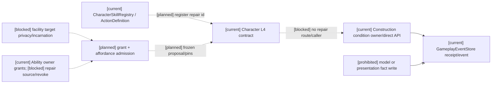
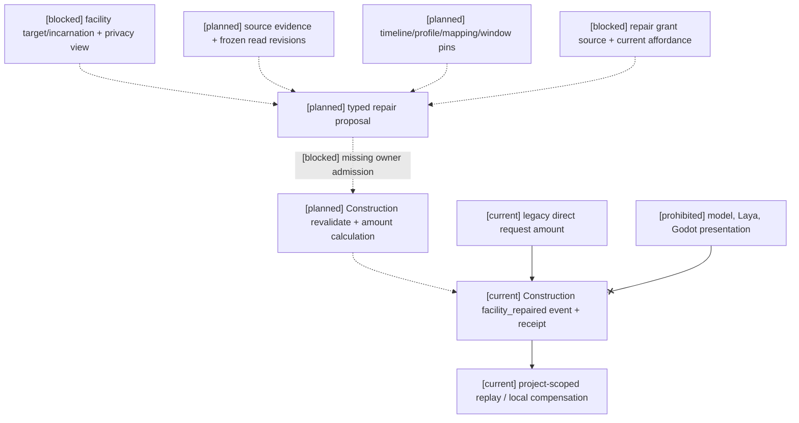

# 阶段三计划04 Task4：设施维修动作准入审查（2026-10-16）

状态：audit complete / implementation blocked / non-combat action chain not_verified。本轮只审查设施维修候选；没有新增 runtime caller、ActionAttempt、领域事件或测试壳。[current] 表示已有代码能力，不等于角色动作链通过。

## 准入矩阵

| 要素 | 已有证据 | 缺口与本轮决定 |
|---|---|---|
| typed semantic id | [current] owner 命令类型 gameplay.construction_production.repair_facility；治理合同 inf:construction-facility-repair@1 | 未发现该 id 在角色完整动作候选/注册中获准，也没有对应 L4→Construction 映射；命令类型不能自动当作已注册角色动作。 |
| actor、facility identity | CharacterExecutionContract.actor_ref/target_refs 可冻结角色和目标；owner 按 facility_ref 查 projector | owner envelope 以设施作 actor_ref，principal 固定为 Construction；未接收角色 actor，也未核对角色与目标绑定、设施 incarnation 或撤销。 |
| capability/grant | L4 合同 expected_observation.grant_ref 可做撤权准入；治理合同约束 Construction principal/stream/event | 维修 API 未接收角色 grant/capability，也未在提交前重验角色授权。 |
| temporal/window pins | 角色16 SettlementWindow 与现有 Task1 Action 时间消费可供设计参照 | 维修 API 只接 submitted_at，未接 window_ref、timeline/profile/mapping revisions 或冻结窗口；Task1 接线仅属于调查冲突 owner。 |
| source/read revisions、evidence | L4 有 source、expected revision/target revision、context 和幂等键；维修 API 接 source_ref、expected_revision，内部 pin 当前 facility revision | 没有贯穿 L4→owner 的 source/read vector 或 evidence refs 重验。非物理维修不要求 PhysicsEvidence；不能伪造 contact marker。 |
| owner contract | [current] ConstructionProductionAuthority 是设施 condition 事实 owner；settle_facility_repair 可追加 facility_repaired | API 由调用者提供 repair_amount，仅检查范围、目标存在、隐私和 stream revision；尚无以 typed intent 求得维修结果及 eligibility 的 owner 规则。 |
| 实际 caller | backend/app 只有维修/补偿方法定义；bakery、semantic 等生产调用 Construction 的其他方法 | backend/app 未发现 settle_facility_repair 或 compensate_facility_repair 调用。直接调用仅在 backend/tests；真实应用/服务 caller 门未通过。不创建 synthetic caller。 |
| receipt/idempotency | [current] store AppendBatchResult、get_by_idempotency；exact duplicate 回原 receipt，changed duplicate 拒绝，expected stream revision 冲突拒绝 | 这些是直接 owner API 合同测试，不是角色动作响应丢失后的实际 caller 查询与 Durable 新实例恢复证据。 |
| recovery/compensation | [current] compensate_facility_repair 引用原 repair event，要求当前 condition 匹配，追加补偿事件；原事件保留 | 无动作 caller 的失败恢复编排；补偿仅是局部 Construction 事实，不是全局回滚。 |
| replay/privacy | [current] projector 全量与 checkpoint-tail 一致；repair/compensation 为 project 可见，非 project 请求拒绝；重放拒绝 stream/privacy/condition/revision 篡改 | 无角色可见过滤反馈、动作结果 replay、真实 actor 私有投影证据。 |

准入判定：Construction 事实 owner 与 append/receipt/compensation 入口成立；实际 caller、canonical 角色动作登记、完整 L4/owner 语义和提交前 revalidate 均不成立。按用户预设闸门停止实施。现有 ActionAttempt 构造需要 contact marker 和 physics evidence，本非物理切片不能借此制造证据；不另建 GameplayActionAttempt 或 authority。Laya 仍仅验证 choice 输出类型，本轮未调用 provider。

规格11 A01–A06 的角色动作共用承诺、权限/窗口 stale、阶段反馈及跨 owner 恢复，在此维修链均 not_verified；现有 owner 单流幂等/补偿测试只覆盖其中局部机制。P01–P06 的近战/空间/物理/投射物全部不在本轮。Task3 资源迁移仍 blocked，未修改资源目标 schema；Task2 限定 batch/checkpoint/replay 已通过但 T07 random blocked/not_verified，prediction 和其他 owner 未完成。Task4、Task2 和阶段三整体未完成。

## 架构图

~~~mermaid
flowchart LR
  I["[planned] typed facility repair intent"] --> L["[current] Character L4 contract"]
  L -. "no admitted caller or route" .-> O["[current] Construction facility owner"]
  O --> S["[current] event store receipt and replay"]
  T["[current] Task1 conflict Action time consumer"] -. "not wired to repair" .-> O
  P["[deferred] physics/combat/other action owners"]
~~~

## 主流程时序图

~~~mermaid
sequenceDiagram
  participant C as Character/L4
  participant A as Application caller
  participant O as Construction owner
  participant S as GameplayEventStore
  Note over C,S: [current] owner direct API and receipt; [planned] repair caller and L4 binding; [deferred] combat/physics
  C--xA: no admitted repair route
  Note over A,O: [current] no application/service repair invocation
  O->>S: direct owner API can append repair/compensation
  S-->>O: AppendBatchResult and idempotency receipt
~~~

## 数据流图

~~~mermaid
flowchart TD
  P["[planned] actor + typed intent + grant + window/read pins"] -. "not connected" .-> V["[planned] repair owner revalidate"]
  D["[current] direct test inputs incl. repair_amount"] --> O["[current] Construction settle_facility_repair"]
  O --> E["[current] facility_repaired / compensation events"]
  E --> R["[current] project-scoped replay and receipt"]
  R -. "no character feedback caller" .-> F["[planned] permitted L1 outcome"]
  X["[deferred] physical impact / other owners"]
~~~

## 验证边界

冻结允许列表：backend/tests/test_infra_construction_facility_repair.py、test_construction_job_event_schema.py、test_character_execution_contract.py、test_character_action_attempt_settlement_contract.py、test_character_action_replay_determinism.py、test_action_consequence_boundaries.py。旧 API 的通过不构成实际 caller、L4 接纳、Task1 时间 pins、Durable 动作恢复或完整链验收。无真实 caller 可导出；不得虚构事件 digest 或恢复结果。

本轮第一次从 backend 目录运行该列表，因 test_character_action_replay_determinism.py 导入 scripts.verification 时 PYTHONPATH 缺仓库根目录，收集失败（1 error、无测试运行）。改为仓库根目录并显式 PYTHONPATH=backend 后，冻结的六文件 focused **66 passed、4 条既有 FastAPI on_event 弃用警告**。backend-contract Harness **passed**，四项静态合同 proved，run_id=2772a14f91c346d987f802e9524fad09，harness_cleanup=passed；它不验证维修实际 caller。Harness 本轮临时目录已不存在；仓库 .harness/verification 有既存文件，来源未归属于本轮，未清理或覆盖。pytest cache 存在，未确认其原始归属，未删除。git diff --check 退出码 0，只有既存工作树 CRLF→LF 警告。没有本轮真实 repair caller、owner append、事件 digest 或 Durable 恢复结果可导出；直接 owner API 的既有测试证据不能冒充这些结果。

## 2026-10-16 动作准入设计收口（仅设计，未实施）

本节是前述审查的增量决定；上文 66 项测试和 Harness 结果属于前一轮，不是本轮证据。分类 A = 原文已有明确 owner/API 的局部合同；B = 原文要求成立但缺设施维修接口，须先设计并回写；C = 原文不足以确定业务选择，保持 blocked。A 不等于完整角色 caller 可实施。`semantic_action_id`、Construction `command_type`、`inf:construction-facility-repair@1` 分别是角色动作身份、owner 命令身份、治理合同身份，不得互换。

来源简称：[S11](../规格/11-技法动作结算与非战斗语义适配规格.md) §2–3/A02–A06；[R11](../角色/11-跨玩法动作承诺协议设计.md) §3–4/§7–8；[R16](../角色/16-通用玩法时序模型与编辑器设计.md) §2.3–2.4/§4/§7.4；[S09](../规格/09-通用时间权限投影与领域服务接入规格.md) §3–4/T01–T06；[Skill](../../superpowers/specs/world-character-siming-authority-mainline/character-gameplay-foundation/2026-07-23-skill-ability-graph-and-affordance-design.md) §Ability Graph / Ability grant / Momentary affordance；[Federated](../../superpowers/specs/world-character-siming-authority-mainline/2026-08-17-inf-federated-owner-capability-admission-design.md) §Authority Model；[Econ-1 Construction](../../superpowers/specs/world-character-siming-authority-mainline/phase-one-gameplay/econ1/2026-08-07-econ1-construction-production-design.md) §Models/Lifecycle/Failure Semantics；[INF-1AE](../../superpowers/specs/world-character-siming-authority-mainline/inf-1/2026-08-17-inf-1ae-construction-action-owner-contract-audit.md) §Row/Remaining boundary。代码入口均按当前工作树静态读取，未运行 caller。

| # | 准入问题与决定 | 分类 | 来源与实际入口 |
|---|---|---|---|
| 1 | 既有动作定义来源是 `CharacterSkillRegistry` 的 `ActionDefinition.action_id`（`SkillActionBinding` 管技能关联），但当前没有直接登记 `semantic_action_id` 的接口；L3 仍以 `_candidate_semantic_action` 内置映射生成该字段。须先设计已登记 action id 到 canonical semantic id 的唯一、版本化绑定并获准维修条目；不得把二者默认视为同名。Gameplay `SemanticRegistry` 是标签/规则声明，不是替代动作表。未知 id 零写入。 | B | R11 §8/§8.1；S11 A01–A02；`backend/app/character_agent/skills/{registry.py,catalog.py,models.py}`；`backend/app/character_agent/planning/l3_planner.py:339`；`backend/app/gameplay/semantic_registry.py:385`。 |
| 2 | L4 冻结的动作身份只能经明确登记的 owner route 指向固定 `ConstructionProductionAuthority` 维修操作及 `inf:construction-facility-repair@1`；不得从任意 `owner_route` 字符串或 Construction command type 推导路由。当前没有这项映射或 caller。 | B | R11 §3–4；Federated §Capabilities and catalog visibility；`backend/app/character_agent/execution/l4_adapter.py:215`、`backend/app/gameplay/construction_production_runtime.py:5282`。 |
| 3 | 角色能力/授予事实的现有 owner 是 `actor_gameplay.skill_domain`；`AbilityAuthorityService.activate_grant` 有写入口，`AbilityStateProjector` 能读撤销事件，但服务没有相应 revoke 命令。谁有权签发/撤销设施维修 grant、其来源事件和设施 scope 均未规定，不能从职业、模型或空 grant 推定。 | C | Skill §Ability grant/§Equipment or buff grant lifecycle；Federated §Gameplay-Pack And Mod Content Boundary；`backend/app/gameplay/ability_runtime.py:171`、`:212`、`:225`；`backend/app/character_agent/models/character_execution.py:230`。 |
| 4 | `facility_ref` 只标识 Construction 投影对象；须有角色可见、privacy 过滤的设施 target 读模型及冻结 revision，且 owner 能核对同一目标。现有 project-scoped outbox 不自动授予该角色目标可见性；Econ-1 `Facility` 有 `revision`/`ownership_right_ref`，但设施 incarnation 的权威字段/规则未找到。 | B；incarnation 规则 C | R11 §8；S11 §4/A06；Econ-1 Construction §Models；INF-1AE §Row；`backend/app/character_agent/planning/l3_planner.py:396`、`backend/app/gameplay/construction_production_runtime.py:5299`。 |
| 5 | 当前可维修须由设施 condition、权限、资源/工具及目标状态等获准输入形成当下 affordance，保留 blocker 和 revision，提交前重算。Econ-1 有 `maintenance_policy` 字段，但未给维修前置规则；`facility_ref` 存在和 `repair_amount` 范围检查均不证明 eligibility。 | B；具体政策 C | Skill §Momentary affordance/§Ability affordance；R11 §8；Econ-1 Construction §Models/Lifecycle；`backend/app/gameplay/ability_runtime.py:239`、`backend/app/gameplay/construction_production_runtime.py:5296`。 |
| 6 | 承诺与结算必须绑定 timeline、profile revision、clock mapping revision、`SettlementWindow` ref/范围/cutoff/confirmation；跨时间线不得比较裸 tick。维修 direct API 仅有 `submitted_at`，没有这些输入。 | B | R16 §2.3–2.4/§4；S09 §3–4/T01–T06；`backend/app/gameplay/construction_production_runtime.py:5282`。 |
| 7 | L4 已有 `source_ref`、target/read revisions、context 与幂等身份；owner 请求须保留来源事件、授权可见 evidence refs、冻结 read-set 和各来源 revision，并在 Construction 内重验。非物理维修不得伪造 `ActionAttempt` 的 contact/physics evidence。具体设施来源 evidence policy 未规定。 | B；具体 evidence policy C | R11 §3–4；R16 §2.3–2.4；`backend/app/character_agent/models/character_execution.py:119`、`backend/app/models/embodied_interaction.py:88`、`backend/app/character_agent/execution/l4_adapter.py:215`。 |
| 8 | `repair_amount` 只能是 typed proposal/上界意向，不能由模型或 caller 确定 owner 事实；最终增量、上限和取整由 Construction 的版本化业务规则依据当前 condition 与获准输入计算。现有 direct API 直接接受 float，规则来源和公式缺失。 | C（原则受 S11 A03 支持，数值合同无依据） | S11 A03；Federated §Domain owners；`backend/app/gameplay/construction_production_runtime.py:5282`–`5340`。 |
| 9 | Construction 必须在 append 前独立重验角色授权/撤销、target 身份与 incarnation、窗口及 profile/mapping、source/read revisions、facility/stream revision、原幂等身份。现有代码只重验 project scope、目标存在、amount、facility/stream revision 和幂等；完整 typed owner admission 接口待设计。 | B；incarnation/授权来源 C | S11 A06；R16 §2.3–2.4；Federated §Domain owners；`backend/app/gameplay/construction_production_runtime.py:5282`–`5381`。 |
| 10 | 补偿使用原 repair receipt 的 committed event id 指向原维修事件，由 Construction 校验其仍为当前 condition 后追加 `facility_repair_compensated`；保留原事件，失败走 receipt 查询/有界恢复，不做全局回滚。现有 API 接 `repair_event_id`，caller 从 receipt 取 id 的关联接口/恢复策略待设计。 | A（owner 局部）；B（caller 恢复接口） | INF-1AE §Row；R16 §2.4；S09 T04–T06；`backend/app/gameplay/construction_production_runtime.py:5383`、`backend/app/gameplay/event_store.py` 的 `get_by_idempotency`。 |

### B 类接口草案与责任矩阵

| 边界 | 拟定接口合同，仅供后续设计审阅 | 责任与兼容要求 |
|---|---|---|
| 定义/候选 | 在既有 `CharacterSkillRegistry` 登记获准维修 `ActionDefinition`；补足 action id→canonical `semantic_action_id` 的受治理绑定及固定 Construction route。候选必须引用可见设施目标及其版本、现时 affordance、能力包络。具体 id、资格政策须另行批准。 | 角色定义/候选层负责枚举与冻结；`SemanticRegistry`、`GovernedAuthorityContractCatalog` 不变成新 action registry 或可写 router。旧动作候选不自动扩充。 |
| L4→owner | 以现有 `CharacterExecutionContract` 的 actor、semantic action、target、source、revision vectors、idempotency、causation/correlation 为基底，设计设施维修 typed proposal 和 temporal/read/evidence pins 的显式传递。 | L4 负责承诺、取消和初步准入；不得把现有物理 `ActionAttempt` 用空 contact marker 冒充。旧 L4/物理路径保持其既有含义。 |
| owner admission | Construction 专属请求应携带已登记 route/contract、角色授权证明、目标身份、冻结 `SettlementWindow`、timeline/profile/mapping、source/read/evidence 和设施 revisions；同一请求 digest 绑定所有 pins，owner 复查后按版本化规则计算增量。 | Construction 负责事实资格、数值、幂等和 append；时间服务只给窗口，不拥有 condition；角色/表现不写事件。缺 grant 来源、incarnation 或数值规则时 fail-closed。 |
| receipt/恢复 | owner append receipt 和原事件 id 是唯一恢复锚；超时先查 `owner + operation/idempotency`，exact duplicate 回原 receipt，changed duplicate 拒绝。补偿请求引用原事件及 reason，限 Construction condition。 | 旧 direct API 的已提交 event/schema、project privacy、receipt、重放及幂等语义保留；新角色入口不得静默调用旧 direct API 以跳过新 pins。旧事件无新字段时按原版本读，不倒填角色授权。 |

未决定且继续 blocked：维修 grant 的签发主体/撤销 API 和 source，设施 incarnation 定义，设施 target 的角色隐私投影，维修 eligibility/evidence、数值 policy。任何一个 C 项缺失都不能通过默认值、空 registry/grant/affordance、隐含 target 或 direct API 代替真实 caller。以上草案也不授权新动作、其他 Task4 行、Godot、近战或物理实施。

### 下一轮真实 caller 前置门

逐项提供可审阅的登记与合同：canonical semantic action 与既有 action id 的绑定；固定 owner route；grant/capability 来源及撤销；target/affordance admission；temporal/source/read-set schema；proposal/owner amount 规则；Construction 提交前重验；补偿/恢复；旧 direct API 兼容和迁移。九项必须全部具备且对应 C 项已由来源决策补足，才允许另轮设计实施真实 caller。当前为 `blocked/not_verified`，Laya 仍只验证 choice 类型；Task3、Task2 T07、Task2 prediction、Task4 其他动作及历史 cleanup incomplete/HTTP503 独立审查 incomplete 状态不变。

### B/C 阻断正式收口：四项待用户决策（2026-10-16）

四项均登记为 **C：原文与现有 owner 均不足，正式 deferred**。没有一项可按 A 进入实现，也没有一项仅凭草案达到 B。必须先取得用户对业务选择的正式决定并补齐接口设计；在此之前不得创建 caller、repair event、默认 grant、默认角色维修资格或新的 owner 基础设施。

| # | 阻断项 | 结果 | 现有依据与不足 | 解除条件与所需来源 |
|---|---|---|---|---|
| 1 | repair grant 的签发、撤销与 owner | **C：正式 deferred，待用户决策** | 现有 Ability owner 只有局部 grant 激活/读取；未定义设施维修 grant 的签发主体、撤销 API、来源事件、设施 scope 或 Construction 提交时的重验。 | 用户确定 grant owner、签发/撤销事件、scope、revocation 查询及 revalidate 合同；来源为 Skill grant 生命周期、Federated capability boundary、现有 Ability owner API。 |
| 2 | facility incarnation、角色可见性与 target admission | **C：正式 deferred，待用户决策** | `facility_ref` 只指向 Construction 投影；`Facility.revision` 不是 incarnation 合同，project privacy 也不是角色 target 视图。缺少 incarnation 身份/生命周期、角色可见投影、target admission 和 owner 同目标核对 API。 | 用户确定 incarnation 身份与重建/终止规则、角色隐私投影和 admission 输入；来源为 Econ-1 Facility、角色11/S11 target contract、Construction owner 审查。 |
| 3 | repair affordance 与资格政策 | **C：正式 deferred，待用户决策** | 通用 `AbilityAffordanceResolver` 与 `maintenance_policy` 尚未给出维修前置规则；condition、资源、工具、权限、窗口和目标状态没有正式 eligibility/evidence policy。不得从当前 condition、facility 存在或 amount 范围推导资格。 | 用户确定资格维度、证据来源、阻断原因、freshness/revision 和提交前重算；来源为 Skill affordance、R11 §8、Econ-1 lifecycle/failure。 |
| 4 | `repair_amount` 的 proposal/owner calculation 边界 | **C：正式 deferred，待用户决策** | S11 A03 只有“caller/model 不得写 owner 事实”的原则；direct API 当前接收 float，但没有版本化增量、上限、取整、condition 公式或 proposal schema。 | 用户批准 typed proposal 字段与版本化 Construction calculation policy，明确 owner 输入、上限、取整、失败/补偿和兼容迁移；来源为 S11 A03、Federated domain owner、Construction owner。 |

### 面向产品决策的最小决策包（2026-10-17）

以下是待产品负责人选择的候选政策，不是已批准业务事实或实现授权。建议每项选择“推荐”以形成可实施合同；选“维持 deferred”则继续不提供角色维修动作、不产生维修事件。四项必须一起决定，不能以单项批准启动 caller。

| 决策 | 推荐选项 | 替代选项及影响 | 必须冻结的合同 | 规格11验收映射 |
|---|---|---|---|---|
| R1 grant 签发与撤权 | 复用既有 Ability grant owner 签发专用、版本化的维修 capability；scope 至 actor + facility incarnation + world/timeline；撤权通过同 owner 的 revoke 事实表达。Construction 在 append 前按 grant ref 和 revision 重验；L4 的检查仅作前置过滤。 | 由 Construction 自身签发会把能力授予与设施事实集中到一个 owner；由更高层授权 owner 签发则增加一个必须具名的 issuer/source。选择其一都需定义稳定 grant ref、签发者、事件、读取接口和撤权生效边界；没有该决定则关闭 caller。 | issuer/revoker、grant/revoke schema/version、scope、有效期时间语义、recipient read API、撤权线性化点、owner append 前重验与迁移兼容。 | A01 未注册/无 grant fail-closed；A02 route 不越权；A05 receipt/recovery 保留已提交结果；A06 过期/撤权后拒绝或重建。P03 仅在采用物理 evidence 时相关，维修本身不要求 physics evidence。 |
| R2 facility incarnation 与 target privacy | 把 incarnation 建成 Construction facility lifecycle 的显式、不可复用身份；普通维修保持 incarnation，拆除/重建产生新 incarnation。角色 caller 只能读取按 actor grant 过滤的 target view；owner 提交时核对 facility_ref + incarnation + view/source revision。 | 沿用 facility_ref 作为永久身份会使拆除重建后的旧承诺可能落到新设施；project 可见性不足以表达 actor 私有范围。若产品选择更宽可见范围，必须明示其 recipient 群体与撤权行为。 | incarnation 创建/终止事件和 revision；target view API、recipient scope/privacy、隐藏候选的拒绝语义；freeze 的 target revision；Construction 同身份重验；旧 event decoder 继续按旧 schema 解释。 | A01 非 canonical target 拒绝；A02 正确 owner route；A06 target/incarnation revision stale 拒绝。P02 查询缺失/过期/不支持的区分与隐藏候选不泄露；P04 incarnation 变化隔离 dedup；P05 在扩到空间 evidence 时再适用。 |
| R3 eligibility / affordance | 由版本化 Construction maintenance policy 明列可维修状态、所需能力/工具/资源、必要 evidence 及 freshness；L4 展示 owner/registry 产生的 momentary affordance，Construction 在提交前重新求值并返回稳定 blocker code。 | 若无资格限制，虽接口简单但允许仅凭设施存在发起维修；若资格完全委托给 caller，owner 无法独立重验。选择 policy owner 和最小资格条件，不能从 condition 数值或 API 参数范围推导。 | policy ref/revision、输入 owner/API 和读权限、证据 refs、blocker code、freshness/revision、提交前重算、拒绝零写。 | A01 未知动作/资格 fail-closed；A02 非战斗路径复用 commitment 而不引入 combat type；A04 执行阶段不等于结算成功；A06 window/source/grant/eligibility stale 拒绝。P02/P03 仅当资格政策实际依赖空间/物理证据时适用，否则明确 N/A。 |
| R4 amount proposal 与 Construction 计算 | caller 只提交 typed repair intent（不含 `repair_amount`/`next_condition`）；Construction 按版本化 policy 从获准输入计算增量、上限和取整，并把 policy revision 与输入 vector 写入原 owner event/receipt。 | 让 caller 提交建议增量仍须定最大值、离散单位及 owner 接受规则；沿用现有 float direct API 则保持旧 owner-direct 合同，不能作为角色链准入。 | proposal schema/version、Construction 公式/单位/上限/取整、输入 owner 与 revisions、并发冲突、receipt lookup、补偿条件及旧 direct API 双版本兼容。 | A03 模型/Caller 不写领域事实；A04 feedback 只据 owner receipt；A05 多 owner 失败时保留已提交 receipt 并走 recovery；A06 输入 revision stale 零写拒绝。P01 结果区分只在维修 policy 会产生对应 combat outcome 时适用；P03/P04 对维修事件幂等/身份键适用；P06 投射物不适用。 |

**共同解除门槛：**四项决定具名并版本化后，先完成本次设计并实现标识、职责、授权读取、owner 提交前重验、receipt 查询、恢复/补偿、旧 direct API 兼容与隐私边界；再由真实 L4 caller 接 Construction 原 owner 和现有 store。A01–A06 必须按适用范围逐项验收；P01–P06 仅对真实接入的物理/evidence 能力适用，不因 repair slice 宣称全覆盖。没有实际物理证据需求时不得造 `ActionAttempt` contact marker，维修不声称覆盖 P01/P02/P05/P06 的物理路径。当前四项仍是 **C/deferred**，本决策包本身不解除状态、不创建 caller，也不提交 `facility_repaired`。

**统一影响：** facility repair 保持 `deferred`；不创建 caller，不提交 repair event，不继续 Task4 该子切片。Task3 资源迁移继续 blocked；Task2 T07、prediction 与其他 owner 继续未完成；Task5/6 未启动；Laya 仍只验证 choice；Godot、calibration、final/holdout、训练和微调保持关闭。

### 三图：拟议边界，不代表运行时



```mermaid
sequenceDiagram
  participant M as Model choice / typed intent
  participant L as L4
  participant G as Grant/target/affordance admission
  participant C as Construction owner
  participant E as Event store
  Note over M,E: [planned] proposal path; [current] Construction direct append only; [blocked] missing repair contracts
  M-->>L: typed intent + chosen facility target
  L-->>G: [planned] verify registered action, visibility, grant, affordance and pins
  G-->>L: [blocked] repair-specific source and target policy absent
  L--xC: no admitted repair caller
  Note over C,E: [planned] owner revalidate actor/target/time/read set and calculate amount before append
  C->>E: [current] direct owner API may append facility_repaired
  E-->>C: [current] append receipt / original event id
  Note over M,E: [prohibited] model choice or animation completion cannot substitute for receipt
```



## 2026-10-16 Task4 最终边界更正

Task4 的可接受运行时范围冻结为 Stormnight conflict action 与 ActionConsequenceBoundary 的既有局部 caller/owner/store 证据。facility repair 四项 C/deferred 沿 RW-40/RW-44 保持；P01–P06 及其他物理/投射物 owner 没有具名真实 caller 与 admission，正式 deferred，不创建空测试或第二 action authority。解除条件是逐动作 owner、evidence lifecycle、incarnation/presence、receipt/replay 与 privacy/revocation。

## 2026-10-19 用户政策批准后的来源复核

用户已批准维修政策：可维修者为组织成员/指定角色，授权者为设施所有者，目标身份为 `facility_ref + incarnation`，维修证据包含工具、材料与施工完成记录，维修量按材料数量计算。该批准解决了此前“资格/证据/目标/计算政策待产品选择”的产品语义问题；**不等同于来源、issuer、权限或既有运行时事实**，也不自动解除旧 deferred 决定。

按现有代码逐项复核后，当前仍无可合法接线的真实执行来源：

| 所需事实 | 可核对的现有位置与合同 | 缺失项/结论 |
|---|---|---|
| Construction facility owner/状态 | `backend/app/gameplay/construction_production_runtime.py` 的 `Facility`（`facility_ref`、condition、revision、`maintenance_policy_ref`）及 `ConstructionProductionAuthority.settle_facility_repair()`；后者仅接收调用者给定的 float `repair_amount`，通过既有 `GameplayEventStore` 追加 project 可见事件。 | `Facility` 没有 incarnation 字段/生命周期事件；`revision` 不能代替 incarnation。现有 API 没有角色、所有者 grant、材料、工具、完工记录或 world/timeline 重验，因此只是 owner-direct API，不是准入 caller。 |
| 设施所有者授权 | `backend/app/gameplay/facility_repair_admission.py` 的本次设计 `FacilityRepairGrant` / `FacilityRepairCaller` 描述 grant 输入与 scope 校验；当前能找到的 credential、session/controller auth 与 Ability grant 都不是 facility owner 的签发/撤权 issuer。 | 没有真实 owner 身份 issuer、grant/revoke API、receipt、facility incarnation scope 或 owner append 前撤权重验。不得把请求传入的 grant 模型实例当作已认证授权。 |
| 组织成员/指定角色 | 维修 admission request 可携带 `organization_ref` / `designated_role_ref`，但尚无被该 caller 使用并在提交前重验的 canonical membership/role source。 | 字段值不是成员/资格证明；无 caller 可读取的 owner API、revision 与撤权合同。 |
| 工具、材料与完工记录 | admission evidence schema 可携带 refs；RW-44 下生产物品归 Inventory custody。 | 没有本维修路径已登记的工具可用性与施工完成事实 issuer，Inventory custody 也不能证明工具使用或工程完工；未找到以材料数量推导维修量的正式版本化 Construction policy/单位/取整规则。 |
| 时间与身份范围 | admission request 包含 world/timeline/tick 字段。 | 这些是 caller 输入，不是受信 world clock、角色 presence/target view 或确认窗口来源；没有提交前 source/read-set revalidation。 |

因此，现有 `FacilityRepairCaller.admit()` 对表面格式与 scope 不匹配做 fail-closed 校验后返回 `facility_repair_sources_unavailable`，并不写事件；这是诚实的边界，不应为满足验收把它改成接受未认证来源。维修仍为 **deferred / not_verified**。继续解除所需的最小新增真实来源是：可核验设施所有者身份及 grant/revoke issuer；Construction facility incarnation 生命周期；membership/指定角色 owner；工具/材料 custody 读取与施工完成记录 owner；版本化材料数量→维修量规则及 owner 提交前完整重验/receipt/recovery 合同。任何正式实现须标明“本次设计并实现”，且不得新造第二套身份、权限、clock 或 store。
