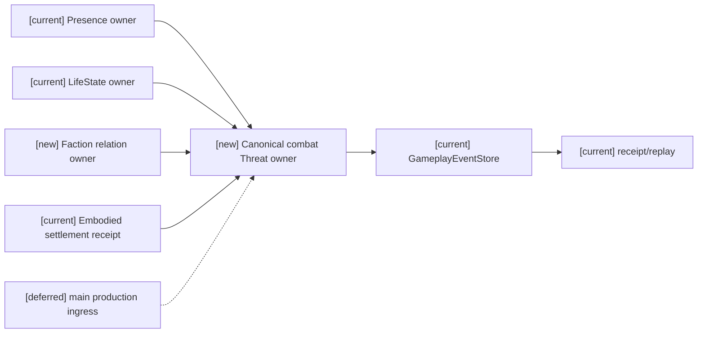
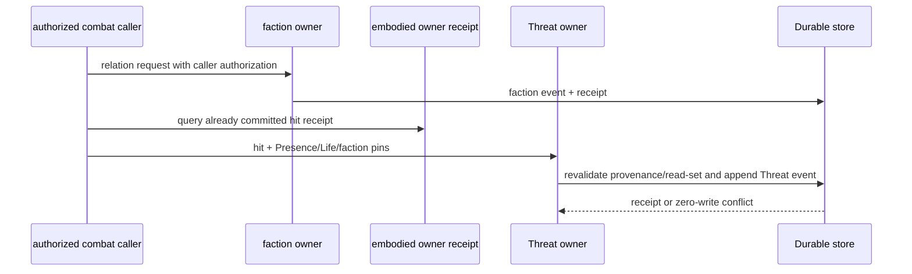
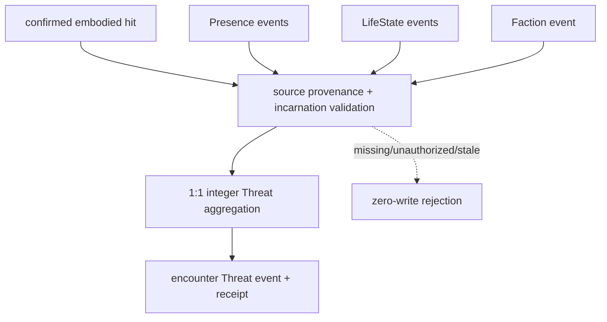

# Stage 3 Task5 canonical combat owner (this design and implementation)

状态：`owner API implemented / production ingress not_verified`。

本批新增 `CombatFactionRelationAuthority` 与 `CanonicalCombatThreatAuthority`。Faction relation 是本次设计并实现的正式 owner；调用者必须由构造时的授权 caller allowlist 接入，写入既有 `GameplayEventStore`，使用 principal、事件、scope、幂等 receipt 和 Durable replay。Threat owner 只消费已提交 embodied receipt 与 canonical Presence/LifeState/faction source；缺任一来源零写拒绝。没有修改既有 embodied service、main ingress、event store 或 shared replay。

## Source and contract

| Source | Owner/principal | Event/stream | Permission and recovery |
|---|---|---|---|
| Presence | existing `PopulationPresenceAuthority` / `population.presence_authority` | `population.presence.spawned` / `presence:<world>` | project-visible, activation-bound, incarnation pinned; exact event/transaction provenance and stream head recheck |
| LifeState | existing `CanonicalLifeStateAuthority` / `authority:character:life-state` | `gameplay.character.life_state_changed` / `gameplay:character:life:<actor>` | only non-dead state is accepted; current owner exposes confirmed death only, so production combat remains closed until an admitted alive source exists |
| Faction | this design and implementation / `authority:combat:faction-relation` | `gameplay.combat.faction_relation_recorded` / `faction:<world>:<timeline>` | explicit authorized caller; exact duplicate replay; changed duplicate rejected |
| Embodied hit | existing `EmbodiedAuthoritySettlementService` | owner receipt and `gameplay.embodied.street_settled@1` | receipt must be committed and exact attempt; Threat writes damage 1:1 and never re-invokes embodied owner |

## Architecture

## Sequence

## Data flow

## Acceptance and boundary

- Faction unauthorized caller, non-boolean hostility, missing sources, stale incarnation, changed duplicate, and multi-event embodied receipt are rejected with zero writes.
- Exact faction retry replays the original receipt from a newly opened Durable store; changed payload under the same idempotency key is rejected and does not append another event.
- Threat does not infer death from HP, profile affiliation, contact, or private estimate; it does not write Fear/Morale or Target facts.
- `main.py` still calls the embodied owner directly. Therefore this is an owner/API implementation with unverified production ingress, not a Task5 end-to-end pass.

## 2026-10-19 encounter lifecycle increment (this design and implementation)

`CanonicalCombatThreatAuthority` now includes a bounded encounter lifecycle and a read-only target query. `begin_encounter` admits only an already committed embodied receipt together with the existing project-visible Presence, initial/alive LifeState, and hostile faction relation sources. The caller is checked against a constructor allowlist (`authorized_callers`); this is a composition boundary for an admitted backend caller, not a new identity issuer or production ingress.

`end_encounter` appends `gameplay.combat.encounter_ended` to the same `GameplayEventStore` stream with an expected stream revision. `encounter_projection` replays the same stream, verifies owner transaction provenance, scope and visibility, and clears all accumulated 1:1 integer Threat rows at the end event. Hits arriving after an ended encounter are rejected without a write. `target_eligibility` revalidates Presence/LifeState/faction, incarnation and source stream heads and performs no write; callers carry the returned revisions into a later CAS.

Exact duplicate lifecycle requests replay the original Durable receipt; changed payload, unauthorized caller, changed scope/incarnation/receipt, stale source, malformed projection, and missing source fail closed. A newly opened Durable store replays the same lifecycle and checkpoint boundary without importing future rows. Existing pre-lifecycle bounded hit events remain replay-compatible; they are not evidence of an admitted production encounter.

Focused evidence: `backend/tests/test_canonical_combat_lifecycle.py`, `test_canonical_combat_authority.py`, and `test_combat_settlement_threat_consumer.py` — 28 passed. This increment closes lifecycle/target owner API behavior only. Production combat producer, authenticated identity/grant service, and full Task5/Task6 ingress remain `not_verified`.
