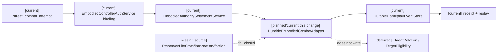
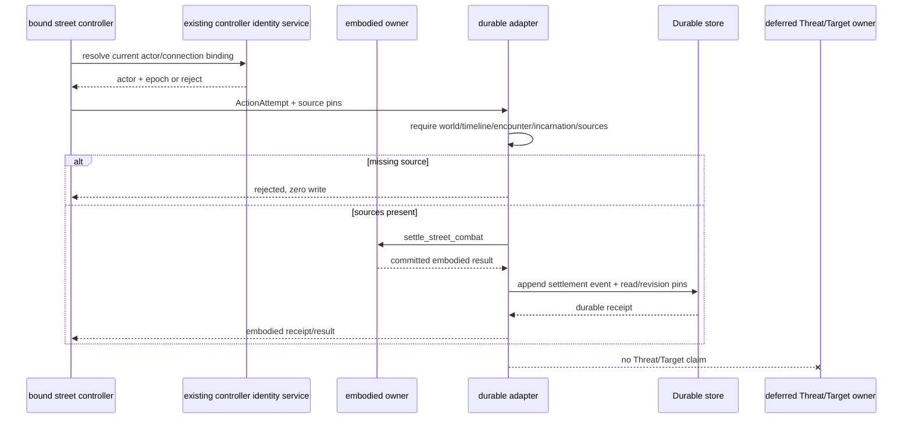
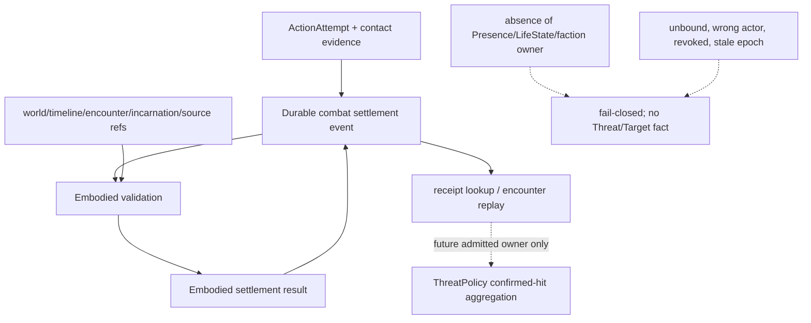

# Task5 Combat settlement source boundary（2026-10-19）

状态：`current bounded / Threat and Target not_verified`。

2026-10-19 补充：`street_combat_pose` 与 `street_combat_attempt` transport 入口现在复用既有 `EmbodiedControllerAuthService`。每个连接必须先完成受信本地 enrollment；caller binding 的 actor 与消息 actor 必须一致，消息 epoch 必须等于当前 binding epoch，撤权后拒绝。该变更仅封闭具身 transport 的身份冒用入口，不提供世界管理员授权、战斗 faction 来源、encounter 来源或 canonical Threat/Target producer。

本次用户已批准：confirmed hit 的实际伤害按整数 1:1 累计、不衰减、不跨 encounter、encounter 结束清零、并列按 `actor_ref` 排序；Target 由 combat owner 按 Presence/LifeState/敌对阵营判定。现有 `street_combat_attempt` 真实入口只能证明具身动作 settlement：它没有受信 Presence、LifeState、incarnation、encounter 或 faction 来源，也没有 combat owner 的 TargetEligibility 合同。因此本次仅持久化已有 embodied settlement 的来源和回执，不把接触或伤害升级为 ThreatRelation/TargetEligibility。

## 来源与实现

| 项目 | 位置 | 结论 |
|---|---|---|
| 真实 caller | `backend/app/main.py:4212` `street_combat_attempt` → `EmbodiedAuthoritySettlementService.settle_street_combat` | current，三种 melee action，contact/physics/transport/revision 校验 |
| 具身 owner | `backend/app/services/embodied_authority_settlement_service.py` | current，内存状态与幂等；不是 Threat owner |
| durable 基础 | `backend/app/gameplay/event_store.py:DurableGameplayEventStore` | current，已有 SQLite WAL、receipt/idempotency、close/reopen、replay |
| 本次设计并实现 | `backend/app/gameplay/combat_durable_adapter.py` | opt-in adapter；要求 world/timeline/encounter、双方 incarnation、Presence/LifeState/faction source pins；缺失时零写拒绝 |
| 验收 | `backend/tests/test_combat_durable_adapter.py` | 2 focused passed：缺来源 fail-closed；Durable close/reopen receipt 与 replay |

`gameplay.combat.embodied_settlement_recorded` 事件只记录已提交的具身 settlement、damage、source pins 和原 settlement event ids。它没有 `threat_value`、`target_eligibility` 或心理字段。`replay_settlements()` 只重建 encounter 范围内的具身 settlement rows。

## 架构图

## 时序图

## 数据流图

## 未完成与集成边界

- 现有 main 共享 service 未注入该 opt-in adapter；本次不伪造生产 scope，也不修改 main 路径。
- 现有 embodied owner 是内存状态，且没有 prepare/commit 接口；adapter 采用“embodied receipt 先提交、Durable combat event 后提交”。Durable append 失败会保留前者并返回恢复错误，不能宣称跨两者的全局原子提交。
- `DurableEmbodiedCombatAdapter.record_committed_settlement()` 提供 append-only recovery：使用已提交 embodied receipt 重试 Durable 记录，不重新调用 owner 或重复扣除 HP/stamina。该恢复 API 不改变跨 owner 非原子边界。
- 没有真实 Presence/LifeState/faction source issuer 和 combat Target owner，因此 ThreatPolicy、TargetEligibility、encounter reset、稳定排序、迁移和 privacy 仍 `not_verified/deferred`。
- 设施维修、LifeState、Soul/identity 和统一跨域故障矩阵不因本切片解除。
