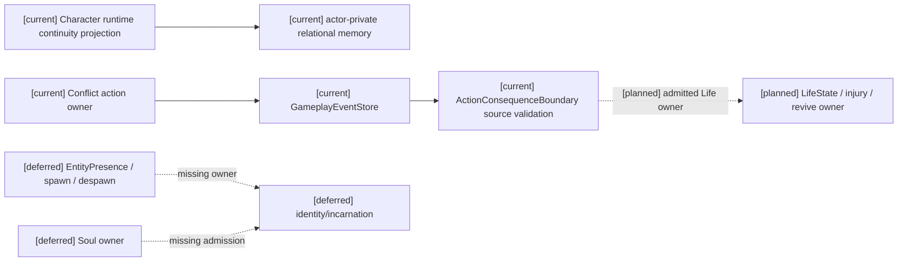
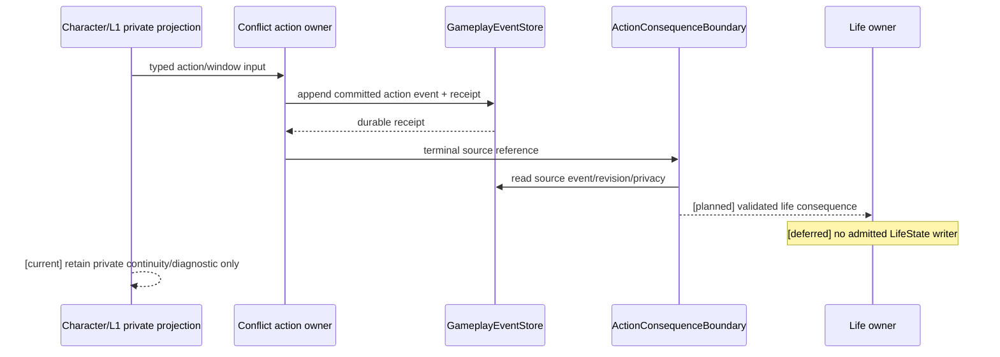
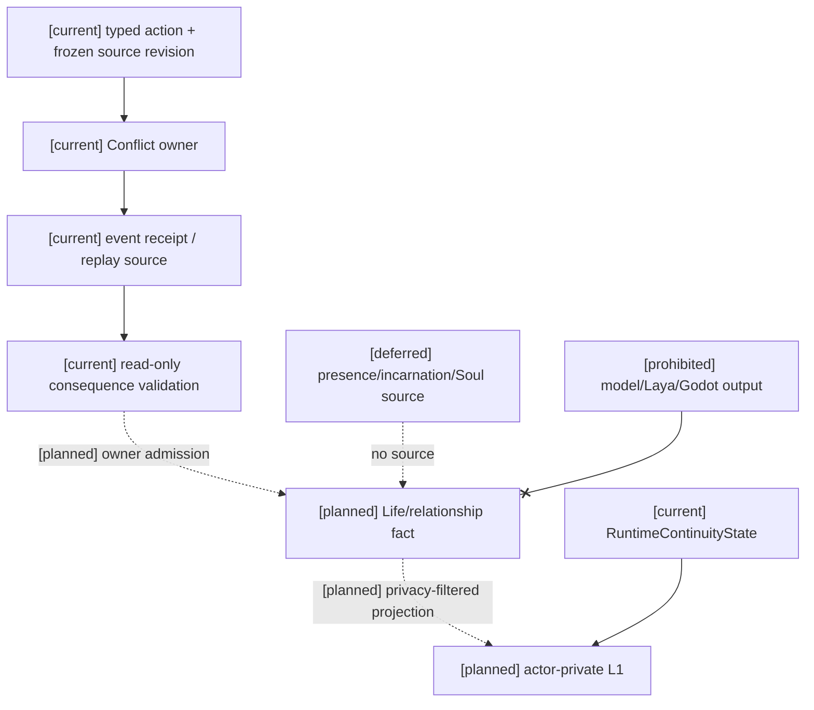
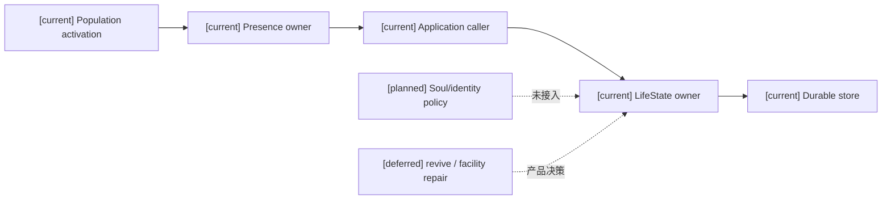
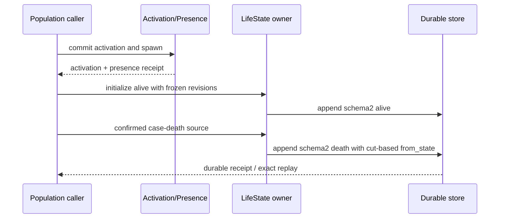
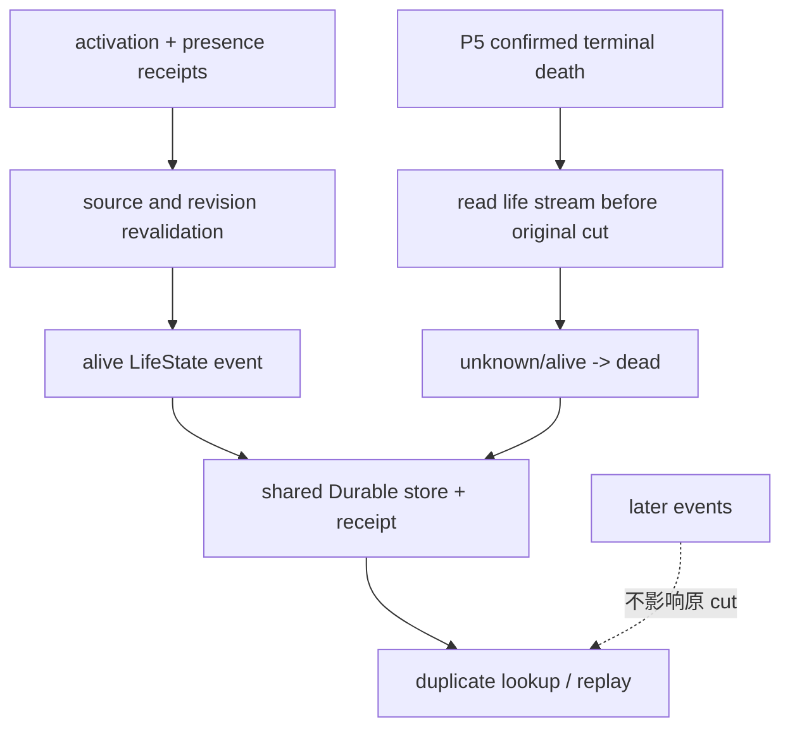

# 阶段三计划04 Task5：生命连续性与关系动态 owner 审查（2026-10-16）

历史状态：`audit complete / owner admission blocked / implementation deferred`。当前以阶段三 closure 的 RW-51 和稳定验收矩阵为准。旧版“没有关系事实 owner”的表述需收窄：已有 P5 `SocialFactAuthority` 负责受约束的共享关系与接收者过滤事实，但它不是 ThreatRelation 动态 owner，且共享身份关系 API 当前没有生产 caller。用户已授权为有来源支持的需求完成设计后实现正式 owner/API/caller，因此缺少 owner 不再是永久停止理由；Life/Presence/Soul/Threat 等不可推导产品政策仍在集中决策包中。

## Task5 总矩阵

| 切片 | 当前实现与真实来源 | 运行时证据 | 缺口 | 决定与解除条件 |
|---|---|---|---|---|
| continuity projection | `RuntimeContinuityState` 由 character runtime 保存 ongoing contact、interrupted action、transition kind；L1/relational memory 只形成 actor-private 记忆槽 | `test_world_runtime_continuity.py`、`test_character_agent_relational_memory.py`；均为真实 runtime/model 调用 | 没有 LifeState writer、事件 receipt、Durable 新实例或跨 owner recovery | **A 局部通过；仅作为私有 continuity projection**。不得扩展为生命事实；完整验收需 Life owner/API、事件/receipt/replay |
| action/death consequence source validation | `ActionConsequenceBoundary` 读取 `GameplayEventStore`，校验 terminal outcome、source revision、actor 与 evidence；`InvestigationConflictAuthority` 是实际 action owner caller | `test_action_consequence_boundaries.py`、`test_stormnight_action_loop.py`；真实 owner append/replay 由 conflict tests 覆盖 | 这是结果来源校验，不是 LifeState transition 或 death owner；无 revive/death persistence contract | **A 已有边界可复用**。解除扩展条件为具名 Life owner 接受该 source contract，并补 receipt/recovery |
| entity presence / spawn / despawn | 未发现 admission/incarnation/quota/cleanup owner；profile activation、entity causal projection 只能作输入 | 无可接受的 presence owner/caller 证据 | identity/incarnation、privacy target、tombstone、cleanup/retry 均缺 owner | **C 正式 deferred**。需用户/架构决定真实 owner、身份与迁移合同后再实施 |
| LifeState / injury / revive | `resource_body_runtime`、`survival_runtime` 有局部身体/生存能力，但没有规格12完整状态机事实 owner | 局部 body/survival 测试不能证明 LifeState；不扩展为通过证据 | 状态集合、合法迁移、因果/revision/policy、不可逆死亡保留与恢复缺失 | **C 正式 deferred**。解除条件：LifeState owner/API、事件 schema、receipt、full/checkpoint+tail replay、部分失败恢复 |
| threat / relation dynamics | `CharacterRelationalMemory` 仅为接收者私有 belief slots；P5 `SocialFactAuthority` 可提交受约束 shared relationship/directed relationship/knowledge facts；没有 committed ThreatRelation、TargetEligibility、Fear/Morale/Protection owner | P5 tests cover visibility filtering/revocation and full/checkpoint-tail projection; relational-memory tests only prove private upsert/replace | shared relationship lifecycle/production caller、threat policy、stable sort/dedup/transfer/reset、恢复均缺 | **C 正式 deferred**。解除条件：Threat/relationship owner、私有投影 contract、隐私撤销与 replay/recovery 证据 |
| Soul / identity continuity | 未发现 Soul/identity 事实 owner；角色只能保留 unavailable/diagnostic | 无 Soul owner/caller 证据 | incarnation 与身份迁移、revive/death soul continuity 未定义 | **C 正式 deferred**。需明确 owner、身份迁移/墓碑及权限来源；不得用 survival、activation、标签或模型代替 |

## 现有动作与连续性证据边界

`InvestigationConflictAuthority.resolve_action_window` 通过已注册 action graph、空间快照、source revisions 和幂等路径写入既有 event store；`ActionConsequenceBoundary` 只读校验 terminal event 后将结果交给目标 owner。两者证明动作结果可被来源校验和回放消费，不能证明生命状态已迁移。设施维修仍沿 RW-40 保持 C/deferred：没有角色 caller、canonical semantic action 绑定、grant/target/window/read-set 重验，禁止重复造 caller。

## 架构图



## 主流程时序图



## 数据流图



## 正式 deferred 与解除条件

Task5 的 LifeState、EntityPresence、spawn/despawn、Soul/identity、ThreatRelation/TargetEligibility/Fear/Morale/Protection 均为 **C：正式 deferred**。统一解除条件是：具名事实 owner/API 与权限边界；事件 schema、owner revision/read-set、幂等 receipt；Durable 新实例恢复；full replay 与 checkpoint+tail 一致；privacy/revocation；Owner A 成功、B 冲突/超时保留 A 事实并可查询回执；迁移前后兼容且失败保留旧事实。未满足前，只允许继续使用已有 continuity projection、action source validation 与 actor-private relational memory，不得创建新 writer、registry、clock、scheduler 或 store。

## 验证

历史本轮 focused backend 集合：

```text
backend/tests/test_stormnight_action_loop.py
backend/tests/test_action_consequence_boundaries.py
backend/tests/test_action_conflict_window.py
backend/tests/test_world_runtime_continuity.py
backend/tests/test_character_agent_relational_memory.py
```

结果：`16 passed`。该证据覆盖真实 conflict owner、event store source validation、动作幂等/空间拒绝及现有私有 continuity；不宣称 Life/Presence/Soul 或关系事实 owner 已验收。未运行 Godot、calibration、final/holdout、训练或微调。

2026-10-17 追加证据：既有 P5 `SocialFactAuthority` 的 Durable close/reopen、receipt/idempotency exact/changed duplicate、recipient revoke 和 checkpoint re-execution parity 见阶段三 closure RW-51；focused P5 11 passed，P5+store allowlist 17 passed。应用级 checkpoint+tail 仍只有原 JSON snapshot 测试，不是本次新增的 Durable 证据。它不解除共享 identity API 生产 caller、relationship lifecycle 或 Life/Presence/Soul/Threat 产品政策缺口。

2026-10-19 新增一个受限 Task5 私有估计切片：`ActorPrivateAffectEstimateAuthority`（`backend/app/gameplay/relationship_private_estimate.py`）复用既有 `CharacterRelationalMemory`，仅接收角色自己的 `fear`/`morale` 估计、有限值域 `[0,1]`、明确 `source_event_id` 和 `actor_private` 可见性；读取必须由同一角色发起。重复同一 belief kind 由既有私有记忆 upsert 语义替换，不写 GameplayEventStore，不创建共享关系、Threat、Target 或客观 Fear/Morale 事实。`backend/tests/test_task5_private_affect_estimate.py` 4 passed（有效写入/替换、跨角色拒读、非法输入零写、禁止升级为共享事实）。该证据只扩大角色私有估计边界，不解除正式战斗 Threat 来源、Target owner、Soul/identity 或 Task6 全局故障矩阵。

## 2026-10-19 生命周期 owner 修正（本次设计并实现）

本轮补齐 Population activation → Presence → LifeState 的真实调用链。`PopulationActivationPresenceService` 在 Presence 提交后调用 `CanonicalLifeStateAuthority`；生命失败通过 `ActivationPresenceResult.life_state` 与 `life_state_stop_reason` 返回，资源字段仅保留资源阶段语义。Presence 已提交而生命追加失败时保留已提交事实，重试先校验 Durable receipt。

确认的 case-death 新事件使用 LifeState schema 2 与 `policy:character-life-state-case-death@2`，按死亡追加前的生命流 cut 计算 `unknown` 或 `alive` 前态。重复请求依据原死亡事件 global sequence cut 核对，后续事件不会改变结果。历史 schema 1 事件仍按原 `unknown → dead` 语义回放，不改写历史 receipt；死亡来源仍必须是 P5 已确认 terminal 与 world-death 事件。







验收证据：`backend/tests/test_life_state_case_death_caller.py` 与 `backend/tests/test_population_activation_presence_service.py` 定向集合共 30 passed；覆盖 alive→schema2 confirmed death、Durable close/reopen exact retry、原 cut 前态和 receipt 篡改拒绝。该修正不解除 Soul/identity、revive、Threat/Target 产品政策或 facility repair deferred。
