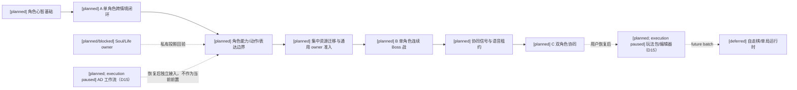
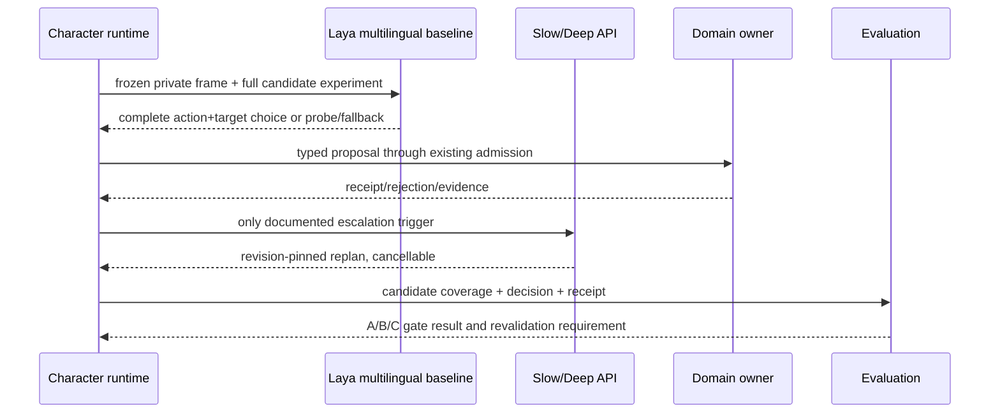
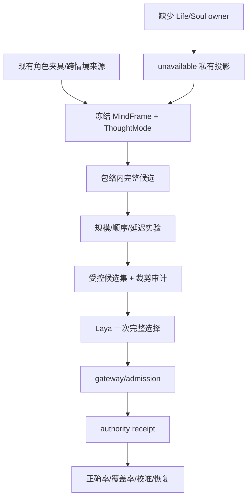

# 十月分析实施待决收敛与验证闸门

状态：`analysis/planned/non-authorizing`；本文件记录脑暴期间已经由用户收敛的实施选择、仍未冻结的实测参数和解除阻断所需的证据。它不新增运行时 owner、协议或实现权限。

设计路线、范围变化和延期项必须同步回写原始分析设计；登记见 [设计回写登记](../回写/README.md)。本登记中的 D01–D19 是执行选择，不替代原设计章节，也不代表已获得代码实施授权。

当前讨论范围按 D15 收敛为待决项1–6：Laya provider/checkpoint、候选与质量/微调、阿博评估档案、资源迁移、Life/Presence/Soul owner、B/C隔离场景。第7项通用编辑器控制面和第8项AD工作流由用户要求暂不处理；规格14/16、计划05/07暂不启动，不为本轮收集其专项证据或作为完成门禁。已有合格动作、角色/领域必要的权限校验仍按原合同使用。

### 2026-10-11 计划01 实施记录

Task 2A 已将现有 L1 self-body/percept 事件投影到 actor-private MindFrame workspace，并保留 unknown freshness/uncertainty；L2/L3 prepared request 可携带冻结 MindFrame。该接线仍使用 runtime 内存投影缓存，未把它升级为新的 event store 或 Laya provider 协议。Task 1B 的本机 `127.0.0.1:8765/health` 探针被拒绝；仓库外官方服务探针记录仍只证明上游协议/部署，不证明 backend gateway/admission 接入。专用 `/v1/systemone` adapter、真实取消/迟到结果和 choice/score/noul 语义继续保持 blocked。

## 1. 已收敛决策

| 编号 | 决策 | 已确定边界 | 仍需证据 |
|---|---|---|---|
| D01 | 算力位置 | 先检查本机可用本地 LLM；本轮调查未发现可用服务或已登记权重，因此慢思考与 Deep Model 先走 API。调查不是永久证明，后续可重新探测。 | provider 凭据、延迟、费用、失败与取消证据 |
| D02 | 验证顺序 | A 单角色跨情境心智闭环先行；B 单角色连续 Boss 战随后；C 双角色协同最后。B、C 都是必验，不得因先做 A 而裁掉。 | 三组独立留出集和对应运行证据 |
| D03 | 质量路线 | 先跑官方模型基线、校准输入和题目；关键决策仍不达标时，本批实施必要的领域微调。慢模型回退不能替代 Laya 完成。 | 质量指标、校准集、微调资源和训练证据 |
| D04 | 决策组织 | 首版一次选择完整“动作＋目标”候选。候选来自注册动作、可见目标、affordance 和执行合同。 | 实际候选注册表与 provider wire 适配 |
| D05 | 评估数据与真值 | 从现有四角色夹具和跨情境来源建立小而可审查基准，再用真实运行轨迹扩充。采用结构化可接受动作集合，允许多个合理的“动作＋目标”；教师或旧 L3 选择不自动是真值。 | 题目版本、场景划分、集合成员的人工审查记录、独立留出证据 |
| D06 | 资源迁移 | 采用集中切换（逐项代码、owner、兼容和证据边界见 [审查06](06-第四项通用资源集中迁移与兼容边界.md)）。角色主线完成后，一次性完成容量、锁定、透支、恢复、兼容迁移和完整验收，再升级已注册资源。 | owner 对 `capacity/base_capacity/locked/debt/recovery` 的字段映射和迁移证明 |
| D07 | Laya 部署 | 使用独立本地 `laya-serve`；backend 通过专用 adapter 调用回环地址的 `/v1/systemone`，端口按部署配置。接入设计已映射到现有持久 L3 provider stage，责任/顺序/取消恢复见规格01 §3.1.2，不新增 owner。 | 已取得固定官方 revision 的 WSL2/CUDA 服务健康与单请求协议探针及仓库静态接入映射；具体请求/候选映射待冻结，adapter 实现、真实 gateway/admission 调用、协议全量语义和质量验收待取得 |
| D08 | 升级策略 | 按情境升级。可局部解决的缺口由 Laya 选择观察、询问或低风险试探；复杂、高风险或持续无法解释才请求慢思考/Deep Model。原分析列出的失败、阶段变化、目标冲突等触发全部保留；不可用走 continuity floor。 | 触发回放、取消/过期和降级证据 |
| D09 | 官方基线 | A 阶段固定 `laya-multilingual`，先完成中文心智输入闭环；`typed-decisions` 后做独立对照，不混入首轮正式路径。 | 最终采用的 checkpoint revision、中文质量和校准切片 |
| D10 | 候选规模 | 正式采用受控候选集，但冻结预算前先做“包络内全部候选”实测。每个候选保持完整动作＋目标；裁剪原因、未入选项和候选覆盖率必须审计。分步“动作族→目标”仅作为后备研究路线，启用需重新批准协议变化。 | multilingual 规模、顺序敏感性、延迟、覆盖率和选择质量 |
| D11 | 生命/灵魂前置 | 角色先行。未准入的 `LifeState`、`EntityPresence`、`SoulAccessGate` 只能以权限过滤后的 unavailable/diagnostic 投影进入角色；不得假装拥有完整规则。真实 owner 准入后回验角色私有感知、表达和决策。代码/测试映射和缺口见 [审查07](07-第五项Life-Presence-Soul真实owner与角色投影边界.md)。 | 计划04的 owner/API/receipt/replay 证据 |
| D12 | B/C 验证载体 | 新建隔离的 Laya Boss/协同验收场景；不复用 `StreetCombatDemo`。动作底座沿用已在 `StreetCombatActorDemo` 验证的 Actor、动作库、Motor 和 authority 接入；新场景只新增 Boss/协同测试壳和 Laya 证据链。 | 新场景的 actor admission、Boss/协同 owner、Godot profile、模型轨迹与可见结果证据 |
| D13 | 阿博评估档案 | 新增仅用于四角色 Laya 评估的 authored `char_d` profile/dossier。它不自动创建 Godot 场景 Actor、不进入默认 roster、不替换已有身份；动作、资产、场景绑定和 backend active-control 另过 admission。 | `char_d` 字段来源、schema 映射、评估夹具和四角色对比证据 |
| D14 | 开放世界范围与自走棋搁置 | 本批只服务开放世界运行时。自走棋装备及其棋盘、单局回合、羁绊、offer/reward 适配属于尚未建立的单局运行时，本批关闭并标记 `[deferred]`；不进入当前执行顺序、前置门禁或完成条件。 | 未来重新启动时另立单局运行时范围、owner、spec、plan 和验证批次；本批不收集其 owner 证据 |
| D15 | 编辑器与AD暂不启动（2026-10-10） | 用户明确要求第7、8项暂不处理。规格14/16及计划05/07执行状态为 `paused-by-user`；共用计划05的玩法包任务也不在本轮1–6中单独启动。设计和待验收要求保留，暂停不表示完成或被技术阻断，不影响已有合格动作底座及角色/领域必要的权限边界。 | 用户后续明确恢复相应范围时再核对依赖与新鲜证据；当前不开展编辑器/AD专项调查、部署、实现或资格链取证，不作为1–6的开工或完成条件 |
| D16 | 两轨选择评估（2026-10-10） | 基础选择质量轨关闭原设计的受控概率性失误，只测输入/题目/候选正确时 Laya 对完整动作＋目标的选择；角色表现轨在相同失误前基线和固定 seed 规则下开启角色受控失误，独立记录证据变化、选择、表达和执行结果。两轨均保留 profile 的能力上限；表现轨错误不回写基础选择质量。 | 评估题型来源/审核记录、轨迹隔离、完整 U 与受控 P 的覆盖/规模/顺序/延迟、正式阈值冻结、最终留出和必要微调证据；未取得前不冻结生产质量门 |
| D17 | 迁移前 reservation 排空（2026-10-11） | 集中资源迁移开始前暂停新的资源承诺；已有 reservation 继续按原动作合同完成、consume 或 release。迁移流程不主动取消动作、不清空 reservation；仍有未结清 reservation 时迁移保持 `pending`，继续提供旧 schema/旧 consumer 所需的现状投影和诊断。 | reservation drain 的真实事件/receipt、超时与停机恢复证据；排空未完成时不得开放目标 schema 或新 consumer pin |
| D18 | Life/Presence/Soul owner 与角色投影（2026-10-11） | 当前仅有资源/身体、survival、profile activation、通用 entity causal projection 和角色 L1 continuity 基础；没有完整 LifeState、EntityPresence 或 Soul/identity owner。角色基础先行，缺 owner 时只允许权限过滤后的 unavailable/diagnostic；owner 准入后再回验角色感知、表达和决策。 | 真实 owner/API、事件/receipt/replay、隐私过滤、部分失败恢复和角色私有投影证据；缺失只阻断相关生命/生成/灵魂语义和依赖其的 B/C，不阻断角色基础 |
| D19 | B/C 隔离场景与真实边界证据（2026-10-11） | B 单角色连续 Boss、C 双角色连续协同都必须在新建隔离 Godot 场景中验证；`StreetCombatActorDemo` 只提供已验证 Actor、动作库、Motor、authority 底座，`StreetCombatDemo` 不提供 B/C 场景语义。模型只产生选择/提案，已准入 domain owner 提交结果，Godot 只负责本地具身/表现。A、动作底座、静态合同测试不能替代 B/C。 | 新场景 actor admission、Boss/协同 owner、真实 Laya→gateway/admission 请求、authority/owner receipt、replay/checkpoint、Godot boundary message 和可见结果；缺项只阻断对应 B/C 验收，不阻断角色基础或 A 准备 |
| RW-23 | 角色动作资产、Laya A 阶段与 package 替换 | 第二阶段只审计静态资产与替换合同。`StreetCombatActorDemo` 是动作底座/资格基线，不代表 Laya live 使用；当前 live 请求仅 `ingest_siming_output + env_lamp`，没有 Godot Actor、GLB、clip、contact marker 或领域 owner 参与。稳定 `actor_id`/profile/backend identity 和 `semantic_action_id`；GLB/skeleton/library/clip/marker 作为带独立 revision 的 package binding，活跃动作 pin 旧 revision，替换只在安全边界提交且失败保留旧 binding。正式动作只认 manifest；backend `short_punch` 是兼容语义，不自动 alias `unarmed_punch`。 | 审查09 矩阵；规格07/16；动作资产替换解锁条件：有效 actor/profile/backend identity/control mode；qualified package 与独立 binding revision；完整 `semantic_action_id + target_refs`；marker/slot/root/physics-contact evidence；原 owner route admission/receipt；可见 Godot boundary/Actor/Motor 结果；失败/取消/stale 零写入。缺项全部 blocked。 |

## 2. 动作族和候选边界

“动作族”只用于候选生成、能力包络和门禁分类，不是新的执行层，也不是战斗专属规则系统。正式实现必须先查现有注册表和 `CharacterExecutionContract`，不能直接把下列示例变成新 API：

```text
动作族：信息获取 / 位置与移动 / 防护与撤离 / 直接干预
具体动作：observe / ask_probe / reposition / protect_ally / retreat / attack ...
目标：角色、对象、位置或环境载体
```

完整候选仍是一次性比较的“动作＋目标”，并携带承诺时长、停止条件、失败回退和上下文版本。`allowed_action_families` 只能限制合法范围，不能替 Laya 在合法候选之间做主观取舍。

正式候选策略为：

1. 先生成 CapabilityEnvelope、ThoughtMode、可见目标和当前 affordance 允许的完整候选。
2. 在基线阶段保留合法全集 U 审计；只有全集可在角色呈现上限和模型协议内发送时才做完整输入实测，超限明确记录本题全集未送模。测量选项数量、顺序/label置换、token截断、延迟、概率稳定性和正确性，不能临时提高角色能力上限。
3. 生产路径使用受控候选集；裁剪必须记录原因、未入选项、原始候选摘要、envelope/policy digest 和候选覆盖率。
4. 候选覆盖质量与 Laya 选择质量分开验收；被裁掉的关键策略不能被计入模型正确率。
5. 在 A/B 实测无法满足质量或延迟前，不启用分步动作族选择。分步选择会新增两阶段版本、取消、置信度和一致性合同。

## 3. 验证顺序和回验







## 4. 尚未冻结的参数与阻断

以下项目不能由本登记文件代填：

- multilingual 的最终生产 Hugging Face revision、正式部署版本策略、真实上下文上限和角色 adapter 请求映射；本机探针固定了一个可复查 revision，但不自动冻结未来生产更新策略；
- 候选预算、顺序置换数量、正确率/校准/延迟阈值；阈值必须来自已注册 policy 或实测方案；
- 领域微调的触发阈值、训练切片、GPU/显存预算和是否采用 `freeze-encoder`；
- `ResourceEntry` 到 capacity/base_capacity/locked/debt/recovery 的 owner 映射与迁移版本；
- LifeState、EntityPresence、SoulAccessGate 的真实 owner、API、receipt 和回放路径；
- AD 的 Blender/MCP 实际运行链、外部资产与媒体来源及各阶段独立资格化证据保留为恢复后的缺口；D15已暂停当前处理，工程位置未知不是阻断。
- 通用玩法包 scope application 和编辑器控制面缺口保留至计划05恢复；population-specific能力仍不能代替通用编辑器，当前不启动专项取证。
- 隔离 Laya 场景的实际节点、Boss 规则 owner、协同通信接点和 Godot profile 字段；实施前必须读取现有 `StreetCombatActorDemo` 的可复用 Actor/动作/authority 边界，再在新场景内登记独立 actor。
- `char_d` authored profile/dossier 的具体字段来源、schema 映射、profile revision、评估夹具内容和是否有任何后续 active-control/场景 admission；在这些证据取得前，`char_d` 只能作为评估输入，不能声明为运行时角色或默认人口成员。

### 4.3 Laya 本机探针证据（2026-10-10）

- **官方来源/静态核验**：源码 [NandhaKishorM/laya](https://github.com/NandhaKishorM/laya) tag `v0.4.2` / commit `68804629e8ccd9d616d48a40e87de9fabbeae069`，Apache-2.0；权重 [convaiinnovations/laya-multilingual](https://huggingface.co/convaiinnovations/laya-multilingual) revision `1720e3e3357cfe1e281542e223f8273b0890ca34`，Apache-2.0，`model.safetensors` SHA-256 `9d628fd971b700382ac6f65920a86f149777b2e748e0c955fb3b19695aa8f204`。
- **本机真实执行**：仓库外隔离的 WSL2 Ubuntu 24.04 环境使用 torch `2.14.1+cu130`；RTX 4070 被 CUDA 识别。官方 serve 绑定 `127.0.0.1:8765`，`/health` 返回 `status=ok`、实际 `device=cuda`、checkpoint device 为 CUDA、CPU fallback 计数 0。真实中文 `POST /v1/systemone` 返回 200。
- **观察到的单题结果**：输入“当前观察：Boss 正在蓄力重击，队友在左侧且距离较近。请选择最合适动作。”，五个完整动作＋目标候选中模型选择 `attack_boss`，概率为 `0.6038`；首次请求约 787 ms，同输入五次热请求约 19.79–24.19 ms。该小样本不是候选覆盖、质量或性能验收；请求题及原始响应尚未经过人工可接受动作集合审核。仅建议作为开发集诊断用例候选，人工审核后才纳入开发集，不能进入校准或最终留出。
- **静态实现映射**：仓库 `CharacterModelGateway` 当前序列化角色请求，经通用 `CharacterModelProvider` 的生成式路径调用；未发现 Laya 专用 `/v1/systemone` adapter。现有 `CharacterModelRouter` 的 `local_only/hybrid_ready/online_default` 不提供所需的 Laya 服务映射。因此本探针没有走 backend gateway/admission，也没有复用仓库注册动作、真实 affordance 或执行合同生成候选。接入责任已收敛为 [规格01 §3.1.2](../规格/01-角色智能体心智运行时重构总规格.md#312-laya-与现有-gatewayadmission-的接入合同) 的持久 L3 纵切；现有 admission 只持久接受 Siming/后台两来源，staged job 的感知/自身四来源不能算持久恢复。非流式取消 Event 尚未传到 provider；driver 关闭可保留 `provider_pending`，不是永久取消。
- **证据等级与未完成门**：官方文档/许可证/revision 属上游静态核验；`/health` 与 POST 属真实本机执行证据；warm latency 只是观察值；输入/候选映射、经 gateway/admission 的实际调用、取消/迟到结果拒绝、正式阈值与 A/B/C 留出仍待后续任务。完整记录和权重缓存留在仓库外 `D:\\laya-probe-cache\\probe-evidence.json`、`D:\\laya-probe-cache\\laya-multilingual`，WSL 服务已停止。配置、官方 benchmark 和此单题响应均不能单独证明项目质量。

这些项目是对应能力的准入或验收条件，不是整批启动前必须全部消除的阻断。provider 协议在 adapter 冻结前取得证据；模型质量、场景表现和领域实现证据在对应任务中取得，不能要求先证明尚未实施的结果才允许实施。缺证据时保留受影响门禁未通过，不在 spec 中臆造默认值。

### 4.1 处理顺序与阻断范围

本表解释现有总计划和分计划的依赖，不新增执行权限或改变 D01–D16。规格/计划的用户审阅批准仍是运行时代码实施的入口；批准之后按各任务前置推进，不等待所有后续领域完成。Goal 仅在用户明确要求建立时使用，遵循 `docs/ai-engineering-workflow.md`，不是自动新增的批准条件。

| 待解决项 | 在哪项任务处理 | 缺失时实际阻断什么 |
|---|---|---|
| 当前角色实现映射、冻结回合和私有输入 | 计划01 Task1、2/2A、3、4/5，先读取当前签名，再按批准范围实施和验证 | 依赖这些输入的新 consumer；后续 Soul、编辑器或 B/C 尚未完成不阻断这一基础阶段 |
| Laya 官方源码/权重版本、本机部署、真实协议、慢/Deep 路由 | 计划01 Task1B；官方版本与 WSL2/CUDA 裸服务探针及静态接入责任已有证据（§4.3/§4.4）；输入/候选映射在 Task2A/1B 冻结，Task1A 实施后取真实 admission 实证；慢/Deep 按 D01 核验路由 | 不阻断角色投影和心智基础；尚未冻结的协议/输入映射限制 adapter 字段冻结，实施实证未取得限制 Laya 闭环通过；持久感知/自身来源未完成限制连续快循环，不要求事先通过质量/B/C/Soul最终门 |
| 阿博 `char_d` 档案与四角色题目 | 计划01 Task1C、计划02 Task1–3/6；按角色13 §12/§22映射现有 profile/dossier schema，在隔离评估夹具中登记来源和版本 | 四角色差异验收；不阻断 Task1 的代码映射或心智基础的实施，不要求先创建 Godot Actor |
| 候选预算、质量/延迟/校准门槛与微调 | 计划01 Task1C、计划02完整包络接入后的回验；按规格05 §4.2.2–4.2.3先规定 U/P、测量分母、两轨归因和冻结流程，再使用独立留出集判定；失败按 D03 处理必要微调 | 正式质量验收和生产候选配置冻结；不要求在部署和输入闭环之前证明最终模型质量；表现轨不得回写基础选择质量 |
| 资源集中迁移、Life/Presence/Soul owner | 计划04对应 Task；核对既有 owner，补齐来源支持的合同、字段迁移、receipt/replay 后实现并回验角色私有投影 | 新资源/生命/灵魂能力；角色基础先按 D11 提供 unavailable/diagnostic，不等待完整 Soul 功能 |
| B 单角色连续 Boss、C 双角色协同场景 | 总计划 Task6A、计划03 Task6A；在所需领域和角色能力准入后创建隔离场景，沿用 StreetCombatActorDemo 动作底座，依次取得 B/C 证据 | B/C 验收；不阻断 A 或角色基础开工，不能用 A 或动作底座通过替代 B/C |
| AD 的 Blender/GLB 资格链 | D15：规格16/计划07由用户要求暂不启动；恢复后再逐段核对取证 | 当前无专项执行门禁，不阻断1–6；依赖未资格化新动作的consumer不启用，已有合格动作可继续使用 |
| 通用玩法包应用与编辑器控制面 | D15：规格14/共用计划05由用户要求暂不启动，包含计划05的玩法包任务 | 当前不启动该阶段，也不作为1–6完成条件；角色与领域仍执行必要的权限校验 |
| 自走棋单局适配 | D14、规格15、计划06已关闭并延期 | 不属于本批阻断，不为本批收集其 owner 证据 |

### 4.2 `char_d` 的含义与来源

`char_d` 是本批为阿博评估档案选定的机器标识；阿博和四角色比较要求来自 [角色13 §12/§22](../角色/13-角色能力图谱、认知包络与动态算力设计.md)，标识及评估范围由 D13 收敛并已回写。当前 `assets/characters/profiles/` 有 `char_a`（林月）、`char_b`（乔任）、`char_c`（沈墨）；阿博档案仍是计划任务，不能因其他单元测试使用同名字符串就视为已实现。

原文对阿博的定位是工作记忆、因果推理和元认知较低，固定流程可靠；同一门锁事件中执行清单、停用入口、通知主管，默认 fast、最高 balanced，一跳推理。四角色测试因此要检查同一模型是否遵守不同角色的能力与人格边界，尤其是增加算力后仍不能突破阿博的能力上限。测试应比较结构化动作、证据、包络和成本，不能只比较最终文风。

处理方式是按 [规格05 §2.1](../规格/05-角色能力图谱、认知包络与动态算力规格.md#21-四角色评估档案与-char_d-admission-边界) 和 [第三项静态审查包](05-第三项阿博评估档案与四角色夹具.md) 在隔离评估夹具中准备 authored profile/dossier；逐字段引用设计与现有 schema，缺少语义依据的字段登记映射缺口，不凭空补人设或数值。本任务不要求模型资产、骨架、动画或场景 Actor，也不要求加入默认 roster 或取得 active-control。当前正式目录会自动发现 YAML，故 `char_d` 不能直接写入 `assets/characters/profiles/` 或 `assets/characters/dossiers/`。

自走棋相关 owner 不属于本批阻断：D14 已将单局运行时范围关闭并搁置。保留原始分析来源和第15号 deferred 规格只为可追踪性，不得为解除本批角色、通用领域或开放世界玩法包门禁而实现、探测或伪造其 owner。

### 4.4 gateway/admission 接入设计与验证分界（2026-10-10）

**已收敛的设计**：复用 `CharacterCognitionAdmissionService` → `CharacterCognitionCoordinator.prepare_l3` → durable `provider_pending` → `CharacterCognitionDriver` / existing provider slots → gateway / 专用 systemone adapter → `accept_l3` → `freeze_l3` / `resume_l3` → L3/L4 → 已准入领域 owner。choice 只能恢复冻结候选中的动作＋目标，参数来自注册合同；角色 `cognition_stage` receipt 与领域 authority receipt 分开。完整架构、时序、数据流和代码/测试映射见规格01 §3.1.2/§3.2/§4/§5；这是 D07 的细化，不重新开放部署路线选择。

| 阶段 | 必须取得什么 | 尚缺时限制的能力 |
|---|---|---|
| 实施前确认 | Task2A 的私有投影和候选来源；官方 wire shape 与当前 L3 request/completion 签名逐项映射；版本、expiry、恢复及显式取消的验证方案 | 对应 adapter 字段/合同冻结；角色基础代码映射和投影任务可先推进 |
| 实施中产生 | 专用 adapter/gateway route/choice validator；L3 候选映射与执行接线；非流式显式取消；同一 admission owner 所需的感知/自身持久来源扩展 | Laya 角色接入与连续快循环尚未具备；不以裸服务探针替代 |
| 验收时验证 | 实际 admission/request/response/stage receipt/replay；未知或失效 choice 拒绝；expiry/pin/revision 不匹配与显式取消后的零新效应；重试不延 expiry，停机恢复不重排候选、不重复提交；槽位随真实 worker 完成释放 | 接入/恢复验收门；服务端是否停止计算单独取证，不能用 shutdown Event 声称中断 |
| 后续独立门 | 正式质量/候选覆盖/校准/微调、完整包络回验及 A/B/C，分别按 Task1C/计划02/计划03验收 | 对应生产质量或场景能力，不反过来阻断基础阶段 |

显式取消终止原持久请求并保留 stale/diagnostic，停机按持久状态重新准入恢复；不得从旧 frame 偷交 continuity floor。旧 receipt 保留，允许的拒绝/释放诊断不计作新角色效应。现有 admission/coordinator/driver/completion 测试是回归证据，Laya 真实调用与世界结果仍须各自实证。本节仅修订设计文档，未实施 adapter 或更改运行时。

第一条动作执行纵切使用已准入 Siming 来源与允许执行的控制模式；辅助模式仍为建议。后台来源现有 `freeze_l3` 设置 `commands=[]`，`resume_l3` 完成后台结果，只验证选择/阶段恢复，不算动作执行通过。连续感知/自身来源扩展仍须单独取得持久准入证据。

### 4.5 第二项收敛与证据分界（D16/RW-17，2026-10-10）

第二项方法设计已收敛：来源/代码映射、完整U与受控P、结构化可接受集合、两轨归因、轨迹隔离、指标分母、开发冻结和必要微调触发详见 [规格05 §4.2.1–4.2.3](../规格/05-角色能力图谱、认知包络与动态算力规格.md#421-现有实现映射与完整受控实验边界)。上游固定版本的train CLI及probability标签/校准切分仅静态核验；未运行训练或正式题集。

计划启动前的静态准入包见 [04-第二项实施准入包与静态映射](04-第二项实施准入包与静态映射.md)。静态完成不表示真实 provider、正式 P、质量/延迟/校准阈值、必要微调或 final 验收已通过。用户于2026-10-11确认：允许执行对应 plan 时按证据逐项解锁，不要求开工前全部通过；本次仍只修订设计文档，不启动运行时代码。

解锁责任：计划01 Task1A/1B在接入实现后验证真实 gateway/admission、取消和迟到拒绝；Task1C及计划02包络回验在开发阶段确定候选预算、质量/延迟标准、校准方案及微调触发，并在 final 前冻结。只有输入/题目/候选正确仍不达标时才实施必要微调；独立 final 验收后才释放 Laya 质量门，A/B/C分别回验。执行本身不等于通过，未通过项只限制相应能力。

| 阶段 | 证据 | 缺失时限制 |
|---|---|---|
| 实施前确认 | 逐动作/目标来源与注册/执行合同、题型与审核流程、可接受集合、U/P评分分母、两轨和轨迹隔离方法 | 具体候选映射/评估数据合同；本文件方法已给出，实际正式资料仍须审核，不阻断角色基础 |
| 实施中产生 | 来源审核夹具、统一candidate compiler、U/P开发实验、预算/阈值及微调触发revision、必要训练/资源与独立校准recipe；char_d资料由第3项补齐 | 生产候选policy和数字门冻结、完整四角色评估；训练未实测不声称本机可行 |
| 验收时验证 | 冻结checkpoint/policy/输入与候选下的独立final两轨结果、真实延迟/超时、校准、取消/执行receipt、A回验及随后B/C | 正式模型质量、角色差异和对应场景通过；慢回退、上游benchmark或unit tests不能替代 |

### 4.6 第四项收敛与 reservation 排空（D06/D17/RW-18，2026-10-11）

第四项的字段和 owner 映射见 [06-第四项通用资源集中迁移与兼容边界](06-第四项通用资源集中迁移与兼容边界.md)。集中切换的迁移窗口采用以下顺序：

1. 迁移申请进入 `pending`，暂停新的资源承诺；现有 reservation 仍由原资源/动作 owner 处理。
2. 已有动作只能按原注册合同完成、consume 或 release；迁移流程不代替动作 owner 取消动作，也不直接清零 `reserved`。
3. 只有 reservation 全部结清、旧事件和 checkpoint 可重放且目标字段映射/receipt 已由 owner 证实，才可提交目标 schema revision 并开放新 consumer pin。
4. 发生超时、停机恢复或未知 reservation 时保持 `pending`，保留旧事实和诊断；不把等待状态解释为迁移成功，也不靠旧 projection 伪装目标字段已存在。

这条选择只限制集中资源迁移及依赖新字段的 consumer，不阻断角色基础主线或不依赖目标 schema 的既有合格动作。完整迁移仍须在计划04 Task3 的实施和验收证据中解锁。

### 4.7 第五项收敛与真实 owner 边界（D11/D18/RW-19，2026-10-11）

逐项代码、测试、合同、receipt/replay 和角色投影映射见 [07-第五项Life-Presence-Soul真实owner与角色投影边界](07-第五项Life-Presence-Soul真实owner与角色投影边界.md)。核对结果不是把设计名词升级为接口：

- `SurvivalAuthority` 只拥有 survival state/need/obligation；`ProfileActivationAuthority` 只拥有 profile activation、lock/pending、region assignment；两者都不是完整 LifeState 或 EntityPresence owner。
- `EntityCausalProjection` 只读重建已提交 entity/relationship/causal records；`RuntimeContinuityState` 只是角色连续性字段。二者不能作为新的生命、presence 或 soul writer。
- 未找到 Soul/identity owner、SoulAccessGate、灵魂事件或灵魂数值实现。`SoulAccessGate` 仍只属于原设计 planned 合同。
- 角色基础继续推进；缺 owner 时仅通过现有权限/可见性边界提供 unavailable/diagnostic 和 blocker。不能把未知解释为 alive、safe、可复活或允许灵魂写入。

| 阶段 | 必须取得什么 | 缺失时限制 |
|---|---|---|
| 实施前确认 | owner/API/事件清单、状态与身份边界、角色投影字段来源和 privacy scope | 不冻结 Life/Presence/Soul writer 或 wire schema；角色基础可继续 |
| 实施中产生 | 真实 owner admission、typed proposal、owner event/receipt、幂等、失败恢复、full/checkpoint replay 和过滤投影 | 继续 unavailable/diagnostic；不开放生命/生成/销毁/灵魂事实写入 |
| 验收时验证 | L01–L09、角色私有感知/表达/决策回验及 B/C 依赖场景证据 | 相关 owner/场景不通过；不反向否定角色基础或已有 survival/activation 合同 |

本项不重新打开 D14 自走棋或 D15 暂停的编辑器/AD专项。完整 Life/Presence/Soul owner 是对应能力的局部准入和验收门，不是整批角色基础开工前置。

### 4.8 第六项 B/C 隔离场景与真实边界证据（D12/D19/RW-20，2026-10-11）

逐项场景、Actor、Motor、authority、mirror、模型和可见结果映射见 [08-第六项B-C隔离Godot场景与真实边界证据](08-第六项B-C隔离Godot场景与真实边界证据.md)。

- `StreetCombatActorDemo` 只作为已查证的 Actor、动作库、Motor、authority 和资格化底座；`StreetCombatDemo` 的场景控制器和街战语义不作为 Boss 或协同验收载体。
- B 单角色连续 Boss 和 C 双角色连续协同都必须在新建隔离场景中验证。B 先于 C；A、动作底座和静态合同测试不能替代任一场景。
- 模型只能产生选择/提案；Boss/协同领域 owner 必须完成 admission 和 authority commit，Godot 只能消费已提交、过滤后的边界消息并做本地具身/表现。动画完成、生成音频或 mirror 发送不能反向生成世界事实。
- 实施前确认新场景 actor admission、实际 Boss/协同 owner、Laya→gateway/admission 协议和独立留出；实施中记录 request/response、owner/authority receipt、replay/checkpoint、boundary delivery/ack；验收时必须有连续 B/C 真实模型轨迹、失败/过期/拒绝负例和 Godot editor/runtime 可见结果。

缺少上述证据时只限制 B 或 C 的验收与生产声明，不阻断角色基础、A 准备或已资格化动作的独立维护。没有 Godot 运行证据时标记 `static-only`/`editor-unverified`，不降级为场景通过。

### 4.9 第二阶段环境解阻与 live admission 取证（2026-10-11）

**连接方案：A，Windows backend 访问 WSL localhost forwarding。** WSL 使用 NAT，WSL IP `172.20.1.66` 从 Windows 直连 `:8765` 超时；WSL 自身 loopback 可访问，且服务绑定固定为 `127.0.0.1:8765`。启动后 Windows `Test-NetConnection 127.0.0.1 -Port 8765` 成功，Windows `GET /health` 返回 200。选择 A 可保留固定服务监听边界，不需改绑地址或改 backend endpoint。运行环境为 Windows 11 backend（Python `C:\Anaconda3\python.exe`）与 WSL2 Ubuntu 24.04.4；WSL Laya source commit `68804629e8ccd9d616d48a40e87de9fabbeae069`，权重 revision `1720e3e3357cfe1e281542e223f8273b0890ca34`，权重文件 SHA-256 `9d628fd971b700382ac6f65920a86f149777b2e748e0c955fb3b19695aa8f204`。Torch `2.14.1+cu130`，实际 device 为 NVIDIA GeForce RTX 4070 / CUDA；认证 `/health` 报 `loaded=[multilingual]`、checkpoint device `cuda`、CPU fallback count `0`。Windows 与 WSL Python 使用 WSL/Windows localhost forwarding；没有更改 WSL IP 或防火墙/端口策略。

**真实链路进度：部分通过，阶段仍 blocked/unverified。** Windows backend 使用当前工作树既有冻结 `LayaSystemOneProvider`，完成 admission、durable `provider_pending`、L3 frozen request、Windows 到真实 WSL `/v1/systemone` 的 200 响应、`accept_l3`、`freeze_l3`、`resume_l3`。source key 为 `character-cognition:ed31fde9f60e143cbb0005dc45dd8f0bfc8431c6acdbc14feb7070f7506c81df`，admission expiry 为 `200`，provider revision 为 `laya:68804629e8ccd9d616d48a40e87de9fabbeae069:1720e3e3357cfe1e281542e223f8273b0890ca34`。冻结 L3 request 中有 15 个有序候选；当前合同没有单独 `candidate_digest`/`frame_digest` 字段，原始证据保留 `candidate_intents`、`context_ref.digest` 和 `l3_prepared_ref.digest`，不虚构缺失的 digest。实际响应及冻结 request、候选、阶段进度/receipt、activation receipt 保存在仓库外 `D:\HarnessEvidence\phase2-live-admission-20261011\live-chain.json`；Windows backend 请求运行脚本和完整 pytest 输出也在同一目录。不得把 focused provider/coordinator 测试算作 live 证据。

本来源在 `resume_l3` 后为 `stage_ready`，没有获准的领域 action owner admission/commit，因此没有领域 owner receipt；JSON 中的 `owner_receipt` 是 activation lock receipt，不能替代领域 owner receipt。未完成 L4/领域提交，也未通过真实链路完成显式取消、超时、旧 revision、迟到结果、provider 不可用五项负例及其零 effect/intent/owner commit/writeback 断言。不能将此记录声明为目标完整 admission 闭环通过。此前启动服务出现的 HTTP 404 根因在 Laya 请求模型字段未设置；以现有认证 health 显示的 `multilingual` 注册名核对后，冻结请求真实返回 200，全程没有更改 adapter 或 wire schema。

### 4.10 第二阶段资产复用与动作可替换准入（RW-23，2026-10-12）

静态盘点和逐 package/action 缺口见 [09-资产复用与动作可替换准入矩阵](09-资产复用与动作可替换准入矩阵.md)。`StreetCombatActorDemo` 只提供现有 Actor/Motor/动作库和资格基线；本批 Laya live 链仅为 `ingest_siming_output + env_lamp`，没有 Actor/GLB/clip/contact marker/领域 owner 执行。静态场景、资格 manifest 或 contract tests 均不能被记为 Laya 动作 live 通过。

动作替换只改变 package binding，不改变 `actor_id`、角色档案、backend identity、`semantic_action_id`、原 owner route、目标合同或权限。binding 必须有独立 revision；活跃动作固定旧 revision，替换在动作终态/取消/失败或其他既有安全边界提交。新 package 需完成 skeleton/retarget、动作、marker、root motion、slot、physics/contact evidence、qualification/admission；失败保留旧 binding。当前没有完整替换事务和独立 binding revision，故 replacement capability 为 planned/blocked。`short_punch` 仅是现有 backend 兼容语义；正式资产动作依据 manifest 实际 ID，包括 `action:melee.unarmed_punch`、`action:melee.sword_slash` 与已登记 locomotion/presentation。无明确迁移合同和资产证据，不 alias short punch。

下一轮 Laya live 资产最小门为：固定 actor/profile/backend identity/control mode；候选具备已注册语义 ID 和 `target_refs`；package qualification 与 revision pin 完整；contact/physics evidence 可追溯；既有 owner route 完成真实 admission/commit receipt；Godot 边界消息和 Actor/Motor 可见结果关联同一动作；拒绝/取消/stale 负例证明零写入。未满足条件不得发动作执行请求。AD、编辑器、自走棋和 B/C 场景执行继续按既有暂停范围 deferred。

**动作候选与 owner 静态映射（本轮只读）**：原请求实际为 `ingest_siming_output`、`agent_full_auto`，actor `char_a`；provider revision 固定为上文 multilingual pins，候选有序列表为 15 个无目标的意图字符串，选择 `observe`。admission 中 `producer_ts=300`、`expires_at=200`，输入自身已过期；该旧输入只用于审计既有证据，不能重放执行。计划01 Task1A 要求首条动作纵切使用已准入来源和允许执行的 control mode，这两个值满足来源/模式类别，但并不满足可执行候选要求。

当前 L3 `_generate_candidates` 产出意图字符串；候选不是已注册完整“动作＋目标”。L4 `CharacterAgentL4Executor` 将 `observe` 映射为 `action:observe`，但没有已准入的领域 action owner 写入/receipt；`inspect_object` 同样没有从现有 registry 到领域 owner 的完整合同。现有近战映射 `short_punch -> action:melee.short_punch` 可到 `EmbodiedAuthoritySettlementService.settle_street_combat`，该 ESM owner 要求合格 Actor/目标、显式 `ActionAttempt`、接触 marker/tick/digest、physics pose 和 transport sequence；不是低风险观察动作。既有注册动作库中的剑击/拳击也有接触及资格前置，不能从 `env_lamp` 输入推导目标或伪造 evidence。故本轮按计划 Task1A 第4项停止 live 动作尝试；缺口是冻结完整候选及目标、由现存合同生成 `CharacterExecutionContract`、L4 exact mapping、真实领域 owner admission/commit ingress 的端到端连接。没有新增 owner、动作、权限、候选字段或协议。候选与 owner receipt 的只读映射摘要见本节；原始输入留在仓库外 `live-chain.json`。

**Live 负例状态**：本轮开始复核时 Windows `127.0.0.1:8765/health` 为连接拒绝，WSL Ubuntu 发行版已停止；唤醒后只读确认官方 checkout 与权重缓存仍在，但 `8765` 没有监听，未重新启动模型服务。五个案例均未通过真实 live admission 本轮验证，不用 unit tests 或旧 receipt 替代：

| 案例 | 状态 | 本轮证据/缺口 |
|---|---|---|
| 显式取消 | `unverified` | 没有真实 provider pending 时取消并核对 stale/诊断 receipt 与零 cognition/L4/owner/writeback 的 trace。 |
| provider 超时 | `unverified` | 没有经真实 admission 的超时 provider 调用及后置零写断言。 |
| 旧 provider/frame/policy revision | `unverified` | 没有本轮 live response 与变旧 pin 的 admission 拒绝 receipt/零写 trace。 |
| 取消或 expiry 后迟到结果 | `unverified` | 没有真实 late worker completion 与 admission 拒绝的关联 trace；不声称服务端停止计算。 |
| provider 不可用 | `unverified` | 服务未监听时尚无一条经真实 admission dispatch 的 provider unavailable/rejected receipt。 |

允许的 stale/rejected/diagnostic receipt、无新 cognition effect、无 L4 提案、无领域提交和无 writeback 尚未由本轮 live 证据共同证明。当前实现/测试的静态合同不能填补此证据缺口。

**全量失败分类：旧轮原始输入缺失；本轮有新鲜失败输出。** 检查仓库、`D:\HarnessEvidence` 和临时输出，未找到所述 `7821 passed、2 skipped、4 failed` 旧轮原始输出或 traceback，故不能提取/复跑其四项。可找到的 2026-10-01 日志 `7240 passed、2 skipped、1 failed` 是另一轮，不用于代替。本轮同一 dirty 工作树的 `python -m pytest -v` 于 2026-10-11 结束，退出码 1，结果 `7820 passed、2 skipped、5 failed、103 warnings`，全日志为 `D:\HarnessEvidence\phase2-live-admission-20261011\pytest-full-v.log`。以下五项按相同收集到的完整 node id 单独重跑，摘要为 `4 failed、1 passed`，日志为 `D:\HarnessEvidence\phase2-live-admission-20261011\rerun-current-failures.log`：

| 本轮失败测试 | 单项复跑 | 分类与依据 |
|---|---|---|
| `backend/tests/test_character_actor_scene_convergence_static.py::test_current_scene_shape_matches_the_frozen_host_choice` | failed | 测试要求精确子串 `[node name="CharacterActor" type="CharacterBody3D"]`，当前/HEAD 场景根行在 `CharacterBody3D` 后还包含 `groups=["character_control_actor"]`，导致字符串断言失败；这是静态文本断言与当前 HEAD 序列化行的差异，不是节点缺失。被测场景、测试文件与 HEAD 相同（`git diff HEAD -- <paths>` 为空），无本轮改动来源。 |
| `backend/tests/test_character_locomotion_motor_ownership_guard_static.py::test_phase0_fallback_locomotion_uses_the_motor_and_reports_real_directional_motion` | failed | 共享同一 `CharacterActor.tscn` 精确子串断言和同一 HEAD 根行差异，不重复计为第二个运行时缺陷。motor/controller 之前的静态断言均已通过；未做 Godot runtime 推断。 |
| `backend/tests/test_character_dialogue_streaming.py::test_websocket_dialogue_waits_for_background_activation_lease` | full run failed; 6 focused executions passed | 新鲜单项执行 5 次均通过，随后 dialogue streaming 文件 11 项全通过；全量原始失败 ACK 为 `accepted=false`。当前路径在 activation lock conflict 后按最多 20ms 间隔同步等待，直到获锁或 60s deadline；释放 timer 为 200ms。复测显示非确定性，但未重现失败，也未观察锁/ACK 的失败 trace，故竞态根因未证实，不能以单次通过认定解决。 |
| `backend/tests/test_phase1_external_character_delivery_contract.py::test_knight_actions_are_explicitly_unavailable_during_replacement_attempt` | failed | 当前/HEAD active manifest 与 action-timing 均声明 `runtime_action_status=available`，测试预期 `unavailable`；两份资产输入及测试均无工作树 diff。这是 HEAD 数据与静态期望不一致，非本轮变更。 |
| `backend/tests/test_phase1_external_character_delivery_contract.py::test_delivery_copy_references_preserve_original_source_identity` | failed | 当前/HEAD manifest digest 与 delivery GLB 是 `54df93c9…5f4587b85c908`，归档 `.blend` digest 是 `22a7cf93…f91de9beac681`；输入/测试无工作树 diff。失败证明 HEAD 声明的派生 GLB 不等于归档源文件，不证明当前轮改动；本轮未改资产或测试。 |

Laya focused provider/coordinator/driver 回归本轮新鲜重跑为 `55 passed`，dialogue streaming 为 `11 passed`。受影响五个 node id 本轮新鲜重跑为 `4 failed、1 passed`（dialogue 单项 1 passed），dialogue wait 单项再执行 5 次仍全部通过。旧轮 `7821 passed、2 skipped、4 failed` 的原始输出仍不可追溯，不使用别轮日志替代。四项可定位为 HEAD 既有静态合同/数据差异；dialogue 仍是未复现的非确定性失败。本轮全量 pytest 新鲜运行仍为 `7820 passed、2 skipped、5 failed、103 warnings`；适用 `model-provider-readiness` Harness profile 新鲜通过（报告已导出到外部证据目录），但这不替代缺失的动作 owner receipt 或五项 live 负例。阶段整体保持 `blocked/unverified`。

### 4.11 第二阶段门禁本轮复核（2026-10-12）

本节登记本轮新鲜证据，覆盖范围仅为 Laya live 负例、动作执行准入映射和全量失败归因；不修改 wire schema、provider revision、adapter、动作合同或测试。仓库外证据根目录为 `D:\HarnessEvidence\phase2-live-negative-20261012`，与此前 `D:\HarnessEvidence\phase2-live-admission-20261011\live-chain.json` 分开保存。固定环境 pins 仍为 source `68804629e8ccd9d616d48a40e87de9fabbeae069`、provider/weight revision `1720e3e3357cfe1e281542e223f8273b0890ca34`、weight SHA-256 `9d628fd971b700382ac6f65920a86f149777b2e748e0c955fb3b19695aa8f204`。

**Laya live 负例：全部 `blocked/unverified`。** 本轮按 Windows backend、WSL localhost forwarding 和固定 revision 尝试启动服务；网络启动为 `Errno 101 Network is unreachable`，离线启动因固定 revision 的本地 snapshot/checkpoint 缺失失败（`model_files=0`），Windows `127.0.0.1:8765` 随后 connection refused。未建立真实 L3 cognition admission，因此没有用 focused adapter/provider tests 替代 live 证据。五项均缺少对应真实 receipt/diagnostic 以及“无新 cognition effect、无 L4 execution proposal、无 domain owner commit、无 memory/cognition writeback”的共同断言：

| 负例 | 本轮状态 | 仍缺失的 live 证据 |
|---|---|---|
| 显式取消 | `blocked/unverified` | pending admission、取消 receipt/diagnostic 和零写 trace |
| provider 超时 | `blocked/unverified` | admission 后真实 provider timeout 与终态零写 trace |
| 旧 provider/frame/policy revision | `blocked/unverified` | stale-pin rejection receipt 与零写 trace |
| expiry/取消后的迟到结果 | `blocked/unverified` | late completion 与取消/expiry 拒绝的关联 trace |
| provider 不可用 | `blocked/unverified` | 真实 dispatch 后的 unavailable receipt |

**动作执行准入映射：当前无可执行动作。** 按审查09唯一矩阵逐项核对，`action:melee.unarmed_punch` 与 `action:melee.sword_slash` 虽有 manifest/clip 和 `owner route=esm` 的静态声明，但均没有完整 `target_refs`、可见目标/affordance、`CharacterExecutionContract`、既有 owner admission/receipt、binding revision、contact/physics/pose evidence、transport pins 及 replay/checkpoint 链。骑士 preview 的 `inspect_relic` 不能作为 Laya 执行动作。缺失链条不创建新 owner、不修改合同、不转成 live admission，也不进行正式 Laya 质量评分。

`short_punch` 继续保持 backend compatibility semantic `action:melee.short_punch`，不是资产动作，不自动 alias 到 `unarmed_punch`。候选编译器在无合法目标、unknown/blocked action 或非法 action family 时只输出诊断/观察/询问路径，不生成完整“动作＋目标”候选，不正式评分；本轮未改变该实现。

**本轮验证结果和失败归因：** Laya provider/coordinator/driver/wait focused run `64 passed`；资产/动作合同静态 run `38 passed、2 failed`，失败仍为 knight manifest `runtime_action_status=available` 与测试预期 `unavailable` 的 HEAD 数据差异，以及 delivery GLB digest `54df93c9…5f4587b85c908` 与 archive source digest `22a7cf93…f91de9beac681` 不一致。五个当前失败节点组合复跑为 `5 failed`；其中两个 CharacterActor 场景 substring 失败、两个 Phase 1 manifest/digest 失败，dialogue 竞态本次失败。dialogue 节点随后独立复跑 5 次为 `4 passed、1 failed`，仍为未复现稳定修复的非确定性失败。

本轮新鲜 `python -m pytest -v` 为 `7821 passed、2 skipped、4 failed、104 warnings`，退出码 `1`；四个失败正是上述两个 CharacterActor 静态 substring 和两个 Phase 1 manifest/digest 节点。旧轮同为 `7821 passed、2 skipped、4 failed` 的原始输出仍不可追溯，不能用本轮日志冒充旧轮证据。`model-provider-readiness` Harness profile 本轮新鲜通过且 cleanup passed，但 provider readiness 报告仍将真实 provider/admission 标记为未验证/缺凭据，不解除本节任何 live 或动作 owner 门禁。

本节新增证据摘要为 `D:\HarnessEvidence\phase2-live-negative-20261012\phase2-live-negative-summary.md`。阶段状态继续为 `blocked/unverified`；B/C、AD/Blender/GLB 新资格化、玩法包、编辑器、自走棋和新领域 owner 仍不启动。

### 4.12 第二阶段 CandidateCompiler/L3-L4 收敛（2026-10-12）

本轮把现有 `CandidateCompiler` 接入 L3 prepared request 生成路径，未创建第二套 candidate registry、planner 或 execution contract。编译流程先形成合法全集 `U`，再按 `CapabilityEnvelope`、`CognitionPolicy` 和 affordance 形成受控集合 `P`；冻结候选保留 `candidate_id`、`semantic_action_id`、`target_refs`、目标 visibility/provenance、affordance 结果、现有 `CharacterExecutionContract` 映射、owner route、source/frame/policy/revision pins，以及 blocked/unknown/cropped diagnosis。无合法目标时只保留 `observe`、`ask_probe`、合法诊断或空可执行集合；不得从 `attention_target`、当前玩家或默认 Actor 补目标，且该题不进入正式动作选择质量分母。

真实 `/v1/systemone` wire schema 未修改。provider 继续发送已验证的字符串 criteria/choice labels；backend 保存 wire label → frozen `candidate_id` 和 candidate_id → 完整动作＋目标描述，并在 evidence 中保留候选顺序、mapping digest、provider revision 与 expiry。Laya 返回 unknown、重复、顺序不一致或 revision 不一致的 label，或目标已失效时，均拒绝还原；Laya 不能生成动作参数、目标、停止条件、回退参数或 owner 事实。

L3 output validator 消费冻结映射并保留 candidate digest；L4 只接受仍合法的 semantic action、target refs、contract revision、policy/envelope pins，拒绝 stale/invalid target、撤权、不可见目标、过期 revision、能力超限和缺少必要 affordance。L4 保留完整动作＋目标，但现有 owner admission 链仍不存在，故 adapter 结果停在 `owner_admission_missing`/diagnostic，不生成 `ActionAttempt`，也不进入真实动作执行。该实现边界不改变原设计语义；仍没有 owner receipt、replay/checkpoint 或 Godot boundary live 证据。

本轮相关 focused tests 共 `178 passed`；该数字只证明静态合同和单元边界，不替代 owner/live 证据。全量 pytest、B/C、玩法包、编辑器、自走棋、AD/Blender/GLB 和 `unarmed_punch`/`sword_slash`/`short_punch` 执行门禁保持原状态。

### 4.13 学习证据、动作承诺与四角色评估准备（2026-10-12）

本轮复用现有 `SkillEvidenceStore`、learning gate、candidate store 和 `SkillLearningSettlement`。学习阶段固定为 `available → noticed → observed → imitated → structured → practiced → operational → stable → integrated → personalized → complete → evolved`，允许停留、回退和重新进入 `practiced`；证据投影只接受八个 mastery 维度和七个 difficulty 因子。缺少 source refs、隐私 scope 不匹配、evidence 过期或 store 中已有相同 evidence id 时 fail-closed；失败证据只保留 failure refs，不改变 profile。upgrade/branch/mutation/fusion/evolution proposal 没有现有 owner settlement 时不产生 revision；accepted owner event 才推进 skill revision。

`CharacterExecutionContract` 继续是唯一承诺合同，区分 intent、request、execution、actor feedback 和 authority result，并冻结 semantic action、targets、commitment/preconditions/abort/fallback、context/target revisions 和 expected observations。stale target/revision、expired commitment、revoked grant、interrupted、owner rejection、missing feedback 和 late result 都拒绝或进入 typed recovery。L4 提供 `ActionIngressResult`：没有 owner admission/route 时只返回 `blocked/owner_admission_missing` diagnostic，不创建 `ActionAttempt`；即使 owner 存在，缺少 physics/contact evidence 也保持 blocked。未开启任何近战动作。

四角色夹具已在 `backend/tests/fixtures/character_evaluation/` 固定：char_a/b/c 使用已有来源，char_d 只存在于隔离 authored fixture，不进入正式 profile/dossier loader、default roster、Godot Actor 或 active-control。题目字段包含 source ref、frozen frame、visible evidence、U/P、acceptable action set、target/visibility、scenario split 和 provider/checkpoint pins；acceptable action set 允许多个合理动作，教师答案、旧 L3 和慢模型不自动是真值，基础选择质量轨保持关闭 controlled error，表现轨独立使用固定 seed。无合法 target 的题目不进入动作选择质量分母。

focused learning/settlement、commitment/recovery、candidate/L3/L4、Laya adapter 和四角色 fixture 测试合计 `59 passed`（本轮新增契约覆盖；不替代 live evidence；不包含相邻 skill catalog 的 6 个目录测试）。本机 `127.0.0.1:8765` 当前 connection refused，固定 checkpoint/cache 不可用，故真实 Windows→WSL `/v1/systemone` positive mapping、provider_pending/accept_l3/freeze_l3/revision/expiry 证据本轮为 `blocked/unverified`；focused mock HTTP 仅证明 adapter 的 mapping/rejection contract。

全量 `python -m pytest -v` 本轮新鲜结果为 `7831 passed, 2 skipped, 7 failed, 104 warnings`，退出码 `1`；7 项单独复跑均稳定失败。失败分为：两个 CharacterActor 场景静态 substring 断言（当前 HEAD 场景根行带额外 groups 属性）、两个 Phase 1 资产 manifest/digest 输入差异（knight action 状态与 delivery/archive digest 不符）、两个 runtime continuity 旧测试合同（仍要求旧的 `observe_target` 推荐名，以及无 target 的 `share_info` 执行；当前候选/L4 按 target fail-closed）、一个 street combat transport 旧动作回执合同（仍要求 `short_punch` execution receipt；当前 owner ingress blocked）。没有新增测试迎合资产或改动用户 dirty Godot/资产文件；上述失败均保留为当前工作树待决项，未把 focused 通过升级为全量通过。

### 4.14 第二阶段最终复核（2026-10-12）

本轮恢复并验证固定 Laya 输入：source commit `68804629e8ccd9d616d48a40e87de9fabbeae069`、checkpoint revision `1720e3e3357cfe1e281542e223f8273b0890ca34`、artifact SHA-256 `9d628fd971b700382ac6f65920a86f149777b2e748e0c955fb3b19695aa8f204`、大小 `643835514` bytes。Windows backend 经 WSL localhost forwarding 取得 `/health=200`、`loaded=[multilingual]`、checkpoint device `cuda`、CPU fallback `0`、Windows `127.0.0.1:8765` 可达和真实 `/v1/systemone=200`；服务已停止并释放端口。

CandidateCompiler 生成并冻结 `observe`、`self_protect`、`ask_probe` 三个非动作候选，顺序固定，mapping digest 为 `sha256:8544699fee1956eab5d15d3e20c2e9cec40e39b4a9f9d8493e7bf17870bbf93c`。真实 Laya 返回 `ask_probe`；`provider_pending → accept_l3 → freeze_l3 → resume_l3` 完成，wire label、candidate、顺序、digest、expiry 和 provider revision 均被校验；unknown、reordered、stale mapping 均拒绝。该证据只证明 L3 positive mapping，不证明动作执行或 owner receipt。

固定 artifact 下五项 live negative 均通过：explicit cancel、provider timeout、stale provider/frame/policy revision、expiry/cancel 后 late result、provider unavailable。每项负边界后 event delta 为零，没有 cognition effect、L4 proposal、execution、owner commit、writeback 或 ActionAttempt。证据为 `D:\HarnessEvidence\phase2-live-negative-20261012-recovered\phase2-live-negative-recovered-summary.md` 及关联 JSON。

四角色 fixture 仍未进入正式评估：`char_a/b/c` 使用现有来源，`char_d` 仅隔离 authored fixture；manifest 仍为 `evaluation_fixture_only`，checkpoint 为 `laya-checkpoint:unverified`，policy 为 `policy:unfrozen`，calibration/final split 为空，acceptable action set 为 `pending_source_review`。因此没有质量阈值、独立留出或必要微调结论，不能解除正式 final quality gate。

动作 owner ingress 保持 `no executable Laya action`。`action:melee.unarmed_punch`、`action:melee.sword_slash` 仍缺完整 target/visibility/affordance、L4→ActionAttempt、owner receipt、binding/transport pins、physics/contact、replay/checkpoint 和 Godot boundary；本轮未执行两者或 `short_punch`，未新建 owner、未 alias。

七项旧失败已分类并最小修订测试合同：CharacterActor 根节点断言接受 Godot 序列化的 `groups` 属性；knight manifest 断言跟随当前已资格化的 `available` 状态；delivery GLB 与归档 `.blend` 按独立 provenance 校验，不伪造 digest；continuity floor 使用统一 `observe`；无冻结 target 的旧 `share_info` fixture 改为无目标观察；street combat receipt 断言当前 `self_protect`，并明确不产生 `short_punch`。此前一次全量运行曾得到 `7838 passed, 2 skipped, 104 warnings`，但本轮为新鲜证据的 `python -m pytest -v` 得到 `7837 passed, 2 skipped, 1 failed, 103 warnings`，失败为 `test_websocket_dialogue_waits_for_background_activation_lease`；该测试随后单项复跑为 `1 passed`，因此当前分类为非确定性 dialogue streaming failure，pytest full gate 仍未 clean。

本轮新鲜 Harness：`model-provider-readiness`、`embodied-interaction-contracts`、`character-behavior-evaluation`、`character-policy-calibration` 均通过并 cleanup passed。`model-provider-readiness` 仍将部分 provider 标为 `http_configured_unverified` 或缺凭据；它与已取得的固定 Laya live mapping 证据分开计。后两个只证明评估/verifier 结构，不提升 fixture 为正式 final 质量证据。综合结论：A 最终验收仍为 `blocked/unverified`；B/C、玩法包、编辑器、自走棋、AD/Blender/GLB 保持关闭。

### 4.15 第二阶段剩余验收收口（2026-10-12）

四角色评估前置审计现已 fail-closed：`char_a/b/c` 来源可追踪，隔离 `char_d` 的 profile/dossier/sources 也纳入 source pins；`char_d` 仍未满足正式 profile/dossier schema，且不进入 loader、roster、Godot Actor 或 active-control。provider revision、checkpoint revision 和权重摘要固定，但 frozen MindFrame、visible evidence、完整 U、controlled P、合法 target、acceptable action review、policy/questions/candidates/thresholds/calibration method 以及 calibration/final/independent holdout 均未物化。development/calibration/final/holdout 没有运行，provider calls 为 0，final labels 未读取，微调结论为 `not_assessable`。计分严格排除无合法 target、输入/题目错误、fallback、timeout 和 slow-model 命中；`legal_target` 只接受布尔 `true`。因此 **A-Cognition 仍 blocked**，不能把正向 provider/CandidateCompiler 或 focused 测试写成质量通过。

dialogue 全量失败已通过受控调度确认竞态：background/Siming 的 activation lock 在 `coordinator.begin()` 与 non-player 判断之间释放，旧顺序会错误拒绝；foreground 仍应拒绝。修复将冲突分类与 begin 放在同一 owner command，并保留 lease release。修复后 dialogue/生命周期/lease/handoff focused 为 `92 passed`，回归覆盖 background/Siming 接受与 foreground 拒绝；修复后的全量 `python -m pytest -v` 为 **7853 passed, 2 skipped, 106 warnings**，退出码 0。此前单项五次通过不作为 full gate 证据，当前 full gate 已有新鲜 clean 结果。

**A-Embodied 仍 blocked**：没有 target-enabled executable Laya action、`ActionAttempt`、owner receipt、physics/contact、replay/checkpoint 或 Godot boundary；本轮未执行 `unarmed_punch`、`sword_slash`、`short_punch`，没有创建新 owner。B/C、玩法包、编辑器、自走棋、AD/Blender/GLB 继续关闭。

最终适用 Harness 四项均 passed，且各自 cleanup passed；证据分别导出到 `D:/HarnessEvidence/stage2-final-model-provider-20261012`、`stage2-final-embodied-20261012`、`stage2-final-behavior-20261012`、`stage2-final-calibration-20261012`。四角色 preflight 诊断在 `D:/HarnessEvidence/stage2-final-evaluation-20261012`，cleanup passed。`git diff --check` 无空白错误；`git status --short -- .harness` 为空。Harness 静态合同不解除上述两个 A 子门。

四角色准备包已落在 `backend/tests/fixtures/character_evaluation/four_role_preparation/`，由 `scripts/verification/prepare_character_evaluation.py` 生成诊断输入。修复脚本缩进后，准备包合同测试 `9 passed`，与四角色评估、CandidateCompiler/L3/L4、dialogue 回归组合为 `124 passed`。准备包生成 8 个 trajectory group、development/calibration 各 4 条、四角色共 32 条冻结输入，完成 MindFrame、visible evidence、独立 U 对照、controlled P、候选顺序和 revision pin；final/independent holdout 标签仍未读取，provider calls 为 0。准备包的 target 仍是 authored fixture，runtime legality 为 `unverified`，因此不改变 A-Cognition 或 A-Embodied 的 blocked 状态。

### 4.16 准备包变更后的最终验证（2026-10-12）

准备脚本缩进修复后，最新工作树完整 `python -m pytest -v` 已重新运行，收集到 `7862 passed, 2 skipped, 106 warnings`，退出码 0。该结果覆盖四角色准备包新增测试及其依赖，不沿用先前的 `7853` 统计。准备包、四角色评估合同、CandidateCompiler/L3/L4 与 dialogue 组合回归为 `124 passed`；准备包和评估合同单独回归为 `21 passed`。

最新四项 Harness 均通过并 cleanup passed：`model-provider-readiness`（证据 `D:/HarnessEvidence/stage2-final-preparation-provider-20261012`）、`embodied-interaction-contracts`（本轮临时目录已清理）、`character-behavior-evaluation`（证据 `D:/HarnessEvidence/stage2-final-preparation-behavior-20261012`）和 `character-policy-calibration`（证据 `D:/HarnessEvidence/stage2-final-preparation-calibration-20261012`）。这些 Harness 证明结构和合同检查，不改变四角色正式 calibration/final/holdout 未运行或 A-Embodied 缺少 live owner 链的结论。

## 5. 来源和关联

- [四域统一架构与执行顺序总规格](../规格/00-四域统一架构与执行顺序总规格.md)
- [角色智能体心智运行时重构总规格](../规格/01-角色智能体心智运行时重构总规格.md)
- [角色能力图谱、认知包络与动态算力规格](../规格/05-角色能力图谱、认知包络与动态算力规格.md)
- [角色回合编排与 L1-L4 生命周期规格](../规格/02-角色回合编排与L1-L4生命周期规格.md)
- [通用资源状态效果影响源与装备领域规格](../规格/10-通用资源状态效果影响源与装备领域规格.md)
- [生命连续性关系状态与动态行为规格](../规格/12-生命连续性关系状态与动态行为规格.md)
- [角色心智运行时基础实施计划](../计划/01-角色心智运行时基础实施计划.md)
- [通用合同与领域服务实施计划](../计划/04-通用合同与领域服务实施计划.md)

### 4.17 A-Cognition 四角色正式评估执行记录（2026-10-12）

本轮按固定 source/checkpoint/artifact 复核 provider 恢复证据：source commit `68804629e8ccd9d616d48a40e87de9fabbeae069`、checkpoint revision `1720e3e3357cfe1e281542e223f8273b0890ca34`、权重 `643835514` bytes、SHA-256 `9d628fd971b700382ac6f65920a86f149777b2e748e0c955fb3b19695aa8f204`、`loaded=[multilingual]`、CUDA/RTX 4070、CPU fallback `0`、Windows `/health=200` 与真实 `/v1/systemone=200` 均由 `D:\HarnessEvidence\four-role-laya-evaluation-20261012-recovered` 支持。服务在本轮检查前已停止，本轮未能重新启动；`127.0.0.1:8765` 已确认释放，不把旧 wire 探针冒充本轮启动证据。

四角色正式 development/calibration/final/independent holdout 均未运行。新鲜 preflight 以 `evaluation_blocked` 退出：policy/questions/candidates/thresholds/calibration method 未冻结，acceptable actions 未审定，char_d schema 未解析，runtime legality 未确认，calibration/final/holdout split 为空，provider calls `0`，final labels 未读取。报告：`D:\HarnessEvidence\four-role-laya-preflight-20261012-unique-02\character-laya-evaluation-preflight.json`；准备输入：`D:\HarnessEvidence\four-role-laya-evaluation-20261012-run\development-preparation.json`。

因此没有 policy/threshold revision、校准参数、四角色差异或微调触发结论；A-Cognition 质量子门保持 `blocked/not_assessable`。A-Embodied 继续 blocked：没有 executable Laya action、owner admission/receipt、ActionAttempt、physics/contact、replay/checkpoint 或 Godot boundary；本轮未执行 `unarmed_punch`、`sword_slash`、`short_punch`，未创建领域 owner。

### 4.18 A-Cognition 前置合同分阶段解锁（2026-10-13）

本轮把 preflight 拆为三个独立状态，并生成仓库外 preparation package。`development_ready=true` 只表示输入、MindFrame、CandidateCompiler 的 U/P、题目来源、指标分母、provider/checkpoint revision、char_d schema mapping 和 development/calibration split 定义已固定；最终阈值明确为 `not_frozen`，不要求 development 启动前已有最终 threshold revision。`calibration_ready=false`，因为 development 尚未运行、候选 policy/指标分母/候选阈值尚未冻结；`final_ready=false`，因为 calibration 与 independent holdout 均为空，final labels 保持 sealed。

准备包逐题保存 source ref、frozen MindFrame、visible evidence、完整 U、controlled P、candidate order、裁剪记录、acceptable action provenance、target/visibility 状态、capability/policy/provider pins 和 split。当前题目只有 authored-visible target，runtime legality 未确认；因此动作＋目标质量分母为 0，题目进入诊断/安全统计，不把无 target 字符串或动作 owner 缺口当作完整候选。`observe`、`ask_probe`、`defer` 仅作为诊断候选；本轮未加入 `unarmed_punch`、`sword_slash` 或 `short_punch`。

`char_d` 字段 manifest 逐项记录 source、schema path、revision、privacy/visibility、required 和缺口；缺失项保持 `unknown/unavailable`，fixture 继续隔离，不进入正式 loader、default roster、Godot Actor 或 active-control。A-Cognition 仍为 `blocked/not_assessable`；A-Embodied 仍 blocked，原因仍是没有合法 target、owner admission/receipt、ActionAttempt、physics/contact、replay/checkpoint 或 Godot boundary。

### 4.19 A-Cognition development 切片停止记录（2026-10-13）

本轮新鲜 `python -m pytest -v` 退出码 0：`7862 passed, 2 skipped, 106 warnings`，覆盖 reviewer rationale 修复。既有 focused `27 passed` 与 Harness 证据保留为局部合同证据，不替代本次全量结果。本轮未改运行时代码。

固定官方 source commit `68804629e8ccd9d616d48a40e87de9fabbeae069`，checkpoint revision `1720e3e3357cfe1e281542e223f8273b0890ca34`，本地 `model.safetensors` SHA-256 `9d628fd971b700382ac6f65920a86f149777b2e748e0c955fb3b19695aa8f204`。本轮 WSL provider PID `299` 从 `/root/laya-probe` 启动，17 个模型目录文件，Windows backend 使用 localhost forwarding；Windows `/health=200` 且 `loaded=[multilingual]`、checkpoint device `cuda`、CPU fallback `0`，真实 `/v1/systemone=200`。该请求仅是服务探针，不是 development 题目。进程已关闭，Windows 端口 `8765` 已释放。

审查 `D:\Temp\paralls-preparation-20261013\preparation-package.json` 的 16 条 development 记录时发现：同场景四角色的 wire `laya_state` 完全相同，`role_projection` 仅留在未发送字段，故四角色差异无法由本题集测量。依“题目/候选缺陷即停止当前切片”规则，development provider calls 为 `0`，未生成原始逐题响应、延迟/usage、diagnostic choice accuracy、safe fallback rate 或 candidate policy/threshold 数值建议。动作＋目标质量分母明确为 `action_target_quality_denominator=0`；`observe`、`ask_probe`、`defer` 仍仅是诊断选项。

仅含 development 的候选修订包位于 `D:\Temp\paralls-preparation-20261013-v2-development\development-preparation.json`，SHA-256 `a70e30a53c8c53de2e7f6f7384c637f36b67a551440c03cb2fa455cf56b31b0a`。它保留冻结 MindFrame、U/P、candidate order、acceptable set，向 `laya_state` 加入有来源的角色定性信息或 `char_d` 的 unknown/unavailable 边界；16 条记录在每个场景的四个 state digest 均不同。该修订为 `development_ready=false/source_review_pending`，须重新审查角色提示与 acceptable set 后另起 development 切片，不作为已完成评估。

隔离审查发生一项污染：检查旧 `scenarios.yaml` 时工具输出包含 calibration 题的 acceptable pairs。原 calibration split 不能再用于盲校准，须由独立来源重建并隔离后才可能令 `calibration_ready=true`；final/independent holdout 标签未读取，`final_ready=false`。当前候选 policy/threshold 仅为“待 development 观察后提出”，`threshold=not_frozen`。`A-Cognition-diagnostic` 未释放，动作选择质量门、A 完整验收及 A-Embodied 均 blocked；未运行 calibration/final、微调、Godot 动作或新增 owner。


### 4.20 A-Cognition 有效输入真实 development（2026-10-13，RW-26）

本轮根因同时位于准备器与正式 provider serializer：角色投影原来停留在旁路记录，运行时已有上下文也未进入 Laya state。修复后准备器复用 `CharacterMindFrameBuilder`、gateway 冻结 prepared request，冻结和真实调用共用 `build_wire_request`；state 包含获准角色 profile summary 与注册 envelope/policy 输入，criteria、choice labels 及 U/P 映射按完整 wire 对照。没有追加原始 dossier、完整私有档案、acceptable actions、gold 或 reviewer rationale；没有更改 Laya wire schema。

新的 v3 包由仓库修正入口生成，canonical digest 为 `b579d06613831eaf97ae0faab3e280e67bf4d8b041abe34c5a02ddcb0e09d1a8`。来源及冻结输入审查后，本轮已完成 **16 个有效输入、16 次真实 development 调用、16 次成功映射**；本轮未再以准备包作为完成结果。逐题输入/完整请求 digest、source/frame/policy/provider/candidate revisions、U/P/裁剪/label 映射、原始响应/映射/拒绝理由/延迟和仅离线使用的 development 真值来源，保存在 `D:/Temp/paralls-acognition-development-20261013-inputfix/development-live-v3/results.jsonl`；同目录 `frozen-development-package.json` 为冻结输入、`summary.json` 为汇总。

固定官方 source commit `68804629e8ccd9d616d48a40e87de9fabbeae069`、checkpoint revision `1720e3e3357cfe1e281542e223f8273b0890ca34`、`model.safetensors` SHA-256 `9d628fd971b700382ac6f65920a86f149777b2e748e0c955fb3b19695aa8f204`；复核使用 `D:/laya-probe-cache/laya-multilingual`。本轮 `/health`、multilingual、CUDA/RTX 4070、CPU fallback 0 及真实 `/v1/systemone` 已取得证据，参见证据根目录 `service-probe.json`、`service-identity-and-cleanup.log`。服务关闭后的 connection refused 不解释为权重丢失。

诊断/安全题的 authored 暂定可评分分母为 16，按该 development acceptable set 计 7/16；该集合尚不是独立审查 gold，**独立审查评分分母为 0**，因此不报告正式正确率或安全验收通过。四道场景只测试共同诊断/安全行为，角色相关来源条件确实送达 wire，但**角色条件敏感评估分母为 0**，不能证明角色差异。完整动作＋目标质量分母继续为 **0**，observe/ask_probe/defer 不升级成完整动作＋目标通过。

char_a/b/c 的 cognitive facets、hard limits、compute defaults 保持 unavailable；char_d 另缺人格数值，并继续是隔离 authored metadata，不能评估完整人格、认知上限、动态算力或真实动作能力，不进入正式 loader、roster、Actor 或 active-control。provider errors、mapping rejections、输入截断均为 0；16 次延迟 min 26.925 ms、p50 30.497 ms、p95/max 447.196 ms，仅解释为本轮诊断输入延迟分布。

相关输入投影、隐私/标签隔离、冻结请求与 provider 映射回归为 **97 passed**。本轮全量 pytest 尚在执行，最终值在下条验证记录补齐，不用历史 7862 passed 替代。Harness all 已实际执行：docs、boundaries、drift、backend-contract、godot-project 五项通过；character-agent-execution 因 Godot runtime 环境 blocked，后续未执行，cleanup passed，不声称 all 通过。

旧 calibration 版本已永久失去正式盲校准资格，保留泄漏事实和历史证据，必须以独立新题和来源重建，不能靠重命名、洗牌或复用相同题目恢复；final/holdout 标签继续封存。本轮未运行 calibration/final、微调、具身动作或 owner 改造，未据16题冻结阈值或 policy。development 已获得真实诊断结果，但 A-Cognition 正式质量、完整 A 与 A-Embodied 仍需各自验收证据；B/C、玩法包、编辑器、自走棋、AD/Blender 保持关闭。


### RW-26 本轮最终工程验证（2026-10-13）

本轮全量 `python -m pytest -v` 已新鲜完成：**7871 passed、2 skipped、106 warnings，1483.60s，exit 0**。原始输出为 `D:/Temp/paralls-acognition-development-20261013-inputfix/pytest-full.log`；相关回归仍为97 passed。本次结果替代本节先前“全量pytest等待”的执行状态，不替换历史记录。

同一证据根目录 `post-call-audit.json` 证明全部16条完整 wire/input digest 与冻结 P/label mapping 一致且无截断；`repeatability.json` 证明重新生成取得相同 package canonical digest；`source-pin-migration.json` 保留来源 hash 迁移历史。Harness all 的范围仍为五项通过、Godot runtime 环境 blocked、后续未执行、cleanup passed，不能将 pytest clean 或 docs 检查解释为 Harness all、完整 A 或 A-Embodied 通过。calibration 独立重建与 final/holdout 封存保持原记录。

### 4.21 Development 真值审查与有限对照（2026-10-13，RW-27）

盲审先于模型比较冻结 16 条 acceptable action；审查者误见角色级 `acceptable_paths`，不能签署 `independent_review_approved`，独立评分分母保持 0。审查只确认 fixture candidate 合法，runtime legality、owner 权限、话语隐私和执行 receipt 仍 unknown。7/16 是 authored 暂定数，9 条 mismatch 主要归因为候选语义不足或来源不足，不能统一记为安全失败或模型选择错误。详见 [审查10](10-development真值审查、失败归因与有限对照.md)。

固定 Laya 合同允许 `label -> description`；`label -> 同 label` 合法但 value 参与模型输入，顺序也有语义。保持 wire label、candidate_id、target_refs、冻结 mapping，不删候选；描述、顺序和 digest 一并冻结。development-only 52 条矩阵中 descriptions 改变 11/16 选择，anonymous-summary 与 baseline 16/16 一致，reversed-order 仅四条弱信号，不据此冻结 threshold、calibration 或 final。

**批准前历史快照（当前状态由下方RW-28替代）：** 2026-10-13 development v4 重构：description 已移入 `CandidateCompiler` 仓库入口，Laya criteria value 消费冻结 description；新增 reviewer 输入包生成器并拒绝 policy answers、旧评分、provider response 和 rationale。旧 blind-review 因 accidental exposure 永久 retired/non-independent。新 reviewer 尚未签署，`independent_review_approved=false`，因此 v4 provider 调用和正式分母仍 blocked。

旧 calibration 继续 retired/contaminated，须由独立新题、来源审核、trajectory isolation 和封存标签重建。role-sensitive 题分 autonomous_decision 与 explicit_instruction_diagnostic 两轨；独立评分、role-sensitive、完整动作＋目标分母均为 0。必要微调只在后续独立评估确认输入/题目正确且关键决策仍失败时触发。


### Development v4 当前回写（2026-10-13，RW-28）

[current] 候选语义合同 `candidate-semantics:v4:1` 由 CandidateCompiler 生成并可复现，label/候选/target/description/顺序/mapping/digest一起冻结。旧盲审SHA `db910db888e0b4a5c88100b0db29dbcd9378dccb586e67b90499d423f7dccc20` 永久retired/non-independent。全新r2隔离审查只读净化包，实际3次read命令与accidental_exposure=[]核验后批准 `independent_review_approved=true`，调用前冻结48行真值。

48次真实调用完成：原16条明确指令诊断独立正式分母16、命中4；新增8题×4角色中autonomous16/explicit16分轨，正式分母均0，因为没有来源要求必然角色差异、三个候选都可接受。不得把相同选择判为失败。动作＋目标分母仍0；A/B/C缺认知、hard limits、compute、authority；D另缺人格，均不补默认值。provider error/mapping rejection=0，CPU p50=793.945ms、p95=910.455ms。原v3→v4选择变化6/16，历史description→v4变化11/16，有输入与设备混杂，不能写成质量提升；旧7/16不是正式正确率。

48条完整追溯与wire一致；state无截断，18种label+description中3种被48token上限截去末尾句号，语义完整。候选合同和新审查已通过，但role-sensitive题仍不能区分质量，calibration blocked，不触发微调。A-Cognition仅development证据；A-Embodied未运行/blocked；Godot本批禁止且历史环境blocked；Harness all未运行且不能称通过。backend-contract/change-lifecycle通过并cleanup passed；全量pytest最终重跑结果见后续工程验证记录。

完整来源、逐题覆盖、三张边界图与证据索引见 [审查11](../审查/11-development-v4真值审查与候选语义冻结.md)。本批偏离原设计的部分为先冻结认知fixture语义、分轨审查，不把fixture别名升级为动作注册/owner执行；新增题的来源条件仍不足以要求不同答案。[planned] 先改善有来源可区分development题，满足门禁后才独立新calibration；[deferred] 无新增延期能力。


### RW-28 最终工程验证与清理（2026-10-13）

新鲜全量 `python -m pytest -v`：**7920 passed、2 skipped、1 failed、106 warnings，1464.29s，exit1**。唯一失败为 `test_main_cold_start.py::test_independent_population_fixture_and_verification_cold_entry[seed]`，population offline dialogue fixture 查找 activation_active 事件时 StopIteration。独立复跑 **1 passed、22.09s、exit0**，根因未证实，不能用复跑覆盖全量失败；pytest full gate **not clean**。该模块本批未修改，未扩展到population/owner/B-C修复。

相关focused76项与v4 runner20项通过；backend-contract、change-lifecycle、docs Harness均exit0、cleanup passed。Harness all本批未运行（用户禁止Godot且历史环境blocked），不称通过。本轮自有临时目录已在导出退休preparation及SHA后删除；未创建自有provider/helper，已有用户Laya服务与系统wslrelay保留，git status --short -- .harness无本批改动，已有资料保留。

日志与机器可读状态见外部证据根 `D:/Users/User/Documents/paralls-evidence/october-development-v4-20261013/` 的 pytest-full-final.log、pytest-cold-start-rerun.log、verification-summary.json、repeatability.json和cleanup.json。本记录替代此前“最终pytest正在执行”的状态，不替换历史证据。calibration仍blocked，A-Cognition未正式接受、A-Embodied/Godot未验收。


### 4.23 Calibration 前置收口与批准纠正（2026-10-13，RW-29）

本节替代RW-28中“r2独立批准”的结论，保留原件与历史结果。`reviewer-truth-r2.json` 的reviewer未批准，`approved-independent-truth.json` 是lead日志复核批准；历史纠正字段为 `reviewer_independent_approval=false`、`lead_audit_approval=true`、`formal_truth_usable=false`。旧reviewer误见acceptable_paths的污染记录永久保留。历史16条诊断4命中不作为角色质量；v4新32条角色质量正式分母0；48次CPU请求事实和冻结v4 digest保留，不混入历史CUDA对照。

[current] v2新输入为24条/6个新trajectory/三条独立轨道；全新reviewer在未读v1结论、旧答案和模型结果时亲自批准，fixture选择正式可计算分母为autonomous 8/8、explicit diagnostic 6/8、role-sensitive 8/8，共22；explicit两条因目标convenor不可用且无fallback排除。v1仅6条diagnostic的部分审查原件保留。role-sensitive依据是各参与者authored当前/过时可见证据，不能解释成人格能力验证；char_d原profile缺口保持unknown。新v2实际verifier通过，reviewer_independent_approval=true、lead_audit_approval=true、formal_truth_usable=true，严格仅适用于这22条fixture选择；原truth与lead审计truth分别保留。全部24题实际option token门通过，max46 <48；历史v4 48条input/wire/mapping digest精确重建。runtime完整动作＋目标、legality、owner、话语及执行receipt分母均0。

[current] 实际MindFrame/U/P/wire追溯和24题token审计已取得；tokenizer SHA `609d8f4c067cd3950f88594c5a802616cea245823836ef5848ee4fc40aab5b6f`，中性C1 label与可逆T1 target catalog保留映射。CPU health已核验，source/checkpoint是声明pin，artifact SHA `9d628fd971b700382ac6f65920a86f149777b2e748e0c955fb3b19695aa8f204`；live revisions.multilingual=null，仍缺live checkpoint attestation。checkpoint temperature=[1,1,1]、argmax eval，seed不是sampling字段，不编造配置。docs/backend-contract/change-lifecycle Harness分别exit0、cleanup passed。

[planned] 尚需live checkpoint证明、阈值预登记与新鲜full pytest最终结果；lead audit/verifier一致性已通过。第一次全量执行在14%为明确label-mapping verifier修正中止，不能作为完整结果；最终冻结代码后重新全量。单项复跑不能覆盖历史full exit1，冷启动根因仍未证实。全部前置门满足后，才允许下一轮正式calibration。本轮provider新调用0，calibration仍blocked；A-Cognition正式质量、A-Embodied、Godot与Harness all分别保留独立状态。

[deferred] 无新增延期能力；本轮禁止事项不改写既有规划。来源、三个边界图、分轨分母、批准语义、验证与待决详情见[审查12](../审查/12-calibration前置收口与独立题集门禁.md)；变更登记见[RW-29](../回写/README.md)。外部证据根为 `D:/Users/User/Documents/paralls-evidence/october-calibration-preclosure-20261013/`。

[current 2026-10-14] 本地snapshot路径不会赋值官方Agent.revision；使用固定Hub repo ID、`HF_HUB_OFFLINE=1`与官方缓存时，snapshot_download local_files_only解析固定revision，health revisions.multilingual与checkpoint revision一致，CPU、loaded及真实systemone 200均在同一实例核验。正式calibration已完成22条逐题封存与评分，Policy A未通过；详见审查12与RW-30。

### 2026-10-14 封存后核对与归因限制

本轮正式calibration实例为PID 6110，启动时间 `Wed Oct 14 15:46:02 2026`、端口18765；前序身份探针PID 5802与正式实例分开记录，两者均已回收。正式实例的前后health记录loaded仅multilingual、固定checkpoint revision、实际checkpoint device CPU。身份attestation与准入记录分别位于仓库外 `D:/laya-probe-cache/checkpoint-live-attestation-20261014.json`、`D:/laya-probe-cache/october-admission.json`，逐题archive/score位于 `D:/laya-probe-cache/october-calibration-run-20261014/`。

封存响应的usage显示21/22条 `truncated=true`，同21条含 `truncated_questions=[choice]`；state丢弃55–1067 token。冻结评分仍为autonomous 0/8、explicit diagnostic 0/6、role-sensitive 1/8，有效样本字段仍为8/6/8，分母、标签、阈值与逐题记录不改。候选option token审计不能证明完整state进入模型；现有输入截断限制将失败全部归因于模型选择能力，必要领域微调触发条件尚未成立。本轮不训练，不修改同批输入后重测，不以慢模型替代质量结论。外部 `post-archive-token-audit.json` 保留逐题usage。

封存完整性复核：score以去除自身digest字段后的canonical JSON（UTF-8、sort_keys、ensure_ascii=false、紧凑分隔符）重算，与登记 `sha256:2113662a7d64ec26dcc3ab78c5abddd78e2e4a97f04fe2dab1a4a66d8a2cd109` 一致。archive采用同口径重算为 `sha256:a9169483075a17220ccd75ea845d507d94327c88fec75cd5e1444e87c639dbb8`，与登记 `sha256:28156259028341ea03b67de11f5b8a97f3daa624808de497b3427edab2caf5b1` 不一致；原封存前image/生成口径尚未恢复，不能称archive digest完整性已验证，也不据此推断篡改。保留原文件及登记值，此证据缺口需关闭后才能接受正式证据链。

A-Cognition保留本轮失败，仍缺完整输入/token门及archive完整性收口、后续独立final/holdout和runtime完整动作＋目标/legality/owner/receipt验收；22条fixture不能证明完整人格、认知上限、算力或具身质量。final/holdout未读取、未运行，A-Embodied独立blocked；Godot及其他关闭范围不启动。


### 2026-10-14 本批规格与计划回写：RW-31 calibration 只读取证

[current] 本轮原证据未重写；新只读诊断与三图见 [仓库外取证报告](D:/laya-probe-cache/calibration-audit-20261014-root/report.md)，逐题/清单/验证见同目录 per-question.json、inventory-expanded.json、verification.json。此项修正前文“archive原口径未恢复”的现状：历史发送命令明确 archive=canonical(records数组)，UTF-8、对象键排序、数组原序、ensure_ascii=false、compact、无末尾换行，185143字节，重算281562…一致。旧审计错误套用全对象去自身digest口径；score211366…与22题request/response digest也一致。records封存不覆盖顶层health/process，原HTTP抓包及服务端token IDs未保存，均unknown，不声称全链verified。

[current] 冻结prepared context state、wire与发送record逐题相同；正式发送直接取冻结wire，绕过runtime backend/provider.complete。固定tokenizer与Laya纯sequence代码离线复现全部22题usage：max_len1024/head_max_len256，题头195/152加SEP后state room828/871；21条在common.build_sequence取state_ids[:room]丢尾55–1067，唯一muted_bell participant04无截断。不是仅审计记录截断。原评分0/8、0/6、1/8及valid_samples8/6/8保持，不删除题、不缩小正式22分母；总观察命中1/22，不称0/22。历史评分漏检usage.truncated，与冻结invalid_handling.truncated合同冲突；calibration完整输入验收blocked，微调触发条件不可评估。另发现发送脚本封存前已加载含标签truth以筛正式ID，“封存后才读取标签”不能证明完整隔离；是否泄漏到模型unknown，不能擅自断言。已暴露calibration不是盲集或holdout。

[planned] 仅提出完整state+head预算门与足够max_len传输方案、truncated评分拒绝、无truth的ID-only准入及明确archive范围测试要求，均未实施；保留fixture/source/truth/U/P/阈值。扩大预算也会使模型看到原未见尾部，必须重新冻结transport/model-input digest、保留原digest，并由fresh独立reviewer复核合同及暴露边界；任何语义/候选/来源改变另冻结对应输入，不能覆盖原证据。细节与对应测试要求见外部报告，不授权下一轮调用。

[deferred] final/independent holdout继续封存未读未跑；A-Cognition质量未验收，A-Embodied/Godot/B/C/玩法包/编辑器/自走棋/AD/Blender保持关闭。阈值 manifest digest 重算一致且锁定 `sha256:a4bb6f41bc165ed1a645550ee54a7e1830ff5f5dbd8843bb73ecfbf6b6517ba1`。本轮provider/训练调用0，无运行时代码变更，不跑全量pytest；本条为取证回写，不是修复或运行时验收。
[2026-10-14 RW-32] 共享 provider 完整输入预算修复与合成 preflight 通过；官方离线 CPU 实例完成22/22 calibration 重跑，完整需求≤2081，usage未截断。正式评分保持blocked：v3输入虽无语义修改，独立审查者仍未把旧批准绑定到新 digest，不能由lead追认。focused修复回归10 passed、calibration Harness通过；全量pytest为7947 passed/2 skipped、exit0；Harness all exit1且cleanup通过。详情见[RW-32](../回写/calibration-repair-20261014.md)。
